# 奇绩大模型日报（4月 18日）

> 来源：[https://miracleplus.feishu.cn/docx/K1j3dMCTloj7TQxmtvlcKp9qnRd](https://miracleplus.feishu.cn/docx/K1j3dMCTloj7TQxmtvlcKp9qnRd)

# 推特

### 波士顿动力公司最新 Atlas 机器人：专为实际应用设计的全电动 Atlas 机器人

贡献人：

https://x.com/MKBHD/status/1780603681161031840

波士顿动力公司刚刚推出了他们最新的 Atlas 机器人。这不是渲染图。我的天啊,它带来了"叫救护车...但不是为了我"的感觉。https://youtu.be/29ECwExc-_M?si=4Sk3KycwS3fp9kbd

全新 Atlas | 波士顿动力公司

我们正在推出下一代人形机器人--一款专为实际应用设计的全电动 Atlas 机器人。新的 Atlas 建立在数十年的研究基础之上,进一步践行我们的承诺,即提供能力最强、最实用的移动机器人,解决当今工业界最棘手的挑战:通过 Spot、Stretch,现在还有 Atlas。敬请关注,看看世界上最具活力的人形机器人到底能做什么--在实验室、工厂和我们的生活中。

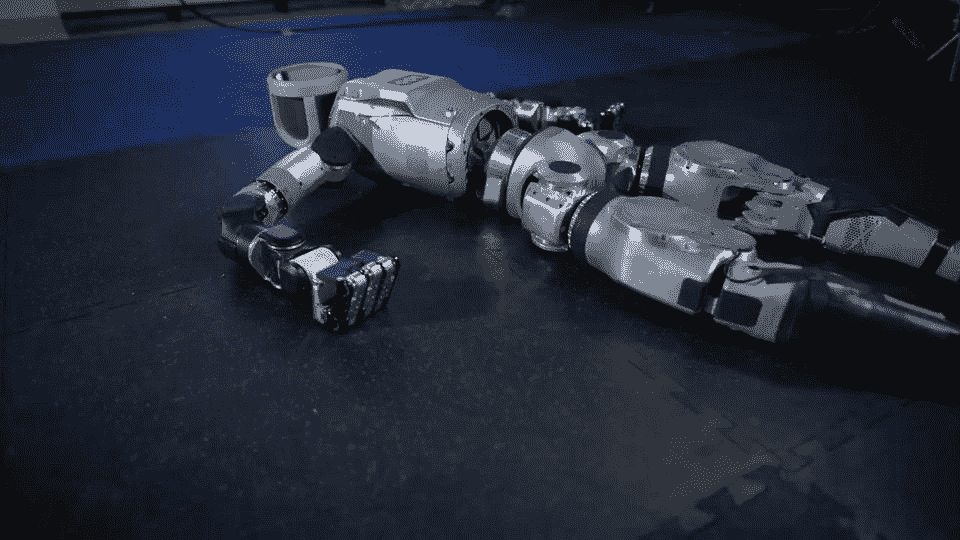

[ssstwitter.com_1713364123031.mp4](https://internal-api-drive-stream.feishu.cn/space/api/box/stream/download/all/Oa8VbX6fBo0pLgx6LNZcVfJKncd)

### Stable Diffusion 3和 Stable Diffusion 3 Turbo API 发布

贡献人：

https://x.com/StabilityAI/status/1780599024707596508

今天,我们很高兴地宣布 Stable Diffusion 3 和 Stable Diffusion 3 Turbo 在 Stability AI 开发者平台 API 上的可用性。

我们与市场上最快、最可靠的 API 平台 @FireworksAI_HQ 合作,提供这些模型。

为了履行我们对开放生成式 AI 的承诺,我们的目标是在不久的将来通过 Stability AI 会员资格提供模型权重供自托管使用。

你可以从这里开始并了解更多:https://bit.ly/3W43FjY

提示:在山顶上的一位巫师的精彩艺术作品,他正在用魔法创造大字"Stable Diffusion 3 API",魔法文字,在黎明,日出时分。

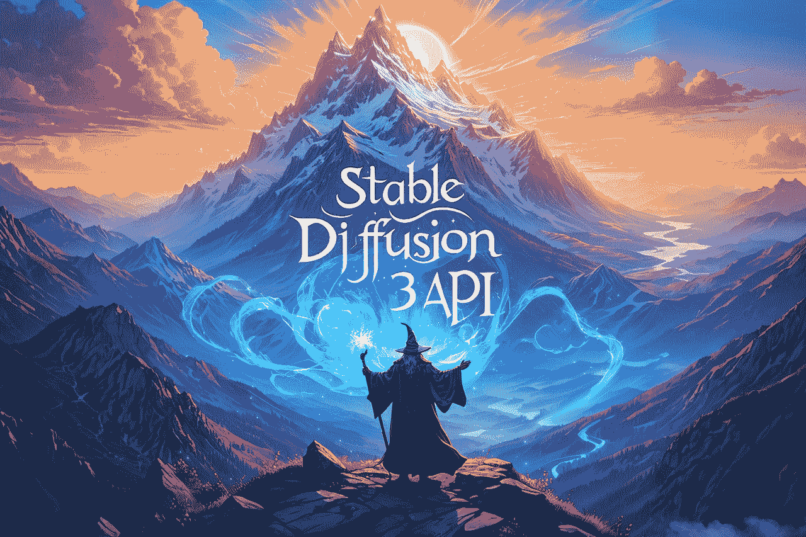

### Mixtral 8x22B 模型发布：SMoE模型，只使用39B 活跃参数，成本效益更佳

贡献人：

https://x.com/MistralAILabs/status/1780606904273702932

除了发布我们的 Mixtral 8x22B 模型,我们还发布了我们的分词器,它们不仅仅是通常的文本到令牌的转换,还增加了对工具和结构化对话的解析。

仓库:https://github.com/mistralai/mistral-common

指南:https://t.co/gnfEz1PYFj

Mixtral 8x22B 是我们最新的开放模型。它在AI社区内为性能和效率设立了新标准。它是一个稀疏的专家混合(SMoE)模型,在 141B 参数中只使用了 39B 的活跃参数,以其规模提供了无与伦比的成本效益。

Mixtral 8x22B 具有以下优势:

它精通英语、法语、意大利语、德语和西班牙语

它具有强大的数学和编程能力

它原生支持函数调用;再加上在 la Plateforme 上实现的约束输出模式,这使得大规模应用程序开发和技术堆栈现代化成为可能

其 64K tokens 的上下文窗口允许从大型文档中精确回忆信息

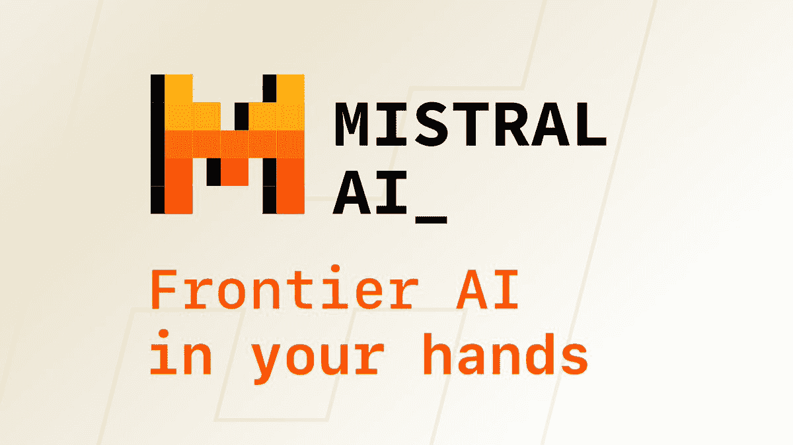

### 微软研究院公布 VASA-1：只需一张肖像照片和语音音频，生成精妙面部视频

贡献人：

https://x.com/bindureddy/status/1780737428715950460

第一个看起来超级真实的 AI 生成视频

微软研究院公布了 VASA-1。

它只需一张肖像照片和语音音频,就能实时生成一段超逼真的会说话的面部视频,具有精准的唇音同步、栩栩如生的面部行为和自然的头部动作。

考虑到 AI 生成的视频看起来非常真实,这真是令人惊叹!

当然,这些例子可能是精心挑选的,但仍然令人惊叹。

我最喜欢这项技术的用例是利用它在新电影中复活像 Cary Grant 这样的老演员 :)

[ssstwitter.com_1713398708907.mp4](https://internal-api-drive-stream.feishu.cn/space/api/box/stream/download/all/AeTGbNzMYo8hJOxX47mcy47InTd)

### Lingo-2穿越伦敦市中心视频：在道路上导航并讲述其旅程

贡献人：

https://x.com/wayve_ai/status/1780507048884531548

见识一下 Lingo-2,这是一个突破性的 AI 模型,能够在道路上导航并讲述其旅程。观看这段从 LINGO-2 驾车穿越伦敦市中心拍摄的视频。同一个深度学习模型生成实时驾驶评论并驾驶汽车。

[ssstwitter.com_1713427739801.mp4](https://internal-api-drive-stream.feishu.cn/space/api/box/stream/download/all/QIbUbqr5goy2VcxMUiQcWcSfnDf)

### Chris分享使用Gazelle生成的500 毫秒延迟超快AI语音聊天

贡献人：

https://x.com/hingeloss/status/1780718391461925049

介绍一下:全球最快的 AI 语音聊天--500 毫秒延迟,在本地运行,比其他任何人都快 2 倍。

这个演示使用了 Gazelle,这是世界上第一个具有直接音频输入的公共语言模型(LLM)。通过跳过转录解码,我们节省了时间,可以直接对语音进行操作--包括语调、语气、情感等。

之后,就是常规的优化工作--我们的实现非常接近甚至达到了多模态语言模型推理的最新水平,接近理论最大值。使用 H100,我们预计这种体验会小于 300 毫秒--低于人类反应时间!

我建立并研究了万亿级规模的基础设施。性能的首要经验总是先减少差异--更简单、组件更少的架构总是会胜出。ASR-LLM-TTS 级联系统永远不会成为可行的解决方案。

显然,这个特定的模型训练不足,还有很大的改进空间,但我非常确信这就是语音AI的未来。如果拥有真正实时且富有同理心的聊天,你会用它做什么?

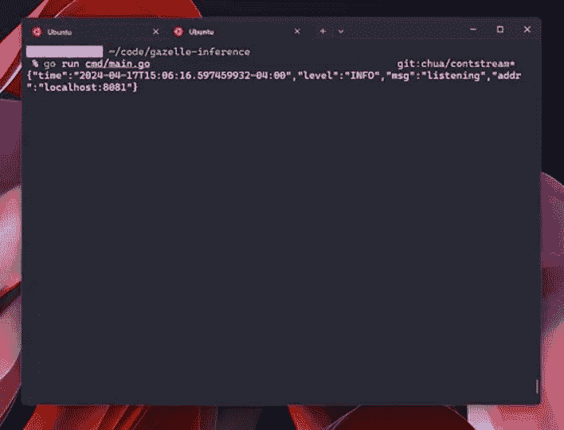

[ssstwitter.com_1713427797430.mp4](https://internal-api-drive-stream.feishu.cn/space/api/box/stream/download/all/O7NFbpp2oorE5jxHgmeca41IneA)

### OpenAI Assistants API更新：新的文件搜索工具，快速集成知识检索

贡献人：

https://x.com/OpenAIDevs/status/1780640119890047475

介绍一系列对 Assistants API 的更新 🧵

有了新的文件搜索工具,您可以快速集成知识检索,现在每个助手最多允许 10,000 个文件。它与我们新的向量存储对象一起工作,用于自动文件解析、分块和嵌入。

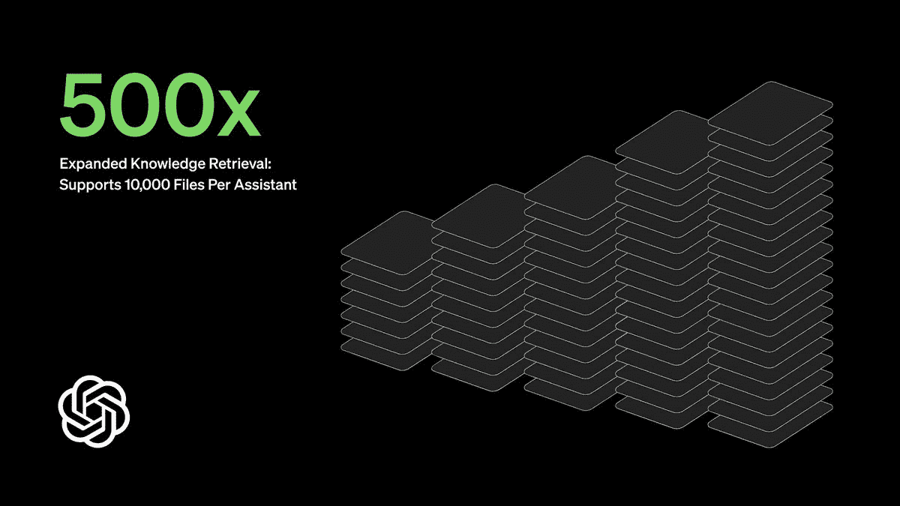

### Greg Kamradt分析OpenAI新助手RAG详细信息：默认分块重叠率为 50%，非常有趣

贡献人：

https://x.com/GregKamradt/status/1780668006705828245

关于 @OpenAI 新助手 RAG 的详细信息

慢慢进入向量存储领域

我的想法:

+   默认分块重叠率为 50%,非常有趣

+   元数据过滤,它如何涉足向量存储领域非常有趣

+   不确定他们使用的是什么分块方法--800 tokens 字符分割器?递归式?语义?

+   支持 CSV 检索,这很难!很酷

+   暗示针对问答类型(摘要)的替代方法路由

检索设置:

+   查询扩展(优化用户查询)

+   多查询(一个查询 > 多个搜索)

+   混合搜索(关键字 + 语义)

+   重新排序

很有趣看到他们在 v1 中包含了什么,以预测 gpt-5 将涵盖的内容

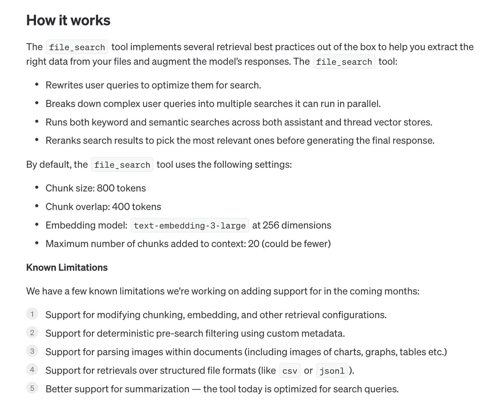

# 资讯

### Meta无限长文本大模型来了：参数仅7B，已开源

贡献人：

https://mp.weixin.qq.com/s/VML5hExo5iPsyEavxzIZSA

Transformers 的二次复杂度和弱长度外推限制了它们扩展到长序列的能力，虽然存在线性注意力和状态空间模型等次二次解决方案，但从以往的经验来看，它们在预训练效率和下游任务准确性方面表现不佳。长文本是大语言模型一直在努力的方向。近日，谷歌提出的 Infini-Transformer 引入有效方法，可以将基于 Transformer 的大型语言模型 (LLM) 扩展到无限长输入，而不增加内存和计算需求，吸引了人们的关注。几乎就在同时，Meta 也提出了一种无限长文本技术。

### 无向图最小割问题取得新突破，谷歌研究获SODA 2024最佳论文奖

贡献人：

https://mp.weixin.qq.com/s/vmGmiYS5yqJUNkHysVIO1A

1996 年， 美国计算机科学家 David R Karger 连同其他研究者在论文《 A new approach to the minimum cut problem》中提出了一个令人惊讶的随机算法 Karger 算法，其在理论计算机科学中非常重要，尤其适用于大规模图的近似最小割问题。Karger 算法可以在时间为 O (m log^3n) 的图中找到一个最小割点，他们将这个时间称之为近线性时间，意思是线性乘以一个多对数因子。在谷歌刚刚更新的一篇博客中，他们介绍了之前发布的一篇论文《 Deterministic Near-Linear Time Minimum Cut in Weighted Graphs 》，研究获得了 ACM-SIAM SODA24 最佳论文奖。文章详细阐述了一个几乎是线性时间内（而不是近线性时间）运行的新算法，这个算法是确定性的，能够可靠地找到正确的最小割，改进了之前可能无法保证结果正确或只适用于简单图的算法。可以说这是自 Karger 著名的随机化算法以来的重大发现。

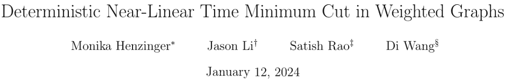

### 让玩家全程掌控游戏：自然语言指令驱动的游戏引擎到来了

贡献人：

https://mp.weixin.qq.com/s/YPPm1lcOo_Ql41Pz9TlWkA

对于每一位热爱打游戏的人而言，都曾经想过这样一个问题，「这游戏要是我来做就好了！」可惜的是，游戏开发有很高的门槛，需要专业的编程技巧。近日，来自**上海交大的团队开展了一个名为「Instr**uction-Driven **Game Engine, ID**GE」的项目，他们针对未来游戏的开发，提出了一个酷炫的新范式：利用自然语言指令开发游戏，玩家说怎么玩就怎么玩，让 UGC 贯穿于游戏的每个角落。IDGE 顾名思义，是一个指令驱动型的新概念「游戏引擎」，它能够支持用户输入对游戏规则的自然语言描述，来自动生成一个「玩家专属」的游戏。

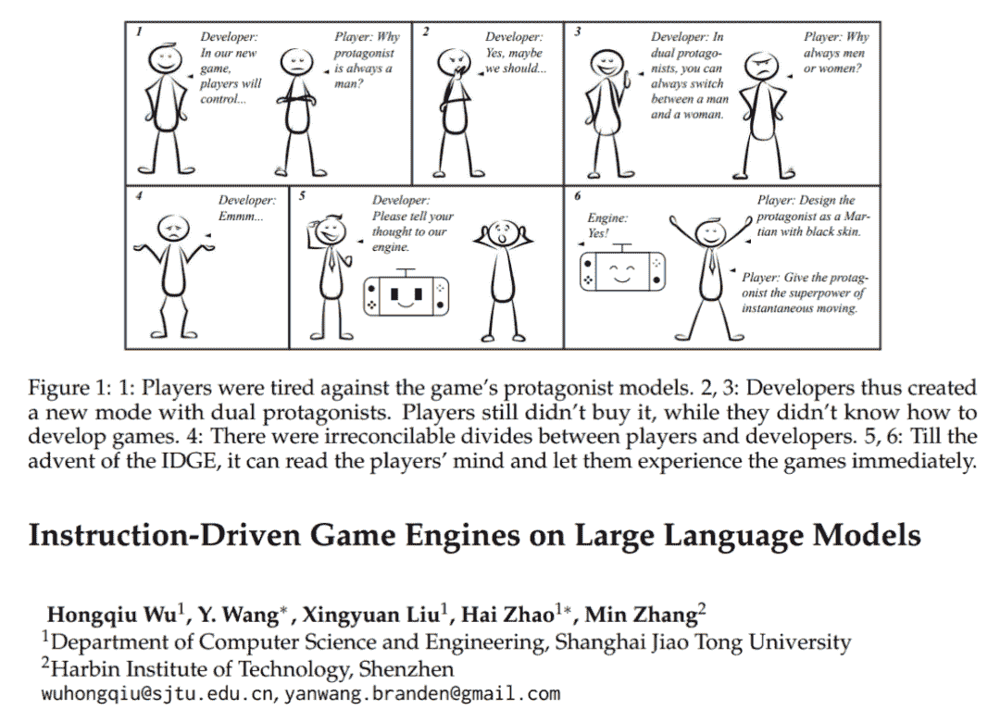

### 比人脑快20000%，内置1152颗7nm芯片，全球最大神经拟态系统诞生

贡献人：

https://www.tmtpost.com/7044204.html

美国芯片巨头英特尔（Intel）宣布，其打造出全球最大的神经拟态系统——Hala Point，旨在支持未来类脑 AI 研究，以及解决 AI 目前在效率和可持续性等方面的挑战。Hala Point内置1152个、基于Intel 4（7nm）制程的英特尔Loihi 2处理器，支持多达11.5亿个神经元和1280亿个突触，每秒可处理超过380万亿个8位突触和超过 240 万亿个神经元操作，相关系统最初部署在美国桑迪亚国家实验室。应用于仿生尖峰神经网络模型时，在运行神经元数量较低的情况下，Hala Point速度可比人脑快200倍（20000%）。

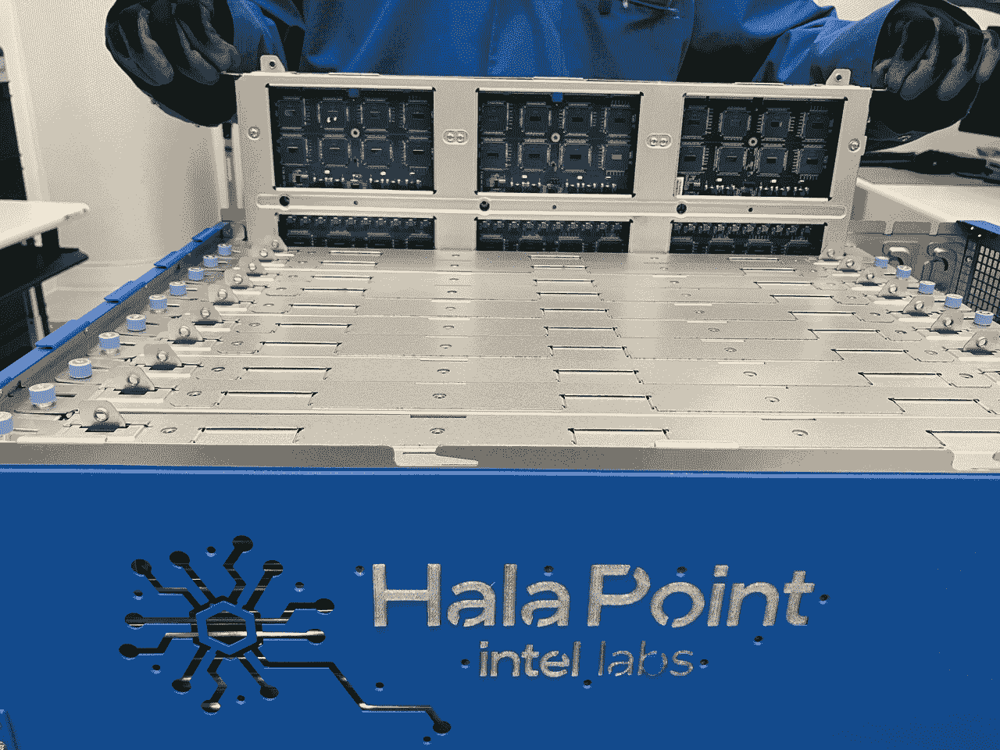

### 金融独角兽 Ramp 宣布从 Khosla、Founders Fund 及红杉筹集 1.5 亿美元用于收购 AI 初创公司

贡献人：

https://mp.weixin.qq.com/s/InIpqr-vqru8aHRaSZWFng

每家公司都代表着一个复杂的资金流入和流出网络。对于许多企业来说，管理公司的费用账户可能会被千刀万剐。例如，平均公司每年仅在 SaaS 订阅上花费34.3 万美元。管理数以万计的费用可能很平常，但它是人们必须管理的任何业务中始终存在的一部分，并且费用管理的复杂性可能会产生大量时间和金钱方面的低效成本。软件已成为管理金融服务不可或缺的一部分。在 2021 年的一项调查中，88%的美国受访者表示他们使用技术来管理财务，这比 2020 年的 58% 显着增加。同时，费用管理软件市场在 2021 年估值为60 亿美元。2022 年公司卡支出将达到1.5 万亿美元。Ramp 是一家金融科技公司，提供一套产品设计来自动化公司财务运营，包括公司卡、费用管理软件、账单支付和供应商管理。Ramp 的公司卡为企业提供无限卡、智能支出政策和支出可视性。Ramp 还提供费用管理软件，可自动收集收据和费用报告；该软件旨在通过消除手动跟踪费用的需要来帮助企业节省时间和金钱。Ramp 近期以 76.5 亿美元的估值筹集了 1.5 亿美元，这轮融资由新投资者 Khosla Ventures 和现有支持者 Founders Fund 共同领投，新投资者包括 Sequoia Capital、Greylock 和 8VC，其他现有投资者包括 Thrive Capital、General Catalyst、Sands Capital、D1 Capital、Lux Capital、Iconiq Capital、Definition Capital、Contrary Capital。

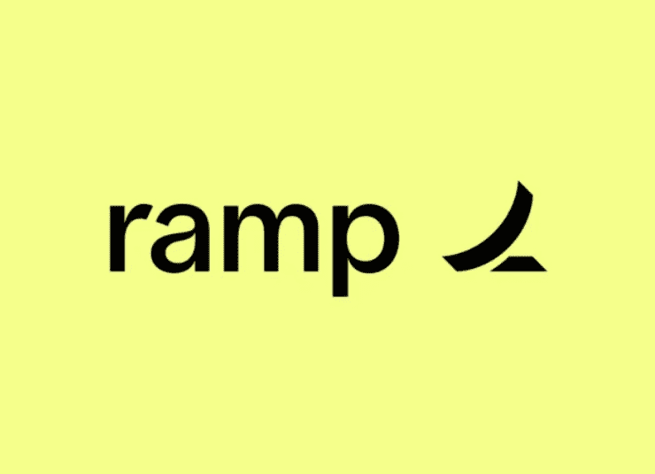

### 172个机构合作，发现奇异粒子，机器学习分析约1.6亿次粒子碰撞数据

贡献人：

https://mp.weixin.qq.com/s/JUqeXEr7mafciSV0djKPGQ

粒子物理学家的任务是挖掘大量不断增长的碰撞数据，寻找尚未发现的粒子证据。特别是，他们正在寻找未包含在粒子物理标准模型中的粒子，科学家怀疑我们目前对宇宙构成的理解是不完整的。近日，来自 ATLAS 合作组的 172 个研究机构的科学家，使用一种受大脑启发的机器学习算法——神经网络，来筛选大量粒子碰撞数据，搜索数据中的异常特征或异常现象。研究团队使用一种称为异常检测的机器学习方法来分析大量 ATLAS 数据。此前该方法从未应用于对撞机实验的数据。神经网络发现了一个异常现象。能量约为 4.8 太电子伏（TeV）的奇异粒子衰变会产生 μ 子和其他粒子射流，其方式不符合神经网络对标准模型相互作用的理解。该技术打破了寻找新物理学的传统方法。它独立于科学家的先入之见，因此不受其限制。

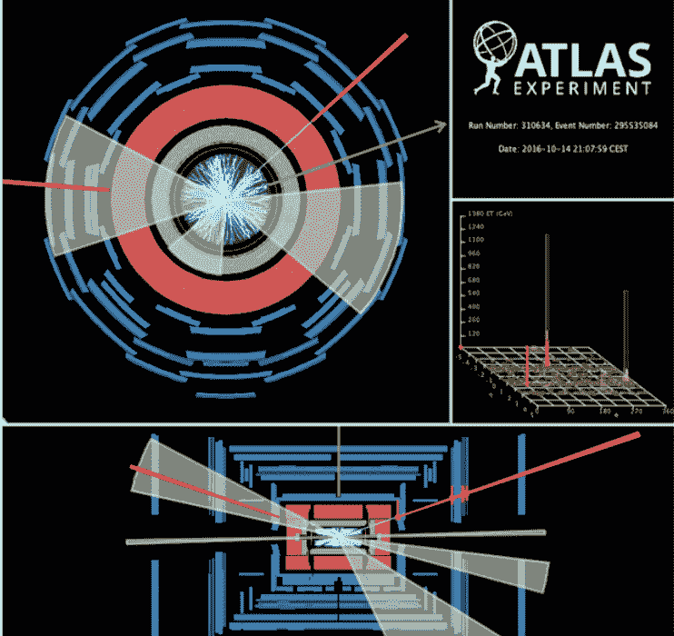

### Mobileye创始人投身机器人项目 产品沉寂两年首次曝光

贡献人：

https://www.cls.cn/detail/1650454

初创公司Mentee Robotics展示了旗下首款人形机器人的原型Menteebot，号称在所有操作层都接入了AI，是“可以被指导的”个性化AI机器人。

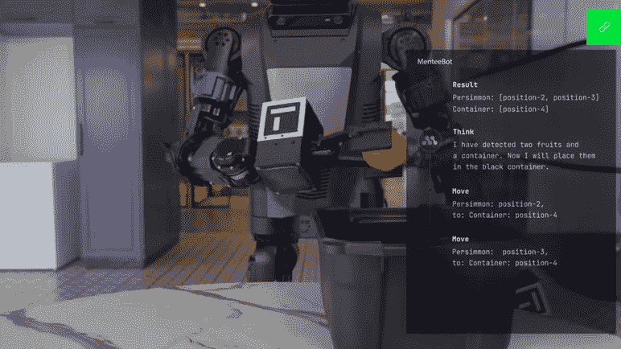

### AI芯片需求继续强劲！台积电Q1净利润一年来首次增长

贡献人：

https://wallstreetcn.com/articles/3713024

4月18日周四，台积电公布截至3月31日的2024年一季度业绩报告。财报显示，台积电一季度净利润为2255亿元台币（约合69.76亿美元），预估2149.1亿元台币，同比增长8.9%，创下一年多以来最快增速；第一季度销售额5926.4亿元台币（约合183.33亿美元），同比增长17%，预估5834.6亿元台币。第一季度营业利润2490.2亿元台币（约合77亿美元），同比增长7.7%，预估2408.7亿元台币。

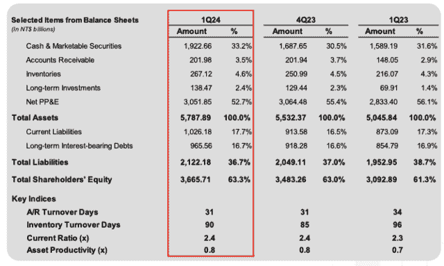

### 钉钉上线AI助理市场，200+AI助理覆盖办公、生活与娱乐场景

贡献人：

https://www.thecover.cn/news/MAMKXd9r1umH90qSdq8Jkw==

钉钉正式上线AI助理市场（AI Agent Store），首批将推出超过200个AI助理，覆盖企业服务、行业应用、效率工具、财税法务、教育学习、生活娱乐等类目，用友、携程商旅、墨见Molook等各领域SaaS企业已上架AI助理，加入钉钉AI生态。

# 论文

### 语言模型是否能解决奥林匹克编程竞赛？

贡献人：

链接：http://arxiv.org/abs/2404.10952v1

计算机奥林匹克竞赛包含一些对人类来说最具挑战性的问题，需要复杂的算法推理、解谜能力，以及编写高效代码。然而，将其作为评估语言模型（LMs）的领域一直被忽视。在本文中，我们介绍了来自美国计算机奥林匹克竞赛的307个问题，以及高质量的单元测试、参考代码和官方分析。这些资源使我们能够首次构建和测试用于竞赛编程的一系列LM推理方法。我们发现，GPT-4只通过零指导完成链条思维提示的正确率为8.7%，我们最佳的推理方法通过自我反思和检索知识的组合将其提高至20.2%。然而，这距离解决基准测试还有很大差距。为了更好地理解剩余的挑战，我们设计了一项新颖的人机互动研究，令人惊讶地发现一小部分有针对性的提示使GPT-4能够解决之前任何模型和方法都无法解决的问题。我们的基准测试、基线方法、定量结果和定性分析作为迈向具有扎实、创造性和算法推理的LMs的初步步骤。

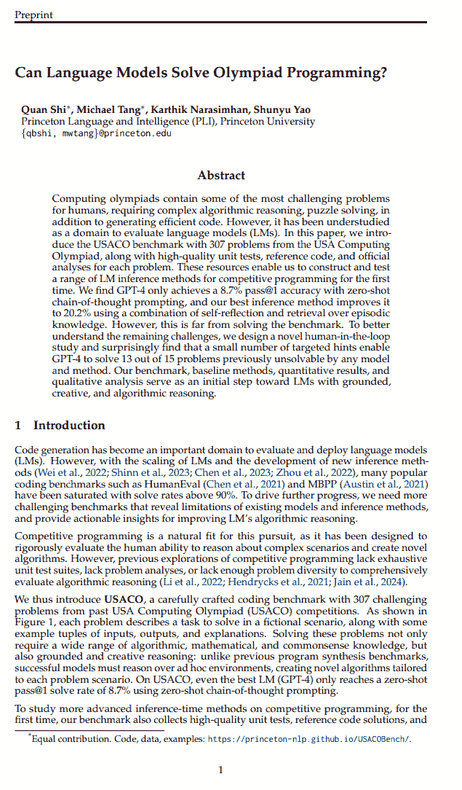

### **多 shot 上下文学习**

贡献人：

链接：http://arxiv.org/abs/2404.11018v1

大语言模型（LLMs）在少样本情境学习方面表现出色——在推理时从上下文中提供的少数示例中学习，而无需任何权重更新。新扩展的上下文窗口使我们能够研究具有数百或数千个示例的情境学习——即多样本情境学习。从少样本到多样本，我们观察到在各种生成和判别任务中取得了显著的性能提升。虽然有所希望，但多样本情境学习可能会受到人生成示例数量的限制。为了缓解这一限制，我们探索了两种新的设置：强化和无监督情境学习。强化情境学习使用模型生成的连贯理由链代替人类示例。无监督情境学习则完全删除提示中的理由，仅使用领域特定问题提示模型。我们发现，无论是强化还是无监督情境学习在多样本情境中都非常有效，特别是在复杂推理任务上。最后，我们证明，与少样本学习不同，多样本学习在覆盖预训练偏见并能够学习具有数值输入的高维函数方面非常有效。我们的分析还揭示了下一个标记预测损失作为下游情境学习性能指标的局限性。

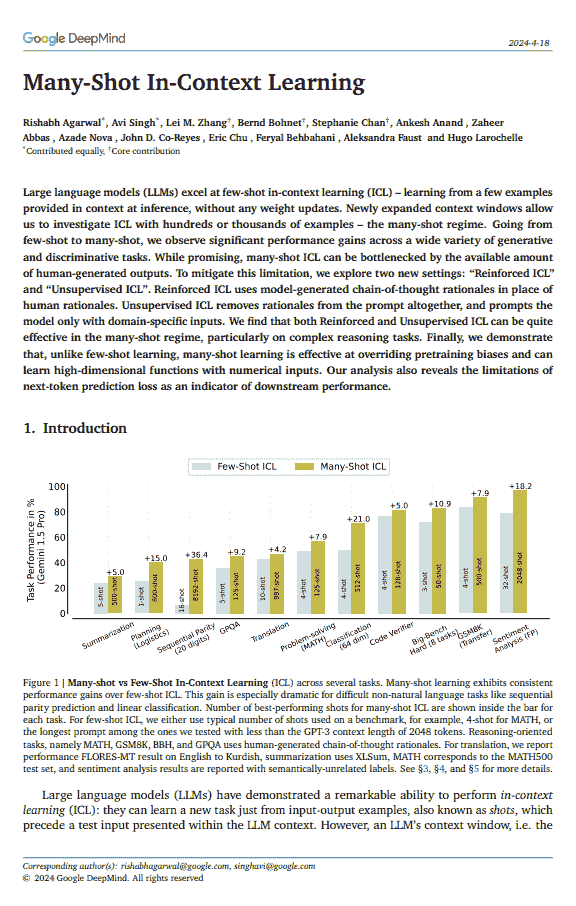

### 长序列建模：基于结构化记忆的矢量量化

贡献人：

链接：http://arxiv.org/abs/2404.11163v1

摘要：Transformer 模型在各种序列处理任务中取得了成功，但自注意机制的计算成本限制了其在长序列上的实用性。尽管存在改善计算效率的注意力变体，但基于手工混合策略的全局信息抽象能力有限。因此，将它们作为统一的 token 混合器的趋势并结合局部详细信息的状态空间模型（SSMs）是最近长序列模型的发展方向。在此基础上，我们提出了一种名为 LongVQ 的新方法。LongVQ 使用矢量量化（VQ）技术将全局抽象压缩为固定长度的码本，从而实现了注意力矩阵的线性时间计算。这种技术有效地保持了动态全局和局部模式，有助于弥补长距离依赖问题的不足。我们在 Long Range Arena 基准、自回归语言建模以及图像和语音分类方面的实验表明了 LongVQ 的有效性。我们的模型在其他序列模型上取得了显著的改进，包括 Transformer 的变体、卷积和最近的状态空间模型。

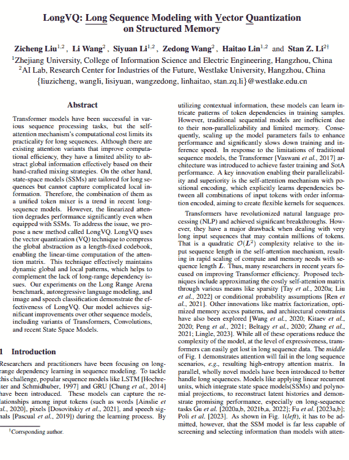

### **更少的截断能提高语言建模**

贡献人：

链接：http://arxiv.org/abs/2404.10830v1

在大型语言模型训练中，输入文档通常被连接在一起，然后分割为相同长度的序列，以避免填充标记。尽管这种方法效率高，但连接方法却损害了数据完整性--它不可避免地将许多文档分割成不完整的片段，导致过多的截断，阻碍模型学习组成逻辑连贯且基于完整背景的事实一致内容。为了解决这个问题，我们提出了一种可扩展且高效的方法Best-fit Packing，通过长短识别的组合优化将文档打包成训练序列。我们的方法完全消除了不必要的截断，同时保留了与连接相同的训练效率。文本和代码预训练的实证结果表明，我们的方法取得了更优异的性能 （例如，阅读理解相对提高了+4.7%; 背景跟随提高了+16.8%; 程序合成提高了+9.2%），并有效地将封闭域幻觉减少了高达58.3%。

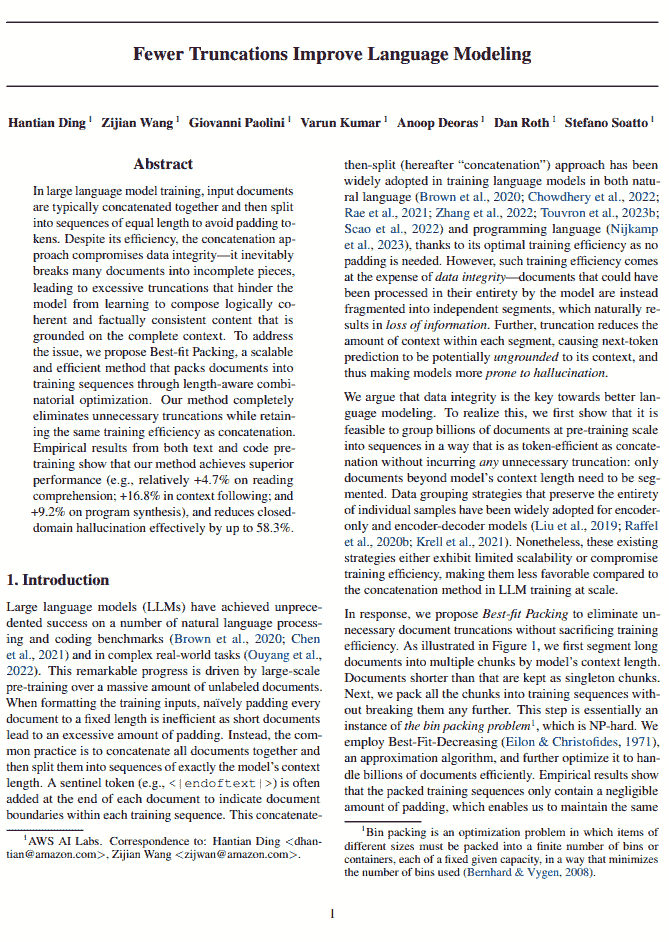

### 面向企业微调大语言模型：实用指南和建议

贡献人：

链接：http://arxiv.org/abs/2404.10779v1

企业对微调LLM（大语言模型）以便让它们训练专有领域知识存在迫切需求。挑战在于如何在最优资源和成本以及最短时间内，将领域特定知识灌输到LLMs中。许多企业依赖于RAG（检索增强生成），它不需要LLMs进行微调，但受到向量数据库质量和检索能力的限制，而不是LLMs本身固有的能力。在我们目前的工作中，我们专注于使用专有文件和代码从企业存储库微调LLaMA，一个开源LLM，并使用微调模型评估响应质量。作为这项工作的一部分，我们旨在指导初学者如何开始微调LLM，以用于文档和代码，通过对所需GPU大小和可用的数据格式选项做出合理猜测。我们还提出了文档和代码的预处理配方，以准备不同格式的数据集。对于文档数据集，我们建议形成段落块、形成问题和答案对以及形成关键字和段落块对。对于代码数据集，我们建议形成摘要和函数对。此外，我们对模型针对特定领域查询的结果进行定性评估。最后，我们还提出了微调LLM的实用指南和建议。

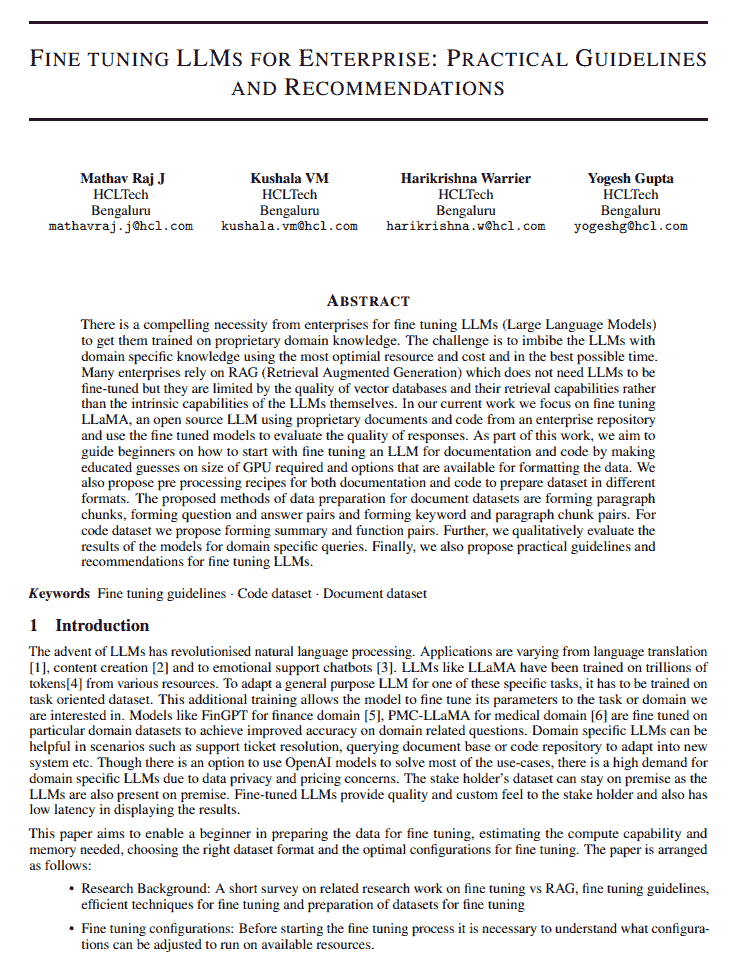

### 视频生成为游戏：从单一视频中生成实时、交互式、逼真且与浏览器兼容的环境

贡献人：

链接：http://arxiv.org/abs/2404.09833v1

本文提出了一种名为Video2Game的新方法，可以自动将现实世界场景的视频转换为逼真且可交互的游戏环境。该系统的核心包括三个主要组件：（i）一个神经辐射场（NeRF）模块，有效捕捉场景的几何形状和视觉外观；（ii）一个网格模块，从NeRF中提取知识以加快渲染速度；以及（iii）一个模拟物理模块，对物体之间的交互和物理动态进行建模。通过精心设计的流程，可以构建出可交互且可操作的现实世界数字副本。我们在室内和大型室外场景上对系统进行了基准测试。我们展示了我们不仅可以实时生成高度逼真的渲染，还可以构建交互式游戏。

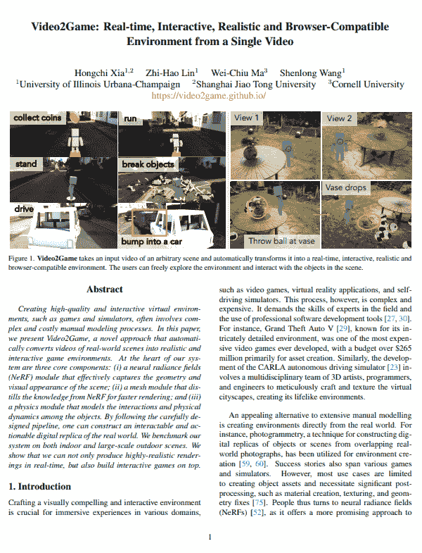

# 产品

### **SpeedLegal**

贡献人：

https://speedlegal.io/

SpeedLegal 是一个由 AI 驱动的法律助手，帮助银行在几分钟内理解合同。它可以帮助用户以三倍速度审阅合同，立即识别潜在风险，并以信心更好地协商条款，从而节省数千美元的法律费用。SpeedLegal 还适用于各种规模的初创企业、忙碌的专业人士以及任何希望在没有法学学位的情况下理解合同的人群。

### Collato AI Notetaker

贡献人：

https://collato.com/

AI Notetaker 是 Collato 公司推出的一款 AI 工具，帮助用户在会议中轻松记录笔记。用户可以通过邀请 ally@collato.com 参加会议，AI Notetaker 将自动录制视频并生成会议记录，用户还可以通过添加或上传补充笔记、截图或手写笔记来完善会议记录。此外，用户还可以通过选择模板将记录转化为专业格式的文档。

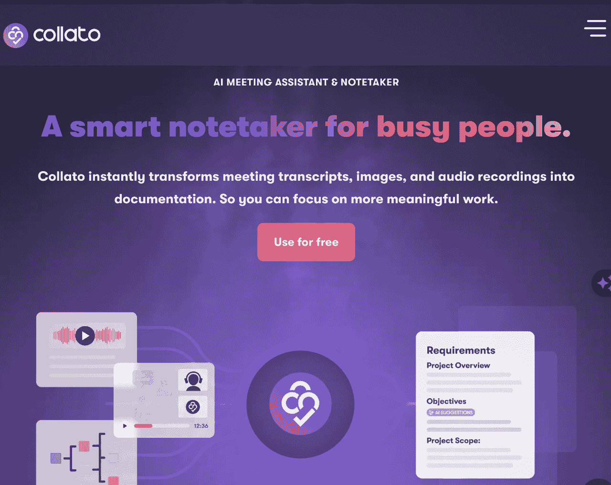

# HuggingFace&Github

### **Dllama **

贡献人：

https://github.com/tinyBigGAMES/Dllama

Dllama 是一个简单易用的库，用于直接从 Delphi 进行LLM推理。它可以将格式化的 GGUF 加载LLMs到 CPU 或 GPU 内存中，使用CUDA后端进行加速。

### CSGHub

贡献人：

https://github.com/OpenCSGs/CSGHub

CSGHub是一个开源、可信的大模型资产管理平台，可帮助用户治理LLM和LLM应用生命周期中涉及到的资产（数据集、模型文件、代码等）。CSGHub提供类似私有化的Huggingface功能，以类似OpenStack Glance管理虚拟机镜像、Harbor管理容器镜像以及Sonatype Nexus管理制品的方式，实现对LLM资产的管理。

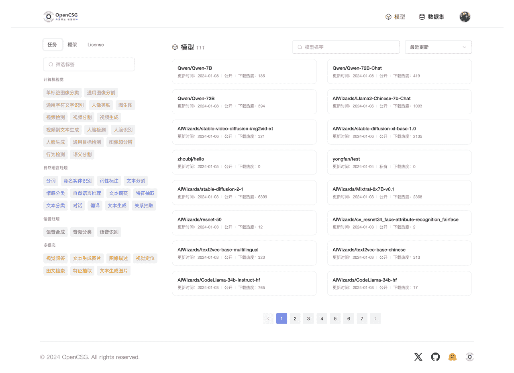

### Risu

贡献人：

https://github.com/kwaroran/RisuAI

RisuAI，是一款跨平台的 AI 聊天软件/Web 应用程序。让用户制作自己的故事，用于实现 AI 角色扮演的软件。

# 投融资

###  FPGA芯片公司「芯璐科技」完成3000万种子轮融资

贡献人:

https://news.pedaily.cn/202306/514885.shtml

芯璐科技，一家专注于FPGA芯片的公司，宣布完成3000万人民币的种子轮融资，由成为资本领投。此轮融资将用于FPGA架构验证流片。公司自研的ArkAngel开发引擎和EDA软件工具，采用数字化设计流程，提高产品市场进入速度，降低成本。目前，芯璐科技已连续打破FPGA行业流片速度记录，且已启动新一轮上亿元人民币的融资计划。

公司官网：https://rapidflex.cn/

### Microchip Technology 收购 Neuronix AI Labs

贡献人：

https://finance.yahoo.com/news/microchip-technology-acquires-neuronix-ai-120200243.html

Microchip Technology 宣布收购 Neuronix AI Labs，以扩大其在FPGA领域部署的节能、AI驱动的边缘解决方案的能力。此次收购将加强Microchip在低功耗FPGA和SoC上的功率效率，提高其在智能边缘系统中使用AI/ML算法的性能。Neuronix AI Labs 提供的神经网络稀疏优化技术，能够在保持高精度的同时，减少功率、尺寸和计算需求。这一技术与Microchip现有的软件设计套件相结合，允许在FPGA上实现AI/ML算法，无需深入了解FPGA设计流程。

公司官网：https://www.neuronix.ai/

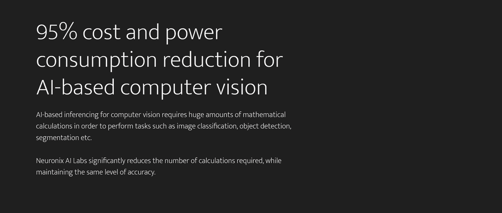

### NeuBird 开发针对复杂云原生环境的生成式AI解决方案

贡献人：

https://techcrunch.com/2024/04/17/neubird-generative-ai-solution-for-complex-cloud-environments-raises-22-million/

NeuBird，一家初创公司，专注于生成式AI解决方案，旨在帮助工程师更快解决复杂云环境中的问题。公司由Goutham Rao和Vinod Jayaraman创立，这两位创始人此前创办的Portworx被PureStorage以3.7亿美元收购。NeuBird最近宣布获得Mayfield的2200万美元投资，用于将其产品推向市场。这笔资金将帮助公司开发数字助理，协助SRE和IT运维工程师快速诊断和解决问题，从而将事件响应时间从小时缩短到分钟。

公司官网：https://neubird.ai/

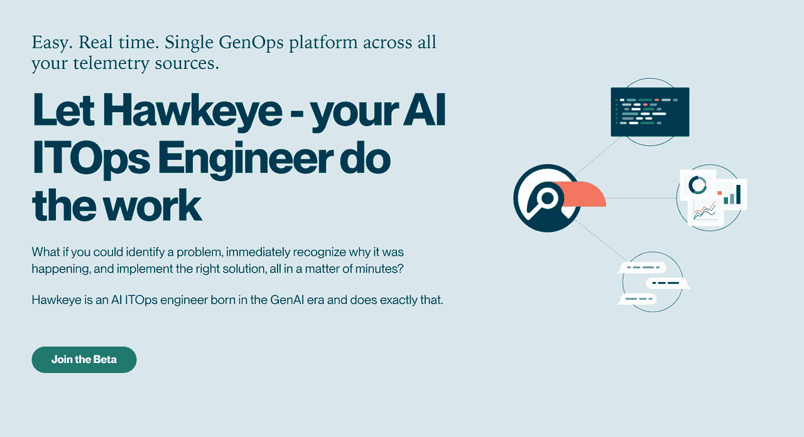

### Mobileye创始人推出新型人形机器人

贡献人：

https://techcrunch.com/2024/04/17/a-humanoid-robot-is-on-its-way-from-mobileye-founder/

由Mobileye创始人Amnon Shashua共同创办的Mentee Robotics，近期展示了其人形机器人Menteebot的原型。该公司成立于2022年末，目前已经获得了由Ahren Innovation Capital领投的1700万美元投资。Menteebot设计用于执行家庭和工业任务，利用大型语言模型（LLM）解读命令并规划完成任务的步骤。Mentee Robotics计划在2025年初推出生产就绪的原型。

公司官网：https://www.menteebot.com/

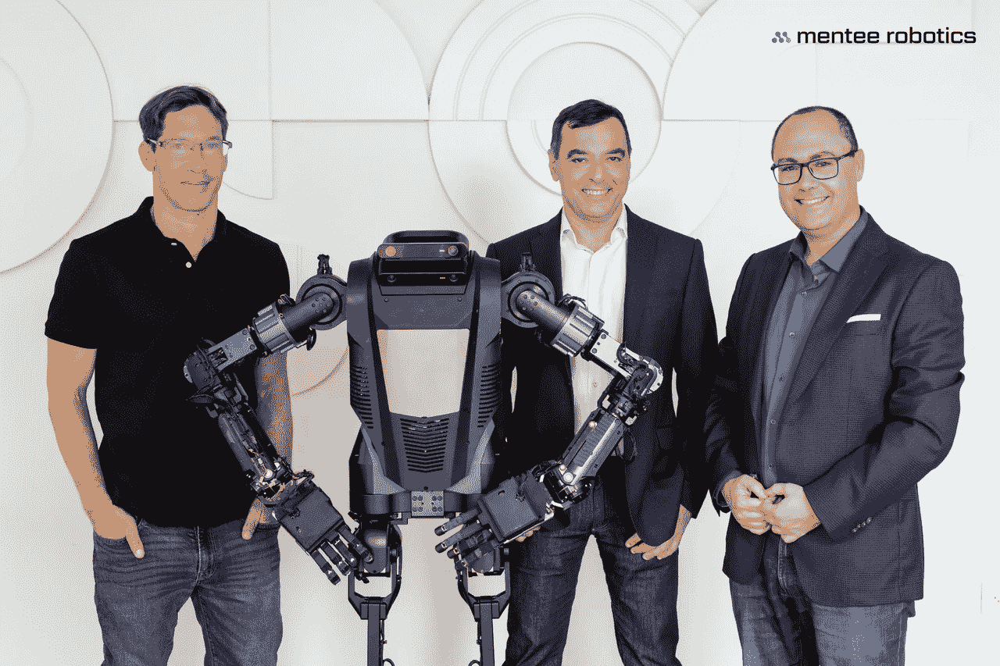

# 学习

### DSPy 入门： 再见提示，你好编程

贡献人：

https://zhuanlan.zhihu.com/p/685171231?utm_psn=1764326921197146112

文章介绍了DSPy框架，一个基于Python的声明式自我改进语言程序设计框架，旨在通过编程而非简单的提示来构建基于语言模型的应用。DSPy消除了因组件变更而重新进行繁琐的提示工程的需求。它通过自动优化语言模型的调用，使得应用更加健壮。DSPy引入了“签名”概念来抽象化提示和微调，通过模块化设计来替代传统的提示技术，并通过编译器和提词器实现流水线的自动优化。此框架允许用户集中精力于定义程序逻辑和验证，而非频繁调整提示。

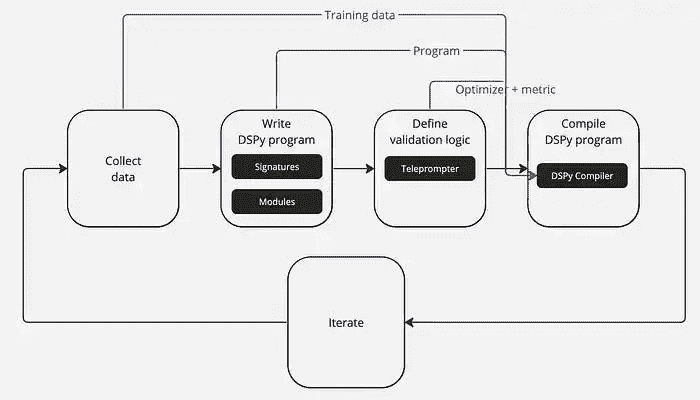

### **I**nfini-mini-transformer: 对谷歌最新提出的Infini-transformer模型进行代码复现（含小规模的预训练过程）

贡献人：

https://zhuanlan.zhihu.com/p/692848185

文章介绍了对谷歌提出的Infini-transformer模型的复现和训练细节。该模型采用分片方法处理输入，利用记忆力机制在各个切片之间传递信息，模拟人类记忆过程。作者对模型的主要组成部分进行了技术解读，包括记忆检索输出、记忆更新，并通过门机制在当前切片的输出中融合注意力和记忆输出。此外，文中也提到了训练中的挑战，如训练速度慢、显存利用率低等问题，并考虑未来使用flash_attention优化训练过程。

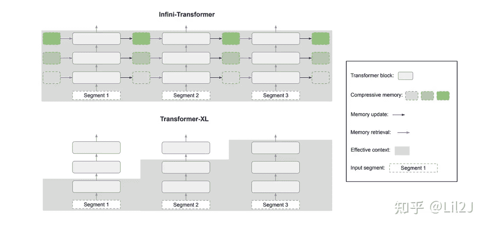

### 一文看懂Score-based模型的基本原理（一）

贡献人：

https://zhuanlan.zhihu.com/p/692665153?utm_psn=1763843449424576512

文章详细介绍了Score-based模型的核心概念和技术细节，突出其在生成模型领域的应用。模型的目的是拟合数据分布并从中采样生成新的图像。通过定义概率密度函数和最大化数据的对数似然，文章讨论了如何优化模型参数。特别强调了Score function的作用，以及如何通过Score-matching和Langevin Dynamics Sampling来预测和生成数据点。此外，还探讨了噪声条件下的Score预测和退化分布的问题，提出了使用多强度噪音进行模型训练的策略，以提高模型的预测精度和适应性。

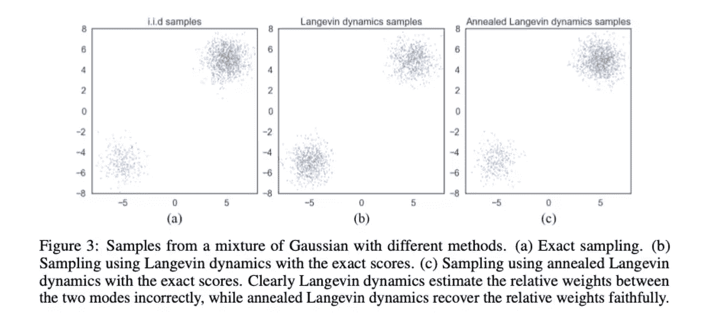

### 不受窗口长度限制的长文本生成全新思路：利用模型参数储存上文信息

贡献人：

https://zhuanlan.zhihu.com/p/679713147?utm_psn=1763631537822765056

研究提出一种全新方法以支持无限长文本生成，主要通过将上文信息储存在模型参数中，而非传统的KV cache。此方法使用一个临时的Lora模块（Temp-Lora）来存储历史信息，该模块在推理过程中不断通过模型生成的token进行训练，并在推理结束后被丢弃，避免对模型参数造成永久性影响。此框架显著降低了计算开销，无论上下文长度如何，生成一个token所需的浮点运算数和推理延时保持不变。此方法在小说补全和翻译任务中均显示出显著效果，大幅度提升了模型的性能。

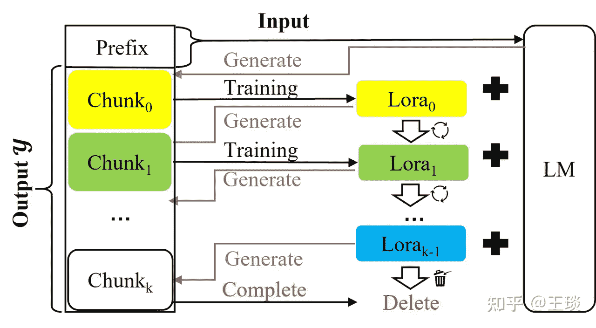

### 基于unsloth框架完成7B规模模型SFT微调训练(10GB显存占用)

贡献人：

https://zhuanlan.zhihu.com/p/689918127?utm_psn=1763630933532807168

本文探讨了使用unsloth框架在单机单卡环境下完成7B规模模型的SFT微调训练。利用unsloth框架和Triton库优化，实现了在RTX A6000 48GB显卡上的高效训练，峰值显存仅为10.342 GB。文章详细描述了模型的设置，包括最大token长度8192、使用4bit量化减少显存占用等技术细节。此外，还介绍了如何通过设置dtype和其他参数来适应不同的硬件架构。整个微调过程展示了在保持性能的同时，如何有效控制资源使用。

### 深度生成模型课程

贡献人：

https://kuleshov-group.github.io/dgm-website/

这是一个关于深度生成模型的开放课程网站，内容涵盖了生成模型的概率基础、学习算法以及流行的模型系列，如变分自编码器（VAEs）、生成对抗网络（GANs）、自回归模型、规范化流和扩散模型等。课程还介绍了这些模型在计算机视觉、自然语言处理和生物医药等领域的应用，并探讨了它们与强化学习领域的联系。

### 接受LLM非确定性

贡献人：

https://barryzhang.substack.com/p/making-peace-with-llm-non-determinism

本文探讨了大型语言模型（LLM）中的非确定性问题，并试图从技术角度解释其原因。非确定性的主要来源之一是采样过程的随机性，尽管通过种子（seeding）可以实现“相同输入，相同输出”。然而，作者在使用具有混合专家（MoE）架构的GPT-4时发现，即使进行了种子设置，结果仍然显示出非确定性。这是因为在批处理推断中，输入序列的路由依赖于其在批次中的位置及其他序列，因此只有在相似的批次中才能体现出确定性。此外，硬件层面的非确定性也是一个问题，如GPU在执行浮点运算时因性能优化而无法保证运算的顺序一致性。最后，作者指出语言本身的高度歧义性和复杂性也为LLM的输出增加了随机性。尽管如此，适当的模型和参数调整可以在一定程度上减少这种非确定性。

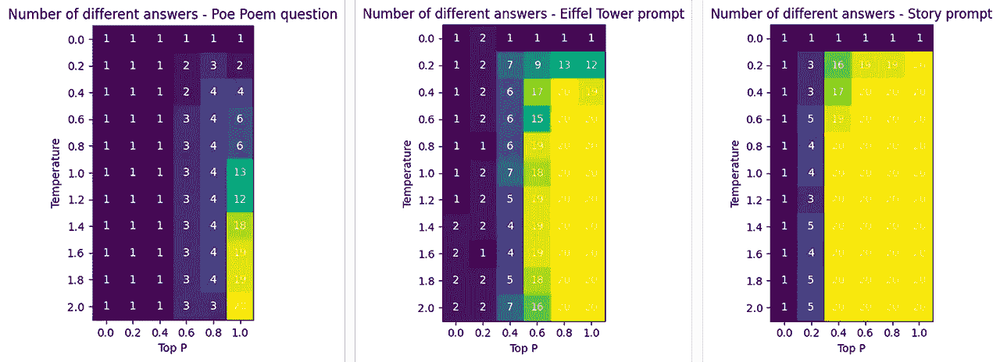

# 声明

本文档仅供学习交流使用，版权归原作者所有，若涉侵权，请联系Jack Jin 15101136166

##

（欢迎在下方反馈您宝贵的意见！整理不易，觉得有用给AI日报小组点个赞👍吧！）

ChatGPT；Angela；Zijia Liu；Alex；Zeqi Tan；Tiezhen（HuggingFace）；Naixu；Lizhi；Peter；Suoman；Jack

封面生成——右脑科技

如果你有大模型相关的创业想法，欢迎来找我们聊聊～🛰️：15101136166

> 快邀请你的小伙伴们一起来读大模型日报吧！

> **【日报****知识库****】**这里是近期日报内容的汇总,欢迎大家查阅

> [大模型日报知识库(分享版)](https://miracleplus.feishu.cn/wiki/KapVwXfkriOBiskB0B2cUHxjnTh)

>

> 欢迎大家多多帮我们分享,转发~~

> 如果大家有任何的建议或者吐槽,欢迎随时找我聊天~

