# 奇绩大模型日报（4月 17日）

> 来源：[https://miracleplus.feishu.cn/docx/EfyYdGgoTopO1xx65bycXDMxnRd](https://miracleplus.feishu.cn/docx/EfyYdGgoTopO1xx65bycXDMxnRd)

## 推特

### 谷歌DeepMind ALOHA Unleashed 一镜到底：通过低成本机器人和AI挑战灵巧性的极限

贡献人：

https://x.com/tonyzzhao/status/1780263497584230432

介绍ALOHA Unleashed - 通过低成本机器人和AI挑战灵巧性的极限。

@GoogleDeepMind

经过几个月的等待,终于可以分享一些视频了。机器人是完全自主的,并且是一镜到底拍摄的。尽情享受吧!

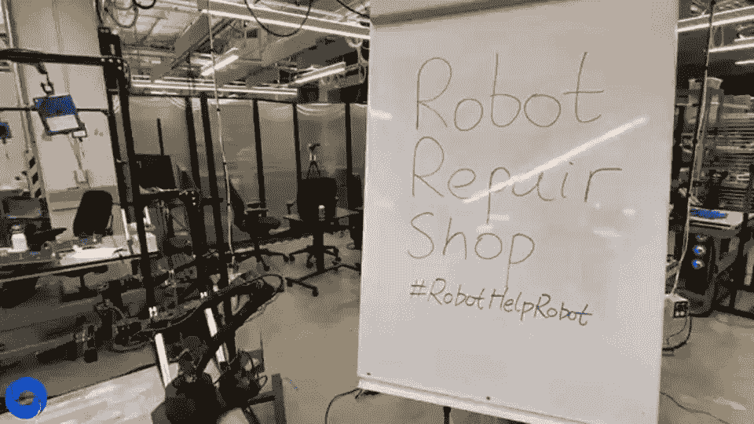

[ssstwitter.com_1713285024186.mp4](https://internal-api-drive-stream.feishu.cn/space/api/box/stream/download/all/AmenbX40XonyuSxlsevcb2dbnYf)

### Snowflake开源snowflake-arctic-embed：一系列强大的嵌入模型

贡献人：

https://x.com/osanseviero/status/1780238572374655298

Snowflake刚刚开源了snowflake-arctic-embed:一系列强大的嵌入模型

+   2200万到3.35亿参数

+   384-1024嵌入维度

+   50-56 MTEB分数(在同等规模下属于SOTA)

这个组织看起来不错 https://huggingface.co/Snowflake

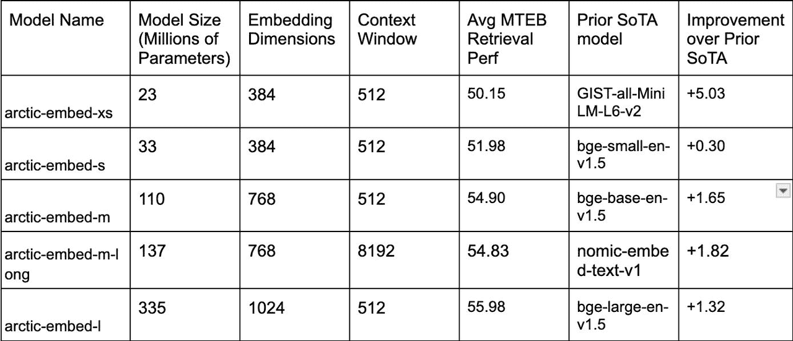

### 由Antonio Torralba和Bill Freeman合著的《计算机视觉基础》发布

贡献人：

https://x.com/phillip_isola/status/1780349596184535447

我们的计算机视觉教材发布了!由Antonio Torralba和Bill Freeman合著的《计算机视觉基础》https://mitpress.mit.edu/9780262048972/foundations-of-computer-vision/…这本书酝酿了超过10年之久。涵盖了从线性滤波器和相机光学到扩散模型和辐射场的所有内容。对我来说,最有趣的部分之一是制作可视化。作为示例,这里有几个,展示了1)MLP中逐层的嵌入,2)CNN中的权重共享,3)扩散模型,4)图像字幕系统

在写这本书的过程中,这个领域发生了很大的变化。这是我们的进展图。(我在中途加入,我的第一个贡献是放慢速度...)但是试图将新旧概念联系起来很有趣。在每个时代,许多概念都会重现,形成螺旋式进步。

感谢所有为这本书提供帮助的人!如果你发现错误和需要更正的地方,请告诉我们。未来会有更多的内容在线上提供。

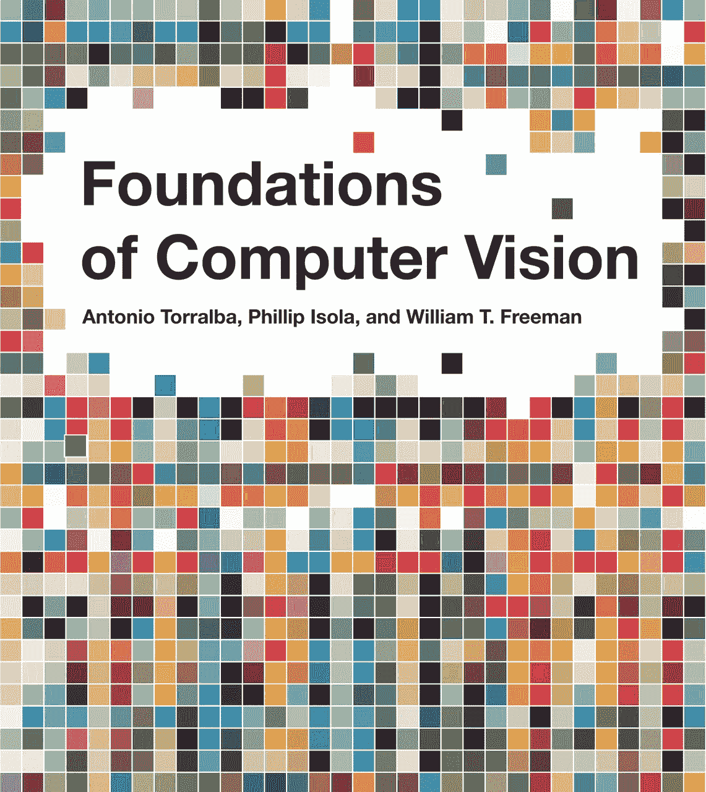

### Thomas Wolf分享低成本的DJI机器人，3个本地开源AI模型控制

贡献人：

https://x.com/Thom_Wolf/status/1780241959036047604

是时候迎来开源AI机器人革命了!

我们一直在玩一个低成本的DJI机器人,它由3个本地开源AI模型(Whisper、Idefics2、Parler-TTS - 都是Apache2)控制,并由Dora-cs编排。

在评论中有一个250行代码的要点(gist),可以在此基础上进行构建 => 尽情享受吧!!

[ssstwitter.com_1713339269829.mp4](https://internal-api-drive-stream.feishu.cn/space/api/box/stream/download/all/LHz7bE3nboZVGGx7MJicVTcsnQb)

### CodeQwen1.5-7B和CodeQwen1.5-7B-Chat发布：开放和多功能的代码助手

贡献人：

https://x.com/huybery/status/1780264890298720570

你想要一个开放和多功能的代码助手吗?今天,我们很高兴向大家介绍CodeQwen1.5-7B和CodeQwen1.5-7B-Chat,它们是基于Qwen1.5语言模型构建的专门代码LLM!CodeQwen1.5已经使用3T代码相关数据进行了预训练,在代码生成、长上下文建模(64K)、代码编辑和SQL方面表现出色。此外,在SWE-Bench竞赛中,传统上由专有模型主导。然而,CodeQwen1.5以0.89的分数超过了ChatGPT-3.5,凸显了开源代码LLM的巨大潜力。

https://qwenlm.github.io/blog/codeqwen1.5…

https://hf.co/spaces/Qwen/CodeQwen1.5-7b-Chat-demo…

https://hf.co/Qwen/CodeQwen1.5-7B…

https://hf.co/Qwen/CodeQwen1.5-7B-Chat…

https://github.com/QwenLM/CodeQwen1.5

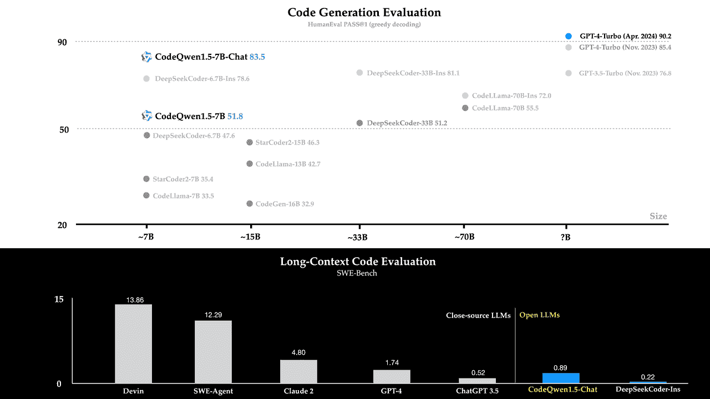

### Claude 3 Opus现已在Amazon Bedrock上全面上线

贡献人：

https://x.com/AnthropicAI/status/1780269789661065453

我们最强大的模型Claude 3 Opus现已在Amazon Bedrock上全面上线。

与Sonnet和Haiku一起,Opus为企业提供卓越的智能、流畅性和推理能力。

立即开始使用:https://aws.amazon.com/bedrock/claude/

[ssstwitter.com_1713339454725.mp4](https://internal-api-drive-stream.feishu.cn/space/api/box/stream/download/all/Zv5qbm8ktotYVbx37nxcCU7XnkT)

### Ross Taylor离开Meta：开拓数据新领域,深度学习大有可为

贡献人：

https://x.com/rosstaylor90/status/1780185987340980277

我昨天离开了Meta。我只能说些积极的事情:FAIR和GenAI是进行研究和工程的好地方。我会想念我的同事们!

LLM展示了深度学习在数据丰富的环境下可以多么神奇。但许多领域仍然受到数据的限制,这阻碍了性能随着计算的扩展而平滑地提高。

我们最终落脚于LLM绝非偶然。互联网为自监督学习的有效运作创造了肥沃的土壤。更大的挑战是在数据稀缺、信号低且生产成本高昂的地方复制这种魔力。

我们谈论"痛苦的教训",好像这是当今进行AI的某种普遍真理,但它甚至不适用于数据受限的情况。这更像是一个冷酷的教训:在扩展计算之前,你需要大量高质量的数据。

因此,我对基于改造数据环境洞见而成立的新公司感到兴奋。没有什么灵丹妙药:方法将高度依赖特定领域,并且需要付出艰辛努力才能发挥作用。但让深度学习在新领域发挥作用所带来的回报将是巨大的,特别是在科学领域。

关于这一点……我正在开始一些新的尝试,并期待在适当的时候分享更多内容。待会儿见!

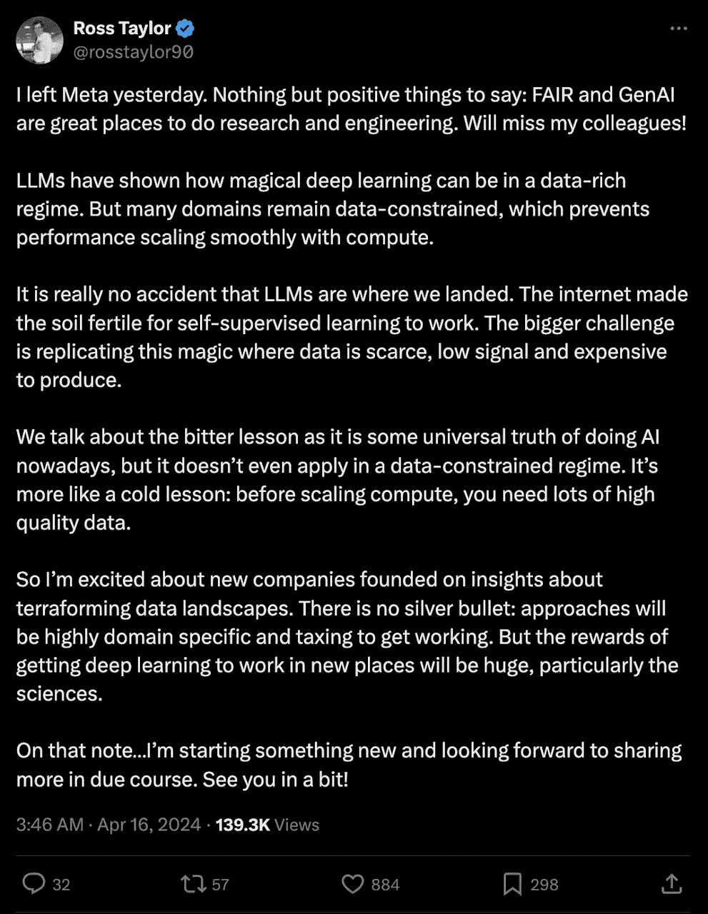

### Zamba-7B推出：70亿参数的Mamba/Attention混合模型

贡献人：

https://x.com/QuentinAnthon15/status/1780280071304937978

Zyphra欣然宣布推出Zamba-7B:

+   70亿参数的Mamba/Attention混合模型

+   仅使用1T完全开放的训练令牌,就能与Mistral-7B和Gemma-7B竞争

+   性能优于Llama-2 7B和OLMo-7B

+   所有训练过程中的检查点都将以Apache 2.0许可发布

+   由7人在30天内使用128个H100 GPU实现

+   https://zyphra.com/zamba

+   https://venturebeat.com/ai/zyphra-releases-zamba-an-ssm-hybrid-foundation-model-to-bring-ai-to-more-devices/...

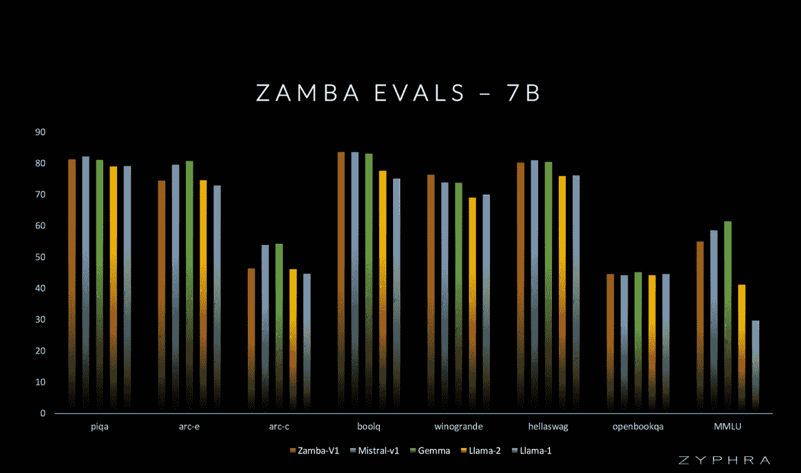

## 资讯

### 对话 MiniMax 闫俊杰：AGI 不是大杀器，是普通人每天用的产品

贡献人：

https://mp.weixin.qq.com/s/OXunu2wnNQv66rZIZLnW7g

在热闹的中国大模型创业圈，MiniMax的创始人闫俊杰可能是最神秘的一个。他从未公开露面，也没有接受过任何采访，即便公司估值已经 25 亿美元了，他依然沉默。在高中生和大学生中流行着 Glow、星野等产品，他们在上面玩恋爱养成游戏，和虚拟人对话，撰写发疯文学，甚至建一座城市，但没多少人知道，它们背后都是 MiniMax。近期完成 B 轮融资后，MiniMax 已是中国估值最高的大模型公司之一，股东名单里同时有腾讯和阿里，它成立刚满两年。“那时 ChatGPT 还没发布，OpenAI 也不温不火，其它中国公司都还没出来，商汤都要上市了，闫俊杰跳出来要创业。他真的对 AGI 有信仰。”MiniMax 的早期投资人、明势资本创始人黄明明说。当时闫俊杰已担任过商汤副总裁、研究院副院长和智慧城市事业群 CTO。更早前，他在中科院和清华大学研究计算机视觉。通常技术人才的聪慧只展现在一个小领域里，但闫俊杰在多个领域都做得风生水起。今年 35 岁的闫俊杰是一位说话声音很轻、总是面带笑容的管理者，投资人描述他是一个很好的倾听者，善于让对谈者放松，但当对方放松时，他会不动声色地抛出尖锐观点。

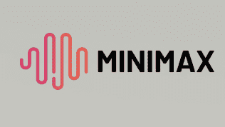

### abab 模型进展｜MiniMax 发布万亿 MoE 模型abab 6.5

贡献人：

https://mp.weixin.qq.com/s/xBoAP-6fZVQA9cEWT8gyfw

2024 年 4 月 17 日，MiniMax 正式推出abab 6.5 系列模型。在 MoE 还没有成为行业共识时，MiniMax 花了 80% 以上的精力下注 MoE，并于今年 1 月，发布了国内首个基于 MoE 架构的 abab 6。在过去的三个月里，我们进一步地挖掘了 MoE 架构的潜力，研发出了更强大的 abab 6.5。这个过程中，我们找到了越来越多加速实现 Scaling Laws 的途径，包括改进模型架构，重构数据 pipeline，训练算法及并行训练策略优化等。今天发布的 abab 6.5 和 abab 6.5s 是我们加速 Scaling Laws 过程的阶段性成果。abab 6.5 系列包含两个模型：abab 6.5 和 abab 6.5s。abab 6.5 包含万亿参数，支持 200k tokens 的上下文长度；abab 6.5s 跟 abab 6.5 使用了同样的训练技术和数据，但是更高效，支持 200k tokens 的上下文长度，可以 1 秒内处理近 3 万字的文本。在各类核心能力测试中，abab 6.5开始接近 GPT-4、Claude-3、Gemini-1.5 等世界上最领先的大语言模型。

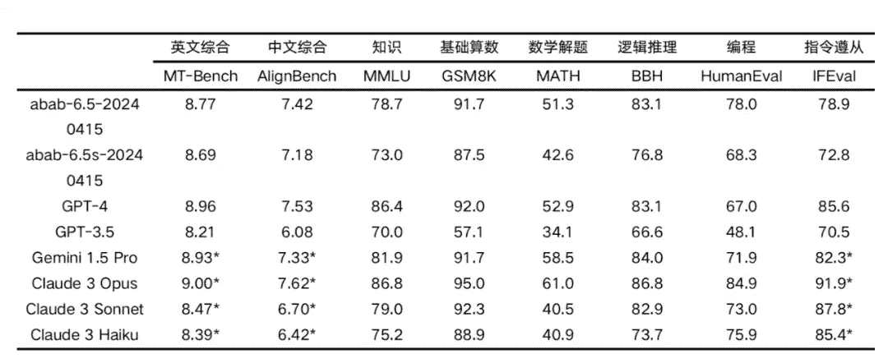

### 昆仑万维：中国首个音乐 SOTA 模型天工 SkyMusic 音乐大模型开启公测

贡献人：

https://www.ithome.com/0/762/373.htm

昆仑万维今日宣布，天工 3.0 大模型性能提升显著，旗下的天工 SkyMusic 音乐大模型也在今日面向全社会开放公测。天工 3.0 拥有 4000 亿参数，超越了 3140 亿参数的 Grok-1，是全球最大的开源 MoE 大模型。天工 3.0 在语义理解、逻辑推理、通用性、泛化性、不确定性知识、学习能力等领域性能提升显著，数学 / 推理 / 代码 / 文创能力提升超过 30%。天工 3.0 新增了多轮搜索与综合工具调用、图表绘制、研究模式、增强模式、改图扩图等多项 AI 能力。天工 3.0 旗下的天工 SkyMusic 音乐大模型也在今日面向全社会开放公测。昆仑万维表示天工 SkyMusic 在人声 & BGM 音质、人声自然度、发音可懂度等领域“显著”领先对手，综合性能超越 Suno V3，取得音乐大模型 SOTA（State of the art model，即在当前研究中表现最好的模型）

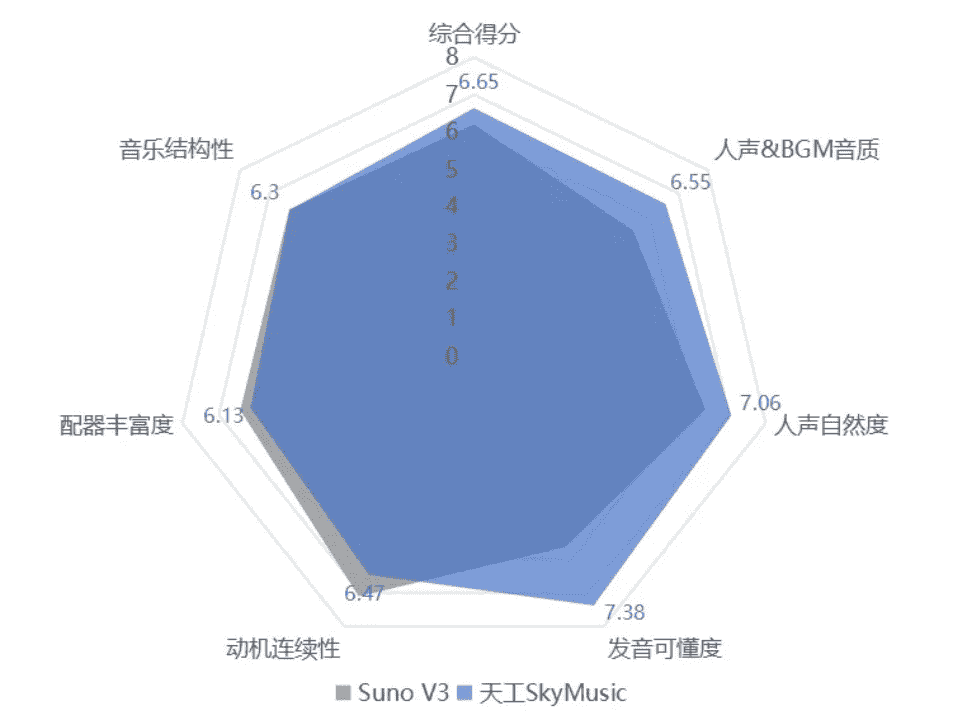

### AGI大基建与马拉松：2024 Q1全球大模型的前沿手记

贡献人：

https://mp.weixin.qq.com/s/S00O5YfdMk4A7ieNtJR2xg

“AGI本质是：电+芯片=产出智能。”拾象科技CEO李广密称，他此前是红杉资本投资人。人类正处于一场宏大的“AGI大基建”时期。“这和曼哈顿计划、登月计划、克林顿网络大基建很像”，特别是上世纪九十年代，克林顿推出美国信息高速公路建设，为后面的美国互联网泡沫破裂与黄金20年提供了根基。在他看来，“如果没有基建，就不可能有应用大爆发”。从基建维度，以训练一个GPT-4举例——据李广密估算，在耗电上，假设GPT-4使用8000张H100训练100天，大概需要2600万度电，大约需要三峡或上海一天发电量或用电量的5%，德州的2%；在算力上，现在最低要8000张H100有效算力，接近一个万卡集群，如果买卡，每张H100售价3万美元，再加上周边设备，3亿美元少不了，而如果租H100，1万多美元一张卡，也就是1亿到2亿美元。随着大模型公司的加速收敛，全球看，2024年模型公司的生死线是：在技术上，年内超越GPT-4；在算力上，年内万张卡集群，而且要能用起来——“你就看未来12个月能不能有10万张H100的集群，这大概需要三五十亿美元，这是明年第一梯队模型的标配。”他说。李广密对海外AGI的前沿进展有一手观察。他称，计算的竞争很残酷，未来只会更残酷，“每个时间阶段都会有模型公司持续的出局”。

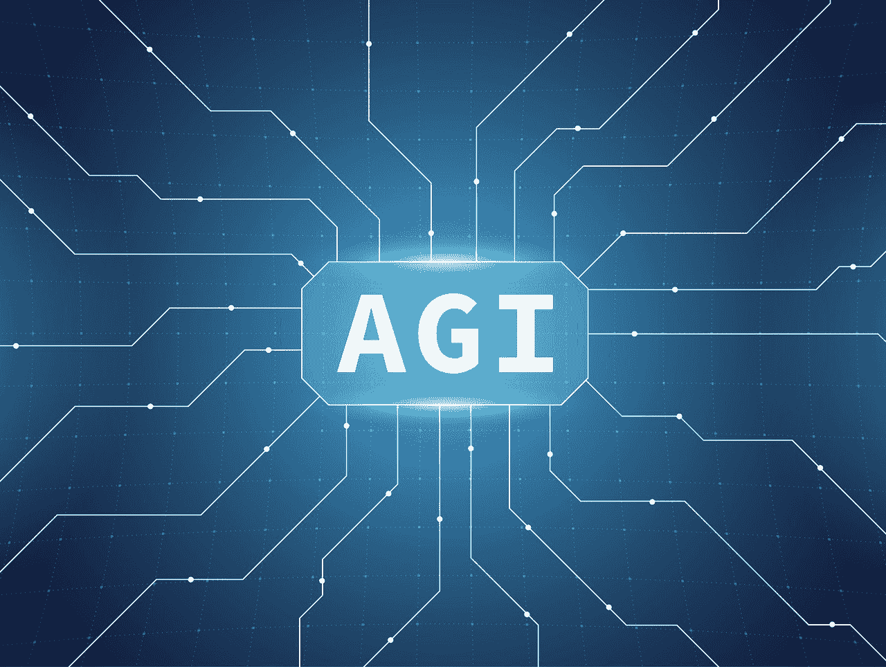

### 清华团队推出新平台：用去中心化AI打破算力荒

贡献人：

https://mp.weixin.qq.com/s/ei094YTCEKzewRwlIrPr4w

最近，一则数据点出了AI领域算力需求的惊人增长——根据业内专家的预估，OpenAI推出的Sora在训练环节大约需要在4200-10500张NVIDIA H100上训练1个月，并且当模型生成到推理环节以后，计算成本还将迅速超过训练环节。照这个趋势发展下去，GPU的供给或许很难满足大模型持续的需求。不过，最近海外有一个新动向，可能会给即将到来的“算力荒”提供新的解决思路——去中心化AI。三周前，3月23日，Stability AI突然发布一项公告，宣布公司CEO Emad Mostaque辞职。Emad Mostaque自己透露了接下来动向，要去追求“去中心化AI的梦想”。但由于去中心化网络的不确定性、不稳定性等技术上的痛难点没法解决，上一波去中心化AI很难在大模型时代真正落地。直到最近，一个在海外创业的清华团队聚焦去中心化AI，创立了NetMind.AI。2023年，NetMind发布了一份白皮书，详细介绍了去中心化算力共享平台NetMind Power。这个平台要解决的，正是去中心化AI在大模型时代落地的痛点。

### Pika联创参与新研究：Diffusion能抢GPT的活了！成功挑战自回归文本范式

贡献人：

https://mp.weixin.qq.com/s/PMATQzK8Z_Ec0DGoF7Eszg

纵观生成式AI领域中的两个主导者：自回归和扩散模型。一个专攻文本等离散数据，一个长于图像等连续数据。如果，我们让后者来挑战前者的主场，它能行吗？斯坦福博士的最新研究，就搞了这么一个扩散模型VS自回归模的同台PK。

### 估值 3 亿美元 AI 初创公司 Tome 宣布裁员！

贡献人：

https://mp.weixin.qq.com/s/qS28tZD9ya7KeYaLUvDkhQ

总部位于旧金山的 Tome是去年众多热门的生成式 AI 初创公司之一，同期知名公司还包括文案公司生成 Jasper以及图像生成初创公司 Stability AI。根据外媒报道，Tome 在本周一解雇了 59 名员工中的 12 名，由于 Tome 的产品依赖于其他公司的 AI 技术，所以很快竞争对手就出现了。目前，Tome 已从 Coatue Management和 Greylock Partners 等投资者那里筹集了 8100 万美元，在 2023 年 2 月的一轮融资中估值达到 3 亿美元。

### 目标50亿美元估值！法国AI独角兽Mistral AI寻求新一轮融资

贡献人：

`https://www.cls.cn/detail/1649300`

法国科技初创公司Mistral AI正在与投资者进行接洽；该公司希望以50亿美元的估值再进行一轮数亿美元的融资；作为人工智能领域的新贵，该公司已经与微软、IBM等公司达成合作。

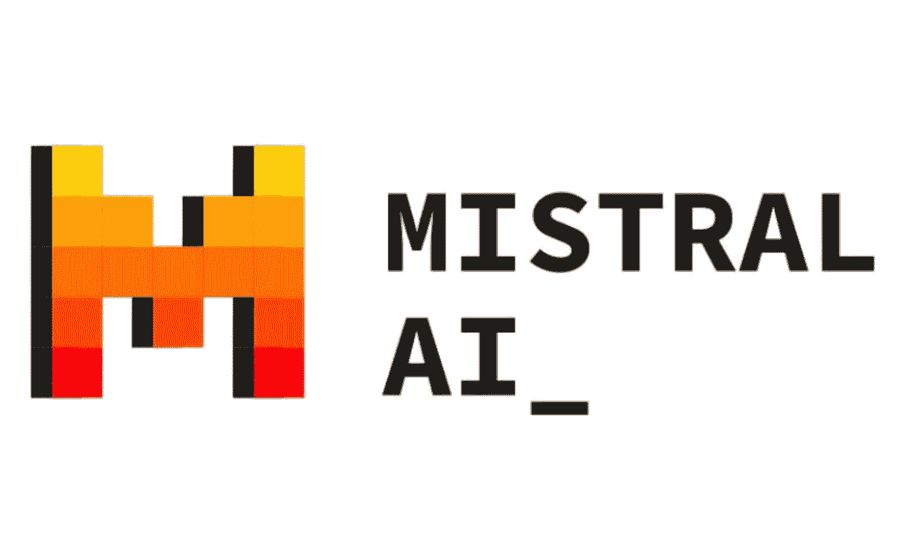

### Chrome 浏览器桌面版地址栏即将整合聊天机器人 Gemini

贡献人：

`https://www.ithome.com/0/762/386.htm`

桌面 Chrome 浏览器地址栏即将添加 Gemini 快捷方式，用户在 Gemini 网页上登录账户后，用户只需输入 `@gemini` 即可快速与谷歌的人工智能聊天机器人 Gemini 开始聊天。

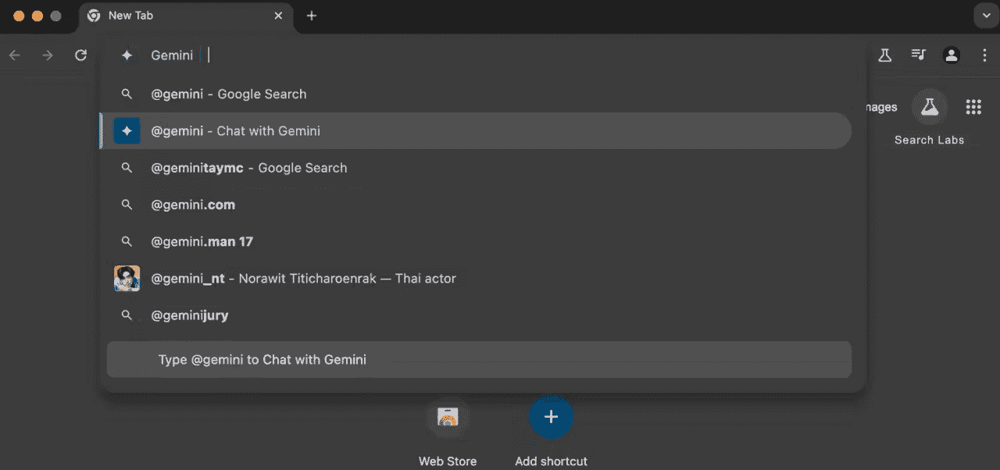

# 论文

### DPO对LLM对齐是否优于PPO？一项全面研究

贡献人：

`http://arxiv.org/abs/2404.10719v1`

摘要：强化学习从人类反馈中学习（RLHF）目前是将大型语言模型（LLMs）与人类偏好对齐的最广泛使用的方法。现有的RLHF方法可以粗略地分为基于奖励或无奖励两类。新颖的应用如ChatGPT和Claude利用首先学习奖励模型并应用演员-评论算法（如PPO）的基于奖励的方法。然而，在学术基准中，通常通过无奖励的方法（如DPO）实现了最前沿的结果。DPO是否真正优于PPO？为什么PPO在这些基准测试中表现不佳？在本文中，我们首先对DPO的算法特性进行理论和实证研究，展示DPO可能存在根本限制。此外，我们还全面检验PPO并揭示PPO在微调LLMs时的最佳性能因素。最后，我们在涵盖对话到代码生成的各种RLHF测试集上对比DPO和PPO。实验证明，PPO能够在所有情况下超越其他对齐方法，并在具有挑战性的代码竞赛中取得最前沿结果。

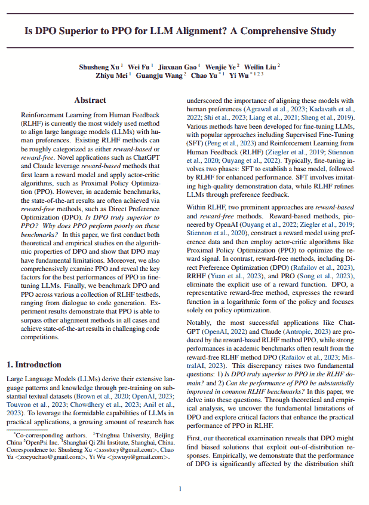

### 自我对抗语言游戏提升大语言模型推理能力

贡献人：

`http://arxiv.org/abs/2404.10642v1`

我们在名为敌对禁忌的双人对抗性语言游戏中探索了大型语言模型（LLMs）的自我训练过程。在这个游戏中，攻击者和防御者仅就对攻击者可见的目标词进行交流。攻击者的目标是在防御者无意中说出目标词，而防御者则试图从攻击者的发言中推断出目标词。为了赢得游戏，双方都应对目标词有足够的了解和高层次的推理能力，在保留信息的对话中进行推理和表达。我们好奇的是LLMs的推理能力是否能通过自我对抗语言游戏（SPAG）进一步增强。为了实现这个目标，我们让LLMs扮演攻击者，在大量的目标词上与自身的副本作为防御者对战。通过强化学习观察到LLMs在广泛的推理基准上表现均匀提升。此外，循序渐进地采用这种自我对抗过程可以持续促进LLMs的推理能力。源代码在`https://github.com/Linear95/SPAG`。

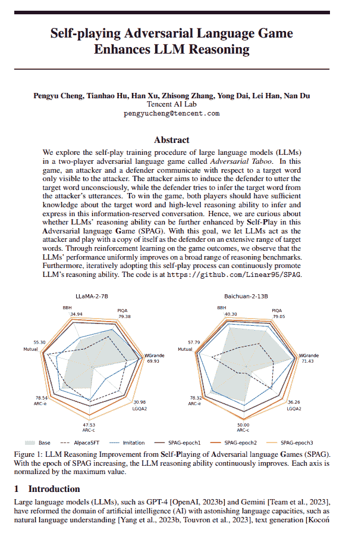

### Chinchilla 缩放：一次复现尝试

贡献人：

`http://arxiv.org/abs/2404.10102v1`

摘要：Hoffmann等人（2022）提出了三种估计计算优化缩放规律的方法。我们尝试复制他们的第三种估计过程，该过程涉及将参数损失函数拟合到从其图表中重建的数据上。我们发现，报告的估计与他们的前两种估计方法不一致，无法拟合提取的数据，并报告了不太可能的窄置信区间--如此窄的区间需要超过60万次实验，而他们可能只运行了不到500次。相比之下，我们使用第三种方法对缩放规律进行了重新推导，得到的结果与Hoffmann等人描述的前两种估计过程得出的结果相一致。

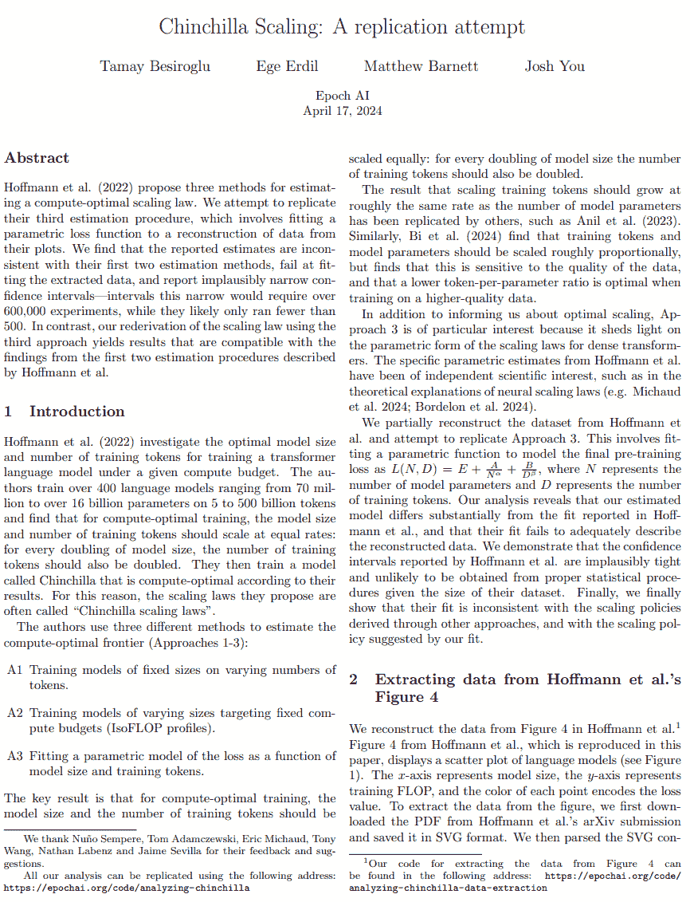

### 分层上下文合并：预训练LLM更好地理解长上下文

贡献人：

`http://arxiv.org/abs/2404.10308v1`

大语言模型（LLMs）在各种自然语言处理任务中表现出卓越性能。然而，它们面临的主要约束是上下文限制，即它们可以处理的token的最大数量。先前的研究已经探讨了架构变化和在位置编码方面的修改以放宽这一约束，但它们经常需要昂贵的训练，或者不能满足自注意力计算需求。在本文中，我们提出了一种新的无需训练的方案——分层上下文合并（HOMER），旨在克服这些限制。HOMER使用分而治之算法，将长输入分成可管理的块。然后，每个块在逐步的Transformer层中采用分层策略进行集体处理，将相邻块合并。每次合并前还采用了减少token的技术，确保内存使用的效率。我们还提出了一种优化的计算顺序，使内存要求随输入长度对数缩放，特别适用于内存受限的环境。我们的实验表明了所提出方法的卓越性能和内存效率，使LLMs能够在需要扩展上下文的环境中更广泛地使用。源代码可在`https://github.com/alinlab/HOMER`找到。

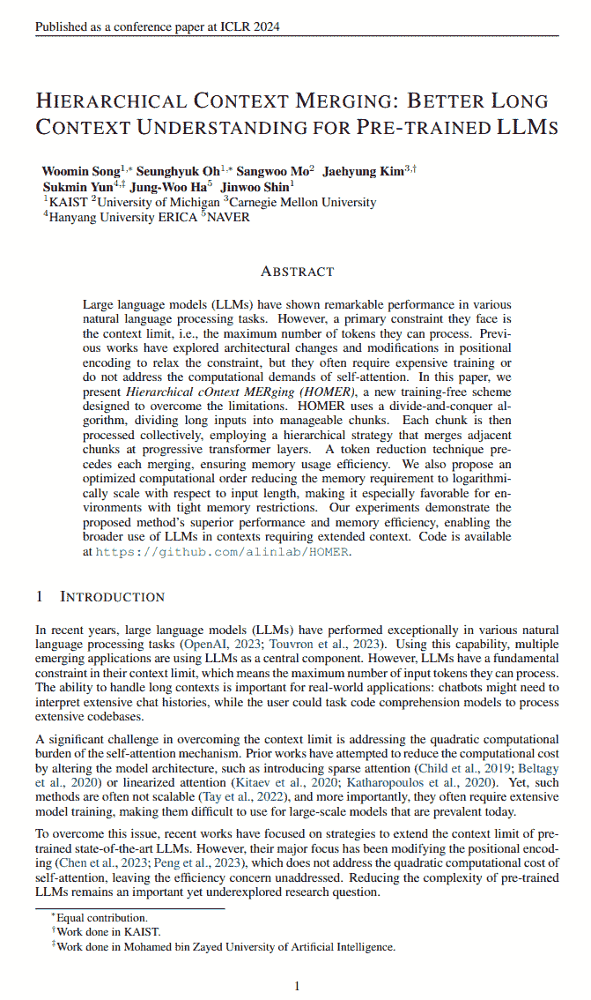

### 朝着DNA编码库生成与GFlowNets

贡献人：

`http://arxiv.org/abs/2404.10094v1`

DNA编码库（DEL）是一种快速筛选大量多样化化合物的强大方法。在使用DEL时，一个关键挑战是库设计，涉及选择将组合以产生最终库的构建块。本文考虑了蛋白质相互作用（PPI）偏向DEL设计的任务。通过评估几种机器学习算法对PPI调控任务的效果，并将它们作为基于GFlowNet的生成方法的奖励。我们还研究了使用构建块的结构信息来设计GFlowNet的分层行动空间的可能性。观察到的结果表明，GFlowNet是一个有潜力生成多样化组合库候选物的方法。

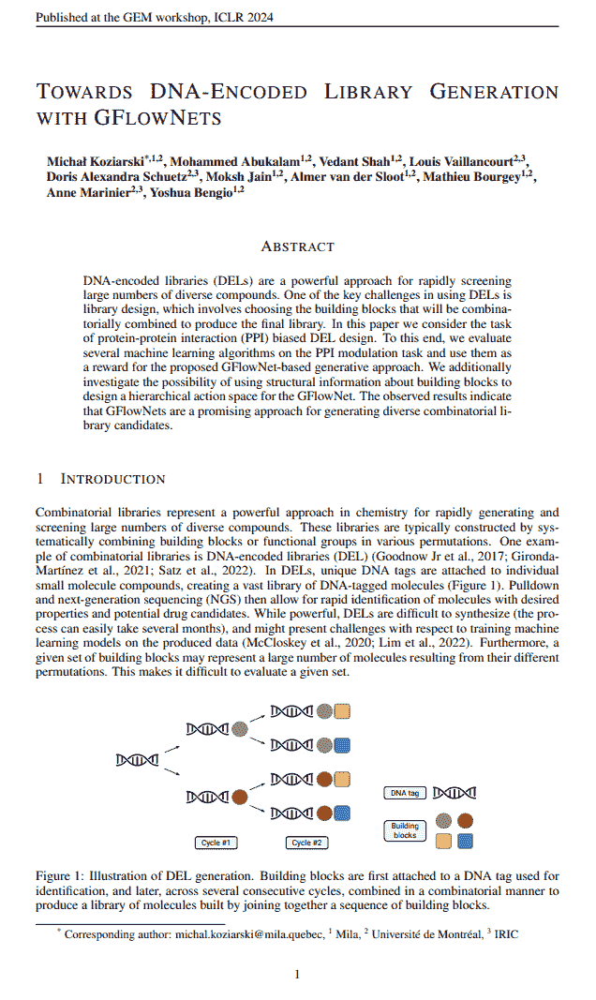

### 潜在扩散下的长篇音乐生成

贡献人：

`http://arxiv.org/abs/2404.10301v1`

音频生成模型在音乐领域取得了巨大进展，但迄今为止尚未能产生具有连贯音乐结构的完整音乐曲目。我们展示通过在长时间上下文中训练生成模型，可以生成长达4分45秒的音乐作品。我们的模型由一个在高度降采样的连续潜在表示上运行的扩散Transformer组成（潜在速率为21.5Hz）。根据音频质量和提示对齐度的指标，它获得了最先进的生成效果，并主观测试表明它能够生成具有连贯结构的完整音乐作品。

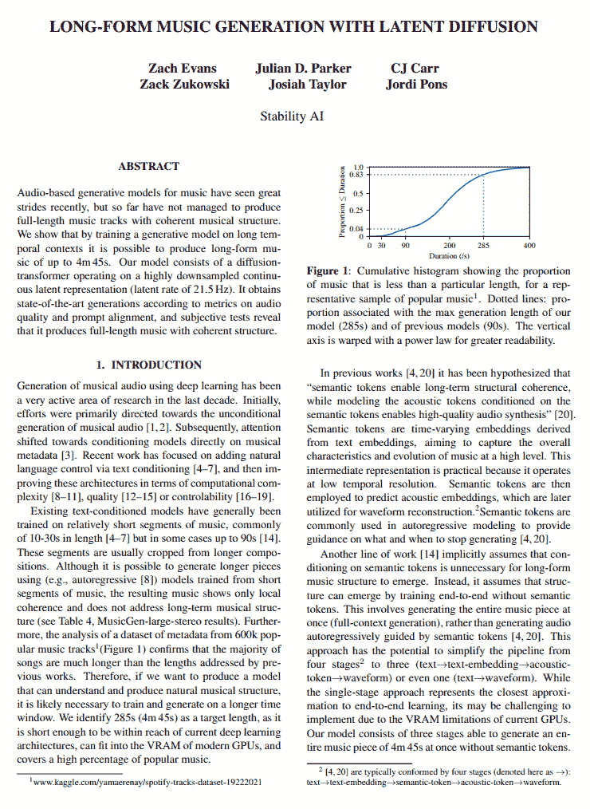

# 产品

### Poe 3.0

贡献人：

`https://poe.com/`

Poe 推出了3.0版本，其中增添了新的机器人功能，包括 RPG 角色扮演选择游戏 （大将军扮演版），这个个游戏拥有现代版，古代版和异世界版本，快来试试吧。

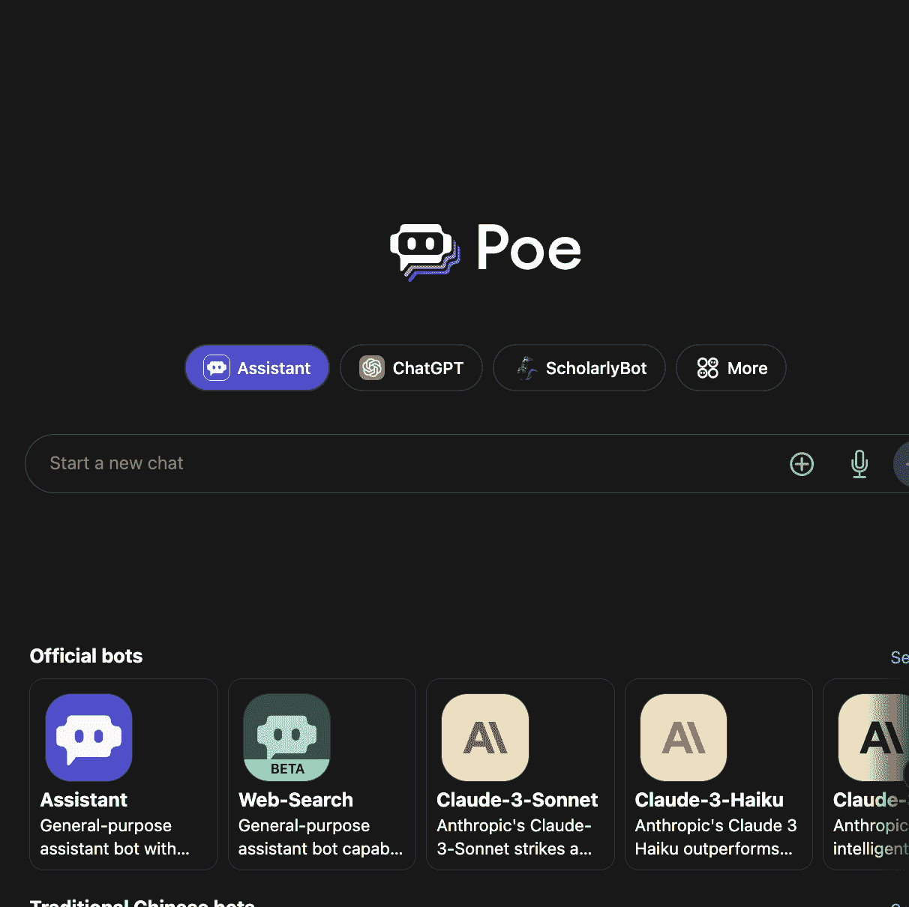

### Vidyard AI Avatars

贡献人：

`https://www.vidyard.com/products/ai-avatars/`

Vidyard是一个视频平台，它提供了AI Avatars功能，可以用来创建个性化的视频消息。使用这项功能，用户可以轻松创建高质量的个性化视频，而无需亲自出镜，只需提供书面脚本或推介，即可生成高质量、个性化的视频，以与潜在客户和客户建立联系。 Vidyard AI Avatars 还直接集成了 Vidyard Video Messages，可以获得 Vidyard 全套功能的好处，例如视频观看通知、高级分析、以及与CRM集成等。

# HuggingFace&Github

### HuixiangDou

贡献人：

`https://github.com/InternLM/HuixiangDou`

茴香豆是一个基于 LLM 的群聊知识助手，近期的更新实现了RAG标注，SFT问答数据和样例，优势：

1. 设计拒答、响应两阶段 pipeline 应对群聊场景，解答问题同时不会消息泛滥。

2. 成本低至 1.5G 显存，无需训练适用各行业

3. 提供一整套前后端 web、android、算法源码，工业级开源可商用

### Aitino

贡献人：

`https://github.com/Futino/aitino`

Aitino 是一个开源平台，允许创建 AI 代理团队，以帮助用户自动执行高级任务并解决复杂问题，而无需冗长而复杂的设置。我们希望 Aitino 可以在几分钟内从提示到解决方案，而用户只需几秒钟即可提供所需的信息，例如 API 密钥、上下文和代理解决任务的特定信息。

# 投融资

### 喔哇宇宙（UOVAMETA）完成首轮千万级战略融资

贡献人：

`https://www.stcn.com/article/detail/1176982.html`

元隆雅图子公司上海喔哇宇宙数字科技有限公司（“喔哇宇宙”或“UOVAMETA”）正式完成首轮千万级战略融资，投资方包括乐华娱乐、阿里影业等，母公司元隆雅图也参与了本次增资扩股。本次融资将进一步助力UOVAMETA完善AI及Web3产业链布局，为未来平台产品的研发和业务拓展打下坚实基础。目前元隆雅图UOVAMETA前期已自主开发了公司首个垂直行业AIGC模型，该模型为用户提供个性化创作工具，大幅提升内容生成和创作效率。

公司官网：`https://uovameta.com/`

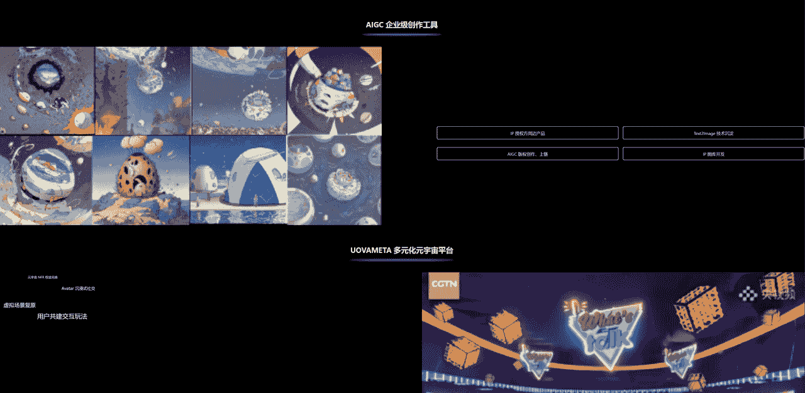

### 「芯算科技」获数千万元天使轮融资，主营高维光计算

贡献人：

`https://mp.weixin.qq.com/s/JOUX2oIJR5v5dOokFy0f-A`

北京芯算科技有限公司最近完成了数千万元人民币的天使轮融资，由九合创投独家投资。资金将用于产品迭代、团队构建和业务扩展。芯算科技专注于开发高维光计算芯片和光电混合计算板卡，旨在满足日益增长的AI加速、云服务器和数据中心等场景的算力需求。高维光计算技术利用光子作为信息载体，提供高通量、高速率和大算力，同时具有低功耗和低延迟的优势。此技术有望在AI时代为中国企业提供摆脱算力限制的新解决方案。

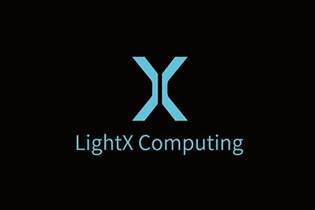

### Staple获400万美元投资，旨在全球推广文档管理

贡献人：

`https://e27.co/ai-powered-staple-raises-us4m-to-streamline-global-document-management-20240416/`

Staple，一家总部位于新加坡的AI驱动文档处理公司，已在Wavemaker Partners领投的Pre-Series A融资轮中筹集到400万美元。这笔资金将支持Staple的全球市场扩张、AI技术的完善以及文档处理解决方案的扩展。Staple的目标是增强其在关键市场的存在，更好地满足企业的文档管理需求。

公司官网：`https://staple.io/`

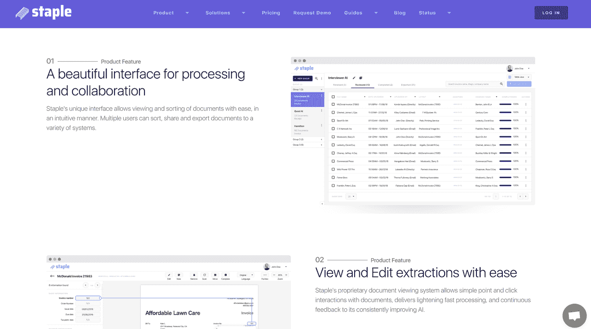

### Bridgewise 完成2100万美元A轮融资，发展全球证券AI分析平台

贡献人：

`https://www.calcalistech.com/ctechnews/article/bkbajlser`

Bridgewise，一家开发全球证券AI分析平台的初创公司，宣布完成2100万美元的A轮融资，迄今为止总资本达到3500万美元。本轮融资由SIX集团领投，Group 11、L4 Venture Builder以及其他全球金融机构参与。该公司选择了能够在关键地区作为战略合作伙伴的领先金融公司作为投资者，例如SIX集团，它负责瑞士和西班牙的金融中心基础设施。

公司官网：`https://bridgewise.com/`

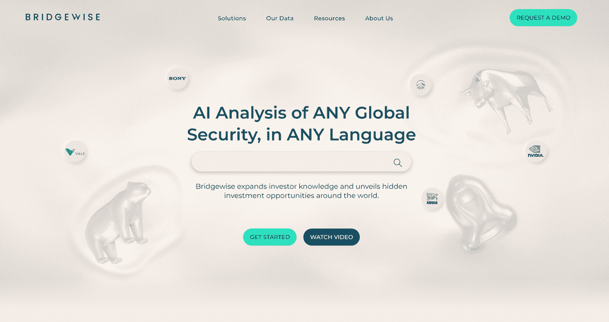

### Rivos 完成超过2.5亿美元融资，聚焦数据分析和生成式AI市场

贡献人：

`https://www.businesswire.com/news/home/20240416215878/en/Rivos-Raises-More-Than-250M-Targeting-Data-Analytics-and-Generative-AI-Markets`

Rivos，一家针对数据分析和生成式AI市场的RISC-V加速平台公司，宣布已在超额认购的A-3系列融资轮中筹集超过2.5亿美元。这轮融资由Matrix Capital Management领投，新投资者包括Intel Capital、MediaTek、Cambium Capital等，同时现有投资者如Dell Technologies Capital、Koch Disruptive Technologies等也增加了投资。这些资金将使公司能够推出其首个硅产品，满足不断增长的客户需求。

公司官网：`https://www.rivosinc.com/`

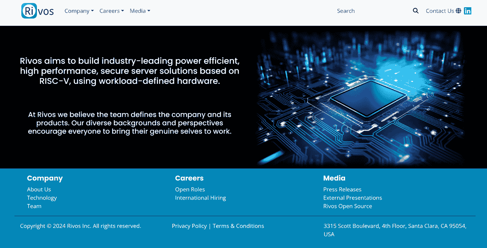

### Upstage完成7200万美元B轮融资，扩展其革命性AI解决方案的全球影响力

贡献人：

`https://www.prnewswire.com/news-releases/upstage-raises-72-million-in-series-b-funding-to-expand-global-reach-of-its-groundbreaking-ai-solutions-302117880.html`

Upstage，一家专注于大型语言模型（LLMs）和文档AI的先锋AI公司，宣布已通过B轮融资筹集7200万美元。这使得公司自2020年成立以来累计筹资超过1亿美元，成为韩国资金最充足的AI软件公司。此轮资金将帮助Upstage在全球范围内推广其顶尖的生成AI模型，并提供企业级的“AGI for work”解决方案。B轮融资由SK网络、KT、韩国发展银行等领投，现有投资者也参与了此轮投资。

公司官网：`https://www.upstage.ai/`

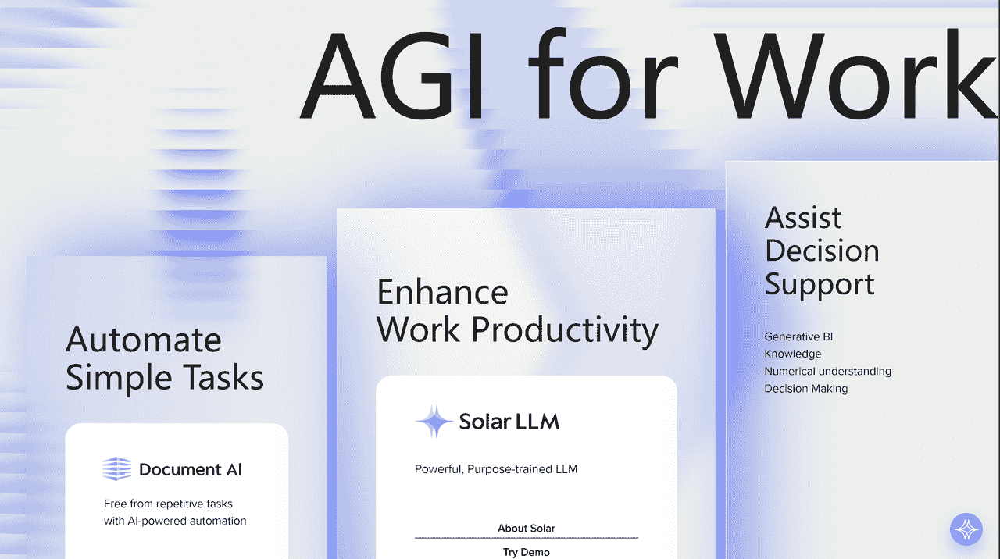

### GovDash完成1200万美元融资，利用AI帮助企业获得政府合同

贡献人：

`https://techcrunch.com/2024/04/16/govdash-aims-to-help-businesses-use-ai-to-land-government-contracts/`

GovDash，一家帮助企业通过AI获取政府合同的公司，已经在本月完成了1000万美元的A轮融资，累计融资1200万美元。这些资金将用于扩大其工程团队，聘请更多联邦提案经理来指导其产品努力，并增加现有平台的新功能。GovDash目前在美国与大约30家联邦承包商合作，并接近现金流平衡。

公司官网：`https://govdash.com/`

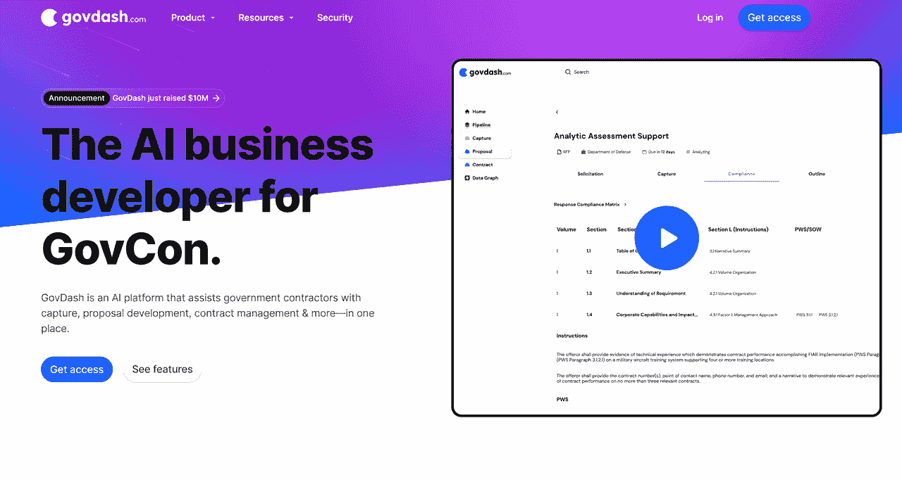

### Take2 AI完成300万美元种子轮融资

贡献人：

`https://www.finsmes.com/2024/04/take2-ai-raises-3m-in-seed-funding.html`

Take2 AI，一家位于纽约的公司，开发了一个AI驱动的销售招聘模拟平台，已完成300万美元的种子轮融资。此轮融资由Reach Capital和SemperVirens领投，Techstars以及来自Visa、Disney、HP和Google的人力资源领导者参投。该公司计划使用这些资金扩展运营和开发工作。Take2 AI的平台帮助公司生成量身定制的真实销售场景模拟，以评估求职者的技能、行为特征和文化契合度，从而帮助企业减少错误招聘并提高员工留存率。

公司官网：`https://www.take2.ai/`

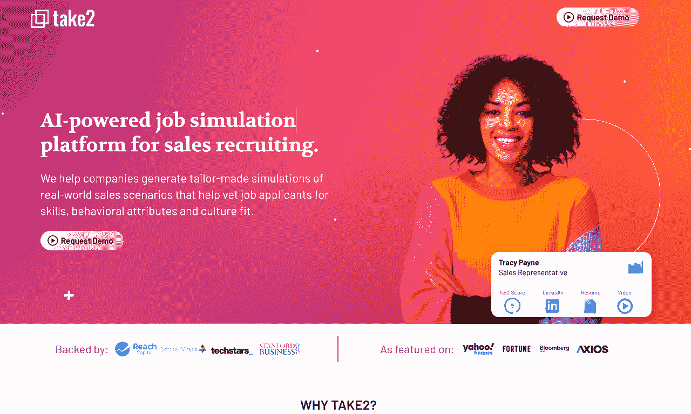

# 学习

### 请问求一个图的全局最小割，有什么比较快的算法？

贡献人：

`https://www.zhihu.com/question/265186138/answer/3468269816`

在讨论求无向图全局最小割的高效算法中，2024年的SODA大会提出了一种新算法，由Henzinger, Li, Rao, Wang团队提出，时间复杂度为 `O(m polylog m)`。这种算法为确定性算法，并获得了Best Paper Award。文章详细介绍了其工作原理，包括算法的60页详细描述和引用其他必要的黑盒技术。此外，还简要讨论了其他几种算法，如随机算法和Stoer-Wagner算法，以及对特定图类型的特化处理，例如平面图。

### From AlphaGo to MuZero --- MCTS

贡献人：

`https://zhuanlan.zhihu.com/p/442630226`

本文介绍了从AlphaGo到MuZero的发展历程，着重讨论了Monte Carlo Tree Search（MCTS）算法。文章首先描述了Game Tree的概念，并引入了minmax策略以优化棋局结果预测。随后，因为棋局规模庞大导致无法展开完整的Game Tree，提出了MCTS算法作为解决方案。MCTS通过随机模拟选择重要节点，该算法包括选择（Selection）、扩展（Expansion）、模拟（Simulation）和更新（Backup）四个步骤。通过这种方法，有效地减少了计算复杂度，同时保证了策略的实用性。

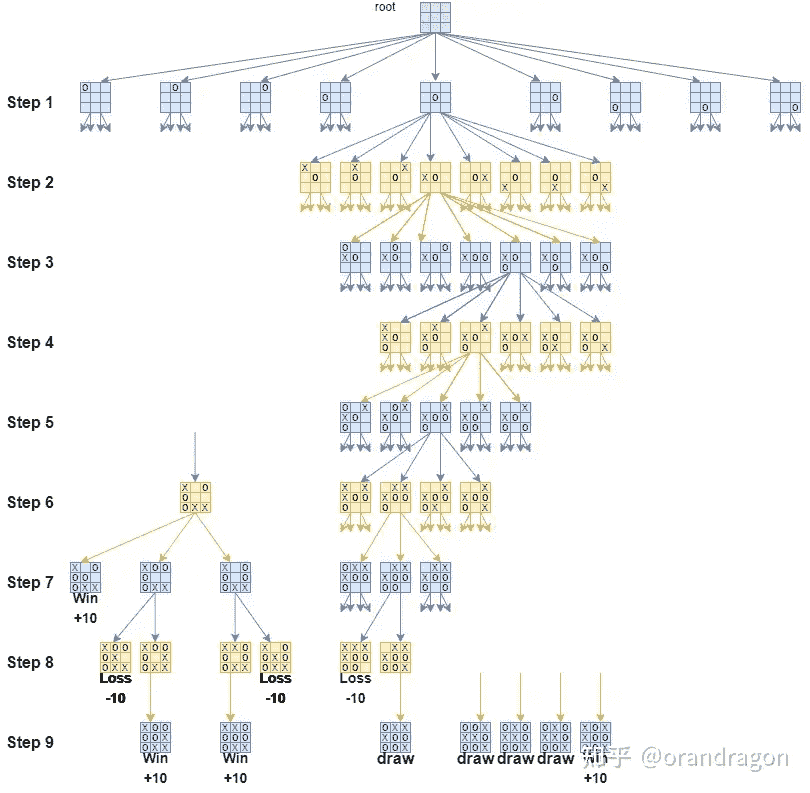

### CUDA一亿行挑战：从17分钟到17秒

贡献人：

`https://tspeterkim.github.io/posts/cuda-1brc`

文章探讨了如何用CUDA处理一亿行数据的挑战，将处理时间从17分钟优化到17秒。作者采用了分区工作的方法，通过计算文件的字节偏移而不是逐行处理，显著提高了效率。实施过程中，主要使用了V100 GPU，并自行编写了处理城市和温度数据的CUDA内核。此外，文中还介绍了自定义的原子最小值和最大值操作（`AtomicMin`和`AtomicMax`）以适应CUDA中的浮点数，并通过二分查找代替哈希表来优化查找效率。尽管这种方法在处理字符串和动态哈希表时显示出CUDA的局限性，但它有效地展示了并行计算在数据处理中的应用潜力。

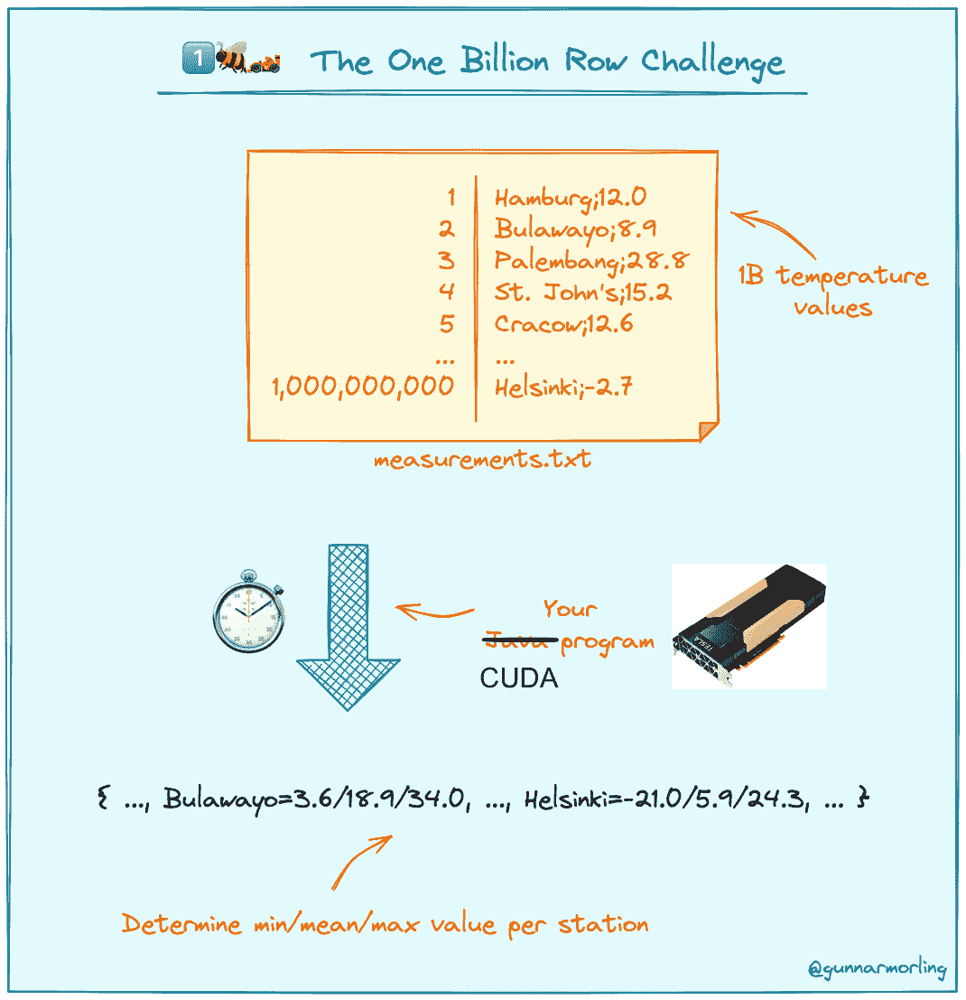

## 通过16位精度技术提高神经网络微调效率

贡献人：

https://lightning.ai/pages/community/tutorial/doubling-neural-network-finetuning-efficiency-with-16-bit-precision-techniques/

文章介绍了如何使用16位混合精度训练（mixed-precision training）来提高PyTorch模型训练的效率。利用16位精度可以显著缩短训练时间，减少内存消耗，同时保持预测准确性不变。通过引入开源Fabric库简化代码，只需少量更改即可实现高级功能。文章中使用的ViT-L-16模型展示了在单GPU上微调的具体应用，证明了使用16位和bfloat16格式的有效性，后者能进一步减少训练时间并大幅节约内存。这些技术尤其适用于资源受限的情况，允许在较小的GPU上训练更大的模型。

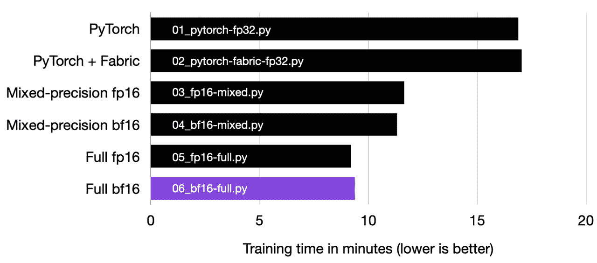

## PixArt α to Σ: All about Efficient Diffusion Models

贡献人：

https://zhuanlan.zhihu.com/p/686900909

文章深入探讨了Diffusion Transformer在图像合成中的应用及其效率问题。特别强调了PixArt系列模型如PixArt-α和PixArt-Σ的发展，这些模型在保持高效能的同时，通过细化的fine-tuning策略，成功应对高分辨率图像生成的挑战。文章讨论了如何将Diffusion模型与Transformer结合，通过引入cross-attention和fine-tuning减少计算需求，同时提升模型的生成质量和效率。这些技术细节表明，即使在算力需求巨大的情况下，也能通过技术创新有效降低资源消耗。

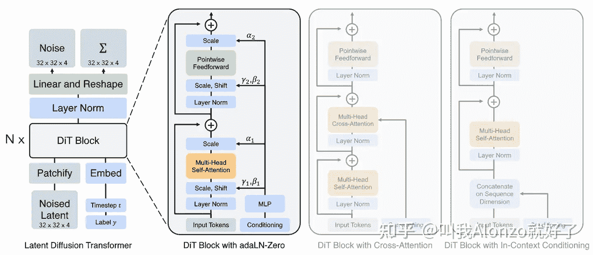

## Ring Attention：如何处理大模型的无限上下文窗口问题

贡献人：

https://coconut-mode.com/posts/ring-attention/

Ring Attention技术是解决大型语言模型中上下文长度扩展带来的显著技术挑战的一种方法。随着模型如GPT 3.5到Gemini 1.5 Pro的上下文窗口从16K扩展到100万个令牌，环形注意力通过多设备并行处理技术，实现了几乎无限的上下文窗口。该技术通过将注意力计算分割成小块，并在多个GPU上映射和协调计算，最小化了通信和计算的额外开销。通过在设备间环形传递键值对块，每个设备只处理一部分数据，从而有效地分散了内存和计算压力，使得整个计算过程更加高效和可扩展。

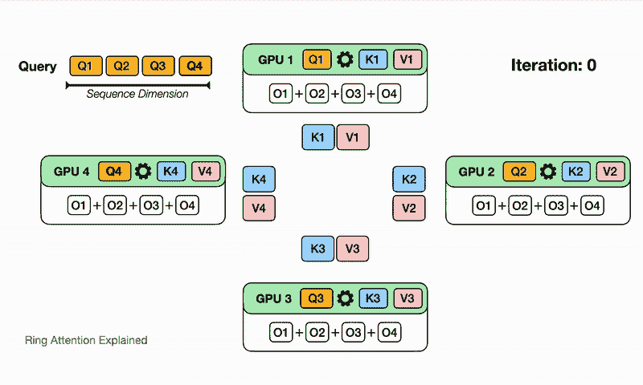

## 图解大模型计算加速系列：vLLM源码解析2，调度器策略(`Scheduler`)

贡献人：

https://zhuanlan.zhihu.com/p/692540949?utm_psn=1763232118870929409

文章详细解析了vLLM的调度器策略。文章通过“宏观（图解）- 细节（配合源码）”的方式，先解释vLLM的操作目的和逻辑，然后深入源码细节。特别关注于如何处理离线批处理和在线流式服务的请求，并解析调度器如何决定哪些请求可进行推理，并进行逻辑块到物理块的映射。此外，讨论了`prefill`和`decode`阶段的操作细节，以及如何管理和分配物理块，显示了调度器的复杂性和嵌套的逻辑层。

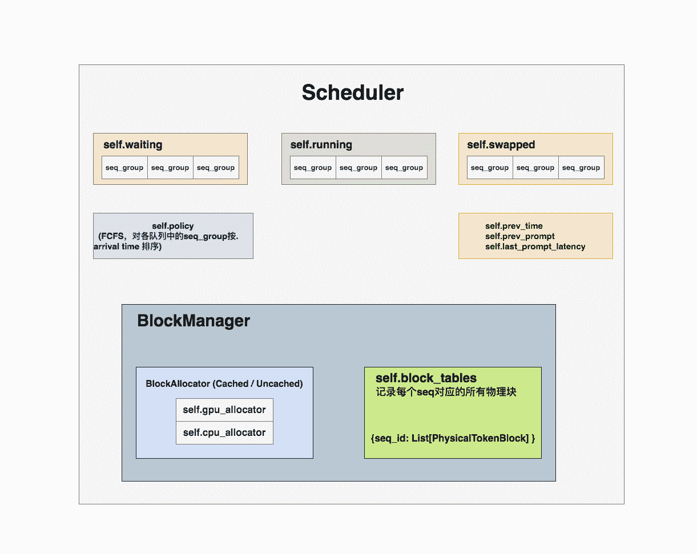
