# 奇绩大模型日报（4月 16日）

> 来源：[https://miracleplus.feishu.cn/docx/UkuIdP8gEo4JAFx0QancYiqVncb](https://miracleplus.feishu.cn/docx/UkuIdP8gEo4JAFx0QancYiqVncb)

## 推特

### 第一个超越GPT-4的开源模型！WizardLM 2在MT-Bench上超越了GPT-4，在Mixtral 8x22B基础上微调和偏好训练

贡献人：

https://x.com/_philschmid/status/1779961137309548774

我们做到了!🙌第一个开放的大语言模型在MT-Bench上超越了@OpenAI的GPT-4(3月版)。WizardLM 2是在Mixtral 8x22B基础上微调和偏好训练的!🤯

简而言之;

🧮基于Mixtral 8x22B(141B-A40 MoE)

🔓Apache 2.0许可

🤖第一个在MT-Bench上达到9.00以上的开放大语言模型

🧬使用了包括Evol-instruct数据分区和分阶段训练在内的多步合成数据流水线

👨🔬使用了SFT → DPO → PPO

博客:https://wizardlm.github.io/WizardLM2/

模型:https://huggingface.co/microsoft/WizardLM-2-8x22B

论文:即将发布

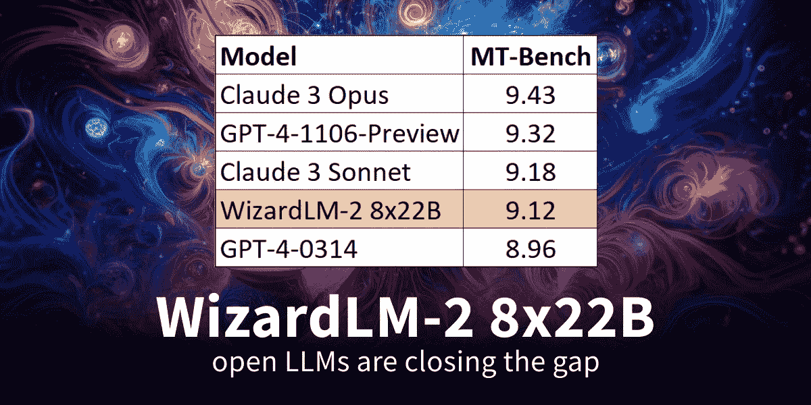

### Deeplearning AI“量化基础”：学习如何量化几乎任何开源模型

贡献人：

https://x.com/AndrewYNg/status/1779905922602782752

LLM 可能需要数 GB 的内存来存储,这限制了消费级硬件上可以运行的模型。但量化可以显著压缩模型,使开发人员可以使用更广泛的模型选择。您通常可以将模型大小减少 4 倍或更多,同时保持合理的性能。在我们由 Hugging Face 的 Younes Belkada 和 Marc Sun 讲授的新的短期课程"量化基础"中,您将:

- 学习如何量化几乎任何开源模型

- 使用 `int8` 和 `bfloat16` 数据类型,利用 PyTorch 和 Hugging Face Transformers 库加载和运行 LLM

- 深入研究线性量化的技术细节,将 32 位浮点数映射到 8 位整数

随着模型变得越来越大,量化对于使模型实用和易于访问变得越来越重要。请在此处查看课程:https://deeplearning.ai/short-courses/quantization-fundamentals-with-hugging-face/

[ssstwitter.com_1713252752497.mp4](https://internal-api-drive-stream.feishu.cn/space/api/box/stream/download/all/B0d3bf3bBohDYrxLPEQccNOmnAd)

### Gemini API 指南：快速测试 100 万字符上下文和原生多模态支持

贡献人：

https://x.com/OfficialLoganK/status/1779902259335209102

Gemini API 指南正在很好地成型(我们刚刚突破了 1000 个 star)。如果你想快速测试 100 万字符上下文和原生多模态支持,可以看看这个指南!

欢迎使用 Gemini API 指南

这是 Gemini API 的指南和示例集合,包括编写提示和使用 API 不同功能的快速入门教程,以及您可以构建的示例。

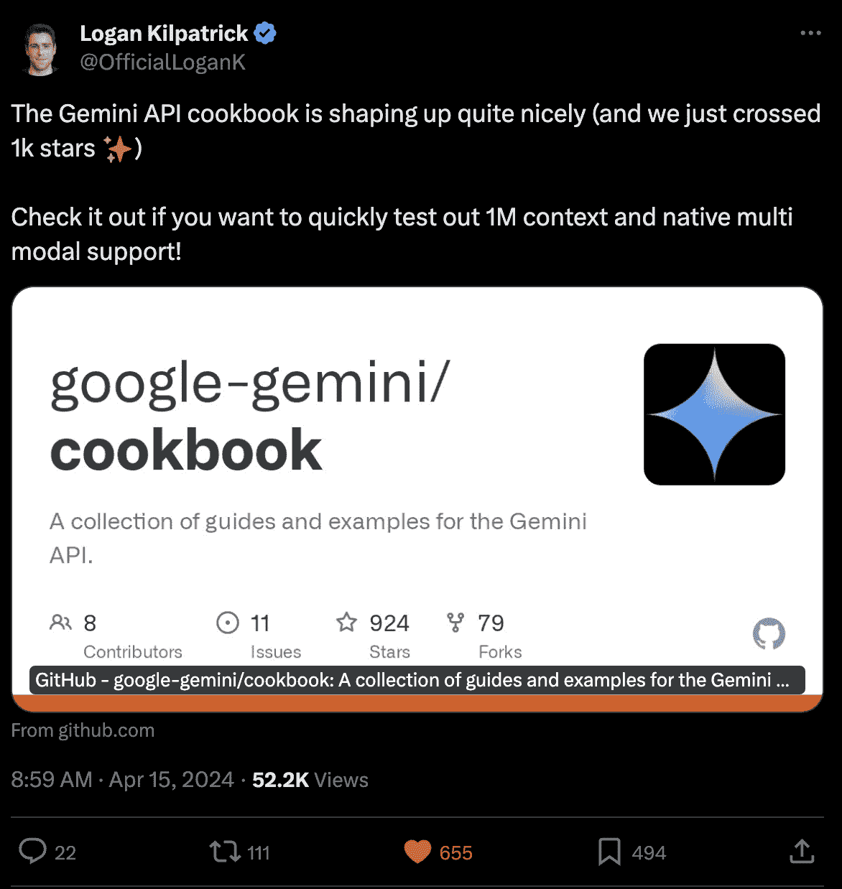

### 斯坦福大学人工智能中心发布2024 年人工智能指数报告

贡献人：

https://x.com/LuizaJarovsky/status/1779932458307248403

斯坦福大学人工智能中心发布了 2024 年人工智能指数报告,这是人工智能数据和洞察力的权威来源之一。以下是其 10 大要点:

1. 人工智能在某些任务上超过了人类,但并非在所有任务上都如此;

1. 业界继续主导前沿人工智能研究;

1. 前沿模型变得更加昂贵;

1. 美国在顶级人工智能模型方面领先于中国、欧盟和英国;

1. 严重缺乏对大型语言模型(LLM)责任的稳健和标准化评估;

1. 生成式人工智能投资飙升;

1. 数据显示:人工智能提高了员工的生产力,并带来了更高质量的工作;

1. 科学进步进一步加速,这要归功于人工智能;

1. 美国人工智能法规数量大幅增加;

1. 全球人们更加意识到人工智能的潜在影响,也更加忧虑。

[https://aiindex.stanford.edu/wp-content/uploads/2024/04/HAI_AI-Index-Report-2024.pdf](https://t.co/ZZP90z5QAg)

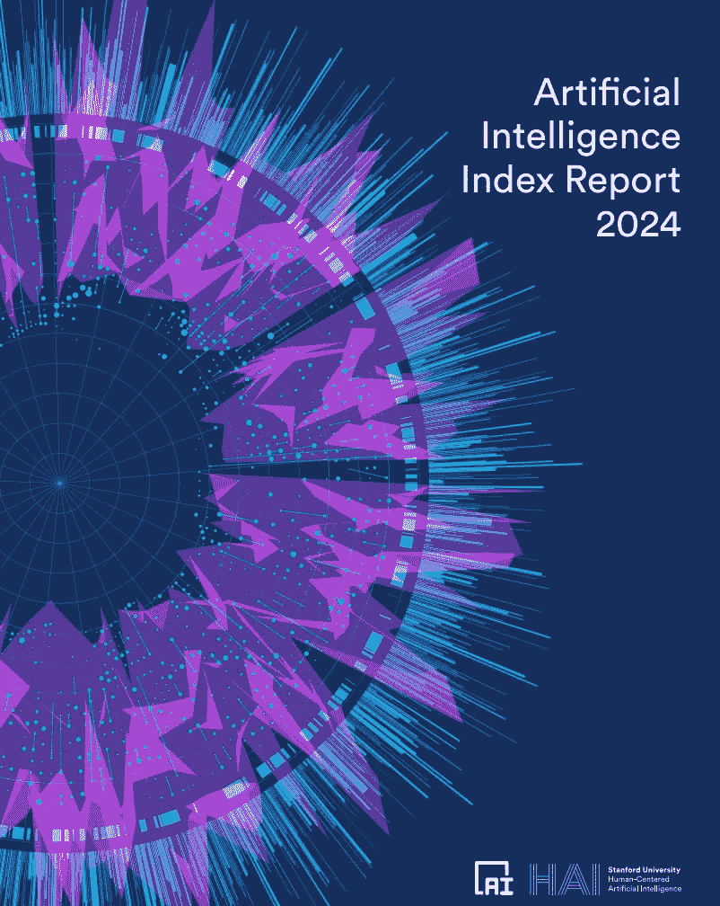

### 腾讯InstantMesh：超快速从单张图像生成高质量的 3D 模型

贡献人：

https://x.com/victormustar/status/1779896687504290245

🤯腾讯的 InstantMesh 太疯狂了 - 超快速从单张图像生成高质量的 3D 模型

⬇️下方链接 - 免费在 30 秒内从单张图像生成 3D 模型 🔥🔥InstantMesh:使用稀疏视图大型重建模型从单张图像高效生成 3D 网格

这个仓库是 InstantMesh 的官方实现,它是一个基于 LRM 架构的从单张图像高效生成 3D 网格的前馈框架。

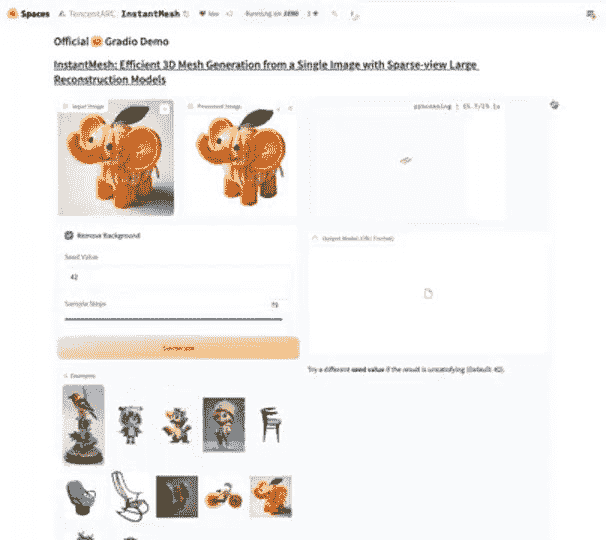

[ssstwitter.com_1713253154031.mp4](https://internal-api-drive-stream.feishu.cn/space/api/box/stream/download/all/NBqTbCoCuoKLwNxLHEncpRRZnPc)

### Lang分享 25 家早期创业公司的名单：公司员工数量不超过 50 人，都在招聘

贡献人：

https://x.com/benln/status/1779916627640799543

以下是一份包含 25 家早期创业公司的名单,所有公司的员工数量都不超过 50 人,都有显著的发展势头,并获得了像红杉资本、Index、凯鹏华盈和科斯拉等顶级投资者的支持。所有公司都在招聘。

1. Magic @magicailabs (远程/湾区)

1. Luma @lumalabsai (湾区)

1. MotherDuck @motherduck (西雅图/纽约)

1. Superblocks @superblocks (纽约)

1. Slope @slopepay (湾区)

1. Hippocratic AI @hippocraticai (湾区)

1. Warp @warpdotdev (美国远程)

1. Nitricity @NitricityInc (远程/湾区)

1. Contra @contra (远程)

1. Hebbia @HebbiaAI (纽约)

1. Hone Health @HoneHealth (湾区)

1. Flyio @flydotio (远程)

1. Keep @Keep_Card (美国/加拿大)

1. Kumo @Kumo_ai_team (湾区)

1. Anrok @anrok (远程/湾区)

1. Langchain @LangChainAI (湾区)

1. Character ai @character_ai (湾区)

1. Liquid AI @LiquidAI_ (远程)

1. Standard Bots @standardbots (纽约)

1. Navattic @navattic (纽约)

1. Sydecar @sydecario (远程)

1. Venteur @VenteurHealth (湾区)

1. Norm @normativeai (纽约)

1. Resend @resend (湾区)

1. Krea @krea_ai (湾区)

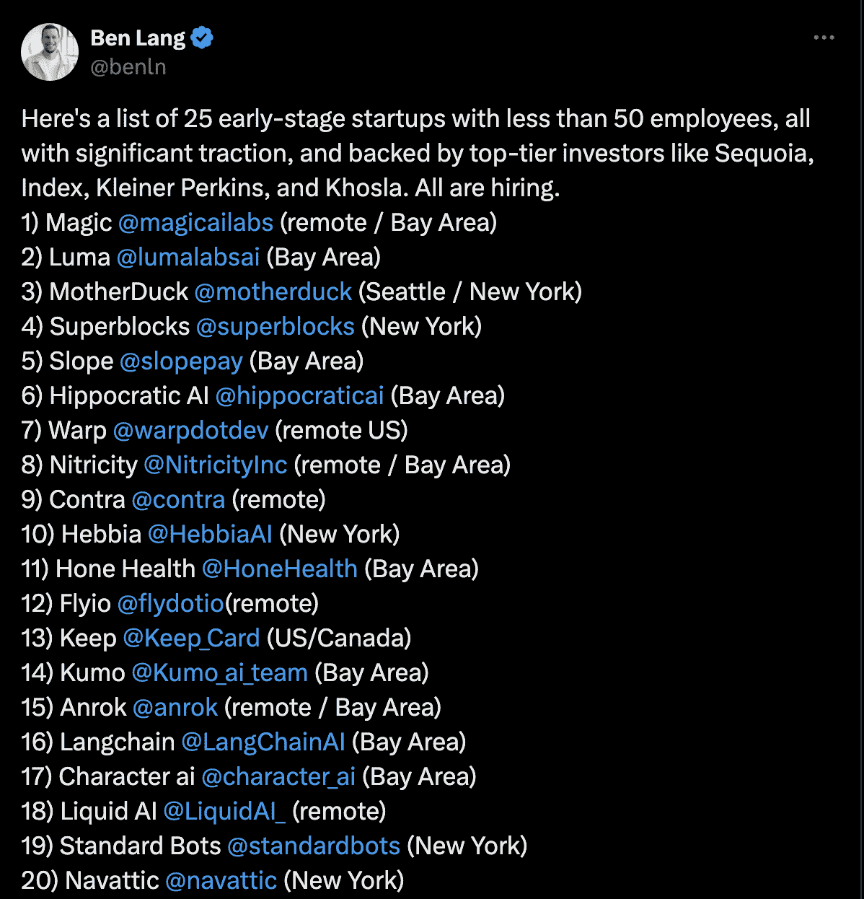

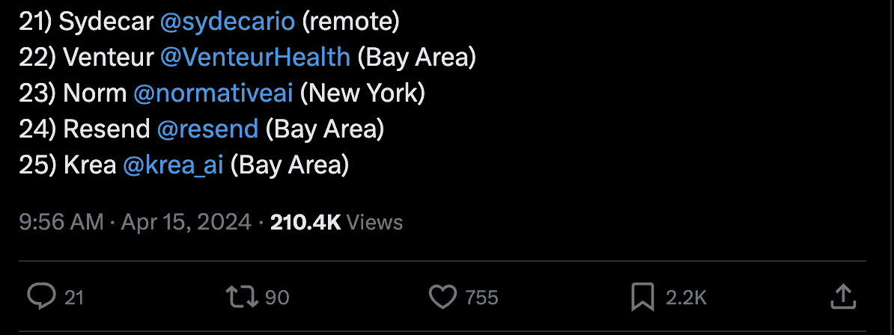

### OpenAI推出批量API：提交批量请求并给他们运行提示，获得50%的折扣

贡献人：

https://x.com/jeffintime/status/1779924149755924707

Jeff Harris：我们刚刚推出了批量 API:

+ 所有令牌享受 50% 的折扣

+ 巨大的速率限制(最多可排队 2.5 亿个 GPT-4T 令牌)

+ 上传批量文件,在 24 小时内获得完成结果

https://platform.openai.com/docs/api-reference/batch

---

Simon Willison：OpenAI 提供 50% 的折扣,如果您提交批量请求并给他们最多 24 小时的时间来为您运行提示 - 可以针对他们的任何 `/v1/chat/completions` 模型

批量请求的格式是换行符分隔的 JSON,如下所示:https://platform.openai.com/docs/api-reference/batch/requestInput

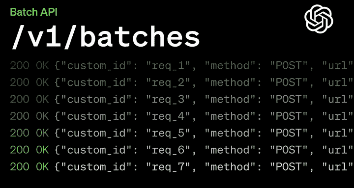

### Cohere分享：基础嵌入模型Cohere Compass私有测试版

贡献人：

https://x.com/cohere/status/1779866409784496436

宣布我们最新的基础嵌入模型Cohere Compass的私有测试版:专为电子邮件、发票、简历和支持票据等多方面数据设计,以提供卓越的企业搜索功能。

立即注册试用吧!

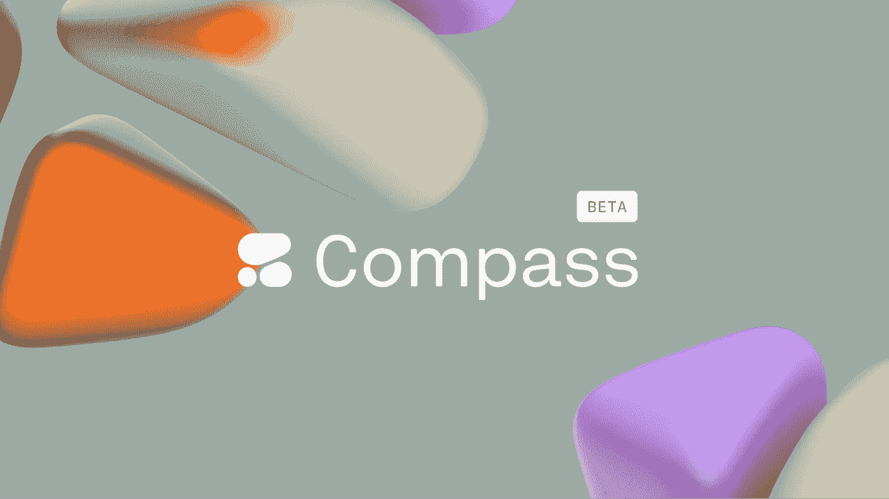

### LeCun：人工智能最终将在所有领域达到并超越人类智能，但不会在明年，也不会通过自回归LLM实现

贡献人：

https://x.com/ylecun/status/1779845304788955292

毫无疑问,人工智能最终将在所有领域达到并超越人类智能。

但这不会在明年发生。

而且,它不会通过目前流行的自回归大语言模型(尽管它们可能构成其中的一个组成部分)实现。

https://thenextweb.com/news/meta-yann-lecun-ai-behind-human-intelligence

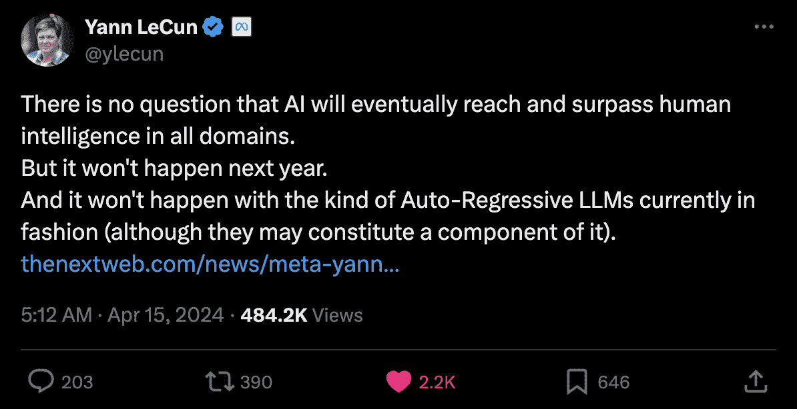

### Idefics2：目前最强大的100亿参数以下的视觉语言模型，在OCR、文档理解和视觉推理方面具有显著增强的能力

贡献人：

https://x.com/_philschmid/status/1779922877589889400

介绍Idefics2,目前最强大的100亿参数以下的视觉语言模型(VLM)!🚀Idefics2在OCR、文档理解和视觉推理方面具有显著增强的能力。💬📄🖼️

简而言之;

📚8B基础模型和指令微调变体

🖼️图像+文本输入⇒文本输出

📷图像分辨率高达980 x 980

🔍卓越的OCR、文档理解和视觉推理能力

🚀性能大致介于Gemini 1.5 Pro和Anthropic Haiku之间

👨👩👧父模型:Google SigLIP和MistralAI 7B

🤯使用Lora进行训练,发现它更加稳定

🔓Apache 2.0许可

💸GPU友好,可在消费级硬件上运行(24GB或~40GB用于`int4`的SFT)

🤗在@huggingface和Transformers中可用

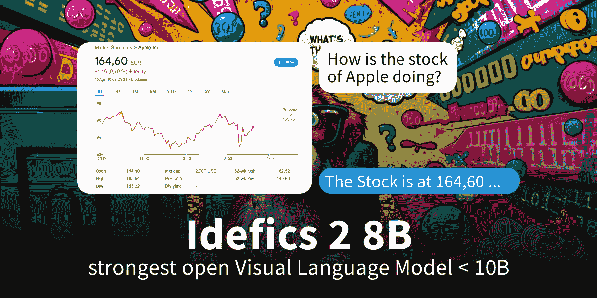

### Limitless：一款由你所见、所说、所闻驱动的个性化AI

贡献人：

https://x.com/dsiroker/status/1779857843895599383

介绍Limitless:一款由你所见、所说、所闻驱动的个性化AI。它是一个Web应用、Mac应用、Windows应用,也是一款可穿戴设备。

0:06 揭幕

0:48 为什么选择Limitless?

1:39 演示

3:05 吊坠

4:27 隐私

5:23 保密云

6:36 回放

7:12 路线图

9:25 愿景

[ssstwitter.com_1713190608264.mp4](https://internal-api-drive-stream.feishu.cn/space/api/box/stream/download/all/JomibmVDYo9abyxEnwNcwwV0nlg)

### Lilian Weng分享视频生成的扩散模型大更新

贡献人：

https://x.com/lilianweng/status/1779914184874160170

视频生成的扩散模型

近年来,扩散模型在图像合成方面展现出强大的效果。现在,研究界已经开始致力于一项更难的任务——将其用于视频生成。这个任务本身是图像情况的超集,因为图像是只有1帧的视频,而且它更具挑战性,因为:

1. 它对时间上各帧之间的时间一致性有额外的要求,这自然需要更多的世界知识被编码到模型中。

1. 与文本或图像相比,收集大量高质量、高维度的视频数据更加困难,更不用说文本-视频对了。

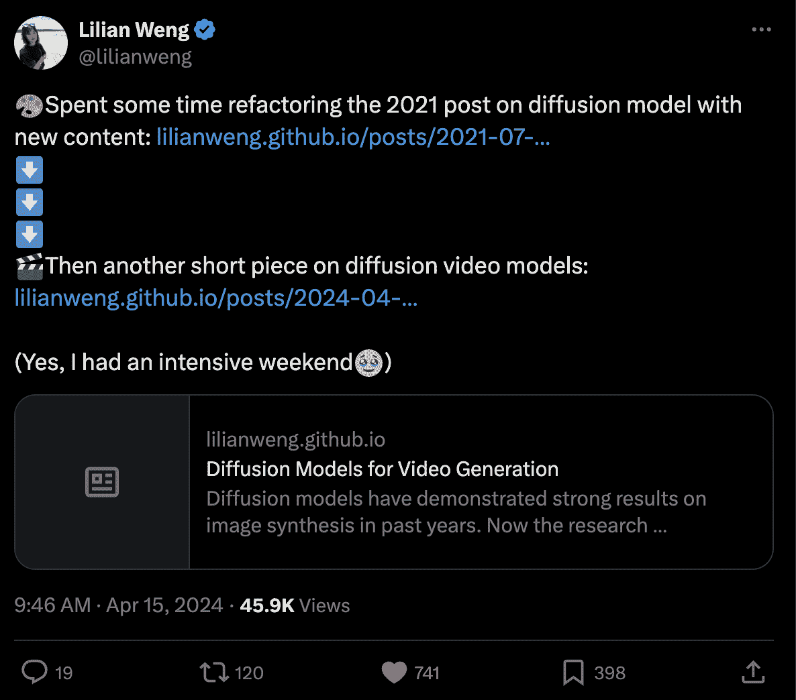

## 资讯

### 李飞飞团队年度报告揭底大模型训练成本：Gemini Ultra是GPT-4的2.5倍

贡献人：

https://mp.weixin.qq.com/s/-XIRaTujUH2poNSu0H_1tQ

如何复盘大模型技术爆发的这一年？除了直观的感受，你还需要一份系统的总结。今天，斯坦福 HAI 研究所发布了第七个年度的 AI Index 报告，这是关于人工智能行业现状的最全面的报告之一。报告指出，人工智能的发展正以惊人的速度向前推进，开发人员每月都在制造出越来越强大、越来越复杂的模型。然而，尽管发展速度加快，人工智能行业在解决人们对人工智能可解释性的担忧以及对其对人们生活影响的日益紧张方面却进展甚微。在今年的报告中，斯坦福 HAI 研究所增加了有关负责任人工智能的扩展章节，有关科学和医学领域人工智能的新章节，以及对研发、技术性能、经济、教育、政策和治理、多样性和公众舆论的综述。

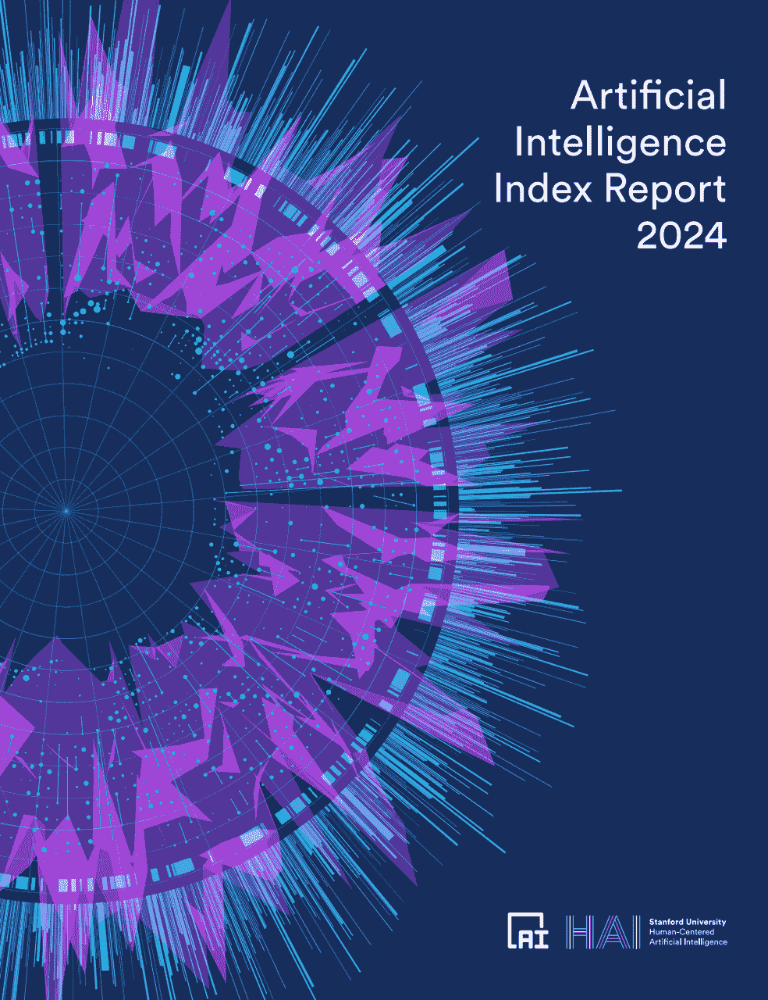

### Sora加入Adobe全家桶，视频改图加戏样样行：PR大更新预告

贡献人：

https://mp.weixin.qq.com/s/Da3lY-344jUFGqEfV8B_Qg

Adobe 全家桶马上就要拥有最先进的生成式 AI 视频创作能力了。

今天，Adobe 宣布了 Premiere Pro 全新版本的更新计划。其中包含为第三方 AI 视频生成模型添加插件，不论是 OpenAI 的 Sora还是 Runway 的 Gen-2 和 Pika，很快都将出现在 Adobe 工具体系中可被人们所用。现在，基于 Adobe 自己的大模型 Firefly 的能力，你可以在视频素材上直接添加或减少内容。

### DeepMind CEO：谷歌将在AI上投入超过1000亿美元

贡献人：

https://wallstreetcn.com/articles/3712829

AI投资军备竞赛的硝烟，已经弥漫了整个硅谷上空。每一家科技公司都在全力以赴，只为在这场革命性的技术变革中抢占制高点，而在这场竞争中略显落后的谷歌，正在迎头赶上。据媒体报道，谷歌旗下AI研究部门DeepMind首席执行官Demis Hassabis当地时间周一在温哥华举行的TED大会上表示，随着时间的推移，谷歌将花费超过1000亿美元开发人工智能技术。

### Sam Altman & Brad Lightcap 最新专访：哪些公司会被 OpenAI 碾压？

贡献人：

https://mp.weixin.qq.com/s/jWaDVmimkWBMT64h6wXCEA

本周二， 20VC 主理人 Harry Stebbings 分享了与 OpenAI CEO Sam Altman 以及COO Brad Lightcap 最新对话，并探讨了 OpenAI 的愿景、战略以及对 AI 行业的深刻见解。

Sam Altman 强调了两种建立在 AI 基础上的策略，一种是假设 AI 模型的性能不会有显著提升，另一种则是押注于模型将持续改进。

他认为，尽管许多初创企业选择了前者，但世界上 95% 的人应该相信后者，即 AI 将持续进步。他的信念源自于深度学习的显著效果以及模型随规模扩大而提升的性能。这种信念不仅推动了 OpenAI 的成立，也成为了他们使命的核心。

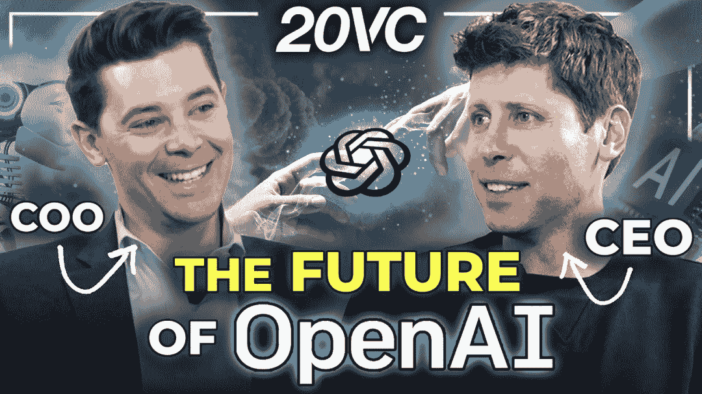

### OpenAI 推出 Batch 批处理 API：半价折扣，24 小时内输出结果

贡献人：

https://www.ithome.com/0/762/140.htm

OpenAI 今天凌晨面向开发者推出 `Batch` 批处理 API，可在 24 小时内给出结果，并提供 API 半价折扣。新的 `Batch` API 适用于异步任务处理，如当开发者需要处理大量文本、图片、摘要时，就可以使用该 API，OpenAI 会在 24 小时内给出处理结果。这样 OpenAI 可以在非高峰期处理，节约服务器资源，并为开发者提供半价优惠，解锁更高的速率限制。

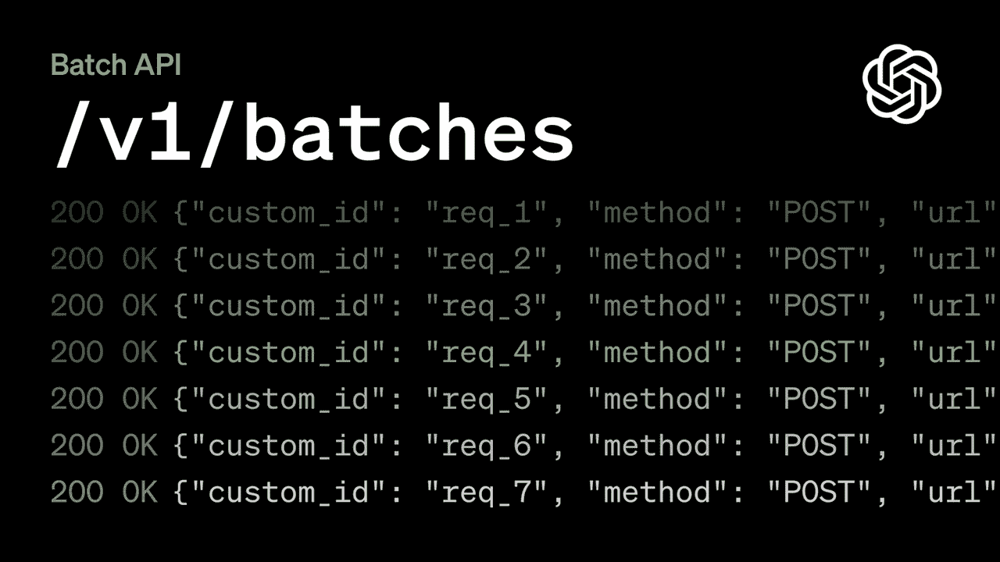

### 百度发布新一代智能计算操作系统！定名 `万源`

贡献人：

`https://news.mydrivers.com/1/974/974626.htm`

在今天的2024百度Create `AI`开发者大会上，百度集团执行副总裁、百度智能云事业群总裁沈抖宣布，百度新一代智能计算操作系统——`万源`正式发布。据介绍，在内核层面，`万源`可将现有的算力资源发挥到极致，并且能自由选择不同芯片组合。

### DeepMind升级`Transformer`，前向通过`FLOPs`最多可降一半

贡献人：

`https://mp.weixin.qq.com/s/nvhXCywpZaOhxWAQWY7PPw`

近日，Google DeepMind研究了这个问题，他们希望使用更低的计算预算来缩减 `Transformer` 使用的计算量。他们设想：在每一层中，网络必须学会为每个 `token` 做决策，从而动态地分配可用计算预算。在他们的具体实现中，总计算量由用户在训练之前设定并且不再更改，而非网络工作时执行决策的函数。这样一来，便可以提前预知并利用硬件效率收益（比如内存足迹减少量或每次前向传播的 `FLOPs` 减少量）。该团队的实验表明：可以在不损害网络整体性能的前提下获得这些收益。DeepMind 的这个团队采用了类似于混合专家（`MoE`） `Transformer` 的方法，其中会在整个网络深度上执行动态 `token` 层面的路由决策。而与 `MoE` 不同的是，这里他们的选择是：要么是将计算应用于 `token`（和标准 `Transformer` 一样），要么就是通过一个残差连接绕过它（保持不变，节省计算）。另一个与 `MoE` 的不同之处是：这里是将这种路由机制同时用在 `MLP` 和多头注意力上。因此，这也会影响网络处理的键值和查询，因此该路由不仅要决定更新哪些 `token`，还要决定哪些 `token` 可供关注。DeepMind 将这一策略命名为 `Mixture-of-Depths`（`MoD`），以突显这一事实：各个 `token` 在 `Transformer` 深度上通过不同数量的层或模块。

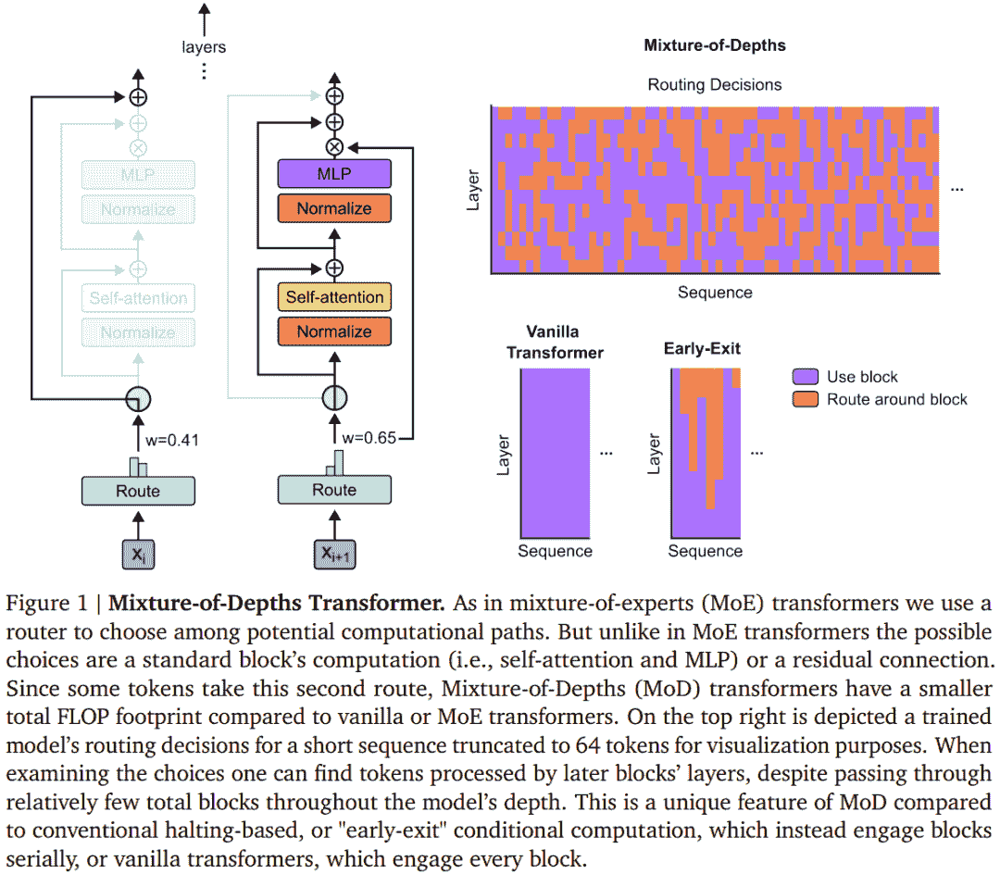

### 模型被投毒攻击，如今有了新的安全手段，还被`AI`顶刊接收

贡献人：

`https://mp.weixin.qq.com/s/46bzqIHjYFOMZRUuJGPPow`

在深度学习时代，联邦学习（`FL`）提供了一种分布式的协作学习的方法，允许多机构数据所有者或客户在不泄漏数据隐私的情况下协作训练机器学习模型。然而，大多数现有的 `FL` 方法依赖于集中式服务器进行全局模型聚合，从而导致单点故障。这使得系统在与不诚实的客户打交道时容易受到恶意攻击。本文中，`FLock` 系统采用了点对点投票机制和奖励与削减机制，这些机制由链上智能合约提供支持，以检测和阻止恶意行为。`FLock` 理论和实证分析都证明了所提出方法的有效性，表明该框架对于恶意客户端行为具有鲁棒性。

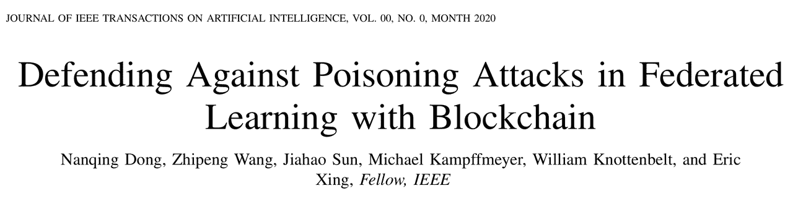

### 极长序列、极快速度：面向新一代高效大语言模型的`LASP`序列并行

贡献人：

`https://mp.weixin.qq.com/s/wPJsmgSAYgh3Si2eZ0_HzA`

极长的上下文可以极大拓展大模型的生产力价值。随着 `AI` 的普及，用户已经不再满足于调戏大模型几个脑筋急转弯，用户开始渴望利用大模型来真正提高生产力。新型高效序列建模方法比如：`Lightning Attention` (`TransNormerLLM`), `State Space Modeling` (`Mamba`), `Linear RNN` (`RWKV`, `HGRN`, `Griffin`) 等最近成为炙手可热的研究方向。研究人员渴望通过改造已经 7 岁高龄的 `Transformer` 架构，获得性能与之旗鼓相当，但复杂度仅为线性的新型架构。这类方法专注于模型架构设计，并提供了基于 `CUDA` 或 `Triton` 的硬件友好实现，使其能够像 `FlashAttention` 一样在单卡 `GPU` 内部高效计算。来自上海人工智能实验室的研究人员提出了 `Linear Attention Sequence Parallelism` (`LASP`) 方法以充分利用 `Linear Attention` 的线性右乘特性实现高效的序列并行计算。在 128 卡 `A100 80G` `GPU`、`TransNormerLLM` `1B` 模型、`FSDP` backend 的配置下，`LASP` 可以最高将序列长度扩展至 4096K，即 4M。与成熟的序列并行方法相比，`LASP` 可训练的最长序列长度是 `Megatron-SP` 的 8 倍、`DeepSpeed Ulysses` 的 4 倍，速度则分别快了 136% 和 38%。值得注意的是，虽然方法的名字包含 `Linear Attention`，`LASP` 并不局限于 `Linear Attention` 方法，而是可以广泛应用于包括 `Lightning Attention` (`TransNormerLLM`), `State Space Modeling` (`Mamba`), `Linear RNN` (`RWKV`, `HGRN`, `Griffin`) 等在内的线性序列建模方法。

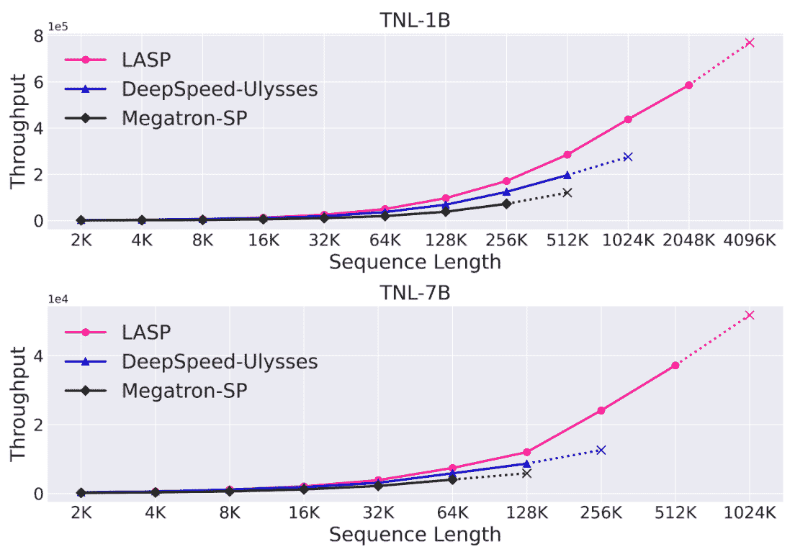

### 药物分子设计新策略，微软条件扩散模型`DiffLinker`登`Nature`子刊

贡献人：

`https://mp.weixin.qq.com/s/B_744fe95wZkWNdA6OhVew`

药理学领域的化学空间高达 `10^60`，在广阔的化学空间中进行搜索，给药物设计带来了巨大的挑战。基于片段的药物发现一直是早期药物开发的有效范例。然而，该领域面临的一个挑战是，如何设计断开的感兴趣分子片段之间的连接子（`linker`），生成化学上合理的候选药物分子。在此，来自微软研究院科学智能中心（`AI4Science`）、洛桑联邦理工学院、牛津大学和 `MIT` 的研究团队，提出了一种用于分子 `linker` 设计的 `E(3)` 等变三维条件扩散模型 `DiffLinker`。与以前只能连接分子片段对的方法不同，新方法可以连接任意数量的片段。此外，模型会自动确定 `linker` 中的原子数量及其与输入片段的连接点。`DiffLinker` 在标准数据集上优于其他方法，可生成更多样化且可合成的分子。在实际应用中对其方法进行实验测试，表明它可以成功生成以靶标蛋白口袋为条件的有效 `linker`。

### 微软将向阿联酋`AI`公司`G42`投资15亿美元，并持有少数股权

贡献人：

微软周二在一份声明中表示，该公司将向总部位于阿联酋的人工智能公司`G42`投资15亿美元，让这家美国科技巨头获得`G42`的少数股权和董事会席位。根据合作伙伴关系，`G42`将在微软的云计算平台`Azure`上运行其人工智能应用和服务，为全球公共部门客户和大型企业提供先进的人工智能解决方案。将担任`G42`董事会成员的微软总裁Brad Smith表示：“我们将与阿联酋和美国政府密切协调，将世界一流的技术与世界领先的安全、可信和负责任的人工智能标准结合起来。”两家公司将共同努力，为中东、中亚和非洲国家带来先进的人工智能和数字基础设施。微软和`G42`还将支持为开发人员设立一个10亿美元的基金，以提高阿联酋和更广泛地区的人工智能技能。

# 论文

## `Megalodon`：具有无限上下文长度的高效`LLM`预训练和推理

贡献人：

链接：`http://arxiv.org/abs/2404.08801v1`

摘要：`Transformer` 模型存在的二次复杂度和长度外推能力不足限制了其处理长序列的能力。为解决这一问题，本文引入了`Megalodon`，一个用于高效序列建模的神经架构，能够处理无限长度的上下文。`Megalodon`基于`Mega`架构，并引入了多个技术组件以提升其性能和稳定性。在与`Llama2`的对比实验中，`Megalodon`在拥有70亿参数和2万亿训练 `token` 的规模上实现了比 `Transformer` 更高的效率。其训练损失为1.70，介于 `Llama2-7B`（1.75）和 `13B`（1.67）之间。GitHub 代码链接：`https://github.com/XuezheMax/megalodon`

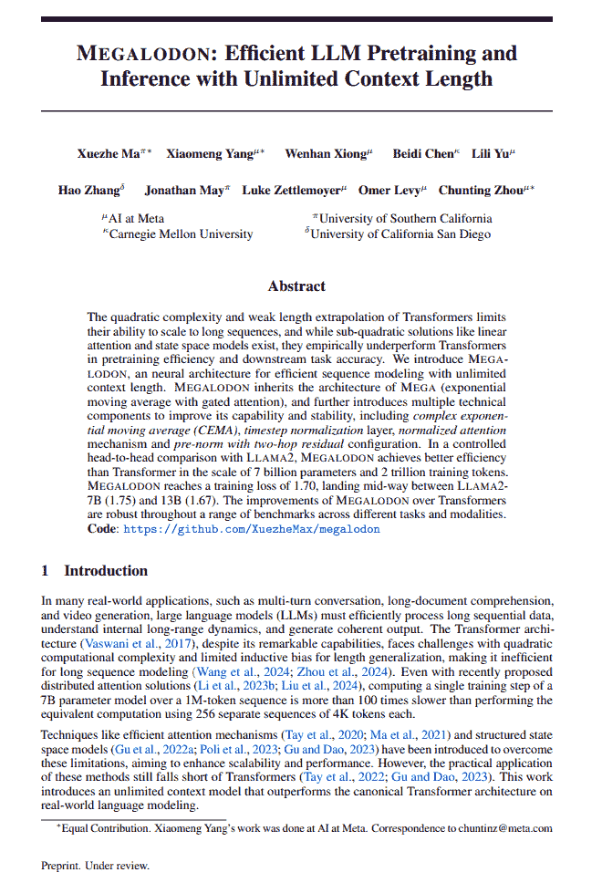

## `TransformerFAM`：反馈注意力即为工作记忆

贡献人：

链接：`http://arxiv.org/abs/2404.09173v1`

尽管`Transformer`已经彻底改变了深度学习，但它们的二次注意力复杂性阻碍了它们处理无限长输入的能力。我们提出了一种新颖的`Transformer`架构Feedback Attention Memory（`FAM`），利用反馈循环使网络能够关注自己的潜在表示。这种设计促进了`Transformer`内部工作记忆的涌现，使其能够处理无限长的序列。`TransformerFAM`不需要额外的权重，可以与预训练模型无缝集成。我们的实验表明，`TransformerFAM`显著改善了各种模型大小（`1B`、`8B`和`24B`）上长上下文任务的`Transformer`性能。这些结果展示了赋予大语言模型（`LLMs`）处理无限长序列的潜力。

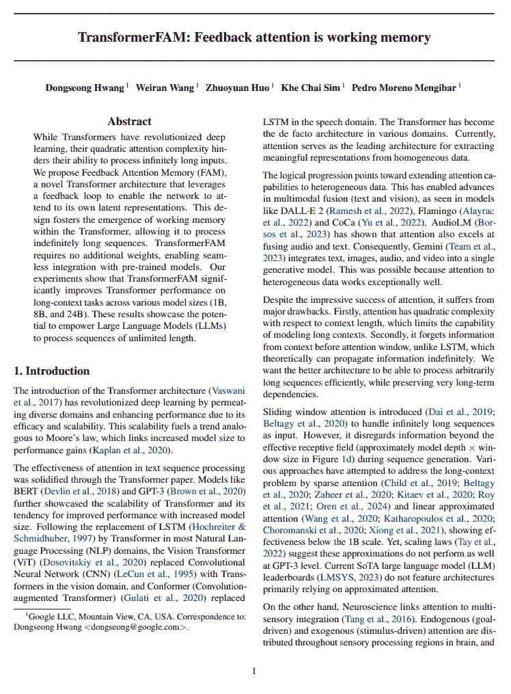

## 压缩线性表达智能

贡献人：

链接：`http://arxiv.org/abs/2404.09937v1`

摘要：有一种观念认为，学会良好地压缩将导致智能。最近，语言建模被证明与压缩等效，这为大型语言模型（`LLMs`）的成功提供了令人信服的理由：发展更先进的语言模型实质上是增强了压缩，从而促进了智能。尽管存在这样吸引人的讨论，但很少有实证证据显示出压缩与智能之间的相互作用。在这项工作中，我们在`LLMs`的背景下检查了它们之间的关系，将`LLMs`视为数据压缩器。鉴于“智能”的抽象概念，我们采用下游基准测试得分的平均值作为替代，特别针对知识和常识、编码以及数学推理相关的智能。在12个基准测试中，我们研究了来自不同组织的30个公共`LLMs`。值得注意的是，我们发现`LLMs`的智能——通过平均基准测试得分反映——与它们压缩外部文本语料库的能力几乎呈线性相关。这些结果提供了具体证据，支持了优越的压缩表明更大的智能的观念。此外，我们的发现表明，作为从原始文本语料库中派生出的无监督指标，压缩效率是一种与模型能力线性相关的可靠评估措施。我们公开了我们的压缩数据集以及我们的数据收集管道，以便未来研究人员能够适当评估压缩。

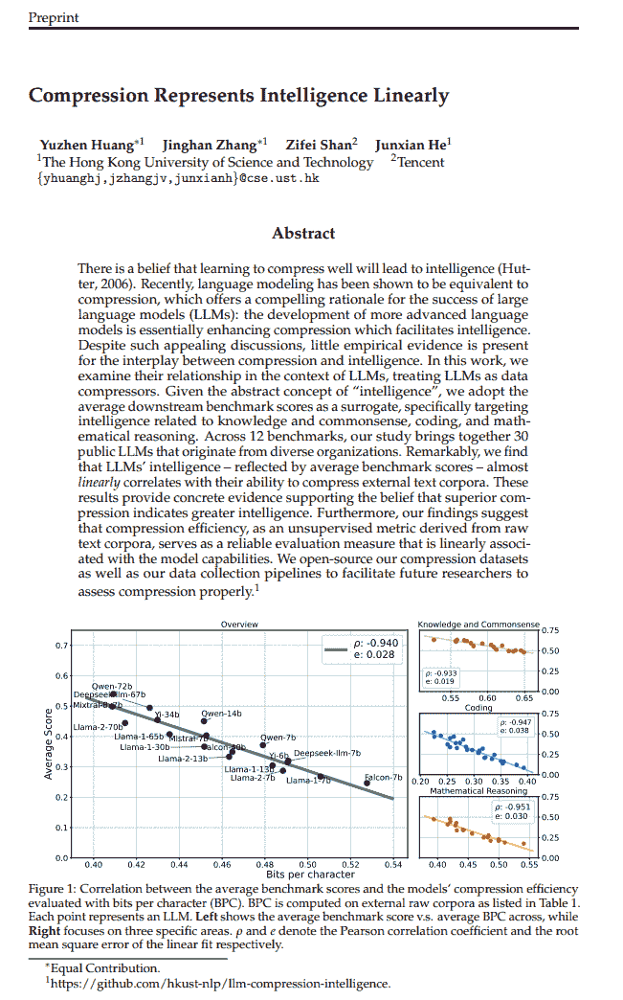

## 大语言模型在上下文中的召回是与提示相关的

贡献人：

链接：`http://arxiv.org/abs/2404.08865v1`

大语言模型（`LLM`）的普及突显了进行彻底评估以区分它们的比较优势、局限性和最佳用例的重要性。特别重要的是评估它们正确检索给定提示中包含的信息的能力。模型执行此操作的能力显著影响其利用上下文细节的效果，从而影响其在实际应用中的实用性和可靠性。

我们的研究使用草堆中的针方法分析了各种`LLM`的上下文召回性能。在这种方法中，一个事实（"针"）嵌入在一块填充文本（"草堆"）中，要求模型检索。我们评估每个模型在各种草堆长度和不同针放置下的召回性能，以识别性能模式。这项研究表明，`LLM`的召回能力不仅取决于提示的内容，还可能因其训练数据中的偏见而受损。相反，调整模型架构、训练策略或微调可以改善性能。我们的分析揭示了`LLM`行为，为开发更有效的`LLM`应用提供了方向。

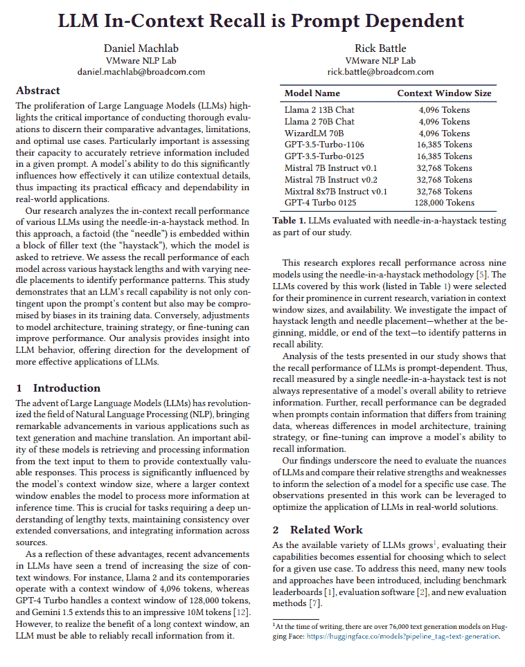

## 关于多模态大语言模型的推测性解码

贡献人：

链接：`http://arxiv.org/abs/2404.08856v1`

摘要：多模态大语言模型（`MLLMs`）的推理速度较慢，因为它们具有大型语言模型骨干，存在内存带宽瓶颈，并且会自动逐词生成`token`。本文探讨了对`MLLMs`，特别是`LLaVA 7B`模型应用推测解码以增强推理效率的方法。我们表明，仅具有语言模型的模型可以作为`LLaVA 7B`的推测解码的良好草稿模型，绕过了从草稿模型获取图像`token`及其相关处理组件的需要。我们在三种不同任务上的实验表明，通过从头开始训练的一个包含1.15亿参数的语言模型，推测解码能够实现多达2.37倍的内存限制加速。此外，我们引入了一个紧凑的`LLaVA`草稿模型，包括一个图像适配器，能够在图像字幕中显示边缘性能提升，同时在其他任务中保持可比的结果。

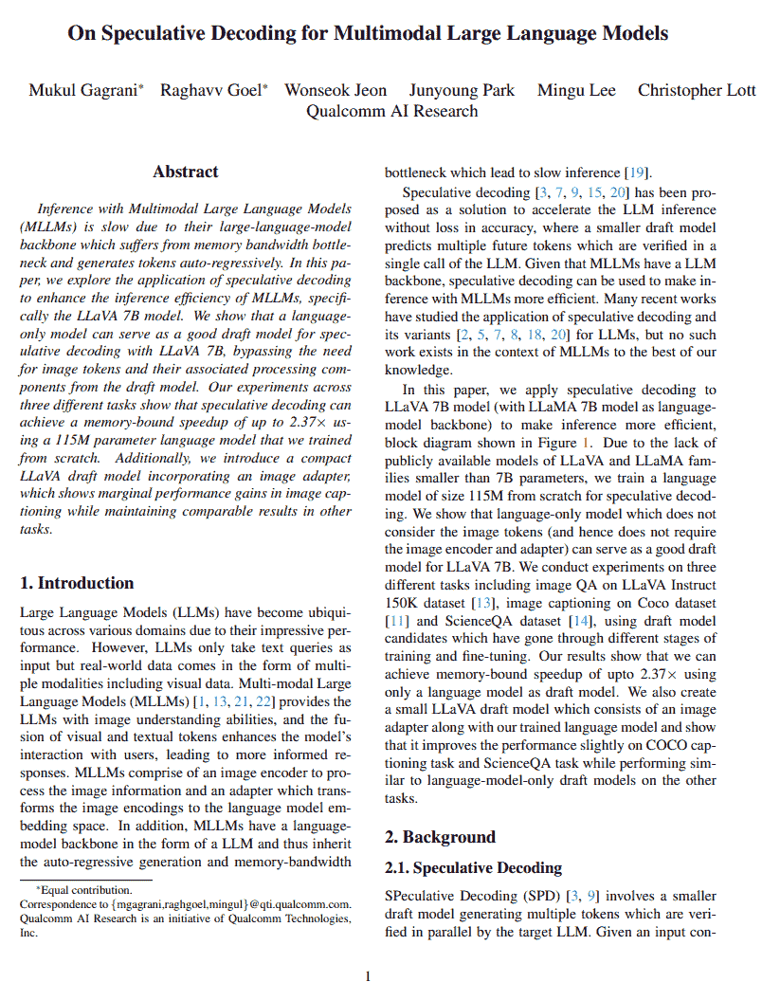

## 状态空间模型中状态的错觉

贡献人：

链接：`http://arxiv.org/abs/2404.08819v1`

摘要：状态空间模型（`SSM`）已经成为与以前普遍的`Transformer`架构相比，构建大型语言模型（`LLM`）的潜在替代架构。`Transformer`的一个理论弱点是它们无法表达某些类型的顺序计算和状态跟踪，而`SSM`则通过其与循环神经网络（`RNNs`）的紧密结构相似性来明确设计以解决这个问题。但`SSM`是否真正具有在状态跟踪方面的优势呢？令人惊讶的是，答案是否定的。我们的分析显示，与`Transformer`非常类似，`SSM`的表达能力也受到限制：`SSM`无法表达超出复杂度类 `` `\mathsf{TC}^0` `` 的计算。特别是，这意味着它们无法解决简单的状态跟踪问题，例如排列组合。因此，`SSM`无法准确跟踪棋盘上的某些符号注释的走法，评估代码，或者在长篇故事中追踪实体。我们的实验结果也显示，`SSM`类似于`Mamba`风格的确在状态跟踪方面遇到困难。因此，尽管其循环的构成，`SSM`中的“状态”是一种幻觉：`SSM`具有类似于`Transformer`等非循环模型的表达限制，这可能从根本上限制了它们解决现实世界状态跟踪问题的能力。

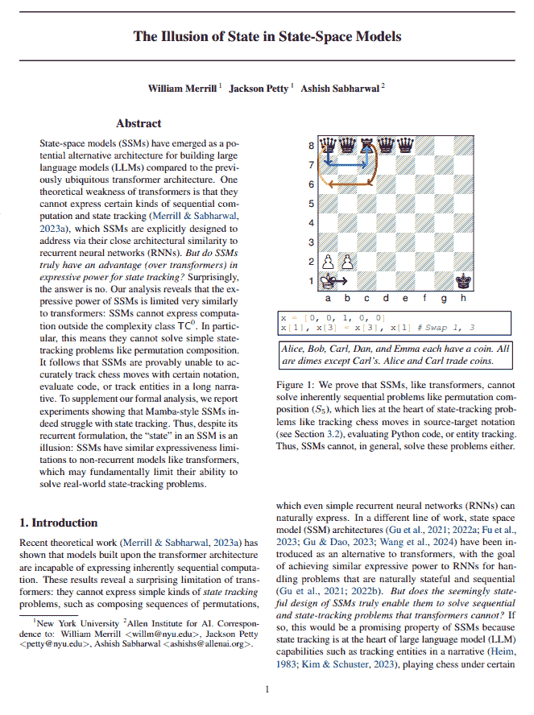

## 英语是新的编程语言吗？伪码工程呢？

贡献人：

链接：`http://arxiv.org/abs/2404.08684v1`

背景：人工智能（`AI`）与自然语言处理（`NLP`）结合，特别是通过使用聊天机器人，具有革命性的潜力和独特挑战。本研究旨在调查不同输入形式对`OpenAI`领先的语言模型`ChatGPT`在理解和执行复杂多意图任务方面的影响。设计：采用案例研究方法，辅以话语分析，研究分析了`ChatGPT`对自然语言和伪代码输入的响应。研究具体考察了模型在意图理解、可解释性、完整性和创造性等四个方面的能力。结果：研究发现，伪代码输入显著提高了`ChatGPT`响应的清晰度和确定性，减少了自然语言固有的模糊性。增强的自然语言，通过提示工程技术进行结构化，同样提高了模型的可解释性和创造性。结论：该研究强调了伪代码工程在改进人工智能交互和实现更确定性、简洁且直接结果方面的潜力，倡导其在需要精确`AI`响应的跨学科领域的广泛应用。

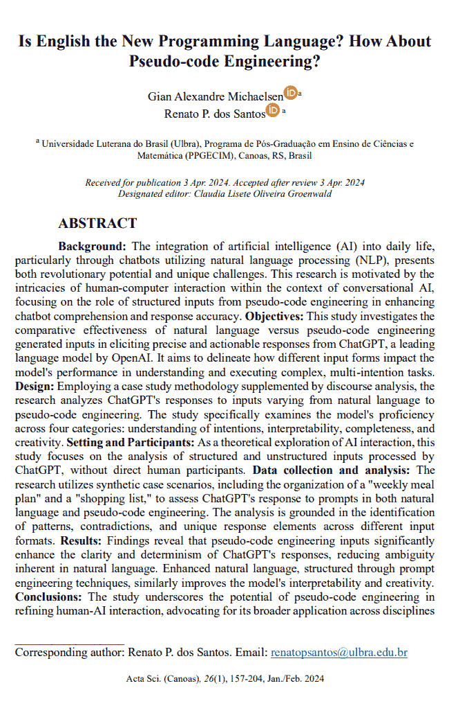

## 一种合成数据生成模型的评估框架

贡献人：

链接：`http://arxiv.org/abs/2404.08866v1`

摘要：如今，使用合成数据作为一种成本效益的策略，已经被广泛应用于增强数据增广，提高机器学习模型性能以及解决与敏感数据隐私相关的问题。因此，保证生成的合成数据质量，准确代表真实数据，是至关重要的。本工作提出了一种新的框架，用于评估合成数据生成模型开发高质量合成数据的能力。所提出的方法能够提供关于评估框架和比较模型排名的强大统计和理论信息。两个使用案例场景展示了所提出框架评估合成数据生成模型生成高质量数据的能力。实现代码可在`https://github.com/novelcore/synthetic_data_evaluation_framework`中找到。

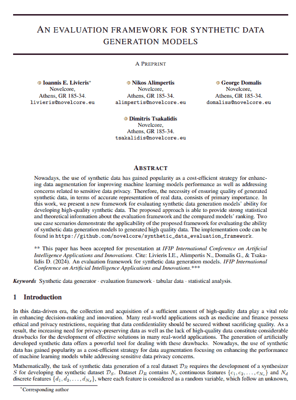

## 大语言模型中的故障`token`：分类分类与有效检测

贡献人：

链接：`http://arxiv.org/abs/2404.09894v1`

随着大语言模型（`LLMs`）在各个领域的应用不断扩大，有必要全面调查它们的意想不到的行为和相应的结果。在本研究中，我们介绍并系统地探讨了“故障标记”，这些标记是由已建立的标记器产生的异常标记，可能会损害模型的响应质量。我们对七种热门的`LLMs`进行了实验，使用了三种不同的标记器，共涉及了182,517个标记。我们对识别的故障标记进行了分类，并研究了`LLMs`与故障标记交互时表现出的症状。基于我们的观察结果，故障标记倾向于在嵌入空间中聚类，我们提出了`GlitchHunter`，一种新颖的基于迭代聚类的技术，用于有效检测故障标记。评估表明，我们的方法在八个开源`LLMs`上明显优于三种基准方法。据我们所知，这是关于故障标记的首个全面研究。我们的新检测方法进一步提供了有价值的见解，以减轻`LLMs`中与标记化相关的错误。

# 产品

## `Airchat`

贡献人：

`https://www.air.chat/`

`Airchat` 是一个新的社交平台，它提供了基于语音的交流方式，并且似乎有一些独特的功能，比如实时语音转文本功能。作为一款`AI` 赋能，基于话题，并以语音为主要内容形态的异步社交产品，到底怎么样呢？大家快来体验下～

## `Packify.ai`

贡献人：

`https://www.packify.ai/`

`Packify.ai` 是一款人工智能包装设计软件，它允许普通人通过简单的交流方式创造性地设计他们的产品包装，并提供了一项用于电子商务产品摄影的人工智能产品拍摄功能。

# HuggingFace&Github

## `MiniCPM-V`和`OmniLMM`

贡献人；

`https://github.com/OpenBMB/MiniCPM-V`

`MiniCPM-V`和`OmniLMM`是面向图文理解的开源多模态大模型系列。该系列模型接受图像和文本输入，并提供高质量的文本输出。我们发布了两个版本的模型，旨在实现领先的性能和高效的部署：

+   `MiniCPM-V 2.8B`：可在终端设备上部署的先进多模态大模型。最新发布的`MiniCPM-V 2.0`可以接受 180 万像素的任意长宽比图像输入，实现了和`Gemini Pro`相近的场景文字识别能力以及和`GPT-4V`相匹的低幻觉率。

+   `OmniLMM-12B`：相比同规模其他模型在多个基准测试中具有领先性能，实现了相比`GPT-4V`更低的幻觉率。

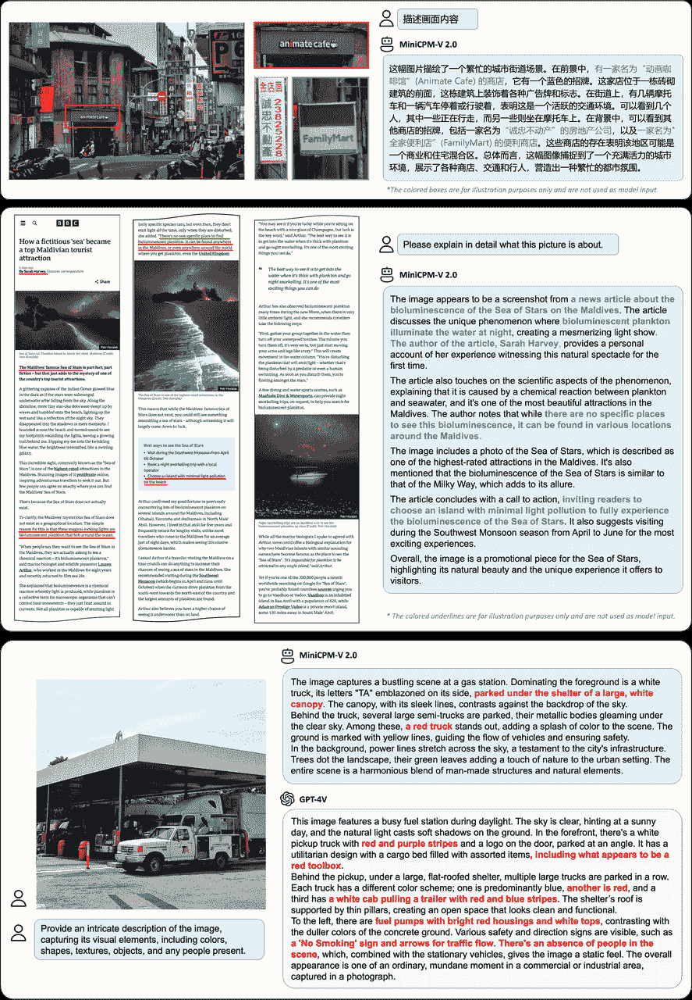

## `llm-universe`——适合小白的入门教程

贡献人：

`https://github.com/datawhalechina/llm-universe`

这个项目是一个面向小白开发者的大模型应用开发教程，旨在基于阿里云服务器，结合个人知识库助手项目，通过一个课程完成大模型开发的重点入门，主要内容包括：

1.  `大模型简介`，何为大模型、大模型特点是什么、`LangChain` 是什么，如何开发一个 `LLM` 应用，针对小白开发者的简单介绍；

2.  `如何调用大模型 API`，本节介绍了国内外知名大模型产品 `API` 的多种调用方式，包括调用原生 `API`、封装为 `LangChain LLM`、封装为 `Fastapi` 等调用方式，同时将包括百度文心、讯飞星火、智谱AI等多种大模型 `API` 进行了统一形式封装；

3.  `知识库搭建`，不同类型知识库文档的加载、处理，向量数据库的搭建；

4.  `构建 RAG 应用`，包括将 `LLM` 接入到 `LangChain` 构建检索问答链，使用 `Streamlit` 进行应用部署

5.  `验证迭代`，大模型开发如何实现验证迭代，一般的评估方法有什么；

# 投融资

## 王小川又融资，百川智能估值130亿

贡献人：

`https://mp.weixin.qq.com/s/dDRZ2_MwtoBd63oPHHe9SQ`

王小川创办的百川智能完成新一轮数亿美元融资，将成为2024年国内AI领域最大的一笔融资，估值已超过18亿美元（约130亿人民币）。百川智能是王小川在卖掉搜狗后的第二次创业，致力于打造中国版的`OpenAI`。新一轮融资参与者包括阿里、腾讯和小米等顶级投资机构。百川智能将资金用于推动`AI`大模型技术的商业化和市场扩展，特别是在医疗数据集和大语言模型方面的应用开发。

公司官网：`https://www.baichuan-ai.com/home`

## `Descript`全新发布，由`OpenAI`创业基金支持

贡献人：

`https://www.descript.com/blog/article/all-new-descript-backed-by-openai-startup-fund`

`Descript`宣布推出全新版本，并由`OpenAI`创业基金领投其5000万美元的C轮融资。这次融资将加速`Descript`的产品开发和市场扩张，特别是在音视频编辑工具的`AI`集成上。新版`Descript`通过简化编辑过程，使用户能像处理文档一样编辑音视频内容，进一步增强了`AI`的应用，如自动去除填充词和降噪等功能。此次合作预示着`AI`技术在创意内容制作领域的深入应用和未来潜力的拓展。

公司官网：`https://www.descript.com/`

## 微软投资15亿美元助力阿布扎比`G42`加速`AI`发展和全球扩张

贡献人：

`https://www.g42.ai/resources/news/microsoft-invests-abu-dhabis-g42`

微软宣布向阿布扎比的人工智能技术控股公司`G42`投资15亿美元，以加速`AI`技术的发展及全球扩张。此次战略投资将加强两家公司在全球`AI`技术和服务领域的合作，尤其是在中东、中亚和非洲地区。此外，`G42`将在微软`Azure`平台上运行其`AI`应用和服务，共同为全球公共部门客户和大型企业提供先进的`AI`解决方案。该合作还包括为开发者建立价值10亿美元的基金。微软副主席兼总裁Brad Smith将加入`G42`董事会。

公司官网：`https://www.g42.ai/`

## `Paraform`为连接初创企业与招聘人员网络筹集360万美元种子轮资金

贡献人：

`https://techcrunch.com/2024/04/15/paraform-a-recruiting-platform-that-connects-recruiters-and-startups-raises-funding/`

`Paraform`，一家针对初创企业的招聘平台，成功筹集了360万美元的种子轮融资，该轮由Kevin Hartz的`A*`领投。此次融资旨在利用被裁员招聘人员的资源，为初创企业提供人才寻找服务并拓展人才网络。`Paraform`平台已支持超过200家公司招聘，并计划利用新资本扩展美国市场及其他国家，预计今年团队规模将翻倍。

公司官网：`https://www.paraform.com/`

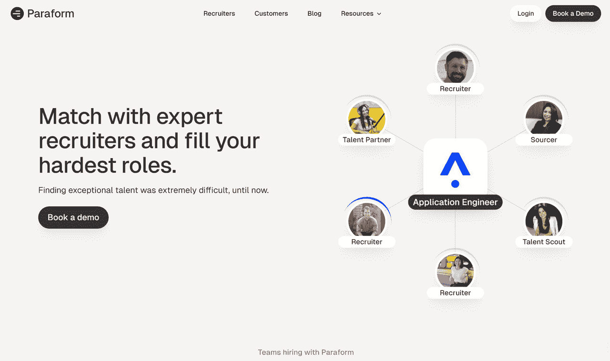

## `Lawhive`为法律`AI`平台筹集950万英镑

贡献人：

`https://techcrunch.com/2024/04/15/lawhive-raises-12m-to-expand-its-legaltech-ai-platform-for-small-firms/`

`Lawhive`成功从`Google Ventures`筹集950万英镑用于其法律`AI`平台。这次种子轮融资紧随2022年4月的150万英镑融资。该平台推出了名为`Lawrence`的生成式`AI`程序，专门自动化律师的日常重复性法律任务，如客户身份验证、客户入职和文件收集。`Lawrence`被设计为能够支持律师处理单调重复的任务，增强法律服务的访问性和效率。

公司官网：`https://lawhive.co.uk/`

# 信号

## `Encoder-Decoder` 结构

+   `Eleuther AI` 重新训了 `Pile T5`，强化其代码能力

+   `Reka` 系列模型的结构是 `T5`

`T5` 比较适合有监督的`input-output`任务；多模态下有一个`encoder`可能也更加适合

## `Grok-1.5` Vision Preview

`https://x.ai/blog/grok-1.5v`

马斯克的`x.ai`近期announce了`Grok-1.5 Vision`，一个多模态模型

这个模型重点强调对`documents`, `diagrams`, `charts`, `screenshots`, and `photographs`的理解能力

模型目前还暂时未开放给公众使用

可能是吸取了之前`Gemini`的经验，这次模型的榜单测评，特别强调了使用`zero-shot setting without chain-of-thought prompting`。和`GPT-4V`对比下来，评测结果有高有低，显得可信度较高

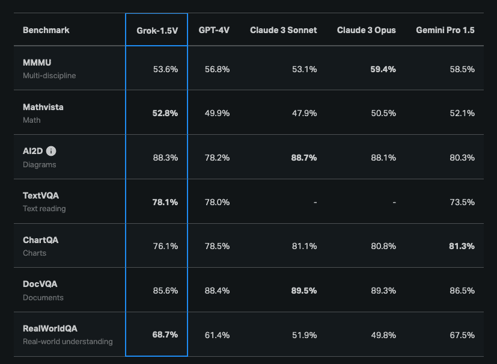

## `Grok-1.5` RealWorld QA：真实世界理解的评测集

`https://data.x.ai/realworldqa.zip`

该评测集包含 700 多张真实世界的图片，考察智能体包括`3D`真实世界空间理解在内的一系列能力

据显示，`Grok-1.5`在该评测集上的评分略高于`Gemini Pro 1.5`，领先`Claude 3`、`GPT-4v`等多模态大模型

但单从官网给出的例子来看，多为真实世界的非复杂情形（比如图1对近大远小的区分并不tricky，图2并不需要理解车道`vanishing point`也可以猜出left，图3-4不进行`2D-3D`空间映射也可以得出相同结论），对于落地非常重要的`corner case`应对能力未见明显考察，对于多帧图像的理解能力、常见物体轨迹规律预测能力也未见考察

另附该项工作的（`Prompt Engineering`）的华人`AI` Tutor：Joseph Lu，UC Berkeley 2020-2023，有助于之后进一步了解项目细节信息

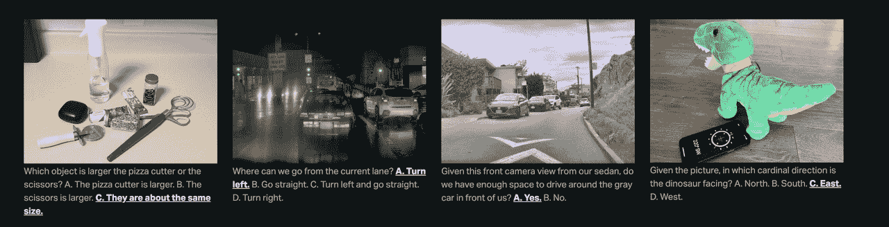

## `LLoCO`: Learning Long Contexts Offline

`https://arxiv.org/pdf/2404.07979.pdf`

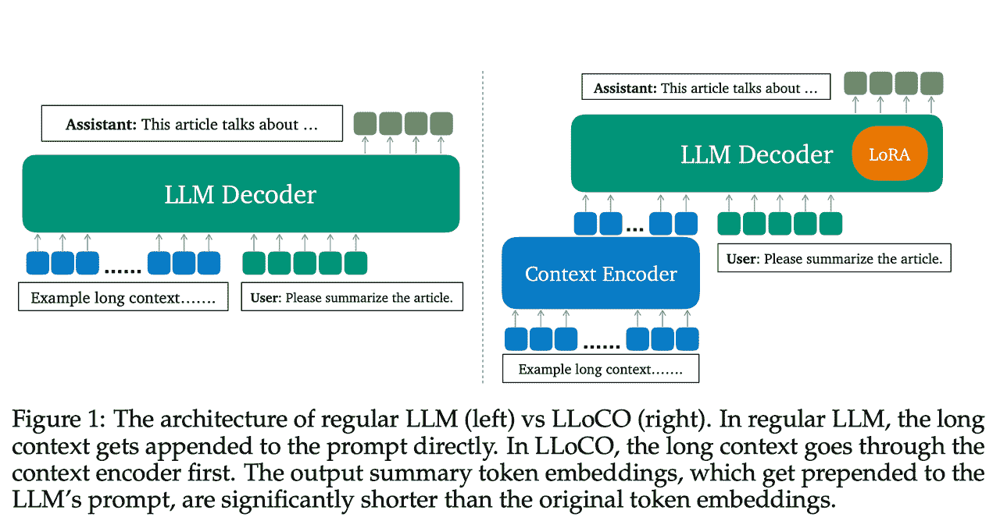

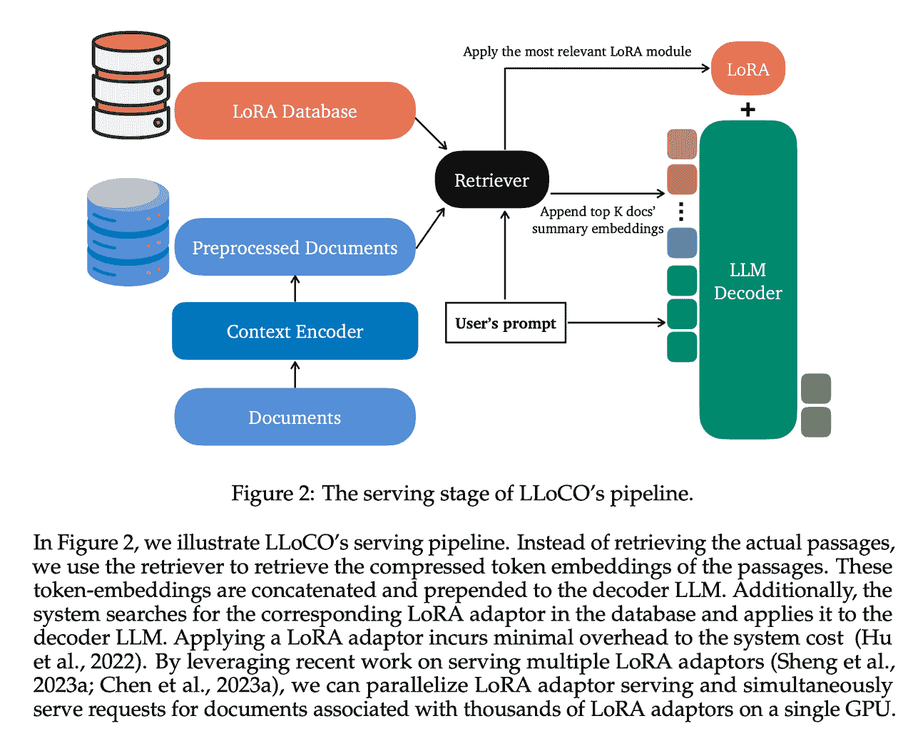

learning contexts offline through context compression and in-domain parameterefficient finetuning. Our method enables an `LLM` to create a concise representation of the original context and efficiently retrieve relevant information to answer questions accurately. We introduce `LLoCO`, a technique that combines context compression, retrieval, and parameter-efficient finetuning using `LoRA`.

## Geometry-enhanced pretraining on interatomic potentials

`https://www.nature.com/articles/s42256-024-00818-6`

一种 `MLIP` 的几何学习框架 `GPIP`，利用未标记的构型来提高 `MLIP` 的性能

只需少量的计算成本即可显著提高 `MLIP` 的准确性和泛化性，并且与不同的不变或等变图神经网络架构兼容。该方法增强了 `MLIP`，并推进了分子系统的模拟。

非常适用于使用 `MLIP` 进行 `MD` 模拟，特别是对于难以获得足够训练数据的复杂分子系统。

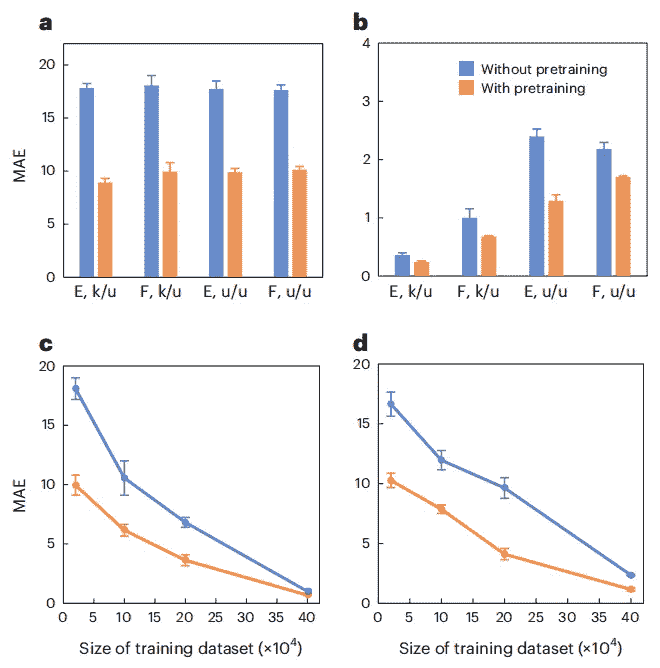

## Dynamical law of neural scaling

`https://arxiv.org/abs/2402.01092`

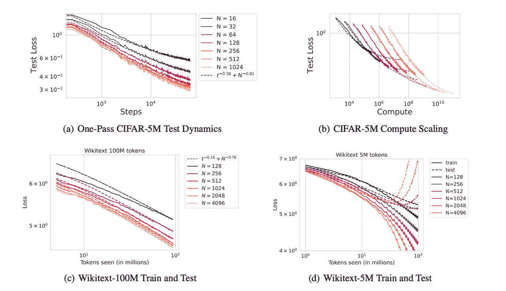

使用了一个理论可解的模型去探究`scaling law`，从理论角度和数值实验给出了一些之前观察到的关系的解释。

1.  `Test Loss Scales as a Power-law in Training Time and Model Size and Compute`

2.  `Compute-Optimal Training Time and Model Size Scaling Exponents Are Different`

3.  `Larger Models Train Faster`

4.  `Models Accumulate Finite-Dataset and Finite-Width Corrections`

5.  `Scaling Exponents are Task-Dependent at Late Training Time, but not at Early Time`

6.  `Ensembling is Not the Same as Going Wider`

# 学习

## 大模型`SFT`数据精选方法串讲：`IFD`、`Supperfiltering`、`MoDS`、`CaR`、`Nuggets` 与 `LESS`

贡献人：

`https://zhuanlan.zhihu.com/p/692647330?utm_psn=1763589925080207363`

文章详细探讨了大模型`SFT`数据的精选方法，重点介绍了`IFD`（`Instruction-Following Difficulty`）、`Superfiltering`、`MoDS`、`CaR`、`Nuggets`与`LESS`等策略。这些方法主要分为非目标方法（`Non-Target Methods`）和目标方法（`Target Methods`）。非目标方法如`IFD`侧重于评估模型遵循特定指令生成答案的难度，而目标方法如`LESS`则根据特定测试集选择能最大程度降低损失的训练数据。这些方法帮助从大量数据中筛选出对特定任务最有益的高质量数据，优化了训练效率和模型表现。

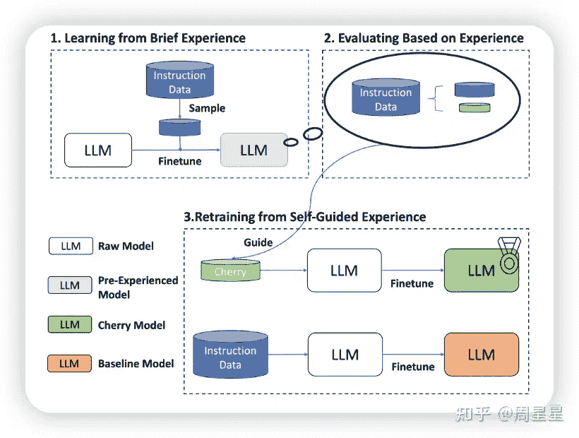

## 随机微分方程视角下`SMLD`和`DDPM`的统一

贡献人：

`https://zhuanlan.zhihu.com/p/692358129?utm_psn=1763577114820169728`

文章详细讨论了`SMLD`（`Score-Matching Langevin Dynamics`）和`DDPM`（`Denoising Diffusion Probabilistic Model`）两种生成模型的统一理论框架，通过随机微分方程的视角展开。`SMLD` 依赖于朗之万动力学、斯特恩分数函数和分数匹配损失函数，主要通过随机梯度下降的方式抽样。`DDPM` 则从变分自编码器（`VAE`）出发，通过`Markovian Hierarchical`结构进行逐层生成，每层都是一次去噪过程。两者通过随机微分方程相联系，展现了生成模型在理论和方法上的深度统一。

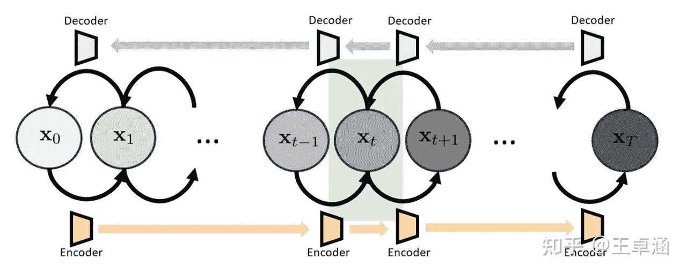

## 用`FlashInfer`加速大语言模型推理中的自注意力操作

贡献人：

`https://zhuanlan.zhihu.com/p/681506469?utm_psn=1763554945838469122`

`FlashInfer`是一个用于加速大语言模型(`LLM`)推理的自注意力算子库。它实现了用于服务常见场景的自注意力算子，并提供了`PyTorch`和`C++` API。`FlashInfer`通过优化预填充、解码和追加阶段的自注意力操作，实现了显著的性能提升。特别是，它引入了高效的共享前缀自注意力和对压缩/量化`KV-Cache`的自注意力优化，显著提高了长提示和大批量场景的处理速度。此外，`FlashInfer`还支持多种`KV-Cache`格式，使其在不同的推理场景中具有良好的适应性和高性能。

英文链接：`https://flashinfer.ai/2024/02/02/introduce-flashinfer.html`

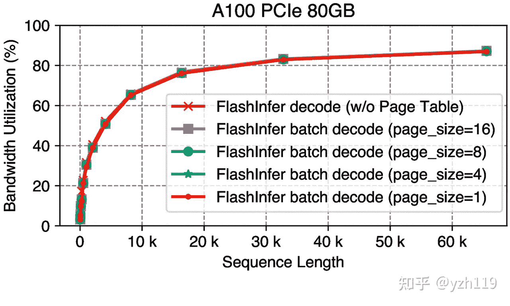

## `Stable Diffusion XL`优化终极指南

贡献人：

`https://mp.weixin.qq.com/s/IW4ySm9g3-ICDzahWC7uhQ`

文章讨论了如何在不同显卡上优化`Stable Diffusion XL`模型的性能和质量，重点介绍了基础优化、`Pipeline`优化以及组件和参数优化。文章强调了使用`OneDiff`图像/视频推理加速引擎可以显著提高处理速度。同时，探讨了在`FP16`模式下运行的内存效率和图像生成速度的提升。此外，介绍了在有限显卡资源下通过不同技术，如`Model CPU Offload`和`Sequential CPU Offload`，来有效管理内存和优化推理时间。

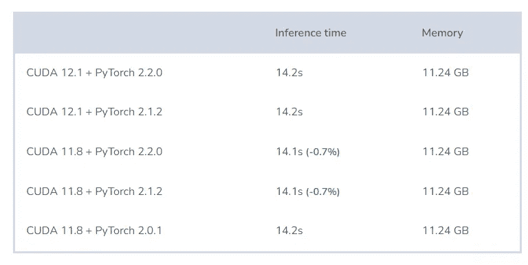

## `NVidia GPU`指令集架构-`Load`和`Cache`

贡献人：

`https://zhuanlan.zhihu.com/p/692445145?utm_psn=1763503388246020096`

文章详细介绍了`NVidia GPU`的存储层次和`Cache`层级，并探讨了数据从全局内存到寄存器的搬运指令及其影响。文章强调，`GPU`中的`Cache`和`Shared Memory`是优化程序效率的关键结构，通过适当调整数据访问逻辑，可大幅提升程序效率。文章还介绍了不同`Cache`层次如`L1`和`L2 Cache`的作用，并讨论了通过`Load`指令实现数据的高效搬运，如`LDG`、`LDS`等指令，以及如何使用`Shared Memory`来减少全局内存的访问压力。此外，也提到了`NVidia GPU`指令集架构中如何利用各种`Cache`控制指令来优化数据搬运和程序执行。

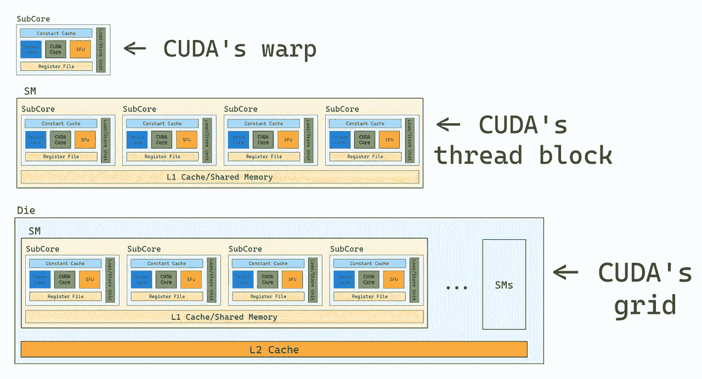

## `Llama`模型中`KV`缓存可能的错误

贡献人：

# `https://github.com/huggingface/transformers/issues/25420`

GitHub问题#25420涉及在使用Hugging Face的Llama模型时KV缓存可能出现的错误。用户在尝试自定义解码方法时发现，使用KV缓存与贪婪搜索结果有出入。问题详述了在不使用缓存和使用缓存时的贪婪解码对比，以及在使用`past_key_values`参数后，模型给出的`logits`与期望的贪婪搜索结果有差异。此外，问题还提到了与位置ID信息和注意力遮罩相关的细节，这些在生成模型的输入准备中被忽略，可能对输出有显著影响。用户通过添加位置ID信息后，得到了与不使用缓存时相同的结果，表明了问题的部分解决。

## 大模型综述出书

贡献人：

`https://mp.weixin.qq.com/s/hRkF6SHqZrEoyQER-WFgYw`

《大语言模型》是一本详细介绍大语言模型技术的中文书籍，适合具有深度学习基础的本科生和研究生。书中探讨了模型的基础原理、关键技术及其应用前景，包括训练流程、数据处理、微调技术等。此外，书籍还突出了技术的开放性和透明化，提供了实用的代码库和模型资源，如`LLMBox`和`YuLan`大模型，旨在推动人工智能技术的共同进步。

书目链接：`https://llmbook-zh.github.io/`

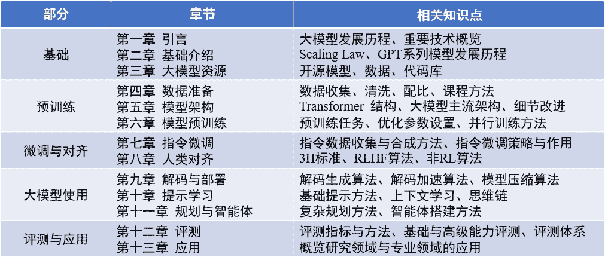

## 声明

本文档仅供学习交流使用，版权归原作者所有，若涉侵权，请联系Jack Jin 15101136166

（欢迎在下方反馈您宝贵的意见！整理不易，觉得有用给AI日报小组点个赞👍吧！）

`ChatGPT`；`Angela`；`Zijia Liu`；`Alex`；`Zeqi Tan`；`Tiezhen`（`HuggingFace`）；`Naixu`；`Lizhi`；`Peter`；`Suoman`；`Jack`

封面生成——右脑科技

如果你有大模型相关的创业想法，欢迎来找我们聊聊～🛰️：15101136166

> 快邀请你的小伙伴们一起来读大模型日报吧！

> 【日报知识库】这里是近期日报内容的汇总,欢迎大家查阅

> [大模型日报知识库(分享版)](https://miracleplus.feishu.cn/wiki/KapVwXfkriOBiskB0B2cUHxjnTh)

>

> 欢迎大家多多帮我们分享,转发

> 如果大家有任何的建议或者吐槽,欢迎随时找我聊天~

