# 奇绩大模型日报（4月 15日）

> 来源：[https://miracleplus.feishu.cn/docx/HYPEdLFSQoC2PkxmGEdcRergnnb](https://miracleplus.feishu.cn/docx/HYPEdLFSQoC2PkxmGEdcRergnnb)

# 推特

### 私密马赛妈妈酱，瓦塔西哇要去远航：OpenAI推出针对日语优化 GPT-4 定制模型

贡献人：

https://x.com/OpenAI/status/1779754674242892014

OpenAI 宣布在亚洲设立第一个办事处 - OpenAI 日本,同时推出一个专门针对日语进行优化的全新 GPT-4 定制模型。

详情请见: [https://openai.com/blog/intr](https://openai.com/blog/introducing-openai-japan%E2%80%A6)[o](https://openai.com/blog/introducing-openai-japan%E2%80%A6)ducing-openai-japan…

[ssstwitter.com_1713164461470.mp4](https://internal-api-drive-stream.feishu.cn/space/api/box/stream/download/all/SLspbsAbHoy5CAxo4ylcPSojn1b)

### Opus模拟图灵机器，给定现有磁带，学习规则并计算出新序列

贡献人：

https://x.com/ctjlewis/status/1779740038852690393

+   Opus 可以作为一台图灵机运行。

+   只需给定现有的磁带,它就能学习规则并正确计算出新的序列。

+   在 500 多个 24 步的解决方案中,准确率达到 100%(还有更多测试正在进行)。

+   要在 24 步内达到 100% 的准确率,输入磁带的权重为 30k tokens*。

+   GPT-4 无法做到这一点。

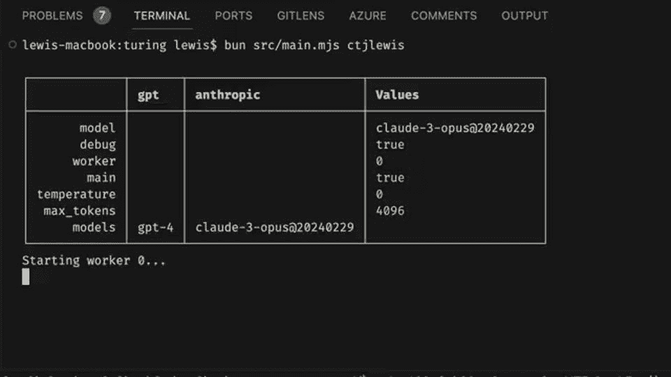

[ssstwitter.com_1713164628372.mp4](https://internal-api-drive-stream.feishu.cn/space/api/box/stream/download/all/CIdubgXAbo78MTxSVIhcvkkVnHd)

### 吴恩达谈规划：一个主动式AI设计模式；许多任务不能在单个步骤或单个工具调用中完成,但智能体可以决定采取什么步骤

贡献人：

https://x.com/AndrewYNg/status/1779606380665803144

规划是一个关键的主动式AI设计模式,其中我们使用大型语言模型(LLM)来自主决定执行什么样的步骤序列来完成一个更大的任务。例如,如果我们要求一个智能体对给定的主题进行在线研究,我们可以使用LLM将目标分解为更小的子任务,例如研究特定的子主题、综合调查结果以及编写报告。

在ChatGPT发布后不久,许多人都有一个"ChatGPT时刻",当他们使用ChatGPT并惊讶地发现它大大超出了他们对AI能力的预期。如果你还没有类似的"AI主动式时刻",我希望你很快就会有。几个月前,我有过一次这样的经历,当时我展示了一个我实现的研究智能体的现场演示,该智能体可以访问各种在线搜索工具。

我曾经多次私下测试过这个智能体,在测试过程中,它始终使用网络搜索工具来收集信息并写出总结。但在现场演示中,Web搜索API意外地返回了一个速率限制错误。我以为我的演示即将公开失败,我害怕接下来会发生什么。令我惊讶的是,智能体灵活地转向了维基百科搜索工具——我已经忘记我给它提供了这个工具——并使用维基百科而不是网络搜索完成了任务。

这对我来说是一个令人惊讶的AI主动式时刻。我认为许多还没有经历过这样时刻的人将在未来几个月内经历它。当你看到一个智能体自主决定以你没有预料到的方式做事,并因此获得成功,这是一件很美好的事情!

许多任务不能在单个步骤或单个工具调用中完成,但智能体可以决定采取什么步骤。例如,为了简化HuggingGPT论文(如下所引)中的一个例子,如果你想让一个智能体考虑一张男孩的图片,并以相同的姿势画一张女孩的图片,任务可能被分解为两个不同的步骤:(i)检测男孩图片中的姿势,以及(ii)渲染一张在检测到的姿势下的女孩图片。LLM可能通过微调或提示(使用少样本提示)来指定一个计划,输出一个格式如"{tool: pose-detection, input: image.jpg, output: temp1 } {tool: pose-to-image, input: temp1, output: final.jpg}"的字符串。

这个结构化的输出指定了要采取的两个步骤,然后触发软件依次调用姿势检测工具和姿势到图像工具来完成任务。(这个例子仅用于说明目的;HuggingGPT使用不同的格式。)

诚然,许多主动式工作流不需要规划。例如,你可能让智能体对其输出进行固定次数的反思和改进。在这种情况下,智能体采取的步骤序列是固定的和确定的。但对于那些你无法事先将任务分解为一组步骤的复杂任务,规划允许智能体动态地决定要采取什么步骤。

一方面,规划是一个非常强大的能力;另一方面,它会导致不太可预测的结果。根据我的经验,虽然我可以让反思和工具使用这两个主动式设计模式可靠地工作并提高我的应用程序的性能,但规划是一项不太成熟的技术,我发现很难提前预测它会做什么。但该领域继续快速发展,我相信规划能力将迅速提高。

如果你有兴趣了解更多关于使用LLM进行规划的信息,我推荐:

+   连锁思维提示引发大型语言模型的推理,Wei等人(2022年)

+   HuggingGPT:使用ChatGPT及其在Hugging Face中的朋友解决AI任务,Shen等人(2023年)

+   理解LLM智能体的规划:一项调查,Huang等人(2024年)

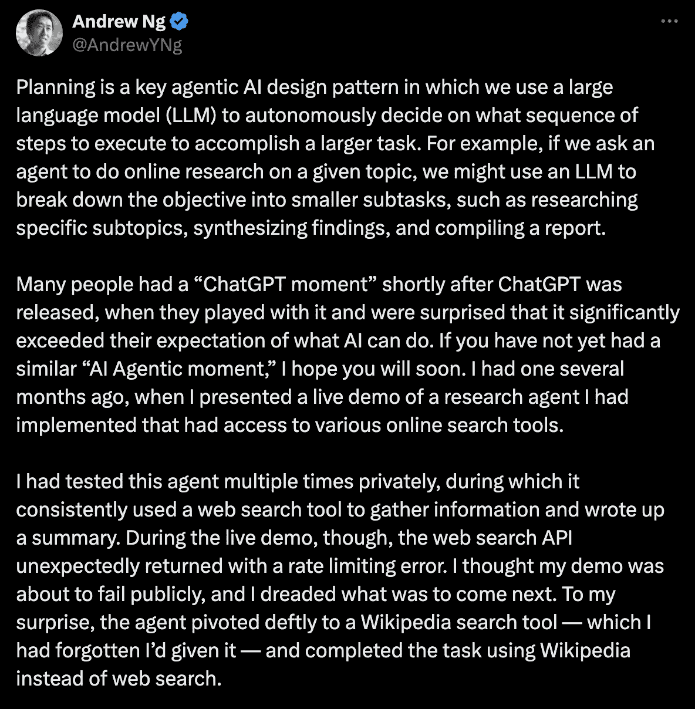

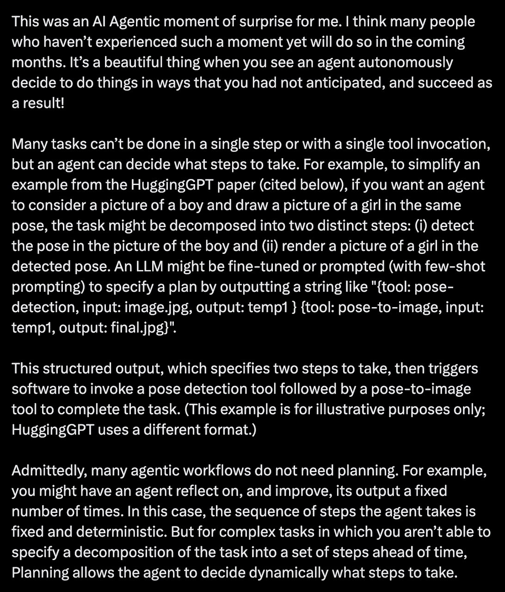

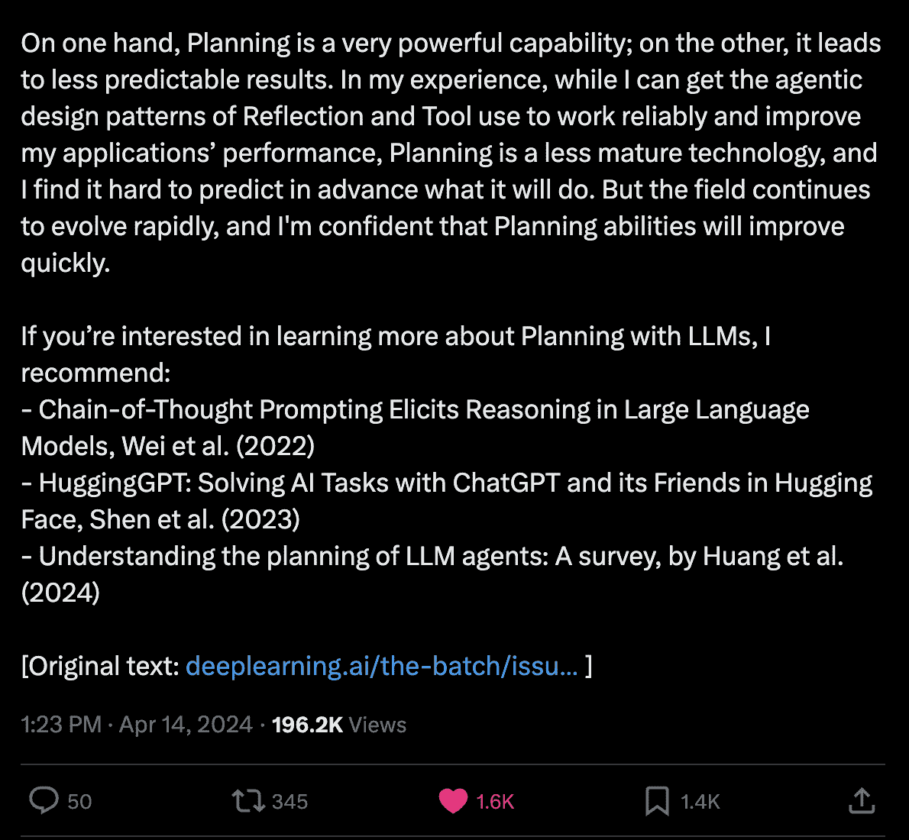

### Jarovsky谈德国联邦信息安全办公室“生成式AI模型-工业和政府机构的机遇与风险”：应特别注意用户意识、测试、敏感数据

贡献人：

https://x.com/LuizaJarovsky/status/1779494839622459505

AI政策警示:德国联邦信息安全办公室发布了题为"生成式AI模型-工业和政府机构的机遇与风险"的报告。引言和评论:"LLM是基于海量文本语料库训练的。由于数据量巨大,这些文本的来源和质量通常没有得到全面验证。因此,训练集中可能包含个人或受版权保护的数据,以及内容可疑、虚假或具有歧视性的文本(例如虚假信息、宣传或仇恨言论)。在生成输出时,这些内容可能原封不动或略有改动地出现在输出中(Weidinger等人,2022年)。训练数据中的不平衡也可能导致模型产生偏差"(第9页)。

"如果个别数据点在训练数据中所占比例过高,就有可能导致模型无法充分学习所需的数据分布,并且根据程度不同,倾向于产生重复、片面或不连贯的输出(称为模型崩溃)。预计未来这一问题会越来越多地出现,因为LLM生成的数据在互联网上变得越来越容易获得,并被用于训练新的LLM(Shumailov等人,2023年)。这可能导致自我强化效应,在生成具有滥用潜力的文本或文本数据中的偏差根深蒂固的情况下尤其如此。例如,随着越来越多的相关文本被制作出来并再次用于训练新模型,而新模型又会生成大量文本(Bender等人,2021年)"(第10页)。

"模型输出的高语言质量,再加上通过API进行用户友好访问,以及当前流行的LLM的回应具有巨大的灵活性,这使得罪犯更容易滥用这些模型,有针对性地生成错误信息(De Angelis等人,2023年)、宣传文本、仇恨言论、产品评论或社交媒体帖子。"

根据该报告,应特别注意以下几个方面:

➵ 提高用户意识;

➵ 测试;

➵ 处理敏感数据;

➵ 建立透明度;

➵ 对输入和输出进行审计;

➵ 注意(间接)提示注入;

➵ 选择和管理训练数据;

➵ 培养实践专业知识。

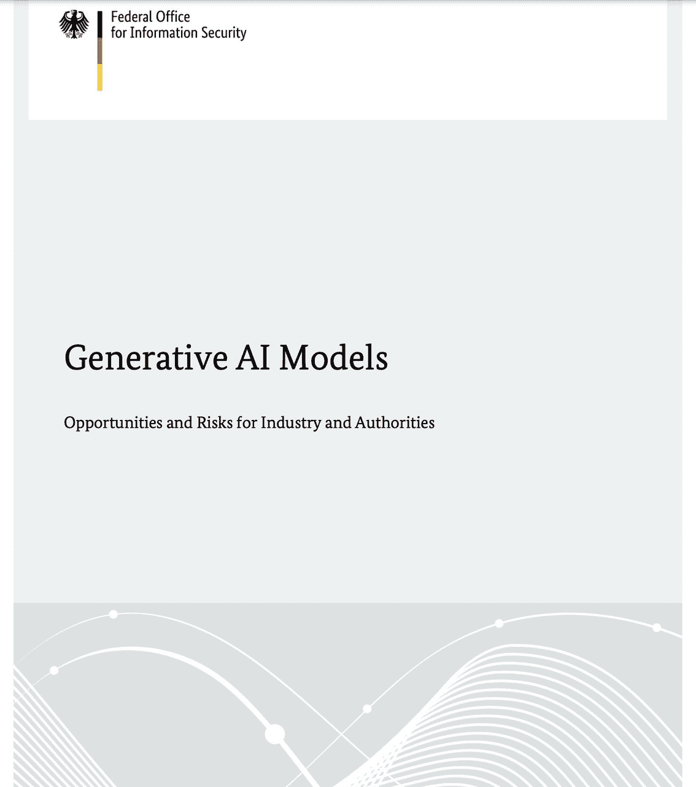

### Yiyue Song教授公开Caltech LLM课程

贡献人：

https://x.com/DevanVarun/status/1779544654771572839

CS159:Caltech的大语言模型(LLM)用于推理的课程讲义非常棒。链接:https://sites.google.com/view/cs-159-2024/lectures

感谢 @yisongyue 和 @acbuller 公开这些资料。

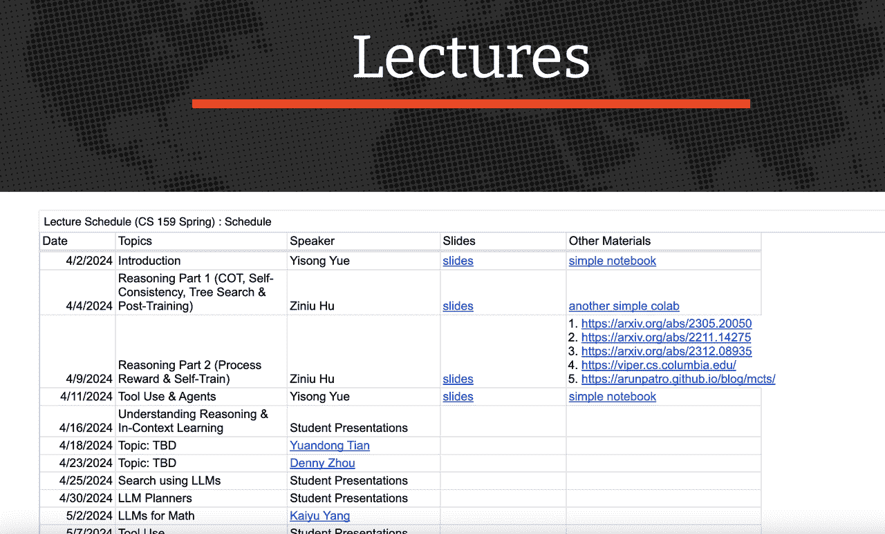

### 作家Daniel Jeffries分享使用AI编程引千人围观：很有意思，但不能代替程序员

贡献人：

https://x.com/Dan_Jeffries1/status/1779472810412286335

Daniel Jeffries分享了使用AI进行编程的亲身经历和感悟。他尝试用AI编写了一个复杂的应用程序,期间经历了情绪的起伏,既有惊喜也有沮丧。他发现AI生成的代码虽然能从无到有,但仍存在许多问题,如不安全、不可维护、无法扩展等,需要人工修复。

作者将AI编程的发展比作网站开发技术的演进。每一次技术进步都让更多人能够创建出优质的网站,但并没有淘汰专业团队,反而让网站变得更加复杂和强大。同样,AI会让更多人能够编程,降低入门门槛,但熟练的程序员仍然具有优势,因为他们更清楚如何利用AI工具,以及如何判断代码质量。

作者还分享了使用Playwright和Beautiful Soup等工具包的经验,尽管他并不熟悉这些工具的使用方法,但在AI的帮助下,他很快就获得了能够正常工作的代码。这让他感到惊喜和振奋。

最后,作者鼓励人们继续学习计算机科学、IT和系统工程等相关知识,因为掌握良好的架构、可扩展性和安全性知识,将有助于更好地使用AI工具。他认为AI只是另一个工具,并不会取代人类程序员,反而会让优秀的程序员更加抢手。展望未来,想象力和创造力将成为关键。

总的来说,这篇文章表达了作者对AI在编程领域应用的乐观态度,分享了他的真实体验和感悟,给出了对程序员未来发展的建议,同时也强调了人工智能只是一种工具,不能完全替代人类程序员,优秀的程序员在AI时代仍大有可为。

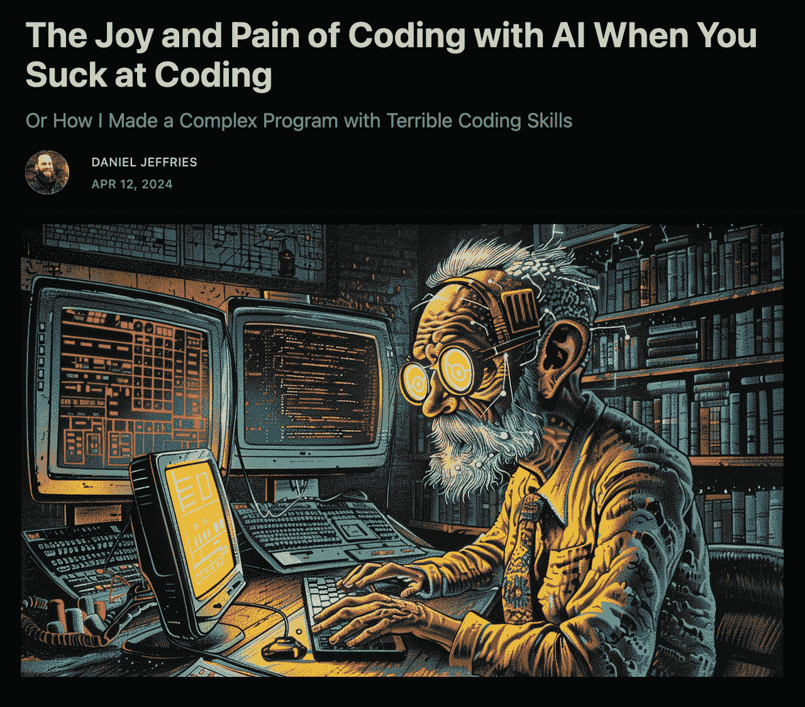

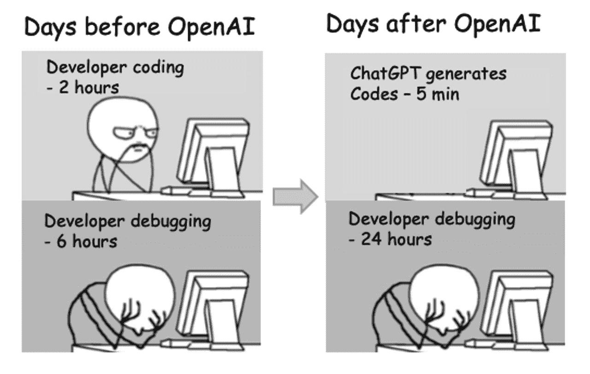

### Shah分享开源SuperMemory：构建你自己的第二大脑，书签的ChatGPT

贡献人：

https://x.com/DhravyaShah/status/1779678999314149755

Dhravya Shah：

使用SuperMemory构建你自己的第二大脑。它就像是你书签的ChatGPT。使用Chrome扩展程序导入推文或保存网站和内容(网上应用商店中的扩展程序未更新,请使用仓库中的扩展程序)。

实际上,我和@yxshv在互联网上保存了大量的内容。

推特书签、网站、片段等。

但我们从不回顾这些内容——对我们来说,这就像是把信息扔进虚空。

SuperMemory解决了这个问题。

### Paliwal分享Insight：AI可穿戴设备，使用Genimi1.5Pro，黑客松中完成

贡献人：

https://x.com/advaitpaliwal/status/1779697730526310521

Advait Paliwal：在本周末的 @GoogleX @mhacks 黑客马拉松上,我用身边闲置的树莓派制作了一个名为 Insight 的 AI 可穿戴设备。

Insight 使用 Gemini 1.5 Pro 根据你所看到和听到的内容来回答问题,并且它会为你记住这些记忆。

代码仓库链接在评论中。

[ssstwitter.com_1713167413474.mp4](https://internal-api-drive-stream.feishu.cn/space/api/box/stream/download/all/MlIFbk5eroCME2xMvhfcG7Wcnyc)

### Rahul为Devin辩护：这里的大部分批评都是你从一个高级工程师那里听到的,他在你身后监视着你,不断地否定你

贡献人：

https://x.com/0interestrates/status/1779268441226256500

我要在这里为Devin和他的团队辩护。这里的大部分批评都是你从一个高级工程师(恐龙)那里听到的,他在你身后监视着你,不断地否定你。他的大部分论点完全被认为是稻草人论证:

+   Devin使用了错误版本的PyTorch(知识截止问题,这很明显)

+   "完成这项任务用了36分钟,但Devin却花了6个小时"(我认为公平的比较应该是一个普通的Upwork任务人员需要多长时间来完成这项任务)

+   Devin本可以阅读README(说明手册)并通过一个命令节省安装时间。(老实说,谁会这样做呢?任何优秀的工程师都会直接开始使用这个东西并找出漏洞,而不是一字不差地遵循说明手册)

+   代码质量是噩梦般的(无可奉告)

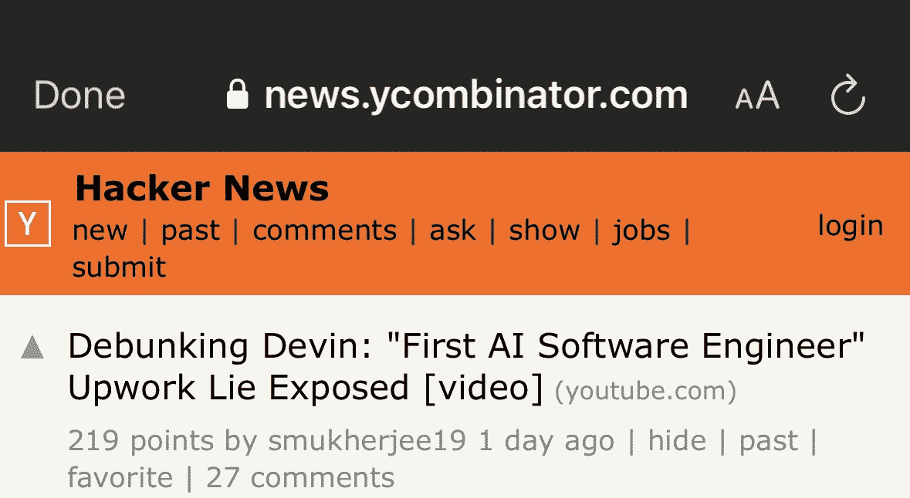

# 资讯

### 刷爆多模态任务榜单！贾佳亚团队Mini-Gemini登热榜，代码、模型、数据全部开源

贡献人：

https://mp.weixin.qq.com/s/j5CGuJ_-Sf0Pqi_-dDjABA

更高清图像的精确理解、更高质量的训练数据、更强的图像解析推理能力，还能结合图像推理和生成，香港中文大学终身教授贾佳亚团队提出的这款多模态模型 Mini-Gemini 堪称绝绝子，相当于开源社区的 GPT4+DALLE3 的王炸组合！

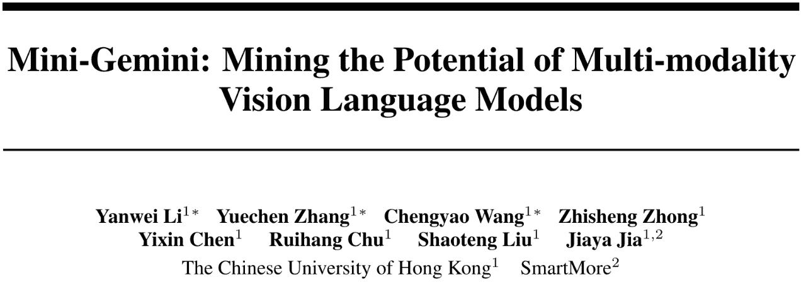

### 多篇顶会一作却申博失败？斯坦福博士生亲述：AI领域太卷

贡献人：

https://mp.weixin.qq.com/s/zhVV9m5CUhY5Cpcf_4eWZw

「尽管我在顶级 ML 会议上发表了多篇一作论文，为开源项目做出了贡献，也在业界产生了影响，但我仍在为进入博士课程而苦苦挣扎。我被顶尖大学拒之门外，感到迷茫和疲惫。」「我开始怀疑自己，怀疑如果没有合适的人脉或家庭背景，光有强大的研究背景是否还不够。我正在考虑放弃攻读博士学位以及从事有价值研究的梦想。」在刚刚过去的周末，关于「AI 博士申请条件卷上天」的帖子成为了 Reddit 社区讨论的焦点。这个帖子的作者在 EMNLP、NeurIPS、ACM、ACL 等顶级会议和研讨会上以第一作者发表了多篇研究论文，也被公司评为过最佳 NLP 研究员。

### 陶哲轩力荐、亲自把关：AI for Math照这个清单学就对了

贡献人：

https://mp.weixin.qq.com/s/eBBf51puJVIGrPmwefo6Kg

刚刚，著名数学家陶哲轩的个人博客又更新了，这次他们整理了一份有用的资源列表，该资源专注于 AI for Math，专为那些希望进入数学 AI 领域的人提供帮助。这份清单发起时间最早可追溯到去年，发起机构由美国国家科学院、工程院和医学院组织的研讨会「人工智能辅助数学推理」提出，陶哲轩担任研讨会主持人。

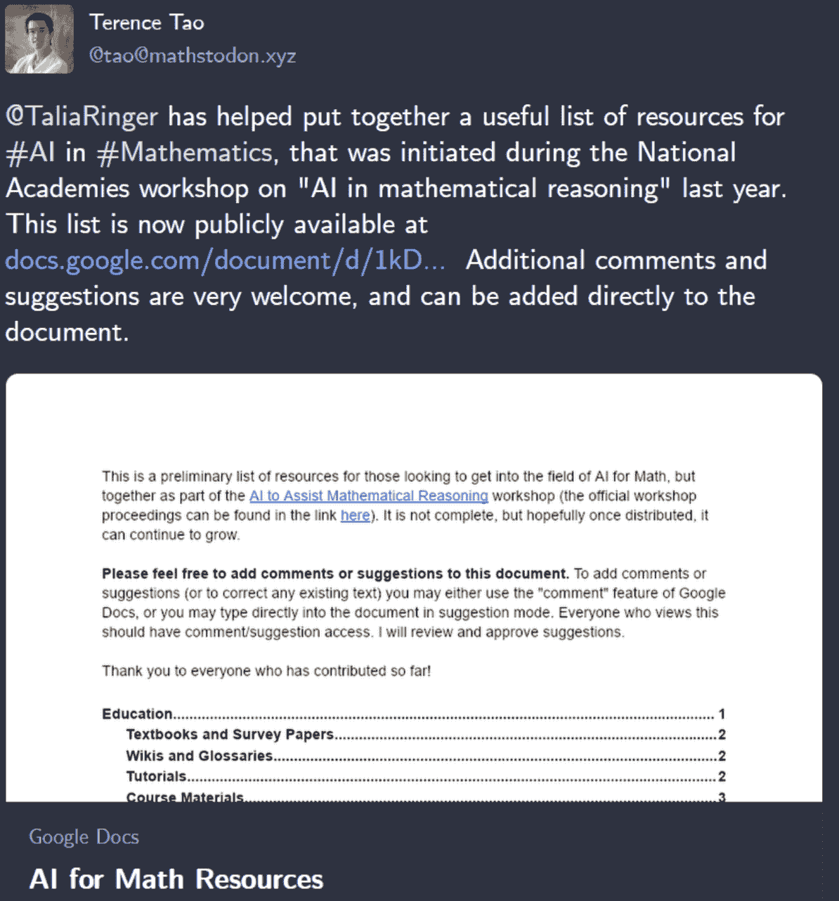

### 前谷歌大佬、Transformer之父打造“企业大脑”，英伟达、AMD和谷歌等科技巨头投资近亿美金

贡献人：

https://mp.weixin.qq.com/s/_JKRpBANiS1EMd-znRyT2A

Transformer作为一种新的神经网络架构，由Google的研究人员Vaswani等人在2017年提出。它主要依靠自注意力机制来处理序列数据，显著提升了处理速度和效率，尤其在自然语言处理任务中展现出卓越性能。随着BERT和GPT系列模型的开发，在企业服务市场也得到文本翻译、内容推荐、情感分析等方面的广泛应用，助力企业提高自动化程度、优化用户体验和决策效率。Ashish Vaswani和Niki Parmar作为《Attention is All You Need》的共同第一作者，有着“Transformer之父”的称号。二人在离开谷歌后联手创建Essential AI，旨在深化人类与计算机间的合作，通过“企业大脑”的概念颠覆现有企业发展模式，让AI展示出超越现今的协作能力。

### 一阶优化算法启发，北大林宙辰团队提出具有万有逼近性质的神经网络架构的设计方法

贡献人：

https://mp.weixin.qq.com/s/7lpPSYJX1qCEyBsFCsiOvQ

北京大学林宙辰教授团队提出了一种易于操作的基于优化算法设计具有万有逼近性质保障的神经网络架构的方法，其通过将基于梯度的一阶优化算法的梯度项映射为具有一定性质的神经网络模块，再根据实际应用问题对模块结构进行调整，就可以系统性地设计具有万有逼近性质的神经网络架构，并且可以与现有大多数基于模块的网络设计的方法无缝结合。论文还通过分析神经网络微分方程（NODE）的逼近性质首次证明了具有一般跨层连接的神经网络的万有逼近性质，并利用提出的框架设计了 ConvNext、ViT 的变种网络，取得了超越 baseline 的结果。论文被人工智能顶刊 TPAMI 接收。

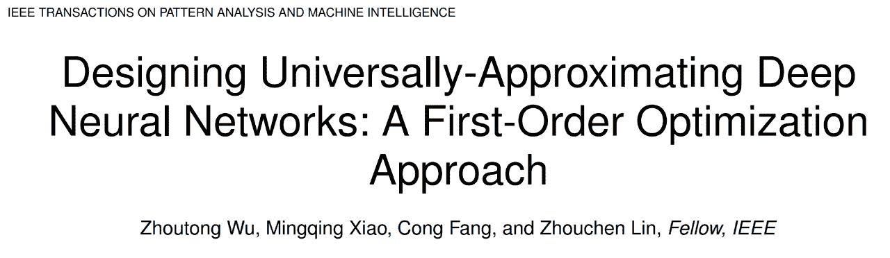

### AI+音频社交｜Airchat，硅谷i人的微信，还是下一个Clubhouse？

贡献人：

https://mp.weixin.qq.com/s/Rlq06C6M0u-wLV8Up2z8Pg

Airchat是由 Tinder 前首席产品官 Brian Norgard 和硅谷知名投资人 Naval Ravikant 共同开发的新型对话网络应用，旨在通过一种独特的连接方式改变社交媒体世界里。根据其官方 X 账号的信息，iOS 版本的测试已经结束，安卓版本的测试即将开始。与其他社交媒体应用一样，Airchat 是免费使用的。目前 Airchat 仅限受邀者参与，其在 Apple App Store 社交应用中排名第 27 位。

### 人在B站，要被AI公司们挤爆了

贡献人：

https://mp.weixin.qq.com/s/6j4jJNZwgDuRBJEikjhPoA

**现在，AI大模型公司们有了新的**必争高地——**把流**量打出去，普通用户抢过来。例如现在逛个B站，画风简直就是“五步一AI，十步一AIGC”。2024年开年，AI公司投放的整体费用有明显增长，也有公司为此扩充了市场营销团队。以AI潜在用户群体最为集中的B站为例，头部A**I厂商及市面常见A**I产品几乎已经全部入局，旺盛的需求导致内容“供不应求”，不少科技UP主档期被约满，多次出现品牌抢单的情况。业内人士保守估计，仅仅在B站，品牌方今年的广告投入就是去年的3 到 4 倍。甚至有AI厂商特意从拼多多挖人负责B站的投放。嗯，不得不说，AI大模型公司们已经在开展激烈的营销商战了，年轻用户恰是他们的主要目标。作为年轻人密度最高的B站，必然是这场“战役”的桥头堡，当然，还有更多社交媒体平台，也都在印证着这点。

### 北大字节开辟图像生成新范式！超越Sora核心组件DiT，不再预测下一个token

贡献人：

https://mp.weixin.qq.com/s/LKDU629r4qn0925P46lEgA

北大和字节联手搞了个大的：提出**图像生成新范式**，从预测下一个token变成**预测下一级分辨率**，效果超越Sora核心组件Diffusion Transformer（DiT）。并且代码**开源，**短**短几天已经揽下1.3k标**星，登上GitHub趋势榜。实验数据上，这个名为VAR（Visual Autoregressive Modeling）的新方法不仅图像生成质量超过DiT等传统SOTA，推理速度也提高了20+倍。

# 论文

### OSWorld：在真实计算机环境中为开放式任务基准测试多模态智能体

贡献人：

链接：http://arxiv.org/abs/2404.07972v1

自主智能体能够在最小干预下执行复杂的计算机任务，有潜力改变人机交互，显著提高可访问性和生产力。为了解决现有基准缺少交互环境或仅限于特定应用程序领域的局限性，我们引入了OSWorld，这是第一个可扩展的真实计算机环境，支持Ubuntu、Windows和macOS等各种操作系统上的任务设置、基于执行的评估和交互式学习。OSWorld可以作为用于评估涉及任意应用程序的开放式计算机任务的统一、集成的计算机环境。通过OSWorld，我们创建了包含369个计算机任务的基准，涵盖了真实网络和桌面应用程序、操作系统文件I/O和跨多个应用程序的工作流程。在OSWorld上对最先进的LLM/VLM智能体进行广泛评估揭示了它们作为计算机助手的显著不足之处。通过OSWorld进行的全面分析为开发以前基准无法实现的多模态通用智能体提供了宝贵的见解。我们的代码、环境、基线模型和数据可在https://os-world.github.io 上公开获取。

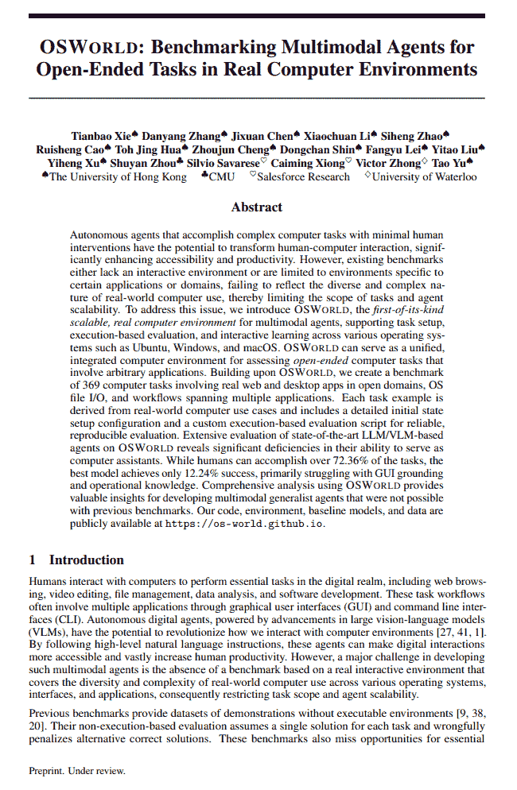

### **蒙特卡罗树搜索与玻尔兹曼探索**

贡献人：

链接：http://arxiv.org/abs/2404.07732v1

摘要：蒙特卡洛树搜索（MCTS）方法，如应用于树的置信上界（UCT），对自动规划技术至关重要。然而，当初始行动看似劣势时，UCT可能会缓慢探索最佳行动。最大熵树搜索（MENTS）将最大熵原则融入MCTS方法中，利用Boltzmann策略来采样动作，自然地鼓励更多探索。我们介绍了两种算法，Boltzmann树搜索（BTS）和衰减熵树搜索（DENTS），以解决MENTS的一个主要局限性，并保持Boltzmann策略的好处，例如使用Alias方法更快地采样动作。我们的实证分析显示，我们的算法在包括围棋在内的几个基准领域中表现出一致的高性能。

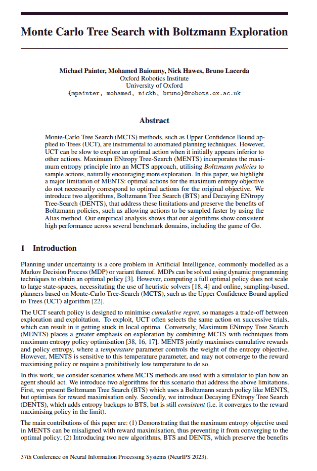

### 使用更少token预训练小型基础LLM

贡献人：

链接：http://arxiv.org/abs/2404.08634v1

我们研究了一种简单方法的有效性，用于从现有的大型基础语言模型（LM）中开发一个小型基础LM：首先从较大LM中继承一些Transformer块，然后在较大模型的原始预训练数据的非常小的子集（0.1%）上对这个较小模型进行训练。我们称这种简单的方法为Inheritune，并首先演示了它用于构建具有15亿参数的小型基础LM，使用10亿token（以及较大LM的30亿参数的起始几层）；我们仅使用一个A6000 GPU不到半天的时间完成。在9个不同的评估数据集以及MMLU基准测试中，所得模型与公开可用的10亿至20亿规模的基础模型相比表现优异，其中一些模型使用了更多50到1000倍的token进行训练。

我们在略有不同的环境中研究了Inheritune，在这里我们训练小的LM利用较大的LM及其完整的预训练数据集。在这里，我们展示了使用来自GPT2-medium（355M）和GPT-2-large（770M）的一些层来训练的较小LM可以在OpenWebText数据集上以90亿token的情况下，在相同数量的训练步骤上有效匹配它们更大的对应物的val loss。我们通过广泛的实验分析了我们的方法，并展示了它在不同情况下的有效性。我们的代码可在https://github.com/sanyalsunny111/LLM-Inheritune 中找到。

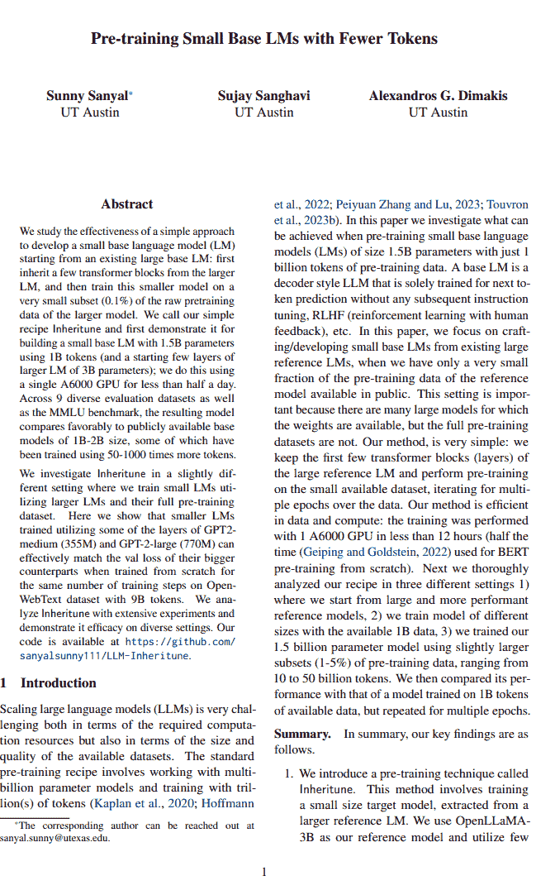

### ChatGPT是否改变了学术写作风格？

贡献人：

链接：http://arxiv.org/abs/2404.08627v1

根据从2018年5月至2024年1月提交的一百万篇arXiv论文，我们通过统计词频变化的分析评估了ChatGPT摘要中的文本密度。我们的模型经过仔细的噪声分析，在真实摘要和ChatGPT修改摘要（模拟数据）的混合数据上进行了校准和验证。我们发现ChatGPT对arXiv摘要有着越来越大的影响，尤其是在计算机科学领域，ChatGPT修改的摘要比例约为35％，如果以最简单的提示之一“修改以下句子”为基准。最后，我们对ChatGPT渗入学术写作风格的积极和消极方面进行了分析。

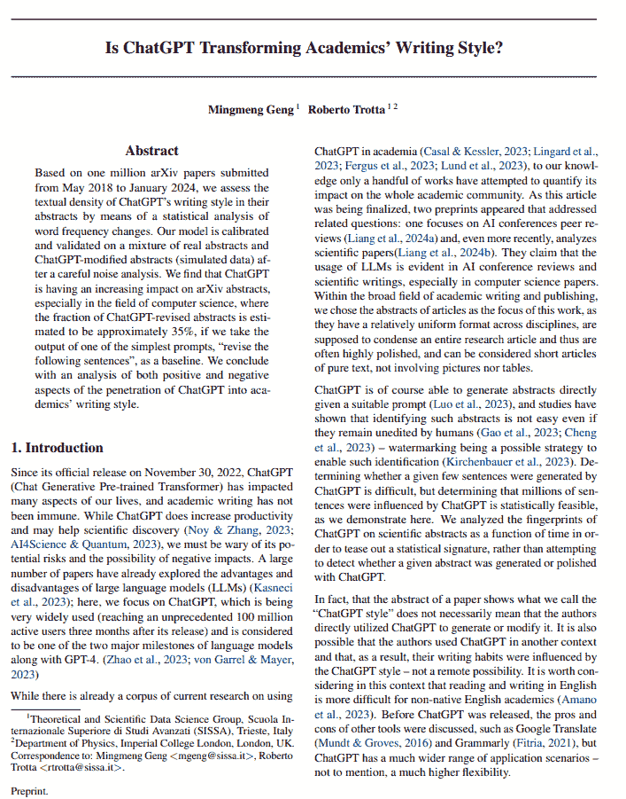

### **LLM中Token的理论**

贡献人：

链接：http://arxiv.org/abs/2404.08335v1

尽管有很多研究试图规避语言建模中的tokenization（Clark等人，2022年；Xue等人，2022年），但目前的共识是，这是设计最先进性能语言模型的必要初始步骤。本文从理论角度研究了tokenization，通过研究transformers在简单数据生成过程中的行为。当在来自某些简单的kth阶马尔可夫过程的数据上训练时，transformers表现出一个令人惊讶的现象-在没有进行tokenization的情况下，它们在实证上未能学习正确的分布，并根据单字符模型进行预测（Makkuva等人，2024年）。然而，通过添加tokenization，我们实证观察到transformers突破了这一障碍，并能够有效地对来自源的序列概率进行建模，实现了较小的交叉熵损失。基于这一观察作为起点，我们研究了transformers在有无tokenization时实现的端到端交叉熵损失。通过适当的tokenization，我们表明transformers学习的甚至是最简单的单字符模型也能有效地对来自kth-order马尔可夫来源的序列的概率进行建模。我们的分析通过研究transformers在马尔可夫数据上的行为为实践中使用tokenization提供了理由。

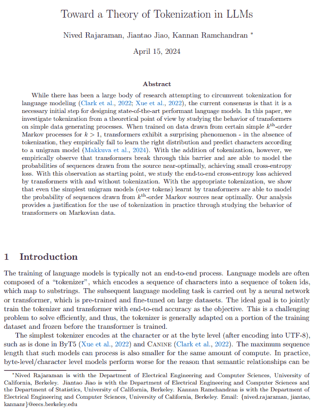

### 减小差异的零阶方法用于微调语言模型

贡献人：

链接：http://arxiv.org/abs/2404.08080v1

细调语言模型（LMs）在各种下游任务中表现出成功。然而，随着LMs的扩大规模，反向传播的内存需求变得过高。零阶（ZO）优化方法可以利用内存高效的前向传递来估计梯度。最近，MeZO（ZO-SGD的改编）已被证明在与合适的任务提示结合时，始终优于零-shot学习和上下文学习。在这项工作中，我们将ZO方法与方差减少技术相结合，以增强基于推理的LM微调的稳定性和收敛性。我们引入了内存高效的零阶随机方差减少梯度（MeZO-SVRG），并展示了它在多个LM微调任务中的有效性，消除了对特定任务提示的依赖。在基准GLUE任务中，对一系列遮蔽和自回归LM进行评估时，MeZO-SVRG在完整和部分参数微调设置下的测试准确性均提高了高达20%。MeZO-SVRG在计算时间上受益，通常在GPU小时数减少2倍的情况下，超过MeZO的峰值测试准确性。与一阶SGD相比，MeZO-SVRG显着减少了所需内存占用量，即自回归模型减少了2倍。我们的实验表明，与更大的批量大小相比，MeZO-SVRG的内存节省逐渐改善。

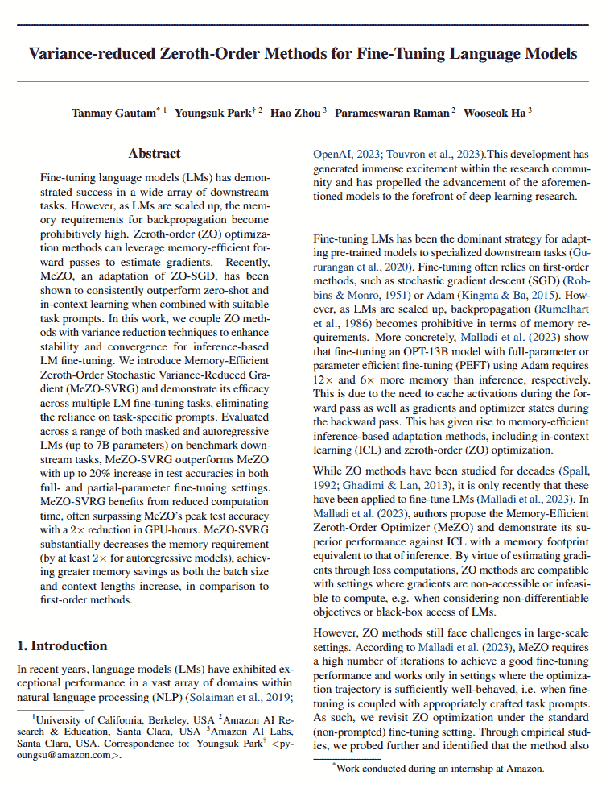

# 产品

### Interview with AI

贡献人：

https://interviewwith.ai/

该工具可以为用户描述的职位创建个性化的面试准备路线图，并使用人工智能进行面试练习，用户可以针对包括面试的形式、个性化程度以及自动化程度进行调整。

### Deblank Colors

贡献人：

https://deblank.com/colors

Deblank Colors 是一个创意助手，它可以帮助用户生成配色方案，并根据用户的指示进行编辑和调整。该助手旨在帮助设计师们在项目的灵感阶段加快速度，提供配色方案、建议和快速可视化。

# HuggingFace&Github

### STORM

贡献人：

https://github.com/stanford-oval/storm

STORM 是一个基于互联网搜索的 LLM 系统，可以从头开始编写类似维基百科的文章。STORM通过两个步骤来生成带有引文的长篇文章：写作前阶段和写作阶段。此外，STORM还采用了两种策略来自动提出好问题：视角引导提问和模拟对话。该系统以高度模块化的方式实现，并被视为自动化知识管理的一个例子。

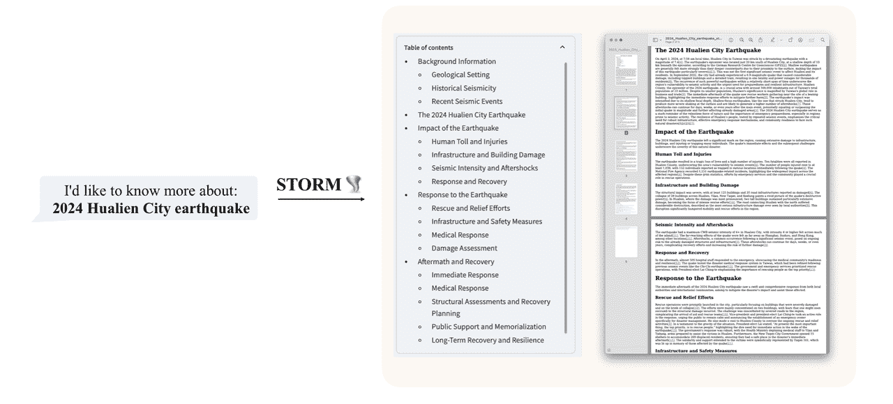

### MagicTime

贡献人：

https://github.com/PKU-YuanGroup/MagicTime

MagicTime 是一个基于给定提示的视频生成官方实现。其主要思想是通过提出的方法和数据集来增强视频生成模型准确描绘现实世界的能力。

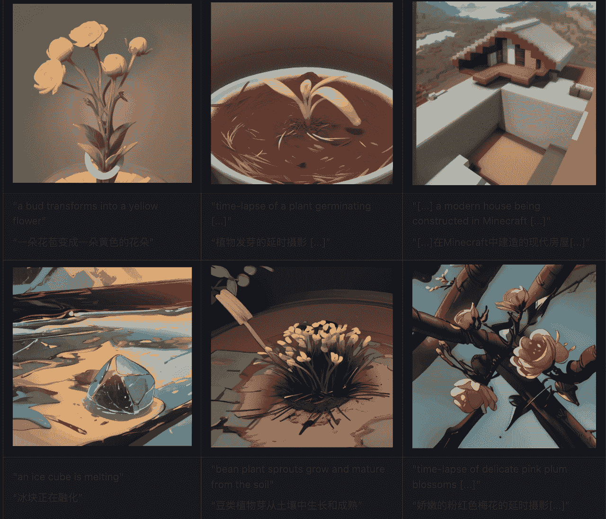

### MaxKB

贡献人：

https://github.com/1Panel-dev/MaxKB

MaxKB 是一款基于 LLM 大语言模型的知识库问答系统。MaxKB = Max Knowledge Base，旨在成为企业的最强大脑。 它支持开箱即用，用户可以直接上传文档或自动爬取在线文档，支持文本自动拆分和向量化，提供智能问答交互体验。此外，MaxKB 也支持无缝嵌入到第三方业务系统，而且可以多模型支持，包括对接主流的大模型，如本地私有大模型（如 Llama 2）、Azure OpenAI 和百度千帆大模型等。

# DevTools

# 投融资

### 此芯科技完成数亿元A+轮融资，加速AI PC芯片创新

贡献人：

https://mp.weixin.qq.com/s/RrMHeZjw43mO1fgIfE33JQ

此芯科技宣布完成数亿元人民币A+轮融资，由国调基金领投，昆山国投、吉六零资本、新尚资本等跟投。资金将用于AI PC领域的创新技术研发及业务落地。此次融资是对此芯科技在通用智能计算领域技术实力和创新力的认可，也展示了公司在AI时代的核心竞争力和未来发展潜力。此芯科技致力于推动AI PC的智能化和高效化，积极与生态伙伴合作，共同打造下一代高端智能芯片。

公司官网：https://www.cixtech.com/news/

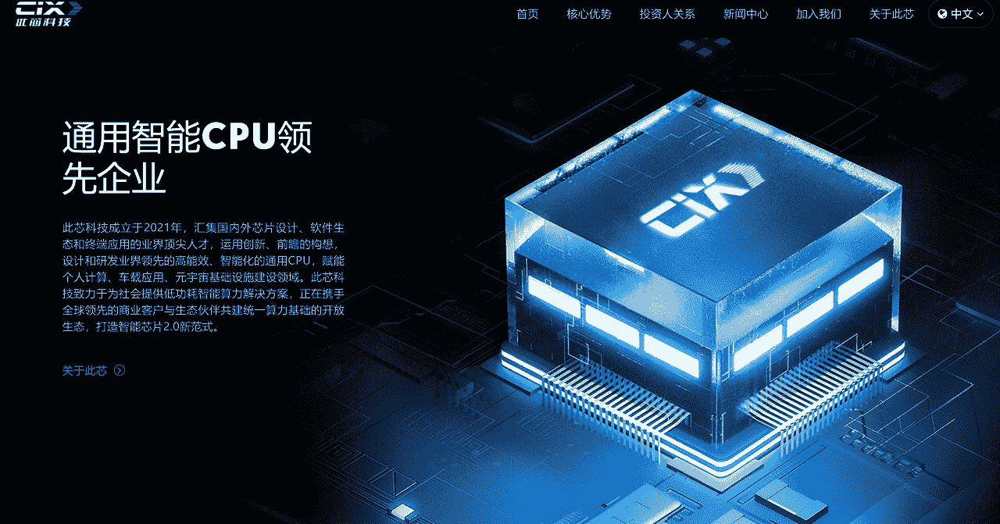

### Inference Labs完成230万美元种子轮融资推动AI创新

贡献人：

https://www.binance.com/en-IN/square/post/2024-04-15-inference-labs-secures-2-3-million-seed-funding-to-boost-ai-innovations-6797248965017?ref=527648310

Inference Labs，一个Web3 AI项目，已成功获得230万美元的种子轮融资。本轮融资由Delphi Ventures、Digital Asset Capital Management和Mechanism Capital领投，其他参投方包括Big Brain Holdings、BitScale Capital等。这笔资金将用于优化Inference Labs在人工智能领域的创新方法，加速产品开发，并促进整个生态系统的成长。公司致力于将人工智能与Web3技术结合，推动人工智能的安全、易用性，并关注去中心化及隐私保护的未来。

公司官网：https://inferencelabs.com/

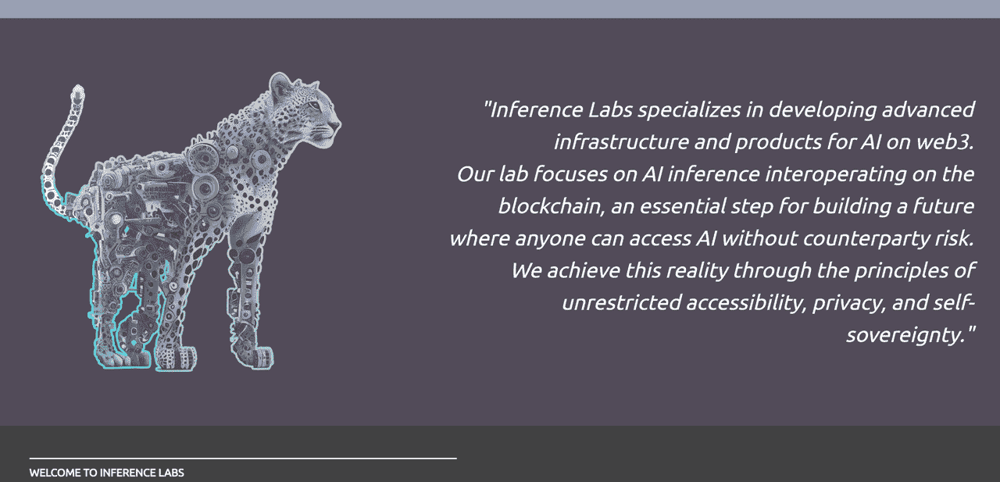

# 学习

### Aloha团队新作--对你的机器人大喊大叫：通过语言在线纠正动作

贡献人：

https://zhuanlan.zhihu.com/p/688551195

文章探讨了如何通过语言指令对机器人进行在线行为纠正以提高任务执行的成功率。这项技术依赖于分层策略，其中高层策略从连续的图片帧中生成语言目标，而底层策略则结合这些图片、目标和机器人状态输出具体动作。研究通过引入人类的即时语言矫正，增强了机器人学习的适应性，使其在多次迭代后，成功率显著提高。此外，这一研究的方法和数据集均已开源，为进一步的研究和开发提供了便利。

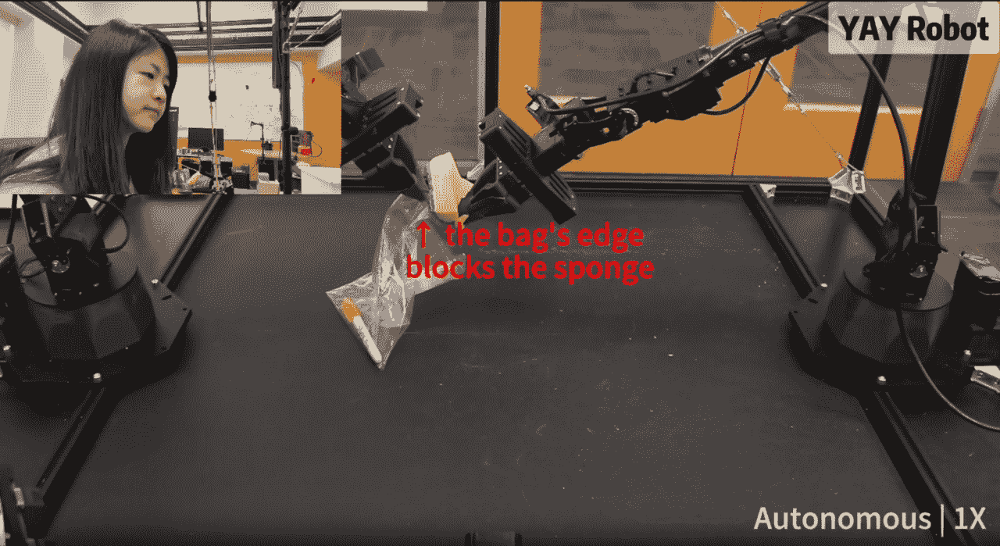

### 使用WholeGraph优化图形神经网络的内存和检索 Part 2

贡献人：

https://zhuanlan.zhihu.com/p/692169067?utm_psn=1763232361691832320

本文详细探讨了使用WholeGraph在大规模图形神经网络（GNN）训练中优化内存存储和检索的方法。WholeGraph通过利用NVIDIA NVLink技术，有效地解决了GPU间通信带宽的挑战，优化了内存聚合带宽，提高了数据存储和检索效率。文章中通过NVIDIA DGX-A100系统上的性能测试，展示了WholeGraph在处理大规模数据集如OGBN-Papers100M时，如何提升GNN训练的性能。测试结果表明，使用WholeGraph可以显著提高内存带宽利用率，并在GNN任务中达到较高的计算效率和测试准确率。

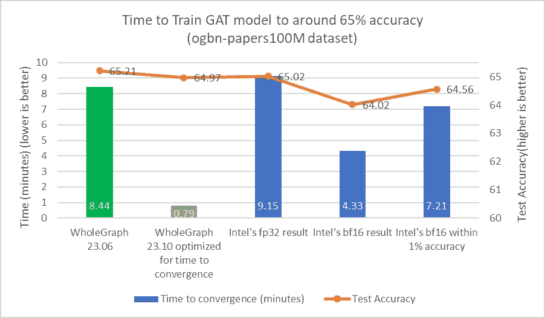

### MiniGPT4Qwen-14B：双语多模态大模型的DeepSpeed流水线并行挑战

贡献人：

https://zhuanlan.zhihu.com/p/684462477

本文详细介绍了MiniGPT4Qwen-14B模型在使用DeepSpeed流水线并行过程中的技术细节和挑战。该模型是一个14B参数的大型多模态语言模型，采用双卡DeepSpeed流水线并行训练，以克服有限硬件资源的限制。文章特别强调了流水线并行的优化策略，如将模型层按照计算需求分布到不同GPU上，并通过改进的算法有效减少GPU间的通信成本。此外，通过对Transformer模型结构的深入拆分和细节调整，成功实现了模型训练的高效率和低资源消耗。文中还讨论了流水线并行的理论基础，包括Naive PP与GPipe的比较，以及与数据并行的结合策略。

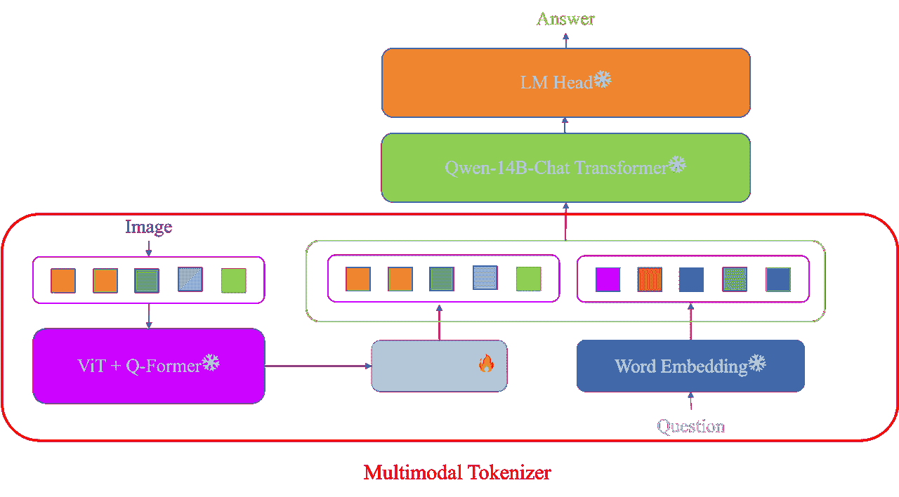

### 加速GPU上的扩散模型

贡献人：

https://github.com/huggingface/diffusers/discussions/6609?utm_source=ainews&utm

GitHub讨论#6609聚焦于如何在性能较低的GPU上实现快速扩散模型的运行。尽管如torch.compile()和scaled_dot_product_attention()等技术在现代GPU（如4090）上能显著提高性能，但在更适合消费者的GPU（如3060，T4，V100等）上的效益则有限。此讨论探索了几种可能的解决方案，包括使用更低的精度（如FP16），来减少内存使用并加速推断过程。此外，也提出了一种叫做“卸载”的技术，允许在需要时才加载模型的各个组件，虽然这会增加推断的延迟。讨论还提到了使用压缩模型和改进小型模型的质量的技术，如使用DPO技术和时间步骤精炼等，以在减少内存的同时改善推断延迟。

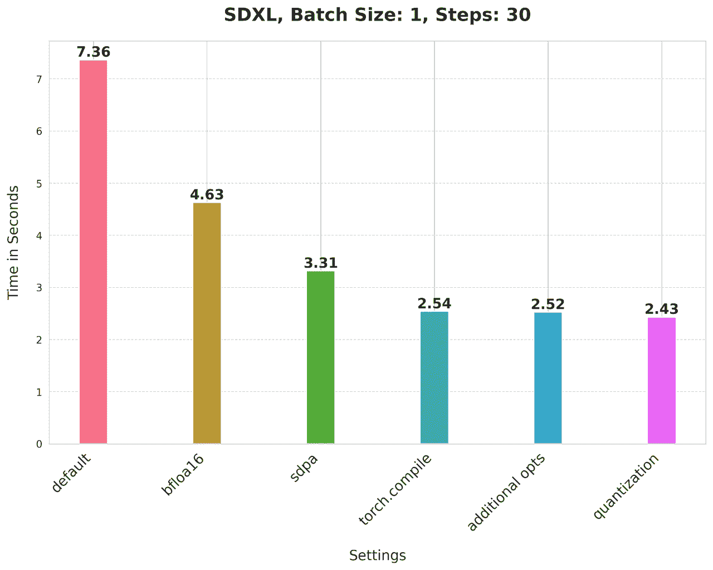

### 加速生成性AI第三部分：快速扩散

贡献人：

https://pytorch.org/blog/accelerating-generative-ai-3/

本文是关于如何利用纯PyTorch加速生成性AI模型的系列博客的第三部分。文章集中介绍了加速文本到图像的扩散模型，最高可达3倍速度提升。主要优化措施包括使用bfloat16精度、scaled_dot_product_attention (SPDA)、torch.compile，以及合并注意力计算中的q、k、v投影。文章中特别强调了这些技术是PyTorch原生的，不依赖任何第三方库。使用这些优化后，Stable Diffusion XL (SDXL)的延迟得到了显著的改善，从生成单张图像的7.36秒降低至2.43秒。这些技术也可应用于其他文本到图像的扩散系统，以提高其性能。

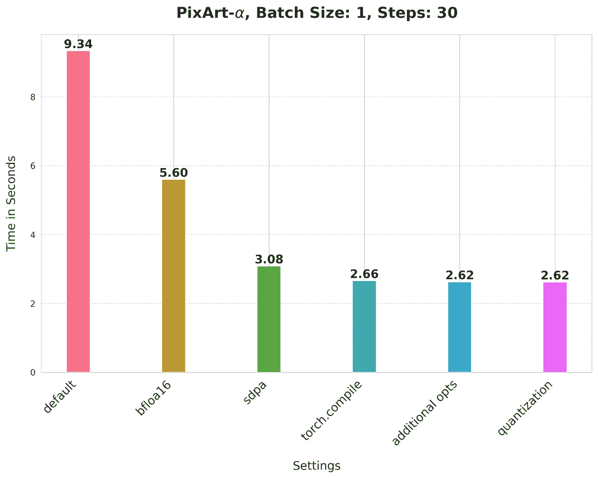

### 使用PyTorch FSDP最大化训练吞吐量

贡献人：

https://pytorch.org/blog/maximizing-training/

这篇博客展示了使用PyTorch的全尺度分布式并行（FSDP）来最大化训练吞吐量的方法。文中提到一个7B模型在128个A100 GPU上的训练速度达到了每GPU每秒3700个token，即每天40B个token。此外，FSDP在512个GPU上展示了接近线性的扩展性，使用该方法训练7B模型至2T个token需要不到两周的时间。文章还介绍了一些关键技术，如SDPA Flash Attention，它通过融合注意力核心和高效的注意力计算提高性能；以及选择性激活检查点，这种方法允许在GPU内存和计算之间进行权衡，从而提高吞吐量。此外，这种方法还利用了计算与通信的重叠，提高了GPU的利用率。

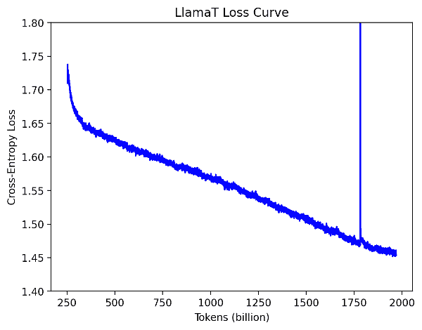

### Score-based SDE扩散生成模型入门到精通系列（一）：随机微分方程在图像生成中的应用

贡献人：

https://zhuanlan.zhihu.com/p/689276382?utm_psn=1763188569341026304

本文深入探讨了使用随机微分方程（SDE）对图像生成任务进行建模的方法，并尝试将分数模型和扩散模型统一到一个框架中。作者通过数学和物理的视角，利用SDE将复杂的图像分布平滑过渡到简单的先验分布，并使用SDE的逆过程进行图像的重建，即通过加噪与去噪过程模拟图像的生成与恢复。文中提到三种SDE形式：Variance Exploding（VE）、Variance Preserving（VP）和sub-VP SDE，其中sub-VP SDE在采样质量和似然评估上表现更优。此外，文章还引入了含校正机制的新采样方法“Predictor-Corrector（PC）sampling”，以提高采样的准确性和效率。

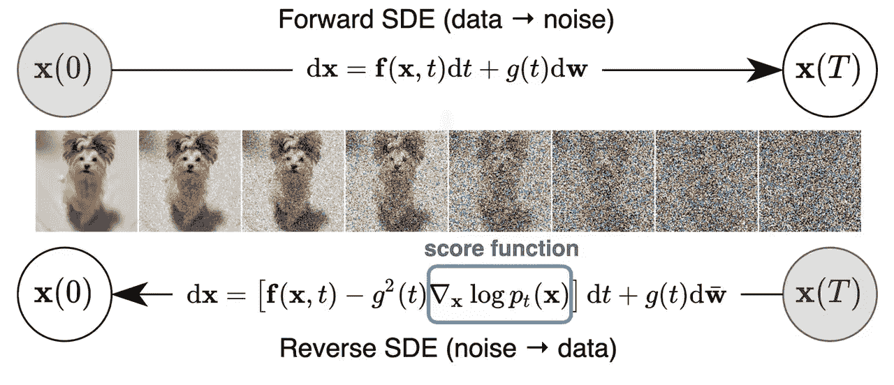

### 2023年引人注目的MLSys相关工作

贡献人：

https://www.zhihu.com/question/637480969?utm_psn=1763187451341099008

在2023年的MLSys领域，一些关于大语言模型（LLM）的推理（inference）优化工作格外引人关注。尤其是“连续批处理”（Continuous Batching）技术，这一技术首次由OSDI'22论文中的Orca项目提出，它通过细粒度的批处理改善了LLM服务过程中的硬件利用率。此外，还有vLLM项目，这是由Ion Stoica门下的LLMSYS小组提出，主要解决了LLM在解码阶段动态增长的kv-cache造成的内存碎片问题。他们引入了类似操作系统中虚拟分页的内存管理机制，这大幅提升了服务过程中的批处理容量，从而提高了吞吐量。这些工作不仅解决了LLM推理阶段的效率和资源利用问题，还推动了MLSys领域的技术进步。

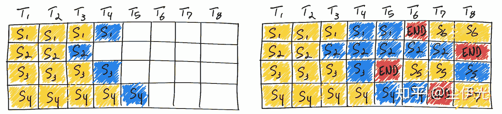

### Rust编程语言的安全漏洞

贡献人：

https://www.cvedetails.com/vulnerability-list/vendor_id-19029/product_id-48677/Rust-lang-Rust.html?utm

Rust编程语言中已发现多个安全漏洞，包括在未适当转义Windows批处理文件参数时可能执行任意代码的关键漏洞（CVE-2024-24576）。此外，Cargo在编译时没有正确转义功能名，导致可能的跨站脚本攻击（CVE-2023-40030）。Rust的标准库在处理特定函数时也存在竞态条件、双重释放和缓冲区溢出等问题，如std::fs::remove_dir_all（CVE-2022-21658）和Vec::from_iter（CVE-2021-31162）。这些漏洞涉及的问题包括不安全的内存操作和输入验证不足，对使用Rust的开发者构成了安全风险。已推出修补版本解决这些问题，开发者应尽快更新到最新版本以避免潜在风险。

# 声明

本文档仅供学习交流使用，版权归原作者所有，若涉侵权，请联系Jack Jin 15101136166

##

（欢迎在下方反馈您宝贵的意见！整理不易，觉得有用给AI日报小组点个赞👍吧！）

ChatGPT；Angela；Zijia Liu；Alex；Zeqi Tan；Tiezhen（HuggingFace）；Naixu；Lizhi；Peter；Suoman；Jack

封面生成——右脑科技

如果你有大模型相关的创业想法，欢迎来找我们聊聊～微信：15101136166

> 快邀请你的小伙伴们一起来读大模型日报吧！

> **【日报****知识库****】**这里是近期日报内容的汇总,欢迎大家查阅

> [大模型日报知识库(分享版)](https://miracleplus.feishu.cn/wiki/KapVwXfkriOBiskB0B2cUHxjnTh)

>

> 欢迎大家多多帮我们分享,转发~~

> 如果大家有任何的建议或者吐槽,欢迎随时找我聊天~

