# 奇绩大模型日报（4月 13-14日）

> 来源：[https://miracleplus.feishu.cn/docx/IoR3dw6qgoYpEcxba0wcyQNKnRc](https://miracleplus.feishu.cn/docx/IoR3dw6qgoYpEcxba0wcyQNKnRc)

# 推特

### Mistral-22B-v0.2 发布，使用8倍以上的训练数据，在处理用户查询方面明显更好

贡献人：

https://x.com/mejia_petit/status/1779131534269673556

Mistral-22B-v0.2 现已发布🎉🎉!在各方面都有重大改进!使用8倍以上的训练数据,该模型在处理用户查询方面明显更好!在这里试用一下吧!

在我们发布 Mistral-22b-v0.1 仅仅两天后,我们很高兴地推出我们精心打造的实验模型 Mistral-22b-v.02。这个模型是将所有专家的平等知识提炼到一个单一、密集的22b模型中的结晶。这个模型不是一个单一训练的专家,而是一个压缩的MOE模型,将其转化为一个密集的22b模式。这是第一个可行的MOE到密集模型的转换。

v0.2 比 v0.1 训练的数据多了8倍!

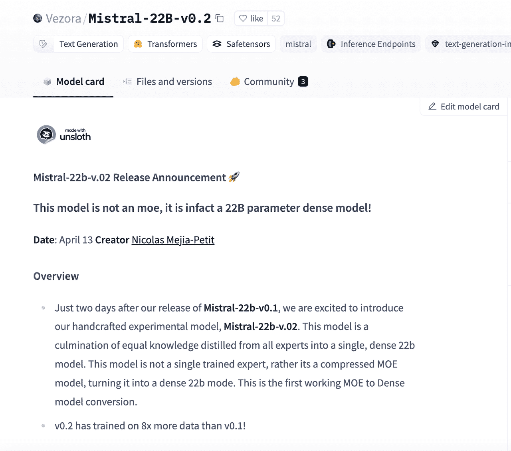

### Karpathy llm.c更新：从比PyTorch慢4.2倍提升到只慢2倍

贡献人：

https://x.com/karpathy/status/1778988957713477778

一些新的CUDA黑客朋友加入了这项工作,现在llm.c只比PyTorch(fp32,前向传递)慢2倍,而4天前还慢4.2倍。最大的改进是:

+   在矩阵乘法中使用TF32(NVIDIA TensorFLoat-32)而不是FP32。这是从Ampere+开始的GPU中的一种新的数学模式。这是一个非常好的、几乎免费的优化,通过在张量核心上运行矩阵乘法,同时将尾数截断到只有10位(浮点数的最低有效19位会丢失),以牺牲一点精度来换取大幅提高性能。因此,输入、输出和内部累加保持在fp32中,但乘法的精度较低。相当于PyTorch的torch.set_float32_matmul_precision('high')。

+   调用cuBLASLt API而不是cuBLAS进行sGEMM(fp32矩阵乘法),因为这允许你将偏置融合到矩阵乘法中,并消除了对单独的add_bias内核的需求,从而避免了对全局内存进行一次愚蠢的往返只为了一次加法。

+   一个更高效的注意力内核,它使用1)cooperative_groups reduction,看起来更简洁,我也是最近才了解到的(CUDA PMP书中没有涉及到...)；2)flash attention中使用的在线softmax算法；3)融合的注意力缩放因子乘法；4)"内置"的自回归掩码边界。(非常感谢GitHub上的ademeure、ngc92和lancerts编写/帮助这些内核!)

最后,ChatGPT创建了这个惊人的图表来说明我们的进展。4天前我们慢了4.6倍,今天我们只慢了2倍。所以我们即将超过PyTorch。

现在(就我个人而言)将专注于反向传递,这样我们就有了完整的CUDA训练循环。

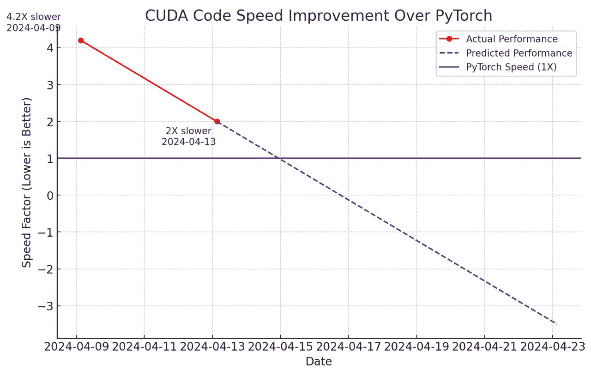

#### 18小时后的更新：降到26.2ms/迭代，与PyTorch完全相同。只用大约2,000行C代码就能比PyTorch更快地训练LLM,这似乎触手可及

https://x.com/karpathy/status/1779272336186978707

非常有趣的更新,大约18个小时后:

llm.c现在已经降到26.2ms/迭代,与PyTorch(tf32前向传递)完全匹配。我们发现了一个错误,即我们错误地在fp32数学模式下调用了cuBLAS🤦♂️。ademeure为非常长的行(最后一层logits中每行50,257个元素)贡献了一个更优化的softmax内核。

但乐趣并没有停止,因为我们还有很多锦囊妙计。我们的注意力内核是朴素的注意力,而不是flash attention,并且实现了(非常大的)前注意力和后注意力矩阵,大小为(B, NH, T, T),它还进行了不必要的往返,内部有尚未融合的GeLU非线性和置换/反置换。我们还没有尝试更多的优化,例如CUDA图、无损可压缩内存(?)等。

所以更新后的图表看起来很乐观:D,只用大约2,000行C代码就能比PyTorch更快地训练LLM,这似乎触手可及。让我们开始反向传递吧。

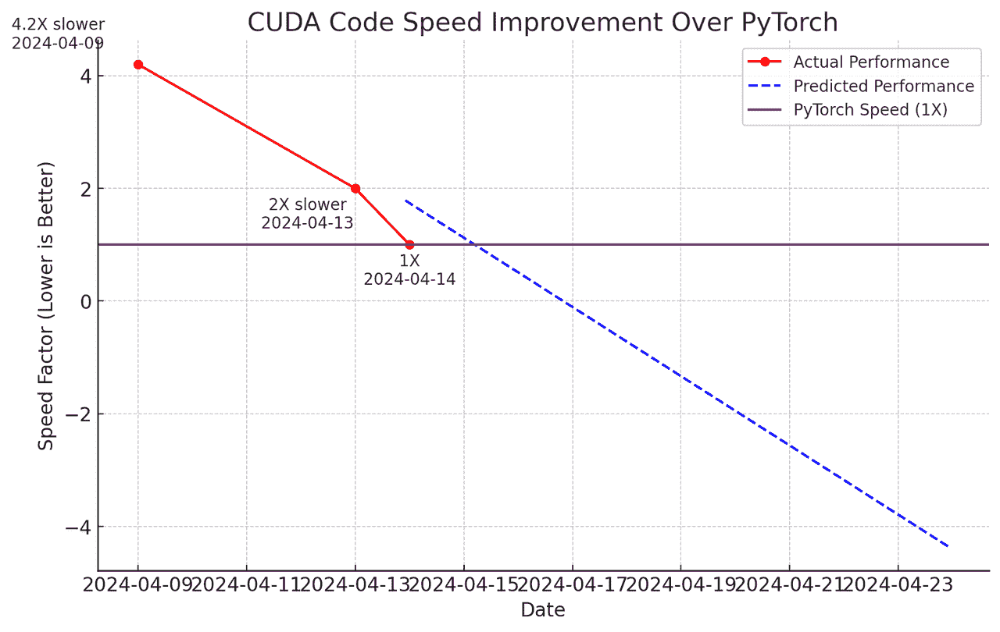

#### PyTorch的复仇，大约20%的加速

https://x.com/karpathy/status/1779354343013269929

PYTORCH的复仇

开个玩笑:)

来自PyTorch团队的@cHHillee 非常友好地帮助改进了PyTorch的基准测试,方法是:1)升级到每夜版,2)直接使用"复合"F.sdpa(缩放点积注意力)层,并打开一个torch编译标志:

TORCHINDUCTOR_COORDINATE_DESCENT_TUNING=1

由于使用了略有不同的GPU(A100 80GB,具有更高的内存带宽),所以数字有一些差异,但是:

llm.c: 23.026892

PyTorch 2.2: 22.408ms

PyTorch nightly: 21.090ms

PyTorch nightly + F.sdpa: 19.224ms

PyTorch nightly + F.sdpa + coordinate descent tuning torch inductor flag: 18.809ms

因此,大约有20%的加速,更多细节请参阅该fork:

https://github.com/Chillee/llm.c?tab=readme-ov-file#some-benchmark-numbers-with-newer-version-of-pytorch

另一个不错的附加说明是,torch compile还可以生成并发出C++代码:

https://github.com/Chillee/llm.c/blob/master/inductor_gpt2.cpp

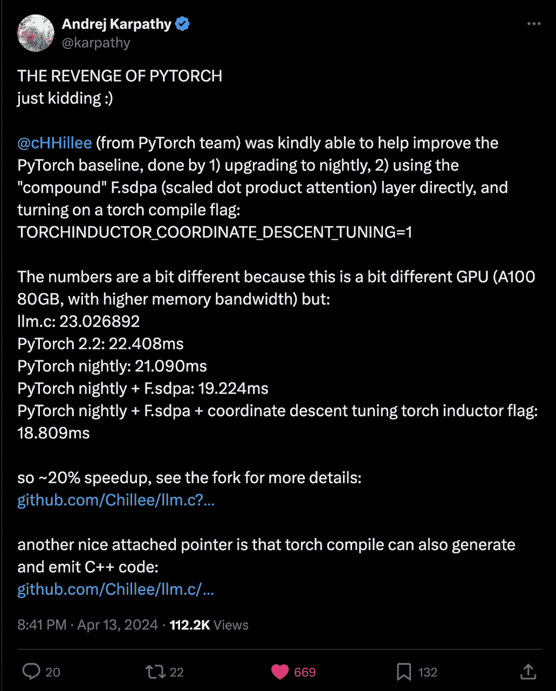

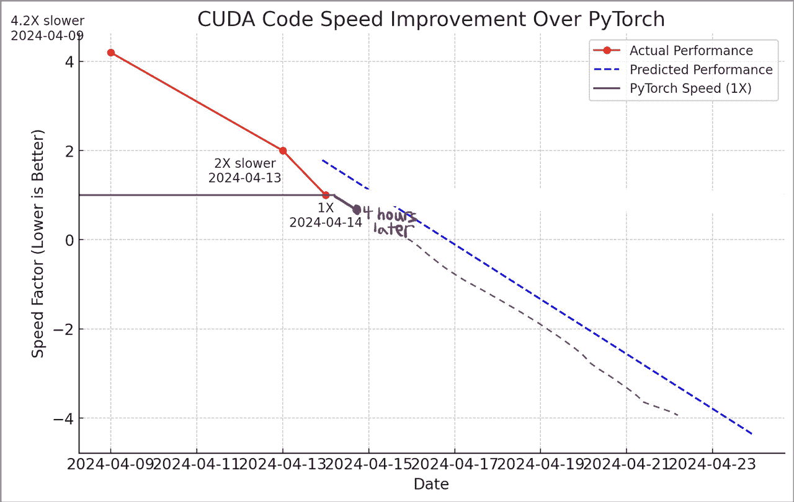

### Virat分享现在用的RAG stack：Cohere、Weaviate、Opus

贡献人：

https://x.com/virattt/status/1779172358760075591

我当前的RAG堆栈🥞

• cohere嵌入

• cohere命令r+工具调用

• cohere重排序3

• weaviate向量数据库

• opus最终输出层

为什么选择@cohere:直观的API,高质量的快速推理,价格实惠。

为什么选择@weaviate_io:易于设置,可靠的检索,支持到位。

为什么选择@AnthropicAI:opus是业界最佳。

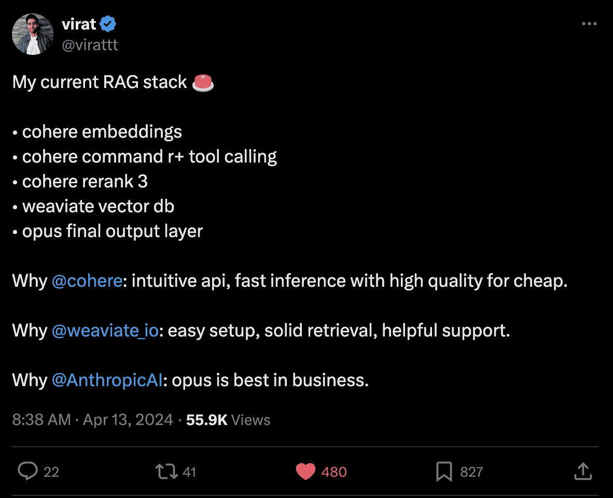

### Roemmele分享开源Gemini 智能体示例

贡献人：

https://x.com/BrianRoemmele/status/1779158342642131077

Brian Roemmele：

Gemini智能体示例

这个仓库演示了如何在应用程序中使用Google的Gemini AI模型。Gemini是一个强大的语言模型,在文本生成、聊天机器人等各种任务中表现出色。最重要的是……它是免费的!!!!

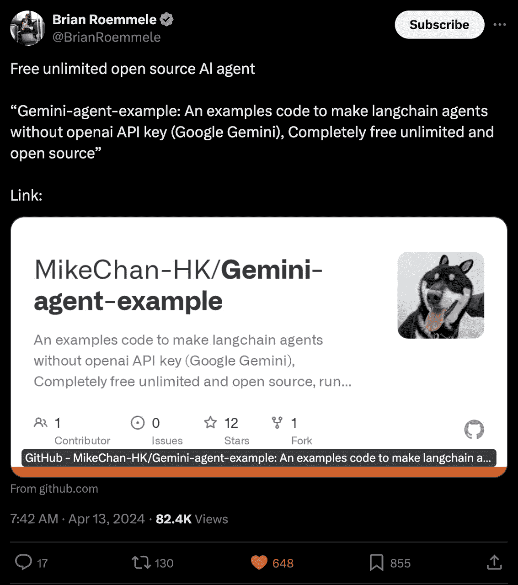

### Arnold谈美国大学强制性标准化成绩：LLM已经完全降低了论文部分作为可靠衡量标准的价值

贡献人：

https://x.com/JohnArnoldFndtn/status/1779163497802174833

John Arnold

至少部分原因是为什么大学重新要求标准化考试,除了高度预测大学成功之外,还因为LLM已经完全降低了论文部分作为可靠衡量标准的价值。

---

Jay Van Bavel, PhD：

研究生入学考试也出现了同样的情况:LLM降低了研究陈述和推荐信的意义。在可预见的未来,"深入研究"各种主题的候选人将会增加!

John Arnold：

推荐信是我使用LLM的首选用例。

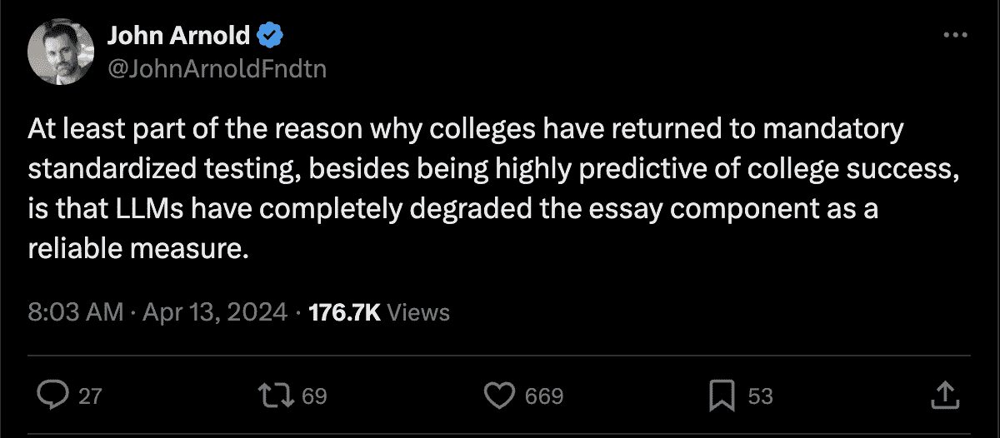

### musicgen-songstarter-v0.2：这是一个大型立体声MusicGen模型，体积是1.0的2倍

贡献人：

https://x.com/_nateraw/status/1778901598254624830

随着文本到音乐模型真正开始升温,今天我分享一个新的开放模型musicgen-songstarter-v0.2。这是一个大型立体声MusicGen模型,可以作为音乐制作人的实用工具。与v0.1相比,它的体积是原来的2倍,并在3倍以上经过手工策划的样本上进行了训练。

### musicgen作者Nate Raw预测AI音乐未来：不会取代音乐唱作，会分完整歌曲生成和专供艺术家

贡献人：

https://x.com/_nateraw/status/1779246493351756058

在进入ML领域之前,我就已经涉足音乐制作。以下是我的一些预测:

+   音乐生成AI不会取代音乐制作、词曲创作等 - 正在形成两条路线:完整歌曲生成(如suno等)和为艺术家提供的AI工具。

+   完全由AI生成的歌曲不会显著污染公告牌排行榜,但会变得非常突出,无处不在。

+   少数拥有良好品牌、由大唱片公司大笔资金支持的"虚拟艺人"将会流行起来,类似虚拟主播。他们将为粉丝制作全AI生成的音乐。唱片公司不需要付钱给他们!我们知道他们会喜欢这一点。就像印钞票一样。

+   然而,很快公告牌排行榜上相当一部分(>80%)的歌曲将包含AI生成的音频样本,就像过去20-30年通过为创作者提供的AI音乐工具,采样变得突出一样。

+   就像聊天GPT的输出无处不在,出现在作业、新闻稿、电子邮件等中一样。AI音乐创作工具领域的赢家,他们的作品将出现在收音机播放的大部分音乐中。这些样本将像制作人目前操纵他们为歌曲找到的样本一样被操纵。

+   这里的"赢家"将是那些在音乐制作人中分布最广的人 - 音乐制作的进入门槛将继续降低,就像过去15年YouTube教程降低门槛的程度一样。年轻艺术家会大大受益。

+   音乐领域的开放和封闭模型之间的差距将比LLM更大。我希望我是错的,但不幸的是,版权问题更加棘手,这激励人们将他们在未经许可的数据上训练的模型权重保持封闭,以避免被可怕的顶级唱片公司律师攻击。

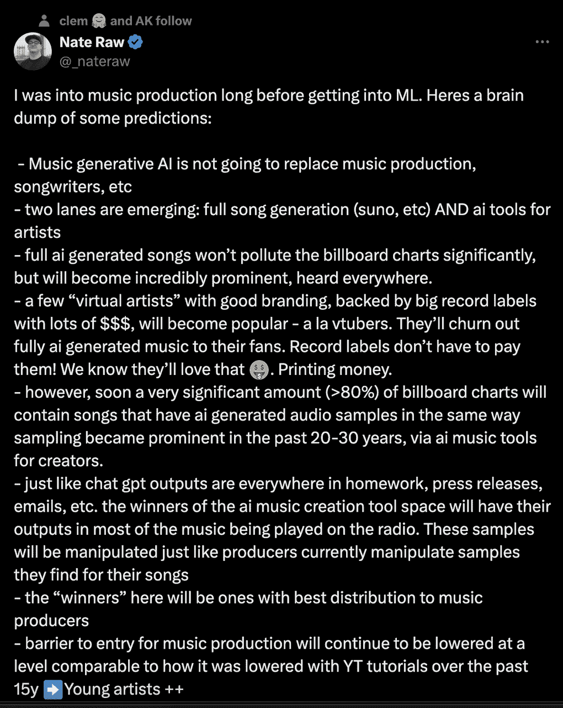

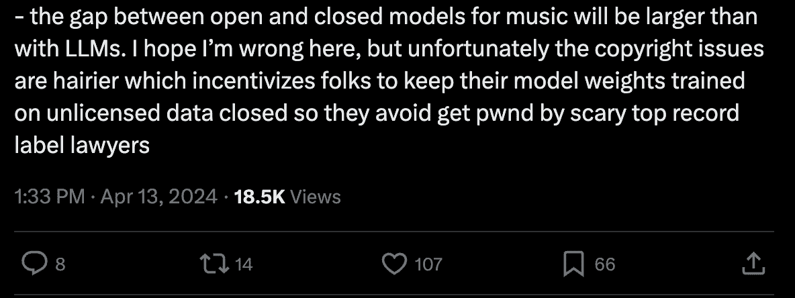

### Jina AI开源网页数据爬取

贡献人：

https://x.com/tuturetom/status/1779377811905769960

Jina AI 刚刚开源了 RAG 数据处理中的关键组件：“网页数据爬取” -- Reader，目前 175 Star

1. 在 https://r.jina.ai<url> 中填入任何 Url 即可获取到 LLM 友好的 Parsed Content（ Markdown）

2. 免费使用，提供 Stream 模式可流式读内容（简单内容 <=2s 可获取）

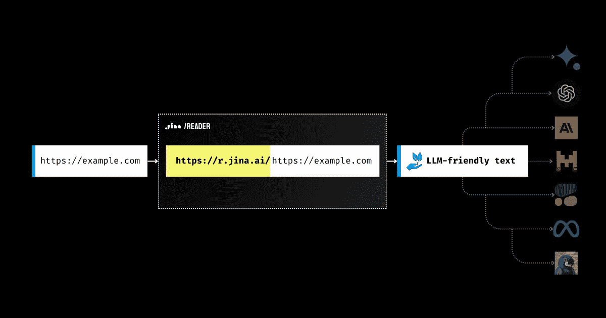

### Shawn Wang分享：Devin，OpenDevin，和SWE-Agent之战

贡献人：

https://x.com/swyx/status/1778641185193730488

直播总结:Devin vs. OpenDevin vs. SWE-Agent

这个YouTube直播比较了三个AI编程助手:

Devin:由Google AI开发的专有工具,授予主播访问权限。

OpenDevin:由Quen人开发的Devin开源克隆版本。

SWE-Agent:由普林斯顿NLP小组开发的另一个开源AI编程助手,专门针对GitHub问题。主播尝试在所有三个平台上运行相同的任务,以比较性能和可用性。

任务结果:

Devin:

成功:

+   用Rust编写了一个斐波那契生成器。

+   根据给定的任务写了一个睡前故事。

+   构建了一个基于React和Chakra UI的Docker CLI,取代了Docker桌面版。

+   编写了一个简单的Golang工作流,用于在特定条件下发送电子邮件。

失败:

+   最初在为Apple Silicon Mac进行交叉编译时遇到困难。

+   在预提交钩子linting方面遇到困难。

优缺点:

Devin:

+   优点:

+   界面精美,用户友好,带有聊天窗口进行交互和计划可视化。

+   强大的功能,包括网络浏览、代码生成和执行。

+   能够根据用户反馈进行调整和重新规划。

+   缺点:

+   专有工具,访问受限。

+   有时可能很慢,特别是在处理复杂任务时。

OpenDevin:

+   优点:

+   开源,任何人都可以访问。

+   在代码生成和执行方面表现出前景。

+   用户友好的界面,有改进的潜力。

+   缺点:

+   开发处于早期阶段,存在安装挑战和依赖问题。

+   关键的网络浏览功能在直播期间无法使用。

SWE-Agent:

+   优点:

+   开源,专注于GitHub问题解决。

+   展示了创建PR和与GitHub交互的能力。

+   与Devin和OpenDevin相比,效率和速度相对较快。

+   缺点:

+   功能有限,只专注于GitHub问题。

+   缺乏用户友好的界面,依赖命令行交互。

+   在更复杂的任务和迭代开发过程中遇到困难。

+   文档可以改进,以提高清晰度和易用性。

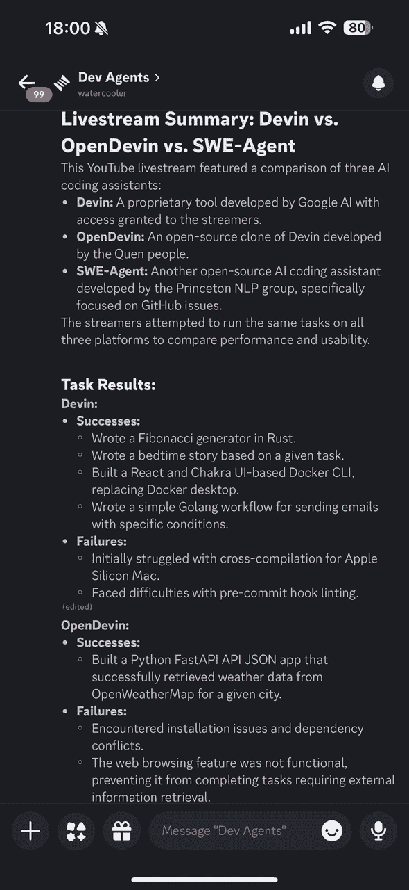

# 资讯

### 马斯克的首款多模态大模型来了，GPT-4V又被超越了一次

贡献人：

https://mp.weixin.qq.com/s/2GDjZS6ctayAF8e8eFb3CQ

自从 2023 年 11 月 Grok首次亮相以来，马斯克的 xAI 正在大模型领域不断取得进步，向 OpenAI 等先行者发起进攻。在 Grok-1 开源后不到一个月，xAI 的首个多模态模型就问世了。昨天，xAI 推出了 Grok-1.5V，该模型不仅能理解文本，还能处理文档、图表、截图和照片中的内容。

### Anthropic CE0 表示领先的人工智能模型的成本将很快上升到 100 亿美元

贡献人：

https://the-decoder.com/anthropic-ceo-believes-leading-ai-models-will-soon-cost-up-to-ten-billion-dollars/

在接受纽约时报的记者 Ezra Klein 的播客采访时，Anthropic 的 CEO Amodei 谈到了人工智能发展的近期和遥远的未来。他预计未来几年训练大型语言模型的成本将迅速上升。虽然今天的模型成本约为1亿美元，但他预计在不久的将来成本将在 10 亿美元左右。"今天的模型训练成本为1亿美元，有时会浮动至2~3亿美元。现在正在训练的模型以及将在今年晚些时候或明年初不同时间推出的模型的成本接近 10 亿美元。我认为在 2025 年和 2026 年，我们将需要更多的资金，达到 50 或 100 亿美元。"

### 木头姐 ARK 宣布已投资 OpenAI！还将 Anthropic 及 Figure1 等 AI 独角兽一网打尽

贡献人：

https://mp.weixin.qq.com/s/lE7zTnVeFfI1wcDfvkVauw

在 Ark 本周四发给客户的电子邮件中表示，截至 2024 年 4 月 10 日，ARK 已通过 Ark Venture Fund 风险基金投资了 OpenAI。此外，ARK 在报告中表示，OpenAI 处于 AI 能力寒武纪爆发的最前沿。

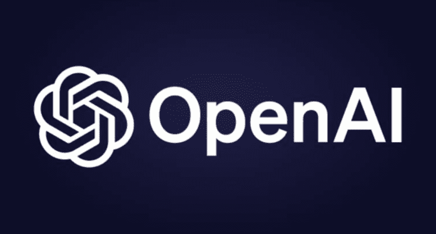

###

### Tier1 厂商麦格纳宣布采用 Sanctuary AI 人形机器人参与汽车制造

贡献人：

https://mp.weixin.qq.com/s/nzuGNBLFKfNonBb_Y4Wcuw

Sanctuary AI 成立于 2018 年，总部位于加拿大温哥华，其使命是创造世界上第一个类人智能通用机器人，帮助我们更安全、高效和可持续地工作，帮助解决当今许多组织面临的劳动力挑战。2024 年 4 月 11 日，Sanctuary AI 宣布与全球移动技术公司麦格纳建立战略合作伙伴关系，Sanctuary AI 开发的机器人将部署在麦格纳（Magna）的制造业务中，利用麦格纳的汽车产品组合、工程和制造能力对机器人的成本和可扩展性进行多学科评估；以及麦格纳的战略股权投资。

### 首个AI程序员造假被抓，Devin再次“震撼”硅谷！扒皮视频文字详解附上

贡献人：

https://mp.weixin.qq.com/s/898TBRvqFwhBVfI3SPdxyA

首个**AI程序**员，演示视频大幅度造假？不久之前震撼硅谷的Devin，再度震撼硅谷——但这次是被打假。事情是这样的：油管程序员博主Internet of Bugs对Devin的视频进行了逐帧分析，逐一举证说明了Devin并不如演示中那般神奇。

### GPT超越扩散、视觉生成Scaling Law时刻！北大&字节提出VAR范式

贡献人：

https://mp.weixin.qq.com/s/KOEdTgJX4Gga5zRbl57Yow

新一代视觉生成范式「VAR: Visual Auto Regressive」视觉自回归来了！使 GPT 风格的自回归模型在图像生成首次超越扩散模型，并观察到与大语言模型相似的 Scaling Laws缩放定律、Zero-shot Task Generalization 泛化能力。这项名为 VAR 的新工作由北京大学和字节跳动的研究者提出，登上了 GitHub 和 Paperwithcode 热度榜单，并得到大量同行关注。

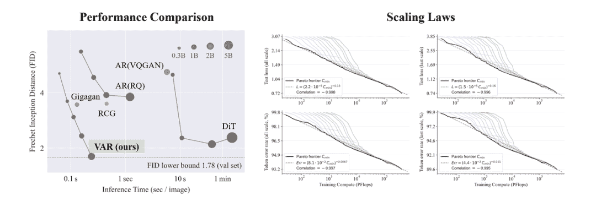

### 曾爆火的 InstantID又有了新玩法：风格化图像生成，已开源

贡献人：

https://mp.weixin.qq.com/s/CP6NFzzt57YZMj4Q3JNySA

风格化图像生成，也常称为风格迁移，其目标是生成与参考图像风格一致的图像。此前基于 diffusion 的方法（比如 LoRA）通常需要批量的同风格数据进行训练，无法迁移到新的风格中，或者基于 inversion（如 StyleAlign），通过将风格图像还原到 latent noise 后，将其前向传播得到的 K、V 用于替换风格图像生成中的 K、V，但这类方法往往由于 inversion 的操作，造成风格退化。最近，InstantID 原班团队推出了风格迁移的新方法 InstantStyle，与人脸 ID 不同，它是一个通用的图像风格注入框架，采用两种简单但非常有效的技术，来实现风格和内容与参考图像的有效分离。

### 全球AI顶会NeurlPS开始收高中生论文了

贡献人：

https://mp.weixin.qq.com/s/Uctt64AT7oeWtZPLmZqxVQ

培养 AI 人才，要从娃娃抓起，这句话似乎越来越不像开玩笑了。本周五，顶级学术会议 NeurIPS开设高中生论文 Track 的消息引爆了人工智能社区。消息援引自大会组织方的一项新公告。请注意，这不是 workshop，是主会议。NeurIPS 2024 邀请高中生提交有关机器学习社会影响主题的研究论文。组委会将选出一部分决赛入围者以虚拟方式展示他们的项目，并将在 NeurIPS 主页上重点展示他们的作品。此外，最多五个获奖项目的主要作者将受邀参加在温哥华举行的 NeurIPS 2024 颁奖典礼。参赛要求强调每份提交的作品必须完全由高中生作者独立完成。NeurIPS 2024 组委会希望每份提交的内容都能突出使用机器学习产生的积极社会影响或产生积极社会影响的潜力。

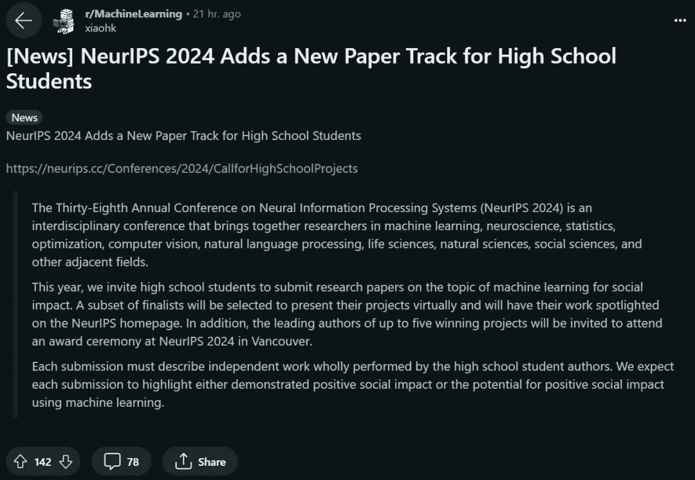

### OpenAI推销ChatGPT to B业务，微软客户也是目标

贡献人：

https://mp.weixin.qq.com/s/86nAqCu84lC_aDCe9_R8dw

技术领先的 OpenAI，正在稳步推进大模型能力的落地。据路透社等媒体报道，OpenAI 首席执行官山姆・奥特曼（Sam Altman）本月在旧金山、纽约和伦敦接待了数百名《财富》500 强公司高管，他和其他 OpenAI 高管在会上推销了供企业使用的人工智能服务，同时还与自己的资金支持者微软的产品进行了一番比对。这些类似路演的活动表明，在通过消费级产品 ChatGPT 引发生成式人工智能爆炸式增长之后，OpenAI 正在寻求从世界各地的企业那里增加新的收入来源 —— 其中一些可能来自其最大合作伙伴的主场。OpenAI 与全球大型企业高管的最近三场会议 —— 两次于上周在美国举行，一场本周一在伦敦举行，此前尚未获得曝光。据不愿透露姓名的与会者称，奥特曼在活动中直接面向每个城市的 100 多名高管发表了讲话。在每次活动中，奥特曼和 OpenAI 首席运营官 Brad Lightcap 都进行了产品演示，包括 ChatGPT Enterprise（其著名的企业级应用，可根据简单的提示生成文本）、将客户应用程序连接到其 AI 服务（称为 API）的软件及其最新的文本到视频模型。OpenAI 承诺 ChatGPT Enterprise 客户的数据不会被用于进一步训练 AI 模型。在与金融、医疗保健和能源等行业的潜在客户交谈时，OpenAI 高管强调了一系列具体应用方向，例如呼叫中心管理和翻译。他们指出，超过 92% 的财富 500 强公司已经在使用其聊天机器人的消费级版本。

微软作为 OpenAI 的最大投资者，去年开始已通过其 Azure 云和销售 Microsoft 365 Copilot（一种由 OpenAI 面向企业的模型提供支持的生产力工具）的方式提供了对 OpenAI 先进大模型技术的访问。

### CVPR 2024 | 仅需文本或图像提示，新框架CustomNeRF精准编辑3D场景

贡献人：

https://mp.weixin.qq.com/s/5Lw5iwSHxJxeqPJYEa3KZw

自 2020 年神经辐射场 (Neural Radiance Field, NeRF) 提出以来，将隐式表达推上了一个新的高度。作为当前最前沿的技术之一，NeRF 快速泛化应用在计算机视觉、计算机图形学、增强现实、虚拟现实等领域，并持续受到广泛关注。有赖于易于优化和连续表示的特点，NeRF 在 3D 场景重建中有着大量应用，也带动了 3D 场景编辑领域的研究，如 3D 对象或场景的纹理重绘、风格化等。为了进一步提高 3D 场景编辑的灵活性，近期基于预训练扩散模型进行 3D 场景编辑的方法也正在被大量探索，但由于 NeRF 的隐式表征以及 3D 场景的几何特性，获得符合文本提示的编辑结果并非易事。为了让文本驱动的 3D 场景编辑也能够实现精准控制，美图影像研究院（MT Lab）与中国科学院信息工程研究所、北京航空航天大学、中山大学，共同提出了一种将文本描述和参考图像统一为编辑提示的 CustomNeRF 框架，可以通过微调预训练的扩散模型将参考图像中包含的特定视觉主体 V∗嵌入到混合提示中，从而满足一般化和定制化的 3D 场景编辑要求。该研究成果目前已被 CVPR 2024 收录，代码已开源。

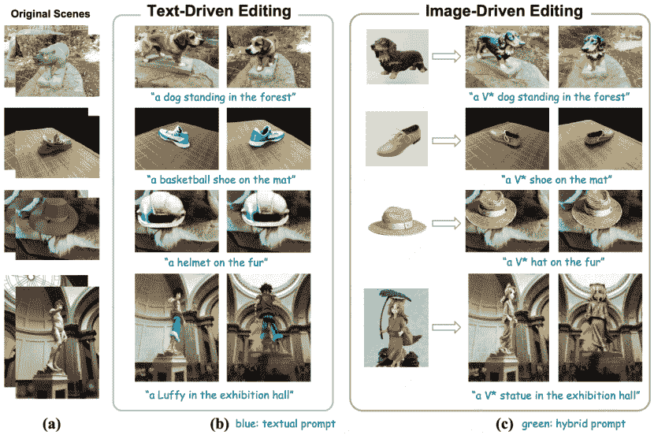

### 谁说大象不能起舞! 重编程大语言模型实现跨模态交互的时序预测 | ICLR 2024

贡献人：

https://mp.weixin.qq.com/s/K04haPMcbKiS6OkCihXAqQ

最近，来自澳大利亚蒙纳士大学、蚂蚁集团、IBM 研究院等机构的研究人员探索了模型重编程 (model reprogramming) 在大语言模型 (LLMs) 上应用，并提出了一个全新的视角：高效重编程大语言模型进行通用时序预测 –- 其提出的 Time-LLM 框架无需修改语言模型即可实现高精度时序预测，在多个数据集和预测任务中超越了传统的时序模型，让 LLMs 在处理跨模态的时间序列数据时展现出色，就像大象起舞一般！

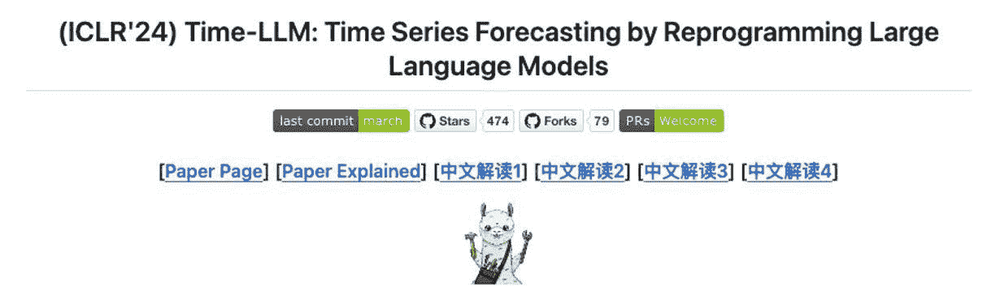

### 除了唱歌，AI还能替你演出？又一AI公司将虚拟人推到新高度

贡献人：

https://mp.weixin.qq.com/s/gSg1JRosqPnX86wAUEzg0A

用 Suno十秒写歌，是不是已经很震撼？现在不仅如此，用最新的 AI 工具，我们还可以快速生成歌手唱歌 MV。

最近，一家名为 AKOOL的 AI 公司推出了一个唱歌虚拟人工具，用户只需在平台上选择虚拟人，简单输入歌词指令，便可生成能唱歌的虚拟人 MV。视频中的 “歌手” 在雪地里随着音乐翩翩起舞，“假唱” 对口型也毫不逊色。

# 产品

### **eezyCollab**

贡献人：

https://www.eezycollab.com/

eezyCollab 是一个旨在提供强大的 AI 驱动网红营销平台。目标是帮助品牌提升影响力，AI 算法会分析用户的产品和目标受众，只需单击一下即可联系多个网红，从而节省数小时的宝贵时间，实现高效有效的网红营销。定价计划相对适中，并提供免费试用帮助企业入门。

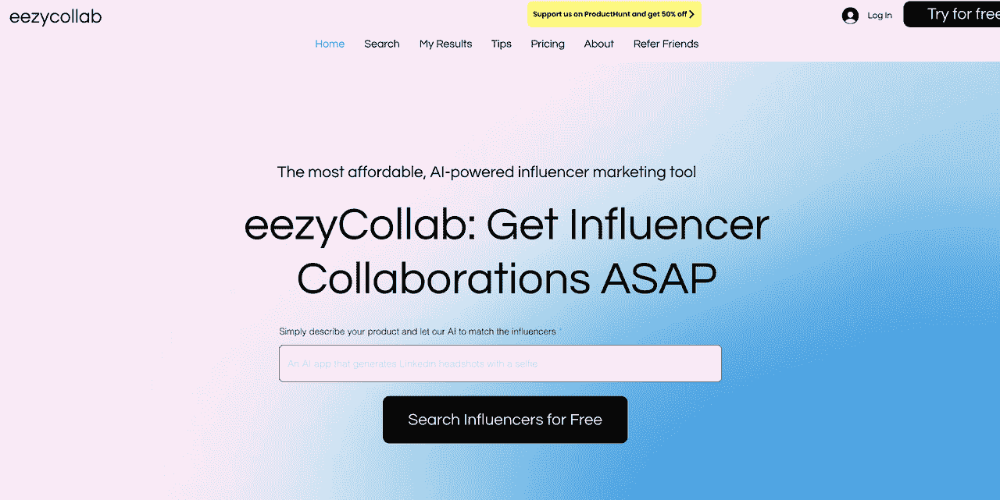

### chatslide.ai

贡献人：

https://chatslide.ai/landing

ChatSlide.ai 是一个强大的工具，可以帮助用户快速生成令人惊叹的幻灯片，并支持不同的音调、风格，甚至语音克隆。它还可以将用户的幻灯片和脚本转换为视频，配有可自定义的头像。通过展示用户的专业知识和创造力的动态视频演示，让内容更加栩栩如生，给被演示者留下持久的印象。

# HuggingFace&Github

### Spring AI

贡献人：

https://github.com/spring-projects/spring-ai?tab=readme-ov-file

Spring AI 是一个旨在简化包含人工智能功能的应用程序开发的项目。它从一些著名的 Python 项目中汲取灵感，如 LangChain 和 LlamaIndex，但并不是这些项目的直接移植。该项目的目标是为开发人员提供一些抽象，作为开发人工智能应用程序的基础，并具有多种实现，使得可以轻松地交换组件而只需进行最少的代码更改。其使命是使下一波生成式人工智能应用程序不仅适用于 Python 开发人员，而且将在许多编程语言中无处不在。

### aiXcoder-7B

贡献人：

https://github.com/aixcoder-plugin/aiXcoder-7B

aiXcoder是一个针对软件开发人员的人工智能工具，旨在提高代码编写的效率和准确性。它是基于大型代码模型训练的，具有广泛的上下文信息和预训练任务，可以用于代码完成和代码生成任务。aiXcoder 7B Base是其中一个版本，经过了1.2T独特标记的广泛训练，在代码完成场景中表现出色，并在多语言nl2code基准测试中超过了其他类似参数大小的模型。

### parler-tts

贡献人：

https://github.com/huggingface/parler-tts

Parler-TTS 是一种轻量级文本转语音 （TTS） 模型，可以根据给定说话者的风格（性别、音调、说话风格等）生成高质量、自然的语音。与其他 TTS 模型相比，Parler-TTS 是一个完全开源的版本，所有数据集、预处理、训练代码和权重均在许可许可下公开发布，使社区能够在其基础上开发他们自己强大的 TTS 模型。

### Copilot-For-Security

贡献人：

https://github.com/Azure/Copilot-For-Security

Microsoft Copilot for Security 是一种生成式 AI 驱动的安全解决方案，有助于提高防御者的效率和能力，以机器速度和规模改善安全结果，同时保持符合负责任的 AI 原则

# 投融资

### 用AI帮企业跑通财税服务全流程，「创业爸爸」获1000万元融资

贡献人：

https://36kr.com/p/2729877214045447

AI公司创业爸爸成立于2020年10月，利用AI技术提供标准化财税全流程服务，针对中小企业。创业爸爸位于海南，受益于2020年海南自由贸易港政策，快速发展，提供多元化服务如公司注册、税务申报等。公司已建立一站式服务平台，有150多个服务项目，涵盖企业生命周期各阶段。创业爸爸还开发了话术库和在线培训系统，提高服务效率。2023年营收达3000万元，净利润1000万元。公司未来计划提升市场占有率，扩展到其他地区，继续投入AI研发，增强服务自动化和个性化。

### Prem Labs获得1400万美元种子轮融资，用于AI模型创新

贡献人：

https://www.techcompanynews.com/prem-labs-secures-14m-seed-funding-for-ai-model-innovation/

Prem Labs成功获得1400万美元种子轮融资，此轮资金由David Maisel（Marvel Studios联合创始人）和红杉资本中国合伙人等知名投资者提供。公司致力于使用开源技术和自主研发的AI模型，推动AI技术的民主化，确保隐私、定制化和数据主权。这笔资金将帮助Prem Labs扩展其创新产品，并巩固其在AI伦理进步领域的领导地位。

公司官网：https://www.premai.io/

### 前Intel高管创立的Lumana获得2400万美元种子轮融资

贡献人：

https://www.calcalistech.com/ctechnews/article/ryny02cyc?utm_

Lumana开发的视频安全平台利用AI和分布式混合云架构，已成功获得2400万美元种子轮融资，由Norwest和S Capital领投。该平台能实时分析数百万小时的视频，提高安全效率和事故响应速度。Lumana的创始人Sagi Ben Moshe是Intel在以色列的资深高管，公司目前在加州和特拉维夫设有办事处。此轮资金将助力Lumana扩大市场影响力，提升AI视频分析技术。

公司官网：https://www.lumana.ai/

# 学习

### AI 集群基础设施 InfiniBand 详解

贡献人：

https://mp.weixin.qq.com/s/2phqowTOr4Hf3K9H-8W48w

文章详细介绍了InfiniBand技术在AI集群中的应用和重要性。InfiniBand是一种高性能网络通信协议，主要用于高速数据传输和低延迟通信。在分布式AI训练和高性能计算中，InfiniBand通过提供高带宽和低延迟的连接，支持高效的机器间通信和GPU通信，从而显著提升了整体的计算性能。文章还探讨了InfiniBand的各个技术规格，包括PCIe 6.0和7.0的发展，以及它们对提升数据吞吐量和设备通信速度的贡献。此外，还提到了InfiniBand的各种实现方式，如NVLink和NVSwitch，这些都是为了优化和提升多GPU系统的通信效率。

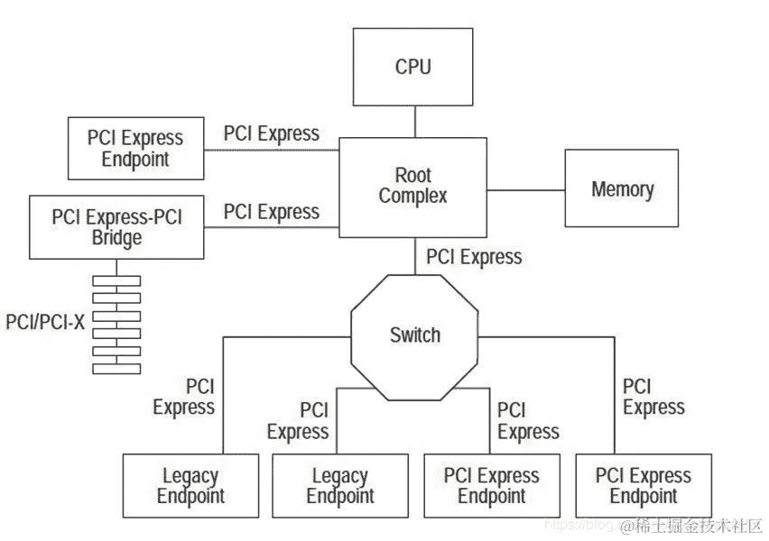

### MoE-SFT：混合专家模型在大模型中的应用

贡献人：

https://zhuanlan.zhihu.com/p/691402411?utm_psn=1762839367150735360

文章讨论了混合专家模型（MoE）的技术细节及其在大模型中的有效性。MoE模型通过门控网络进行专家选择，允许模型根据输入选择最适合的“专家”进行计算，从而提高了模型的计算效率和推理速度。MoE的优势在于可以有效扩展模型的规模并降低训练与推理成本，尤其适用于参数规模庞大的模型。文章也指出，MoE的训练速度更快，推理速度提升，同时具有较好的多任务平衡能力。然而，MoE模型的泛化能力不足，显存占用依然高，是其主要劣势。此外，文中还分享了Mixtral 8x7B微调的经验，这是一种具有8个专家的MoE模型，适用于处理复杂的多任务场景。

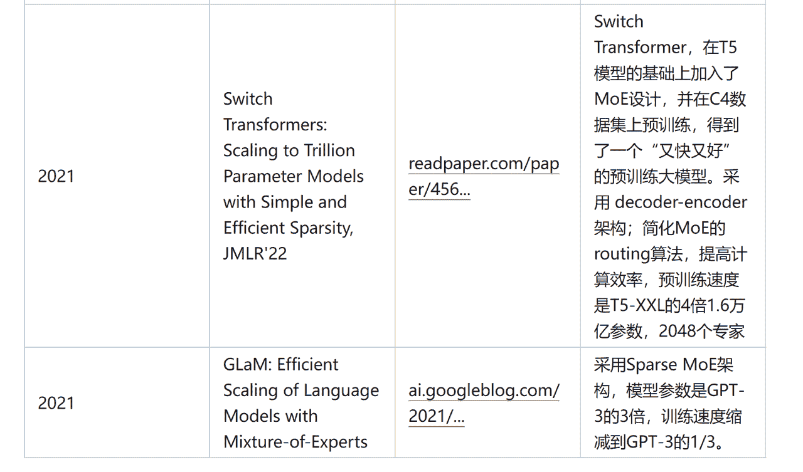

### **Nvidia Blackwell系列GPU性能及总成本分析：B**100 vs B200 vs GB200

贡献人：

https://www.semianalysis.com/p/nvidia-blackwell-perf-tco-analysis?utm=

Nvidia的新Blackwell系列GPU，包括B100、B200和GB200，显著提升了内存带宽和浮点运算能力。B100在700W功率下提供1750 TFLOPS的FP16/BF16计算能力，而更高功率的B200提供2250 TFLOPS，GB200则在液冷条件下达到2500 TFLOPS。这一系列显著增强了内存带宽，从H100的3.4 TB/s增加到Blackwell系列的最高8.0 TB/s，极大改善了推理吞吐量和交互性。此外，Nvidia通过增加硅片面积（约1600mm²，拥有2080亿晶体管）而非仅靠工艺缩小，以实现性能的倍增，尽管面对摩尔定律放缓和3nm工艺挑战。

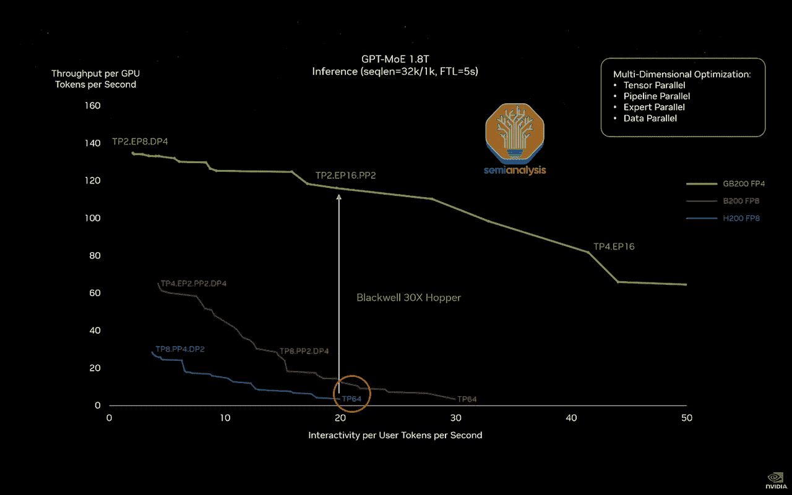

### 行主序与列主序矩阵：Mojo和NumPy的性能分析

贡献人：

https://www.modular.com/blog/row-major-vs-column-major-matrices-a-performance-analysis-in-mojo-and-numpy

本文分析了行主序和列主序矩阵在内存中的存储方式及其对性能的影响。行主序是将行向量或行中的元素在连续的内存位置存储，而列主序则是将列向量或列中的元素在连续的内存位置存储。因此，经常需要访问行元素的算法在行主序矩阵上运行更快，而经常需要访问列元素的算法在列主序矩阵上运行更快。文中举例，使用Mojo和NumPy对行主序和列主序矩阵进行性能对比，发现在处理列操作时，列主序矩阵性能更优。文章还讨论了不同编程语言和库对行主序和列主序的偏好，如MATLAB、Fortran使用列主序，而C、C++和NumPy默认使用行主序。

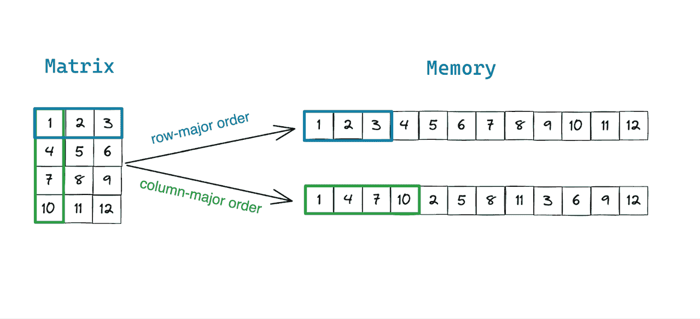

### **多GPU分布式推理技术细节解析**

贡献人：

https://huggingface.co/docs/diffusers/main/en/training/distributed_inference?utm

Hugging Face的Diffusers库支持使用🤗 Accelerate和PyTorch Distributed进行多GPU分布式推理。通过Accelerate库，用户可以简化分布式环境的设置，并轻松分配GPU进行模型推理。初始化一个accelerate.PartialState来自动检测并设置分布式环境，无需显式定义rank或world_size。使用split_between_processes工具作为上下文管理器，自动在多个处理器间分配推理任务。此外，还可以使用device_map来决定如何在多个设备上分配模型，这在有多个GPU的情况下尤其有用。例如，可以通过设定"balanced"策略来在所有可用GPU间平均分配模型，以充分利用硬件资源。

# 声明

本文档仅供学习交流使用，版权归原作者所有，若涉侵权，请联系Jack Jin 15101136166

##

（欢迎在下方反馈您宝贵的意见！整理不易，觉得有用给AI日报小组点个赞👍吧！）

ChatGPT；Angela；Zijia Liu；Alex；Zeqi Tan；Tiezhen（HuggingFace）；Naixu；Lizhi；Peter；Suoman；Jack

封面生成——右脑科技

如果你有大模型相关的创业想法，欢迎来找我们聊聊～🛰️：15101136166

> 快邀请你的小伙伴们一起来读大模型日报吧！

> **【日报****知识库****】**这里是近期日报内容的汇总,欢迎大家查阅

> [大模型日报知识库(分享版)](https://miracleplus.feishu.cn/wiki/KapVwXfkriOBiskB0B2cUHxjnTh)

>

> 欢迎大家多多帮我们分享,转发~~

> 如果大家有任何的建议或者吐槽,欢迎随时找我聊天~

