# 奇绩大模型日报（4月 12日）

> 来源：[https://miracleplus.feishu.cn/docx/Idgzd2X8XoCqUlxlrWNcg3gJnld](https://miracleplus.feishu.cn/docx/Idgzd2X8XoCqUlxlrWNcg3gJnld)

## 推特

### OpenAI 新 GPT-4 Turbo 模型开放所有付费用户，奥特曼：GPT-4现在明显更智能,使用起来也更愉悦

贡献人：

https://x.com/sama/status/1778578689984270543

我们面向付费ChatGPT用户推出了新的GPT-4 Turbo模型。我们在写作、数学、逻辑推理和编程方面进行了能力提升。

来源:[https://github.com/openai/simple-evals](https://github.com/openai/simple-evals)

---

Sam Altman：GPT-4现在明显更智能,使用起来也更愉悦。

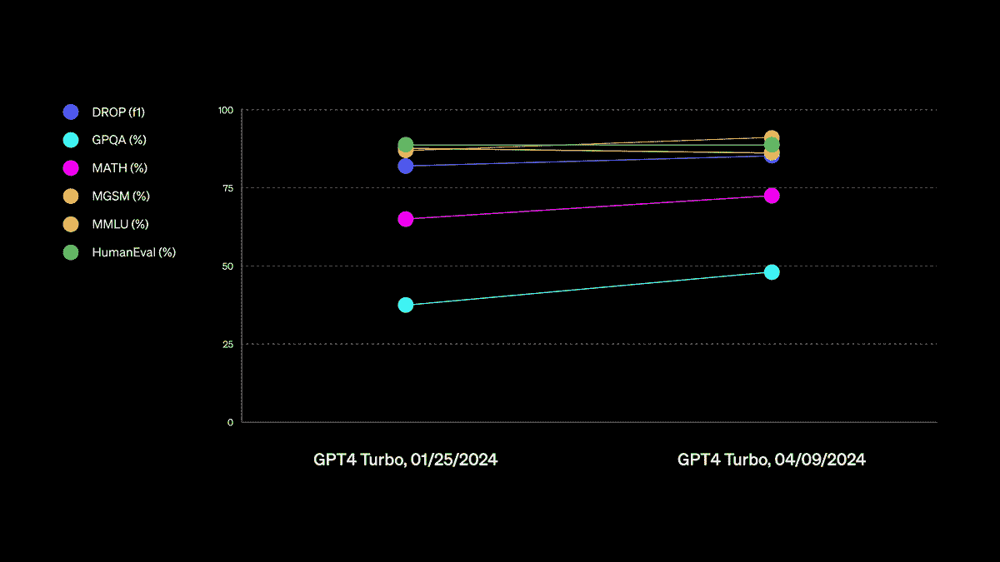

### OpenAI刚刚解雇了两名AI研究人员，原因是泄露信息

贡献人：

https://www.theinformation.com/articles/openai-researchers-including-ally-of-sutskever-fired-for-alleged-leaking

根据The Information、@steph_palazzolo和@erinkwoo的最新报告:

OpenAI已经解雇了研究人员Leopold Aschenbrenner和Pavel Izmailov,原因是他们涉嫌将信息泄露给公司外部。

目前尚不清楚实际泄露的信息内容。

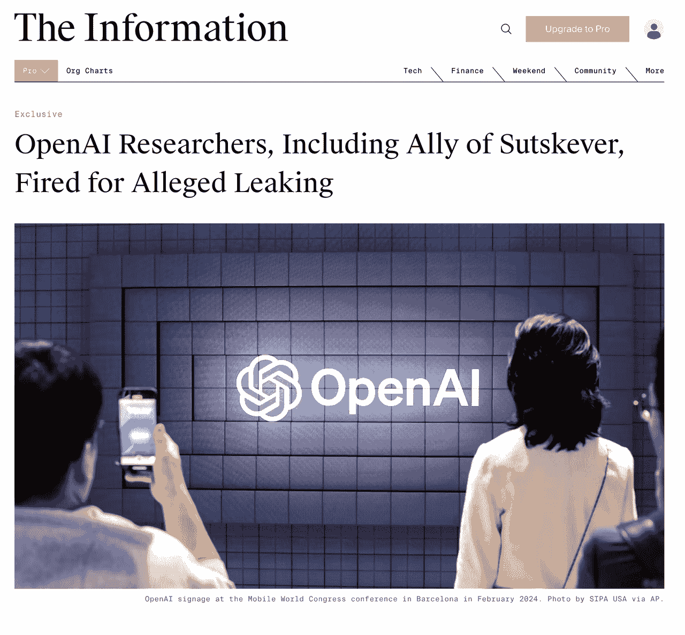

### Adobe正在以每分钟3美元的价格购买视频,用于构建AI模型

贡献人：

https://www.bloomberg.com/news/articles/2024-04-10/adobe-is-buying-video-clips-for-3-per-minute-to-build-ai-model?embedded-checkout=true

OpenAI的Sora增加了Adobe面临的竞争压力

Adobe利用其素材库构建了AI模型,并采购了媒体资源

### 苹果计划用专注AI的M4芯片彻底改革整个Mac系列

贡献人：

https://www.bloomberg.com/news/articles/2024-04-11/apple-aapl-readies-m4-chip-mac-line-including-new-macbook-air-and-mac-pro?embedded-checkout=true

· 公司正致力于向新处理器的快速过渡

· 改革将带来AI能力和内存改进

苹果公司为了提振低迷的电脑销售,正准备用一个新的自研处理器系列来彻底改革整个Mac产品线,旨在突出人工智能。

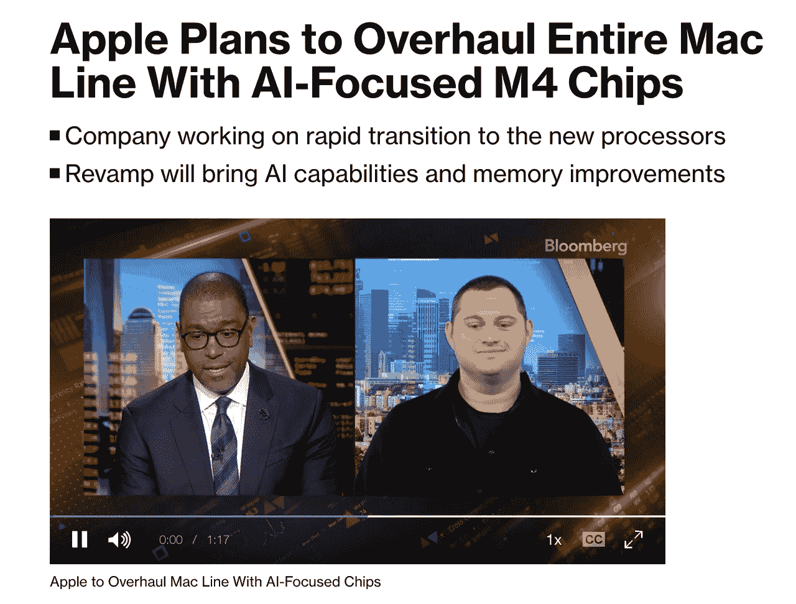

### Zephyr 141B-A35B：Mixtral-8x22B微调， 使用DORPO对齐算法

贡献人：

https://x.com/osanseviero/status/1778430866718421198

介绍:Zephyr 141B-A35B 🥁

🔥Mixtral-8x22B微调

🤯 使用DORPO:新的对齐算法(无SFT,开放)

🚀 使用7000个(开放)数据实例

在IFEval、BBH、AGIEval等测试中表现非常强...尽情享用吧! 🤗

### Wong评论AI Pin手势来控制和导航Cosmos：许多评论者不想花时间学习才留差评

贡献人：

https://x.com/raywongy/status/1778424557499544060

在我看来,许多评论者似乎只是不想去应对一个需要超过5秒钟才能掌握的新界面所带来的学习曲线。

使用Ai Pin的手势来控制和导航Cosmos确实有一个学习曲线,但我花了5天时间就能非常熟练地使用它。正如我在评论中所说,我现在可以轻松地以9/10的准确率"激光瞄准",并以非常快的速度浏览激光墨水显示界面。

它确实可以工作,你只需要学习如何使用它。如果你不愿意学习,那是你自己的问题。在这个世界上,存在着一些很好的技术,其输入和控制并非愚蠢到易于使用——但它们需要练习和耐心。

我不需要伪装或为我的观点辩解。我总是有依据的。

[ssstwitter.com_1712870961578.mp4](https://internal-api-drive-stream.feishu.cn/space/api/box/stream/download/all/TwL6bqqf2o7Kdrxbe2QcVsLSnce)

### Rerank 3简介:一个高效的企业搜索和检索新基础模型

贡献人：

https://x.com/cohere/status/1778417650432971225

介绍Rerank 3:我们最新的基础模型,专为增强企业搜索和检索增强生成(RAG)系统而构建,能够准确检索100多种语言的多方面和半结构化数据。

今天,我们推出了最新的基础模型Rerank 3,专门用于增强企业搜索和检索增强生成(RAG)系统。

我们的模型与任何数据库或搜索索引兼容,也可以插入到任何具有本地搜索功能的旧应用程序中。通过一行代码,Rerank 3可以提高搜索性能或降低运行RAG应用程序的成本,对延迟的影响可以忽略不计。

Rerank 3为企业搜索提供了最先进的功能,包括:

+   4k上下文长度,可显著提高较长文档的搜索质量

+   能够搜索多方面和半结构化数据,如电子邮件、发票、`JSON`文档、代码和表格

+   支持100多种语言

+   改善延迟,降低总体拥有成本(TCO)

具有长上下文的生成模型能够执行RAG。然而,为了优化准确性、延迟和成本,RAG解决方案需要生成模型和我们的Rerank模型相结合。Rerank 3的高精度语义重新排序确保只有最相关的信息被输入到生成模型中,提高响应准确性,并保持低延迟和低成本,特别是在从数千和数百万个文档中检索信息时。

### OpenEQA——开放词汇体现式问答基准测试：通过使用开放词汇问题测试对物理环境的理解

贡献人：

https://x.com/AIatMeta/status/1778425321118732578

今天,我们发布了OpenEQA——开放词汇体现式问答基准测试。它通过使用开放词汇问题(如"我把工牌放在哪里了?")来测试AI智能体对物理环境的理解。

更多详情 ➡️ https://go.fb.me/7vq6hm

当今所有最先进的视觉+语言模型(VLM)的表现都远远低于人类水平。

事实上,对于需要空间理解的问题,当今的VLM几乎是"盲目的"——获取视觉内容只能对仅基于语言的模型提供微小的改进。

我们希望OpenEQA能够激励更多的研究,帮助AI理解并传达它所看到的世界。

[ssstwitter.com_1712855604100.mp4](https://internal-api-drive-stream.feishu.cn/space/api/box/stream/download/all/TKRsbqkiAolP56xjuZ5cwZTKnnt)

### Batra评OpenEQA：我总是很乐意戳破炒作的泡沫！

贡献人：

https://x.com/DhruvBatraDB/status/1778447178262040850

我从事视觉+语言模型(VLM)的研究已有十年。每隔几年,这个社区就会重新发现同样的教训——在困难的任务上,VLM会退化到几乎失明的状态! 即使是关于视觉内容的问题,视觉内容对VLM的改进也微乎其微,超过了LLM。语言并不包含答案,只有视觉才有。为什么?因为语言提供了关于世界的简单先验,而"看"是困难的。无论VLM是GPT-4V、Claude还是Gemini,情况都一样。我总是很乐意戳破炒作的泡沫!

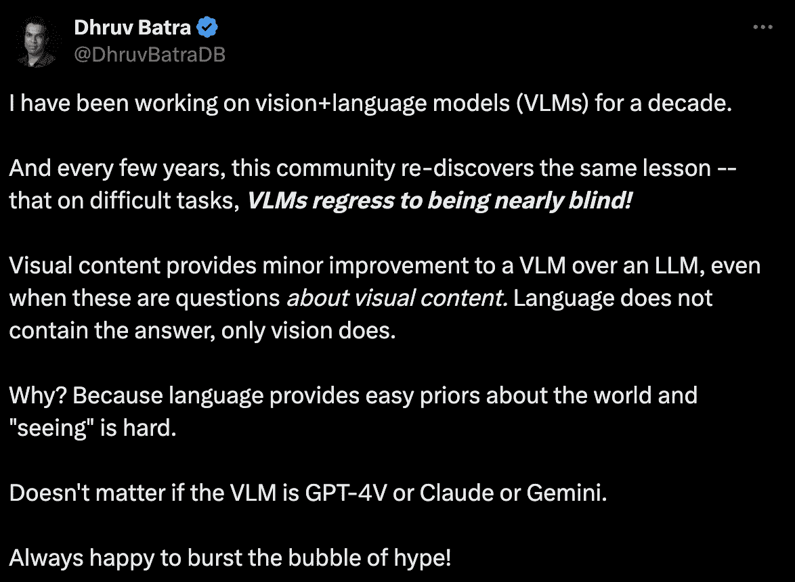

### Patchscopes：检视语言模型隐藏表示的统一框架

贡献人：

https://x.com/GoogleAI/status/1778503607199150303

能够解释#ML模型的隐藏表示是理解其行为的关键。今天我们介绍了Patchscopes,这是一种训练#LLM以自然语言解释其自身隐藏表示的方法。了解更多 → https://goo.gle/4aS5epd

Patchscopes:检视语言模型隐藏表示的统一框架

Patchscopes是一个新的框架,旨在利用LLM固有的语言能力,以直观、自然的语言解释其内部隐藏表示,从而统一以前各种解释LLM内部工作原理的方法。

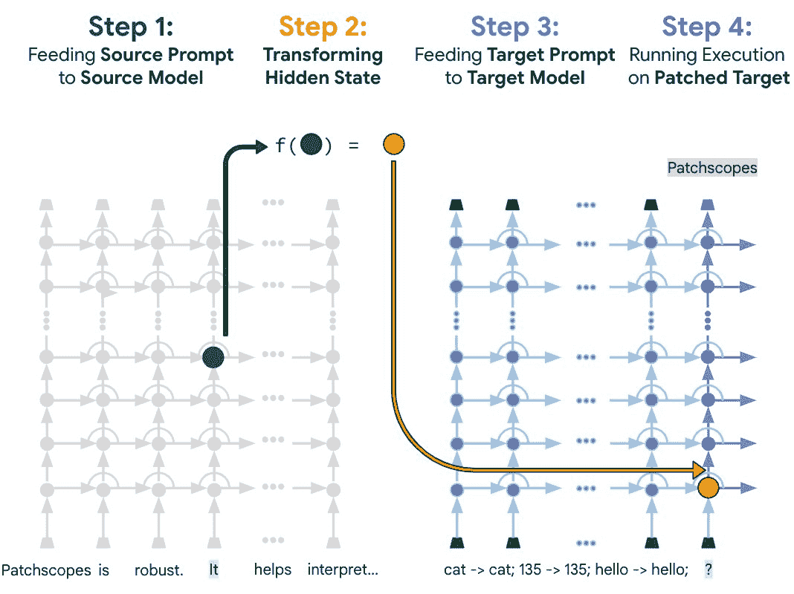

### Perplexity CEO Srinvas：一个合理规模的、训练时间极长的、部署在设备上的模型，将成为日请求量最大的LLM

贡献人：

https://x.com/AravSrinivas/status/1778520029983551709

越来越明显,一个合理规模的、训练时间极长的、部署在设备上的模型,将成为日请求量最大的LLM。目前还不清楚它将基于谁的基础模型。但看着这一切发生并找出答案将是令人兴奋。

Rich Miner：

你这么认为?你看到了哪些使用场景?

Aravind Srinivas

Concierge(智能助理)!

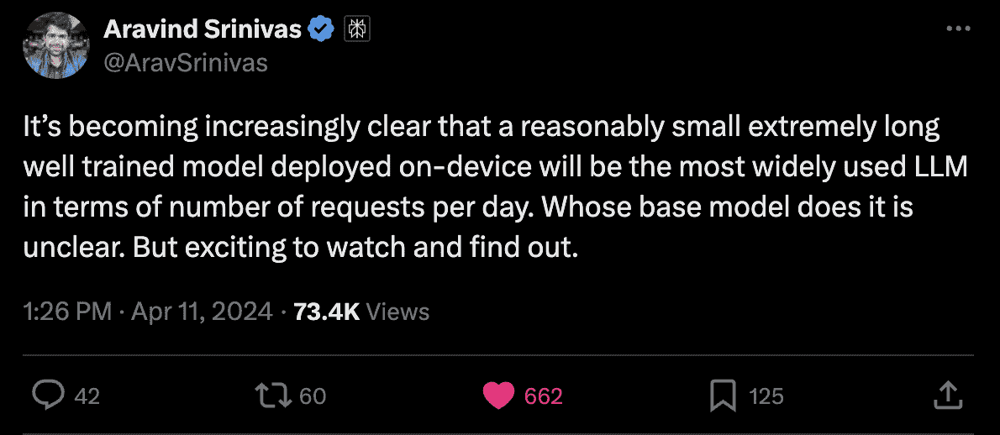

### Mistral-22b-V.01：实现MoE到Dense模型的转换，只有220亿参数

贡献人：

https://x.com/mejia_petit/status/1778390352082215129

🚀 介绍Mistral-22b-V.01——AI领域的突破性进展! 🧠💡

+   首次实现MoE到Dense模型的转换🔥 #Mistral22bV01

这个模型不是MoE

(它只有220亿参数。)

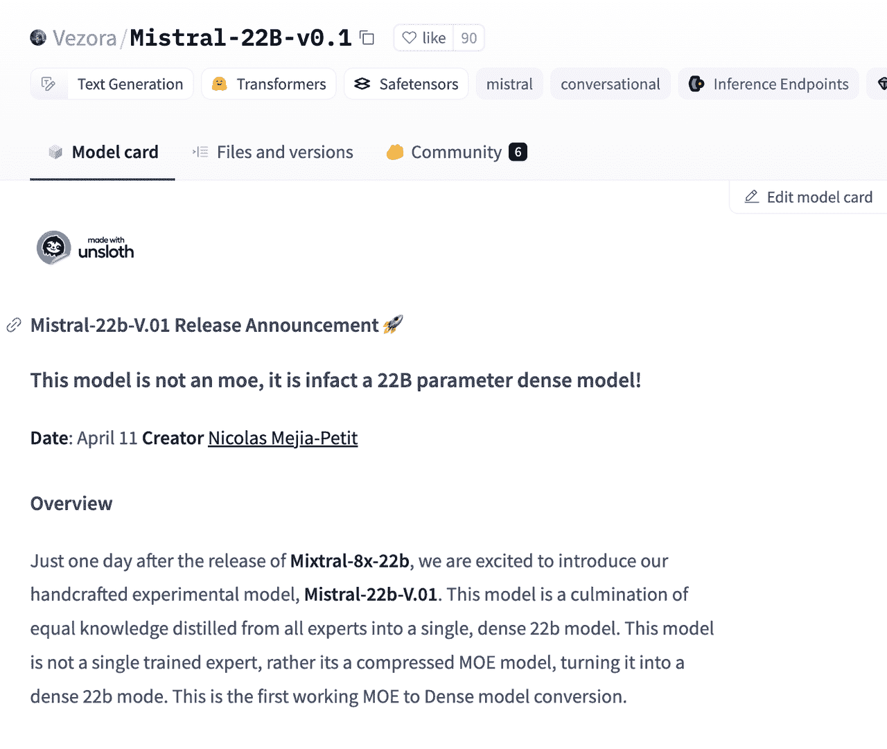

## 资讯

### 李彦宏首谈文心大模型为什么不开源：闭源才有商业模式，能力更强

贡献人：

https://www.thepaper.cn/newsDetail_forward_26996280

百度创始人、董事长兼首席执行官李彦宏谈及文心大模型为何不开源时表示：“一年前文心刚刚发布的时候，我们内部是有过非常激烈的讨论的，最后当然大家也知道这个结果，我们的决定是不开源。为什么不开源？当时的判断是，市场上一定会有开源的模型，而且是不止一家会开源。在这种情况下，多百度一家开源不多，少百度一家开源也不少。”李彦宏认为，目前国外像Llama，Mistral都有相当的影响力，国内的智源、百川、阿里的通义也都是开源模型，市场上不缺百度这一家开源的模型。百度要开源还得自己去维护一套开源的版本，这不划算。在李彦宏看来，开源模型均是在外头零零散散小规模地去做各种各样的验证应用，没有经过大算力的验证，而且模型开源不是一个众人拾柴火焰高的情况，闭源模型能力会持续领先，“虽然Llama也鼓励大家去贡献各种各样的数据、代码，但是实际上大家明白最主要的开发者就是Meta这些人，它并不是一个真正由大家一起来协同开发的产品。”面对模型开源与闭源，李彦宏的判断是，闭源才有真正的商业模式，才能聚集人才和算力。

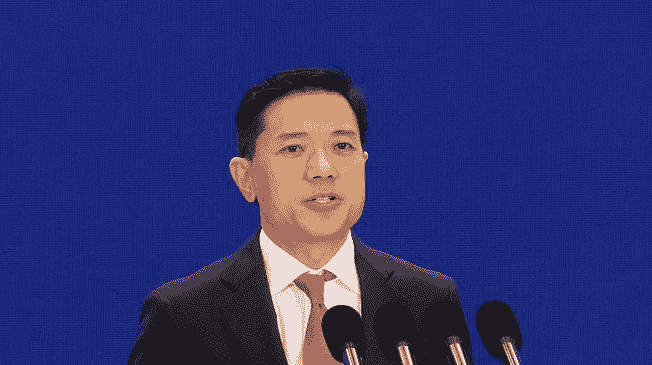

### 突发！吴恩达加入亚马逊董事会

贡献人：

https://mp.weixin.qq.com/s/h9KSBZ4bMC7GeYTy7uyWKQ

4 月 11 日晚间，亚马逊宣布吴恩达（Dr. Andrew Ng）教授将加入其董事会，同时长期担任电视行业高管、管理 MTV 并帮助 Viacom成为媒体巨头而著称的 Judy McGrath 将不再担任董事。此前，亚马逊花费多年的时间和成本（2023年在视频和音乐业务上的投资几乎达到了 190 亿美元）来建立其娱乐帝国，如今 McGrath 不再参与下任董事会竞选，这是亚马逊业务方向重要转折点。

### 低成本、准确、稳健，各类分子通用，上海人工智能实验室开发MD模拟AI新方法

贡献人：

https://mp.weixin.qq.com/s/BLX207bSbWXoxfO3zyU-Qw

机器学习原子间势（MLIP）因其兼顾高精度和高效率的优势，在材料、化学、生物学等领域的大尺度原子模拟研究中引起了广泛关注。然而，高性能 MLIP 依赖于大量标记数据，通过从头计算获取这些数据的成本很高。近日，上海人工智能实验室、复旦大学和清华大学的研究团队，提出了一种 MLIP 的几何学习框架 GPIP，利用未标记的构型来提高 MLIP 的性能。研究表明，GPIP 只需少量的计算成本即可显著提高 MLIP 的准确性和泛化性，并且与不同的不变或等变图神经网络架构兼容。该方法增强了 MLIP，并推进了分子系统的模拟。

### 消息称苹果最快年底推出 M4 系列芯片：更擅长处理 AI 任务，支持最高 512GB 统一内存

贡献人：

https://www.ithome.com/0/761/341.htm

彭博社的马克・古尔曼在最新一期 Power On 时事通讯中，认为苹果正加速研发 M4 系列 Apple Silicon 芯片，有望提前到 2024 年年底装备在新款 Mac 设备中，且重点提高处理 AI 任务的性能。

### Humane 宣布其可穿戴 AI 硬件产品 Al Pin 现已在美国全面上市

贡献人：

https://www.prnewswire.com/news-releases/humane-announces-ai-pin-now-available-nationwide-302114323.html

AI硬件初创公司 Humane 宣布全面推出其全球首款可穿戴人工智能AI计算机,Humane Al Pin。该AI产品是一款可穿戴计算机，旨在充当助手和第二大脑，内置人工智能来帮助用户寻求答案、做笔记、捕捉瞬间、拨打电话和发送消息。该产品硬件方面售价 699 美元，软件服务订阅采用包月套餐(每月 24 美元)，为所有客户提供无限的人工智能查询、无限的通话、文本和数据以及无限的照片和视频存储。

### 工具与测评 | Udio VS Suno：谁是AI音乐界的扛把子

贡献人：

https://mp.weixin.qq.com/s/aI1OIlHnXM0F-zq2x1pfUw

4月11日，AI音乐生成软件Udio正式面向大众开放测试，其足以媲美Suno的生成品质引发了热议。早在前几天，就有不少博主拿到了Udio的内测资格，并且有博主宣称“Udio是比Suno还要好两倍的音乐产品”。4月10日，Udio官号在X发布了一段视频，明明视频正在播放音乐，声音却被mute掉了，评论区memes大爆发。前些时间，Suno V3的发布已经在AI生成音乐方面引起了不小的轰动，如今Udio开启Beta测试加入比赛，不知是否会给AI界带来新一轮的震撼。今天，让我们快速对Udio进行一下体验和测评，来看看它是不是真的能够像宣传所说的那样超越Suno。

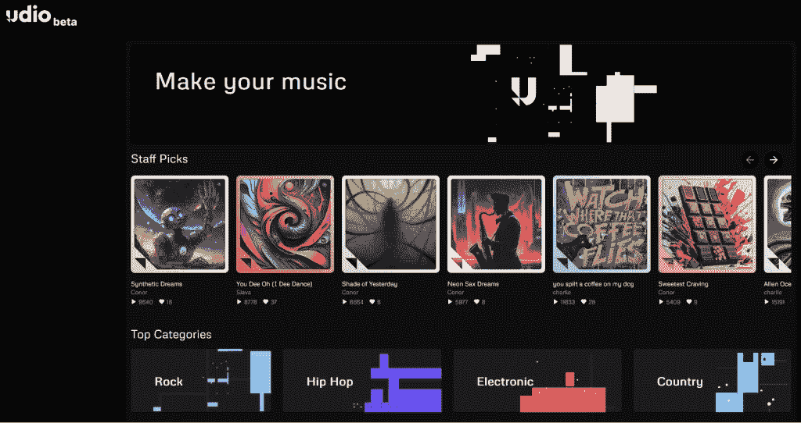

## 论文

### RecurrentGemma：超越Transformer以提高效率的开放语言模型

贡献人：

链接：http://arxiv.org/abs/2404.07839v1

我们介绍 RecurrentGemma，一个使用谷歌创新的 Griffin 架构的开放大语言模型。Griffin 结合了线性循环和局部注意力，在语言任务上表现出色。它具有固定大小的状态，降低内存使用，能够有效地推理长序列。我们提供了一个包含 20 亿非嵌入参数的预训练模型，以及一个微调的变种。尽管使用更少的 token 进行训练，但这两个模型都达到了与 Gemma-2B 相当的性能。

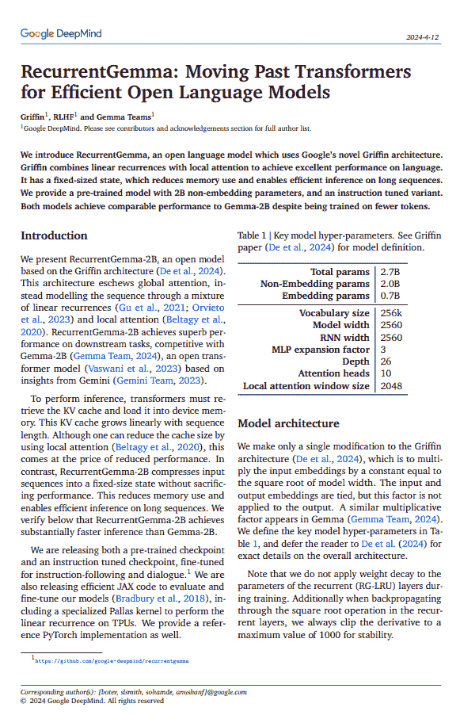

### JetMoE: 用10万美元达到Llama2性能

贡献人：

链接：http://arxiv.org/abs/2404.07413v1

大语言模型（LLM）取得了明显的成绩，但它们对资源的需求不断增加，已成为强大和可访问超人类智能发展的主要障碍。本报告介绍了JetMoE-8B，这是一个新的LLM，经过少于0.1百万美元的培训，使用了来自仔细混合的开源语料库和30,000个H100 GPU小时的1.25T token。尽管成本较低，JetMoE-8B表现出色，JetMoE-8B的性能优于Llama2-7B模型，JetMoE-8B-Chat超过了Llama2-13B-Chat模型。这些结果表明，LLM的培训成本可以比通常认为的要便宜得多。JetMoE-8B基于高效的稀疏门控专家混合（SMoE）架构，由注意力和前馈专家组成。两个层都是稀疏激活的，使得JetMoE-8B拥有8B参数，仅激活每个输入token的2B，相比于Llama2-7B，推理计算减少约70％。此外，JetMoE-8B非常开放和学术友好，仅使用公共数据集和训练代码。本报告详细介绍了所有训练参数和数据混合，以促进未来开放基础模型的发展工作。这种透明度旨在鼓励合作和促进可访问和高效LLM领域的进一步发展。模型权重可在`https://github.com/myshell-ai/JetMoE` 上公开获取。

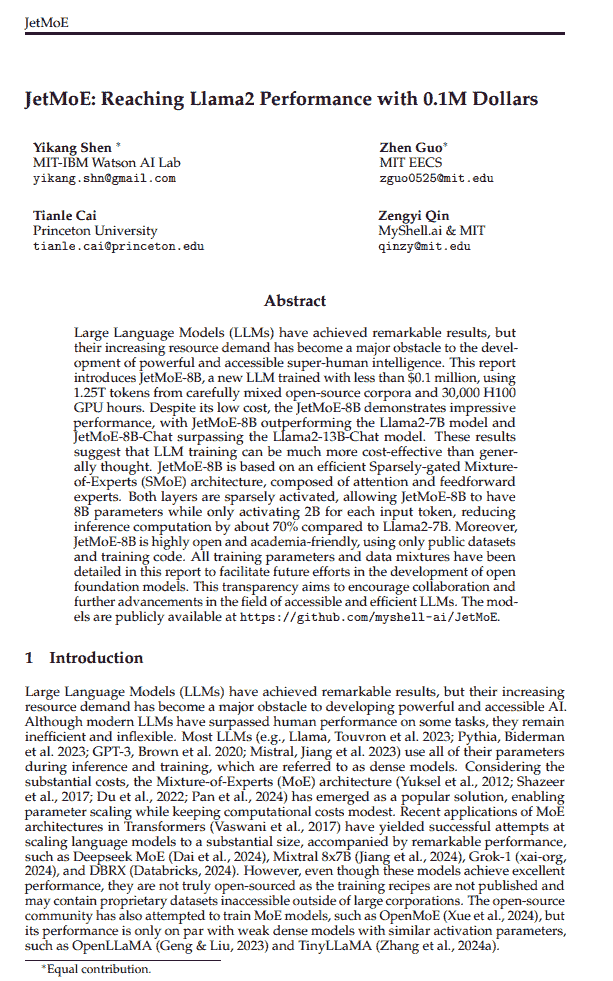

### Rho-1: 并非所有 token 都是你所需的

贡献人：

链接：`http://arxiv.org/abs/2404.07965v1`

之前的语言模型预训练方法通常对所有训练token应用下一个token预测损失。挑战这一规范，我们认为“语言模型训练中并非所有token都同等重要”。我们的初步分析深入研究了语言模型的token级训练动态，揭示了不同token的独特损失模式。借助这些见解，我们引入了一种称为Rho-1的新语言模型。与传统的语言模型不同，Rho-1采用选择性语言建模（SLM），有选择地训练与期望分布对齐的有用token。这种方法包括使用参考模型对预训练token进行评分，然后通过专注于具有较高溢出损失的token的损失进行语言模型训练。在持续在15B OpenWebMath语料库上预训练时，Rho-1在9个数学任务中几乎提高了30%的few-shot准确性。微调后，Rho-1-1B和7B在MATH数据集上分别实现了40.6%和51.8%的最先进结果 - 仅占预训练token的3%的DeepSeekMath。此外，在80B通用token上进行预训练时，Rho-1在15个不同任务中实现了平均增强6.8%，提高了语言模型预训练的效率和性能。

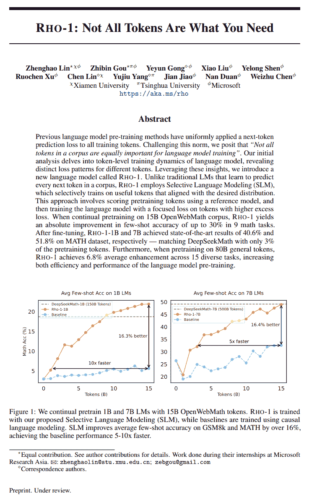

### 语言模型合成数据的最佳实践和经验教训

贡献人：

链接：`http://arxiv.org/abs/2404.07503v1`

人工智能模型的成功依赖于大量、多样化和高质量的数据集，但由于数据稀缺、隐私问题和高成本，获取这些数据可能具有挑战性。合成数据已成为一种有前途的解决方案，通过生成模拟真实世界模式的人工数据。本文概述了合成数据研究，讨论了其应用、挑战和未来方向。我们提供了先前研究的经验证据来证明其有效性，并强调确保其真实性、忠实性和无偏见的重要性。我们强调了对合成数据的负责任使用，以构建更强大、包容和可信赖的语言模型。

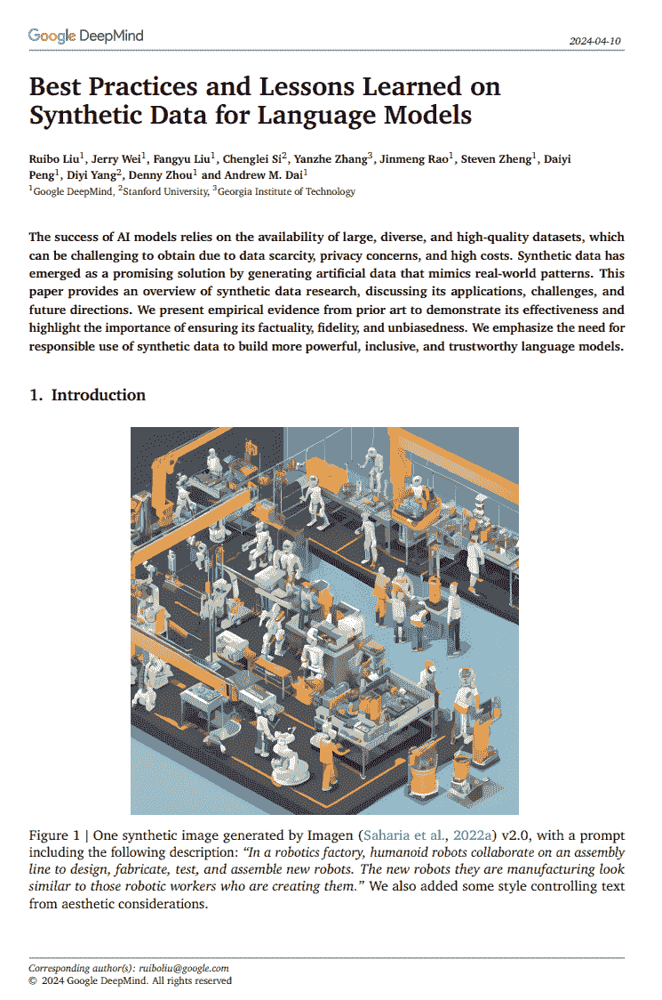

### HGRN2：具有状态扩展的门控线性RNN

贡献人：

链接：`http://arxiv.org/abs/2404.07904v1`

摘要：HGRN (Qin等人，2023) 层级门控线性RNN 在语言建模中表现出竞争性的训练速度和性能，同时提供高效的推断。然而，HGRN的循环状态大小仍然相对较小，限制了其表达能力。为了解决这个问题，受线性注意力的启发，我们引入了一个简单的基于外积的状态扩展机制，可以显著扩大循环状态的大小，而不引入任何额外的参数。线性注意力形式还允许硬件高效的训练。我们的大量实验证实了HGRN2在语言建模、图像分类和长距离竞技场的优势。在受控实验设置中，我们最大的3B HGRN2模型略优于Mamba和LLaMa架构Transformer在语言建模方面；而在下游评估中，其与许多开源的3B模型竞争，并且使用较少的总训练tokens。

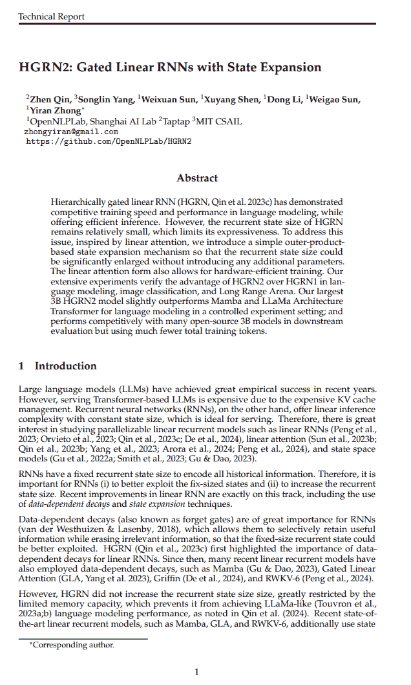

### `ResearchAgent`：利用大语言模型在科学文献中进行迭代研究思想生成

贡献人：

链接：`http://arxiv.org/abs/2404.07738v1`

科学研究对于改善人类生活至关重要，但其固有的复杂性、缓慢的步伐和对专业专家的需求却对其造成了阻碍。为了增强其生产力，我们提出了一个`ResearchAgent`，这是一个由大语言模型驱动的研究思路编写智能体，可以自动生成问题、方法和实验设计，并在基于科学文献的基础上进行迭代优化。我们的`ResearchAgent`从一个核心论文作为主要焦点开始生成思路，不仅通过连接学术图中的信息得到相关出版物，还通过基于其潜在概念的实体检索库中的实体进行增强，这些实体从众多论文中挖掘和共享。此外，与人类通过同行讨论迭代改进思路的方法类似，我们利用多个提供评论和反馈的`ReviewingAgent`。此外，它们是用与人类偏好对齐的大型语言模型实例化的，其评估标准源自实际的人类判断。我们在跨多个学科的科学出版物上实验证明了我们的`ResearchAgent`，在生成基于人类和模型评估结果的新颖、清晰和有效的研究思路方面的有效性。

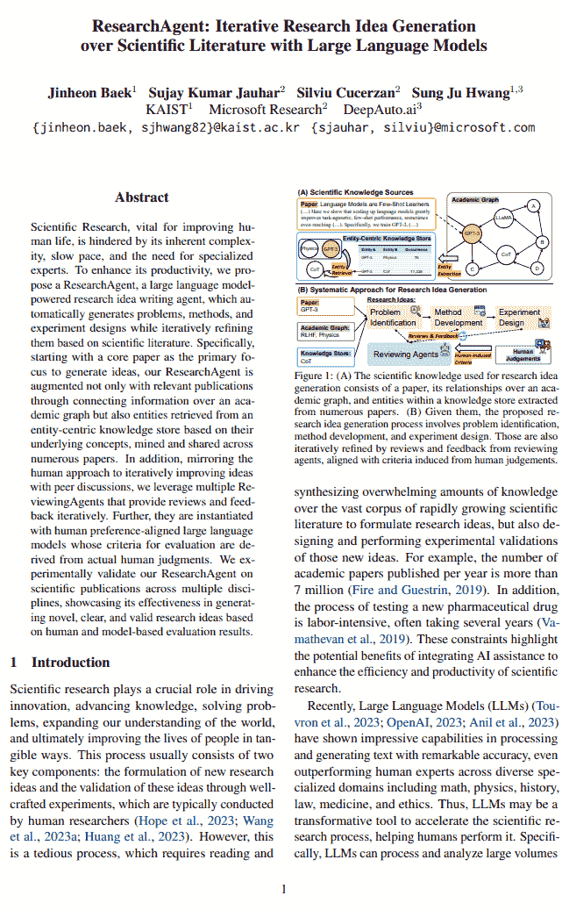

### 为什么小型语言模型表现不佳？通过Softmax瓶颈研究语言模型饱和

贡献人：

链接：`http://arxiv.org/abs/2404.07647v1`

近期在语言建模中取得的进展在于在极大的网络采集文本语料库上对高参数化神经网络进行预训练。在实践中，使用这些模型进行训练和推理可能成本高昂，这促使人们使用规模较小的对应模型。然而，观察到规模较小的模型可能会出现饱和现象，即在训练的某个较高点出现性能下降，随后进入平台期。本文发现，这种饱和现象可以通过规模较小模型的隐藏维度与目标上下文概率分布的高秩之间存在不匹配来解释。这种不匹配通过在这些模型中使用的线性预测头的性能受到已知的 `softmax` 瓶颈现象的影响。我们衡量了 `softmax` 瓶颈在各种设置下的影响，并发现基于小于1000个隐藏维度的模型往往在预训练后期采用退化的潜在表示，导致了评估性能的降低。

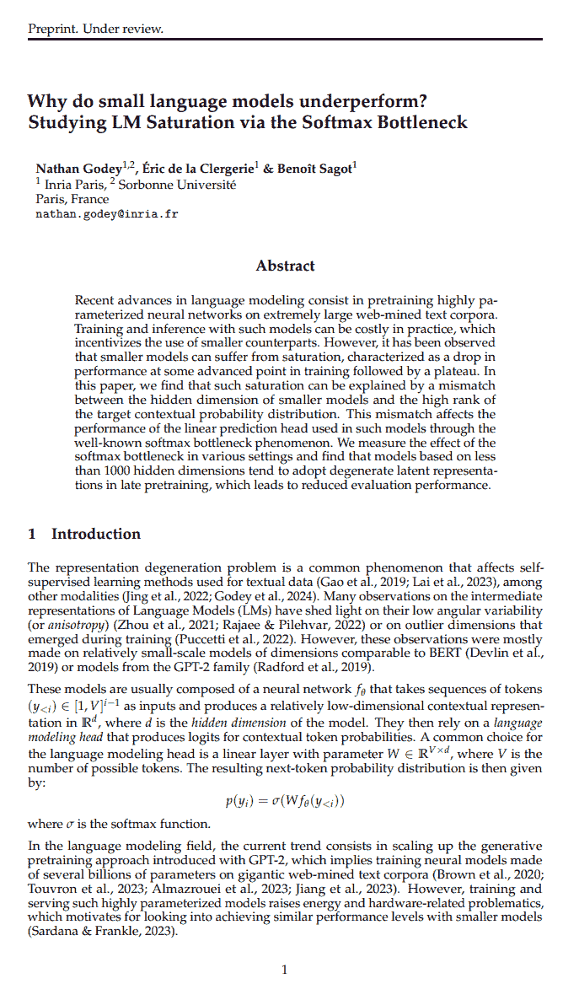

### 从单词到数字：你的大语言模型在给定上下文示例时悄悄成为了一个能干的回归器

贡献人：

链接：`http://arxiv.org/abs/2404.07544v1`

我们分析了预训练的大型语言模型（如Llama2、GPT-4、Claude 3等）在给定上下文示例时，在没有额外训练或梯度更新的情况下，能够进行线性和非线性回归的能力。我们的发现显示，几个大型语言模型（如GPT-4、Claude 3）能够执行回归任务，性能可以达到甚至超过传统监督方法（如随机森林、装袋法或梯度提升）。例如，在具有挑战性的Friedman＃2回归数据集中，Claude 3胜过许多监督方法，如AdaBoost、SVM、随机森林、KNN或梯度提升。然后，我们研究了大型语言模型的性能如何随着上下文示例数量的增加而扩展。我们从在线学习中的后悔概念中借鉴，并凭经验证明，LLM能够获得次线性后悔。

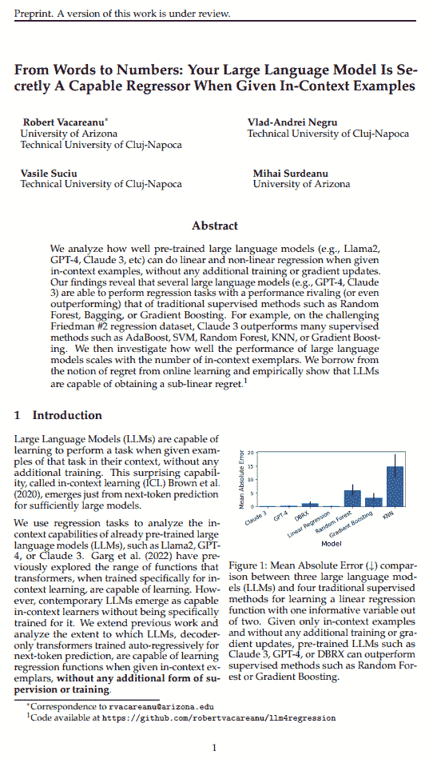

# 产品

## Musho

贡献人：

`https://musho.ai/`

Musho 是一款新的个人AI设计助手，可以根据简单的提示即时生成专业、符合品牌形象的网站设计，是一种可以在Figma内部充当创意伙伴的工具，能够快速将想法转化为设计。

## V7 Go

贡献人：

`https://www.v7labs.com/go`（网站比较玄学，🪜也有时打不开）

V7 Go是一个基于人工智能的数据库，解放人们后勤和行政任务的处理，使他们有更多时间专注于创造性和人际工作。通过直观配置人工智能模型并在涉及文档、视频或文本的任务上进行规模化运行，V7 Go可以提取信息、对消息进行资格认证和分类、进行文本、电子邮件或图像分类，并比较不同语言模型在相同任务中的性能。此外，它还具有许多特殊功能，包括将文件转换为小型存储库、控制模型输出选项、将项目细分为工作流程以及视觉定位，并且具有很强的规模化能力。

# HuggingFace&Github

## `llm.c`

贡献人：

`https://github.com/karpathy/llm.c`

`llm.c` 其中包含了使用简单的 C/CUDA 进行 LLM 训练的代码。这种方法不需要使用大量的PyTorch（245MB）或cPython（107MB）。举例来说，训练GPT-2（CPU，fp32）只需要大约1000行清晰的代码，而且全部内容都在一个文件中。它可以立即编译和运行，并且与PyTorch的参考实现完全匹配。

## Realmdreamer

贡献人：

`https://realmdreamer.github.io/`

RealmDreamer 是一种从文本描述生成通用前向3D场景的技术。该技术通过优化 3D 高斯 Splatting 表示来匹配复杂的文本提示。通过利用最先进的文本到图像生成器来初始化这些斑点，将它们提升到3D，并计算遮挡体积。然后，将这个表示优化到多个视图上，作为一个带有图像条件扩散模型的3D 修复任务。为了学习正确的几何结构，通过结合深度扩散模型，通过在修复模型的样本上进行条件化，从而得到丰富的几何结构。最后，使用图像生成器的锐化样本对模型进行微调。值得注意的是，这个技术不需要在任何特定场景数据集上进行训练，并且可以合成多种风格的高质量3D场景，包括多个对象。其通用性还允许从单个图像进行3D合成。

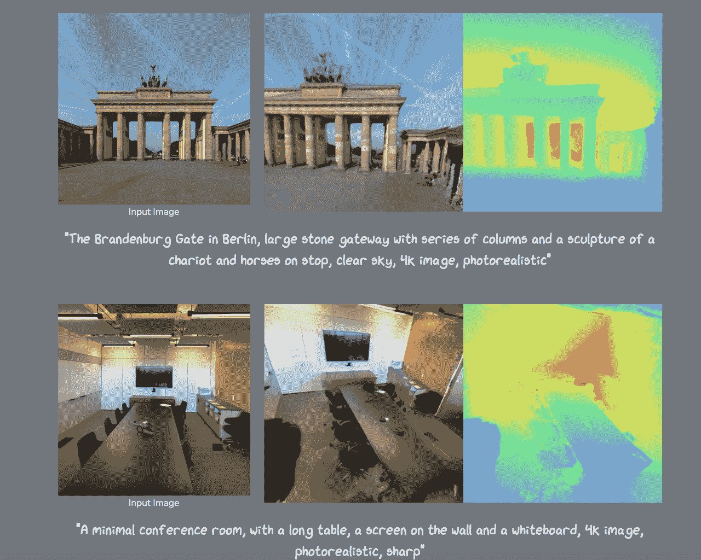

## recurrentgemma-2b

贡献人：

`https://huggingface.co/google/recurrentgemma-2b`

RecurrentGemma 是建立在 Google 开发的新递归架构上的开放语言模型。它包括预训练版本和指令调整版本，适用于各种文本生成任务，如问答、摘要和推理。与 Gemma 相比，RecurrentGemma 需要更少的内存，并且在生成长序列时推理速度更快。

# 投融资

## 内容商业AIGC视频应用平台「筷子科技」完成近5000万元B1轮融资

贡献人：

`https://36kr.com/p/2726136547976201`

筷子科技」宣布完成近5000万元B1轮融资，投资方包括金沙江创投、海珠城发集团等。筷子科技利用AI技术提高企业营销内容的生产与管理效率，主要提供企业级AIGC视频应用平台。该平台连接内容团队的多个工作流程，通过AI优化营销内容的生产和转化效率。随着AI技术的发展和市场需求增加，筷子科技加强了产品矩阵，扩展海内外市场，并推出更多AI驱动的营销应用，以支持更广泛的品牌和市场需求。

公司官网：`https://kuaizi.ai/`

## 新加坡AI创业公司Mindverse获得500万美元种子轮融资

贡献人：

`https://www.businesstimes.com.sg/startups-tech/singapore-based-ai-startup-mindverse-obtains-us-5-million-seed-funding`

新加坡的人工智能创业公司Mindverse在由风险投资公司Square Peg领投的种子融资轮中获得了500万美元。Mindverse成立于2022年，创始人包括前Meta高管和AI研究人员。该公司的旗舰产品包括MindOS Studio和Mebot。MindOS Studio可以帮助创建具有个性化聊天体验和界面的AI原生网站；Mebot是一款能学习并记忆用户思维和偏好的生产力工具。此轮融资将用于进一步研究和产品开发，以推进其大规模个性化模型。

公司官网：`https://www.mindos.com/`

## AI音乐创业公司Udio及出版平台Spines AI分别完成融资

贡献人：

`https://www.forbes.com/sites/charliefink/2024/04/11/udio-ai-music-raises-10-million-65-million-for-spines-ai-more-sora-cinematic-ai/?sh=7ed4d4d712ed`

在最新的融资轮中，基于人工智能的音乐生成器Udio AI Music获得了1000万美元的种子资金。这轮融资由包括a16z、Instagram联合创始人Mike Kreiger以及音乐人will.i.am和Common在内的知名投资者和名人参与。此外，AI出版平台Spines AI也在其种子轮融资中获得了650万美元，该轮融资由Aleph领投，前投资者M-Fund、畅销书《创业国家》的合著者Dan Senor和LionTree LLC参与。Spines AI平台能将出版时间从六个月缩短至两周，同时减少30%的成本，为出版过程的每个阶段提供服务。

公司官网：`https://www.udio.com/`

## AI加密应用Sharpe AI完成种子轮融资

贡献人：

`https://www.binance.com/en/square/post/2024-04-11-ai-powered-crypto-app-sharpe-ai-secures-seed-funding-6618188480697`

根据Foresight News的报道，由AI驱动的加密货币应用Sharpe AI成功完成了其种子融资轮。此次融资吸引了包括Animoca Brands、GBV Capital、Morningstar Ventures、Maven Capital、Metabros、Contango Digital Assets、Ape Terminal和AIT Protocol等多家投资者的参与。具体的融资金额尚未披露。关于Sharpe AI的投资细节和未来计划预计将在未来几天内公布。

公司官网：`https://www.sharpe.ai/`

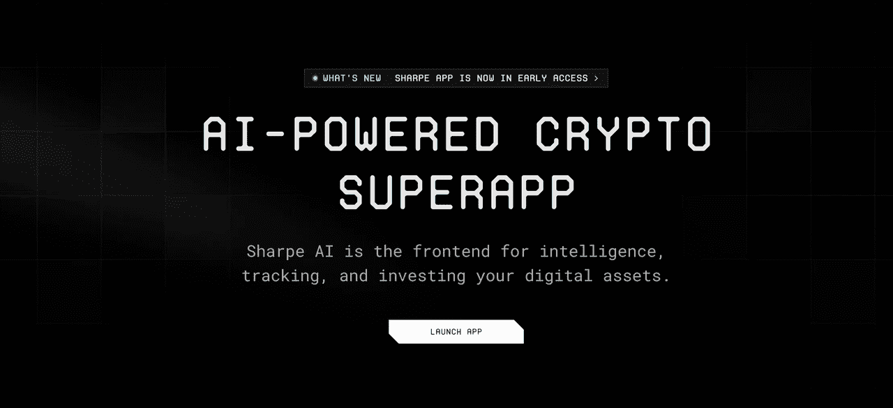

## Simbian获得1000万美元种子轮融资以全自动化安全运营

贡献人：

`https://siliconangle.com/2024/04/11/simbian-raises-10m-fully-automate-security-operations-generative-ai/`

Simbian公司，一家开发了首个针对网络安全团队的生成性人工智能副驾驶的初创公司，宣布已完成超额认购的1000万美元种子轮融资，以推出其新平台。本轮融资由专注于安全和人工智能的投资者领投，包括Cota Capital、Icon Ventures、Firebolt和Rain Capital。同时，包括Datadog联合创始人兼CEO Olivier Pomel、Nile Global联合创始人兼CEO Pankaj Patel以及前Meta Platforms、Uber Technologies和Cloudflare的首席安全官Joe Sullivan等知名天使投资者也参与了投资。此资金将用于推动Simbian的安全协同工具，该工具旨在提供完全自主的安全解决方案。

公司官网：`https://simbian.ai/`

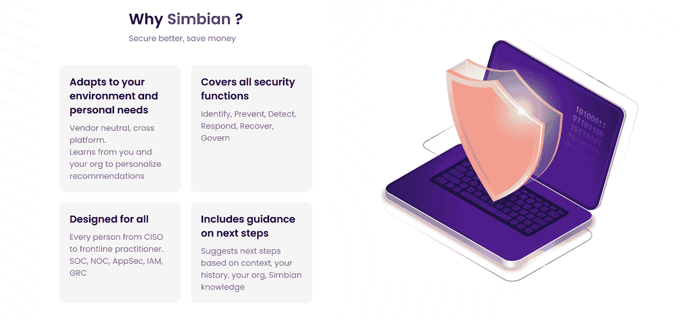

## AI专利工作流平台Patlytics完成450万美元种子轮融资

贡献人：

`https://www.businesswire.com/news/home/20240411104124/en/Patlytics-Secures-4.5-Million-Led-by-Gradient-Google%E2%80%99s-AI-Fund-to-Transform-Patent-Intelligence-with-AI`

Patlytics，一家以AI驱动的专利工作流平台，已成功完成由Google的AI专注风险基金Gradient领投的450万美元种子轮融资。此轮融资还包括了8VC、Joe Montana的Liquid 2 Ventures、Tribe Capital、Vermilion Ventures、Gaingels、Alumni Ventures和Position Ventures等参投。Patlytics利用AI的变革性创新，旨在重新定义知识产权保护行业，通过自动化专利流程的关键环节，例如初稿撰写、办公室行动响应、侵权评估、高级搜索和竞争对手情报，从而增强专利专业人士的能力。

公司官网：`https://www.patlytics.ai/`

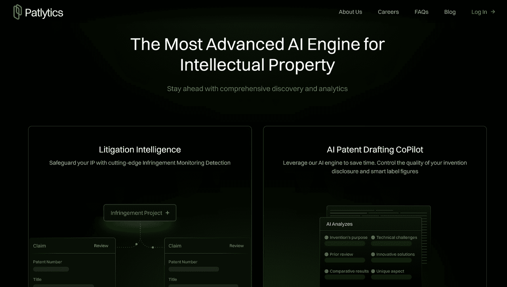

## Tabs获得700万美元种子资金以自动化应收账款管理

贡献人：

`https://www.axios.com/pro/fintech-deals/2024/04/11/accounts-receivable-tabs-7-million`

Tabs公司开发了一个针对B2B公司的应收账款平台，最近成功筹集了700万美元的种子资金。这轮融资由Lightspeed Venture Partners领投，现有投资者Primary Ventures也参与了投资。Tabs使用AI技术解析B2B合同并自动化发票和付款流程，其早期客户包括Findigs、Pinata和Inspiren，他们的收款时间减少了40%。至此，Tabs总共筹集了1200万美元资金。CEO Ali Hussain表示，公司成立的初衷是解决应收账款这一在其他ERP功能（如工资和支出管理）创新中被忽视的问题。

公司官网：https://tabs.inc/

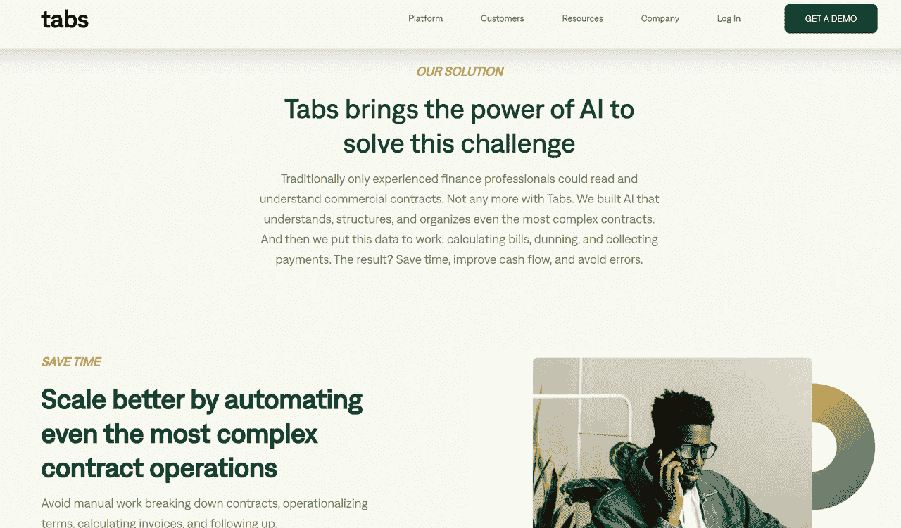

# 学习

## 吐槽一下megatron

https://zhuanlan.zhihu.com/p/692015516

贡献人：

文章描述了作者在使用Megatron框架进行DPO (Decentralized Partial Observability) 训练时遇到的挑战。Megatron框架暴露了许多底层细节，缺乏高级抽象，使得算法工程师必须深入理解分布式训练的每个细节。作者讨论了如何处理megatron的pipeline并行化 (pp) 和tensor并行化 (tp)，以及如何通过修改`forward_backward_func`函数来实现复杂的训练策略。此外，文中提到，在设置大的gradient accumulation (ga)时，可能导致内存不足的问题。整体上，这篇文章提供了对Megatron在实际应用中面临的技术挑战和限制的深入分析。

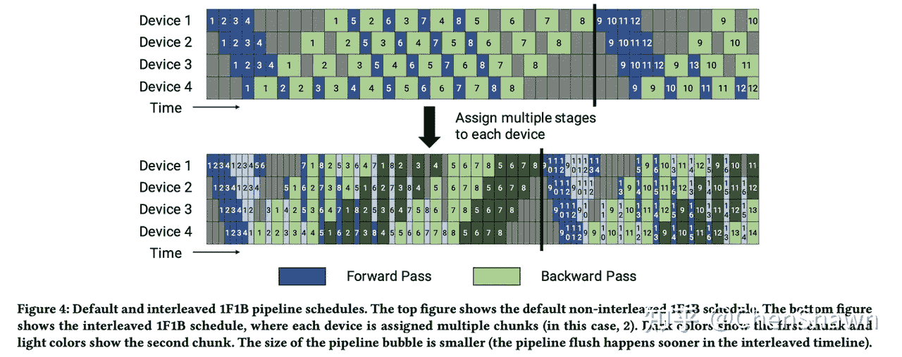

## 使用`DSPy`对语言模型进行红队测试 | Haize Labs博客 🕊️

贡献人：

https://blog.haizelabs.com/posts/dspy/

`DSPy`是斯坦福NLP团队开发的一种新框架，用于结构化和优化大型语言模型(LLM)系统。该框架通过将程序流程分离为独立模块和各步骤的参数（LLM提示和权重），允许更有结构和效率的优化。文章中详细介绍了`DSPy`如何通过`Attack`（攻击）和`Refine`（精炼）模块的交替层次结构，构建红队语言程序来测试目标语言模型的反应。每个`Attack`模块生成一个攻击提示，旨在引发目标模型产生有害意图，而`Refine`模块则对这些攻击提示进行细化，以提高其隐蔽性和有效性。通过使用`DSPy`的`MIPRO`优化器，该程序能够在多次尝试中学习和改进攻击策略，最终实现了44%的攻击成功率。

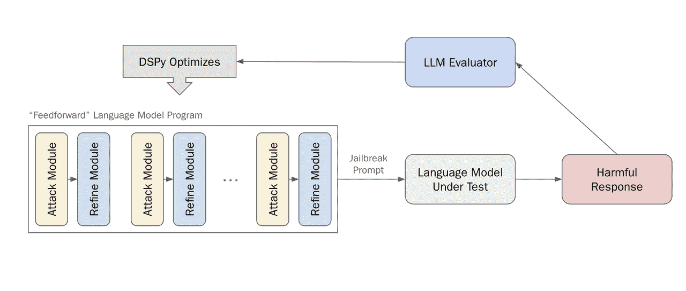

## 用于显著提高检索速度和降低成本的二进制和标量嵌入量化

贡献人：

https://mp.weixin.qq.com/s/qerIRaL6_4nJCY-2rKjTRA

文章探讨了在自然语言处理中使用嵌入量化技术来优化检索速度、内存使用、磁盘空间和成本。文中详细描述了通过二进制量化和标量量化处理嵌入的技术细节。二进制量化通过将浮点数转换为1位二进制数，显著减少内存和存储需求，提高检索效率；而标量量化则将浮点数映射到有限的整数范围内，进一步优化了存储和检索性能。这些技术在处理大规模数据集时特别有价值，能在保持较高检索性能的同时，大幅降低硬件资源需求。

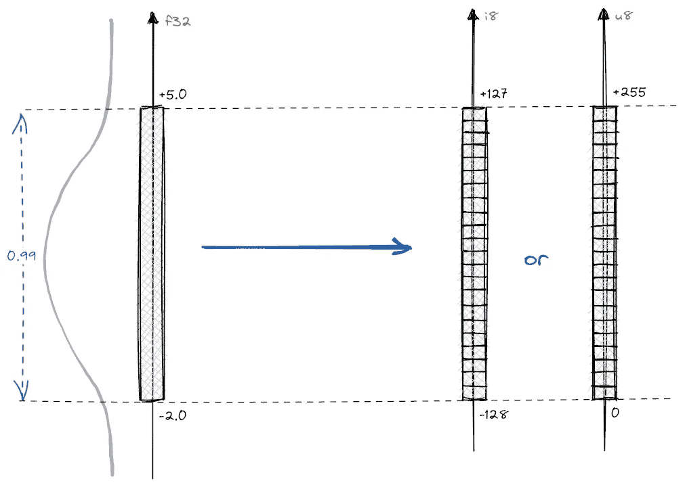

## 矩阵乘法喜欢什么形状？

贡献人：

https://www.thonking.ai/p/what-shapes-do-matrix-multiplications

文章探讨了矩阵乘法的性能如何受到矩阵形状的影响。主要介绍了计算密集度、平行化、瓦片化（Tiling）、和波量化（Wave Quantization）这三个核心概念，解释了它们如何影响矩阵乘法的性能变化。文章指出，较大的矩阵乘法通常表现更好，因为它们提供了更多的工作量和平行化机会，减少了与启动内核相关的固定开销。同时，矩阵的形状在内存中的布局也极大影响性能，特别是与缓存线对齐情况密切相关。矩阵形状的可除性（如能否被2、8、16整除）会导致性能显著不同，因为这影响了瓦片化的效率。此外，波量化现象描述了在达到某个特定的瓦片或块数量时，性能可能突然下降，因为需要执行额外的“波”。

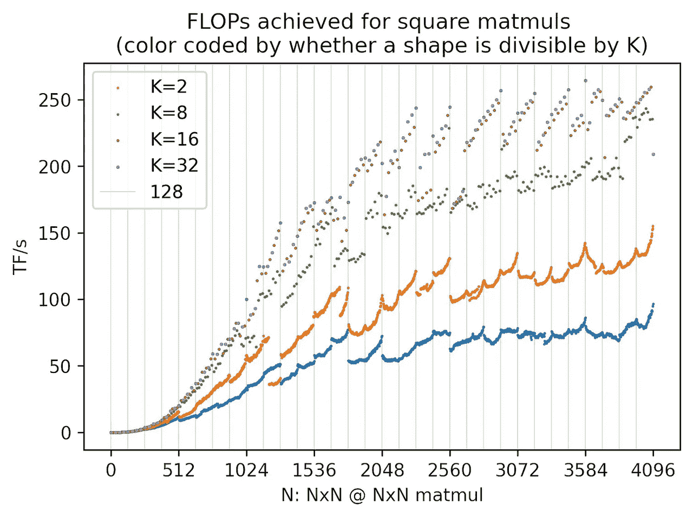

## `llm.c` 内存管理分析

贡献人：

https://zhuanlan.zhihu.com/p/691580531?utm_psn=1761712289735335936

文章分析了在C语言中实现GPT-2模型时内存管理的策略和技术细节。在GPT-2的实现中，作者使用了一个`ParameterTensors`结构体统一管理所有的参数张量，如词嵌入矩阵和位置编码矩阵等，并通过`malloc_and_point_parameters`函数一次性分配连续的内存空间。此策略提高了内存访问的局部性和效率，同时简化了内存管理。激活值和梯度的内存也通过类似的方法管理，确保了资源的有效使用和避免内存泄漏。优化器状态变量如`Adam`的一阶和二阶矩估计也需要特定的内存管理策略。文中讨论了内存分配的优势和需要注意的问题，提供了内存管理的实用技巧。

## 为什么大模型在 Pre Train 的时候，为了减少 Pad Token 数量，把不同样本拼接在一起？

贡献人：

https://www.zhihu.com/question/652311359/answer/3461508767?utm_psn=1761705538096623616

大模型在预训练时拼接不同样本的主要原因是提高训练效率和减少计算资源的浪费。拼接可以显著减少Pad Token的数量，因为能更紧凑地填充训练批次，从而减少无效计算。此外，通过修改每个位置的`attention_mask`和`position_ids`，可以让模型只感知到各自样本的token，从而保证训练的有效性。这种做法有助于利用现有算力，增加`batch`中的有效信息量，提高并行处理能力，而不会增加额外的成本。

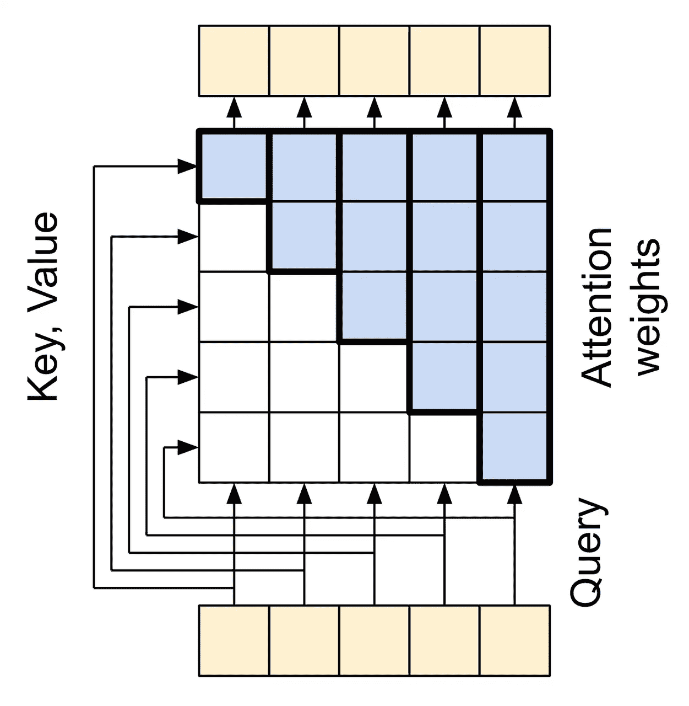

## 实战 8卡环境微调Grok-1

贡献人：

https://mp.weixin.qq.com/s/AFsUMeABRbP_6o1bOrKBMg

文章详细介绍了魔搭社区的轻量级训练推理工具`SWIFT`（Scalable lightWeight Infrastructure for Fine-Tuning）的使用。`SWIFT`是基于`PyTorch`的模型微调和推理框架，特别支持在消费级显卡上处理大模型和AIGC任务。文中重点讨论了在8个NVIDIA A100 GPU上使用`SWIFT`微调Grok-1模型的过程，这是一个具有314B参数的大模型，使用的是`Colossal-AI`提供的Python+`PyTorch`+`HuggingFace`版本。实验中，使用了`LoRA`和`deepspeed` zero3 offload技术来优化显存使用和训练速度。推理阶段，由于模型体积大，一些层需要被转移到CPU上，文章也对此做了详细说明和调整。

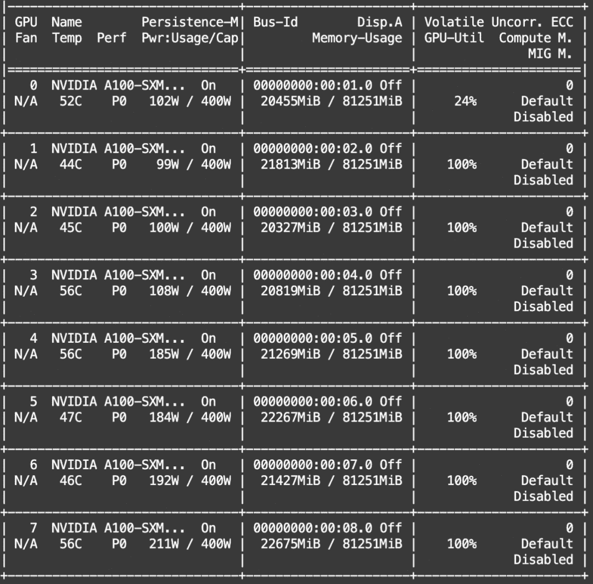

# 声明

本文档仅供学习交流使用，版权归原作者所有，若涉侵权，请联系Jack Jin 15101136166

（欢迎在下方反馈您宝贵的意见！整理不易，觉得有用给AI日报小组点个赞👍吧！）

ChatGPT；Angela；Zijia Liu；Alex；Zeqi Tan；Tiezhen（HuggingFace）；Naixu；Lizhi；Peter；Suoman；Jack

封面生成——右脑科技

如果你有大模型相关的创业想法，欢迎来找我们聊聊～🛰️：15101136166

> 快邀请你的小伙伴们一起来读大模型日报吧！

> **【日报知识库】**这里是近期日报内容的汇总,欢迎大家查阅

>

> 欢迎大家多多帮我们分享,转发~~

> 如果大家有任何的建议或者吐槽,欢迎随时找我聊天~

