# 奇绩大模型日报（4月 11日）

> 来源：[https://miracleplus.feishu.cn/docx/Hp4ZdD1yromVjFxZcvAcmPYMnMd](https://miracleplus.feishu.cn/docx/Hp4ZdD1yromVjFxZcvAcmPYMnMd)

# 推特

### Karpathy：用通俗易懂的方式解释llm.c

贡献人：

https://x.com/karpathy/status/1778153659106533806

# 用通俗易懂的方式解释 llm.c

训练大型语言模型(LLM),如 ChatGPT,涉及大量的代码和复杂性。

例如,一个典型的 LLM 训练项目可能会使用 PyTorch 深度学习库。PyTorch 之所以非常复杂,是因为它实现了一个非常通用的 Tensor 抽象(一种排列和操纵保存神经网络参数和激活的数字数组的方法),一个非常通用的用于反向传播的 Autograd 引擎(训练神经网络参数的算法),以及您可能希望在神经网络中使用的大量深度学习层。PyTorch 项目包含 11,449 个文件中的 3,327,184 行代码。

除此之外,PyTorch 是用 Python 编写的,而 Python 本身就是一种非常高级的语言。您必须运行 Python 解释器来将训练代码转换为低级计算机指令。例如,执行此转换的 cPython 项目在 4,306 个文件中包含 2,437,955 行代码。

我删除了所有这些复杂性,将 LLM 训练简化到最基本的要素,直接用非常低级的语言(C)与计算机对话,没有其他库依赖项。这下面唯一的抽象就是汇编代码本身。与上面相比,我认为人们会惊讶地发现,训练像 GPT-2 这样的 LLM 实际上只需要在一个文件中用 C 编写大约 1000 行代码。我通过直接在 C 中实现 GPT-2 的神经网络训练算法来实现这种压缩。这很困难,因为您必须详细了解训练算法,能够推导出所有层的前向和后向传递,并非常仔细地实现所有数组索引计算,因为您没有 PyTorch 张量抽象可用。因此,这是一个非常脆弱的安排,但一旦您这样做了,并通过与 PyTorch 进行检查来验证正确性,您就会得到一些非常简单、小巧且在我看来非常漂亮的东西。

好吧,为什么人们不总是这样做呢?

第一:你放弃了很大的灵活性。如果您想更改神经网络,在 PyTorch 中您可能只需更改一行代码。在 llm.c 中,更改很可能会涉及更多的代码,可能会更加困难,并且需要更多的专业知识。例如,如果它是一个新操作,您可能必须进行一些微积分计算,并为反向传播编写其前向传递和后向传递,并确保它在数学上是正确的。

第二:你至少在一开始就放弃了速度。没有完全免费的午餐——你不应该指望在只有 1,000 行的情况下获得最先进的速度。PyTorch 在后台做了大量工作,以确保神经网络非常高效。不仅所有 Tensor 操作都非常仔细地调用最有效的 CUDA 内核,而且还有例如 torch.compile,它进一步分析和优化您的神经网络以及它如何在您的计算机上最有效地运行。现在,原则上,llm.c 应该能够直接调用所有相同的内核。但这需要更多的工作和关注,就像在(1)中一样,如果你改变了神经网络的任何东西或者你运行的计算机,你可能必须调用不同的内核,使用不同的参数,并且你可能必须手动进行更多的更改。

所以 TLDR:llm.c 是训练 GPT-2 的直接实现。事实证明,这个实现出奇地简短。不支持其他神经网络,只支持 GPT-2,如果你想改变网络的任何东西,都需要专业知识。幸运的是,所有最先进的 LLM 实际上与 GPT-2 没有太大的不同,所以这并不像你想象的那样是一个强有力的约束。而且 llm.c 必须进行额外的调整和完善,但原则上我认为它应该能够(或者甚至因为我们摆脱了所有开销而超过?)几乎与 PyTorch 相匹敌,而且代码量与现在的代码量相差不大,适用于大多数现代 LLM。

而我为什么要研究它?因为它很有趣。它也很有教育意义,因为这 1,000 行非常简单的 C 代码就是所需要的全部,没有其他东西。它只是一些数字数组和一些简单的数学运算,如 + 和 *。经过更多正在进行的工作,它甚至可能被证明是实用的。

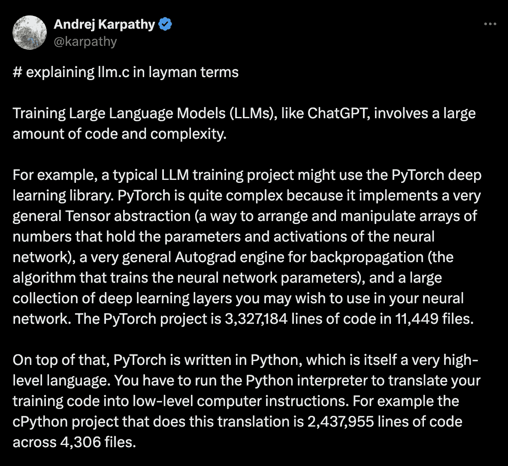

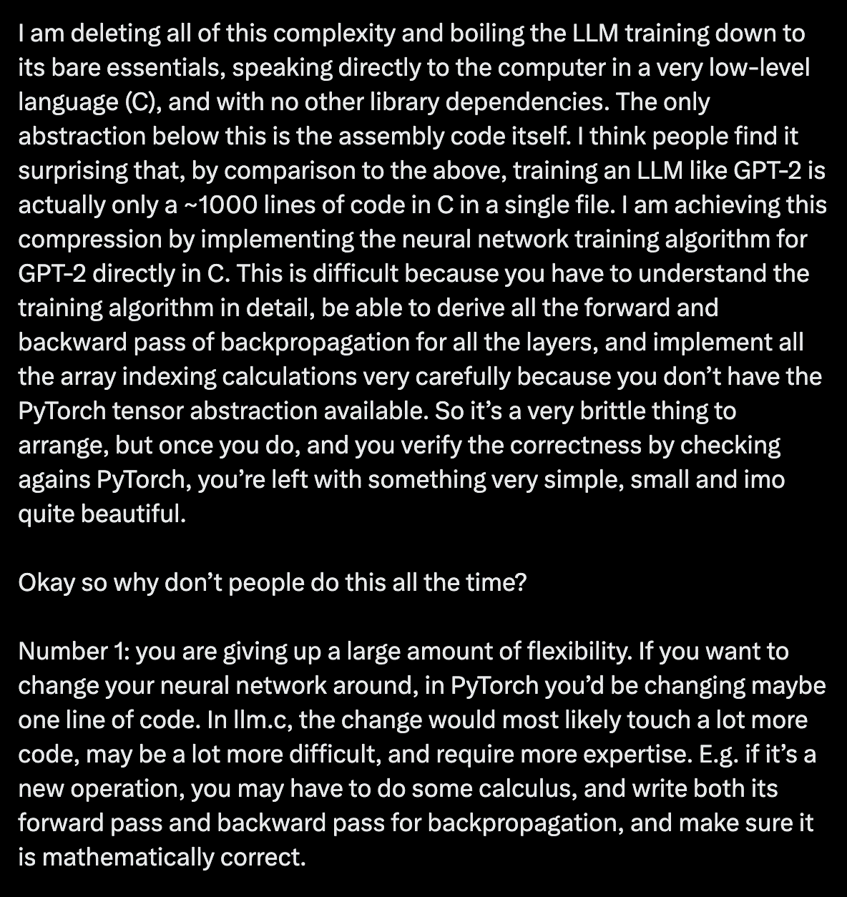

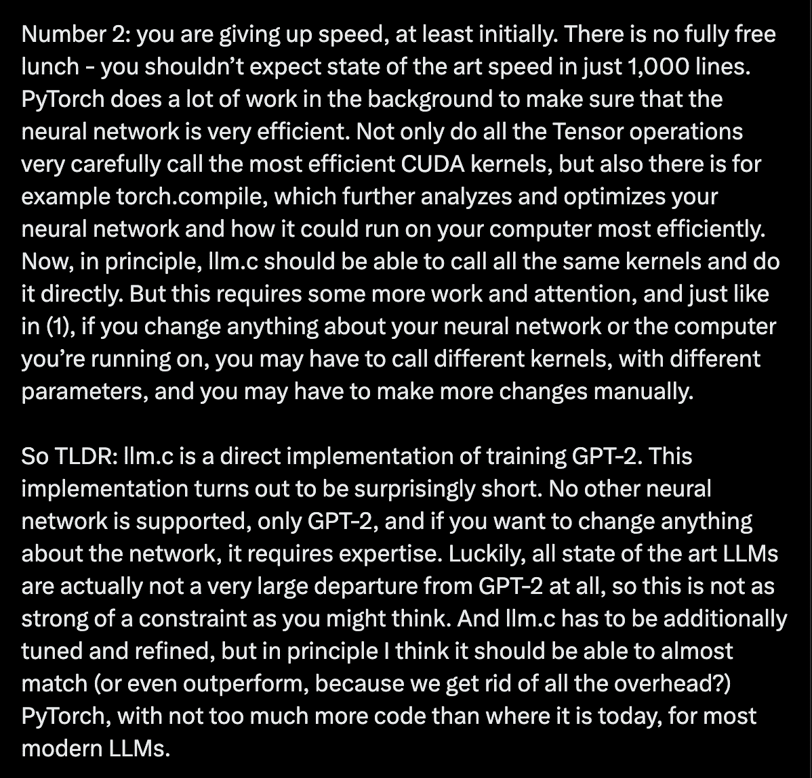

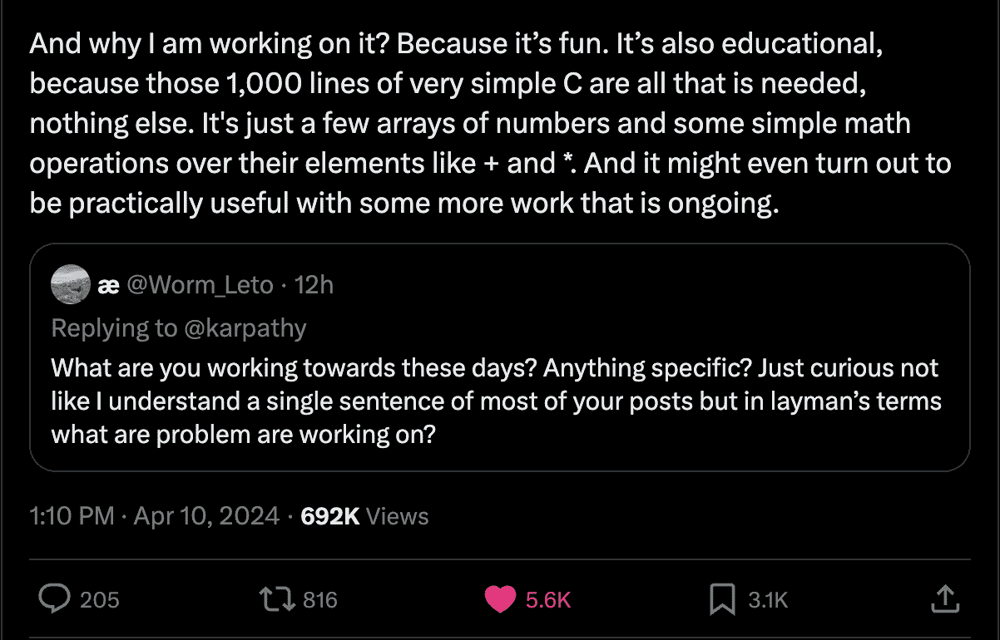

### 如果语言模型可以通过搜索来更好地推理，为什么不在 Chain of Thought 期做呢？Noahdgoodman分享：数据而非架构的局限

贡献人：

https://x.com/noahdgoodman/status/1777409751326081176

当我第一次看到 Tree of Thoughts 时,我问自己:如果语言模型可以通过搜索来更好地推理,为什么它们在 Chain of Thought 期间不自己做呢?一些可能的答案(和一篇新论文):

1)也许搜索不能表示为单个序列?不:如果我在 python 搜索代码中插入打印语句,我会得到搜索过程的连续流。

2)也许架构无法执行搜索所需的计算?这似乎是可能的,但 ToT 无论如何都会将大多数有趣的步骤推迟到 LM。

3)各种效率论证——上下文窗口等——都有可能,但我们应该在 CoT 中看到简单的原型搜索。

4)数据问题?也许 LM 在思考时没有学会搜索,因为训练数据是人类交流,而不是人类思维。(我们写解决方案的方式与我们最初得到它们的方式不同。)

在新的工作中,我们测试了简单(但很难)的 Countdown 游戏。当只训练正确的解决方案时,LM 表现不佳;当训练序列化的"搜索流"时,LM 表现更好,可以对新问题进行搜索。所以,这一直是一个数据问题!

(警告:这也是一个效率问题。即使对于小问题,SoS 也需要大量上下文。)

额外收获!一旦你给了 LM 搜索的概念,它就可以通过 STaR 和 APA 进行自我改进,找到更有效的搜索方法并解决新问题。

第一作者 @gandhikanishk 的帖子:https://x.com/gandhikanishk/status/1777358353045622891… Arxiv:https://arxiv.org/abs/2404.03683

接下来是什么?研究迁移学习并为预训练的 LM 调整这些想法。

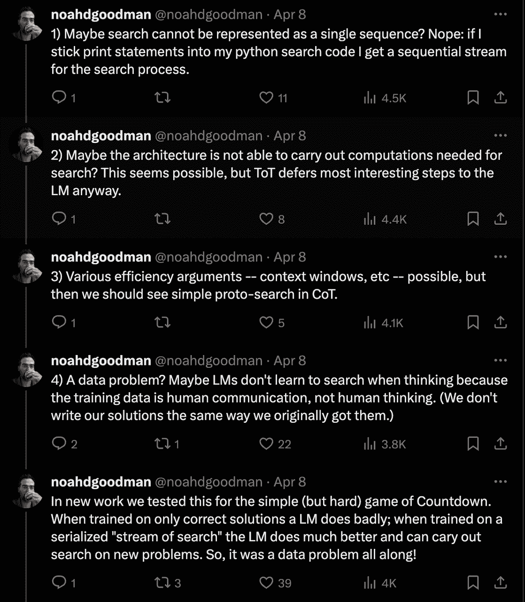

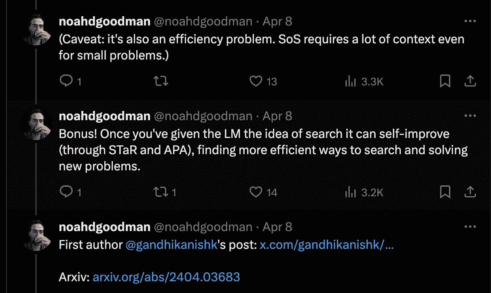

### Karpathy分享：GPT-2 的前向传播快速的原生 CUDA 内核实现

贡献人：

https://x.com/karpathy/status/1778128793166856368

我对 GPT-2 的前向传播进行了第一次快速的原生 CUDA 内核实现,并将所有内容推送到了 llm.c 的一个文件中,代码仍然只有大约 1000 行:

https://github.com/karpathy/llm.c/blob/master/train_gpt2.cu

在我的 Lambda 机器上的当前每次迭代时间 <3 A100 40GB PCIe,B=4,T=1024:

+   llm.c:111ms

+   PyTorch:180ms

+   +torch.compile:86ms

+   +fp32 Tensor Cores:26ms

所以还有一些差距需要缩小!快来一起 hack,让它变快:)

### Jim Fan：软件 AI 代理的护城河不是薄薄的包装层，而是底层的大型语言模型

贡献人：

https://x.com/DrJimFan/status/1778105360685080644

软件 AI 代理的护城河不是薄薄的包装层(Devin,SWE-Agent),而是底层的大型语言模型(LLM)。与其对包装层进行基准测试,我认为 SWE-Bench 非常适合评估编码 LLM:固定代理层,只改变 LLM 后端。提供所有工具:对 LLM 友好的命令行、编辑器、Web 浏览器。指定最大令牌预算和互联网查询预算。GPT、Gemini、Claude、Command R、Mistral、Llama 在解决现实世界软件工程问题方面如何相互比较,具有人类级别的工具访问权限?这是一个比 HumanEval 更加现实的基准。它测试 LLM 搜索 StackOverflow、阅读文档、自我反思、自我纠正以及执行长期一致计划的能力。在 Voyager(在 Minecraft 中使用 LLM)论文中,我们进行了这样一个实验,我们固定了 Voyager 算法,将 GPT-4 后端(橙色曲线)替换为 3.5(绿色曲线)。这产生了巨大的差异。使用较差的 LLM,无论是 Devin 还是 Voyager 都无关紧要——你无论如何都无法获得良好的性能。相反,使用更强大的 LLM(着眼于 GPT-5),我们可能只需要付出一点额外的努力就能实现 L4-L5 级别的软件自动化。

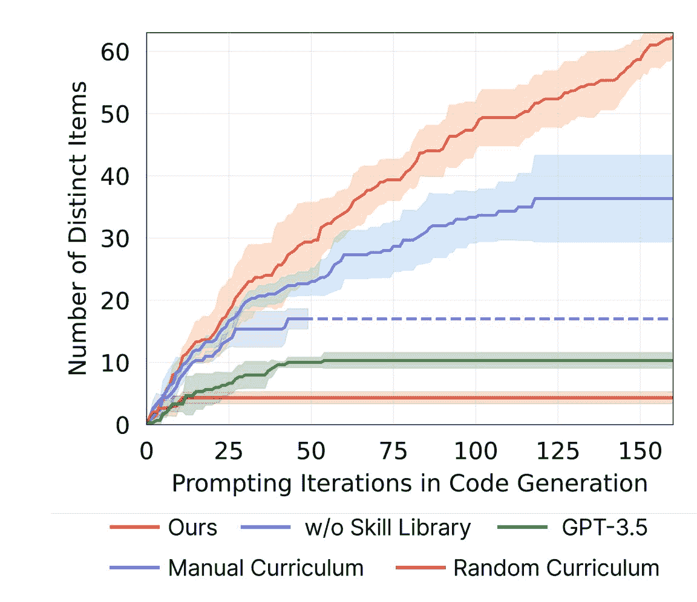

### ChatGPT fun fact：从1到100之间选一个数，竟然更倾向于选择42

贡献人：

https://x.com/infobeautiful/status/1778059112250589561

让 ChatGPT 在 1 到 100 之间选择一个数字——它会选择哪个数字?

(来自@Leniolabs_)

---

Pietro Schirano：有趣的是,对于人类来说,37 和 73 是最常被选择的数字。

Samoalfred：数字 37 再次出现。YouTuber Veristasium 最近调查了为什么大多数人倾向于认为 37 是随机的。

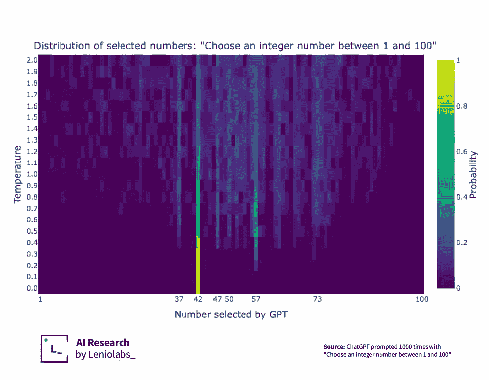

### DeepLearningAI新课程：为 LLM 应用预处理非结构化数据

贡献人：

https://x.com/AndrewYNg/status/1778075380886495676

数据预处理对于构建有效的 RAG 系统至关重要。我们的新短期课程"为 LLM 应用预处理非结构化数据",由 @UnstructuredIO 的 @mrobinson0623 讲授,展示了 RAG 系统中重要但有时被忽视的方面:

+   如何从 PDF、Powerpoint 和 HTML 等不同格式中提取和规范化内容,以扩展你的 LLM 的知识

+   使用元数据丰富数据,以实现更强大的检索和推理

+   应用文档布局分析和视觉转换来处理嵌入的图像和表格

然后你将运用所有这些技能,构建一个 RAG 机器人,从包含 PDF、PowerPoint 和 Markdown 文档的语料库中提取信息。

请在此注册:https://deeplearning.ai/short-courses/preprocessing-unstructured-data-for-llm-applications

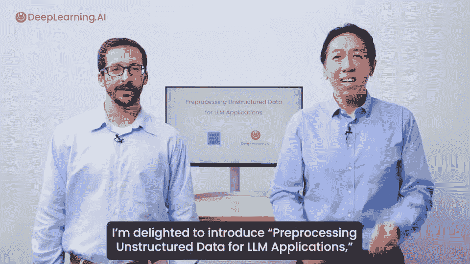

[ssstwitter.com_1712819989749.mp4](https://internal-api-drive-stream.feishu.cn/space/api/box/stream/download/all/AZ3Tbkt3loPInaxH2SwcA4TInZe)

### Parler-TTS:一个用于高质量、可控文本到语音(TTS)模型的推理和训练库

贡献人：

https://x.com/sanchitgandhi99/status/1778093250324189627

介绍Parler-TTS:一个用于高质量、可控文本到语音(TTS)模型的推理和训练库🗣️

为了促进开源TTS研究的发展,我们正在开源所有数据集、训练代码以及我们的第一个迭代检查点:Parler-TTS Mini v0.1。

[ssstwitter.com_1712774816128.mp4](https://internal-api-drive-stream.feishu.cn/space/api/box/stream/download/all/YHx4bkCjDoNUttxXn0IcYBS5nPe)

### Google Gemini + Vercel AI SDK聊天机器人模板：预订航班、选择座位、结账等等

贡献人：

https://x.com/leeerob/status/1778121817959333890

新消息:Google Gemini + Vercel AI SDK聊天机器人模板

预订航班、选择座位、结账等等——所有这些都可以通过服务器驱动的交互式生成式UI组件来完成。

开源且可定制!

**https://**gemini.vercel.aiNext.js

**Gemini 聊天机器人**

这是一个使用 Next.js、Vercel AI SDK 和 Google Gemini 构建的开源 AI 聊天机器人应用模板。

它使用带有函数调用的 React 服务器组件,将文本与来自 Gemini 的生成式 UI 响应混合在一起。UI 状态通过 AI SDK 进行同步,因此模型始终了解您在浏览器中发生的有状态交互。

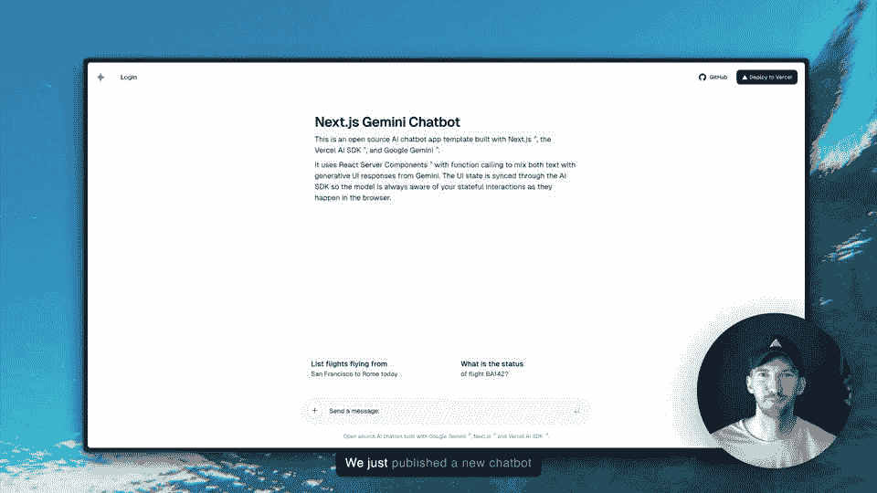

[ssstwitter.com_1712820613975.mp4](https://internal-api-drive-stream.feishu.cn/space/api/box/stream/download/all/SDkvbXOXtozpWZxPO6ucrD38nRh)

### 网页版Captions：一键式编辑视频，直接在浏览器中完成

贡献人：

https://x.com/getcaptionsapp/status/1778073088023802134

介绍网页版Captions。

得益于AI,视频编辑变得简单——现在可以在更大的屏幕上使用。

一键式编辑,直接在浏览器中完成。

---

Nikita Bier：当人们问我哪个消费者应用将成为AI浪潮的赢家时,我的答案是Captions:

他们确定了增长最快的内容类型——谈话视频,并简单地构建了生产它的最佳工具。

[ssstwitter.com_1712820869245.mp4](https://internal-api-drive-stream.feishu.cn/space/api/box/stream/download/all/RSDtbzDzOoCFTwx1m5scvtKfnzh)

### ChatGPT新旧版本并排对比：turbo版本更加简洁、勤奋

贡献人：

https://x.com/skirano/status/1778122305471705489

最新版本的gpt-4-turbo和之前的0125-preview版本的并排比较。

新版本不仅更加简洁,直接给出了代码,而且还(理所当然地)决定添加一个标志来下载最高质量的视频。

真聪明!👨🏫

[ssstwitter.com_1712773697527.mp4](https://internal-api-drive-stream.feishu.cn/space/api/box/stream/download/all/BVK0b5uADo46kbx4whFctOWWnLh)

# 资讯

### 重磅！DeepMind推出具身智能“足球运动员”，过人、射门、防守样样精通，真实机器人可直接部署

贡献人：

https://mp.weixin.qq.com/s/xMBk31b-nOabXG3fqFEtQw

足球是一项综合性非常强的运动，运动员不仅需要具备**超出常人的身体素质，还必须掌握十分精湛的技术。

对于我**们人类而言，要想成为一名好的足球运动员并不容易，更不用说那些“肢体不协调且动作僵硬”的机器人了。

如今，由 Google DeepMind 研发的具身智能体（agent）——一个微型人形机器人，不仅可以快速“奔跑”“过人”“进攻”，还可以阅读比赛，正确预测足球移动方向，以及阻挡对手射门等。

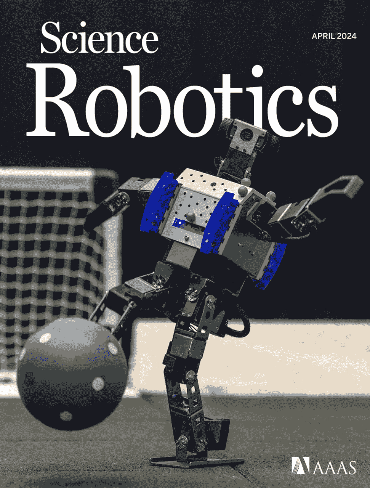

### 红杉美国最新分享：创业者须知的 3 种 PMF 框架，OpenAI 是这个时代最有趣的愿景故事之一

贡献人：

https://mp.weixin.qq.com/s/neJ8iA48jw9KbuBJ85heqQ

这是红杉美国团队近期分享给创业者的一份 PMF 思维框架。对于每一个早期阶段的初创公司而言，找到产品与市场的契合度（Product-Market Fit，PMF）是其核心任务。通过多年与尚未达到 PMF 的公司合作的经验，红杉美国认为思考和寻找这一契合度有多种方式。在其为种子阶段和前种子阶段公司举办的公司构建沉浸式体验 Arc 中，红杉会引导创始人通过以下框架，这一框架不是用来诊断是否已经实现了 PMF，而是概述了三种独特的  PMF 框架，帮助理解产品在市场中的位置并决定公司的运作方式。

### 由前 Google DeepMind 研究员推出的 AI 音乐生成器 Udio 开启免费公测

贡献人：

https://www.udio.com/

由前 Google DeepMind 研究人员创立的人工智能音乐生成器 Udio 开启免费公测，最高每月可免费生成1200首歌曲。该AI音乐生成工具能够根据用户输入的文本提示，包括音乐风格、主题、歌词等信息，快速生成包含人声的完整音轨。Udio不仅支持多种音乐风格和流派，还能够捕捉并表达音乐中的情感，创造出既逼真又具有创意的音乐作品。

### Meta宣布全新训推一体加速器：完全集成PyTorch 2，性能3倍提升

贡献人：

https://mp.weixin.qq.com/s/bzL_WfpjXK1Ha5LsnmS9LQ

Meta 正在不遗余力地想要在生成式 AI 领域赶上竞争对手，目标是投入数十亿美元用于 AI 研究。这些巨资一部分用于招募 AI 研究员。但更大的一部分用于开发硬件，特别是用于运行和训练 Meta AI 模型的芯片。在英特尔宣布其最新人工智能加速器硬件的第二天，Meta 便迅速公布了关于芯片研发的最新成果：下一代 MTIA（Meta Training and Inference Accelerator），其中 MTIA 是专为 Meta AI 工作负载而设计的定制芯片系列。分析认为，Meta 此举意在减少对英伟达及其他外部公司芯片的依赖。

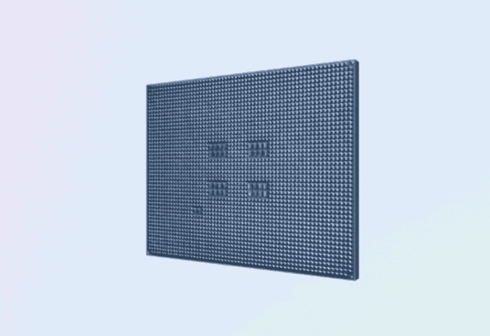

### XAI有什么用？探索LLM时代利用可解释性的10种策略

贡献人：

https://mp.weixin.qq.com/s/V35k4UJZPtJkAHqYlZiO1A

你是否也好奇，在大模型时代，可解释性人工智能技术（XAI）有怎样的使用价值？近日，来自佐治亚大学、新泽西理工学院、弗吉尼亚大学、维克森林大学、和腾讯 AI Lab的研究者联合发布了解释性技术在大语言模型（LLM）上的可用性综述，提出了 「Usable XAI」 的概念，并探讨了 10 种在大模型时代提高 XAI 实际应用价值的策略。这些策略涵盖两方面：（1）如何利用 XAI 来更好地理解和优化 LLM 与 AI 系统；（2）如何利用 LLM 的独特能力进一步增强 XAI。此外，研究团队还通过具体的案例分析说明如何获取和使用大模型的解释。

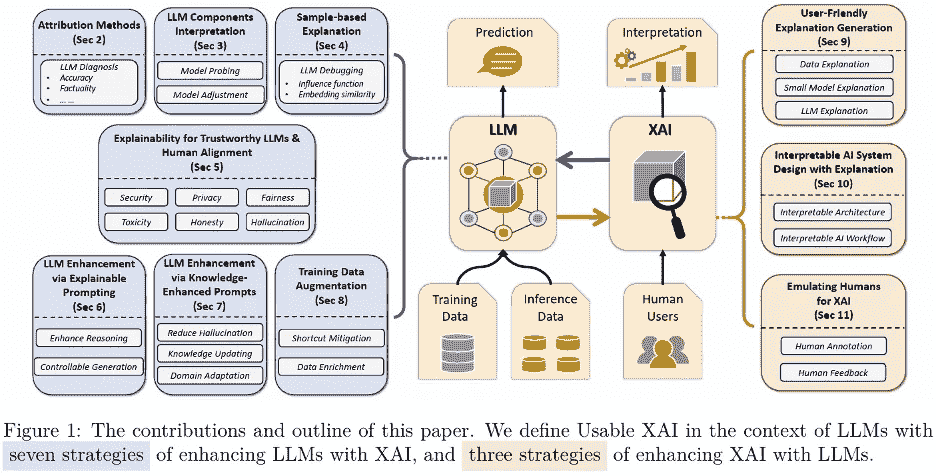

### 对25,000多个原子进行纳秒级MD模拟，DeepMind开发基于ML的大规模分子模拟通用方法

贡献人：

https://mp.weixin.qq.com/s/MXp8t2YfIj8gdVc0H0eiSw

分子动力学 (MD) 模拟可以深入了解复杂的过程，但准确的 MD 模拟需要昂贵的量子力学计算。对于较大的系统，使用高效但不太可靠的经验力场。机器学习力场（MLFF）提供与从头计算方法相当的精度，速度更快更高效，但难以模拟大分子中的长程相互作用。Google DeepMind、柏林工业大学（Technische Universität Berlin）和卢森堡大学（University of Luxembourg）的研究人员提出了一种通用方法 GEMS，通过对「自下而上」和「自上而下」分子片段进行训练，来构建用于大规模分子模拟的准确 MLFF。

### “梗王”大模型，靠讲笑话登上CVPR | 中山大学

贡献人：

https://mp.weixin.qq.com/s/k8iH1ZM8sUc_B8gK-MKYDw

只是让**大模型讲笑话**，论文竟入选了顶会**CVPR**！这项研究正是来自中山大学HCP实验室林倞教授团队、Sea **AI Lab和哈**佛大学等单位，主打的就是打破常规思维思考（Think Outside the Box），探索多模态大模型的创造力。

### 大模型做时序预测也很强！华人团队激活LLM新能力，超越一众传统模型实现SOTA

贡献人：

https://mp.weixin.qq.com/s/UL_Kl0PzgfYHOnq7d3vM8Q

大语言模型潜力被激发——无需训练大语言模型就能实现高精度时序预测，超越一切传统时序模型。来自蒙纳士大学、蚂蚁、IBM研究院提出了一种通用框架，结果成功激活大语言模型跨模态处理时序数据的能力。时序预测有益于城市、能源、交通、遥感等典型复杂系统的决策制定。自此，大模型有望彻底改变时序/时空数据挖掘方式。

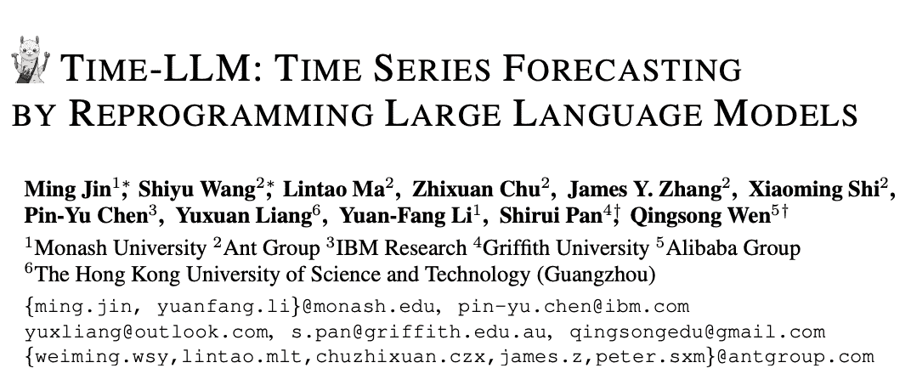

# 论文

### 数据过滤的扩展定律 -- 数据构建不可能与计算无关

贡献人：

链接：http://arxiv.org/abs/2404.07177v1

视觉语言模型（VLMs）经过数千小时的GPU训练，使用精心策划的网络数据集。最近，数据整理受到关注，许多研究开发了保留“高质量”子集的策略来保留‘原始’抓取的数据。例如，LAION公共数据集仅保留了总爬取数据的10％。然而，这些策略通常不考虑训练所需的计算资源。本文首先证明，在不考虑训练计算的情况下做过滤决策通常不是最佳选择：有限的高质量数据在被重复使用时迅速失去效用，最终需要包含‘未见过’但‘较低质量’的数据。为了解决质量和数量之间的权衡问题，我们引入了考虑网页数据非均匀性的神经缩放定律，这是现有文献中忽略的一个角度。我们的缩放定律（i）表征了各种质量子集的‘效用’之间的差异；（ii）考虑了数据点在第‘n’次重复时效用如何减少；以及（iii）制定了各种数据池的相互作用，使得能够估计模型在多个数据池组合上的性能，而无需同时在它们上面进行训练。我们的核心信息是，数据整理不应该忽视模型将被训练的总计算资源。我们的缩放定律允许我们精心策划最佳可能的数据池，以在不同计算预算下实现在Datacomp上的最佳性能，为数据整理开辟出一个帕累托边界。代码可在https://github.com/locuslab/scaling_laws_data_filtering获取。

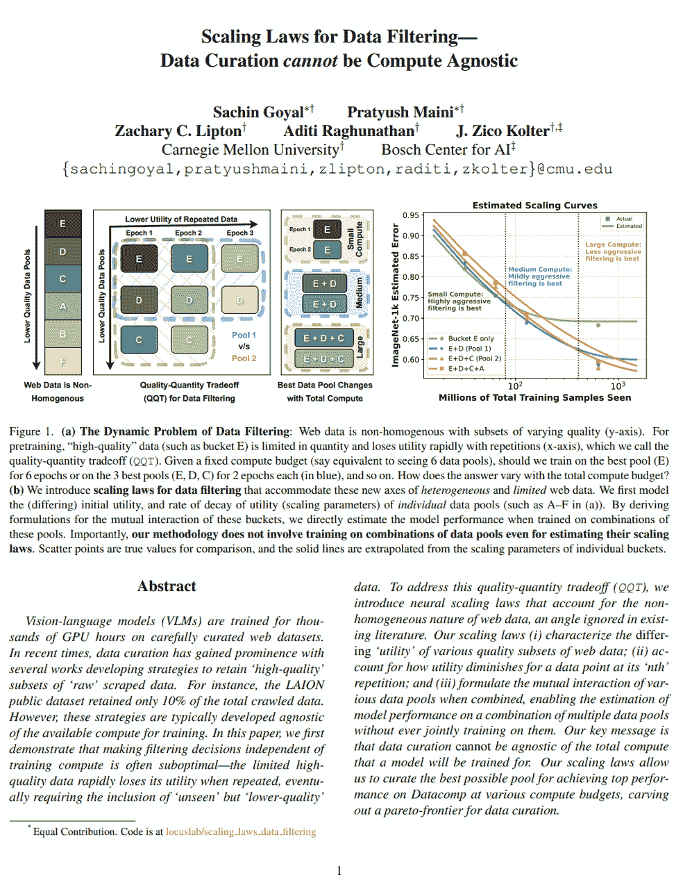

### 诱导头电路取得成功需要什么？在上下文学习电路及其形成的机制研究

贡献人：

链接：http://arxiv.org/abs/2404.07129v1

在Transformer模型中，背景学习是一种强大的涌现能力。在机械解释性方面的先前工作已经确定了一个可能对背景学习至关重要的电路元素——诱导头（IH），它执行匹配和复制操作。在自然语言数据上训练大型Transformer模型时，IH会在损失的显著阶段变化时出现。尽管有关IH的强有力证据以及与阶段变化的有趣巧合，对IH的多样性和涌现动态知之甚少。为什么会有多个IH？它们之间如何相互依赖？IH为什么突然出现？什么是使它们涌现的子电路？通过在合成数据上训练，我们研究了IH在受控环境中的涌现动态。在这个过程中，我们开发并分享了一个受光遗传学启发的新型因果框架，用于修改整个训练过程中的激活。利用这一框架，我们详细说明了IH的多样且可累加的性质。通过在整个训练过程中夹紧激活的子集，我们确定了三个相互作用以驱动IH形成的基础子电路，导致阶段变化。此外，这些子电路揭示了涌现特性的数据相关属性，如阶段变化的时机，已经展现了对于IH需要“正确进行”的更深入理解的潜力。

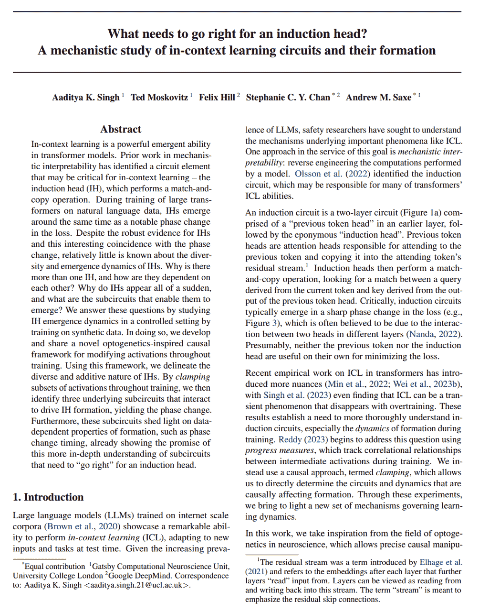

### 不落下任何上下文：高效的无限上下文Transformer与无限注意力

贡献人：

链接：http://arxiv.org/abs/2404.07143v1

本研究介绍了一种有效方法，可以将基于Transformer的大语言模型(LLMs)扩展到具有有限内存和计算的无限长输入。我们提出方法的关键组件是一种名为无限关注(Infini-attention)的新注意力技术。无限关注将一个压缩式记忆体纳入到传统注意力机制中，并在单个Transformer块中构建了掩码局部关注和长期线性关注机制。我们在长上下文语言建模基准上，1M长度密码上下文块检索和500K长度书籍摘要任务中，分别使用1B和8B的LLMs展示了我们方法的有效性。我们的方法引入了最小的有限内存参数，并实现了LLMs的快速流式推理。

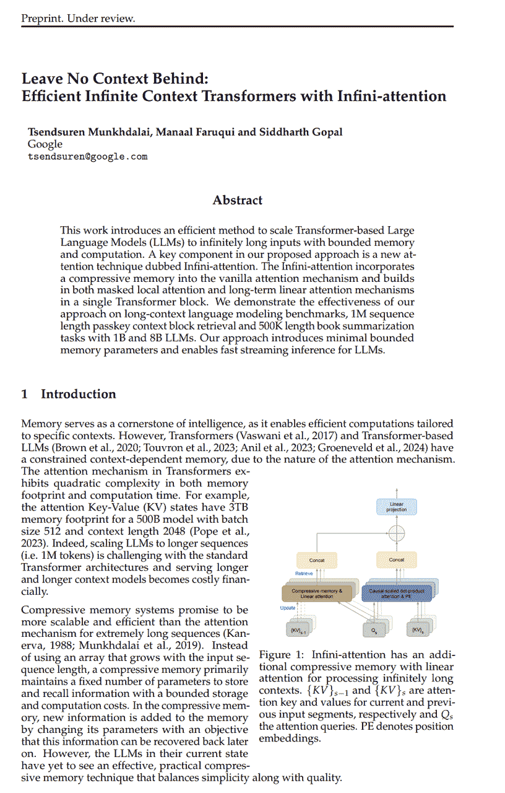

### 探索概念深度：大语言模型如何在不同层面获得知识？

贡献人：

链接：http://arxiv.org/abs/2404.07066v1

本文研究了大语言模型中不同层次学习不同概念的现象，即更困难的概念在更深层次上完全被习得。我们通过抽象程度定义了概念的困难程度，并粗略地按事实、情感和推理进行分类。每个类别包含一系列任务，从简单到复杂排列。我们利用探测技术从模型的不同层中提取表示，并将其应用于分类任务。我们的发现表明，模型倾向于有效地分类较简单的任务，表明这些概念是在更浅的层次中学习的。相反，更复杂的任务可能只在更深层次上才能分辨，如果有的话。本文探讨了这些发现对我们理解模型学习过程和内部表示的影响。我们的实现可在 https://github.com/Luckfort/CD 找到。

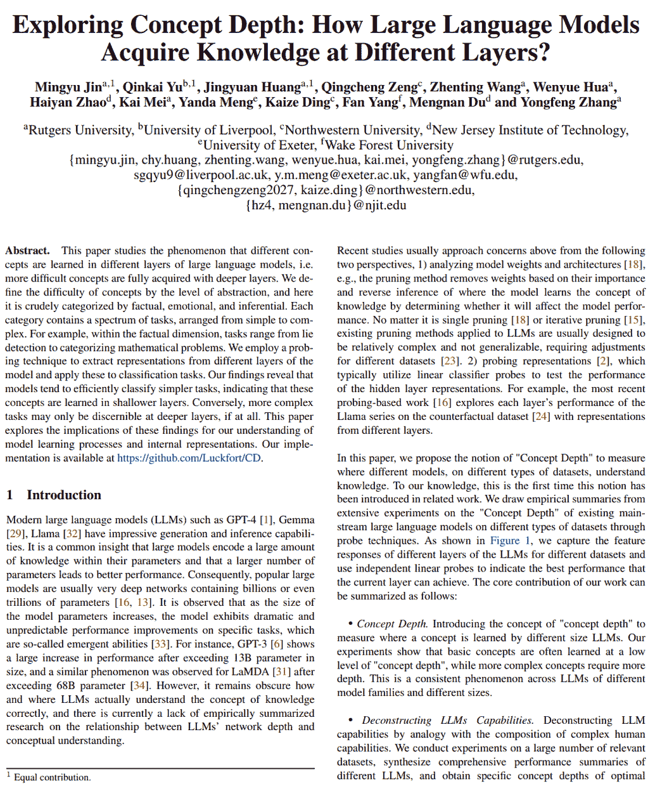

### 思维雕刻：使用中间修订和搜索进行推理

贡献人：

链接：http://arxiv.org/abs/2404.05966v1

我们提出了THOUGHTSCULPT，一种通用的推理和搜索方法，适用于可以分解为组件的任务。THOUGHTSCULPT使用蒙特卡洛树搜索（MCTS）来探索潜在解决方案的搜索树，一次构建一个动作，并根据任何特定于领域的启发式进行评估，实际上通常只是一个LLM评估器。关键是，我们的动作空间包括修订动作：THOUGHTSCULPT可能选择修改其先前输出的部分，而不是继续构建其余的输出。实验证明，THOUGHTSCULPT在三项具有挑战性的任务中表现优于最先进的推理方法：故事大纲改善（高达+30％的趣味性），迷你填字游戏求解（高达+16％的单词成功率）和受限生成（高达+10％的概念覆盖率）。

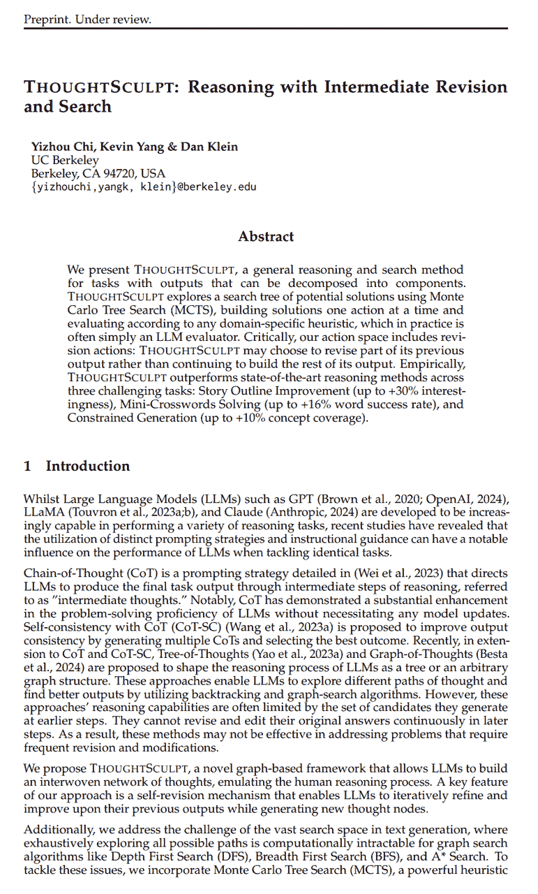

### 麻婆豆腐中包含咖啡吗：探索大语言模型中的食品文化知识

贡献人：

链接：http://arxiv.org/abs/2404.06833v1

最近的研究强调了大语言模型（LLMs）中存在的文化偏见，但往往缺乏一个全面剖析这些现象的强大方法论。我们的工作旨在通过深入探讨食品领域来弥补这一差距，这是一个普遍相关但文化多样的人类生活方面。我们引入了FmLAMA，一个以食品相关文化事实和食品实践变化为中心的多语言数据集。我们分析了不同架构和配置下的LLMs，在单语和多语环境下评估它们的性能。通过利用六种不同语言中的模板，我们研究LLMs如何与语言特定和文化知识互动。我们的研究发现：（1）LLMs表现出对美国食品知识的明显偏好；（2）纳入相关文化背景显著提高了LLMs访问文化知识的能力；（3）LLMs捕捉文化细微差别的有效性很大程度上取决于探究语言、具体模型架构和所讨论的文化背景之间的相互作用。这项研究突显了将文化理解融入LLMs的复杂性，并强调了通过文化多样性数据集来减轻偏见、增强模型在不同文化领域中的性能的重要性。

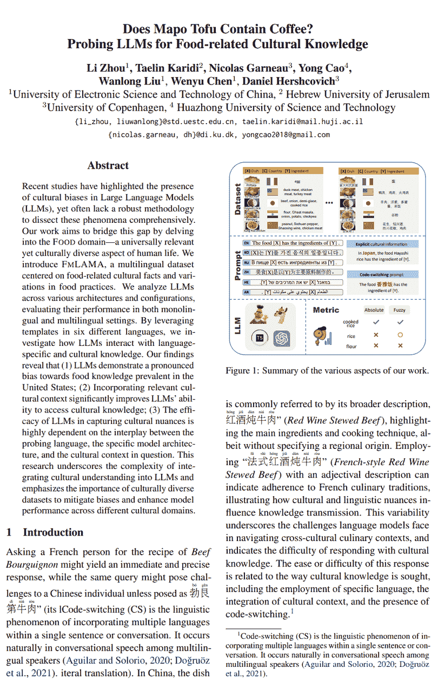

### 简化能提升事实一致性自动评估效果

贡献人：

链接：http://arxiv.org/abs/2404.06579v1

评估自动生成文本与源语境的事实一致性对于开发可靠的自然语言生成应用程序至关重要。最近的文献提出了使用统一对齐模型的AlignScore来评估事实一致性，在许多基准任务上远远超过以往的方法。本文对AlignScore中使用的数据集进行了详细研究，并发现一个意外的发现：利用较少的数据点实际上可以提高性能。我们处理原始AlignScore训练数据集以去除噪声，增加具有鲁棒性的样本，并利用该数据的10%子集训练了一个改进的事实一致性评估模型，我们称之为LIM-RA（Robust AlignScore的小即是多）。LIM-RA展示了优越的性能，持续优于AlignScore和其他强基线模型，如ChatGPT，跨越四个基准测试（两个使用传统自然语言生成数据集，两个关注大型语言模型输出）。我们的实验表明，LIM-RA在33个测试数据集中的24个上获得了最高分，同时在其他数据集上保持竞争力，建立了新的最优基准。

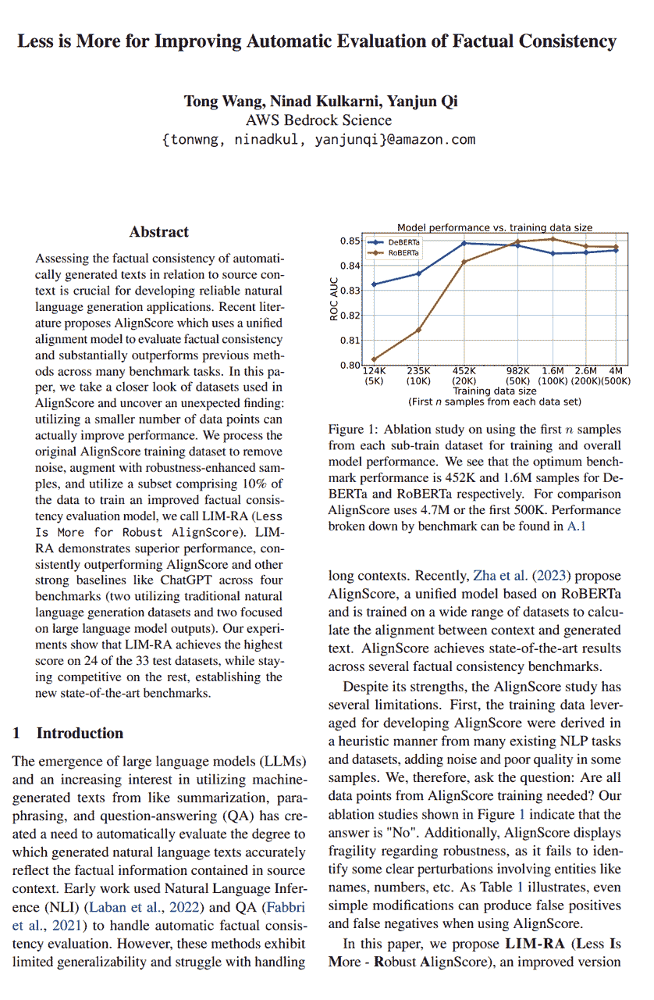

# 产品

### Persana AI for Prospecting

贡献人：

https://persana.ai/

Persana AI 是一款利用人工智能算法来简化潜在客户识别、提取客户洞察以及实现个性化推广的工具，可帮助企业提高销售效率。它能创建全面的客户档案，实现个性化沟通，并自动执行重复性任务，使销售专业人员能够专注于建立关系和推动销售，是一款适用于优化销售流程、识别高质量潜在客户并大规模提供个性化推广的强大且智能的解决方案的产品。

### Prelaunch AI Idea Validator

贡献人：

https://prelaunch.com/features/idea.html

Prelaunch Idea Validator 可以在不到3分钟的时间内将用户的想法转化为一个产品页面，并从朋友、用户的社交网络以及2亿人的群体中获取反馈，帮助用户快速验证自己的想法。

# HuggingFace&Github

### morphic

贡献人：

https://github.com/miurla/morphic

Morphic 是一个开源的项目，旨在创建一个能够让用户轻松访问并收获所需信息的 AI 搜索引擎。

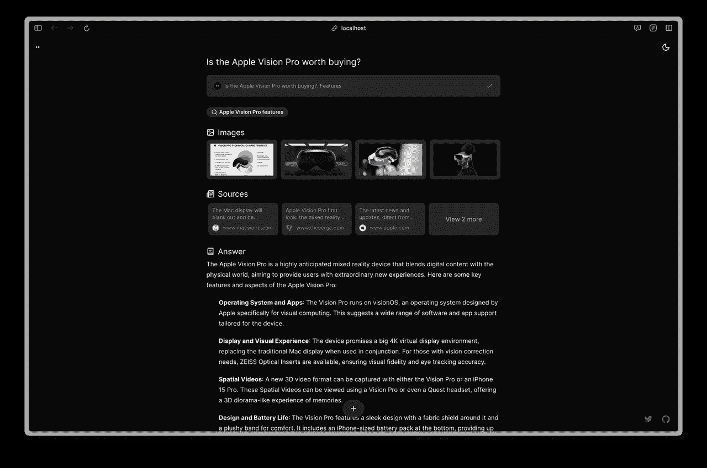

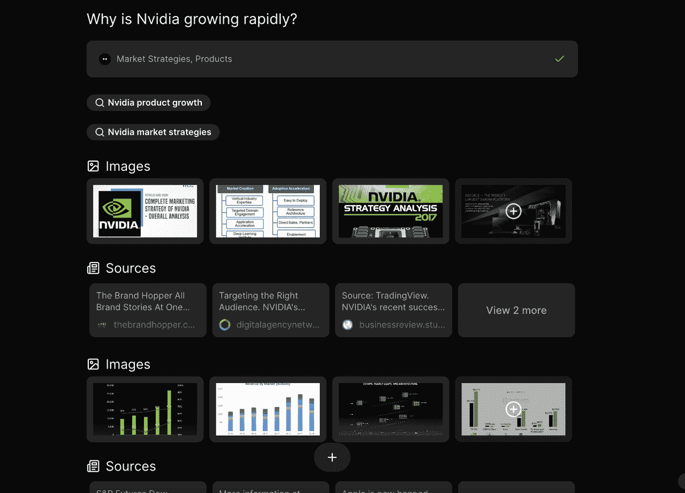

### Codefuse-ModelCache

贡献人：

https://github.com/codefuse-ai/CodeFuse-ModelCache?tab=readme-ov-file

Codefuse-ModelCache 是一个开源的大模型语义缓存系统，通过缓存已生成的模型结果，降低类似请求的响应时间，提升用户体验。该项目从服务优化角度出发，引入缓存机制，在资源有限和对实时性要求较高的场景下，帮助企业和研究机构降低推理部署成本、提升模型性能和效率、提供规模化大模型服务。

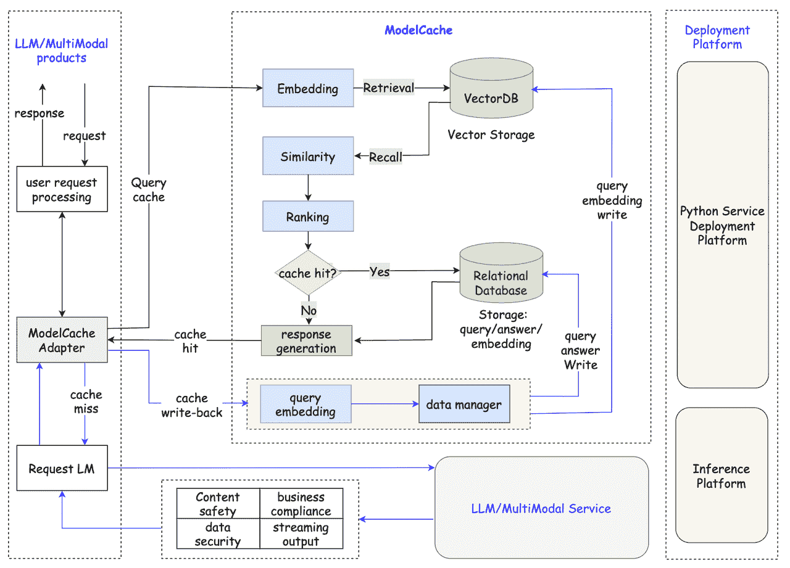

### Easy-Edit

贡献人：

https://github.com/zjunlp/EasyEdit

EasyEdit 是一个基于 PyTorch 构建的 Python 包，用于编辑大型语言模型（LLM），如 GPT-J、Llama、GPT-NEO、GPT2（T5 支持从 1B 到 65B 的模型），在不对其他输入的性能产生负面影响的情况下有效地改变行为LLMs。

# 投融资

### 面壁智能完成新一轮数亿元融资，春华创投、华为哈勃领投

贡献人：

https://mp.weixin.qq.com/s/X4g6iaBhl4w4YoxHxuSQtg

面壁智能近日完成了数亿元的新一轮融资，此轮融资由春华创投和华为哈勃领投，北京市人工智能产业投资基金等跟投，知乎作为战略股东继续支持。面壁智能成立于2022年8月，核心团队来源于清华大学自然语言处理与社会人文计算实验室。此次融资将主要用于人才引进、大模型底层算力与数据基础建设以及大模型的市场落地。面壁智能致力于推进大模型技术的发展和应用，特别是在提升大模型的训练效率和推理成本方面，以及推动大模型技术在端侧的落地，包括开发了适配端侧硬件的MiniCPM-2B模型，有效降低了推理成本，并保持了良好的性能。

公司官网：https://modelbest.cn/

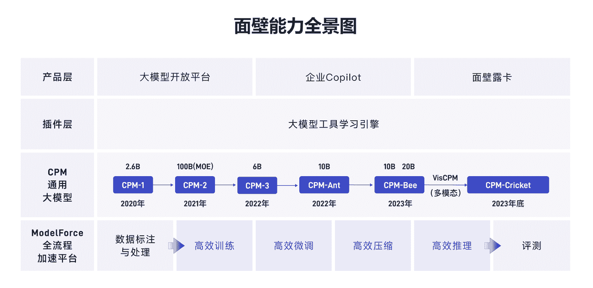

### FloQast完成1亿美元E轮融资 成为独角兽企业

贡献人：

https://siliconangle.com/2024/04/10/financial-operations-platform-floqast-raises-100m-series-e-funding-achieve-unicorn-status/

财务运营平台FloQast成功完成了1亿美元的E轮融资，由现有投资者ICONIQ Growth领投，新投资者BDT & MSD Partners和World Innovation Lab等参与投资，使公司估值超过16亿美元，达到独角兽状态。该融资将用于增强其平台的人工智能能力，支持新技术的研发和全球扩张。FloQast成立于2013年，提供能够统一各个商业部门会计操作的软件，通过AI驱动的自动化简化了繁重的财务工作流程。目前，该平台已被2600多个会计团队使用，包括Zoom、Snowflake和洛杉矶湖人篮球队等知名客户。

公司官网：https://floqast.com/

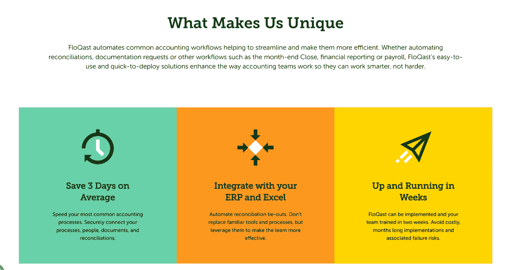

### PVML完成800万美元种子轮融资 发展安全AI数据访问平台

贡献人：

https://www.calcalistech.com/ctechnews/article/sya1csbg0

以色列初创公司PVML，由夫妇Shachar Schnapp和Rina Galperin创立，旨在通过差分隐私和AI两大支柱，民主化企业数据的安全访问。该公司最近宣布其安全AI驱动数据访问平台的普及，并成功完成了800万美元的种子轮融资。这轮融资由NFX领投，FJ Labs和Gefen Capital参投。PVML的技术能够连接多个数据源，提供访问权限，并保证隐私，即使是敏感数据也能解锁实时洞察。此外，PVML还为非技术用户提供了一个自然语言接口，使他们能够通过AI分析数据。

公司官网：https://pvml.com/

### Sapien AI完成500万美元种子轮融资 加速游戏化数据标注平台发展

贡献人：

https://www.prnewswire.com/news-releases/ai-company-sapien-raises-5-million-to-gamify-data-labeling-for-ai-302112788.html

AI公司Sapien AI近日宣布完成500万美元的种子轮融资，以加速其通过游戏化手段进行数据标注的平台发展。该轮融资由Primitive Ventures、Animoca、Artichoke Capital和Yield Guild Games等顶级投资者参与。Sapien AI旨在通过其独创的游戏化数据标注平台，提供可扩展、高质量的注释服务，以训练AI模型。公司通过区块链奖励机制激励其全球网络中的人类标注者提供准确的注释，旨在建立世界上最大的人力驱动的AI训练数据网络，服务于健康、web3、教育和领先的大型语言模型等多个行业的AI客户。

公司官网：https://www.sapien.io/

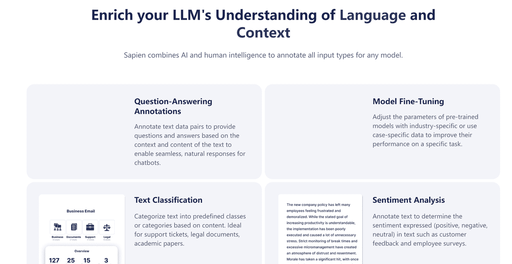

### Neysa获得2000万美元融资 推动企业AI技术采用

贡献人：

https://elblog.pl/2024/04/11/neysa-secures-20-million-to-drive-ai-adoption-in-businesses/

总部位于班加罗尔的初创公司Neysa最近成功获得了2000万美元的融资，由Matrix Partners India、Nexus Venture Partners和NTTVC等知名投资者参与。这笔资金将使Neysa能够加速其尖端的genAI平台和服务的采用，赋能企业利用人工智能和机器学习的力量。Neysa由Netmagic的创始人Sharad Sanghi和Anindya Das共同创立，并任命了著名的硅谷投资者B V Jagadeesh为其董事长。公司旨在通过一体化的方法和专注于行业垂直解决方案，推动生成式AI在印度及全球企业中的广泛采用。

公司官网：https://www.neysa.ai/

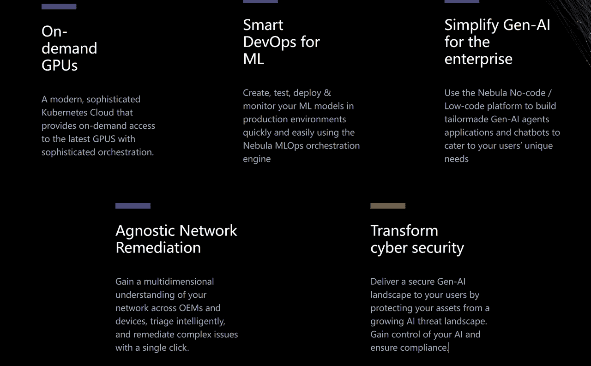

# 学习

### DeepMind 提出可交互生成式世界模型 Genie，有什么意义？和 Sora 比有什么不同？

贡献人：

https://www.zhihu.com/question/645930988

DeepMind推出了名为Genie的可交互生成式世界模型，这标志着生成式AI向交互性和理解物理世界规则的一大步。Genie能够通过无监督学习，从互联网视频中学习并生成可交互的虚拟环境，训练素材超过20万小时的在线游戏视频。这一模型包含11亿参数，基于ST-Transformer架构，能够利用文本、合成图像、照片或草图生成具有可控动作的虚拟世界。它由一个时空视频tokenizer、一个自回归动力学模型及一个潜在动作模型组成，使用户能够以帧为单位在生成的环境中进行操作。此外，Genie的交互性和能够让模型在一定程度上理解空间和物体之间互动关系的能力，区别于其他图像/视频生成模型，如Sora，向着生成能够理解物理规则的环境迈进。

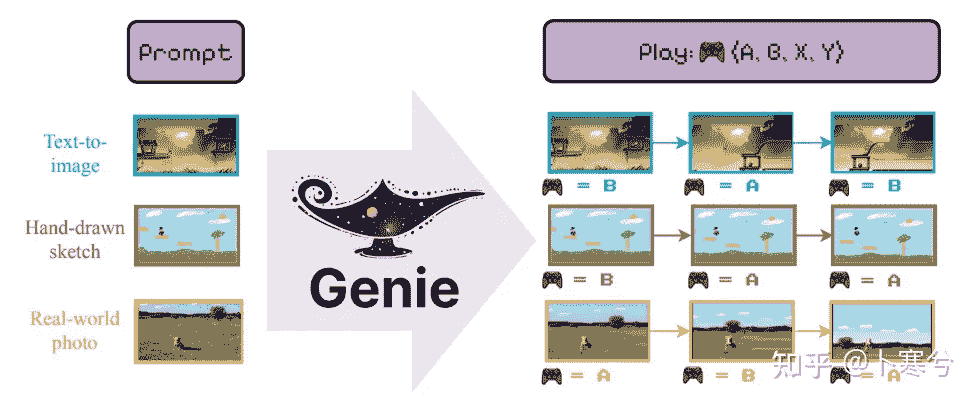

### 从DDPM到Consistency Models（笔记）

贡献人：

https://zhuanlan.zhihu.com/p/623402026

文章介绍了宋飏博士团队基于扩散(diffusion)与基于分数的随机微分方程(score-based SDE)推出的一步生成模型——Consistency Models。文章回顾了扩散模型的基本概念和DDPM（基于变分下界的扩散）的过程，其中包括正向过程逐步加入高斯噪声至数据，形成随机过程，以及逆向过程模型逐步采样还原数据的过程。此外，还探讨了从随机微分方程(SDE)和常微分方程(ODE)角度理解和推导扩散模型的方法，展示了如何通过最小化预测误差来训练这些模型。最后，文章介绍了Consistency Models的概念，这是一种能够在给定轨迹上的任一点，一步推断原始数据的模型，以及其训练方法，如Consistency Distillation，即从已经训练好的score function中提取和利用信息来训练一致性模型。

### 英伟达 AI技术路线的解读与推演

贡献人：

https://zhuanlan.zhihu.com/p/691701825?utm_psn=1761424528478375936

文章详细解析了NVIDIA的AI技术发展战略，强调了其“One Architecture”统一架构策略的重要性，该策略旨在支持跨平台的模型训练与部署，无论是在数据中心还是边缘设备，覆盖x86与Arm架构。NVIDIA将其AI芯片更新周期从两年一次加快至每年更新一次，显示出对快速市场变化的响应能力。通过整合训练和推理能力，并强调推理的重要性，NVIDIA旨在满足从超大规模数据中心到企业级用户的边缘计算需求。文章还详细讨论了NVIDIA在GPU、CPU、DPU的综合布局，以及通过NVLink、NVSwitch技术实现硬件间灵活连接的策略，旨在构建完整的软硬件生态系统，以维持其在AI领域的技术和市场领导地位。

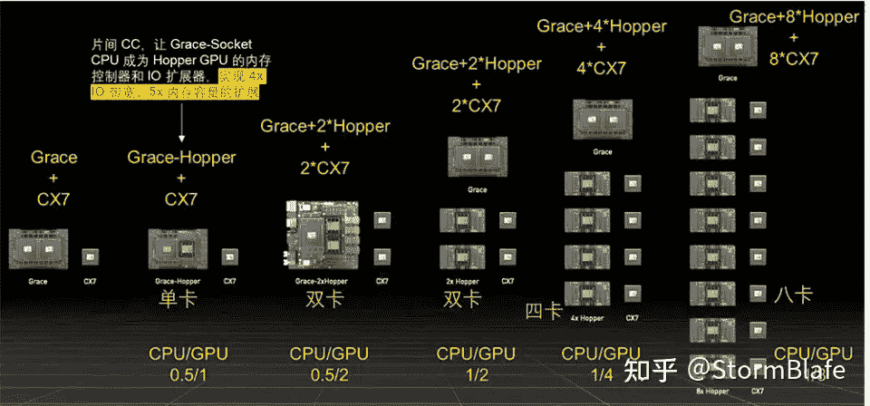

### GB200的性能成本定量分析

贡献人：

https://mp.weixin.qq.com/s/oy5yh1gh2c9d7eK85aNwmA

文章深入分析了NVIDIA GB200 GPU的性能与成本效益。核心亮点包括GB200采用NVL 72交换结构，显著提升GPU间的带宽，从而大幅降低了推理成本。文章通过详细的定量图表展示了各种应用下的实际性能提升，并比较了NVIDIA与其竞争对手（如AMD的MI300X、Intel的Gaudi 2/3）在性能与总体拥有成本（TCO）方面的表现。特别指出，GB200的推出不仅因NVIDIA的性能宣称（提升30倍）而备受关注，还因为其相对于上一代产品在定价上显得更为激进和慷慨。分析认为，GB200的主要性能提升源自于其架构改进和量化优化，而非单纯的硬件规格提升，指出了内存带宽与计算能力之间的平衡是当前AI硬件发展的关键挑战。

### [Note] XTuner 长序列训练解决方案

贡献人：

https://zhuanlan.zhihu.com/p/691790652

文章介绍了XTuner解决方案，旨在提高长序列训练的GPU利用率并降低成本。通过序列并行技术，XTuner能够对大模型进行有效训练，尤其是在处理高达70B参数的模型时，能显著提升训练效率。文章解释了为何选择序列并行—主要是为了解决显存瓶颈问题，即大的激活tensor占用过多显存。通过把序列进一步切片成head并行，XTuner解决了高显存占用的问题。此外，文章还提供了快速实现序列并行的方法，包括初始化SP(Group)和DP(Group)、分发和切分数据、在Attention计算前后进行All to All Gather和Scatter，以及Reduce Loss。最后，通过降低训练门槛，XTuner旨在使序列并行技术更易于使用，进一步推动长序列AI模型的发展。

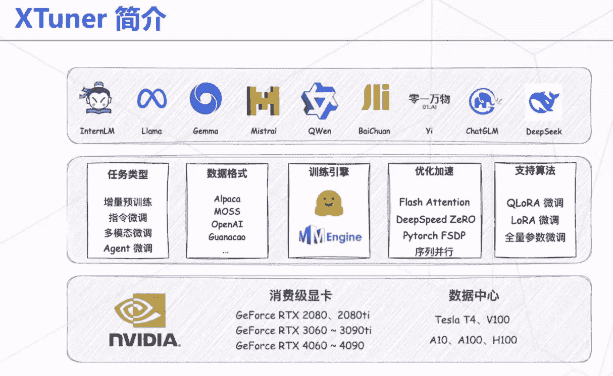

### Fourier变换取代Transformer的self-Attention提速近10倍（第3部分—实验篇）

贡献人：

https://zhuanlan.zhihu.com/p/691795920?utm_psn=1761552412303978496

文章介绍了使用FNet进行文本分类的实验过程和结果。FNet通过将Transformer模型中的自注意力层替换为傅里叶变换层来加速文本处理任务，尤其是在情感分析上。实验使用IMDb数据集，展示了FNet在GPU上比BERT快80%，同时在GLUE基准测试中达到BERT92-97%的准确率。FNet的关键优势在于傅里叶变换层无参数化，利用快速傅里叶变换（FFT）将时间复杂度从O(n^2)降低至O(n log n)。这一改进显著减少了训练时间和计算资源需求，提高了长序列训练的效率。此外，文章还详细说明了FNet模型的设置、数据集准备、模型构建和训练过程，展示了FNet作为一种高效的文本处理解决方案的潜力。

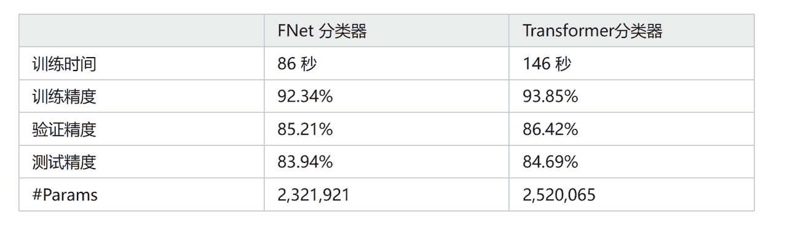

### 利用 Amazon ECS 进行分布式机器学习

贡献人：

https://aws.amazon.com/cn/blogs/china/distributed-machine-learning-with-amazon-ecs/

文章介绍了如何使用Amazon ECS服务运行分布式机器学习工作负载，以便ML团队更专注于模型的创建、训练和部署，而非管理容器编排引擎。通过简化架构、控制节点的无感升级和集成AWS IAM认证服务，Amazon ECS为ML项目提供了优秀的运行环境。文章还详细说明了使用PyTorch和RayTrain库在ECS容器中实现分布式数据并行的ML模型训练的过程。这包括设置ECS集群、部署Ray集群（包含一个head进程和多个worker进程）、使用Amazon S3作为共享存储、以及如何通过容器运行分布式训练脚本。此外，还探讨了分布式训练中的资源部署方式，包括流水线并行、张量并行和分布式数据并行的技术支持。

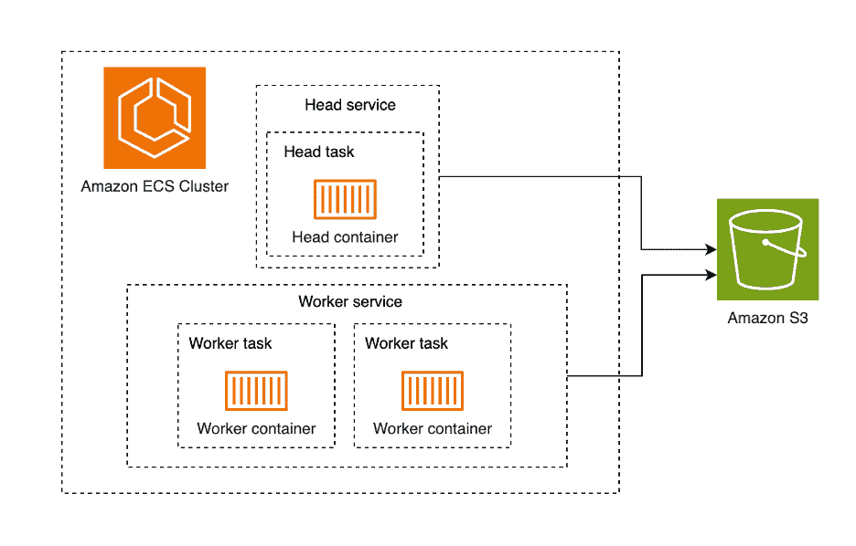

### 构建基于 Amazon Aurora 和 Amazon Bedrock 知识库的生成式 AI 应用程序

贡献人：

https://aws.amazon.com/cn/blogs/china/build-generative-ai-applications-with-amazon-aurora-and-knowledge-bases-for-amazon-bedrock/

文章探讨了如何利用 Amazon Aurora PostgreSQL 兼容版数据库与 Amazon Bedrock 结合构建生成式 AI 应用。通过检索增强生成（RAG）技术，可以利用公司数据定制基础模型响应，Amazon Bedrock 知识库全面自动化了RAG工作流程，简化了数据摄取、检索、提示增强和引用过程。文章重点介绍了如何将 Amazon Aurora 设置为Amazon Bedrock的知识库，并展示了通过简单的SQL命令和Amazon Aurora Machine Learning扩展从Amazon Bedrock生成嵌入的过程。通过使用Aurora的HNSW索引，可大幅加速RAG向量相似性搜索性能，优化读取可以进一步提升向量搜索性能，为生成式AI应用提供了高效、可扩展的解决方案。

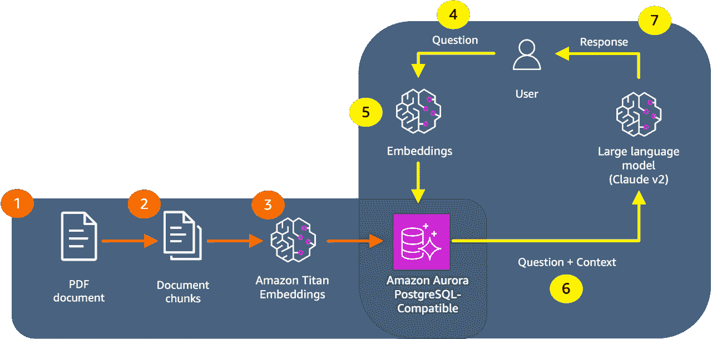

# 声明

本文档仅供学习交流使用，版权归原作者所有，若涉侵权，请联系Jack Jin 15101136166

##

（欢迎在下方反馈您宝贵的意见！整理不易，觉得有用给AI日报小组点个赞👍吧！）

ChatGPT；Angela；Zijia Liu；Alex；Zeqi Tan；Tiezhen（HuggingFace）；Naixu；Lizhi；Peter；Suoman；Jack

封面生成——右脑科技

如果你有大模型相关的创业想法，欢迎来找我们聊聊～微信：15101136166

> 快邀请你的小伙伴们一起来读大模型日报吧！

> **【日报****知识库****】**这里是近期日报内容的汇总,欢迎大家查阅

> [大模型日报知识库(分享版)](https://miracleplus.feishu.cn/wiki/KapVwXfkriOBiskB0B2cUHxjnTh)

>

> 欢迎大家多多帮我们分享,转发~~

> 如果大家有任何的建议或者吐槽,欢迎随时找我聊天~

