# 奇绩大模型日报（4月 10日）

> 来源：[https://miracleplus.feishu.cn/docx/A1kYd7QDPo3jtNxv4wacebRYncc](https://miracleplus.feishu.cn/docx/A1kYd7QDPo3jtNxv4wacebRYncc)

# 特别活动

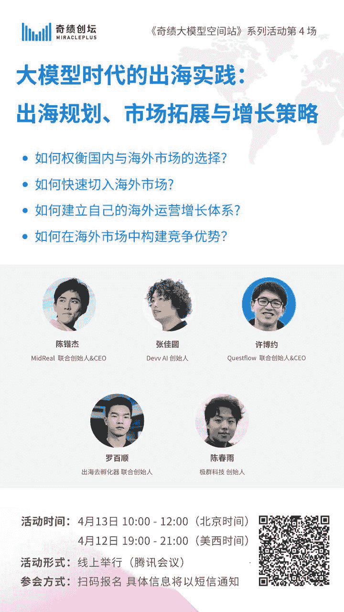

# 推特

### Anthropic AI语言模型说服力的测量：每一代模型的说服力都比前一代模型更高

贡献人：

https://x.com/AnthropicAI/status/1777728366101119101

长期以来,人们一直在质疑AI模型是否会在某个时刻变得像人类一样有说服力,能够改变人们的想法。但是,关于模型规模与模型输出说服力之间关系的实证研究还比较有限。为了解决这个问题,我们开发了一种基本方法来衡量说服力,并用它来比较Anthropic的各种模型,这些模型跨越了三个不同的代(Claude 1、2和3)和两个类别的模型(更小、更快、更具成本效益的紧凑型模型,以及更大、更强大的前沿模型)。

在每一类模型(紧凑型和前沿型)中,我们发现了一个明显的跨代模型的缩放趋势:每一代模型的说服力都比前一代模型更高。我们还发现,我们最新、最强大的模型Claude 3 Opus生成的论点在说服力方面与人类写的论点没有统计学上的差异(图1)。

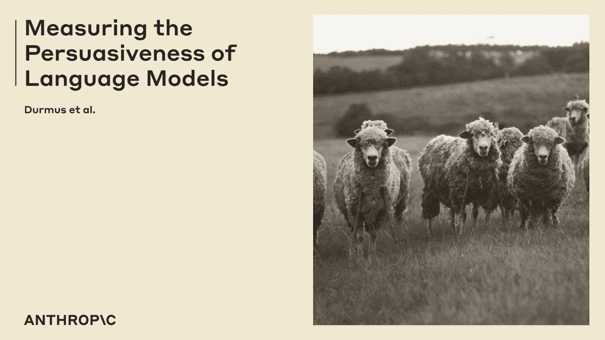

### 在家里运行Command-R+模型！Carrigan分享教程

贡献人：

https://x.com/carrigmat/status/1777689816383053855

首先,关于硬件的说明:文本生成受内存带宽的限制。这可以在任何具有64GB或更多内存的机器上运行,但如果你想要速度,我建议使用DDR5,最好是在8通道或甚至12通道主板上,如Xeon/Epyc/Threadripper Pro/苹果芯片。

为了开始,我们将构建最新版本的llama.cpp。

接下来,我们将获取GGUF格式的压缩[Command-R+模型和权重。在这里:https://huggi](https://huggingface.co/dranger003/c4ai-command-r-plus-iMat.GGUF/tree/main)ngface.co/dranger003/c4ai-command-r-plus-iMat.GGUF/tree/main... 下载你能装入RAM的最大尺寸,可能需要8-16GB的空间(所以在64GB时,尝试iq3_m或iq3_s,大约48GB)。更大的尺寸是分割的。

现在,让我们使用Command-R+附带的聊天模板准备我们的聊天。安装transformers,然后在Python中运行这个。你可以随意更改聊天内容。

结果是格式化的聊天,准备好传给llama.cpp。将其粘贴到llama.cpp目录中./main的-p参数中,并将你的GGUF文件传递给-m。-n是最大响应长度,以令牌为单位。

现在只需按回车键,然后...

为了获得更高的性能,你可以增加更多的内存带宽或使用BLAS支持编译llama.cpp。你还可以使用Python绑定来完成整个过程,这样你就不必来回粘贴了。就是这样:在家中运行GPT-4!

另外,请注意,在较小的量化中,模型会变得更蠢。如果你在iq2上尝试这个,它给你一个可怕的答案,不要怪我!你可能需要128GB的RAM才能装下更高质量的Q6和Q8量化。

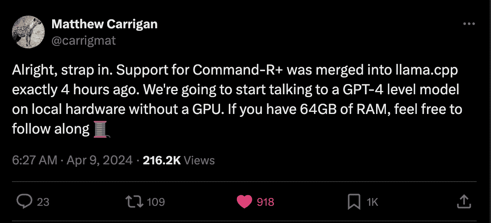

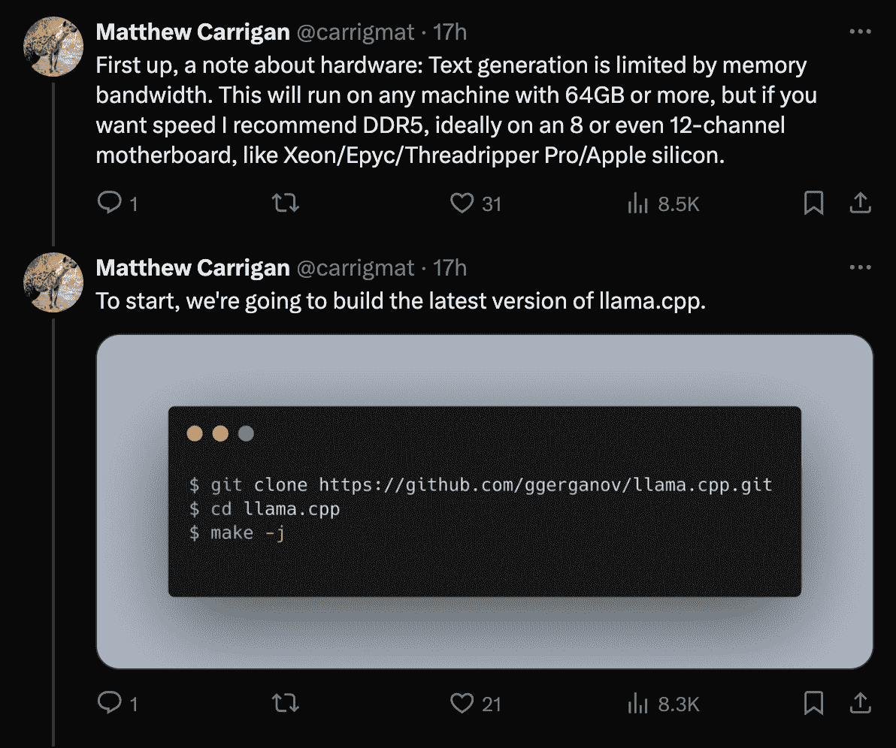

### UMD教授 Soheil Feizi 讲授深度学习基础:大型语言模型,第二部分

贡献人：

https://x.com/FeiziSoheil/status/1777766220617396437

这是我的大语言模型(LLM)讲座的第二部分:

https://youtu.be/mxERaO8FXHc

0:00 微调LLM

4:58 低秩自适应(LORA)

21:26 量化

41:06 QLORA

46:43 前缀调优

52:22 检索增强生成(RAG)

1:06:26 上下文学习

1:18:45 思维链提示

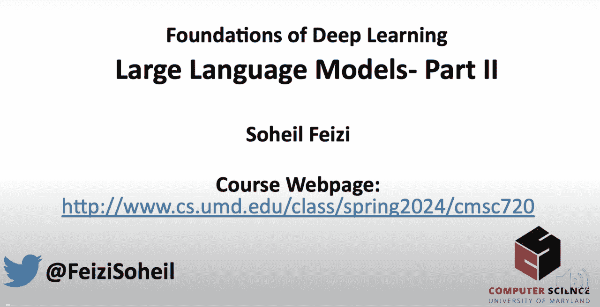

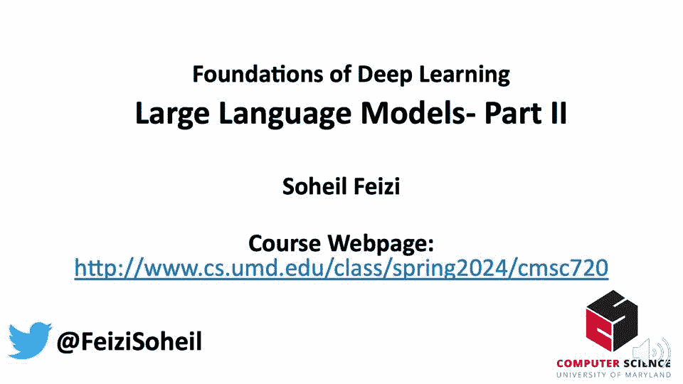

[ssstwitter.com_1712734030396.mp4](https://internal-api-drive-stream.feishu.cn/space/api/box/stream/download/all/K9EDbTTOjorIoOx6Ck5cek5gnNc)

### 书生·浦语灵笔2：视觉语言模型，可以处理从336像素到4K高清的分辨率

贡献人：

https://x.com/arankomatsuzaki/status/1777872267709464618

InternLM-XComposer2-4KHD:一个开创性的大型视觉语言模型,可以处理从336像素到4K高清的分辨率。在16个基准测试中的10个显示出超越GPT4V和Gemini Pro的卓越能力。

代码仓库:https://github.com/InternLM/InternLM-XComposer

论文:https://arxiv.org/abs/2404.06512

[ssstwitter.com_1712734377206.mp4](https://internal-api-drive-stream.feishu.cn/space/api/box/stream/download/all/DXZWbH3QMoVrmPx7AgRclCW0nkb)

### Nat Friedman分享三大语言模型用户数据：Gemini已经达到ChatGPT的25%， Cluade使用率仍然非常低

贡献人：

https://x.com/natfriedman/status/1777739863678386268

以下是一些观察和问题:

+   你知道吗,Gemini的流量已经达到了ChatGPT的25%左右?而且Google还没有通过他们巨大的分销渠道(Android、Google、GSuite等)推广它。

+   X上的关注度很高,但Claude的使用率仍然非常低。Anthropic是否应该做广告?

+   ChatGPT仍然是大品牌,但在过去一年中,使用率相对持平。为什么没有增长?OpenAI是受限于算力还是需求?

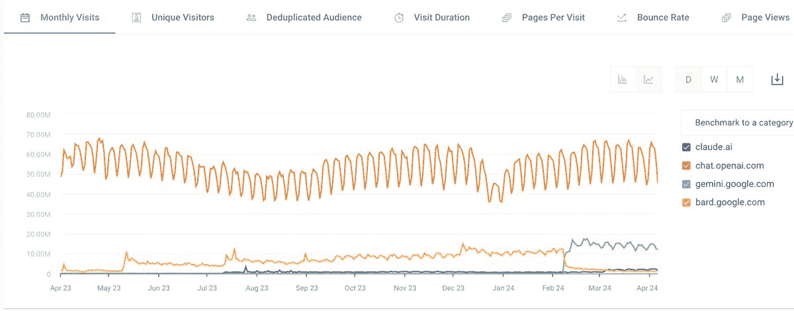

# 资讯

### 全面突围，谷歌昨晚更新了一大波大模型产品

贡献人：

https://mp.weixin.qq.com/s/SWGMtLYSss2MR6or8J87HQ

当地时间本周二，谷歌在 Google’s Cloud Next 2024 上发布了一系列 AI 相关的模型更新和产品，包括 Gemini 1.5 Pro 首次提供了本地音频（语音）理解功能、代码生成新模型 CodeGemma、首款自研 Arm 处理器 Axion 等等。

### Mistral开源8X22B大模型，OpenAI更新GPT-4 Turbo视觉，都在欺负谷歌

贡献人：

https://mp.weixin.qq.com/s/hf4uq3yrHxTGhQuzl61Imw

在谷歌昨晚 Cloud Next大会进行一系列重大发布时，你们都来抢热度：前有 OpenAI 更新 GPT-4 Turbo，后有 Mistral 开源 8X22B 的超大模型。今年 1 月，Mistral AI公布了 Mixtral 8x7B 的技术细节，并推出了 Mixtral 8x7B – Instruct聊天模型。该模型的性能在人类评估基准上明显超过了 GPT-3.5 Turbo、Claude-2.1、Gemini Pro 和 Llama 2 70B 聊天模型。短短 3 个月后，Mistral AI 开源了 Mistral 8X22B 模型，为开源社区带来了又一个性能强劲的大模型。

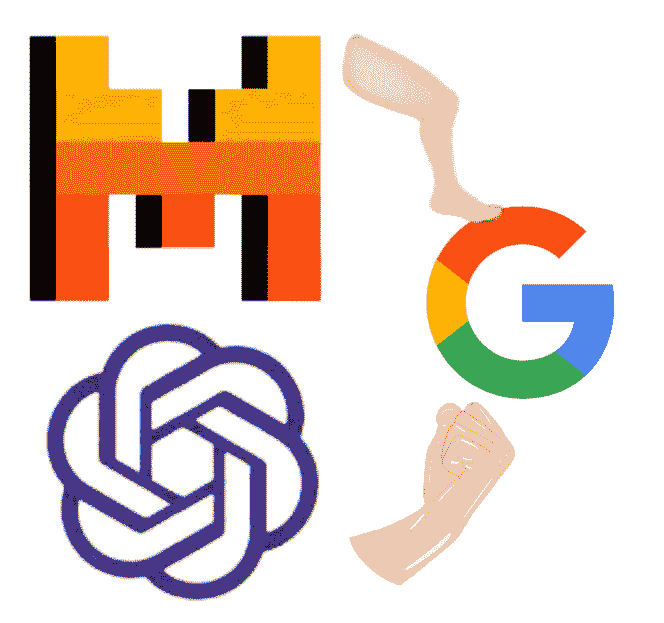

### 马云内部发声：AI时代刚刚到来，我们正当其时

贡献人：

https://mp.weixin.qq.com/s/bvODZzWMfmtTBid2R8cpWA

马云在文中认为，过去这一年阿里最核心的变化，不是去追赶KPI，而是认清自己，重回客户价值**轨道。通过向**大公司病开刀，阿里重新回归效率至上、市场至上，变得简**单和敏捷。他认为新管理层“直面**问题、直面未来，相信年轻人，对年轻团队充分授权，对于我们要什么，不要什么，做出了果断清晰的取舍”“不仅是突破昨日固化的战略，更是打造未来的阿里”。针对行业未来，马云判断“三、五年的时间跨度对于互联网领域而言，犹如一个世纪之久，足以发生翻天覆地的变化，AI时代刚刚到来，一切才刚开始，我们正当其时！”

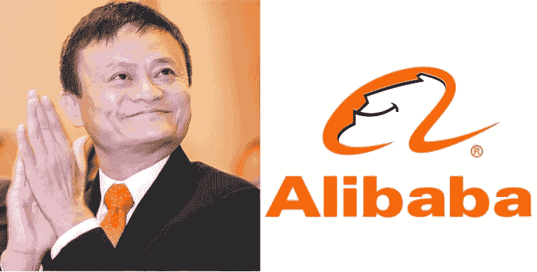

### Llama架构比不上GPT2？神奇token提升10倍记忆？

贡献人：

https://mp.weixin.qq.com/s/TMkn6yMTUrrGhxCQnd7_2g

一个 7B 规模的语言模型 LLM 能存储多少人类知识？如何量化这一数值？训练时间、模型架构的不同将如何影响这一数值？浮点数压缩 quantization、混合专家模型 MoE、以及数据质量的差异 (百科知识 vs 网络垃圾) 又将对 LLM 的知识容量产生何种影响？近日，朱泽园 (Meta AI) 和李远志 (MBZUAI) 的最新研究《语言模型物理学 Part 3.3：知识的 Scaling Laws》用海量实验（50,000 条任务，总计 4,200,000 GPU 小时）总结了 12 条定律，为 LLM 在不同条件下的知识容量提供了较为精确的计量方法。作者首先指出，通过开源模型在基准数据集 (benchmark) 上的表现来衡量 LLM 的 scaling law 是不现实的。例如，LlaMA-70B 在知识数据集上的表现比 LlaMA-7B 好 30%，这并不能说明模型扩大 10 倍仅仅能在容量上提高 30%。如果使用网络数据训练模型，我们也将很难估计其中包含的知识总量。再举个例子，我们比较 Mistral 和 Llama 模型的好坏之时，到底是他们的模型架构不同导致的区别，还是他们训练数据的制备不同导致的？综合以上考量，作者采用了他们《语言模型物理学》系列论文的核心思路，即制造人工合成数据()，通过控制数据中知识的数量和类型，来严格调控数据中的知识比特数 (bits)。同时，作者使用不同大小和架构的 LLM 在人工合成数据上进行训练，并给出数学定理，来精确计算训练好的模型从数据中学到了多少比特的知识。

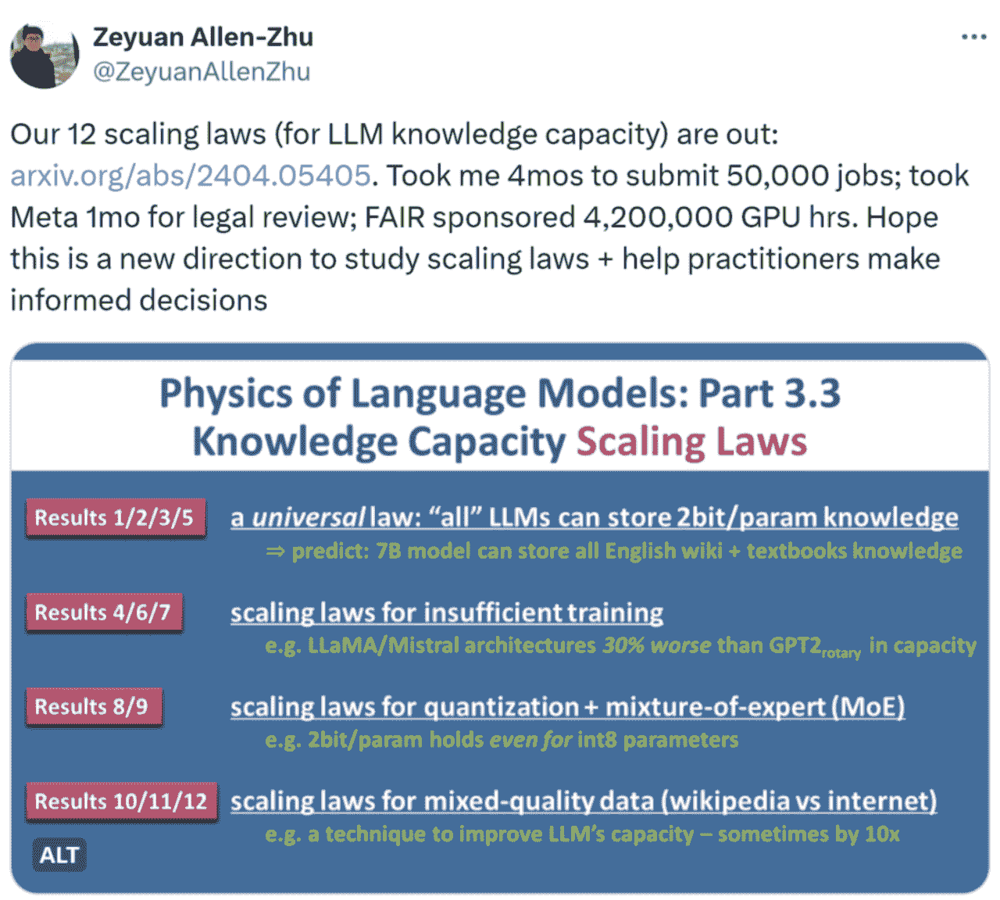

### 英伟达竞品来了，训练比H100快70%，英特尔发最新AI加速卡

贡献人：

https://mp.weixin.qq.com/s/RgBxQH1DVjTSY8i25Ygf0Q

英伟达的 AI 加速卡，现在有了旗鼓相当的对手。今天凌晨，英特尔在 Vision 2024 大会上展示了 Gaudi 3，这是其子公司 Habana Labs 的最新一代高性能人工智能加速器。Gaudi 3 将于 2024 年第三季度推出，英特尔现已开始向客户提供样品。凭借 1835 TFLOPS 的 FP8 计算吞吐量，英特尔相信它足以在广阔的（且昂贵的）AI 计算领域中分得一杯羹。根据内部基准测试，英特尔估计 Gaudi 3 性能部分超过了英伟达的 H100，并且具有更好的能耗比。在一些关键的大型语言模型中，Gaudi 3 能够击败英伟达的旗舰 H100/H200 Hopper 架构 GPU。在当前这个科技领域抢购英伟达 GPU 的时刻，Gaudi 3 或许能为英特尔在 AI 加速器市场打开一扇门。Gaudi 3 的发布也正值英特尔对其 AI 加速器产品的定位发生变化之际：当前，Gaudi 系列已升级为英特尔旗舰 AI 加速器。

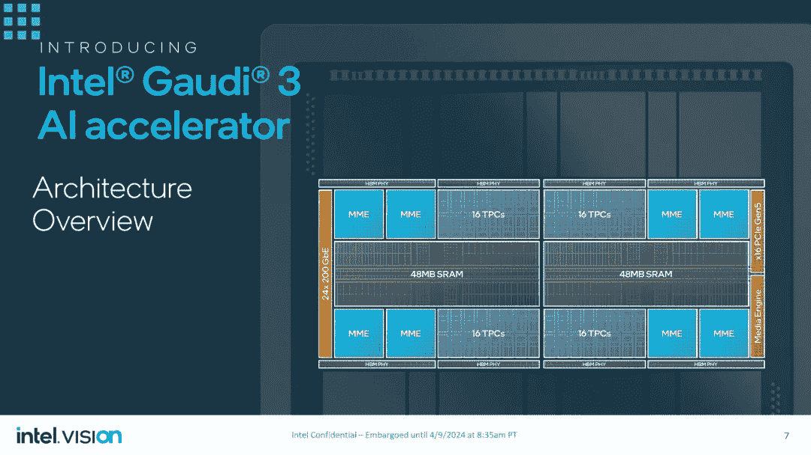

### 开源模型首胜GPT-4！竞技场最新战报引热议，Karpathy：这是我唯二信任的榜单

贡献人：

https://mp.weixin.qq.com/s/lg3H5GlZlGOv0PjxWF1OHg

能打得过GPT-4的开源模型出现了！大模**型竞技场最新战报：1**040亿参数开源模型Command R+攀升至第6位，与GPT-4-0314打成平手，超过了GPT-4-0613**。这**也是第一个在大模型竞技场上击败GPT-4的开放权重模型。大模型竞技场，可是大神Karpathy口中唯二信任的测试基准之一。Command R+来自AI独角兽Cohere。这家大模型创业公司的联合创始人兼CEO，正是Transformer最年轻作者Aidan Gomez()（简称割麦子）。

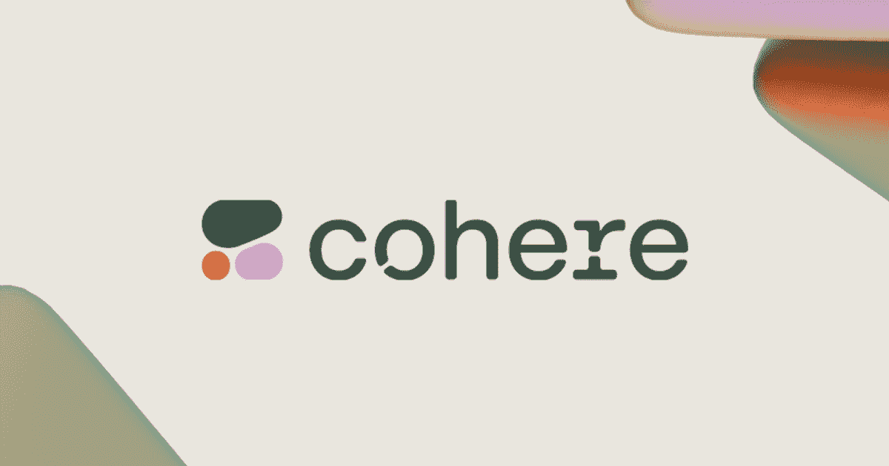

### Google 仍在内耗，OpenAI 继续挖人

贡献人：

https://mp.weixin.qq.com/s/p3pAwj6r0diMXU_cnfqXXQ

2022 年 11 月 ChatGPT 发布的热烈反响震惊了 Google，多年来 Google 运营着世界上两个最先进的机器学习团队。Google Brain 是构建语言模型的先驱，并且还发明了 Transformer 技术，OpenAI 用它来创建 ChatGPT。与此同时，DeepMind构建了能够精通国际象棋和围棋等游戏的 AI，但这两个团队经常因为一切从共享代码到计算资源而争执，两者都没有能够发布一个像 ChatGPT 那样在互联网上引起轰动的产品。在 OpenAI 发布 ChatGPT 几周内，Google CEO Sundar Pichai 指示 Google Brain 和 DeepMind 的高管合作开发一个被称为 Gemini 的单一 AI 模型，而不是追求分开的努力。与此同时，Pichai 开始准备一个更大的步骤：合并 AI 单位。DeepMind CEO Demis Hassabis 似乎并不热衷于这样的组合，他曾表示不确定是否想要领导这个联合单位，并且思考着离开 Google，筹集数十亿美元来启动一个新的研究实验室。这样的举动将使他能够从越来越多占据他时间的组织政治中重新开始。

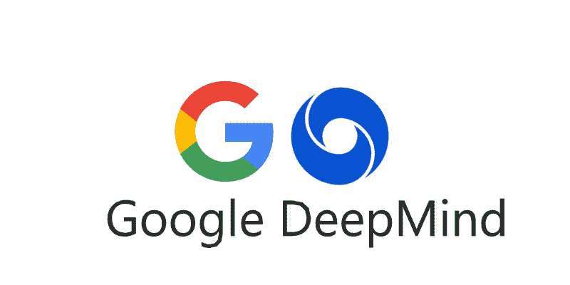

# 论文

### 鹰与金翅雀：使用矩阵值状态和动态递归的RWKV

贡献人：

链接：http://arxiv.org/abs/2404.05892v1

我们提出了Eagle（RWKV-5）和Finch（RWKV-6），这是在RWKV（RWKV-4）架构基础上改进的序列模型。我们的架构设计包括多头矩阵值状态和动态循环机制，提高了表达能力，同时保持了RNN的推断效率特性。我们引入了一个包含1.12万亿token的新多语种语料库，并基于贪婪匹配提供了一个快速的分词器，增强了多语种能力。我们训练了四个Eagle模型，参数范围从0.46到75亿，以及两个Finch模型，参数为16亿和31亿，发现它们在各种基准测试中取得了竞争性表现。我们在HuggingFace上发布了所有模型，使用Apache 2.0许可。模型链接见上文。

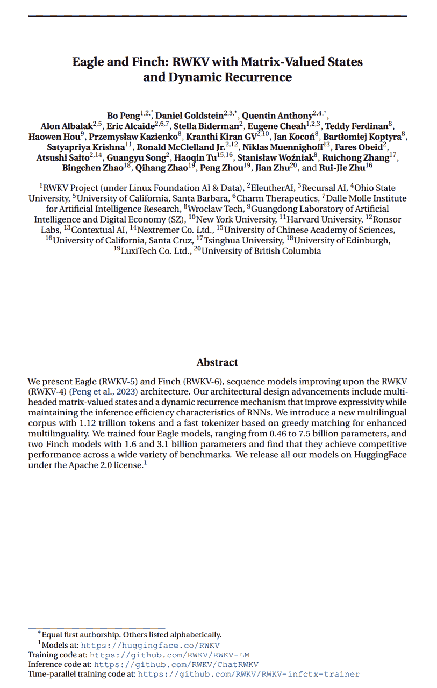

### MiniCPM：揭示小型语言模型通过可伸缩训练策略的潜力

贡献人：

链接：http://arxiv.org/abs/2404.06395v1

随着拥有高达万亿参数的大型语言模型（LLMs）的发展引起了人们的极大兴趣，但也引发了对资源效率和实际成本的担忧，尤其是鉴于实验的巨大成本。在这种情况下，探索小语言模型（SLMs）作为资源有效的替代方案的潜力变得至关重要。为此，我们推出了MiniCPM，特别是1.2B和2.4B非嵌入参数变体，不仅在各自类别中表现出色，而且还展示了与7B-13B LLMs相媲美的能力。我们的方法展示了对未来LLM研究在模型和数据维度上的可扩展性。在模型缩放方面，我们进行了大量的模型风洞实验，以实现稳定和最佳缩放。在数据缩放方面，我们引入了一个适合于持续训练和领域适应的Warmup-Stable-Decay（WSD）学习率调度器（LRS）。通过WSD LRS，我们现在能够有效地研究数据模型缩放定律，无需在模型和数据的两个轴上进行广泛的重新训练实验，从而得出比Chinchilla Optimal更高的计算最佳数据模型比率。此外，我们推出了MiniCPM系列，包括MiniCPM-DPO，MiniCPM-MoE和MiniCPM-128K，其出色的性能进一步巩固了MiniCPM在各种SLM应用中的基础。MiniCPM模型可在https://github.com/OpenBMB/MiniCPM 上公开获得。

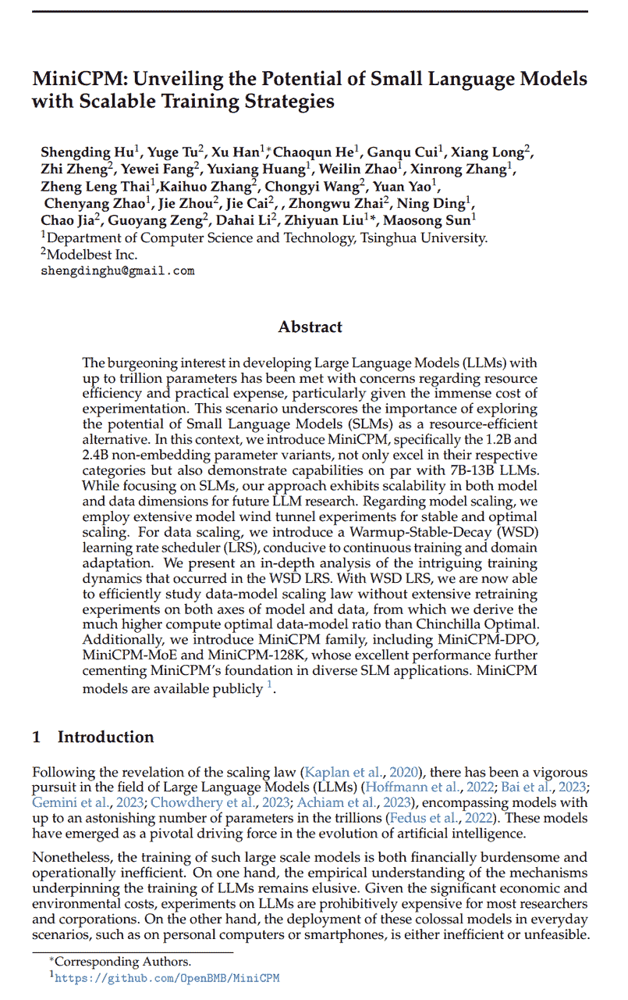

### **吴氏方法可以提升符号人工智能，使其与IMO几何银牌选手匹敌**，AlphaGeometry超越金牌选手

贡献人：

链接：http://arxiv.org/abs/2404.06405v1

证明几何定理是视觉推理的标志，结合直觉和逻辑能力。因此，自动证明奥林匹克级别几何问题被视为人类级别自动推理的一个显著里程碑。AlphaGeometry的引入，一个用1亿个合成样本训练的神经符号模型，标志着一个重大突破。它解决了30个国际数学奥林匹克(IMO)问题中的25个，而基于吴氏方法的报告基线仅解决了10个。在这个论文中，我们重新审视了引入AlphaGeometry的IMO-AG-30挑战，并发现吴氏方法令人惊讶地强大。吴氏方法单独可以解决15个问题，其中一些问题其他方法均无法解决。这导致两个关键发现：(i)将吴氏方法与经典的演绎数据库以及角度、比例和距离追逐等合成方法结合，在仅使用CPU笔记本电脑，每个问题限定5分钟的情况下解决了30个问题中的21个。基本上，这种经典方法仅比AlphaGeometry少解决了4个问题，并建立了足够强大的第一个完全符号基线，可以与IMO银牌得主的表现匹敌。(ii)吴氏方法甚至解决了AlphaGeometry未能解决的5个问题中的2个。因此，通过将AlphaGeometry与吴氏方法结合，我们为IMO-AG-30上的自动定理证明设立了一个新的技术水准，解决了30个问题中的27个，这是第一个优于IMO金牌获得者的人工智能方法。

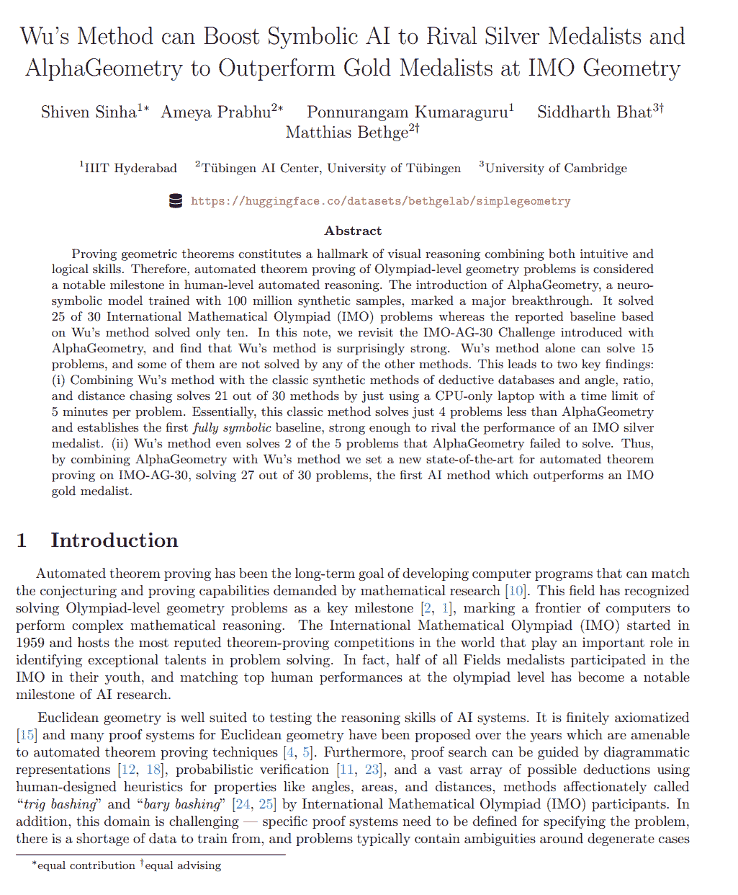

### **AgentQuest: 一个模块化的**基准框架，用于衡量进展并改进LLM智能体

贡献人：

链接：http://arxiv.org/abs/2404.06411v1

摘要：大语言模型（LLMs）取得的进展促使人们追求能够解决复杂、多步推理任务的LLM智能体。AgentQuest提出面临的问题，我们提出了AgentQuest框架–一个框架，其中（i）基准测试和评估指标都是模块化且易于扩展，通过文档完备且易于使用的API；（ii）我们提供了两个新的评估指标，可以可靠地跟踪LLM智能体在解决任务时的进展。我们通过两个用例展示了指标的实用性，并在识别常见故障点的基础上，改进了智能体架构，显著提高了性能。希望与研究社区一起进一步扩展AgentQuest，我们已将其提供在https://github.com/nec-research/agentquest。

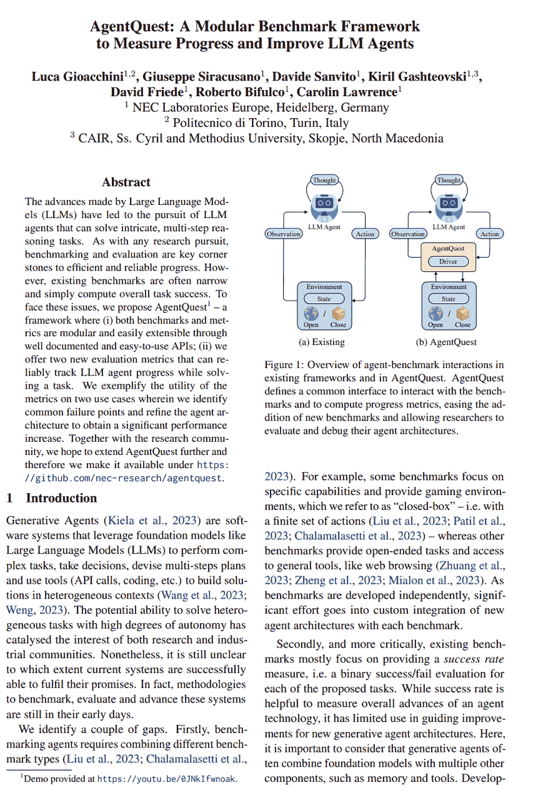

### Transformer的可解释性能否转移到RNNs？

贡献人：

链接：http://arxiv.org/abs/2404.05971v1

最近，对循环神经网络（如 Mamba 和 RWKV）架构的进展使RNN能够在语言建模困惑度和下游评估方面与同等规模的Transformer相匹敌甚至超越，暗示未来系统可能建立在全新的架构之上。本文研究了最初设计用于Transformer语言模型的部分可解释性方法是否能够转移到这些新兴的循环架构上。具体来说，我们关注通过对比激活添加引导模型输出，通过调整镜头引发潜在预测，以及从经过微调以产生特定条件下错误输出的模型中提取潜在知识。我们的结果表明，当应用于RNN时，这些技术大多是有效的，并且我们展示了通过利用RNN的压缩状态，有可能改进其中一些技术。

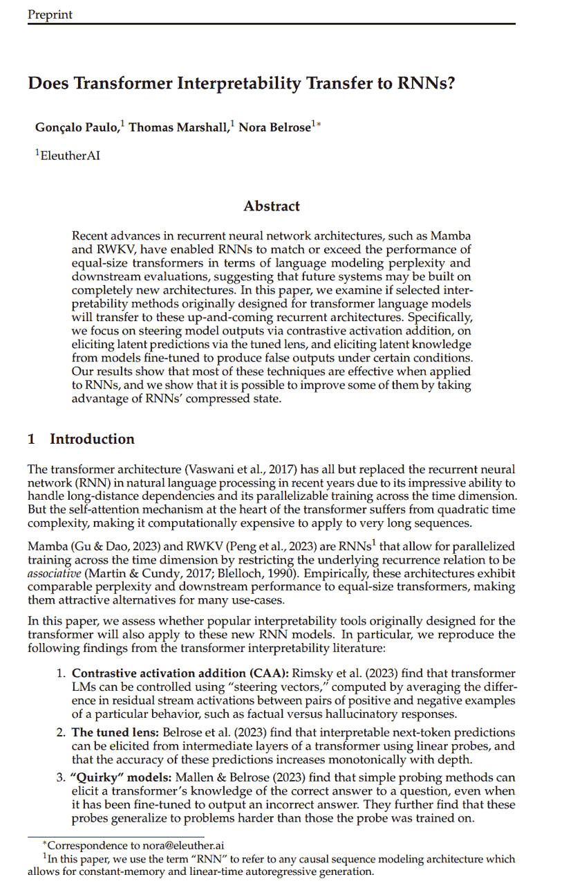

### **高噪音调度是必要的**

贡献人：

链接：http://arxiv.org/abs/2404.06353v1

一种新的训练技术被提出，用于改进图像生成的一致性模型。通过引入多项式噪声分布，使得模型在高低噪声水平之间保持平衡，取得了比基本一致性模型更好的结果。进一步引入了基于正弦函数的课程表，进一步提升了去噪性能。实验结果显示，多项式噪声分布优于对数正态噪声分布，在10万次训练步骤后获得33.54的FID分数。同时，基于正弦函数的课程表的实施提高了去噪性能，产生了30.48的FID分数。

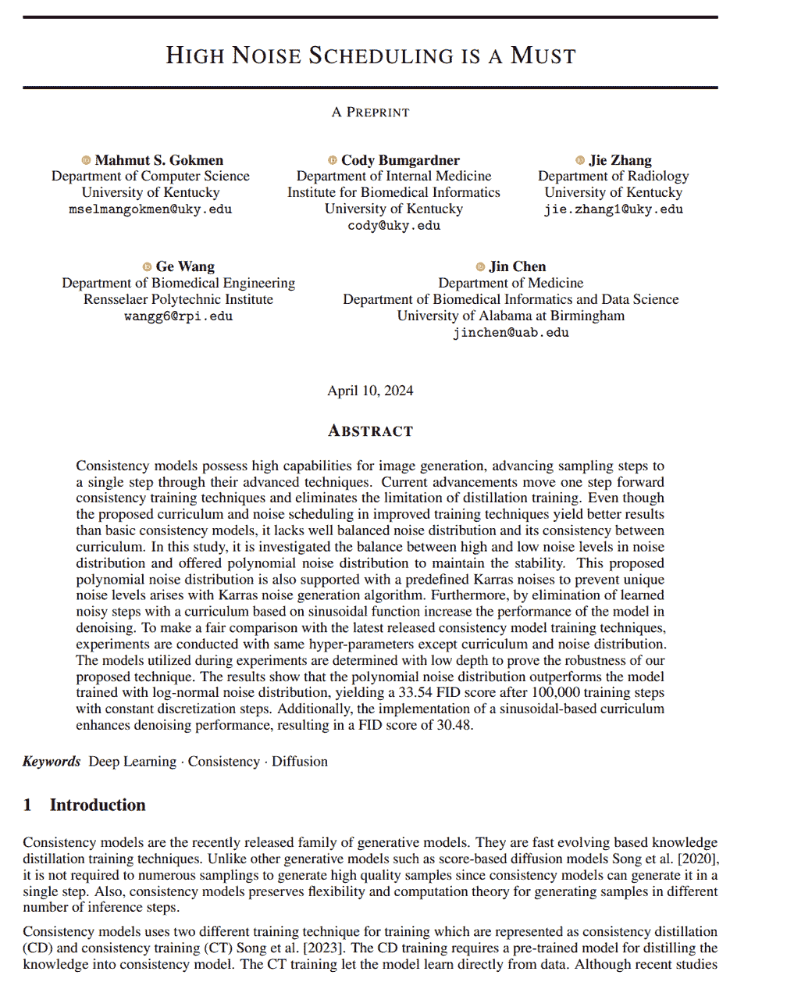

### MuPT：一个音乐生成符号预训练Transformer

贡献人：

链接：http://arxiv.org/abs/2404.06393v1

在这篇论文中，我们探讨了大语言模型（LLMs）在音乐预训练中的应用。虽然MIDI在音乐建模中的广泛应用已得到确认，但我们的发现表明LLMs与ABC记谱更加兼容，更符合其设计和优势，从而提高了音乐创作模型的性能。为了解决生成过程中不同轨道的不对齐措施所带来的挑战，我们提出了开发同步多轨ABC记谱（SMT-ABC记谱）的方案，旨在保持多个音乐轨道之间的连贯性。我们的贡献包括一系列能够处理高达8192个token的模型，覆盖了我们训练集中90%的符号音乐数据。此外，我们探讨了符号音乐缩放定律（SMS定律）对模型性能的影响。结果显示了音乐生成研究的未来方向，并通过我们的开源贡献为社区主导的研究提供了广泛资源。

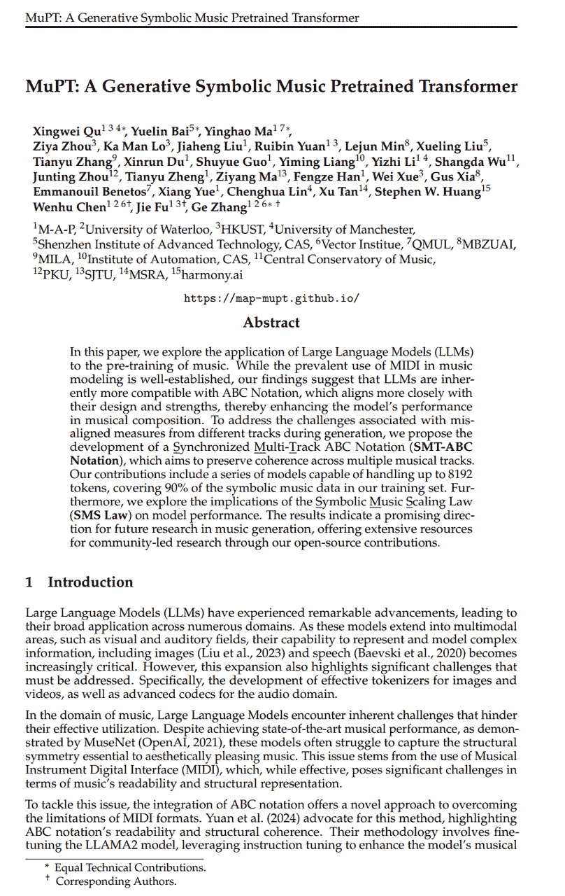

# 产品

### Chat2DB

贡献人：

https://chat2db.ai/

Chat2DB 是一款多数据库客户端工具，支持在 Windows、Mac 上进行本地安装，也支持服务器端部署和通过 web 网页访问。与传统的数据库客户端软件如 Navicat 和 DBeaver 相比，Chat2DB 集成了 AIGC 的能力，能够将自然语言转换为 SQL，也可以将 SQL 转换为自然语言，并且可以给出研发人员 SQL 的优化建议，极大地提升了人员的效率。它是 AI 时代数据库研发人员的利器，未来即使不懂 SQL 的运营业务也可以使用它进行快速查询业务数据和生成报表。

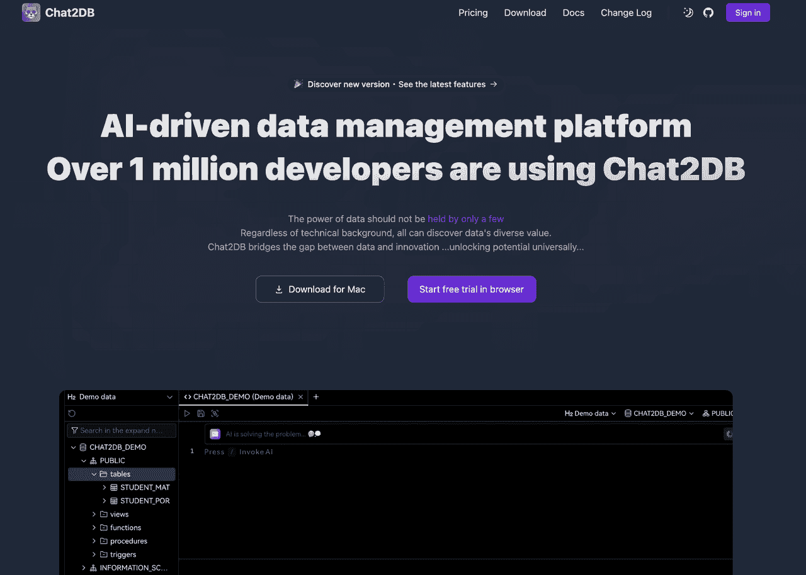

### Muraena.ai

贡献人：

https://muraena.ai/

Muraena.ai 是一款新的 B2B 潜在客户生成工具，旨在简化小型团队和销售发展代表（SDR）的整个潜在客户获取过程。该平台利用人工智能技术，以较低的价格、简单易用的特点，为用户带来更接近正确潜在客户的解决方案。

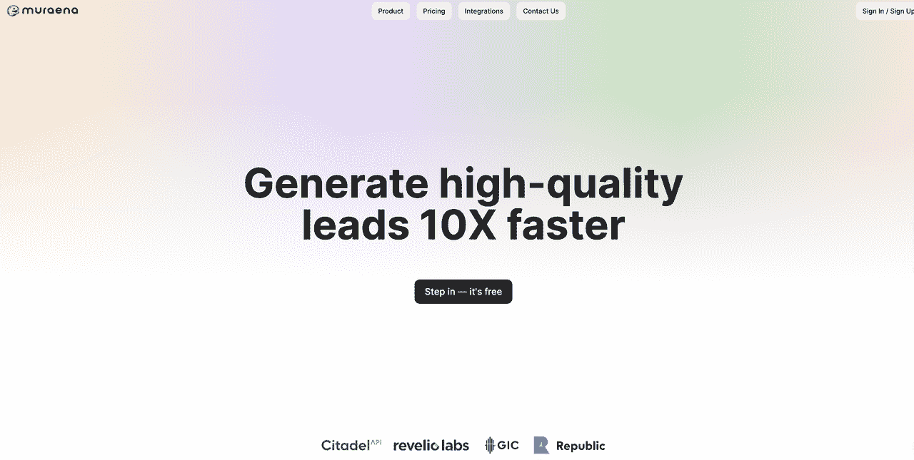

# HuggingFace&Github

### Open-Sora-Plan

贡献人：

https://github.com/PKU-YuanGroup/Open-Sora-Plan

更新了最新探索：MagicTime，它从延时视频中学习现实世界的物理知识。

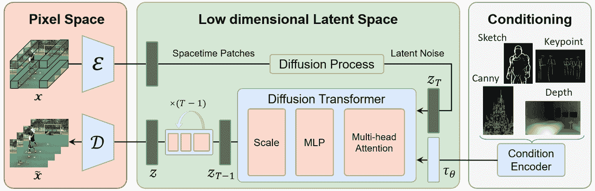

### ByteEdit

贡献人：

https://byte-edit.github.io

ByteEdit 是一个创新的反馈学习框架，经过精心设计，旨在提升、遵守和加速生成图像编辑任务。它无缝集成了致力于增强美感和图像文本对齐的图像奖励模型，同时还引入了一个密集的像素级奖励模型，旨在促进输出的连贯性。此外，ByteEdit 还提出了一种开创性的对抗式和渐进式反馈学习策略，以加快模型的推理速度。通过广泛的大规模用户评估，研究人员证明了 ByteEdit 在生成质量和一致性方面都超过了领先的生成图像编辑产品，包括 Adobe、Canva 和美图等。

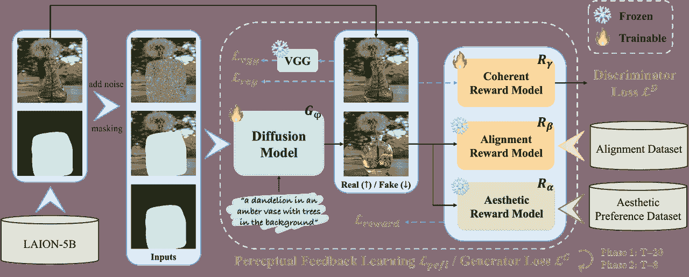

# 投融资

### 墨芯人工智能完成数亿元A+轮和B轮融资，加速AI芯片研发

贡献人：

https://36kr.com/p/2724861966967815

墨芯人工智能近半年内完成了数亿元人民币的A+轮和B轮融资。B轮融资由蚂蚁集团领投，盛景嘉成跟投；A+轮则由金浦投资上海金融科技基金领投，华大松禾天使基金等跟投。资金将用于公司二代AI芯片"Antoum"的研发、市场拓展及构建稀疏化生态。墨芯致力于通过稀疏计算技术，提供高算力、低功耗的AI算力服务，面向互联网、医疗等众多行业。公司产品主要聚焦大模型推理市场，旨在提升数据吞吐率，降低成本，提升整体TCO。

公司官网：http://www.moffettai.com/

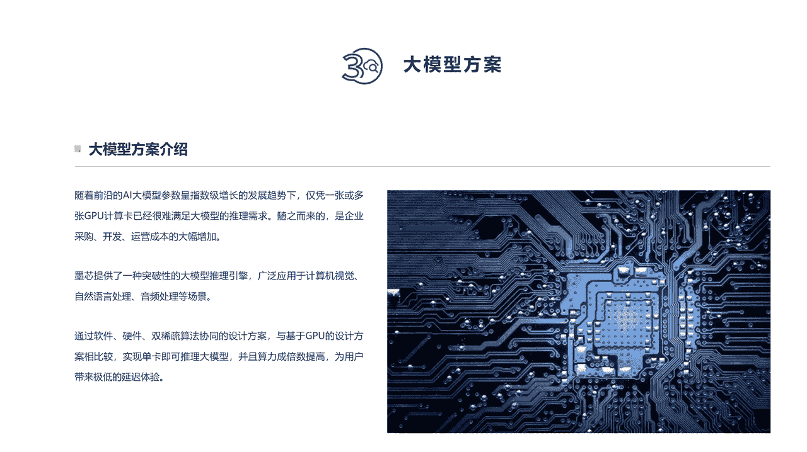

### 海港城获得数千万元A轮投资

贡献人：

https://new.qq.com/rain/a/20240409A05FFM00

海港城是一家人工智能大模型技术创新与应用落地公司，目前主打产品为抹香鲸APP，这是一款能够让你与人工智能技术创造的“角色”聊天实时互动，共同创造美好回忆的应用。公司日前数千万元A轮投资，投资方包括王慧文、嘉程资本等。

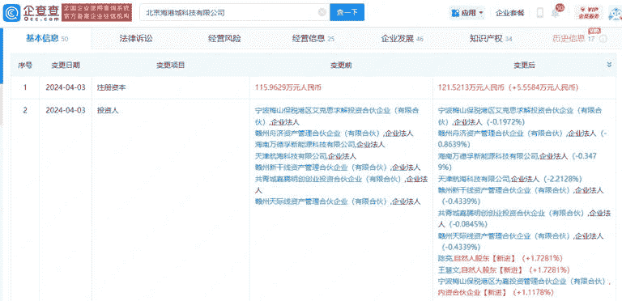

### 特斯联完成20亿元D轮融资，国际、国有资本双领投

贡献人：

https://www.stcn.com/article/detail/1171108.html

特斯联宣布完成20亿元人民币D轮融资，由国际投资机构AL Capital和国内产业基金阳明股权投资基金共同领投，加上多家新老股东跟投。融资将用于提升其垂直领域大模型的多模态能力，并构建高性能的智算基础设施，进一步在AIoT领域构建技术壁垒，加强国际竞争力。特斯联提出的“大模型+系统”技术路径，旨在通过深度结合具体场景的垂直领域模型，解决跨模态数据的建模难题，加速大模型的场景化落地。

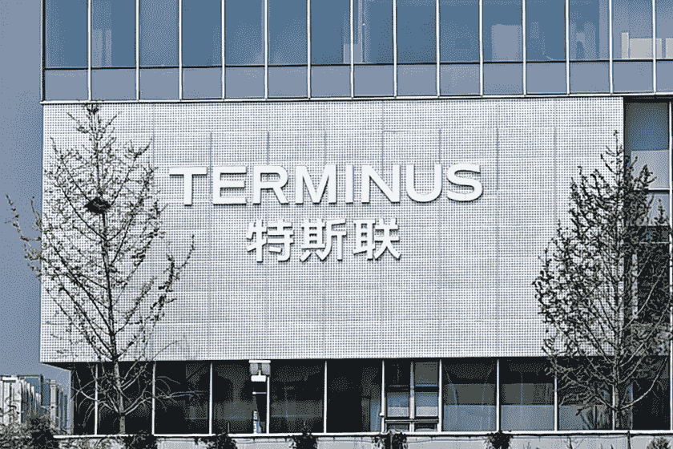

### GoodGist Inc成功筹集100万美元资金，应对企业技能危机

贡献人：

https://www.accesswire.com/849867/goodgist-inc-secures-1-million-funding-in-fight-against-corporate-skills-crisis

GoodGist Inc，一家在企业技能发展和知识管理自动化领域的创新企业，宣布成功筹集100万美元资金。本轮融资由FortyTwo.VC, Cedar Ridge Ventures, DX Partners以及来自微软和亚马逊等领先技术公司的著名天使投资者参与。资金将用于推出其多语言平台，扩大团队，加强研发力度，并改进产品以缓解技能差距和信息过载问题。GoodGist Inc旨在利用其先进的AI Curator及其专利技术，个性化地促进个人的学习和研究旅程，加快劳动力的技能提升和再培训。

公司官网：https://www.goodgist.com/#/new

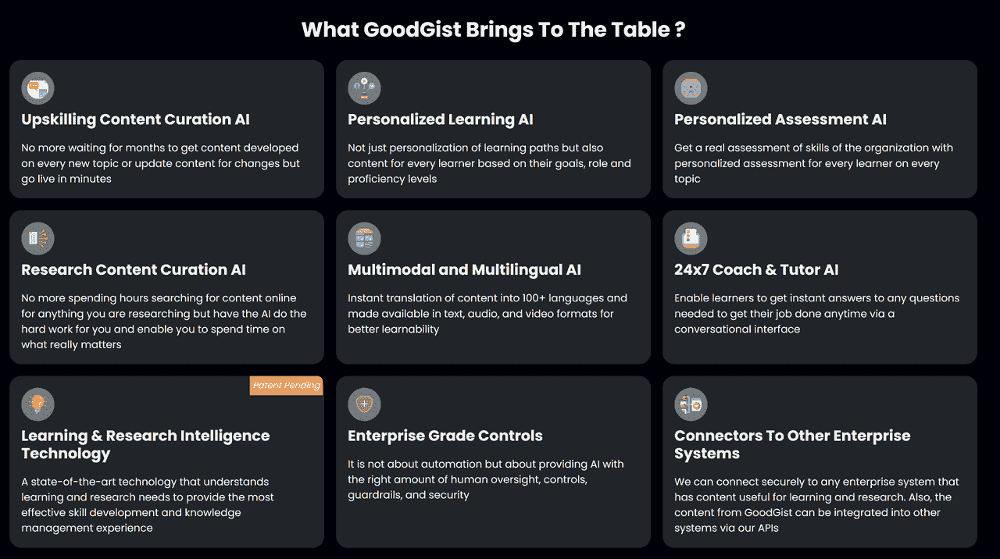

### Symbolica通过符号模型押注，希望避免AI军备竞赛

贡献人：

https://www.reuters.com/technology/symbolica-raises-31-mln-develop-ai-systems-compete-with-openai-2024-04-09/

Symbolica AI，由前特斯拉工程师George Morgan创立，致力于开发新型AI模型，以减少数据需求和训练时间，降低成本，并提供结构化输出。公司已成功获得由Khosla Ventures领投的3300万美元投资，其他投资者包括Abstract Ventures、Buckley Ventures、Day One Ventures和General Catalyst。Symbolica的产品是一个为特定任务（如代码生成和数学定理证明）预训练的符号AI模型工具包，公司计划与大型企业合作伙伴和客户紧密合作，开发定制模型，以提高推理能力，并销售先进的代码合成模型。

公司官网：https://www.symbolica.ai/

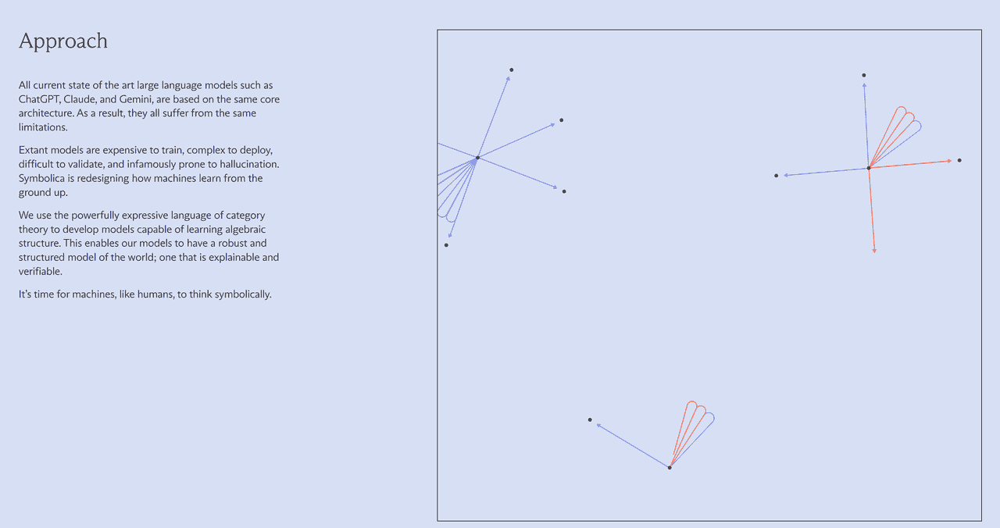

### GTM Buddy获得800万美元融资，解决B2B销售渠道漏损问题

贡献人：

https://venturebeat.com/ai/gtm-buddy-raises-8-million-to-fix-leaky-b2b-sales-funnels/

GTM Buddy，一家AI驱动的销售使能平台，宣布在与Archerman Capital和Leo Capital的合作下，成功融资800万美元A轮资金。该轮融资还得到了Neon Fund和Stellaris Venture Partners的参与。融资将用于推动收入增长，增强销售使能力，并成为解决销售渠道漏损问题的答案。GTM Buddy推出了包括动态销售策略和AI生成的销售模板在内的AI驱动的销售成功解决方案，旨在通过利用AI提高销售代表的效率，填补销售执行中的漏洞。

公司官网：https://gtmbuddy.ai/

### AI数据安全初创公司Cyera确认以14亿美元估值融资3亿美元

贡献人：

https://techcrunch.com/2024/04/09/ai-data-security-startup-cyera-confirms-300m-raise-at-a-1-4b-valuation/

Cyera, 一家AI数据安全初创公司，已成功完成3亿美元的C轮融资，公司估值达到14亿美元。该轮融资由Coatue领投，Spark Capital、Georgian及AT&T Ventures等新投资者参与。这标志着公司估值在不到一年的时间里几乎翻了三倍。Cyera开发了一个AI平台，帮助组织理解网络中所有数据的位置和流动，以采取正确的安全措施。此次融资将用于继续扩大其数据安全平台的产品和服务。

公司官网：https://www.cyera.io/

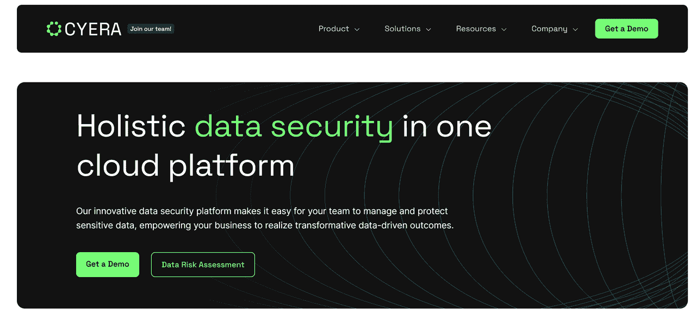

### Reshape通过计算机视觉自动化实验室试验，加速生物技术研发

贡献人：

https://techcrunch.com/2024/04/09/reshape-wants-to-accelerate-biotech-rd-by-bringing-computer-vision-to-lab-experiments/

Reshape，一家丹麦初创公司，通过开发配备软件和AI模型的机器人成像系统，帮助科学家追踪培养皿等容器中的视觉变化，以自动化需要视觉检查的实验室试验。公司在A轮融资中筹集了2000万美元，计划将其技术扩展到美国市场。Reshape的系统能够实现特定温度的内置孵化，同时记录数据，确保实验能够轻松重复，从而实现24/7无人直接监管的运行，释放技术人员从事其他关键任务。

公司官网：https://www.reshapebiotech.com/

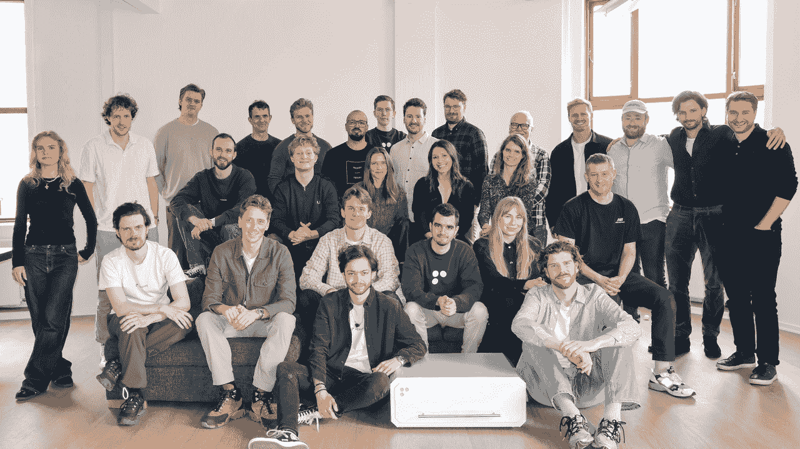

### PETE获得200万美元种子轮融资，推动下一代劳动力学习

贡献人：

https://www.pete.com/blog/orlando-based-ai-edtech-startup-pete-secures-2-million-in-seed-funding

PETE，一家位于奥兰多的AI教育技术初创公司，成功完成了200万美元的种子轮融资，由Cofounders Capital领投。该轮融资还包括来自奥兰多地区的天使投资者。资金将用于推广公司的销售和战略营销活动，并继续开发其专利待定的AI技术。PETE旨在为个性化和自适应的培训体验提供成本效益高的AI驱动学习解决方案。

公司官网：https://www.pete.com/

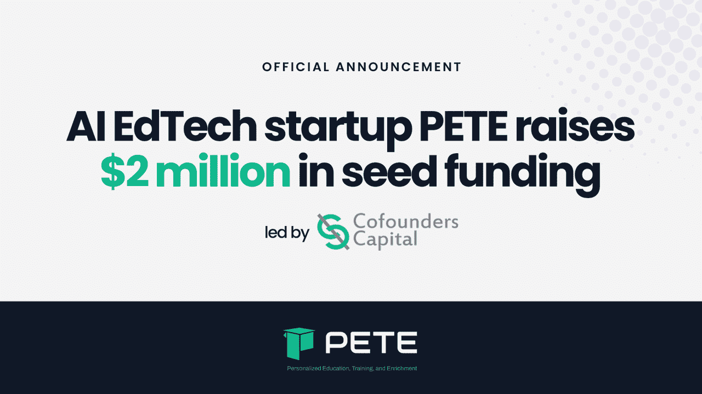

# 学习

### MegaScale字节万卡集群搭建的实践，提升模型算力利用率

贡献人：

https://mp.weixin.qq.com/s/k9dUiWk_2jdiFicr07C3yA

MegaScale是字节跳动开发的用于万卡级别大规模语言模型训练的高效稳定生产系统。它采用了模型和优化器设计、计算与通信重叠、算子优化等优化措施，显著提升了训练效率和稳定性，具备深入的监控和诊断能力。其模型FLOPs利用率达到55.2%，比Megatron-LM高1.34倍。通过全栈方法共同设计算法和系统组件，实现了数据并行、流水线并行、张量并行和序列并行的并行策略，以及网络性能的调优。MegaScale还开发了一系列诊断工具，实现了故障容忍与稳定性的优化，包括心跳消息和实时异常检测机制，快速检查点和恢复过程，从而有效提高了大规模训练的效率和稳定性。

相关链接：1.https://zhuanlan.zhihu.com/p/684712727

2.https://zhuanlan.zhihu.com/p/684619370

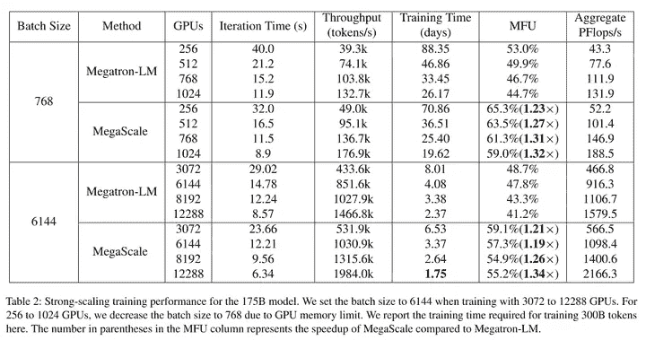

### 你读过的最好的 C++ 开源代码是什么？

贡献人：

https://www.zhihu.com/question/21376384/answer/3459052295

微软的C++代理库以其高效的代码实现和强大的功能而受到赞誉。该库通过不到一千行的代码，实现了运行时多态、类型推导、异常处理和反射机制等核心功能。技术细节上，库中使用了模板元编程，如递归模板和std::type_identity来实现类型推导和展平嵌套类型。此外，它还利用了C++20的consteval特性来判断表达式是否可在编译时计算，以及通过instantiated_t和flat_reduction等技术来优化编译时类型处理。这些技术的应用使得库在处理复杂类型和继承结构时更为灵活和高效。

### Quanto: PyTorch 量化工具包

贡献人：

https://zhuanlan.zhihu.com/p/691603386

Quanto是一个PyTorch量化工具包，旨在简化深度学习模型的量化流程。它支持使用低精度数据类型（如int8和float8）来减少模型的内存和计算需求，适用于多种设备。Quanto提供动态和静态量化，自动插入量化和反量化节点，并支持量化后的torch.nn模块和functional算子。此外，它允许模型权重和激活的多种位宽量化，包括int2、int4，并与Hugging Face的transformers库无缝集成。Quanto的核心技术包括量化张量子类、量化torch.nn模块和定制算子，以及对低位宽量化的特别处理。

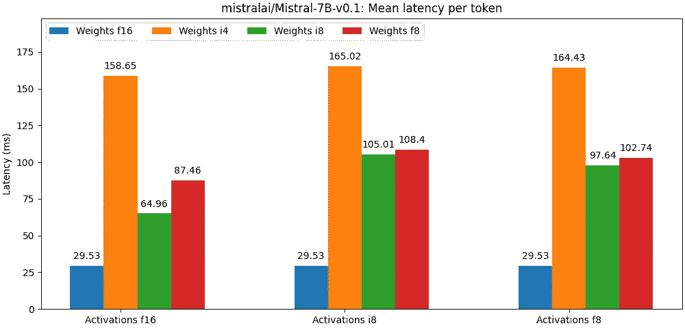

### 算力平台：Nvidia H20 的实用价值

贡献人：

https://zhuanlan.zhihu.com/p/691287727

Nvidia H20 GPU卡是专为2024年中国市场准备的高端显卡，具有高配的显存、高卡间互联带宽和竞争力的FP8算力，特别适合于大模型训练和推理。H20从H200裁剪而来，保留了900GB/s的高速互联带宽和支持PCIe Gen5的能力，使其能够组建超大规模GPU集群。其显存配置为96GB HBM3，带宽达4TB/s，尽管相较H200有所裁剪，但对比国产AI芯片仍有优势。H20的FP8算力、显存配置、卡间互联带宽在与Nvidia A800、H800和华为昇腾910B-A2相比时展现出显著优势。特别地，H20在小规模集群中训练吞吐达到A800的62%，在大规模集群中能达到70%。此外，H20对于大模型推理展现出高性价比，使其成为一个值得投资的GPU卡。

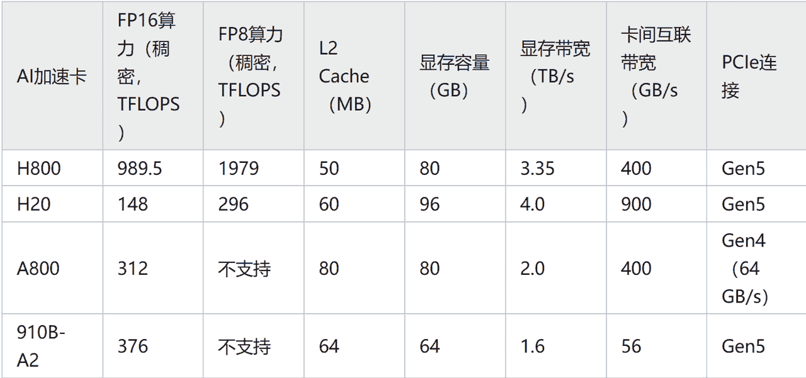

### 多GPU训练在tinygrad中的实现解析

贡献人：

https://github.com/mesozoic-egg/tinygrad-notes/blob/main/multigpu.md?utm_source=ainews&utm_medium=email&utm_campaign=ainews-anime-pfp-anon-eclipses-10k-ab-prompting

此文档介绍了如何在tinygrad中实现多GPU训练，重点是通过beautiful_mnist_multigpu.py示例展示数据如何在多个GPU间进行分片。使用shard_方法，数据沿着0轴被分割成多个部分，每部分由不同的GPU处理。MultiLazyBuffer是关键类，它接收来自原始LazyBuffer的输入，并将数据跨多个设备分布。文章还通过点乘示例解释了在多个GPU上分配和处理数据的细节，包括如何在设备间传递数据以及如何利用MultiLazyBuffer进行元素级和归约操作。通过对比单GPU和多GPU的数据处理，文章强调了在进行多GPU训练时，数据如何被划分并在多个设备间进行计算，展现了tinygrad在实现多GPU支持方面的灵活性和效率。

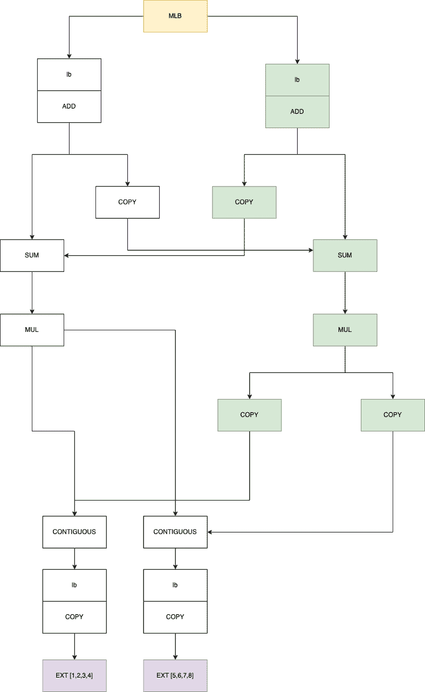

### 从tensorRT-LLM MoE CUDA kernel角度理解Mixtral-8x7b的推理加速及展望

贡献人：

https://zhuanlan.zhihu.com/p/691549433

文章探讨了如何从tensorRT-LLM MoE CUDA kernel的角度理解并加速Mixtral-8x7b的推理过程。Mixtral-8x7b是首个开源的MoE（Mixture of Experts）模型，通过使用稀疏MoE技术，大幅减少了计算量，使得实际参与计算的参数量只有13b，而模型性能可以媲美LLama2-70b和GPT3.5。文章详细解析了MoE的结构和工作原理，包括router（路由）网络的作用和expert的加权组合。此外，作者还从CUDA编程的角度，解释了Mixtral-8x7b在tensorRT-LLM中的具体实现，包括如何通过并行处理和batch GEMM来优化推理性能。文章预测，随着LLM（Large Language Models）的快速发展，训练和推理可能会逐渐向稀疏技术发展，从而涉及到更多关于量化、稀疏kernel甚至专门的AI加速器的研究。

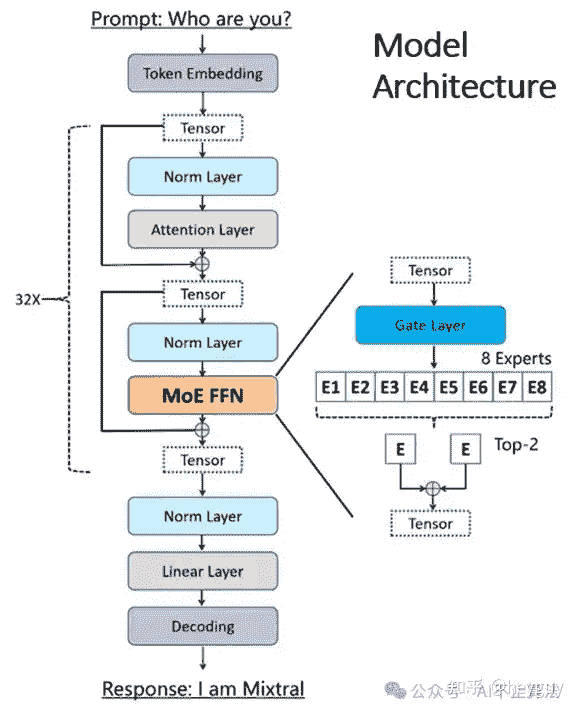

### LLM模型量化世界观(下)

贡献人：

https://zhuanlan.zhihu.com/p/691415664

文章深入探讨了LLM模型量化的高级技术，特别是对极低比特量化方法的分析。介绍了SpQR、SqueezeLLM和AQLM三种极低比特量化策略，分别采用不同技术实现权重的有效压缩。SpQR利用分治法分离敏感权重并对非敏感权重采用二级压缩，转化为3bit存储。SqueezeLLM通过加权k-means聚类进行非均匀量化，优化权重存储与计算效率。AQLM采用码本和码字的方法，借鉴近似搜索技术重新建模量化过程，有效推进比特数至2bit。这些技术不仅压缩了模型大小，还保持了模型的性能，展现了量化领域的创新和进步。

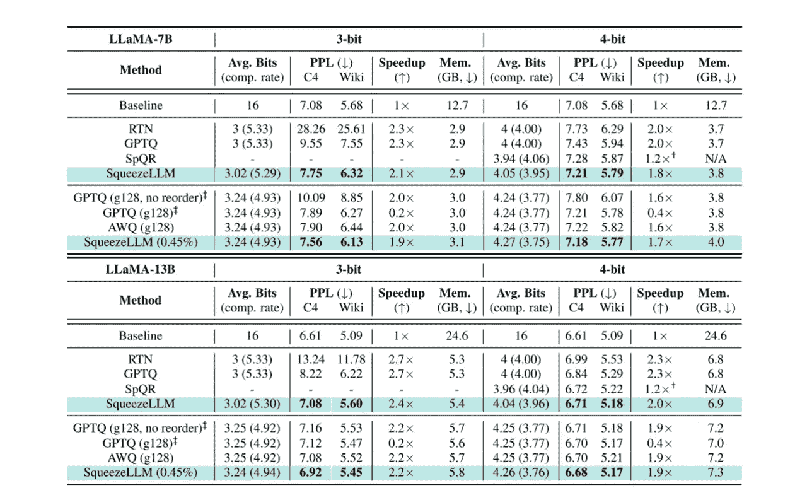

# 声明

本文档仅供学习交流使用，版权归原作者所有，若涉侵权，请联系Jack Jin 15101136166

##

（欢迎在下方反馈您宝贵的意见！整理不易，觉得有用给AI日报小组点个赞👍吧！）

ChatGPT；Angela；Zijia Liu；Alex；Zeqi Tan；Tiezhen（HuggingFace）；Naixu；Lizhi；Peter；Suoman；Jack

封面生成——右脑科技

如果你有大模型相关的创业想法，欢迎来找我们聊聊～🛰️：15101136166

> 快邀请你的小伙伴们一起来读大模型日报吧！

> **【日报****知识库****】**这里是近期日报内容的汇总,欢迎大家查阅

> [大模型日报知识库(分享版)](https://miracleplus.feishu.cn/wiki/KapVwXfkriOBiskB0B2cUHxjnTh)

>

> 欢迎大家多多帮我们分享,转发~~

> 如果大家有任何的建议或者吐槽,欢迎随时找我聊天~

