# 奇绩大模型日报（4月 9日）

> 来源：[https://miracleplus.feishu.cn/docx/QfihdwYonoO6Mcxsf5VcqMuLnZb](https://miracleplus.feishu.cn/docx/QfihdwYonoO6Mcxsf5VcqMuLnZb)

## 特别活动

## 推特

### 微软人工智能将在伦敦市中心开设一个新的人工智能中心

贡献人：

https://x.com/mustafasuleyman/status/1777341903597617506

英国拥有非凡的人工智能人才和长期以来负责任的人工智能开发文化。今天,我很自豪地宣布开设一个新的办事处:微软人工智能伦敦办事处。如果您想加入我们,请与我们联系。我们正在招聘!

宣布在伦敦成立新的微软人工智能中心

微软最近宣布成立微软人工智能,这是一个新成立的组织,旨在帮助推进我们的消费者人工智能产品和研究,包括 `Copilot`。在这一消息的基础上,我很高兴地宣布,微软人工智能将在伦敦市中心开设一个新的人工智能中心。微软人工智能伦敦将开展开创性的工作,以推进最先进的语言模型及其支持基础设施,并与微软的人工智能团队以及我们的合作伙伴(包括 `OpenAI`)密切合作,为基础模型创建世界一流的工具。

这个新的人工智能中心将由杰出的人工智能科学家和工程师乔丹·霍夫曼领导。在加入微软人工智能之前,霍夫曼曾在位于伦敦的 Inflection 和 DeepMind 担任人工智能先驱。霍夫曼将与一群才华横溢的微软人工智能团队成员在我们位于伦敦帕丁顿的办公室共事。

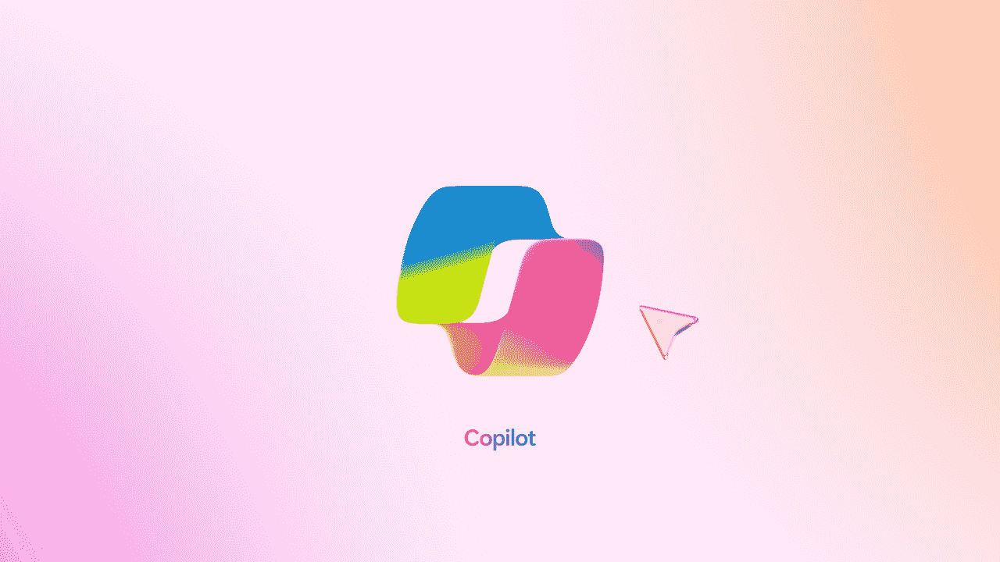

### `Stable LM 2 - 12B`：多语言模型， 性能与 `Mixtral` 相当

贡献人：

https://x.com/reach_vb/status/1777437448009597234

`Stable LM 2 - 12B` ⚡

> 多语言 - 英语、西班牙语、德语、意大利语、法语、葡萄牙语和荷兰语。

> 性能与 `Mixtral` 相当。

> 开放访问。

> 发布了基础模型和指令调优模型。

> 指令调优版本可用于工具使用和函数调用。

> 非常适合 `RAG(Retrieval-Augmented Generation,检索增强生成)`!

> 在 `Transformers` 🤗 中试用

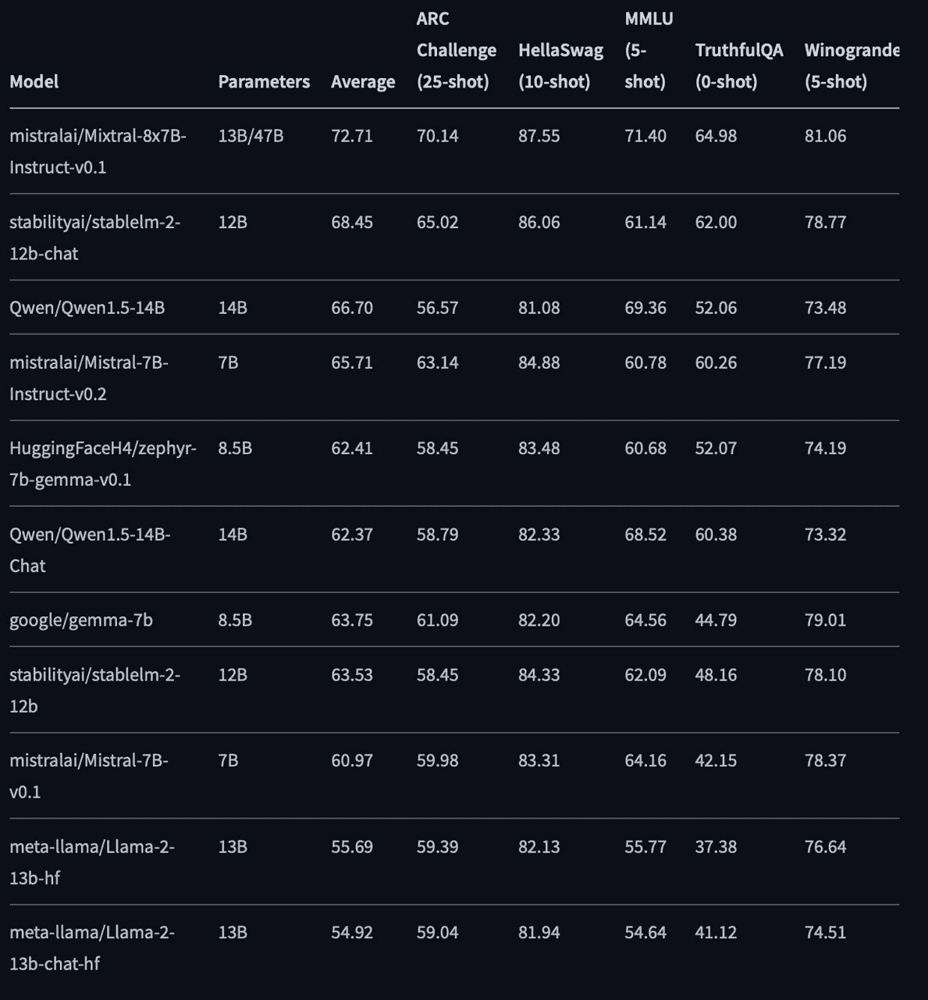

### `Morph`：完全开源的 AI 驱动的答案引擎，具有生成式用户界面

贡献人：

https://x.com/miiura/status/1777350693596139546

介绍 `morph`:一个完全开源的 AI 驱动的答案引擎,具有生成式用户界面。使用 `@vercel` 的 AI SDK 构建,它可以提供出色的流式结果。

🧱 技术栈

- 应用框架:`@nextjs`

- 文本流/生成式 UI:`@vercel AI SDK`

- 生成模型:`@OpenAI`

- 搜索 API:`@tavilyai`

- 组件库:`@shadcn/ui`

- 无头组件基元:`@radix_ui`

- 样式:`@tailwindcss`

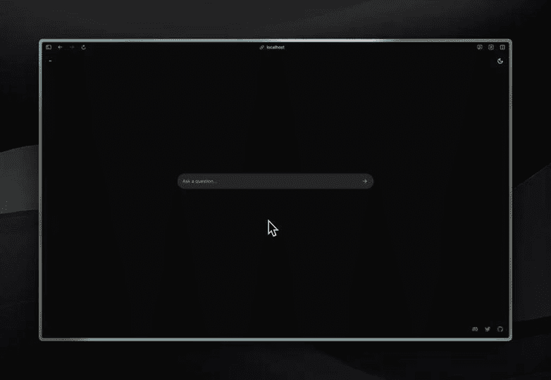

[`ssstwitter.com_1712620308958.mp4`](https://internal-api-drive-stream.feishu.cn/space/api/box/stream/download/all/H1TVbZLwWoKAw3x2ozPcThymnZc)

### `NanoLLaVA`：您口袋里的强大的 `1B` 视觉语言模型

贡献人：

https://x.com/stablequan/status/1777375755653300413

🎉 隆重介绍 `nanoLLaVA`:您口袋里的强大的 `1B` 视觉语言模型🚀💡

🔍 `nanoLLaVA` 将多模态 AI 的能力压缩到仅 `5GB` 的显存中,使其非常适合边缘设备。📱💻

🌟 立即体验设备上高效、尖端的视觉理解能力!

### 语言模型为什么会在搜索方面存在困难？`Kanishk Gandhi`谈语言模型的数据问题

贡献人：

https://x.com/gandhikanishk/status/1777358353045622891

语言模型在搜索方面存在困难,这不是架构问题,而是数据问题!它们很少看到如何搜索或回溯。我们展示了如何通过将搜索过程表示为扁平化的字符串,即搜索流(`SoS`),来教导大语言模型进行搜索!

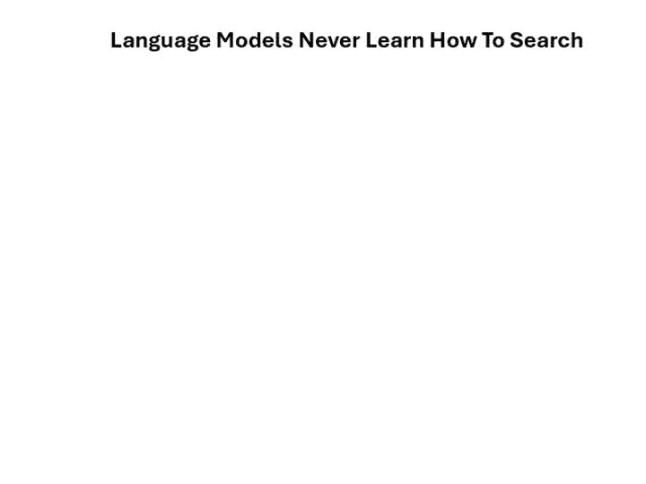

[`ssstwitter.com_1712646864014.mp4`](https://internal-api-drive-stream.feishu.cn/space/api/box/stream/download/all/FbHCb0nVfokjUZxuVN6cXMROnEb)

### 哪些`RAG`表现最好？`ARAGOG`：对高级`RAG`技术最全面的评估调查之一分析：`HyDE`和`LLM`重新排序可以提高检索精度

贡献人：

https://x.com/llama_index/status/1777441831262818403

有成千上万的`RAG`(检索增强生成)技术和教程,但哪些表现最好呢?

`Matous Eibich`的`ARAGOG`是对高级`RAG`技术最全面的评估调查之一,测试了从"经典向量数据库"到重新排序(`@cohere`, `LLM`)、`MMR`(最大边际相关性)以及`@llama_index`原生高级技术(句子窗口检索、文档摘要索引)的所有内容。

研究发现 💡:

✅ `HyDE`和`LLM`重新排序可以提高检索精度

⚠️ `MMR`和多查询技术似乎没有那么有效

✅ 句子窗口检索、自动合并检索和文档摘要索引(都是`@llama_index`的原生技术)在检索精度和答案相似性方面都有很大的优势!(同时也有有趣的权衡)。

强烈建议您完整阅读这篇论文。查看:https://arxiv.org/pdf/2404.01037.pdf

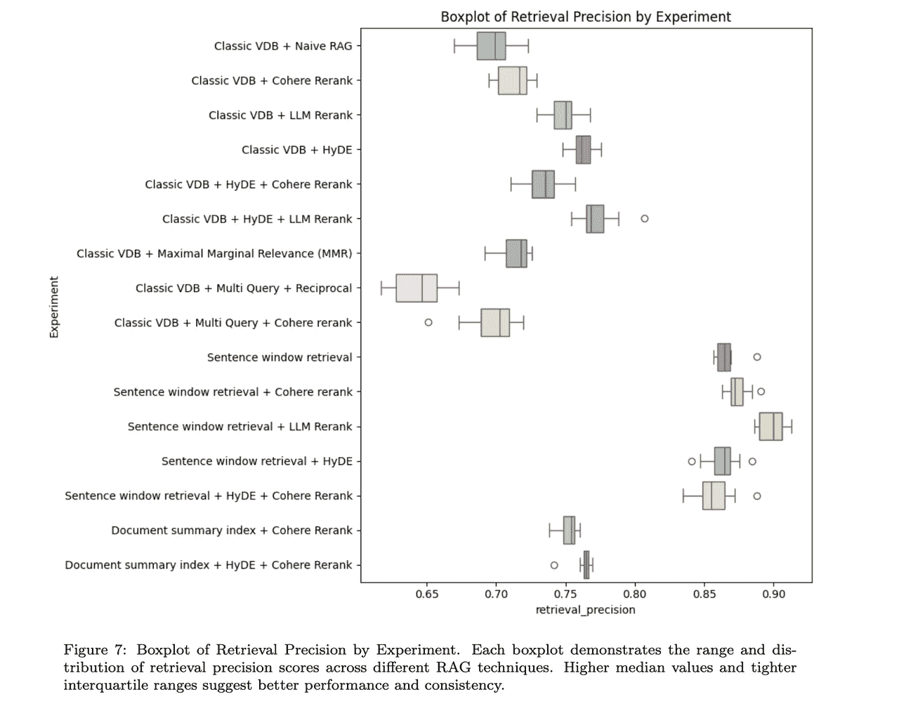

## 资讯

### Meta 下周发布 `Llama3` 两个版本！

贡献人：

https://mp.weixin.qq.com/s/vU7dB-NT6bfVjcxALLSW0g

根据 `Information`，Meta 正计划在下周推出其即将发布的 `Llama 3` 的两个小版本，这些模型将作为今年夏天预期推出的 `Llama 3` 最大版本的先行者，发布这两个小型模型很可能会激发人们对即将推出的 `Llama 3` 的兴趣，该模型将在去年 7 月推出的 `Llama 2`之后约 1 年推出。

### 不牺牲算法，不挑剔芯片，这个来自中科院的团队正在加速国产AI芯片破局

贡献人：

https://mp.weixin.qq.com/s/KUoC7lGAy8m8A_6Uz0WkUw

在国内，生成式 AI 引发的这场算力竞赛也变得愈发激烈。但除了疯狂堆卡，企业还有没有其他更加经济、有效的方法来提升算力，尤其是在 AI 芯片国产化进程加速的当下？对此，中科院计算所编译团队负责人、中科加禾创始人崔慧敏提到了一条鲜有人涉足的路径 —— 编译技术。编译的作用就像一位翻译，它能把高级编程语言翻译成芯片可以理解并执行的机器语言。同时编译器还要做优化，让生成的机器代码运行起来更高效。这种优化的力量有多大？崔慧敏提到，「我们能做到的是在不降低算法精度的情况下，把算力的利用效率给提上来，提供额外的 `2~10` 倍的性能提升。」这个数字可能超出了很多人的预料，就像崔慧敏所说，「在 AI 这样的负载里面，编译器的作用其实是被远远低估了的。」

### 纯C语言手搓`GPT-2`，前`OpenAI`、`Autopilot`高管新项目火了

贡献人：

https://mp.weixin.qq.com/s/YMuq9Jo9Nibl1QFbLNxazg

众所周知，大语言模型还在快速发展，应该有很多可以优化的地方。我用纯 C 语言来写，是不是能优化一大截？也许很多人开过这样的脑洞，现在有大佬实现了。今天凌晨，前特斯拉 `Autopilot` 负责人、`OpenAI` 科学家 Andrej Karpathy 发布了一个仅用 1000 行代码即可在 `CPU/fp32` 上实现 `GPT-2` 训练的项目「`llm.c`」。GitHub 链接：https://github.com/karpathy/llm.c

消息一出，立即引发了机器学习社区的热烈讨论，项目的 Star 量不到七个小时就冲上了 2000。有网友表示，大佬从零开始用 C 语言写大模型只为好玩，我等只能膜拜。

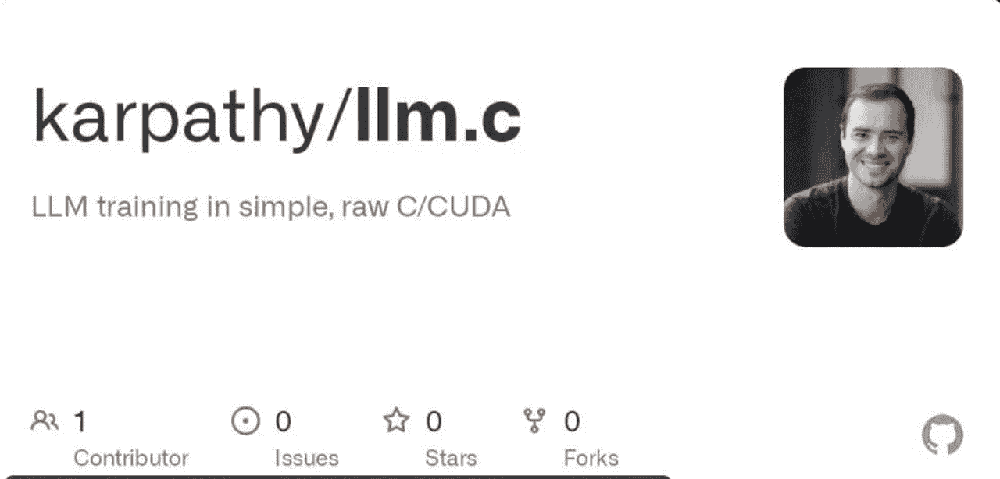

### `Nat. Mach. Intell.`|设计超高效疫苗，普林斯顿团队开发首个解码`mRNA`序列大模型

贡献人：

https://mp.weixin.qq.com/s/OVRY-R7gROFsGd8krd6fMQ

普林斯顿王梦迪团队迎来了一项具有划时代意义的突破，该团队开发了世界首个解码`mRNA`非翻译区域序列的大模型，用于准确预测从`mRNA`到蛋白质的转录功能，及设计新序列用于`mRNA`疫苗。该研究论文的题目是「A 5’ UTR Language Model for Decoding Untranslated Regions of mRNA and Function Predictions」，已被《Nature Machine Intelligence》接收。这篇论文意味着大语言模型可以用于预测和设计`mRNA`疫苗，其中新设计的序列经过实验证实远高于传统疫苗的转录效率。AI和语言模型正在颠覆生物学和制药研究中的传统方法。

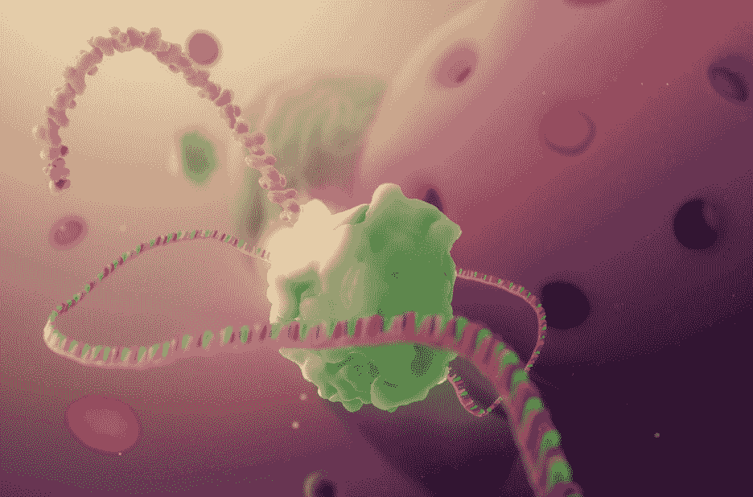

### 北大开源最强`aiXcoder-7B`代码大模型！聚焦真实开发场景，专为企业私有部署设计

贡献人：

https://mp.weixin.qq.com/s/YujpEG5XyAClLoxOH3yH4Q

从科技圈最新动态来看，最近`AI代码生成`概念实火。可是，小伙伴们有没有感觉，`AI`刷程序题比较亮眼，到了企业真实开发场景中，总感觉欠点火候？恰在此时，一位低调的资深大玩家`aiXcoder`出手了，放出大招：它就是全新开源的代码大模型——`aiXcoder-7B Base`版，一个专门适合在企业软件开发场景中部署的代码大模型。等等，一个“仅”`70亿`参数的代码大模型，能展现出什么样的`AI`编程水平？先看看在`HumanEval`、`MBPP`和`MultiPL-E`三大主流评测集上的表现，它平均得分居然超过`340亿`参数的`Codellama`。这个模型不仅打败了一众开源大模型、成为百亿级代码大模型中最强，还有特别的优势：一改传统的“刷题式”代码生成，它专门针对企业级软件项目，在真实开发场景下效果最好——代码生成补全能力、和跨文件能力经过测试，都是`No.`。言外之意，`aiXcoder-7B`不玩“虚”的，可以hold得住企业真实业务场景。

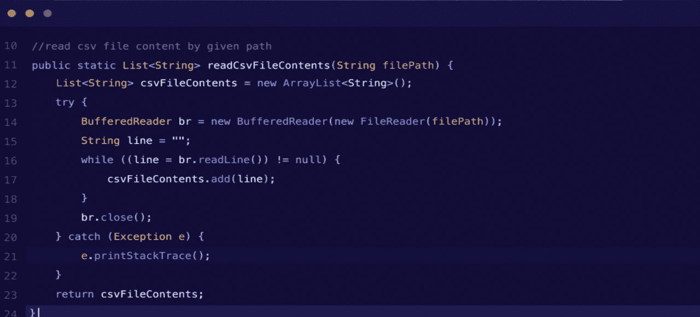

### 联发科推出生成式 AI 服务平台“达哥”，支持“最强繁体中文大模型”`MR BreeXe`

贡献人：

https://www.ithome.com/0/760/772.htm

据联发科官方消息，在今日举行的生成式 AI 论坛期间，联发科生成式 AI 服务平台 `MediaTek DaVinci` 正式推出，亦称“联发科技达哥”，目前已有超过 40 家厂商加入其生态系统。据悉，该工具最初为集团内部生成式 AI 工具，被广泛应用于软件开发的需求分析和规格设计、人资的自动媒合、财务的报销流程、法务的专利翻译和合约诉讼等，集团渗透率达到 96%。

同时，联发创新基地还发布了该平台最新的繁体中文大型语言模型 `MediaTek Research BreeXe`（IT之家下文简称 `MR BreeXe`）。`MR BreeXe` 以 `Mixtral 8x7B` 模型为基础开发，继承 `Mixtral` 多专家模型特有的节省运算资源、提升速度优势，号称在繁体中文测试项目（`TMMLU+`、`MT Bench TW`）超越 `GPT-3.5`，并对台湾地区常见的地端应用进行了“特别优化”。

### 杨笛一新作：社恐有救了，AI大模型一对一陪聊，帮i人变成e人

贡献人：

https://mp.weixin.qq.com/s/gGZ3V3ZsMfT8klvuCw7L4g

在人类的社交活动中，为了更有效地在工作和生活中与他人沟通，需要一定的社交技能，比如解决冲突。然而，社交技能的练习环境对于大多数人来说通常是遥不可及的。特别是由专家训练这些技能时，往往耗时、投入高且可用性有限。现有的练习和反馈机制很大程度上依赖专家监督，使训练难以扩展。此外，经过专业培训的教练也缺乏，而大多数可以提供定制化反馈的教练无法帮助大量有需要的人。近日，在由斯坦福助理教授杨笛一为共同一作的论文《Social Skill Training with Large Language Models》中，研究者认为，借助大语言模型可以使得社交技能训练变得更容易、更安全、更有吸引力，并在现实、虚拟练习空间中提供量身定制的反馈。

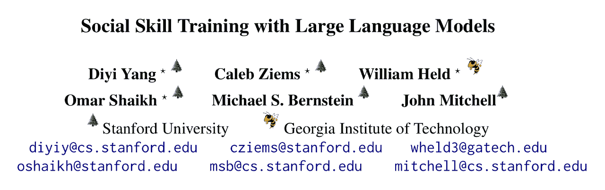

### CVPR 2024 | 分割一切模型`SAM`泛化能力差？域适应策略给解决了

贡献人：

https://mp.weixin.qq.com/s/KzQTWVGPuSScy_p2J6kqIQ

大语言模型（`LLMs`）的成功激发了计算机视觉领域探索分割基础模型的兴趣。这些基础分割模型通常通过 Prompt Engineer 来进行 zero/few 图像分割。其中，`Segment Anything Model`（`SAM`）是最先进的图像分割基础模型。

将预训练好的 `SAM` 适应到下游任务主要面临三个挑战：

+   首先，传统的无监督域自适应范式需要源数据集和目标数据集，由于隐私和计算成本较为不可行。

+   其次，对于域适应，更新所有权重通常性能更好，同时也受到了昂贵的内存成本的限制。

+   最后，`SAM` 可以针对不同种类、不同颗粒度的提示 `Prompt`，展现出多样化的分割能力，因此当缺乏下游任务的提示信息时，无监督适应将非常具有挑战性。

为了应对上述挑战，港中深提出了一种具有锚点正则化和低秩微调的弱监督自训练架构，以提高自适应的鲁棒性和计算效率。

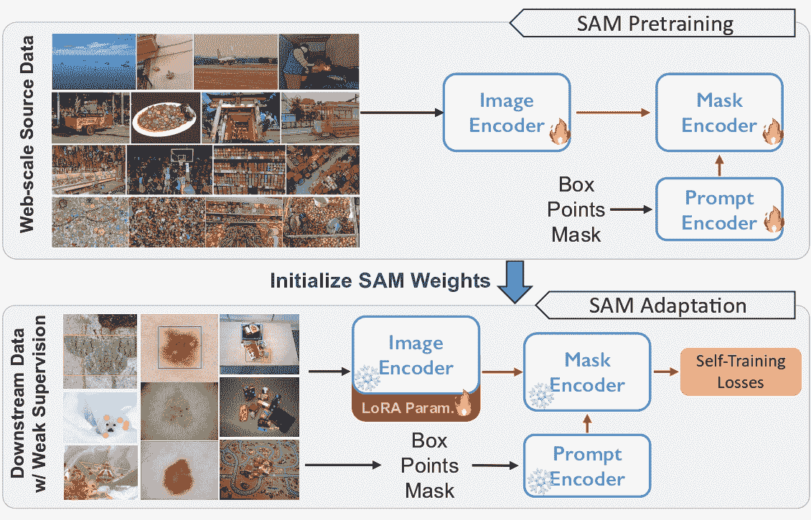

## 论文

### 密集训练，稀疏推断：重新思考混合专家语言模型的训练

贡献人：

链接：http://arxiv.org/abs/2404.05567v1

混合专家语言模型（`MoE`）可以在不牺牲性能的情况下，与密集模型相比，将计算成本降低`2-4`倍，使其在计算受限的场景中更加高效。然而，`MoE`模型通常需要`2-4`倍的参数才能实现与密集模型相当的性能，这会导致更大的`GPU`内存需求，使得`MoE`模型在像自回归生成这样的`I/O`受限场景中效率较低。在本研究中，我们提出了一种混合密集训练和稀疏推断框架用于`MoE`模型（`DS-MoE`），通过在训练期间在所有专家之间使用密集计算，然后在推理期间使用稀疏计算，实现了强大的计算和参数效率。我们的实验表明，我们的`DS-MoE`模型比标准稀疏`MoE`更具参数效率，在总参数大小和性能方面与密集模型不相上下，同时计算成本更低（激活模型参数的`30-40％`）。使用`vLLM`进行的性能测试显示，我们的`DS-MoE-6B`模型比类似的密集模型（如`Mistral-7B`）运行速度快高达`1.86`倍，比类似的`MoE`（如`DeepSeekMoE-16B`和`Qwen1.5-MoE-A2.7B`）快`1.50-1.71`倍。

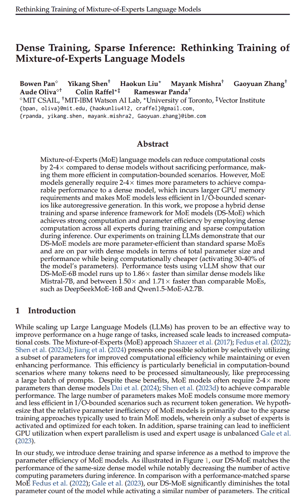

### 语言模型的物理学：第`3.3`部分，知识容量缩放定律

贡献人：

链接：http://arxiv.org/abs/2404.05405v1

规模定律描述了语言模型的大小与其能力之间的关系。与以前评估模型能力的研究不同，我们通过估计模型存储的知识位数来评估模型的能力。我们关注作为元组表示的事实知识，例如从维基百科页面中提取的（美国，首都，华盛顿特区）。通过多个受控数据集，我们确认语言模型可以且只能每个参数存储`2`位知识，即使量化为`int8`，并且这样的知识可以灵活地用于下游应用。因此，根据我们的估计，`7B`模型可以存储`14B`位知识，超过英文维基百科和教科书的总和。

更广泛地说，我们提出`12`项结果，说明训练持续时间、模型架构、量化、`MoE`等稀疏约束和数据信噪比如何影响模型的知识存储能力。值得注意的见解包括：

+   具有旋转嵌入的`GPT-2`架构，在知识存储方面与`LLaMA/Mistral`架构相匹敌甚至超越，特别是在较短的训练持续时间内。这是因为`LLaMA/Mistral`使用了不太稳定且难以训练的`GatedMLP`。

+   在训练数据前添加域名（例如，`wikipedia.org`）显著增加了模型的知识容量。语言模型可以自主识别和优先考虑知识丰富的域，优化其存储能力。

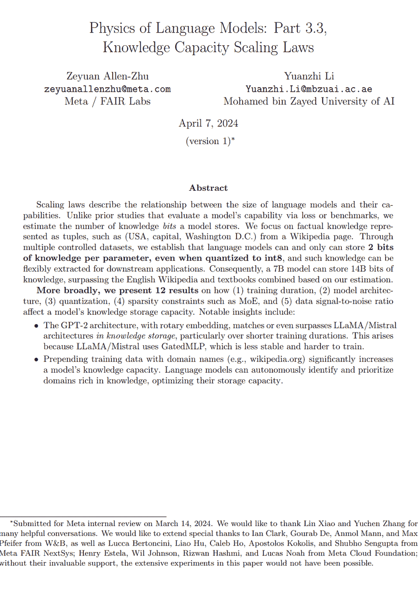

### `MIMIR`：领域专家个性化智能体调优的简化平台

贡献人：

链接：http://arxiv.org/abs/2404.04285v1

最近，大型语言模型（LLMs）已经发展成具有规划、工具使用和跨多种任务执行能力的互动智能体。然而，没有特定智能体调整，像LLaMA这样的开源模型目前难以匹敌GPT-4的效率，尤其是缺乏用于微调的智能体调整数据集时。为此，我们推出了Mimir：一个简化的平台，提供可定制的管道，使用户能够大规模利用私有知识和公开、合法的数据集进行个性化智能体调整。此外，Mimir支持从相同输入生成通用的指令调整数据集。这种双重功能确保通过该平台开发的语言智能体既具有特定智能体能力，又具有一般能力。 Mimir将这些功能集成到一个连贯的端到端平台中，从上传个性化文件到一键智能体微调都得以便捷进行。

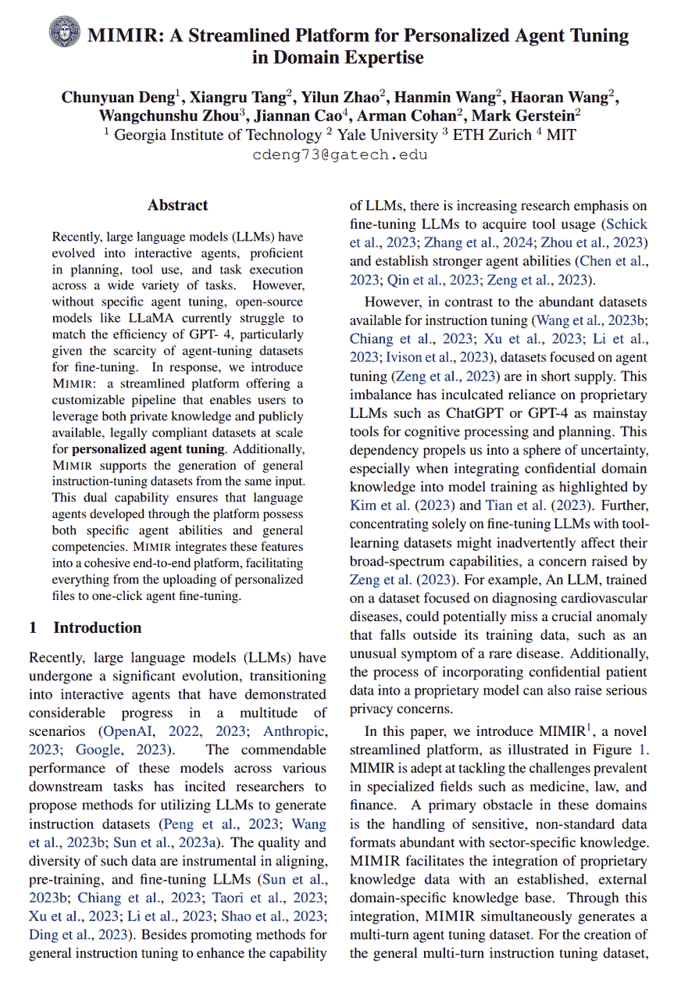

## 使用合成数据进行训练有多糟糕？语言模型崩溃的统计分析

贡献人：

链接：http://arxiv.org/abs/2404.05090v1

《模型崩溃现象》，由Shumailov等人在2023年引入，指的是当新模型基于先前训练模型生成的合成数据进行训练时性能下降的现象。这种递归训练循环使得原始分布的尾部消失，导致未来生成的模型忘记了最初的（真实）分布。为了深入理解语言模型中的模型崩溃现象，本文考虑了一个统计模型，允许我们描述不同递归训练情景的影响。具体而言，我们证明了仅在合成数据上训练时无法避免模型崩溃。然而，当混合使用真实和合成数据时，我们提供了一个估计，即在模型崩溃最终可以避免的情况下，合成数据的最大数量。我们的理论结论得到了经验验证的进一步支持。

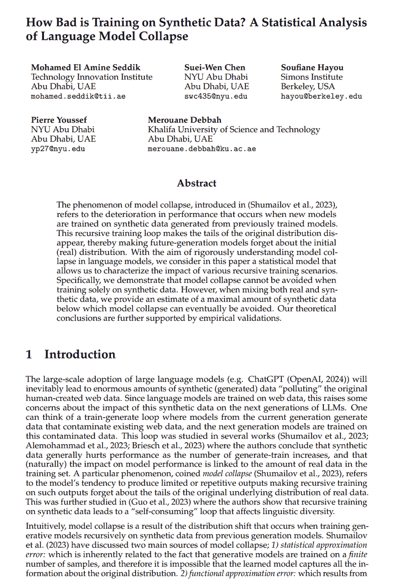

## 探索与理解DPO限制的理论视角

贡献人：

链接：http://arxiv.org/abs/2404.04626v1

直接偏好优化（DPO）从成对偏好数据中直接导出奖励信号，已证实在将大型语言模型（LLM）与人类偏好对齐方面的有效性。尽管DPO在各种任务中被广泛使用，但它却因对SFT效果的敏感性和对向人类优选回复学习能力的阻碍而受到批评，从而导致性能不佳。为了克服这些限制，对DPO的理论理解至关重要但仍然缺乏。为此，我们采取了一步措施来从理论上分析和理解DPO的限制。具体而言，我们提供了一个使用场论来分析DPO优化过程的分析框架。通过分析DPO损失函数的梯度向量场，我们发现DPO损失函数在减少生成人类不偏好数据的概率速度方面比增加生成优选数据的概率更快。这为理解相关研究实验中发现的DPO限制提供了理论洞见，从而为其改进奠定了基础。

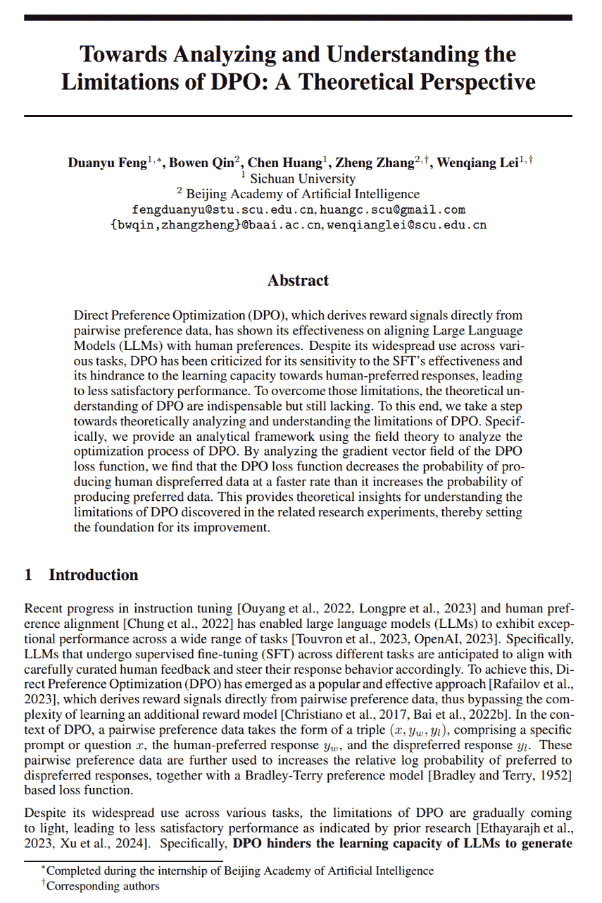

## SqueezeAttention: 通过分层最优预算在LLM推理中管理KV缓存的二维方式

贡献人：

链接：http://arxiv.org/abs/2404.04793v1

摘要: 优化大语言模型（LLM）的键值（KV）缓存被认为是节省推理成本的关键。现有的大多数KV缓存压缩算法试图通过利用标记的不同重要性来减少标记序列的稀疏性。在这项工作中，我们发现通过识别注意力层的重要性，我们可以从两个维度共同优化KV缓存。基于我们对推理中逐层重要性的观察，我们提出了SqueezeAttention，精确优化KV缓存预算在各层之间的分配，并结合三种代表性的标记稀疏化算法，压缩每个层的KV缓存。通过从序列和层的维度优化KV缓存，SqueezeAttention在广泛的LLMs和基准测试中实现了大约30%到70%的内存减少以及高达2.2倍的吞吐量改善。代码可在https://github.com/hetailang/SqueezeAttention找到。

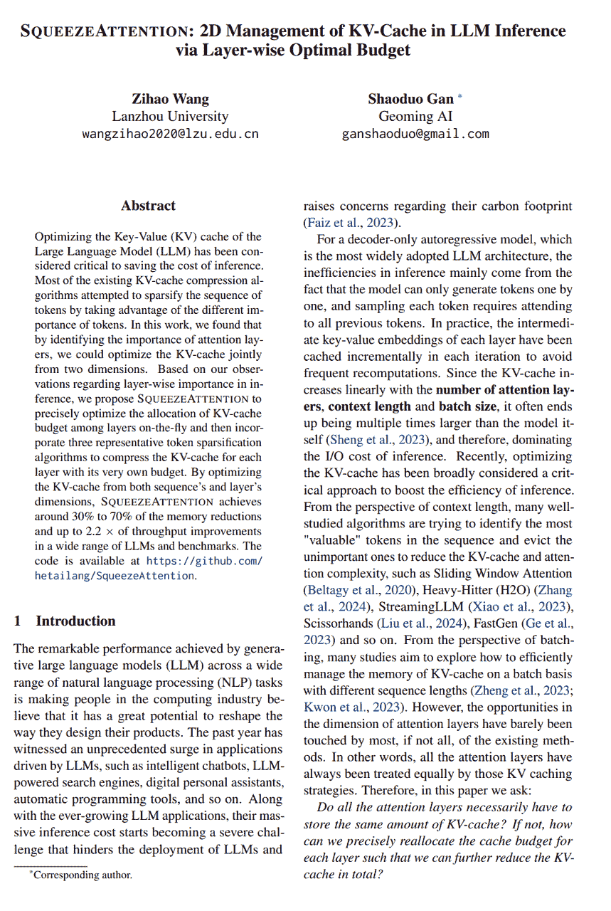

## 一个大规模的μ-转移的探索

贡献人：

链接：http://arxiv.org/abs/2404.05728v1

大型神经网络模型已成为自然语言处理和计算机视觉的主要支柱，然而它们的初始化和学习速率在很大程度上是凭经验确定的，可能会因论文和模型大小的不同而有所变化。μ参数化（μP）提供了对这些挑战的潜在解决方案，为模型初始化和学习速率提供了缩放规则，并据称在各种情况下实现了从小到大模型的零-shot超参数转移。尽管显而易见的前景，但μP缩放规则尚未被广泛采用，可能是因为实现复杂性较高、变化较多或理论背景复杂。这项工作通过经验研究了μP，重点关注普遍存在的Transformer架构，并旨在回答一个简单问题：μ-转移在实践中是否提供了最佳学习速率？从具有2M到10B参数的模型中，我们展示了μ-转移对大多数重要情况的有效性，但也发现了一些令人惊讶的情况，可能并不适用。

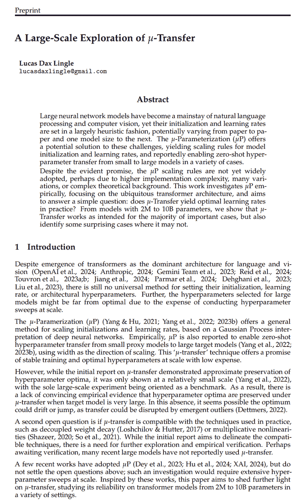

## nanoLM: 通过准确损失预测跨尺度预训练LM的可负担性基准

贡献人：

链接：http://arxiv.org/abs/2304.06875v4

随着语言模型的扩展，验证研究想法变得越来越昂贵，因为针对小模型的结论不能轻易转移到大模型上。一种可能的解决方案是建立一个通用系统，能准确预测大模型的某些指标，而无需对其进行训练。本文提出了一种名为μScaling的方法，通过我们的观察，最大更新参数化（μP）实现了对超参数空间中常见损失盆地附近的缩放规律的准确拟合。通过μScaling，不同模型设计可以在大规模上进行比较，只需训练它们较小的对应物。我们引入了nanoLM：一个经济实惠的LLM预训练基准，促进了这种新的研究范式。通过大约14%的一次性预训练成本，我们可以准确预测高达52B的模型损失。我们希望通过nanoLM使有限资源的研究人员能够对大型模型做出有意义的结论。我们还希望我们的基准能够成为学术界和工业界之间的桥梁。μScaling的代码可在https://github.com/cofe-ai/Mu-scaling找到。nanoLLM的代码稍后会提供

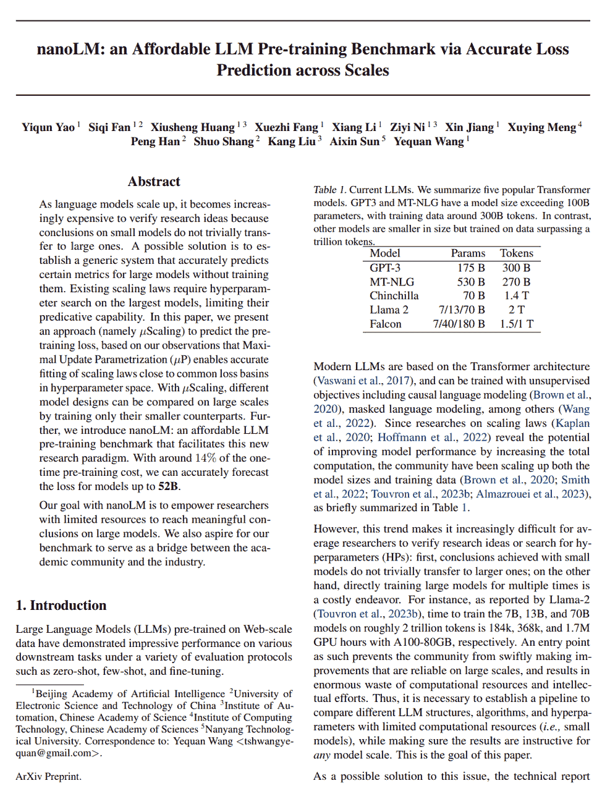

## Diffusion-RWKV：为扩散模型扩展RWKV类架构

贡献人：

链接：http://arxiv.org/abs/2404.04478v1

摘要：Transformer在计算机视觉和自然语言处理领域引发了进展。然而，对于长篇任务（如高分辨率图像生成），巨大的计算复杂性限制了它们的应用。本文介绍了一系列源自用于NLP的RWKV模型的架构，对Diffusion-RWKV进行了必要的修改，以适用于应用于图像生成任务的扩散模型。与Transformer的扩散类似，我们的模型设计为在序列中高效处理块状输入，并能有效扩展，适应大规模参数和广泛数据集。其独特优势表现在减少了空间聚合复杂性，使其在处理高分辨率图像时异常擅长，从而消除了窗口化或组缓存操作的必要性。对有条件和无条件图像生成任务的实验结果表明，Diffison-RWKV在FID和IS指标上表现与现有的CNN或Transformer基础的扩散模型相媲美甚至超越，同时显著减少了总的计算FLOP使用。

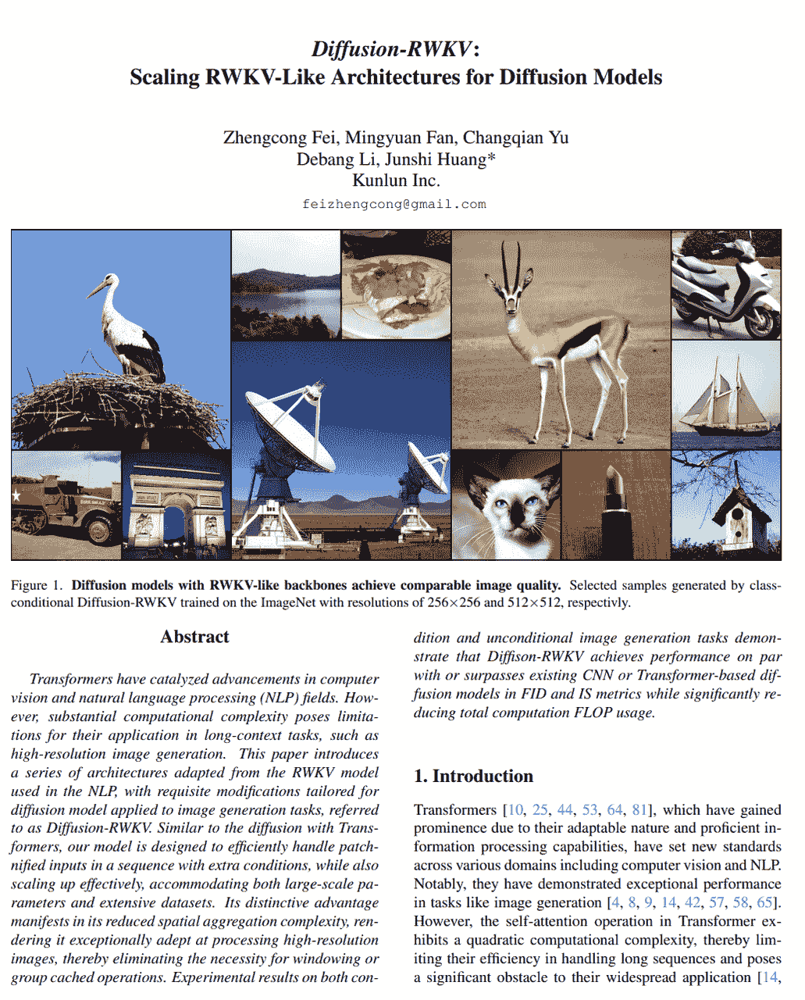

# 产品

## UI Bakery AI App Generator

贡献人：

https://uibakery.io/ai-app-generato

UI Bakery 是一个自助低代码平台，允许快速构建定制的 Web 应用程序（内部工具、客户应用程序和管理面板）。最近推出了 UI Bakery AI 应用生成器，这个工具允许在现有数据（目前是 SQL 数据库）的基础上生成功能性的 Web 应用程序，只需指定一个提示。这个工具可以用于创建内部工具、CRUD 应用、管理面板、对数据进行对话式搜索以及原型设计和构思。生成应用程序后，用户可以通过后续提示进行调整或澄清，或者将其转换为 UI Bakery 应用程序，以在 UI Bakery 可视化编辑器中继续开发。

## Odaptos

贡献人：

https://odaptos.com/

Odaptos 提供了一种用于用户体验（UX）研究项目的人工智能工具。他们的人工智能分析可以捕捉传统分析所忽略的情感细微差别，帮助更好地理解用户。该工具的一些关键特性包括自动生成用户会话文本、轻松招募测试参与者、清晰展示用户旅程中的关键时刻、情感视频回放、可用性评分（SUS）、以及一个名为 Oda 的聊天机器人，它可以提供快速摘要和见解。

# HuggingFace&Github

## FreeAskInternet

贡献人：

https://github.com/nashsu/FreeAskInternet

FreeAskInternet 是一个完全免费、私有且在本地运行的搜索聚合器和答案生成器LLM，无需 GPU。用户可以提出一个问题，系统会进行多引擎搜索，并将搜索结果组合到 ChatGPT3.5 中LLM，并根据搜索结果生成答案。

## BIG-AGI

贡献人：

https://github.com/enricoros/big-AGI

Big-AGI 是一款面向需要功能、形式、简单性和速度的专业人士的 AI 套件。由 12 家供应商和开源服务器的最新型号提供支持， Big-AGI 提供一流的聊天、通话，包括 AI 角色、可视化、编码、绘图、并排聊天等。

## Cerule-v0.1

贡献人：

https://huggingface.co/Tensoic/Cerule-v0.1

Cerule 是一个小巧而强大的视觉流水模型，基于新发布的 Google 的 Gemma-2b 和 Google 的 SigLIP。小参数但性能强大，可识别图像给出文本回复

# 投融资

## Multiverse学徒制独角兽，收购Searchlight以聚焦AI

贡献人：

https://techcrunch.com/2024/04/08/multiverse-the-apprenticeship-unicorn-acquires-searchlight-to-put-a-focus-on-ai/

Multiverse，一家英国的学徒制独角兽企业，已经收购了AI招聘初创公司Searchlight。此举旨在整合Searchlight的AI技术，以增强多元宇宙的专业培训服务。Searchlight由Kerry和Anna Wang两位双胞胎姐妹共同创立，迄今为止已经筹集了近2000万美元资金，包括2021年的1700万美元A轮融资。多元宇宙在2022年的估值为17亿美元，计划通过此次收购扩大其AI能力，进一步在专业培训领域巩固地位。收购的财务细节未予披露。

公司官网：https://www.searchlight.ai/

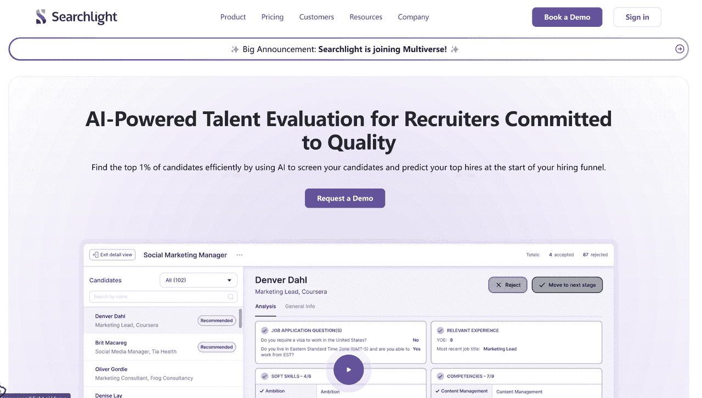

## Lexverify完成由Midven领投的90万英镑种子轮融资

贡献人：

https://www.uktechnews.info/2024/03/26/lexverify-secures-900k-seed-investment-led-by-midven/

位于伯明翰的Lexverify，一家使用人工智能驱动的风险管理助手，已成功完成90万英镑的种子轮融资。此轮融资由Midven领投，Midven是Future Planet Capital Group的一部分。其中55万英镑来自Midlands Engine Investment Fund (MEIF 1)通过MEIF西米德兰兹股权基金，另外35万英镑来自Raspberry Ventures、The LegalTech Fund和包括Richard Yorke、Mark Watkin Jones、Jonathan Scudder、Richard Grethe和Karl Wyborn在内的天使投资者。这次投资将使公司能够进行关键的人才招聘，以实现其扩张计划，并已经成功地与金融服务和制药行业的企业进行了试点。

公司官网：https://www.lexverify.com/

## Lockchain.ai完成460万美元种子轮融资

贡献人：

https://www.thesaasnews.com/news/lockchain-ai-raises-4-6-million-in-seed-round

Lockchain.ai，一家总部位于美国乔治州雅典的区块链风险管理平台，借助人工智能技术，已正式结束隐身模式，并在种子轮融资中筹集了460万美元。本轮融资由Lerer Hippeau领投，Arrington Capital、Valhalla Ventures、ARCA、RSE/Vayner、Sonic Boom Ventures、Clear Sky Capital的Alex Weiss以及Artico Search参投，White Star Capital在随后的融资周期中加入。Lockchain.ai旨在为区块链生态系统中的交易者、投资者和基金经理提供自动化风险管理解决方案。

公司官网：https://lockchain.ai/

## 「原粒半导体」完成新一轮融资，加速大模型算力Chiplet落地

贡献人：

https://news.pedaily.cn/202404/532122.shtml

原粒（北京）半导体技术有限公司，一家专注于多模态AI处理器设计技术和Chiplet算力融合技术的创新企业，近日宣布完成数千万元的新一轮融资。本轮融资由一维创投和华峰集团联合领投，中科创星、中关村生态雨林基金、英诺天使和清科创投等老股东集体追加投资。资金将主要用于公司的大模型AI Chiplet研发流片及相关算力产品开发和业务拓展。此次融资标志着原粒半导体在AI Chiplet领域的技术和市场布局将进一步加速。

公司官网:https://calculet.com.cn/

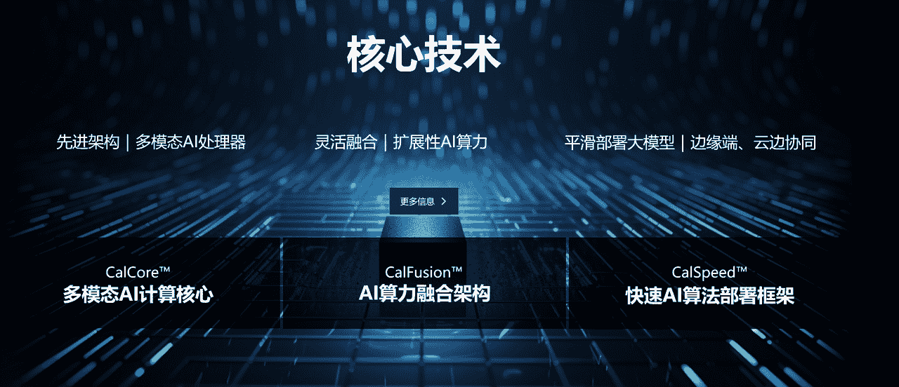

## AI Infra供应商「星凡科技」获近亿元Pre-A轮融资

贡献人：

https://news.pedaily.cn/202404/532158.shtml

星凡科技，一家提供一站式行业AGI技术服务，近日完成了近亿元人民币的Pre-A轮融资。本轮融资由盛景嘉成领投，开普云和高捷资本跟投。资金将主要用于服务器产线建设、算力中心项目建设及后期运营，以及大模型推理芯片的研发。星凡科技主要提供以大模型为核心的训练推理一体机和训推集群产品，技术聚焦于算力中心运营全业务场景的LLM-Agent、异构芯片的大模型性能加速中间件开发及模型智能化适配。

公司官网：http://xffuture.com/

# 学习

## 如何理解 natural gradient descent?

贡献人：

https://www.zhihu.com/question/266846405/answer/3450931951

这篇知乎回答详细探讨了自然梯度下降（Natural Gradient Descent），强调了它在优化参数时考虑参数空间内在几何结构的重要性。通过使用Fisher信息矩阵的逆来调整梯度，自然梯度下降方法能更有效地进行参数更新。此外，该回答还通过将概率分布之间的KL散度用于定义参数更新的距离，进一步阐释了自然梯度下降的技术细节。

参考链接：https://people.math.sc.edu/wuchen/papers/ChenLi.pdf

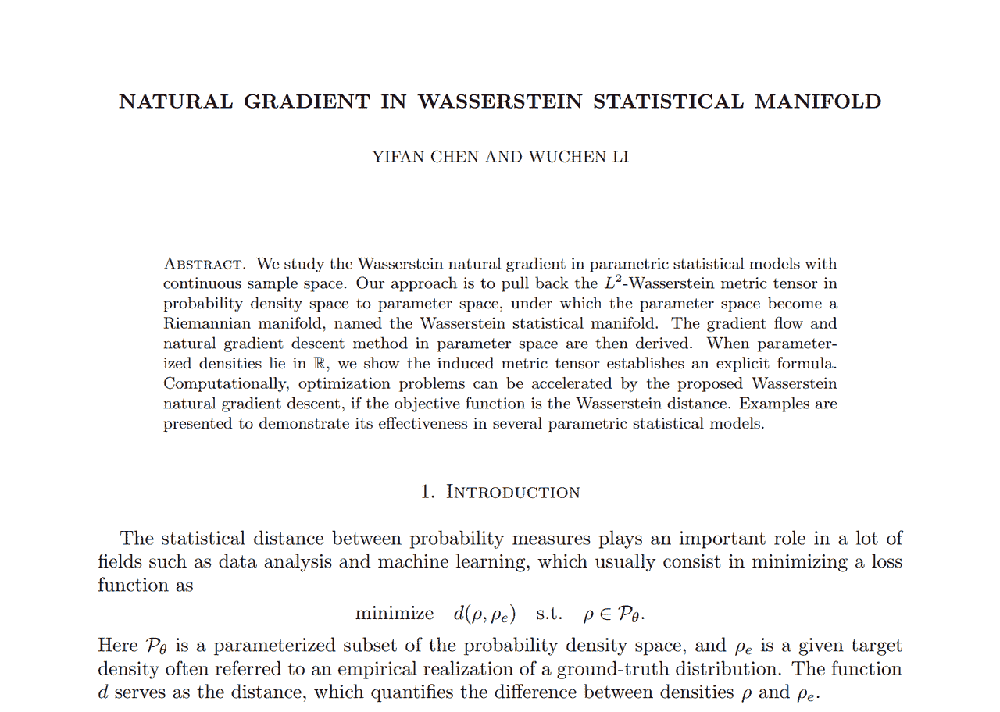

## kimi chat大模型的200万长度无损上下文可能是如何做到的？

贡献人：

https://www.zhihu.com/question/649192998/answer/3445754185

陈巍在回答中指出，kimi chat大模型实现200万长度无损上下文的技术关键在于相对位置嵌入、旋转位置嵌入、位置插值和线性偏置等方法。长文本的核心挑战在于保持文本的语义和逻辑一致性，而非仅仅提升KV cache或Inference速度。例如，旋转位置嵌入(RoPE)通过旋转矩阵编码绝对位置并结合自注意力公式中的明确相对位置依赖性。另外，提及的文献如《LongRoPE: Extending LLM Context Window Beyond 2 Million Tokens》展示了通过位置插值和渐进扩展策略实现大规模上下文窗口。这些进展表明，通过技术创新可大幅提升模型处理长文本的能力，保持内容的一致性和准确性。

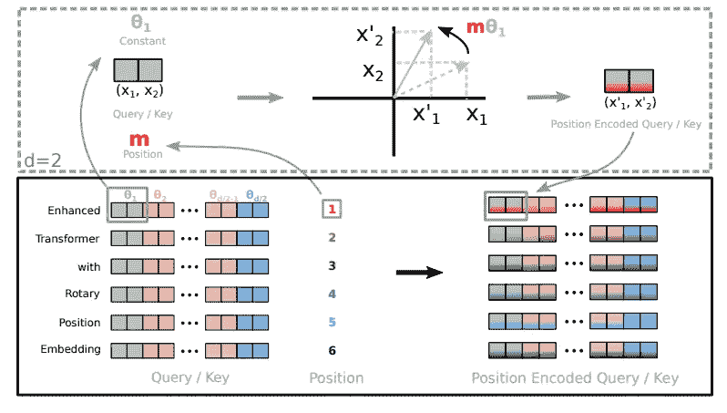

## 现代GPU体系结构Cache Operators行为研究

贡献人：

https://zhuanlan.zhihu.com/p/691104610

本文对现代GPU体系结构中Cache Operators的行为进行了深入研究。文章基于Compute Capability 8.9的L20 GPU和CUDA Toolkit版本12.2进行实验，探讨了STG指令是否绕过L1缓存、L1缓存之间的一致性问题、STG指令命中L1缓存后的行为（Write Back还是Write Through）、未命中L1时的行为（是否触发Write Allocate）。实验表明，STG指令命中L1时执行Write Through，未命中时先执行Write Allocate再进行Write Through，且SM的L1缓存之间不具备一致性。文章通过详细的实验代码和分析，为理解现代GPU微架构中的缓存操作提供了宝贵的见解。

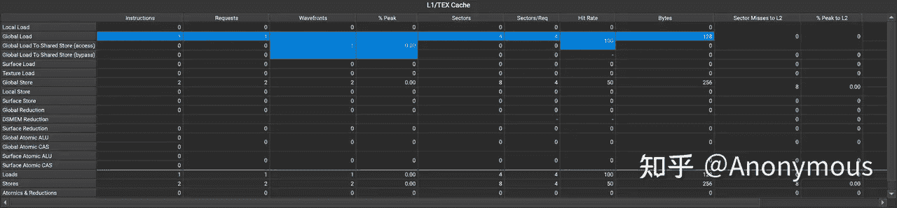

## 创业：大模型RAG系统三个月的开发心得和思考

贡献人：

https://zhuanlan.zhihu.com/p/690298565

文章分享了作者在三个月内开发RAG大模型AI产品的经验。RAG（检索增强生成）通过为大语言模型（LLM）提供外部知识源信息，旨在生成更精确的回答并减少误导性信息的产生。开发中遇到的挑战包括LLM的知识更新成本、数据安全等问题。RAG技术能有效减少LLM的“幻觉”问题，提高数据安全性。文章还探讨了RAG技术与架构思考，强调了数据工程、检索生成的重要性，并分享了技术和产品开发的心得，最后讨论了编程语言选择的考虑。

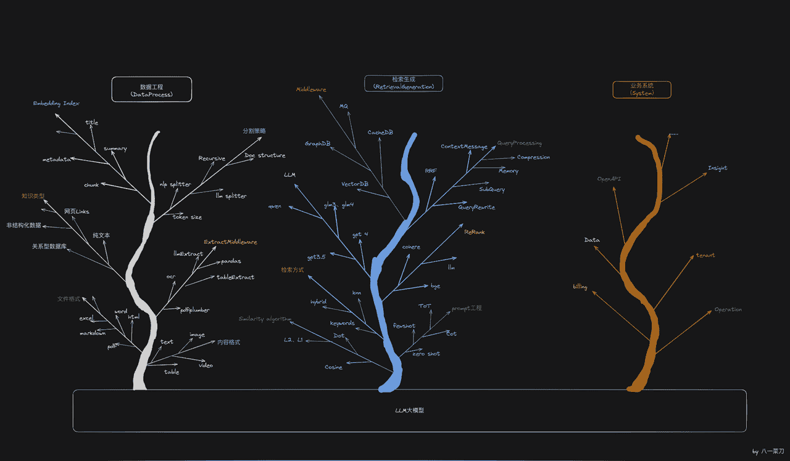

### 一文读懂`nsight system`与`cuda kernel`的时间线分析与可视化

贡献人：

`https://zhuanlan.zhihu.com/p/691307737`

文章深入分析了使用`nsight system`进行GPU性能优化的方法，强调了其在服务器上生成程序运行报告和多平台可视化工具的功能。通过示例程序和分析，文章展示了如何使用`nvtx`工具标记感兴趣的时间段，对`cuda kernel`的执行时间线进行了详细探究。实验部分详细解释了GPU上`kernel`的异步执行特性、CPU与GPU之间的调用关系、以及通过时间线分析来优化程序性能的实际应用。文章突出了`nsight system`在分析并发执行、`kernel`执行时间、以及优化`cuda`程序中的重要作用，为GPU性能优化提供了实用的技术细节和方法。

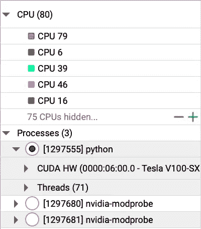

### batch normalization在文本上的具体操作？

贡献人：

`https://www.zhihu.com/question/606381745/answer/3458818089?utm_psn=1760989050050514944`

本文探讨了在文本处理中批量归一化（Batch Normalization）的具体实现方法，重点在于理解其在二维数据和计算机视觉（CV）数据中的操作差异。首先，通过`PyTorch`代码示例，作者解释了在二维数据（如全连接层的输出）中如何应用`BatchNorm1d`，包括其归一化和仿射变换（缩放+平移）两个步骤。随后，文章比较了`BatchNorm`和`LayerNorm`在处理二维数据时的不同点，指出`BatchNorm`沿着批次维度（`dim=0`）操作，而`LayerNorm`在特征向量内部（`dim=1`）操作。最后，探讨了在CV数据中`BatchNorm2d`和`LayerNorm`的实现，强调了`BatchNorm2d`在每个通道内进行归一化的特性，以及`LayerNorm`如何对整个输入特征图进行归一化并应用仿射变换。整个讨论通过代码实现和手动计算的对比，清晰地展示了这些归一化技术的工作原理和它们在实际应用中的效果。

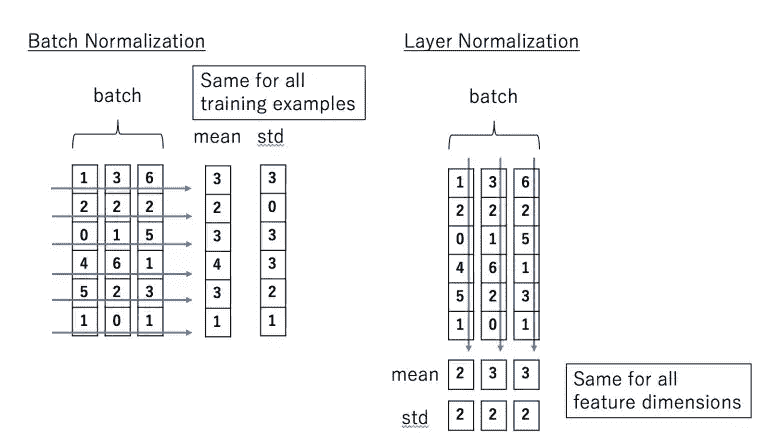

### LLM推理的极限速度

贡献人：

`https://mp.weixin.qq.com/s/v2rJmmnNr1VB0hg1tt1pmg`

文章探讨了语言大模型推理的理论极限及其影响，特别是在单GPU单批次上的硬件利用率。作者Arseny Kapoulkine开发的`calm`实现，通过最小化依赖和简化实现，旨在达到LLM架构的最大单GPU单批次效率。文中分析了矩阵-向量乘法和注意力计算的处理过程，以及如何通过模型配置和`KV`缓存大小预测推理速度。此外，通过比较实际推理速度与理论最短时间，可以验证推理系统实现的质量并预测架构变化的影响。

# 声明

本文档仅供学习交流使用，版权归原作者所有，若涉侵权，请联系Jack Jin 15101136166

（欢迎在下方反馈您宝贵的意见！整理不易，觉得有用给AI日报小组点个赞👍吧！）

ChatGPT；Angela；Zijia Liu；Alex；Zeqi Tan；Tiezhen（HuggingFace）；Naixu；Lizhi；Peter；Suoman；Jack

封面生成——右脑科技

如果你有大模型相关的创业想法，欢迎来找我们聊聊～🛰️：15101136166

> 快邀请你的小伙伴们一起来读大模型日报吧！

> **【日报知识库】**这里是近期日报内容的汇总,欢迎大家查阅

> [大模型日报知识库(分享版)](https://miracleplus.feishu.cn/wiki/KapVwXfkriOBiskB0B2cUHxjnTh)

>

> 欢迎大家多多帮我们分享,转发~~

> 如果大家有任何的建议或者吐槽,欢迎随时找我聊天~

