# 奇绩大模型日报（4月 8日）

> 来源：[https://miracleplus.feishu.cn/docx/UX8od5Epao17ojxBEg1caRZKneg](https://miracleplus.feishu.cn/docx/UX8od5Epao17ojxBEg1caRZKneg)

## 推特

### 3blue 1brown新视频：可视化注意力，`Transformer`的核心

贡献人：

https://x.com/3blue1brown/status/1776961654183645246

YouTube上有关`Transformer`的下一章节已经发布,深入探讨了注意力机制:https://youtu.be/eMlx5fFNoYc

该模型使用代表`tokens`(可以理解为单词)的向量,这种机制允许那些向量从上下文中吸收意义。

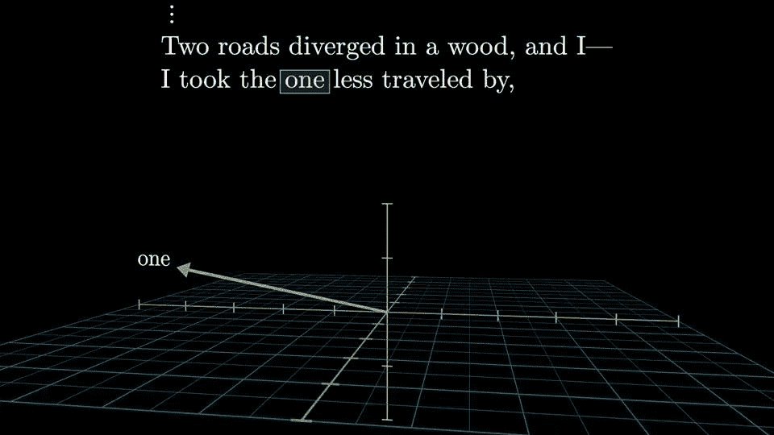

[ssstwitter.com_1712557529400.mp4](https://internal-api-drive-stream.feishu.cn/space/api/box/stream/download/all/MU1PbdsKaohavAxU5gMclfC5n9f)

### 阿妮亚带你学：潜在一致性模型详解

贡献人：

https://x.com/halcyonrayes/status/1777043562024010106

Suvaditya Mukherjee：这是我最近阅读过的关于`LDMs`和`LCMs`的最佳博客之一。阅读起来很有趣,充满了使用Dingboard制作的图表,很好地平衡了数学和代码,对一些相当棘手的概念做出了很棒的解释。https://naklecha.notion.site/explained-latent-consistency-models-13a9290c0fd3427d8d1a1e0bed97bde2…太棒了!

---

大家好,我是Naklecha。在这篇文章中,我将带你了解潜在一致性模型(`LCMs`)。这篇博客将非常详细,迎合那些想要学习`LCMs`及其数学和代码的人。让我们马上开始吧!

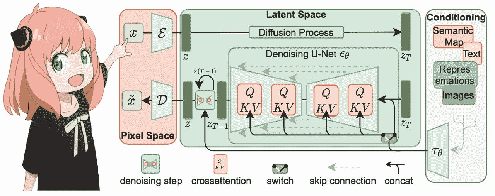

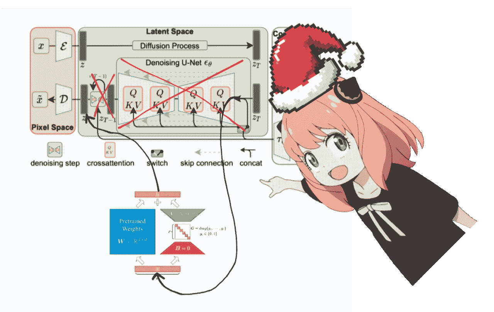

### Victor M分享视频：被AI桌宠骂是一种什么样的体验

贡献人：

https://x.com/victormustar/status/1777015435558301890

制作一个AI精灵,检查我在做什么,他正在狠狠地吐槽我😭😭

它使用了来自`@NousResearch`的`Nous-Hermes-2-Mixtral`(未经审查),也用`AniPortrait`渲染视频(`https://huggingface.co/spaces/ZJYang/AniPortrait\_official…`)

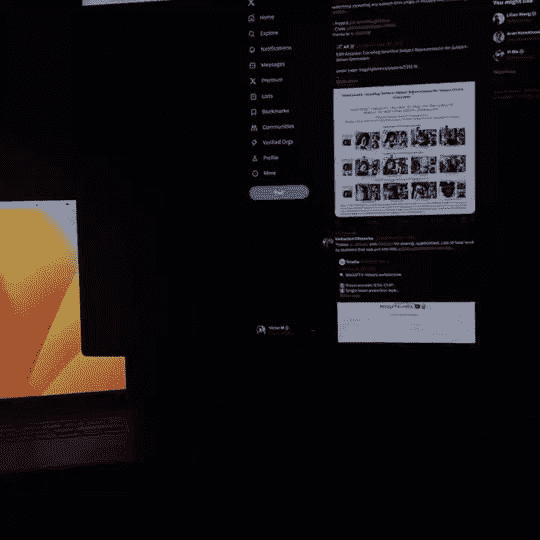

[ssstwitter.com_1712517310600.mp4](https://internal-api-drive-stream.feishu.cn/space/api/box/stream/download/all/J32sbQzzuoQl2AxDyXDcl0Vbnhb)

### 还在傻傻从`GPT`复制粘贴代码？一个小技巧，暖你一整天：`cat << EOF`

贡献人：

https://x.com/jeremyphoward/status/1776814672773263509

Jeremy Howard：不要像个傻瓜一样手动复制粘贴你的`LLM`代码到单独的文件中——用这个简单的小技巧一次性搞定!

以下是你可以复制/粘贴的文本：

----

Please create a single code block containing `cat << EOF` statements that I can copy/paste to create all those files

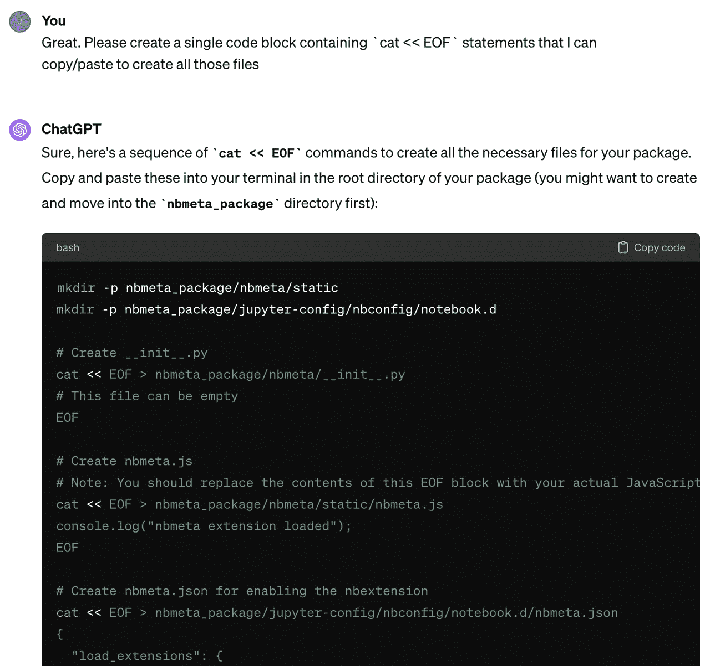

### 闹剧落幕！Taelin1万奖金“任何`transformer`模型都不可能做出的谜题”被解决

贡献人：

https://x.com/VictorTaelin/status/1777049193489572064

Victor Taelin 在他的推特中承认自己之前声称 `GPT` 永远无法解决一个简单问题(`A::B` 问题)的看法是错误的。他为此设立了一个 $10k 的挑战,希望有人能设计出一个提示,使 `GPT` 模型以 90% 以上的成功率解决随机的 `A::B` 问题实例。

尽管一开始看起来没人能解决,但最终有几位参与者成功地完成了挑战。其中,@futuristfrog 的方案在 Victor 的测试中达到了 94% 的准确率,赢得了奖金。这证明了 Victor 最初的断言是错误的,`GPT` 模型确实能够解决这类问题。

不过,Victor 指出目前还不清楚取得成功的 `Claude` 模型是否基于原始的 `GPT` 架构。他为自己错误的判断道歉,并感谢所有参与挑战的人。

为了进一步优化解决方案,Victor 将把奖金的 25% 奖励给 `inference` 成本最低的方案,其余参赛者可以在下周三前提交自己的方案角逐剩余的 $2.5k 奖金。

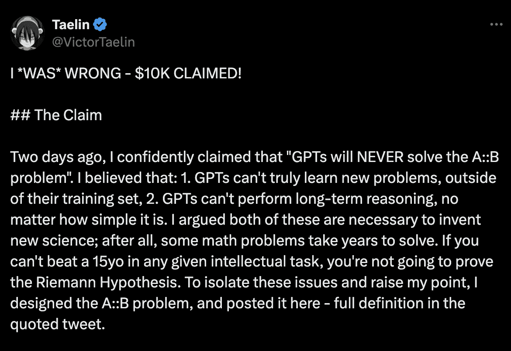

### AGI House主题演讲：来自OpenAI `Sora`团队Brooks和Peebles

贡献人：

https://x.com/agihouse_org/status/1776827897892024734

关于AGI House,有一件事你应该知道:我们表彰我们这个时代最伟大的AI创始人和研究人员!

来自OpenAI `Sora`团队的Tim Brooks 和Bill Peebles在AGI House主题演讲

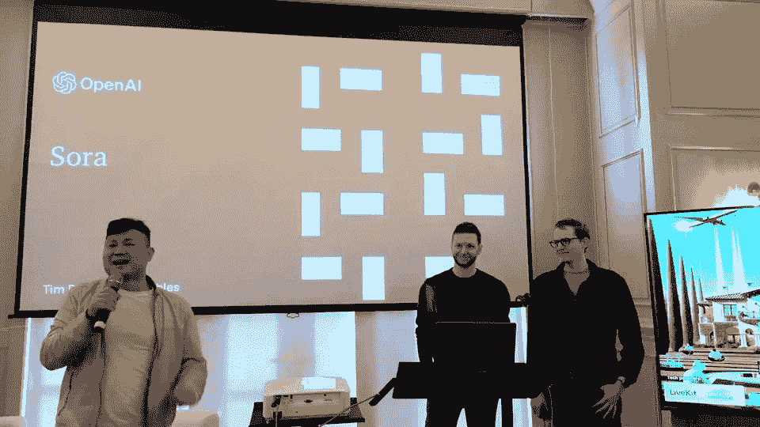

[ssstwitter.com_1712465323344.mp4](https://internal-api-drive-stream.feishu.cn/space/api/box/stream/download/all/SITobsTRrocgYexKSsZcVYgxn6d)

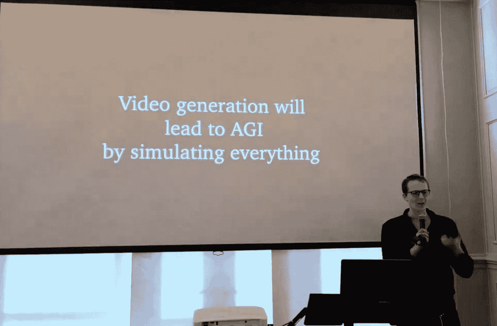

### `Transformer` 现在不是视觉领域的标准吗？谷歌Lucas Beyer怒搜十年`CVF`论文，得出答案

贡献人：

https://x.com/giffmana/status/1777080704679006638

我最近无意中听到一些类似 "`Transformer` 现在不是视觉领域的标准吗?" 的话。

我不确定。所以这个周末,每当孩子睡着的时候,我就搜集、解析、分析了过去十年所有 `CVF` 会议论文,以找出答案!

方法、代码、反馈请求都在这个帖子里。

为了代表 "论文使用 `ViT`（`Vision Transformer`）/`CNN`（卷积神经网络）",我只是简单地检查它是否引用了主要的 `ViT` 或 `CNN` 论文。这并不完美,但鉴于数据规模(每次会议 1-2k 篇论文),我相信足以反映趋势。

问题1:这确实遗漏了一些需要进一步挖掘的大项目,比如 `CLIP` 和 扩散(两者都有可能!)。你认为我还遗漏了哪些可能改变结果的主要项目吗?问题2:我是否应该做一个后续分析,把 `PDF` 放入 `Gemini` 的上下文中,直接询问它?

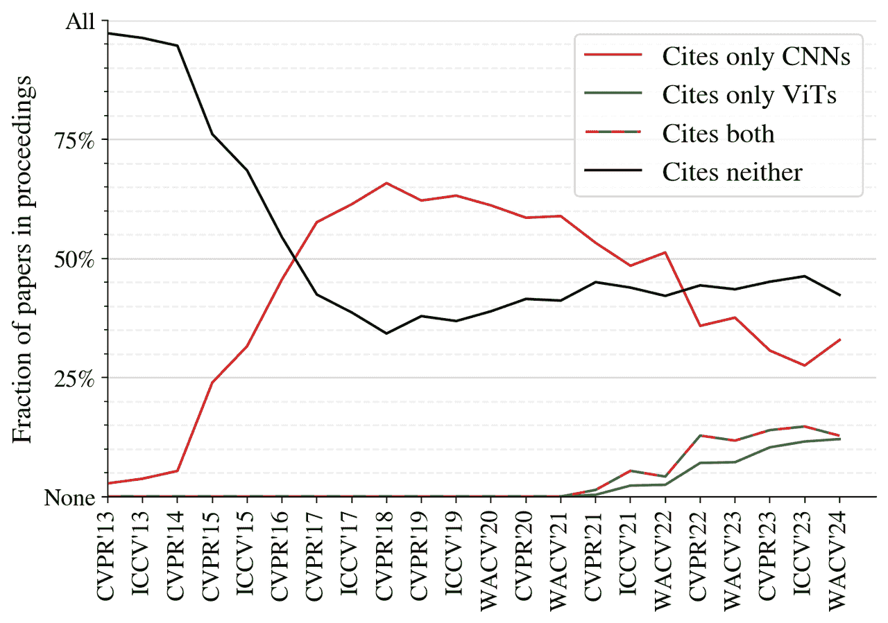

## 资讯

### 陶哲轩转发、菲尔兹奖得主领衔：AI正在颠覆数学家的工作方式 | 美国数学学会特刊

贡献人：

https://mp.weixin.qq.com/s/5Wk03xO8v0iPWbXBwhBmkA

陶哲轩点赞转发，《美国数学学会通报》用一整期特刊介绍了AI给数学带来的改变。作者阵容非常豪华，包括菲尔兹奖得主Akshay Venkatesh、华裔数学家郑乐隽、计算机科学家Ernest Davis等多位知名学者。其中郑乐隽表示，如果最终机器能做得比人类更好，那很好，她将乐意退出数学领域去弹钢琴。

他们提出的观点包括：

+ AI的数学能力不完全反映人类的认知过程，依赖于训练数据中的模式，而不是真正理解问题的本质。

+ 合成数学如合成拓扑学和合成微分几何学，提供了一种全新的数学实践方式，允许数学家专注于更深层次的概念和问题。

+ 交互式证明系统与软件工程中的“规范驱动开发”，可以降低数学家的认知负荷，促进数学家之间的合作。

+ 形式化证明技术可能改变数学证明的本质、颠覆数学家的工作方式。

+ 数学届不应被科技公司主导的议程所绑架。

### 千元级AI 模盒，云天励飞率先打响大模型「平民化」之战

贡献人：

https://mp.weixin.qq.com/s/8q55XwJn_1L2eU1J5ZYBAg

从 `Gemini`、`Lumiere`、再到 `Sora`，“百模大战” 的 “战火” 延续至 2024 年。诸多的大模型已经诞生，接下来的任务是落地。但行业大模型在落地过程中，遇到的瓶颈就像是一座冰山，藏在冰山下面的问题，更加棘手。要做物理世界的解码者，为 “无形” 技术和 “有形” 世界构建通道，这是云天励飞的定位。如何构建 AI 落地的通道？2024 年，围绕 “自进化城市智能体” 的理念，云天励飞持续深耕 AI 市场，并且在 3 月发布 “深目” AI 模盒，为 AI 大模型落地长尾场景交上一份新答卷。

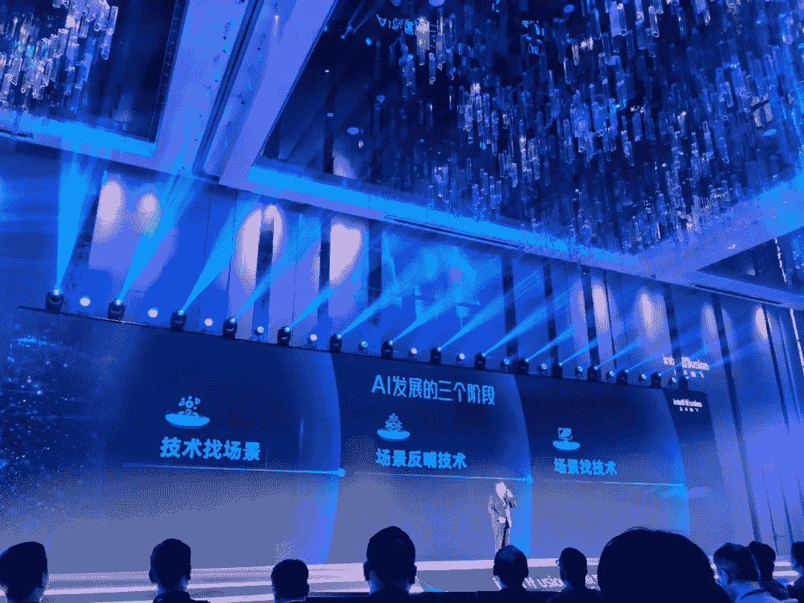

### 超10秒高分辨率，北大Open Sora视频生成更强了，还支持华为芯片

贡献人：

https://mp.weixin.qq.com/s/1GWxp8ENrA1YGGwrFpOAxA

OpenAI 在今年年初扔出一项重大研究，Sora 将视频生成带入一个新的高度，很多人表示，现在的 OpenAI 一出手就是王炸。然而，众所周知的是，OpenAI 一向并不 Open，关于 Sora 的更多细节我们无从得知。谁能率先发布类 Sora 研究成了一个热门话题。今年 3 月初，北大团队联合兔展启动了 Sora 复现计划 ——`Open-Sora-Plan`，该项目希望通过开源社区的力量复现 Sora。现在这个项目终于有了新成果，`Open-Sora-Plan v1.0.0` 来了，新研究显著增强了视频生成的质量以及对文本的控制能力。研究者表示，他们正在训练更高分辨率（>1024）以及更长时间（>10s）的视频。目前该项目已支持国产 AI 芯片（`昇腾 910b`）进行推理，下一步将支持国产算力训练。项目作者林彬表示：`Open-Sora-Plan v1.0.0` 可以生成1024×1024分辨率视频，也能生成10 秒、24 FPS 的高清视频。而且它还能够生成高分辨率图像。

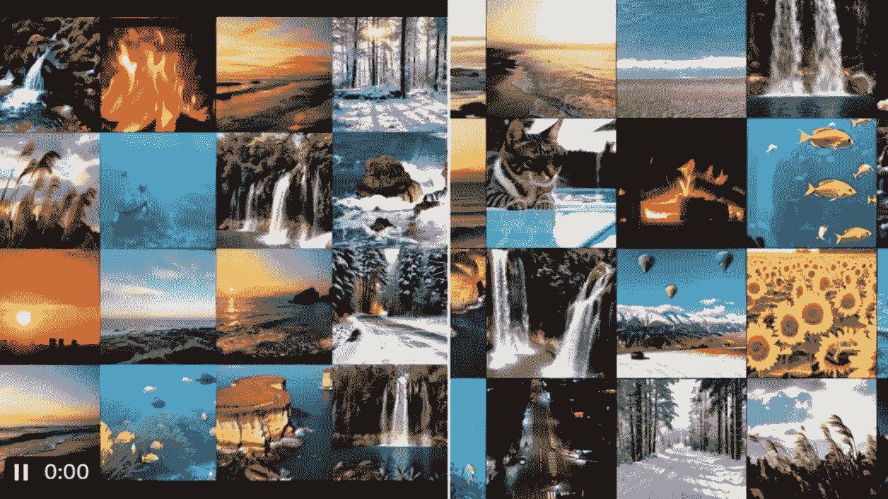

### 第一个能听懂人类语气的AI火了，网友：感觉在和真人交谈

贡献人：

https://mp.weixin.qq.com/s/QnPpniRafBwUOF0GVhAaKw

第一个能听懂你说话的语气、有“情商”的AI火了！这个AI名为`EVI`（`Empathic Voice Interface`），它不仅能够能够理解用户的语气，还会为每个词增加意义。对话中的每句话，它都能可视化含惊讶量、含悲伤量、含兴奋量……然后根据用户的声音信号来变换自己的语音语调，给出高情商回答。`EVI`发布后，网友再次沸腾，称其为“语音交互的游戏规则改变者”。背后公司来自Hume AI。

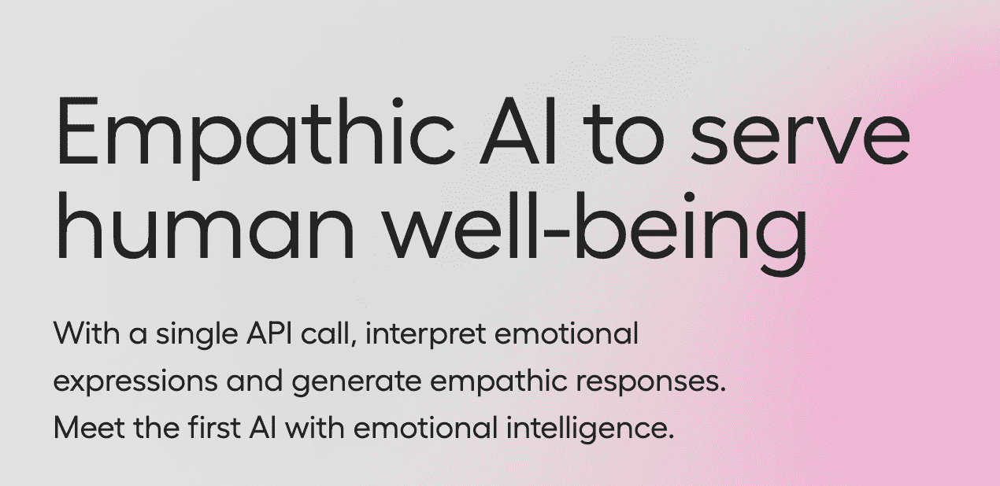

### 北大&火山引擎夺冠！`CLIC`视频压缩挑战赛结果公布，中国团队表现亮眼

贡献人：

https://mp.weixin.qq.com/s/YoP5bhPXQ4rQujGmIDTecg

随着以深度学习为代表的新一代人工智能技术不断取得突破，学术界与工业界逐渐意识到人工智能技术在图像、视频压缩领域的巨大应用潜力。基于深度学习的图像视频压缩技术被视为超越传统压缩技术能力极限、取得突破性进展的明日之星。近日，第六届深度学习图像压缩挑战赛（以下将简称“`CLIC`大赛”）比赛结果公布，由火山引擎多媒体实验室与北大组成的联合参赛平台`b-2`在高码率视频压缩和低码率视频压缩两个赛道均夺得主客观指标冠军。基于深度学习技术，`b-2`平台提出了一项“传统-智能混合解决方案”。

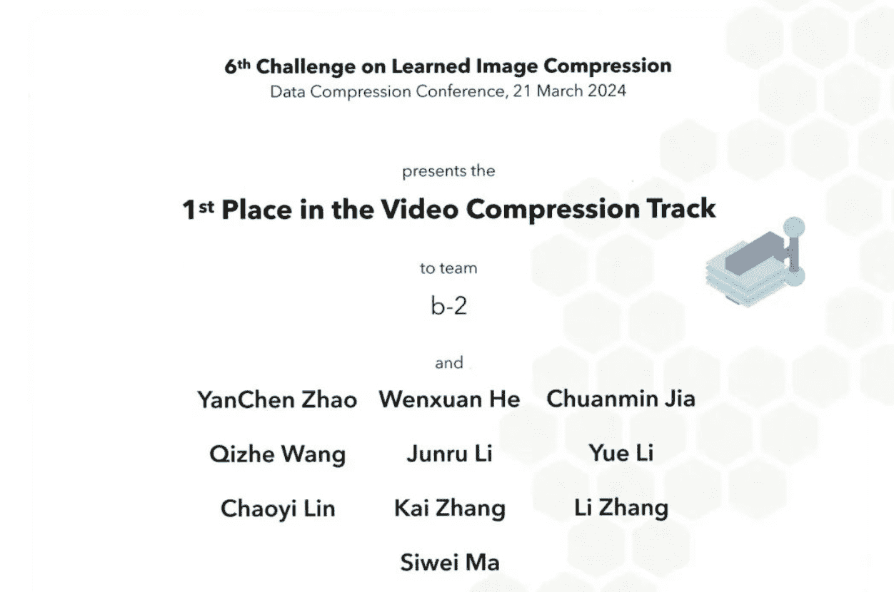

### 多模态大模型有了统一分割框架，华科`PSALM`多任务登顶，模型代码全开源

贡献人：

https://mp.weixin.qq.com/s/LwaYUEom-PKkWbNWZ3RaGA

华中科技大学的研究团队针对多模态大模型（`LMM`）在视觉任务中的应用挑战，推出了针对性的解决方案：`PSALM` 模型。这一模型的设计理念是：通过一个统一的框架处理绝大多数类型的图像分割任务，从而实现分割任务的全面覆盖。同时，得益于多模态大模型广泛的预训练，`PSALM` 不仅在已见分割任务上表现出色，更在诸多未曾训练过的开放场景分割任务中，展现出强大的零样本泛化能力。多模态大模型作为视觉任务统一框架的巨大潜力得到进一步挖掘。

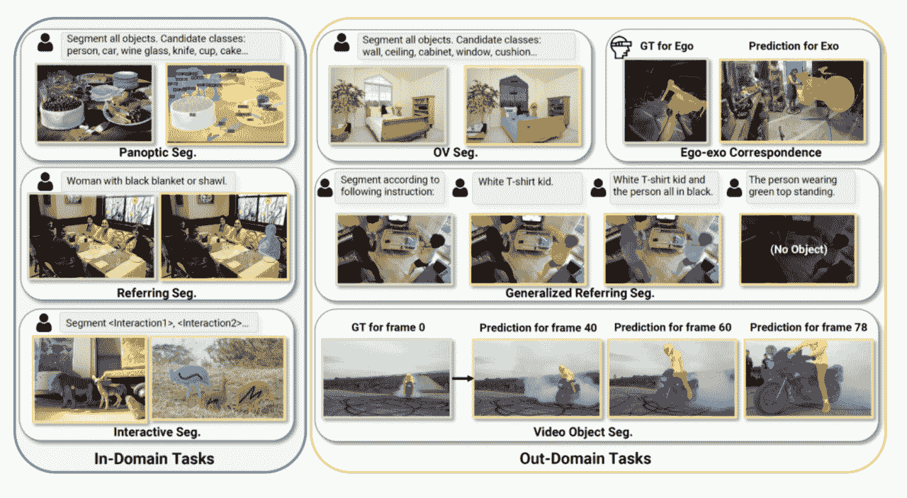

### 无需训练，这个新方法实现了生成图像尺寸、分辨率自由

贡献人：

https://mp.weixin.qq.com/s/FgqN-f-PKGhNmTMaNSc1yw

近日，来自香港中文大学 - 商汤科技联合实验室等机构的研究者们提出了`FouriScale`，该方法在利用预训练扩散模型生成高分辨率图像方面取得了显著提升。`FouriScale` 通过引入空洞卷积操作和低通滤波操作来替换预训练扩散模型中的原始卷积层，旨在实现不同分辨率下的结构和尺度一致性。配合「填充然后裁剪」策略，该方法能够灵活生成不同尺寸和长宽比的图像。此外，借助 `FouriScale` 作为指导，该方法在生成任意尺寸的高分辨率图像时，能够保证完整的图像结构和卓越的图像质量。`FouriScale` 无需任何离线预计算，具有良好的兼容性和可扩展性。定量和定性实验结果表明，`FouriScale` 在利用预训练扩散模型生成高分辨率图像方面取得了显著提升。

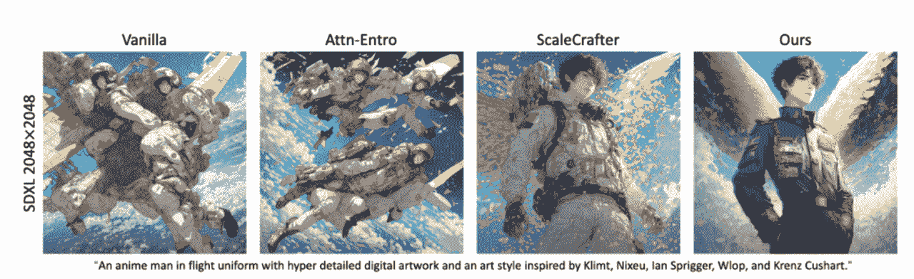

### 3倍灵敏度，搜索百万蛋白对只需几秒，复旦、山大、上海交大开发新的蛋白质语言模型

贡献人：

https://mp.weixin.qq.com/s/u1umvHdTUqQqZYvJrC7Ikw

同源蛋白质搜索是蛋白质注释和分析最常用的方法之一。与结构搜索相比，仅从序列中检测远程进化关系仍然具有挑战性。复旦大学、山东大学以及上海交通大学的研究团队提出了 `PLMSearch`（`Protein Language Model`），一种仅以序列作为输入的同源蛋白质搜索方法，能够捕获隐藏在序列后面的远程同源信息。`PLMSearch` 可以像 `MMseqs2` 一样在几秒钟内搜索数百万个查询目标蛋白质对，同时将灵敏度提高三倍以上，可与当前最先进的结构搜索方法相媲美。此外，与传统的序列搜索方法不同，`PLMSearch` 可以召回具有不相似序列但结构相似的大多数远程同源对。

### CVPR 2024｜`FairCLIP`：首个多模态医疗视觉语言大模型公平性研究

贡献人：

https://mp.weixin.qq.com/s/EEe4Z1OrKaKqr5xXr3vipg

公平性在深度学习中是一个关键问题，尤其是在医疗领域，这些模型影响着诊断和治疗决策。尽管在仅限视觉领域已对公平性进行了研究，但由于缺乏用于研究公平性的医疗视觉-语言(`VL`)数据集，医疗`VL`模型的公平性仍未被探索。为了弥补这一研究空白，介绍了第一个公平的视觉-语言医疗数据集（`FairVLMed`），它提供了详细的人口统计属性、真实标签和临床笔记，以便深入检查`VL`基础模型中的公平性。使用`FairVLMed`，针对两个广泛使用的`VL`模型（`CLIP`和`BLIP2`）进行了全面的公平性分析，这些模型在自然图片和医疗图片领域都有预训练，涵盖了四个不同的受保护属性信息。我们的结果突出显示了所有`VL`模型中的显著偏见，亚洲人、男性、非西班牙裔和西班牙语者分别是种族、性别、族裔和语言这些受保护属性中的首选组别。为了减轻这些偏见，`FairCLIP`，一种基于`optimal-transport`的方法，通过减少整体样本分布与每个人口统计组之间的`Sinkhorn`距离，实现了性能和公平性之间的有利折衷。作为首个研究公平性的`VL`数据集，`FairVLMed`对研究模型公平性实现既具有伦理意识又在临床上有效的机器学习模型的潜力。

## 论文

### 中文迷你 `LLM`：预训练一个以中文为中心的大语言模型

贡献人：

链接：http://arxiv.org/abs/2404.04167v1

在这项研究中，我们介绍了CT-LLM，一个2B大型语言模型（LLM），展示了在开发LLM时向中文语言优先的重要转变。独特地从零开始，CT-LLM与传统方法有所不同，主要融合了中文文本数据，利用了一个包括12,000亿个token的庞大语料库，其中包括了80亿个中文token、30亿个英文token和10亿个代码token。这种战略性构成加强了模型在理解和处理中文方面的卓越能力，并通过对齐技术进一步增强。在CHC-Bench上表现出色，CT-LLM在中文任务中表现出色，并通过SFT展示了其在英文方面的熟练技能。这项研究挑战了主要在英语语料库上训练LLM，然后将它们适应其他语言的盛行范式，拓宽了LLM训练方法的视野。通过公开完整的训练中文LLM过程，包括详细的数据处理流程，获得的大规模预训练中文语料库（MAP-CC），一个精心选择的跨学科中文难题基准（CHC-Bench）和2B规模的中文微型LLM（CT-LLM），我们旨在促进学术界和工业界进一步探索和创新，为更具包容性和多功能性的语言模型铺平道路。

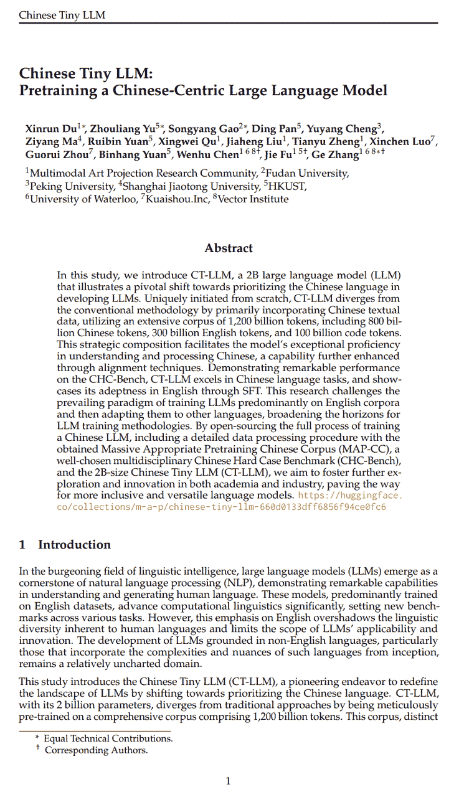

## 搜索流 (SoS)：学习在语言中搜索

贡献人：

链接：`http://arxiv.org/abs/2404.03683v1`

语言模型在训练过程中很少展示出有效的错误。它们很难超越下一个token，并且遭受错误的越滚越大，难以预测数步以后的后果。本文展示了如何通过在语言中表示搜索过程，将语言模型教授如何搜索，即作为一个扁平化的字符串-搜索流。我们提出了一个统一的搜索语言，涵盖了各种不同的符号搜索策略。我们使用了简单但困难的Countdown游戏来演示我们的方法，目标是将输入数字与算术运算结合以达到目标数字。我们从头开始在一个由启发式求解器生成的搜索流数据集上对基于Transformer的语言模型进行了预训练。结果表明，SoS预训练将搜索准确性提高了25%，优于仅训练以预测最优搜索轨迹的模型。我们进一步使用两种政策改进方法对此模型进行微调：优势诱导策略对齐（APA）和自学习推理器（STaR）。微调后的SoS模型解决了36%以前无法解决的问题，包括任何启发式求解器都无法解决的问题。我们的结果表明，语言模型可以通过搜索学会解决问题，自我改进以灵活使用不同的搜索策略，并潜在地发现新策略。

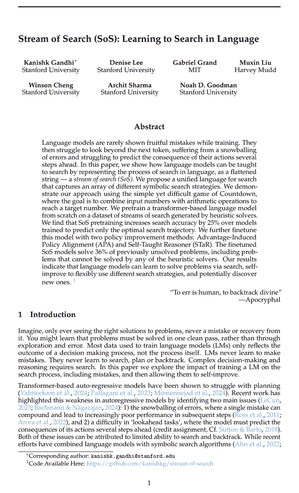

## 没有指数数据级别，就没有`zero-shot`：预训练概念频率决定了多模态模型的性能

贡献人：

链接：`http://arxiv.org/abs/2404.04125v1`

网络爬虫的预训练数据集支撑着多模态模型（如用于分类/检索的CLIP和用于图像生成的稳定扩散）令人印象深刻的`zero-shot`评估性能。然而，对于这些多模态模型而言，“`zero-shot`”泛化的概念到底有多有意义尚不明确，因为尚不清楚它们的预训练数据集在“`zero-shot`”评估期间所针对的下游概念的范围有多大。在这项研究中，我们问道：多模态模型在下游概念上的表现如何受其预训练数据集中这些概念的频率影响？我们全面调查了34个模型和五个标准的预训练数据集（CC-3M，CC-12M，YFCC-15M，LAION-400M，LAION-Aesthetics），生成了超过300GB的数据。我们一致发现，多模态模型远非表现出“`zero-shot`”泛化，需要指数级增加数据才能在线性改进下游“`zero-shot`”性能，遵循一种样本低效的对数线性缩放趋势。这种趋势甚至在控制预训练和下游数据集之间的样本级相似性，并在纯合成数据分布上进行测试时仍然存在。此外，在基于我们的分析对长尾数据进行采样进行基准测试后，我们发现，整体而言，多模态模型表现不佳。我们将这种长尾测试集贡献给进一步研究这个方向的“`Let it Wag!`”基准测试。总之，我们的研究揭示了训练数据的指数级需求，这意味着在大规模训练范式下实现“零-shot”泛化能力的关键仍有待发现。

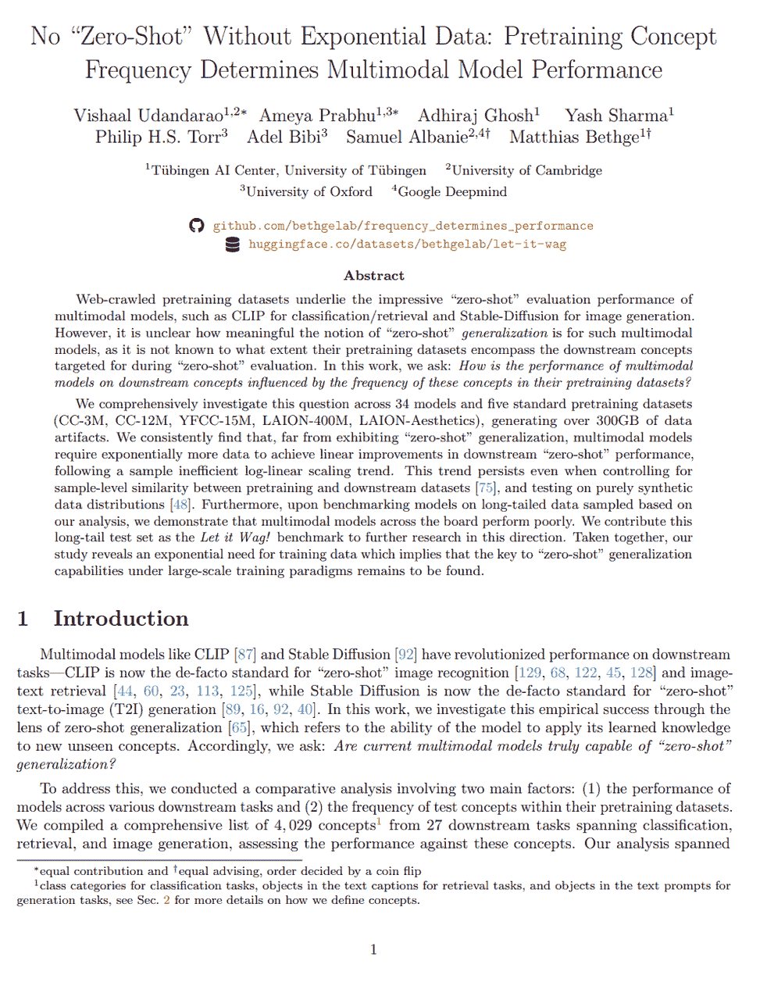

## 从设计上可验证化：对齐语言模型使其引用预训练数据

贡献人：

链接：`http://arxiv.org/abs/2404.03862v1`

人类要信任大型语言模型（LLMs）流利的生成内容，他们必须能够通过可信的外部来源验证其正确性。最近的努力旨在通过引用检索文档或事后来来源来增加可验证性。然而，这种引用很容易出现错误，进一步复杂了可验证性。为了解决这些限制，我们采用了一种不同的哲学来实现可验证性目标：我们通过开发模型从预训练数据中引用可信源的言辞来简化验证过程。我们提出了Quote-Tuning，它展示了将LLMs与预训练数据中记忆的信息对齐并引用的可行性。Quote-Tuning使用高效的成员推断工具来量化对大型语料库的引用，并使用引用数量作为隐式奖励信号构建引用的合成偏好数据集，而无需任何人工注释。接下来，目标模型通过偏好优化算法对齐引用。实验结果显示，相对于未调整的模型，Quote-Tuning将LLM生成的引文从高质量预训练文档中引述的比例提高了55%至130%，同时保持响应质量。进一步的实验表明，Quote-Tuning将引用泛化到领域外数据，适用于不同任务，并为真实性提供额外的好处。Quote-Tuning不仅作为一种无忧的增加引文的方法，还为通过更好的可验证性提高LLM的可信度打开了新途径。

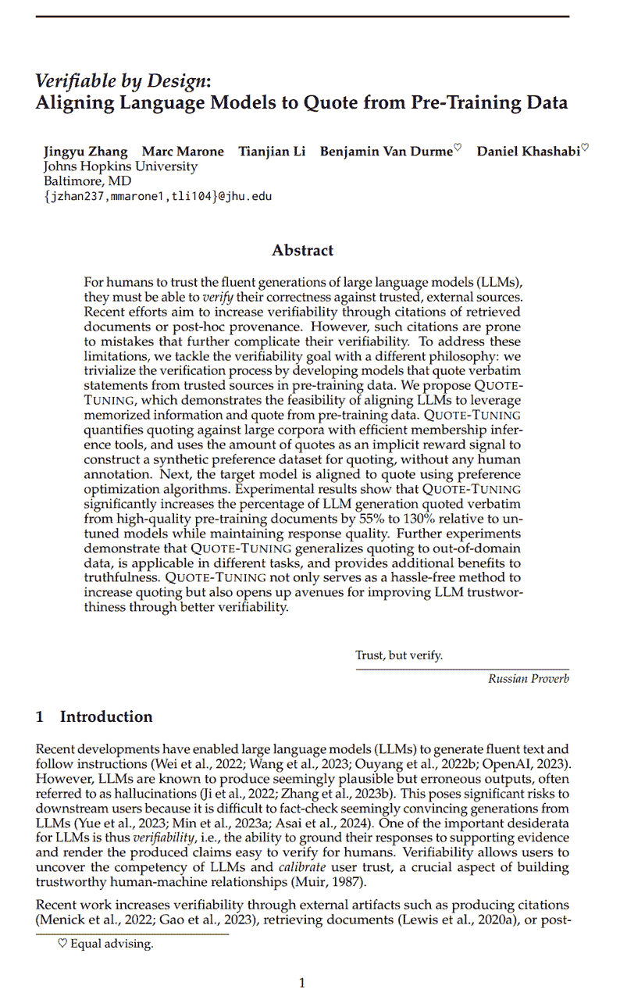

## FFN-SkipLLM：自回归解码中的隐藏宝石与自适应前馈跳跃

贡献人：

链接：`http://arxiv.org/abs/2404.03865v1`

自回归的大语言模型（如LLaMa，GPTs）无处不在，在语言理解和生成方面取得了显著成功。然而，这种令人印象深刻的能力通常伴随着庞大的模型大小，对自回归逐标记生成提出了重大挑战。为了减轻生成过程中的计算负担，提出了一些早期退出和层丢弃策略。尽管在Rough-L/BLUE等指标上LLM层之间的冗余带来了一些令人满意的成功，但我们精心的知识密集型评估揭示了诸如生成坍塌、错误事实的幻觉以及即使在仅有10-15%层比率的轻微退出处性能明显下降等问题。我们主要将这些错误归因于在早期退出过程中通过状态复制无效处理KV缓存。在这项工作中，我们观察到了LLM层中计算昂贵的前馈块的饱和，并提出了FFN-SkipLLM，这是一种自回归LLM的新颖细粒度跳过策略。更具体地说，FFN-SkipLLM是一种输入自适应的前馈跳过策略，可以跳过25-30%的LLMs的FFN块，在知识密集型生成任务上性能略有改变，而无需处理KV缓存。我们在MT-Bench，Factoid-QA和可变长度文本摘要等基准上的大量实验证明了我们简单易用的方法如何促进更快的自回归解码。

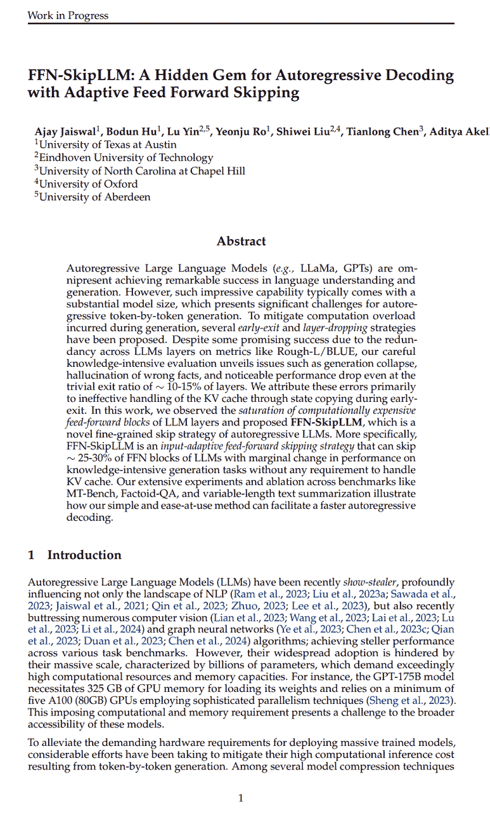

# 产品

## Opusclip

贡献人：

`https://clip.opus.pro/captions`

OpusClip Captions 是一款免费的 AI 工具，可让用户最喜欢的创作者的风格为视频添加动画字幕，由 GPT-4 提供支持。它有一键式动画字幕、让用户可以使用用户喜欢的创作者的字幕模板、支持 20 多种语言以及各种纵横比（9：16、16：9 或 1：1）等功能。OpusClip Captions 与著名创作者合作，以获得最佳的字幕样式，用户只需单击一下即可将他们的字幕样式添加到视频中。用户还可以在评论中提名并投票选出他们最喜欢的样式。

## Faraway

贡献人：

`https://apps.apple.com/es/app/faraway-build-movies-with-ai/id1671313231`

Faraway 是一款让用户可以使用 AI 构建简单电影的应用程序，用户通过简单的拍照就可以完成电影基础布景的选择即可借助 AI 完成后续工作。除此，产品还可以帮助用户完成风格和构图控制，AI 配音，字幕调整等，同时它也是一个简单而强大的编辑器。

# HuggingFace&Github

## Octopus-v2

贡献人：

`https://huggingface.co/NexaAIDev/Octopus-v2`

Octopus-V2-2B 是一款拥有 20 亿参数的开源语言模型，代表了 Nexa AI 在函数调用中应用大型语言模型的研究突破，专为 Android API 量身定制。与检索增强生成 （RAG） 方法不同，RAG 方法需要对潜在的函数参数进行详细描述，有时需要多达数万个输入 token，而 Octopus-V2-2B 在其训练和推理阶段都引入了独特的函数 token 策略。这种方法不仅使其能够达到与 GPT-4 相当的性能水平，而且还显着提高了其推理速度，超过了基于 RAG 的方法，使其对边缘计算设备特别有利。

## Instantstyle

贡献人：

`https://instantstyle.github.io`

InstantStyle 旨在通过将样式和内容与特征空间内的参考图像分离，并将参考图像特征专门注入到特定样式的块中，解决图像风格生成中的挑战，展示出卓越的视觉风格化效果，并在风格的强度和文本元素的可控性之间取得最佳平衡。

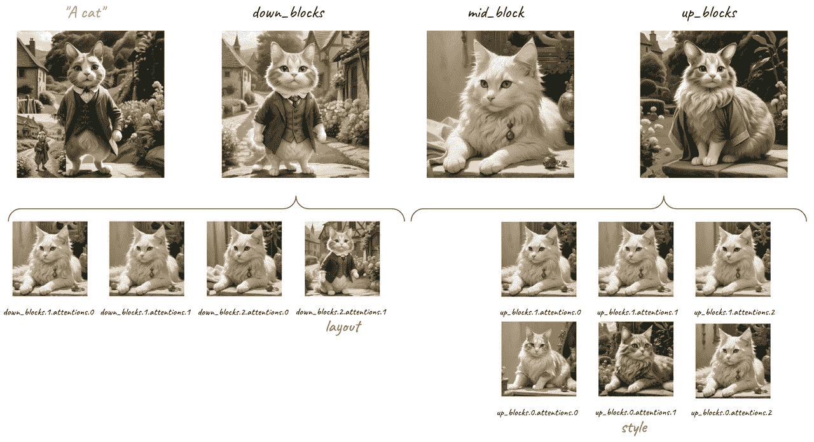

## XVERSE-MoE-A4.2B

贡献人：

`https://huggingface.co/xverse/XVERSE-MoE-A4.2B`

XVERSE-MoE-A4.2B 是由深圳元象科技自主研发的支持多语言的大语言模型（Large Language Model），使用混合专家模型（MoE，Mixture-of-experts）架构，模型的总参数规模为 258 亿，实际激活的参数量为 42 亿，本次开源的模型为底座模型 XVERSE-MoE-A4.2B。

# 投融资

## AI角色创作平台「捏Ta」完成超千万元融资

`https://www.163.com/dy/article/IV8E4OQO05118DFD.html`

AI角色创作平台“捏Ta”（公司名为“看见概念”）已完成天使轮和Pre-A轮融资，总额超千万元人民币，由源码资本和奇绩创坛等机构投资。资金将用于模型优化、增强多模态功能及社交玩法开发。捏Ta利用自研多模态AI模型，支持用户基于热门IP或原创角色进行同人漫创作，提供AI漫画和虚拟角色内容生成工具，满足二次元玩家的创作需求。自2023年4月上线以来，捏Ta在社交媒体的曝光量已达2.5亿次，证明了其产品市场契合度（PMF）的初步验证。

公司官网：`http://official.talesofai.cn/`

## 「博瀚智能」完成数千万人民币战略融资

贡献人：

`https://www.36kr.com/p/2722957421056644`

博瀚智能，一家中国领先的Data Centric AI赋能平台及解决方案服务商，近日宣布获得海创汇的数千万人民币新一轮战略融资。本轮融资由光源资本担任独家财务顾问，将用于加速前沿技术研发和尖端设备投入，持续巩固其在国内通用AI开发平台的领先地位。博瀚智能专注于将Data Centric AI范式应用于更多垂直场景，推动AI在复杂应用场景中的高效落地。

## Celestial AI完成1.75亿美元C轮融资

贡献人：

`https://www.celestial.ai/blog/celestial-ai-closes-175-million-series-c-funding-round-led-by-us-innovative-technology-fund`

Celestial AI公司近日成功完成了高达1.75亿美元的C轮融资，这标志着该公司在光学互连技术平台——“光子结构”技术领域的重大突破和商业化进程中迈出了坚实的一步。这笔资金由美国创新技术基金（USIT）领投，得到了多家新老投资者的支持。Celestial AI的光子结构技术旨在优化数据传输，特别是在处理带宽密集型的高级AI工作负载时，能够显著减少数据在转换过程中的损失，从而解决了当前计算行业面临的“内存墙”问题。这次融资的成功不仅为Celestial AI提供了强大的动力，也为公司未来的发展奠定了坚实的基础。

公司官网：`https://www.celestial.ai/`

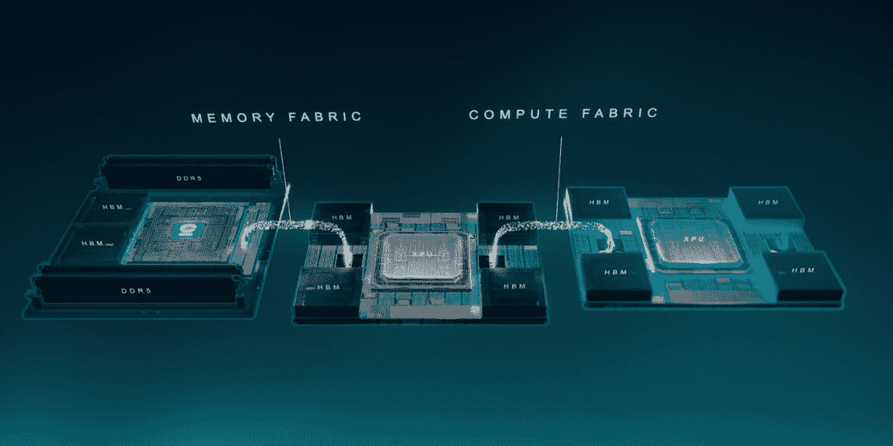

## 数字生命技术公司「MyTwins.ai」完成将门创投领投千万元天使轮融资

贡献人：

`https://mp.weixin.qq.com/s/XrB2vbA6UlkPww6xyQfx-A`

数字生命技术公司「MyTwins.ai」宣布完成千万元人民币级别的天使轮融资，由将门创投、永禧资产、西湖科创投联合领投，元启资本担任独家财务顾问。资金将用于技术研发、设备采购、市场拓展等方面。MyTwins.ai专注于利用AGI技术为每个人创造数字分身，其核心团队成员拥有深厚的技术背景和丰富的行业经验，已与多名头部主播合作成功，展示了技术的实用性和市场潜力。此轮融资标志着公司技术研发和市场扩张的新阶段。

公司官网：`https://www.maituai.com/`

## OpenAI融资盘点

贡献人：

`https://mp.weixin.qq.com/s/e08KhGzDtvbauxpWKDxdew`

文章探讨了OpenAI如何在10年间通过融资超过143亿美元（约合1034.30亿元人民币），估值超过800亿美元（约5786.32亿元人民币）成为AI领域的巨兽。OpenAI能够吸引顶尖人才，部分原因是其提供高达500万-1000万美元的年薪。例如，OpenAI从硅谷的科技巨头中“挖角”了许多优秀人才，包括谷歌、Meta、亚马逊等。此外，OpenAI的技术创新，如ChatGPT和Sora，依赖于其核心理念——Scaling Law，即模型、计算量和数据规模越大，性能越好。OpenAI的成长离不开微软的支持，微软向OpenAI投资了约130亿美元，并为其提供算力支持。此外，微软还计划与OpenAI共同投资超过1150亿美元建设名为“星际之门”的AI超算数据中心，预计2026年落地。

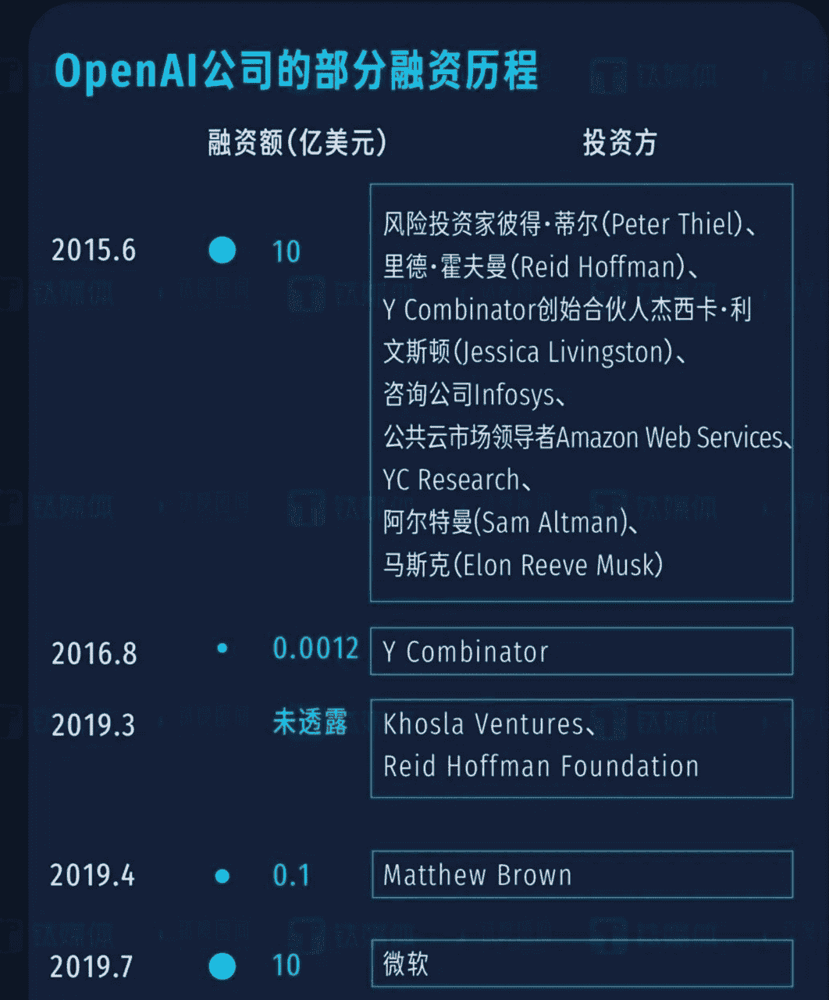

# 学习

## 生成扩散模型漫谈（二十二）：信噪比与大图生成

贡献人：

`https://kexue.fm/archives/10047`

本文探讨了高分辨率图像生成的挑战和解决方案。当前多数高分辨率图像生成工作通过Encoder变换至Latent空间进行，即Latent Diffusion Model (LDM)，直接在原始Pixel空间训练的模型分辨率较低。文章分析了大图生成的困难，特别是信噪比（Signal-to-Noise Ratio, SNR）在高分辨率扩散模型学习效率中的作用，并介绍了论文《Simple diffusion: End-to-end diffusion for high resolution images》的方法，通过优化noise schedule和多尺度Loss等技巧，在Pixel空间直接生成高达1024*1024分辨率的图像，有效地提高了训练效率和效果。

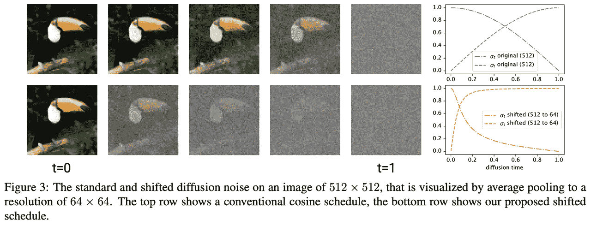

## 时空之章：将Attention视为平方复杂度的RNN

贡献人：

`https://zhuanlan.zhihu.com/p/691319860`

本文探讨了RNN与Attention模型的对比和结合可能性。随着RNN的“文艺复兴”，文章指出，尽管RNN在训练和推理效率上具有线性的时间复杂度优势，但其空间复杂度的常数特性可能限制了在长上下文任务中的表现。通过将Causal Attention重写为RNN的形式，作者揭示了Attention的空间复杂度理论上可以达到常数级别，但以牺牲极高的时间复杂度为代价。这一发现表明，Attention模型的优势可能并非来自其直观上的空间扩展，而是通过增加计算量来实现的。文章进一步讨论了RNN和Attention在模拟人脑处理信息方式上的相似性与差异，以及尝试通过增强RNN模型引入“翻书”能力的可能路径。通过这些探讨，文章为理解和改进现有序列处理模型提供了新的视角。

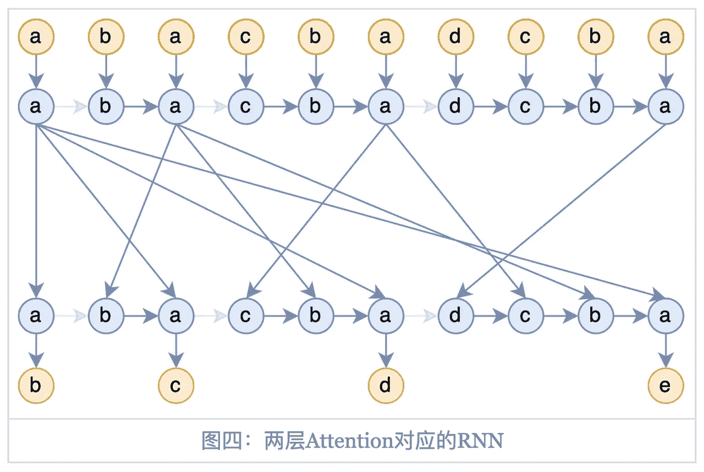

## cuTENSOR 2.0：用于加速张量计算的全面指南

贡献人：

`https://zhuanlan.zhihu.com/p/691242410`

NVIDIA cuTENSOR 2.0 是一款CUDA数学库，专门用于优化的张量运算。此版本对`API`进行了重构，使其更加表达丰富，并在NVIDIA Ampere和NVIDIA Hopper GPU架构上实现显著性能提升。cuTENSOR 2.0 支持元素式API、归约API和收缩API，分别对应于1级、2级和3级`BLAS`运算，可扩展至多维度。它的优化允许开发者专注于算法而非性能细节，并支持多种编程语言，包括`Fortran`、`Python`和`Julia`。cuTENSOR 2.0引入了即时编译支持，特别适用于高维张量收缩任务，如量子电路模拟。此外，还提供了对张量排列的灵活控制，包括填充支持以满足对齐要求或优化后续运算性能。cuTENSOR的使用简化了高性能计算任务，特别是在机器学习和量子化学领域。

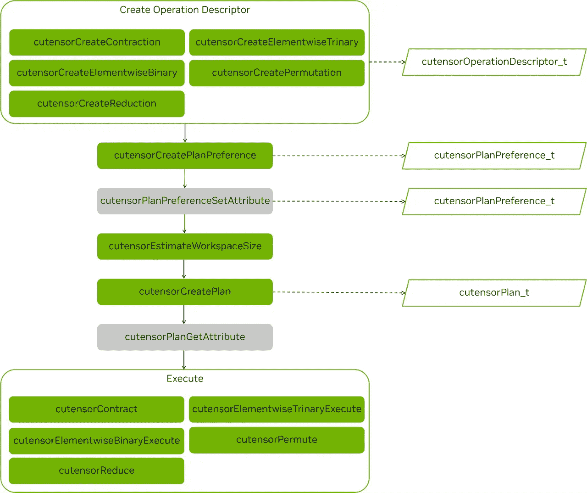

## 当计算撞上内存墙：Attention！注意力机制及其优化算法浅析

贡献人：

`https://zhuanlan.zhihu.com/p/672659900`

# 大模型日报

文章深入探讨了注意力机制（`Attention`）对内存容量和带宽需求的影响。随着大语言模型（如LLaMA 2）的迅猛发展，NVIDIA发布的H200显卡突出了内存容量和带宽的提升，而不是算力单元的改变，反映出GPU内存在现代AI开发中的重要性。文章从《Attention Is All You Need》论文出发，分析了`Attention`机制如何通过`FlashAttention`和`PagedAttention`等优化算法减少内存需求，解释了大模型对内存的依赖及其在处理长上下文时的限制。此外，讨论了内存在模型训练和推理中的关键角色，以及优化内存使用的各种技术，包括`KV Cache`和`PagedAttention`。

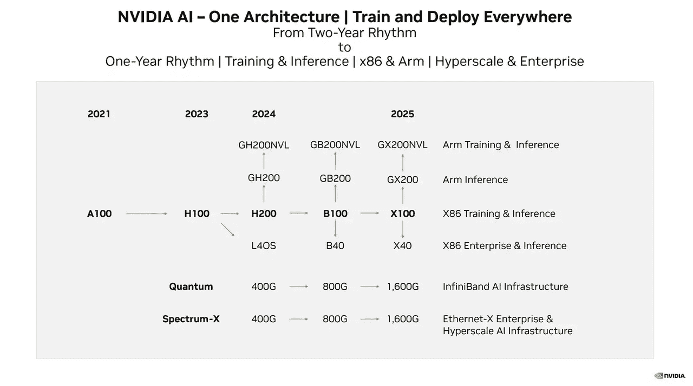

## AI硬件：Looi，万字深度解析

`https://mp.weixin.qq.com/s/ZVLxoCa4YV-RBXmihmObFw`

文章介绍了Looi，一款能将智能手机变身为桌面机器人的硬件产品。自从发布至Kickstarter以来，Looi获得了超过60倍的认购，甚至吸引了马斯克的注意。该产品利用仿生行为系统和集成了ChatGPT的功能，能够通过对话与用户互动，并提供丰富的情感表达。Looi旨在加强人与智能手机的连接，提供包括情感交互、视觉识别能力、远程遥控等增强功能。此外，Looi强调隐私保护，所有数据仅在本地处理，不依赖云服务。这不仅是一款智能手机外挂增强器，而且代表了一种新的AI硬件产品范式，旨在通过有形交互方式，为用户与智能设备之间的互动提供更自然、更富有情感的体验。

## GPU 经济学：算力背后的成本与未来

贡献人：

`https://mp.weixin.qq.com/s/Ob56_GFomY5KGbe0dPh9hA`

文章深入探讨了GPU芯片及其在人工智能发展中扮演的角色，特别是在算力需求日益增长的背景下。文章通过访谈CoreWeave公司的联合创始人Brannin McBee，揭示了GPU市场的现状及其面临的挑战，包括算力供应短缺和能源消耗问题。文章指出，数据中心的电力供应成为限制算力增长的主要瓶颈，而创新的冷却技术和建设位置的选择成为应对挑战的关键。McBee预测，到2030年，算力供需可能达到平衡。此外，文章还讨论了大型语言模型训练的物理难题和AI新基建的供需问题，展望了GPU云基础设施市场的未来趋势。

# 声明

本文档仅供学习交流使用，版权归原作者所有，若涉侵权，请联系Jack Jin 15101136166

（欢迎在下方反馈您宝贵的意见！整理不易，觉得有用给AI日报小组点个赞👍吧！）

ChatGPT；Angela；Zijia Liu；Alex；Zeqi Tan；Tiezhen（HuggingFace）；Naixu；Lizhi；Peter；Suoman；Jack

封面生成——右脑科技

如果你有大模型相关的创业想法，欢迎来找我们聊聊～🛰️：15101136166

> 快邀请你的小伙伴们一起来读大模型日报吧！

> **【日报知识库】**这里是近期日报内容的汇总，欢迎大家查阅

> [大模型日报知识库(分享版)](https://miracleplus.feishu.cn/wiki/KapVwXfkriOBiskB0B2cUHxjnTh)

>

> 欢迎大家多多帮我们分享,转发

> 如果大家有任何的建议或者吐槽,欢迎随时找我聊天~

