# 奇绩大模型日报（4月 3日）

> 来源：[https://miracleplus.feishu.cn/docx/DyaWd5rq1oSr4AxDscPciripnSf](https://miracleplus.feishu.cn/docx/DyaWd5rq1oSr4AxDscPciripnSf)

## 推特

### HuggingFace发布两个用于OCR(从PDF/图像中提取文本的任务)的最大开源数据集

贡献人：

https://x.com/ClementDelangue/status/1775217191421350160?s=20

我们刚刚发布了两个用于OCR(从PDF/图像中提取文本的任务)的最大开源数据集。@m_olbap、@wightmanr 和团队做得非常出色!https://huggingface.co/collections/pixparse/pdf-document-ocr-datasets-660701430b0346f97c4bc628

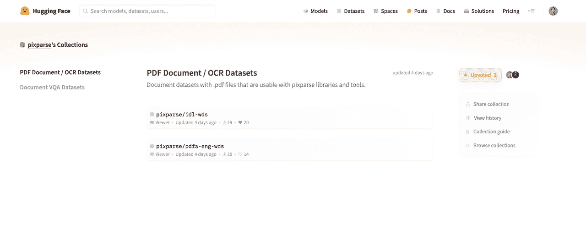

### 面向开发者的无服务器 LLM：部署在Cloudflare上，提供无服务器 GPU 推理

贡献人：

https://x.com/_philschmid/status/1775146868630032405?s=20

面向开发者的无服务器 LLM!🌪️ 我们很高兴在 @huggingface 上宣布"部署在 @Cloudflare Workers AI 上",使开发者能够轻松地使用由 Cloudflare 边缘 GPU 数据中心驱动的开放 LLM 作为无服务器 API。🚀😍 这是我们与 Cloudflare 合作伙伴关系的第一次整合。🤝

入门:https://huggingface.co/blog/cloudflare-workers-ai

简而言之:

✅ 为我们流行的开放模型提供无服务器 GPU 推理

💰 按请求付费定价,只为使用的计算付费

🌐 由 Cloudflare 全球无服务器 GPU 网络提供支持

📚 可用模型:Llama、Gemma、Mistral 等。

🔗 集成选项:Workers AI REST API 或 Cloudflare AI SDK

我们才刚刚开始!@CloudflareDev 🤝 @huggingface 🤗☁️

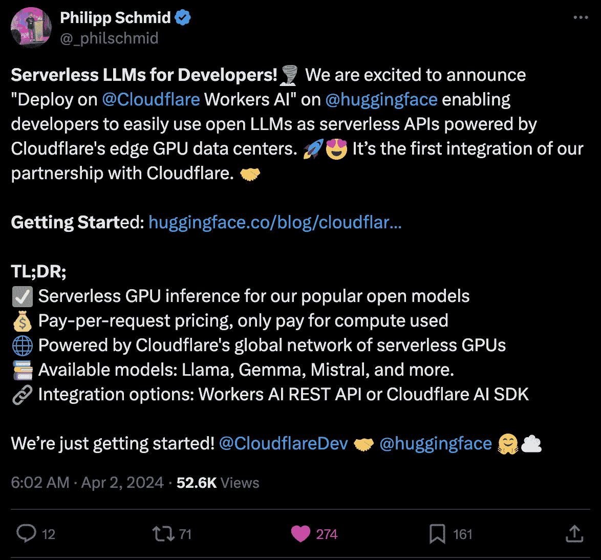

### Witten分享交互式提示工程教程：使用Anthropic API的互动式文档

贡献人：

https://x.com/zswitten/status/1775187565219631155?s=20

我已经迫不及待地想了六个月要更努力地推广这个了,现在 Anthropic API 正式发布了,我终于可以这样做了……交互式提示工程教程!

https://docs.google.com/spreadsheets/d/19jzLgRruG9kjUQNKtCg1ZjdD6l6weA6qRXG5zLIAhC8…… 在我看来,这是学习提示最好、最有趣的方式。把它分享给你生活中的主题专家/数据科学家吧!

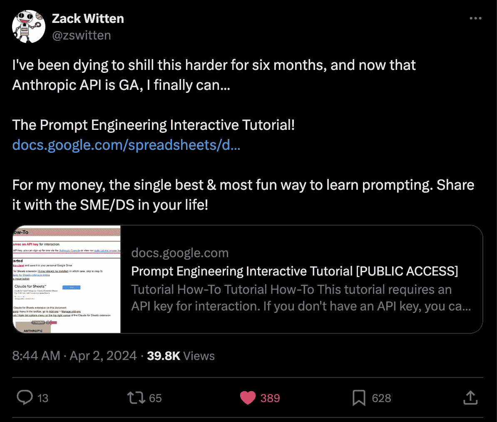

### Notebook企业高级文档解析：5种性能出色且可以适应企业级规模的文档解析方法

贡献人：

https://x.com/giannis2two/status/1775208991905243499?s=20

[Notebook: 企业高级文档解析](https://colab.research.google.com/drive/1xJzQdsgy6zH7H1igwT2CTx-JzgG0mCq2?usp=sharing)

文档解析是几乎每个基于文档的RAG应用程序都必须处理的一个复杂问题。我在@cohere的团队反复问自己以下问题(续)

1) 解析文档数据最准确的方法是什么?

2) 如果我的文档是`.csv`、`.pdf`、`.pptx`、`.png` 格式怎么办?或者更糟的情况是这些格式的组合(带图片的`pdf`,带图片的`pptx`)?

3) 企业想要使用什么样的设置?他们是否受限于特定的云服务提供商?

@justinsylee 和我整理了一个 notebook,详细介绍了5种性能出色且可以适应企业级规模的文档解析方法。我们涵盖的用例是在一个21页的FDA药品审批PDF上使用RAG + Command-R。

1) Google Document AI @googlecloud

2) AWS Textract @awscloud

3) Unstructured @UnstructuredIO

4) LlamaParse @llama_index

5) `pdf2image` + `pytesseract`

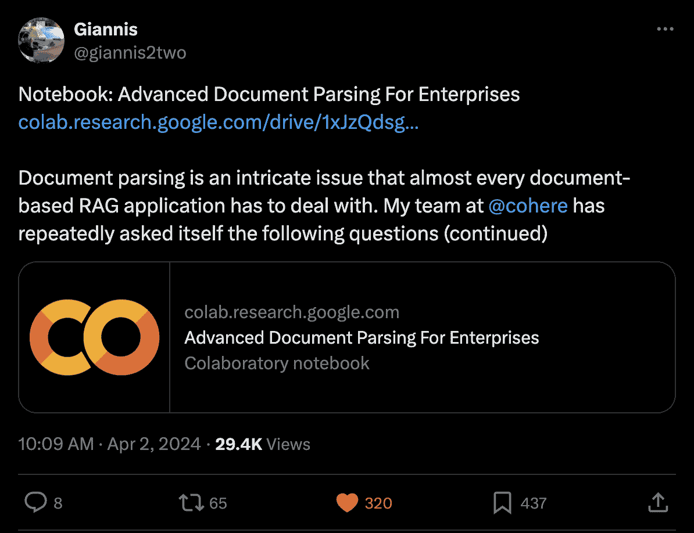

### 谷歌DeepMind新生成模型Genie可从零开始制作类似超级马里奥的游戏

贡献人：

https://x.com/GoogleDeepMind/status/1775162077696360804?s=20

我们的新AI模型Genie可以根据一个图像提示、草图或文本描述,创建出类似2D平台游戏风格的可玩世界。作为一个基础的世界模型,Genie还能帮助我们训练AI智能体。

谷歌DeepMind的新生成模型可从零开始制作类似超级马里奥的游戏

Genie通过观看数小时的视频来学习如何控制游戏。它还可以帮助训练下一代机器人。

[`website2a.mp4`](https://internal-api-drive-stream.feishu.cn/space/api/box/stream/download/all/ELavbYoHVoMnDyxgcFUcTHaWnRd)

### AutoQuant：五种不同的格式量化你的模型

贡献人：

https://x.com/maximelabonne/status/1775095198898422072?s=20

⚡ AutoQuant

AutoQuant 是我之前的 AutoGGUF notebook (https://colab.research.google.com/drive/1P646NEg33BZy4BfLDNpTz0V0lwIU3CHu) 的进化版。

它允许你以五种不同的格式量化你的模型:`GGUF`、`GPTQ`、`EXL2`、`AWQ` 和 H🐧。

💻 AutoQuant:https://colab.research.google.com/drive/1b6nqC7UZVt8bx4MksX7s656GXPM-eWw4?usp=sharing

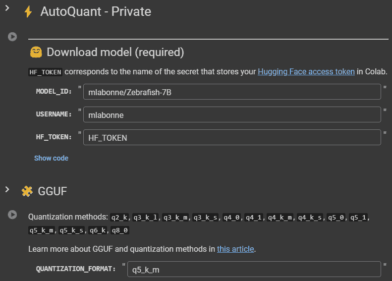

### lightning-whisper-mlx：使用MLX的超快速Whisper

贡献人：

https://x.com/maxaljadery/status/1775196809893478797?s=20

介绍 `lightning-whisper-mlx`,一个使用MLX的超快速Whisper实现。https://mustafaaljadery.github.io/lightning-whisper-mlx/… 性能比Whisper CPP快大约10倍!

`pip install lightning-whisper-mlx`

特性

批量解码 -> 更高的吞吐量

蒸馏模型 -> 更快的解码(更少的层数)

量化模型 -> 更快的内存移动

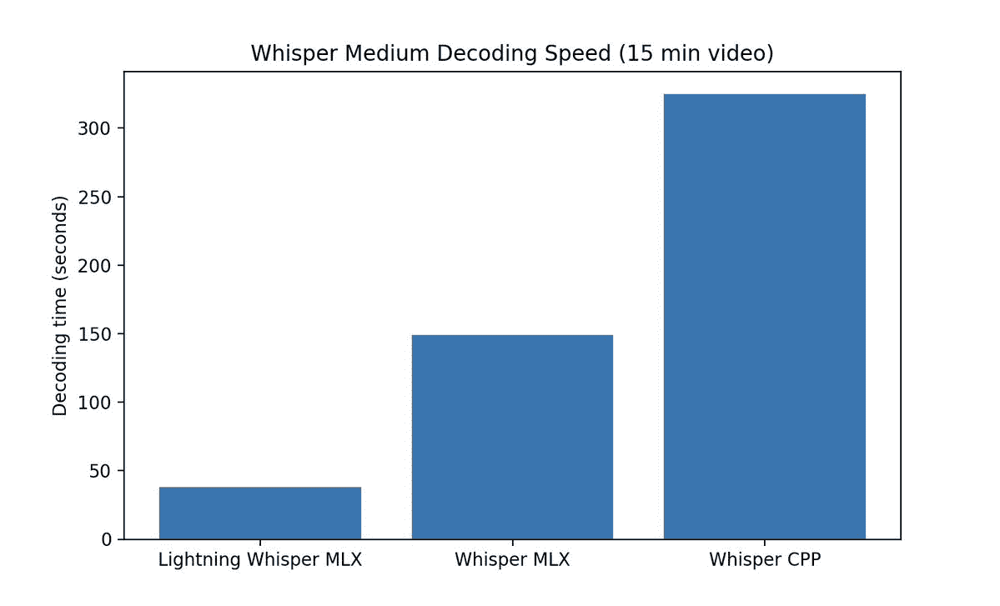

## 资讯

### GPT-4加Agent轻松追平Devin！普林斯顿造，开源首日斩获1.6k星

贡献人：

https://mp.weixin.qq.com/s/gUdh3uwKCY-4eI_RihgiNA

用GPT-4打造的AI程序员，结果轻松追平Devin！普林斯顿打造的开源`SWE-agent`，直接开箱即用——修复GitHub存储库中真实bug。在25%的SWE-bench测试集上，它实现了与Devin相似的准确度—— 解决了12.29%的问题GitHub上线首日即斩获1.6K星。不少网友感叹，只需对GPT-4命令行工具进行简单设计，就可以让GPT-4部分能力大幅提升。

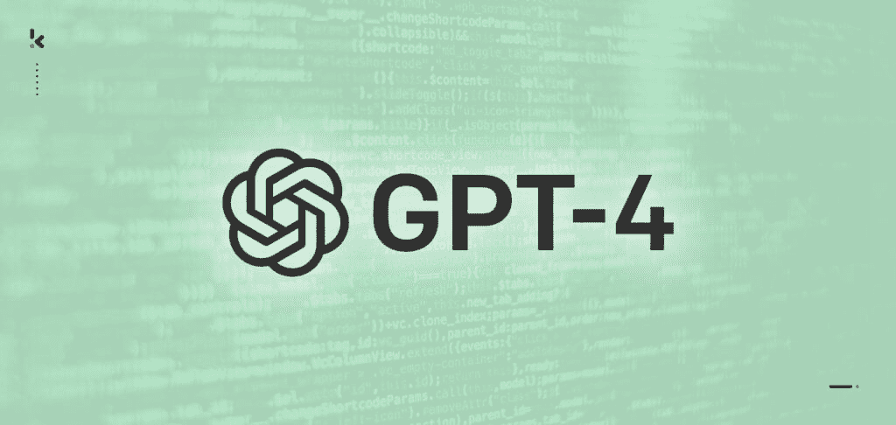

### 国内首个AI程序员入职阿里云：专属工号AI001，KPI是一人写完公司20%代码

贡献人：

https://mp.weixin.qq.com/s/t_OJu1JGrzk7q8A2GAfA0g

你肯定听过一句话：学计算机要从娃娃抓起。在过去的很多年，学习编程都曾经是一件时髦的事，但随着生成式 AI 技术的发展，科技圈对此的态度似乎有些转向。英伟达 CEO 黄仁勋就表示：「未来编程交给 AI 就行了，以后人人都是软件工程师。」不久之后，全球首个 AI 软件工程师 Devin 给开发者们带来了亿点点震撼，真正引发了人们对程序员这个职业未来前景的热议。难不成，码农的饭碗真要被 AI 端走了？其实不然，现在 AI 还只是程序员的工作助手。

实际上，国内有一位 AI 程序员，已经在某互联网大厂上岗一段时间了。它就是阿里云数万名工程师最近频繁打交道的新同事 ——「通义灵码」，专属工号`AI001`。

### 刚刚，Sora官方发布首支MV

贡献人：

https://mp.weixin.qq.com/s/8dXhqSzuhCCL480e5WCEDg

就在刚刚，OpenAI官方账号发布的一支由Sora制作的MV（Music Video）——《Worldweight》，引发了不少网友们的围观。据了解，这首《Worldweight》的音乐是由艺术家August Kamp作曲；而MV的画面内容，正是他借助Sora来完成的。用August Kamp自己的话来说：“我心中的Worldweight，终于有了具象的视觉效果。”

### 长文本之罪：Claude团队新越狱技术，Llama 2到GPT-4无一幸免

贡献人：

https://mp.weixin.qq.com/s/C0opoIzLCFojfmoa6poM8A

刚刚，人工智能初创公司 Anthropic 宣布了一种「越狱」技术（Many-shot Jailbreaking）—— 这种技术可以用来逃避大型语言模型（LLM）开发人员设置的安全护栏。研究者表示，其对 Anthropic 自家模型以及 OpenAI、Google DeepMind 等其他 AI 公司的模型都有效，模型包括 Claude 2.0、GPT-3.5 和 GPT-4 、Llama 2 (70B) 和 Mistral 7B 等。目前，该团队已经向其他 AI 开发人员通报了此漏洞，并已在他们自己开发的系统上实施了缓解措施。相关论文已经放出。

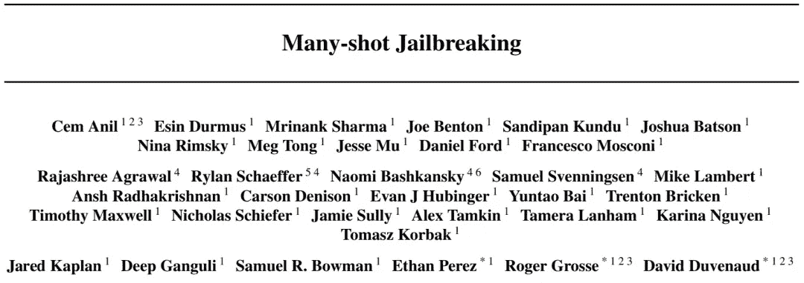

### 腾讯开源视频生成新工具，论文还没发先上代码的那种

贡献人：

https://mp.weixin.qq.com/s/8FO9K1uJwF_vSHMKy_nFvQ

先上代码再发论文，腾讯新开源文生视频工具火了。名为MuseV，主打基于视觉条件并行去噪的无限长度和高保真虚拟人视频生成。腾讯这次论文还没发直接放出训练好的模型和部署运行的代码的操作让网友眼前一亮。主页显示训练代码也即将推出。不少人已趁热码住，GitHub获星500+。

### Vercel：用生成式UI重塑前端开发

贡献人：

https://mp.weixin.qq.com/s/7UBlsoP8mjfcwtZaAFVSow

AI 正在重塑软件的生产方式，而前端开发是最先可能受影响的领域：前端开发逻辑适合模板化，且开发者多、头部开发语言集中。前端的视觉属性适合用户快速表达偏好，形成数据飞轮。随着前端代码能够被实时生成，生成式 UI 能带来人机交互方式的创新，比 Chatbot 更智能的 LUI+GUI 产品交互将涌现。Vercel V0是目前最好的 UI 生成模型，且可控性远强于其他模态的生成模型，因为软件的可编码性让用户可以对任意一个web组件用prompt进行改写。同时他们的 AI SDK 也让前端开发者更无缝地将 LLM 能力融入产品中，打造出一个能实时生成 UI 的产品。对比其他代码模型还停留在 code autocompletion 和 demo 的状态，Vercel 团队对前端开发的深入理解和数据积累让他们能成为领军者。

### 华为诺亚频域LLM「帝江」：仅需1/50训练成本，7B模型媲美LLaMA，推理加速5倍

贡献人：

https://mp.weixin.qq.com/s/3zdfuhNr_HjvcJAy8REayA

基于 Transformer 架构的大语言模型在 NLP 领域取得了令人惊艳的效果，然而，Transformer 中自注意力带来的二次复杂度使得大模型的推理成本和内存占用十分巨大，特别是在长序列的场景中。此前，研究者们提出了线性 Transformer、Mamba、RetNet 等。这些方案可以大幅降低 Transformer 计算成本，并且取得媲美原有模型的精度，但是由于架构更换，模型重训练带来的巨大成本令人望而却步。为了解决这一问题，最近的一篇论文提出了一种基于频域的大语言模型架构 — 帝江（源于山海经的一种神话生物，以跑得快而闻名），同时解决了现有大模型的两大痛点：推理成本和训练成本。

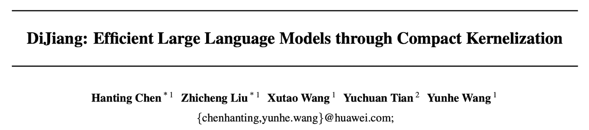

### GenAI 初创公司估值开始高峰回落

贡献人：

https://mp.weixin.qq.com/s/7AoXqXxtM4ybKUuaAdzAMw

近几个月来 AI 初创公司的估值可能已从高峰时期下降。三个月前， 外媒 Information 为 8 家主要提供消费者或企业服务的公司计算了此类估值倍数，这些服务与 LLM 有关。投资者将这些公司的估值定为 ARR（年度销售收入）的 83 倍，或投资时 MRR（月度销售收入）的 12 倍，有 3 家 AI 初创公司收入倍数平均为原始 8 家公司的 50%，这种下降归咎于营收的增长。当一家初创公司开始产生收入时，它们的未来销售倍数会从早期的高倍数快速滑落，因为那时它们几乎没有产生什么收入。根据 Meritech Capital 的数据，公开的软件公司平均未来收入在 7 倍。

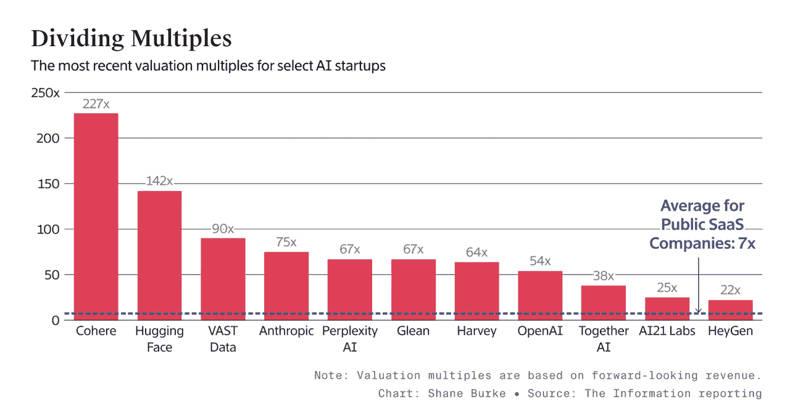

### 准确率达100%，「人机交互」机器学习，驱动有机反应精确原子映射研究

贡献人：

https://mp.weixin.qq.com/s/oWP8NAg3oN8JiE9xNwKBvQ

原子到原子映射（Atom-to-atom Mapping，AAM）是识别化学反应前后分子中每个原子位置的任务，这对于理解反应机理非常重要。近年来，越来越多的机器学习模型用于逆合成和反应结果预测，这些模型的质量高度依赖于反应数据集中 AAM 的质量。虽然有一些算法使用图论或无监督学习来标记反应数据集的 AAM，但现有方法是基于子结构 alignments 而不是化学知识来映射原子。在此，来自韩国首尔大学（Seoul National University）和韩国科学技术院（KAIST）的研究团队，提出了一种 ML 模型——`LocalMapper`，可通过人机回圈（human-in-the-loop）机器学习从化学家标记的反应中学习正确的 AAM。研究表明，`LocalMapper` 通过仅从整个数据集中 2% 的人类标记反应中学习，就能以 98.5% 的校准精度预测 50 K 反应的 AAM。更重要的是，`LocalMapper` 给出的可信预测覆盖了 50 K 反应中的 97%，对 3,000 个随机采样的反应显示出 100% 的准确率。在分布外（Out-of-distribution，OOD）实验中，`LocalMapper` 性能优于其他现有方法。研究人员期望 `LocalMapper` 可用于生成更精确的反应 AAM，并提高未来基于 ML 的反应预测模型的质量。

## 论文

### 长上下文的LLM很难完成长篇上下文学习

贡献人：

链接：http://arxiv.org/abs/2404.02060v1

大语言模型（LLMs）在处理超过32K个token的长序列方面取得了重要进展。然而，它们的性能评估主要局限于像困惑度和合成任务这样的指标，这可能无法完全捕捉它们在更微妙、真实世界场景中的能力。本研究引入了一种专门针对极端标签分类领域的长上下文学习的基准（LIConBench）。我们精心选择了六个数据集，标签范围跨越28到174个类别，覆盖了不同输入长度（少量样本演示）从2K到50K。我们的基准要求LLMs理解整个输入以识别庞大的标签空间以进行正确预测。我们在我们的基准上评估了13个长上下文LLM。我们发现长上下文LLM在20K token长度下表现相对良好，并且性能受益于利用长上下文窗口。然而，在上下文窗口超过20K后，除了GPT-4之外，大多数LLMs都会急剧下降。这表明当前LLMs在处理和理解长、上下文丰富序列方面存在显著差距。进一步分析显示，模型倾向于偏爱对序列末尾呈现的标签进行预测。它们在长序列中推理多个片段的能力有待提高。我们的研究表明，对于现有的LLMs来说，理解和推理长上下文仍然是一项具有挑战性的任务。我们相信LIConBench可以作为未来长上下文LLMs的更现实的评估。

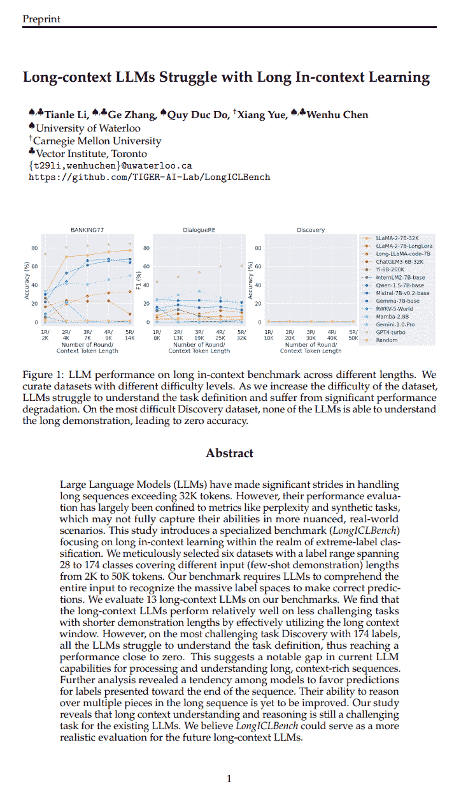

## Octopus v2: 端侧智能体语言模型

贡献人：

链接：`http://arxiv.org/abs/2404.01744v1`

语言模型在各种软件应用中表现出有效性，特别是与自动工作流相关的任务。这些模型具有调用函数的关键能力，这对于创建AI智能体至关重要。尽管大规模语言模型在云环境中表现出色，但常常伴随着隐私和成本方面的担忧。目前的设备上模型面临延迟和准确性问题。我们的研究提出了一种新方法，赋予设备上的模型20亿参数的能力，使其在准确性和延迟方面超越了GPT-4，并将上下文长度缩短了95\%。与使用RAG机制的Llama-7B相比，我们的方法将延迟提高了35倍。这种方法将延迟降至适合在生产环境中各种边缘设备部署的水平，符合实际应用程序的性能要求。

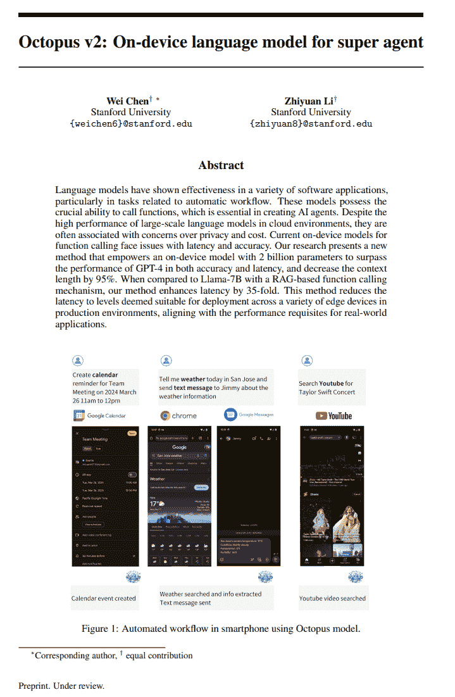

## LLaVA-Gemma: 用紧凑语言模型加速多模态基础模型

贡献人：

链接：`http://arxiv.org/abs/2404.01331v1`

我们使用最新发布的Gemma系列大语言模型(LLMs)，在流行的LLaVA框架下训练了一组多模基础模型(MMFM)。特别感兴趣的是具有2B参数的Gemma模型，为构建功能强大的小规模MMFM提供了机会。我们测试了三个设计特征的切除效果：预训练连接器、利用更强大的图像主干和增加语言主干的大小。我们称之为LLaVA-Gemma的结果模型在各种评估中表现一般，但未能超越当前规模相当的SOTA模型。对性能的深入分析显示出混合效果；跳过预训练往往会降低性能，较大的视觉模型有时会提高性能，而增加语言模型大小效果不一。我们公开发布了LLaVA-Gemma模型的训练配方、代码和权重。

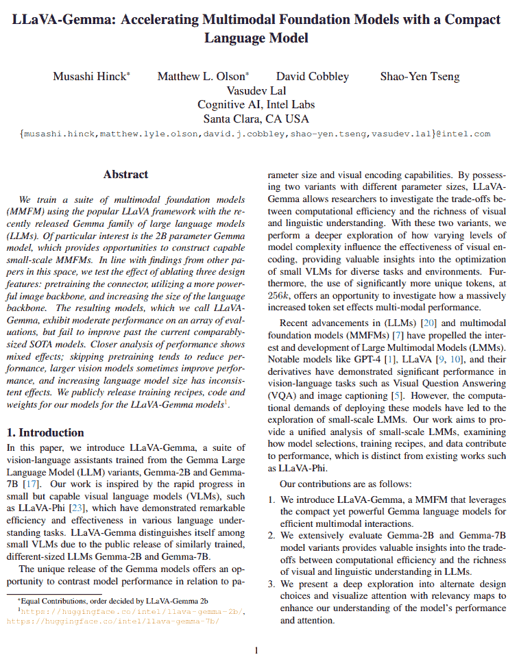

## 推进智能体利用偏好树进行LLM推理泛化

贡献人：

链接：`http://arxiv.org/abs/2404.02078v1`

我们介绍了Eurus，一套针对推理优化的大语言模型（LLMs）。从Mistral-7B和CodeLlama-70B微调而来，Eurus模型在涵盖数学、代码生成和逻辑推理等各种基准测试中取得了开源模型中的最新结果。值得注意的是，Eurus-70B在通过对五项任务进行全面基准测试的12项测试中击败了GPT-3.5 Turbo，并在LeetCode和TheoremQA两个具有挑战性的基准测试中分别实现了33.3%和32.6%的通过率@1，远远超过现有的开源模型13.3%以上。Eurus的强大性能主要归因于UltraInteract，我们专为复杂推理任务而设计的新颖大规模、高质量的对齐数据集。UltraInteract可用于监督微调和优先学习。对于每个指令，它包括一个优先树，其中包含（1）以统一格式呈现的具有多样化规划策略的推理链，（2）与环境和批评的多轮互动轨迹，以及（3）促进优先学习的成对数据。UltraInteract使我们能够深入探讨推理任务的优先学习。我们的调查显示，一些成熟的优先学习算法在推理任务中可能不如它们在一般对话中的有效性。在此启发下，我们提出了一个新颖的奖励建模目标，结合UltraInteract，形成强大的奖励模型。

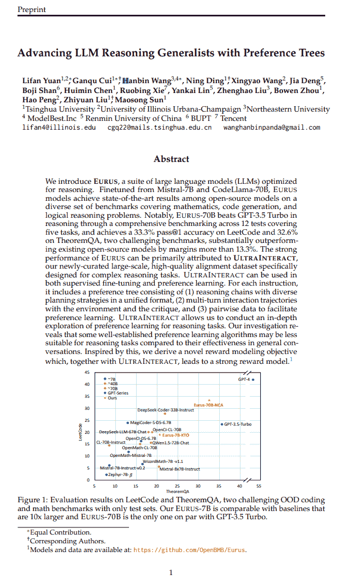

## 模型坍塌是否不可避免？通过积累真实和合成数据打破递归的诅咒

贡献人：

链接：`http://arxiv.org/abs/2404.01413v1`

生成模型的泛滥，结合在Web规模数据上的预训练，引发了一个时机问题：当这些模型被训练在它们自己生成的输出上时会发生什么？最近对模型-数据反馈回路的研究发现，这种回路可能导致模型崩溃，一个现象是性能会随着每次模型拟合迭代逐渐下降，直到最新的模型变得毫无用处。然而，一些最近研究模型崩溃的论文假设，随着时间的推移新数据会取代旧数据，而不是假设数据会随着时间不断累积。在本文中，我们比较了这两种情况，并展示了累积数据可以防止模型崩溃。我们首先研究了一个可以解析地处理的设置，在这个设置中，一系列线性模型适合于先前模型的预测。先前的研究表明，如果数据被替换，测试错误率会随着模型拟合迭代次数呈线性增加；我们通过证明，如果数据累积，测试错误率有一个与迭代次数无关的有限上界，扩展了这一结果。接着，我们通过在文本语料库上预训练语言模型序列来实证测试是否累积数据同样防止模型崩溃。我们确认，替换数据的确会导致模型崩溃，然后证明累积数据可以防止模型崩溃；这些结果适用于各种模型大小、架构和超参数。我们进一步表明，类似的结果也适用于其他深度生成模型在真实数据上的表现：生成分子的扩散模型和生成图像的变分自编码器。我们的工作提供了一致的理论和实证证据，证明数据累积可以减缓模型崩溃。

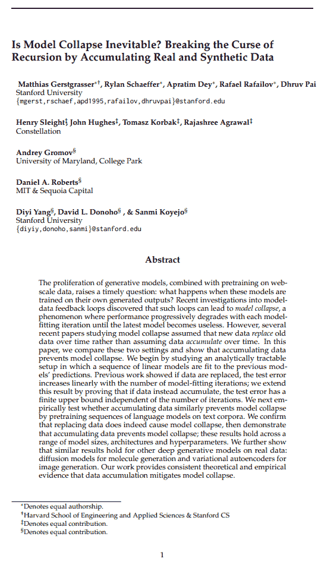

## 提示引导的混合专家用于高效大语言模型生成

贡献人：

链接：`http://arxiv.org/abs/2404.01365v1`

随着基于Transformer的大语言模型（LLMs）的发展，由于其出色的实用性，它们已被应用于许多领域，但在部署时需要付出相当大的计算成本。幸运的是，一些方法，如剪枝或构建专家混合体（MoE），旨在利用Transformer前馈（FF）块中的稀疏性来提高速度并降低内存需求。然而，这些技术在实践中可能非常昂贵且缺乏灵活性，因为它们通常需要训练或限于特定类型的架构。为了解决这个问题，我们引入了GRIFFIN，一个新颖的无需训练的MoE，它在序列级别选择独特的FF专家，以在各种具有不同非ReLU激活函数的LLMs上实现高效生成。尽管我们的方法很简单，但我们证明了在保持原始模型性能不降的情况下，在各种分类和生成任务上，GRIFFIN只需使用50\%的FF参数，同时提高速度（例如在NVIDIA L40上的Llama 2 13B上加快1.25倍）。代码将在`https://github.com/hdong920/GRIFFIN`上提供。

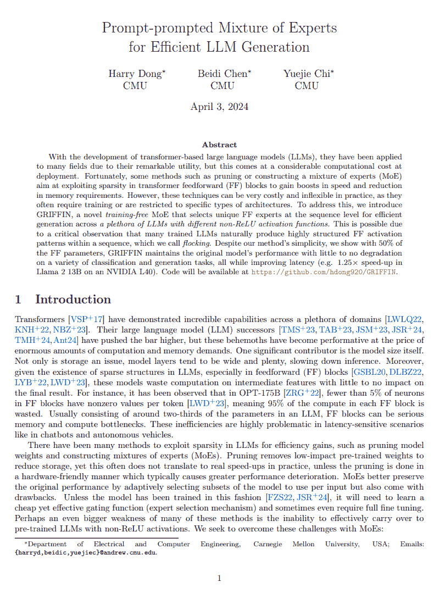

## 神经剪枝：一种面向大型语言模型的基于神经元的拓扑稀疏训练算法

贡献人：

链接：`http://arxiv.org/abs/2404.01306v1`

基于Transformer的大语言模型在自然语言处理领域变得无处不在，因为它们在各种任务上展现出令人印象深刻的性能。然而，昂贵的训练以及推理仍然是它们广泛可应用性的一大障碍。在模型架构的各个层面引入稀疏性已经被发现有望解决规模化和效率问题，但稀疏性如何影响网络拓扑仍存在差距。受大脑神经网络启发，我们通过网络拓扑的视角探索稀疏性方法。具体地，我们利用生物网络中看到的机制，如优先连接和冗余突触修剪，并展示出基于原则的、与模型无关的稀疏性方法在各种自然语言处理任务中表现出色和高效，包括分类（如自然语言推理）和生成（摘要、机器翻译），尽管我们的唯一目标不是优化性能。NeuroPrune在性能上与基准线相媲美（有时甚至更优），在给定稀疏程度的训练时间上可以快10倍，并且在许多情况下同时展现推理时间的可衡量改善。

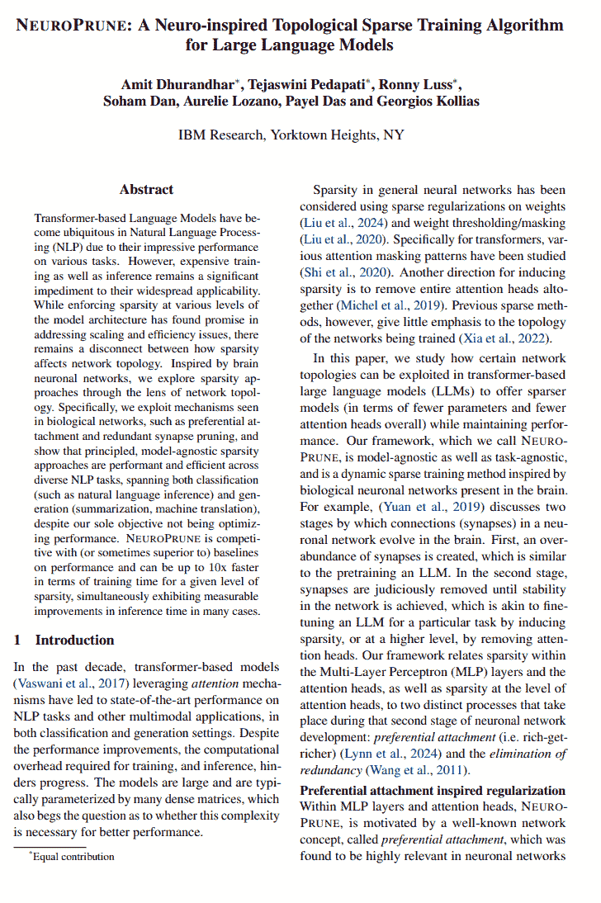

# 产品

## Keywords AI

贡献人：

`https://keywordsai.co/`

Keywords AI 旨在通过仅需两行代码即可加速构建和监控人工智能应用程序。该平台具有许多特性，包括与 OpenAI 兼容的集成、支持100多个 LLM 的负载平衡、错误处理和动态路由、直观的提示管理系统，用于版本控制和部署提示，以及用于跟踪和调试用户-模型交互的请求日志。此外，它还提供实时监控模型性能和用户分析的功能。

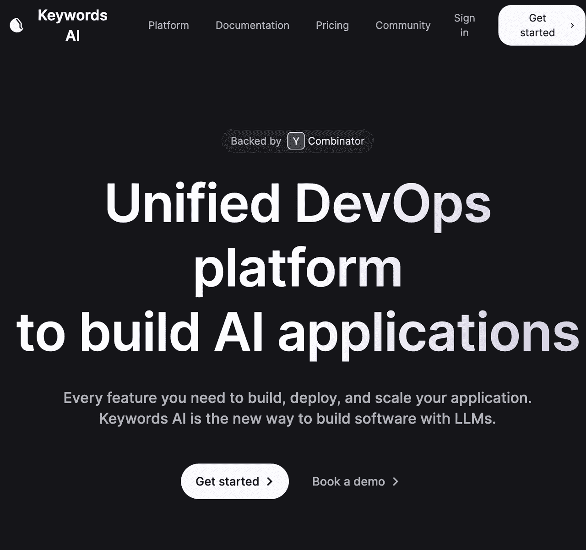

## AIxBlock

贡献人：

`https://aixblock.org/`

AIxBlock 旨在通过将未使用的计算资源连接在一起，创建一个去中心化的超级计算机，并提供一个无代码的综合人工智能平台，使更多的小公司和国家能够拥有自己的人工智能的平台。它可以让人工智能构建者通过节省计算成本、轻松构建、部署和监控 AI 计划，以及通过自动和分布式训练无缝开发 AI 模型来受益。同时，计算供应商可以通过在全球 AI 社区中提供 AI 计算赚取收入，而自由职业者可以通过加入 AI 项目来最大化收益。

# HuggingFace&Github

## BrushNet

贡献人：

`https://github.com/TencentARC/BrushNet`

BrushNet 是一种基于扩散的文本引导图像修复模型，可以即插即用到任何预训练的扩散模型中。这个架构设计包含两个关键见解：（1）划分掩码图像特征和噪声潜伏减少了模型的学习负荷，（2）利用对整个预训练模型的密集每像素控制增强了其对图像修复任务的适用性。

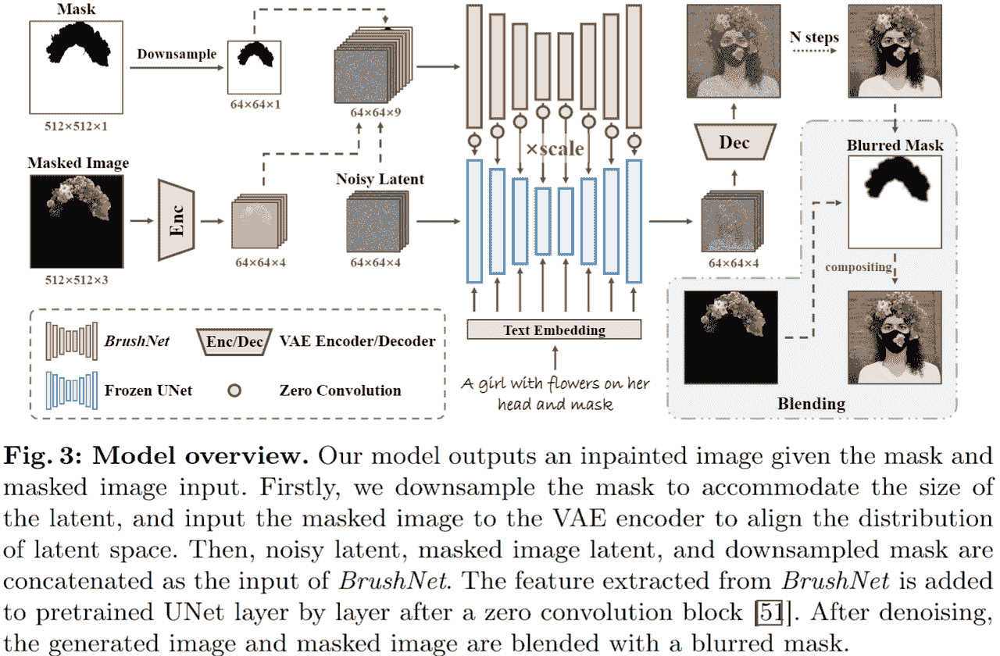

## Mini-Gemini

贡献人：

`https://github.com/dvlab-research/MiniGemini`

Mini-Gemini 支持从 2B 到 34B 的一系列密集和 MoE 大型语言模型 （LLMs），同时进行图像理解、推理和生成。基于 LLaVA 构建此存储库。

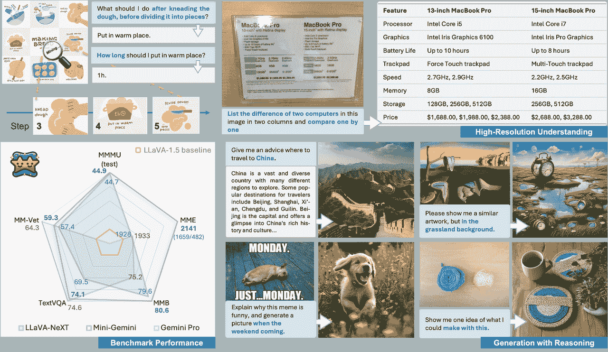

# 投融资

## Proxima AI完成1200万美元A轮融资

贡献人：

`https://www.businesswire.com/news/home/20240402670146/en/Proxima-AI-Raises-12-Million-in-Series-A-Financing`

数据智能软件公司Proxima AI宣布完成1200万美元A轮融资，由Mucker Capital领投，Aglae Ventures（LVMH创始人家族办公室）、Great Oaks Venture Partners、Data Point Capital、Broadway Venture Partners、FirstLook Partners及Connexa Capital参投。Proxima AI旨在帮助消费科技企业有效扩大客户获取、提升客户生命周期价值并优化整个生命周期营销。自2022年5月推出以来，Proxima AI的收入增长超过400%，其专有的B2C连接网络扩展到超过12000个，拥有超过6500万独特、匿名的购物者档案，通过高级AI模型提升营销表现。这轮融资将支持Proxima的技术平台成长，包括AI功能开发和技术及商业功能的进一步扩展。

公司官网：`https://www.proxima.ai/`

## Lumana退出隐身模式，旨在使每一秒视频都能提供可操作的、有影响的洞察

贡献人：

`https://www.prnewswire.com/news-releases/lumana-emerges-from-stealth-to-create-a-world-where-every-second-of-video-delivers-actionable-impactful-insights-302105105.html`

Lumana今日宣布推出新一代视频安全平台，该平台利用人工智能（AI）和分布式混合云架构，使组织能够充分利用其视觉数据的全部潜力。Lumana的尖端技术使组织能够增强安全和安保措施，提高运营效率并简化事故响应。该平台能够实时分析数百万小时的视频，跨不同地点，根据捕获的视频优化其专有AI模型，提供有意义的洞察和任何环境的更大可视性。此外，Lumana还宣布获得2400万美元的种子融资，由Norwest和S Capital领投，旨在将任何安全摄像头转变为能够实时识别复杂事件和潜在风险的AI驱动设备。

公司官网：`https://www.lumana.ai/`

## 法律科技初创公司Luminance凭借AI热潮募集4000万美元资金

贡献人：

`https://www.cnbc.com/2024/04/02/legal-tech-startup-luminance-rides-ai-hype-to-40-million-fundraise.html`

法律科技公司Luminance成功募集了4000万美元新资金，以扩大其在美国的业务版图，充分利用围绕人工智能的投资者兴趣浪潮。该公司向CNBC透露，这笔新资金是通过由美国风险基金March Capital领投的B轮融资筹集的。国家电网合作伙伴和律所斯劳特和梅也参与了本轮投资。Luminance是由律师、数学家和剑桥大学的并购专家共同创立的，旨在通过机器学习模型帮助律师自动化合同审查，缩短签署时间。公司计划利用这轮资金大力扩展其在美国的业务，并计划在当地招聘新的高管以及探索新办公室。

公司官网：`https://www.luminance.com/`

## Modal宣布完成2500万美元A轮融资，加速AI技能培训

贡献人：

`https://www.modallearning.com/blog-posts/modal-announces-25m-series-a`

Modal，一家为数据和分析专业人员提供技能发展平台，宣布完成2500万美元A轮融资。此轮融资由Left Lane Capital和Ensemble VC领投，Signalfire和Learn Capital等领先投资公司参与。Modal由前Udemy总裁Darren Shimkus和前CEO Dennis Yang共同创立，旨在通过个性化的技术和AI技能培训帮助雇主可靠地提升员工技能。Modal的学习平台通过一对一专家辅导和模拟工作项目驱动教育，重新定义了企业如何通过基于成功的定价模式来解决技能提升问题，公司只需为员工开发的技能支付费用。目前，Modal已经服务了包括Dentaquest和Casey’s在内的100多家企业客户，计划利用这轮资金加强平台功能，扩大市场推广能力，并继续招募顶尖人才。

公司官网：`https://www.modallearning.com/`

## SOAI完成500万美元天使轮融资，由Archer Capital和XForce Capital领投

贡献人：

`https://www.coinlive.com/news-flash/480337`

AI社交平台SOAI宣布完成了500万美元的天使轮融资，其中Archer Capital投资了300万美元，XForce Capital投资了200万美元。这轮融资将加速SOAI在AI情感通讯领域的技术创新和市场扩展。新计划包括深化AI情感理解与匹配技术，优化用户体验，以及扩展全球市场。SOAI是一个起源于硅谷的创新AI平台，专注于通过先进的AI技术重塑虚拟伴侣产业生态系统，为全球数十亿人创建定制的AI灵魂伴侣。

公司官网：`https://soai.org/`

## Hailo 宣布新一轮1.2亿美元融资并推出强大的AI加速器Hailo-10，将生成式AI带入边缘设备

贡献人：

`https://hailo.ai/de/company-overview/newsroom/news-de/hailo-closes-new-120-million-funding-round-and-debuts-hailo-10-a-new-powerful-ai-accelerator-bringing-generative-ai-to-edge-devices/`

以色列特拉维夫，Hailo——一家边缘人工智能(AI)处理器的先驱芯片制造商，今天宣布其C系列融资轮增加了1.2亿美元的投资。同时，公司推出了创新的Hailo-10高性能生成式AI(GenAI)加速器，开启了用户可以本地拥有和运行GenAI应用程序、无需注册云基础GenAI服务的新时代。新一轮融资由当前和新投资者领投，包括Zisapel家族、Gil Agmon、Delek Motors、Alfred Akirov、DCLBA、Vasuki、OurCrowd、Talcar、Comasco、Automotive Equipment (AEV)和Poalim Equity。至今，公司已筹集超过3.4亿美元资金。Hailo-10 GenAI加速器使得如个人电脑、智能车辆和商用机器人等边缘设备上的GenAI成为可能，使用户能够完全拥有他们的GenAI体验，成为他们日常生活的一部分。Hailo-10预计将于2024年第二季度开始提供样品。

公司官网：`https://hailo.ai/de/`

## DeepLink协议完成超800万美元融资，引领AI云游戏新时代

贡献人：

https://www.coinlive.com/news-flash/480241

去中心化AI云游戏协议`DeepLink`近日完成了超过800万美元的天使轮和A轮融资。此次融资由Gobi Ventures、Hycons、DBC、ROCK Ventures等多家公司参与，吸引了日本、北美、欧洲及其他亚洲社区的参与。`DeepLink`协议旨在为3A级游戏和云网吧提供超低延迟的游戏渲染解决方案，整合AI+DePIN+3A GAME技术。该协议使用AI、区块链和流媒体技术，支持1毫秒的超低延迟、8K高分辨率、240fps高刷新率和24小时不间断播放，旨在为用户提供无与伦比的云游戏体验。`DeepLink`软件基于`DeepLink`协议开发，目前覆盖全球100多个国家，拥有超过50万用户，其中日活跃用户超过10万，月活跃用户超过30万，并且正在快速增长。

公司官网：https://www.deeplink.cloud/

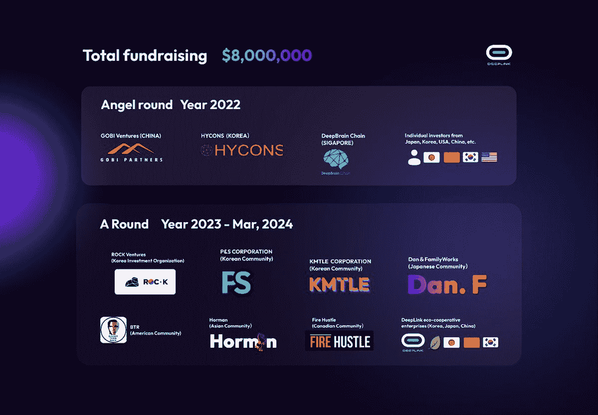

# 学习

## WholeGraph存储技术详解

贡献人：

https://zhuanlan.zhihu.com/p/690122769?utm_psn=1758883132424519680

文章详细介绍了`WholeGraph`存储技术，这是一种优化图形神经网络(GNN)内存和检索的技术。`WholeGraph`通过多内存支持（如固定主机内存和设备内存）提供大容量、高性能的存储抽象，可跨多GPU覆盖，支持NVIDIA NVLink P2P内存访问或NCCL批量传输。其存储结构`WholeMemory`，类似张量，支持多维数据的高效组织和操作。`WholeGraph`还特别为大规模GNN训练设计，通过提供缓存支持和对可训练特征的稀疏优化器支持，加速特征收集或更新过程。此外，`WholeGraph`的集成允许无缝转换`WholeMemory`对象为适用于深度学习框架的张量，通过减少代码更改，简化多GPU或多节点存储设置。

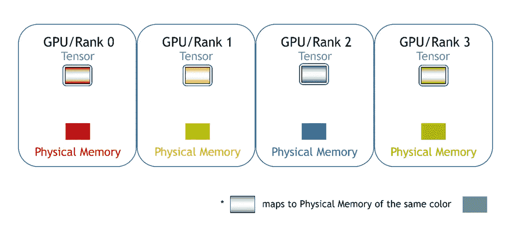

## EM算法

贡献人：

https://zhuanlan.zhihu.com/p/687120237?utm_psn=1758589828722069504

本文探讨了`EM`算法（最大期望算法）如何作为一个高级技巧，帮助机器学习领域的研究者在顶级会议上发表论文。`EM`算法不仅在实验中能提升模型表现，也能用其背后的理论严谨地支撑论文的观点，将复杂的直觉转化为严谨的数学语言。此外，文章指出`EM`算法的使用并不局限于经典场景，如高斯混合模型，它在顶会论文中的应用仍然广泛，能够作为论文的“基石”技术，提升论文的层次。通过优化隐变量分布和模型参数之间的一致性，`EM`算法能够有效地解决含有未观测隐变量的概率模型优化问题。

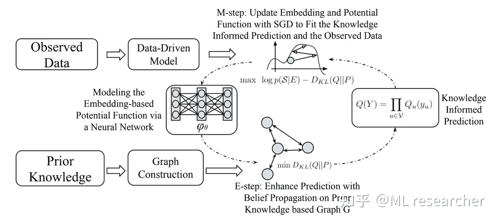

## 分布式训练文章综述

贡献人：

https://zhuanlan.zhihu.com/p/664235818?utm_psn=1758789200949063681

本文是关于大模型分布式训练领域的综述，覆盖了2012年至2023年间的28篇重要论文。文章详细介绍了并行化训练的演进，包括数据并行、模型并行、流水线并行等多种策略，并对各种并行策略进行了分类和总结。重点关注了优化内存使用、提高训练效率的技术，如Zero优化策略、混合精度训练、以及针对特定模型结构的优化。此外，还探讨了基础系统架构的演进，从早期的参数服务器到最新的异步分布式数据流图。文章旨在为读者提供一个大模型分布式训练技术的全面框架，便于快速了解该领域的技术演变和最新进展。

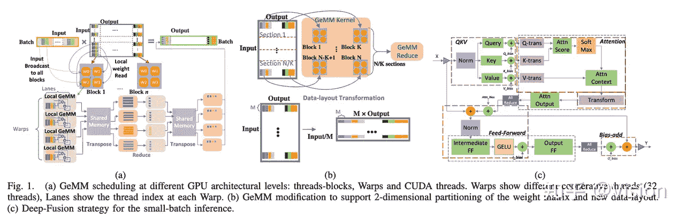

## [大模型优化方法]`PagedAttention`,`StreamingLLM`

贡献人：

https://zhuanlan.zhihu.com/p/679043987?utm_psn=1758786644222607360

本文介绍了两种大模型优化技术：`PagedAttention`和`StreamingLLM`。`PagedAttention`旨在提高显存利用率，通过分页管理机制允许`KV Cache`存储在离散的内存空间中，解决了连续内存空间预留导致的显存浪费问题。此技术主要面向大模型服务推理部署阶段，能显著提高内存利用效率。`StreamingLLM`解决了随着对话进行导致的`KV Cache`不断增长和生成长度超出训练限制的问题。它通过发现并利用`Attention Sink`现象，保留初始字符来让模型能持续稳定输出内容，适用于流式应用中。这两种方法在提高大模型运行效率和显存利用方面展示了显著优势。

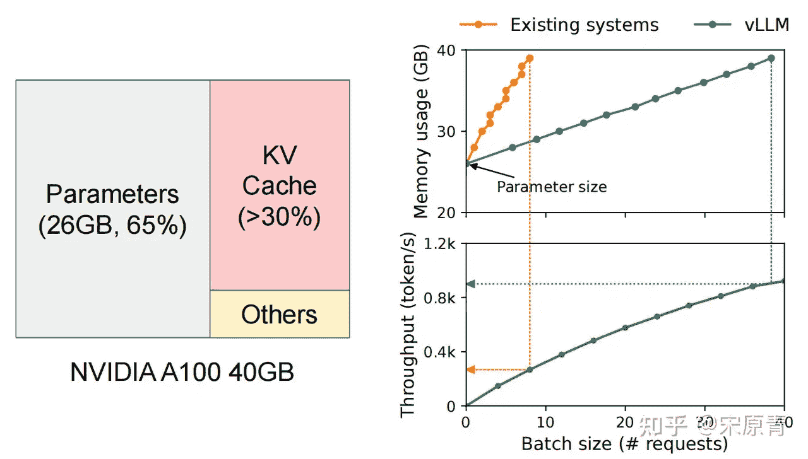

## 深入解析SoC中的内存管理：从Cache到虚拟内存的技术细节

贡献人：

https://zhuanlan.zhihu.com/p/685368508?utm_psn=1758837171719692289

本文深入探讨了SoC中的`Memory`部分，特别聚焦于`Cache`和虚拟内存。文章首先解释了存储器层次结构的重要性，阐明了为何需要不同类型的存储器（如寄存器，`SRAM`，`DRAM`，和`FLASH`）以及它们之间的速度差异。接着，详细介绍了`Cache`的工作原理，包括局部性原理、`Cache`组织结构和`Cache`替换策略，以及如何通过`Cache`减少访存时间，提高系统性能。此外，还讨论了写策略的不同选择对性能的影响。最后，简要回顾了虚拟内存的概念，强调了物理地址和虚拟地址的区别及其对提升存储效率的贡献。文章通过举例和图解，使复杂的内存管理原理易于理解。

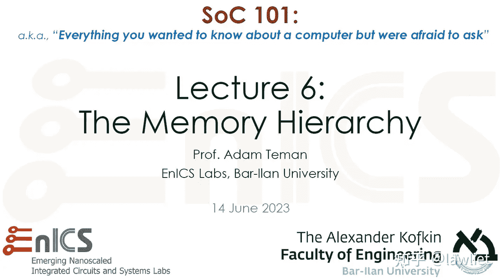

## 扩散蒸馏的悖论

贡献人：

https://zhuanlan.zhihu.com/p/690452342

本文探讨了扩散模型优化的悖论，即虽然其强大能力源于将生成任务分解为多个去噪任务并通过迭代细化来提升结果，但最近的研究却集中在减少所需的抽样步骤，甚至实现单步抽样。文章重点讨论了各种减少抽样步骤的方法，特别是蒸馏技术，这种技术通过让一个模型（学生）在另一个模型（教师）的监督下学习，已经产生了引人注目的结果。文章深入解析了扩散模型的工作原理、抽样步骤的必要性及其与模型效能之间的潜在矛盾，提出了关于如何在不牺牲输出质量的情况下减少抽样步骤的思考和策略。

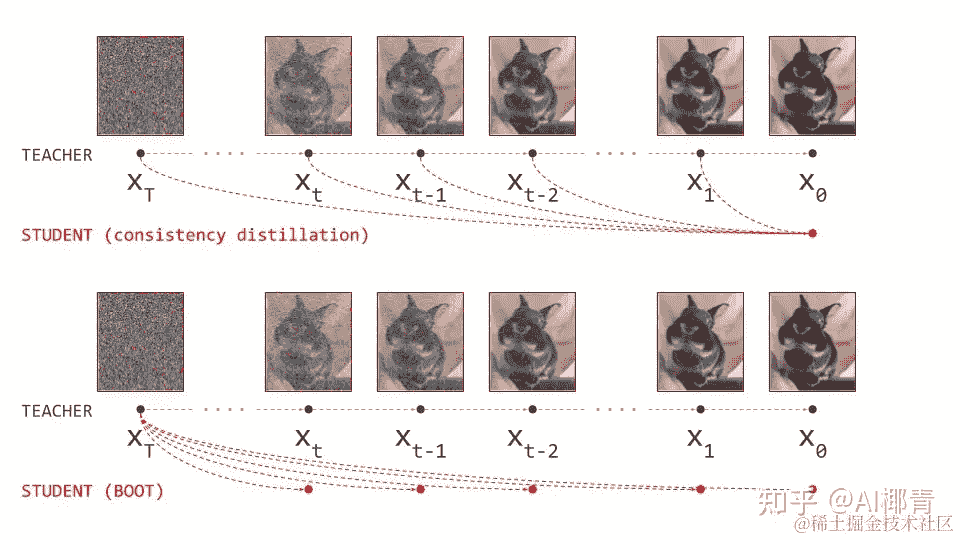

## 在Amazon SageMaker上加速Mixtral 8x7B模型推理的方法

贡献人：

https://www.philschmid.de/sagemaker-awq-medusa

本文介绍了如何在`Amazon SageMaker`上使用`Speculative Decoding (Medusa)` 和 `Quantization (AWQ)` 技术加速`Mixtral 8x7B`模型的推理过程。通过结合`Medusa`和`AWQ`，不仅减少了内存占用，还提高了`Mixtral 8x7B`的推理速度，使其能够在单个`g5.12xlarge`实例上部署，该实例仅配备了4个`NVIDIA A10G GPUs`，实现每个令牌约50-60毫秒的延迟。文章详细介绍了设置开发环境、检索新的`Hugging Face LLM DLC`、准备`Medusa`和`AWQ`工件、部署`Mixtral 8x7B`到`Amazon SageMaker`以及运行推理和与模型交互的过程。

# 声明

本文档仅供学习交流使用，版权归原作者所有，若涉侵权，请联系Jack Jin 15101136166

（欢迎在下方反馈您宝贵的意见！整理不易，觉得有用给AI日报小组点个赞👍吧！）

ChatGPT；Angela；Zijia Liu；Alex；Zeqi Tan；Tiezhen（HuggingFace）；Naixu；Lizhi；Peter；Suoman；Jack

封面生成——右脑科技

如果你有大模型相关的创业想法，欢迎来找我们聊聊～🛰️：15101136166

> 快邀请你的小伙伴们一起来读大模型日报吧！

> **【日报知识库】**这里是近期日报内容的汇总,欢迎大家查阅

> [大模型日报知识库(分享版)](https://miracleplus.feishu.cn/wiki/KapVwXfkriOBiskB0B2cUHxjnTh)

> 欢迎大家多多帮我们分享,转发~~

> 如果大家有任何的建议或者吐槽,欢迎随时找我聊天~

