# 奇绩大模型日报（4月 2日）

> 来源：[https://miracleplus.feishu.cn/docx/LfjWdZu8uokm7ixSXrLcEcDMnlb](https://miracleplus.feishu.cn/docx/LfjWdZu8uokm7ixSXrLcEcDMnlb)

# 推特

### OpenAI开放体验AI：不再需要注册，直接可以使用 ChatGPT 的功能

贡献人：

https://x.com/OpenAI/status/1774848681981710821?s=20

我们正在推出无需注册即可立即开始使用 ChatGPT 的[功](https://openai.com/blog/start-using-chatgpt-instantly)能,让体验 AI 的潜力变得更加容易。https://openai.com/blog/start-using-chatgpt-instantly

[ssstwitter.com_1711992198052.mp4](https://internal-api-drive-stream.feishu.cn/space/api/box/stream/download/all/WJIkbVhk8ozj4mxPDrTcij7onub)

#### --相关评论

https://x.com/simonw/status/1774858822173254114?s=20

Simon Willison：

现在使用 https://chat.openai.com 与 GPT 3.5 交互无需登录(在某些市场)。

我想知道他们的防刮擦机制是如何工作的?我想人们将这作为免费的3.5 API滥用的诱惑会非常强烈。

在我与之交谈的每个群体中,从企业高管到科学家,包括昨

Ethan Mollick 12月提到:"我越来越认为OpenAI决定让 "坏的"AI免费,导致人们忽略了为什么AI对使用先进系统的少数人来说似乎是一个巨大的进步,而对其他人来说只是耸耸肩"。

https://x.com/emollick/status/1774902481044066474?s=20

Ethan Mollick：

我认为OpenAI允许人们在没有登录的情况下使用3.5是一个错误。这可能会使人们更难看到AI的能力,因为它远远落后于GPT-4。

如果我要建议某人用AI来了解它们有多强大,GPT-3.5甚至不会进入我推荐的前六七名。

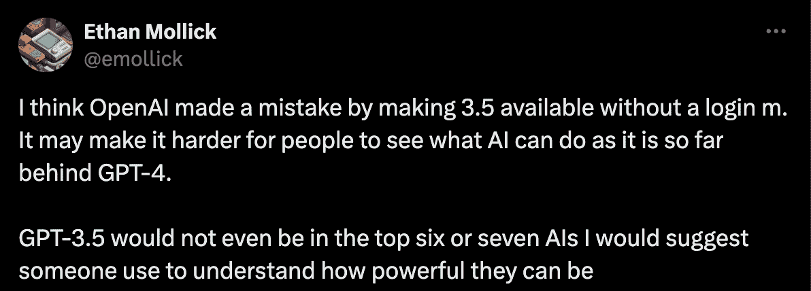

### 3blue1brown视频教程：Transformers的可视化介绍 | 深度学习,第五章

贡献人：

https://x.com/NielsRogge/status/1774883847705874492?s=20

我开始接触AI要感谢两件事:@karpathy 的 cs231n 课程以及 @3blue1brown 关于深度学习的精彩视频。

@3blue1brown 刚刚发布了一个新视频:"什么是GPT?Transformers的可视化介绍"。

强烈推荐!一如既往地有着精彩的动画演示。

---

3blue1brown：但是,什么是GPT?Transformers的可视化介绍 | 深度学习,第五章

介绍Transformers及其先决条件

为赞助人提供下一章的早期预览:https://3b1b.co/early-attention

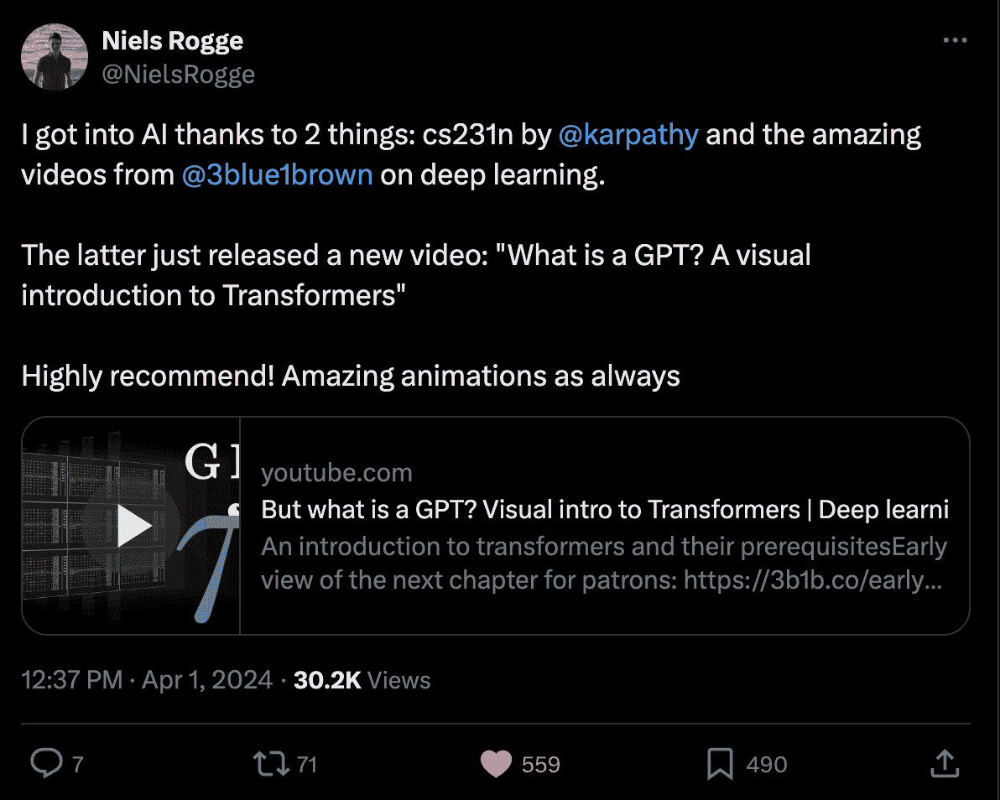

### MultiOn Agent API进入公开测试阶段：首个自主 API，通过我们的语言行为模型，从自然语言转换到 Web 操作

贡献人：

https://x.com/DivGarg9/status/1774861645510234283?s=20

我们很高兴地宣布,我们的 Agent API 已经进入公开测试阶段,同时还有我们的 Agent Playground @MultiOn_AI

我们的 Agent API 是首个自主 API,通过我们的语言行为模型(LAMs),可以从自然语言转换到 Web 操作,所有这些都在安全的云托管浏览器中运行。你可以使用我们的 API 在你自己的设备和应用程序中构建和嵌入 AI 代理,通过在 Web 上完成任务和工作流来为用户完成工作。这里有一个我们的 Agent API 实际运行的例子,用于查找 @elonmusk 的最新推文

在这里试用 Action API https://app.multion.ai/playground

[ssstwitter.com_1712040984725.mp4](https://internal-api-drive-stream.feishu.cn/space/api/box/stream/download/all/Z6bibVHKxof5CYxmmr5c83oEnmg)

### UMD教授Feizi分享“大语言模型”4小时讲座

贡献人：

https://x.com/FeiziSoheil/status/1774833586736189911?s=20

Soheil Feizi：刚发布了一个4小时的讲座,主题是"大语言模型":

https://youtu.be/2yjzZfDQxy8

0:00 语言模型基础

2:30 Word2vec

16:27 迁移学习

19:23 BERT

1:00:39 T5

1:31:14 GPT1-3

1:53:05 ChatGPT

2:20:03 将大语言模型视为深度强化学习

2:53:00 策略梯度

3:32:50 训练你自己的大语言模型

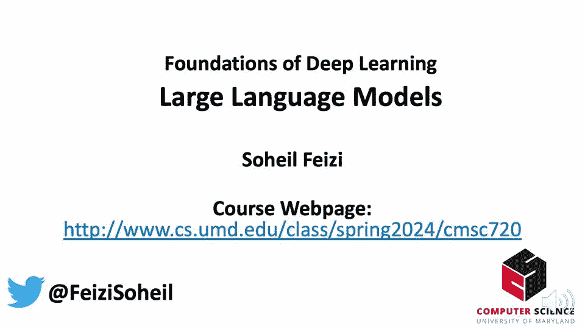

[ssstwitter.com_1712010182160.mp4](https://internal-api-drive-stream.feishu.cn/space/api/box/stream/download/all/SRvbbSgkUokWivxsLpCcDqEcnGc)

### 新的SOTA合并方法：Zebrafish-7B合并模型

贡献人：

https://x.com/maximelabonne/status/1774788607405899888?s=20

Maxime Labonne：⚙️ 模型库存:新的SOTA合并方法

这项技术在论文发表仅四天后就在MergeKit中实现了。

我用它来创建了一种新型的Zebrafish-7B合并模型。效果非常好,我已经把它加入到AutoMerger中了。

🤗 模型:h[ttps://huggingface.co/ml](https://huggingface.co/mlabonne/Zebrafish-7B)abonne/Zebrafish-7B

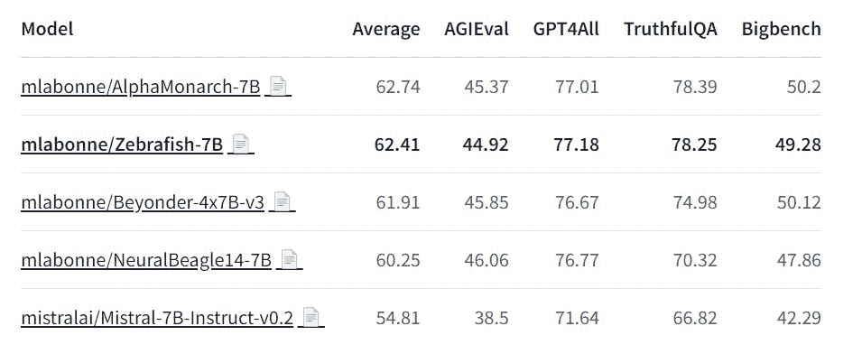

### 电子宠物Wall-e：存在于你的笔记本电脑中,记住你所看到的一切

贡献人：

https://x.com/Karmedge/status/1774728840058634697?s=20

Wall-e 存在于你的笔记本电脑中,记住你所看到的一切。

为你处理想法。创建笔记库,用AI增强你的思想。

+   获得推荐

+   跟上进度

+   拥有个性化的学习

或者只是享受与了解你的某样事物交谈的乐趣。

谁想要测试版?

[ssstwitter.com_1712041506108.mp4](https://internal-api-drive-stream.feishu.cn/space/api/box/stream/download/all/JmcpbDYmKoEBeDxXPk7ctI45nLh)

### Schirano分享：用GPT-4调试，用Claude 3编码，最大化利用AI编码

贡献人：

https://x.com/skirano/status/1774929535923888597?s=20

Pietro Schirano：

目前在使用AI编码方面最大的优势是:

用GPT-4调试,用Claude 3编码。

在逻辑方面,GPT-4仍然是王者,但它非常懒惰。

与此同时,Claude会完成你要求的任何事情。

这两者结合在一起是无敌的。

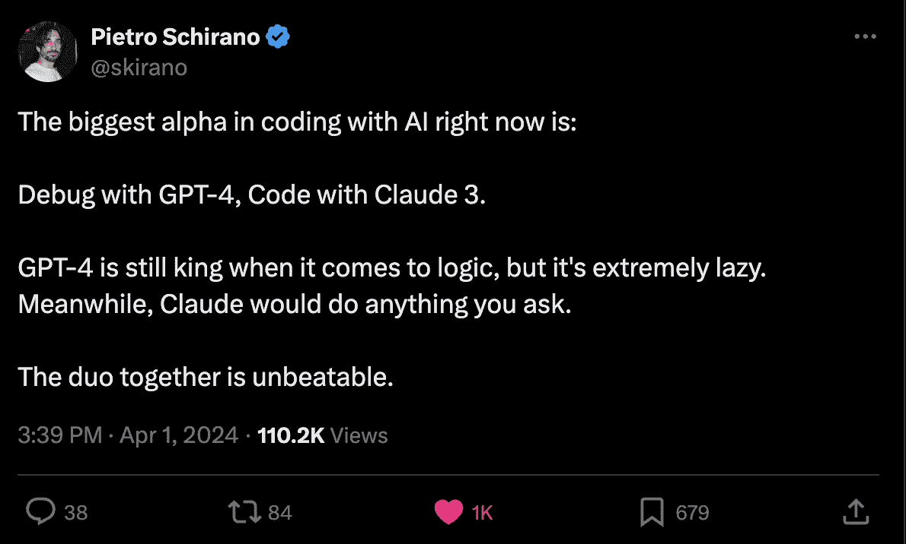

### Martinez：在这里，我们反驳了GPT-4在律师资格考试中获得90%的说法

贡献人：

https://x.com/ericgrimani/status/1774811653537735070?s=20

Eric Martinez：AI 能在法律考试中取得优异成绩吗?

去年,OpenAI 宣布 GPT-4 在律师资格考试中获得了 90% 的分数。

在这里,我们(a)反驳了 90% 的说法;(b)复制/扩展了最近关于 GPT 能力的工作;(c)讨论了对法律行业的影响。

现已开放,AI&Law:https://link.springer.com/article/10.1007/s10506-024-09396-9

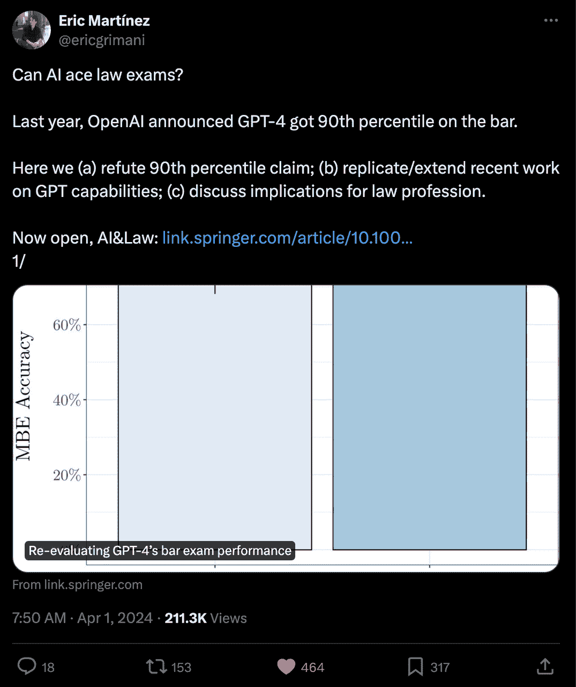

# 资讯

### 叠衣服、擦案板、冲果汁，能做家务的国产机器人终于要来了

贡献人：

https://mp.weixin.qq.com/s/wbYNNFv7lew2a_cLU7EjgA

还记得会炒菜的斯坦福 ALOHA 机器人吗？现在，中国的初创公司自变量机器人（X Square）展示了同样令人惊艳的能力，甚至更进一步。在该公司最新展示的 Demo 中，完全基于大模型自主推理的双臂机器人，利用低成本硬件即实现对不规则物体的精细操作（如抓握、拾取、切割等），以及折叠衣服、冲泡饮料等复杂任务，展现出相当程度的泛化性能。

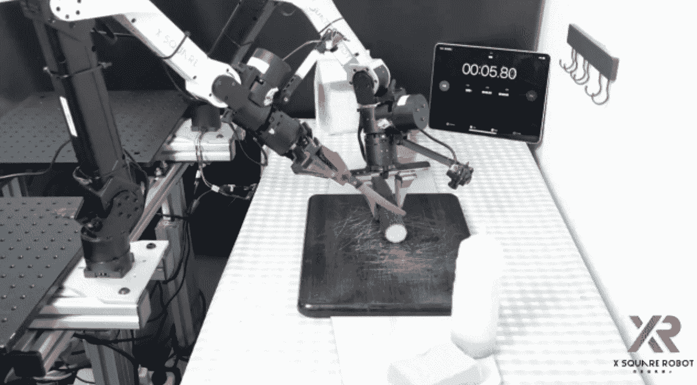

### 音乐ChatGPT时刻来临！「天工SkyMusic」音乐大模型今日启动邀测

贡献人：

https://mp.weixin.qq.com/s/LFuZ0EIPkLrM342JB1EF_A

**4 月 2 日，昆仑万维 AI 音乐生成大模型「天工 Sk**yMusic」即日起面向社会开启免费邀测。本轮邀测将开放 1000 个免费名额，面向行业媒体、专家、以及感兴趣的音乐从业者开放，用户可扫描文后二维码或通过网页填写申请，收到申请表后工作人员将第一时间联络回复。「天工 SkyMusic」正式版也将在 4 月 17 日随「天工 3.0」面向全社会免费开放。

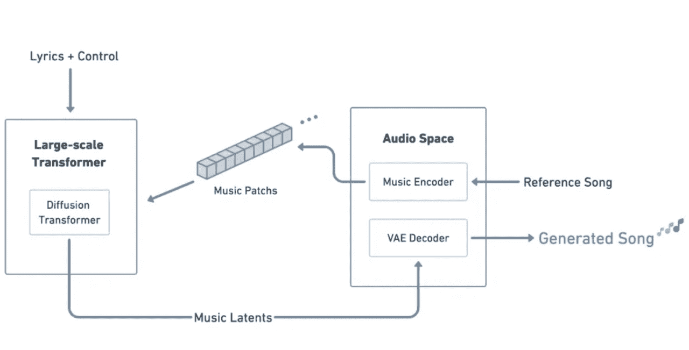

### 现在，ChatGPT不注册登录也能免费用了

贡献人：

https://mp.weixin.qq.com/s/WRieID-8mxiL1KBZUlShHA

现在，使用 OpenAI 的人工智能平台 ChatGPT，不需要注册账户了。当地时间 4 月 1 日，OpenAI 正式公布了这个新政策，立即引来了全网的欢呼。在开放之后，ChatGPT 打开就能用，看起来终于初步具备了「AI 搜索引擎」的样子。不过这次开放仅适用于免费版的 ChatGPT（3.5 版本），其他 OpenAI 产品如 DALL-E 3、GPT-4 等仍然需要付费才能访问，当然也需要登录帐户。人们第一时间涌入 ChatGPT 的网站尝试，很多国家和地区的用户表示仍需登录。也有人表示第一次需要登录，同一台电脑过一会看又不需要账户了。

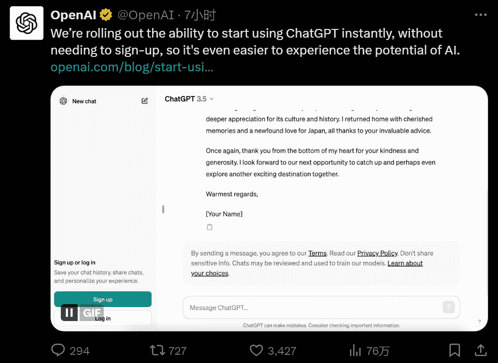

### 苹果AI放大招？新设备端模型超过GPT-4，有望拯救Siri

贡献人：

https://mp.weixin.qq.com/s/WqbcAQu1cbMNOZ9LN1OHZg

在最近的一篇论文中，苹果的研究人员宣称，他们提出了一个可以在设备端运行的模型，这个模型在某些方面可以超过 GPT-4。具体来说，他们研究的是 NLP 中的指代消解（Reference Resolution）问题，即让 AI 识别文本中提到的各种实体（如人名、地点、组织等）之间的指代关系的过程。简而言之，它涉及到确定一个词或短语所指的具体对象。这个过程对于理解句子的意思至关重要，因为人们在交流时经常使用代词或其他指示词（如「他」、「那里」）来指代之前提到的名词或名词短语，避免重复。

不过，论文中提到的「实体」更多得与手机、平板电脑等设备有关，包括：

1.  屏幕实体（On-screen Entities）：用户在与设备交互时，屏幕上显示的实体或信息。

1.  对话实体（Conversational Entities）：与对话相关的实体。这些实体可能来自用户之前的发言（例如，当用户说「给妈妈打电话」时，「妈妈」的联系方式就是相关的实体），或者来自虚拟助手（例如，当助手为用户提供一系列地点或闹钟供选择时）。

1.  后台实体（Background Entities）：这些是与用户当前与设备交互的上下文相关的实体，但不一定是用户直接与虚拟助手互动产生的对话历史的一部分；例如，开始响起的闹钟或在背景中播放的音乐。

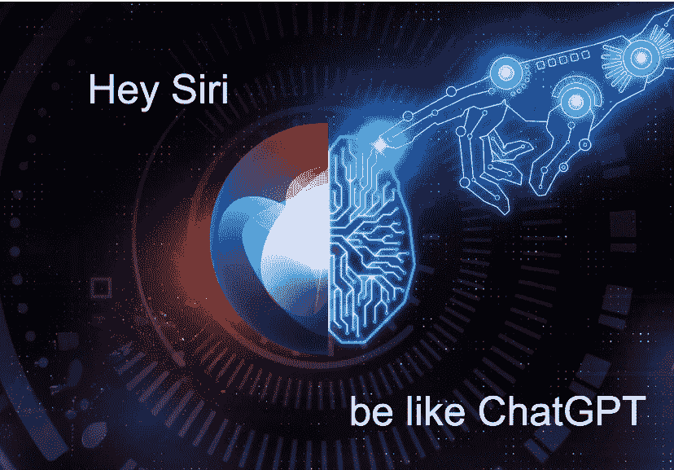

### ChatGPT也在评审你的顶会投稿，斯坦福新研究捅了马蜂窝，“这下闭环了”

贡献人：

https://mp.weixin.qq.com/s/SJf61uB8rFGCCo58IdQaAg

人们还在嘲讽有人用ChatGPT写论文忘了删掉“狐狸尾巴”，另一边审稿人也被曝出用ChatGPT写同行评论了。而且，还是来自ICLR、NeurIPS等顶会的那种。在ChatGPT出现之后，这些同行评论的“AI含量”大增，最多的高达16.9%，而有ChatGPT之前这个比例大约是2%。证据也很直观，AI常用的词汇出现频率，在ChatGPT发布之后就上去了。在X上，也有人发出了同样的疑问：既然写论文和审稿都是大模型在干，那科学家去干什么了？

### 阿里7B多模态文档理解大模型拿下新SOTA｜开源

贡献人：

https://mp.weixin.qq.com/s/vtymW1k93ZLSOqj0iWwe6A

**多模态文档理解**能力新SOTA！阿里mPLUG团队发布最新开源工作mPLUG-DocOwl 1.5，针对高分辨率图片文字识别、通用文档结构理解、指令遵循、外部知识引入四大挑战，提出了一系列解决方案。阿里新研究mPLUG-DocOwl 1.5在10个文档理解基准上拿下SOTA，5个数据集上提升超过10个点，部分数据集上超过智谱17.3B的CogAgent，在DocVQA上达到82.2的效果。

### “大海捞针”out！“数星星”成测长文本能力更精准方法，来自鹅厂

贡献人：

https://mp.weixin.qq.com/s/rH7PNHYeTkZOlhSoFL6bpA

**大模型长文**本能力测试，又有新方法了！腾讯MLPD实验室，用全新开源的“数星星”方法替代了传统的“大海捞针”测试。相比之下，新方法更注重对模型处理长依赖关系能力的考察，对模型的评估更加全面精准。利用这种方法，研究人员对GPT-4和国内知名的Kimi Chat()进行了“数星星”测试。结果，在不同的实验条件下，两款模型各有胜负，但都体现出了很强的长文本能力。

### 少量数据实现高通用性，KAIST开发药物设计3D分子生成新框架

贡献人：

https://mp.weixin.qq.com/s/sxnCSbRUZlB-loO2Hcfg3w

深度生成模型具有加速药物设计的巨大潜力。然而，由于数据有限，现有的生成模型常常面临泛化方面的挑战，导致设计创新性较差。为了解决这些问题，韩国 KAIST 的研究人员提出了一种相互作用感知的 3D 分子生成框架，该框架能够在靶标结合口袋内进行相互作用引导的药物设计。通过利用蛋白质-配体相互作用的通用模式作为先验知识，该模型可以利用有限的实验数据实现高度的通用性。通过分析生成的未见靶标配体的结合姿势稳定性、亲和力、多样性和新颖性等，对其性能进行了全面评估。此外，潜在突变选择性抑制剂的有效设计证明了该方法对基于结构的药物设计的适用性。

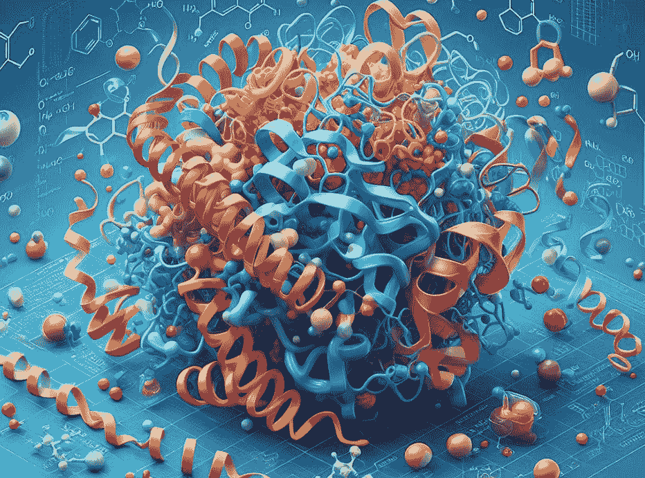

# 论文

### 泾渭之分：利用下游能力分析指导大型语言模型的预训练

贡献人：

链接：http://arxiv.org/abs/2404.01204v1

找出反映最终模型性能的早期指标是大规模预训练的核心原则之一。现有的缩放定律展示了预训练损失和训练量之间的幂律相关性，这是大语言模型当前训练状态的重要指标。然而，这一原则仅关注模型在训练数据上的压缩特性，与下游任务能力改进有较大的不一致。本文对各种预训练中间检查点的模型能力进行了全面比较。通过这一分析，我们确认特定的下游指标在不同规模模型之间呈现出相似的训练动态，最多达到670亿参数。此外，我们复现了Amber和OpenLLaMA，并发布了它们的中间检查点。这一举措为研究社区提供了宝贵资源，并促进了LLM预训练的验证和探索。我们提供了包括不同模型和能力的性能比较在内的经验总结，并对不同训练阶段的关键指标进行了说明。基于这些发现，我们提出了一种更加用户友好的评估优化状态的策略，为建立稳定的预训练过程提供了指导。

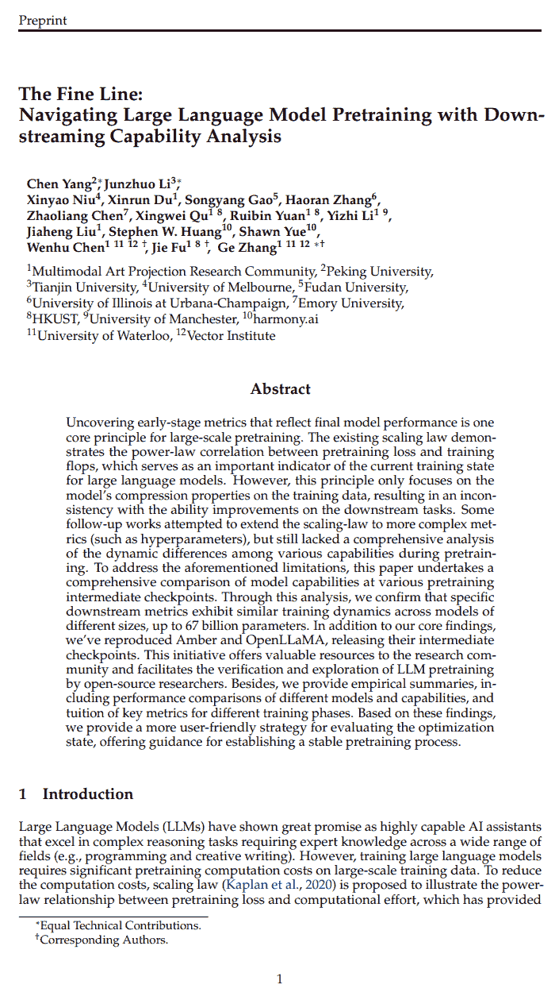

### 对抗阿喀琉斯之踵：关于生成模型红队对抗的综述

贡献人：

链接：http://arxiv.org/abs/2404.00629v1

生成模型正在迅速走红，并被整合到下流应用中，但各种漏洞的暴露引发了对其安全性问题的担忧。面对这一问题，红队领域正经历快速增长，与此同时我们也需要对领域进行全面梳理，涵盖整个流程并讨论涌现的话题。我们广泛调查了超过120篇论文，从语言模型固有能力的出发，设计了细粒度攻击策略分类。此外，我们还开发了统一各种自动红队方法的“searcher”框架。此外，我们的调查还涵盖了一些新颖领域，包括多模态攻击与防御、多语言模型的风险、无害查询的过度拒绝以及下游应用的安全性。我们希望这项调查可以提供该领域的系统观点，并开辟新的研究领域。

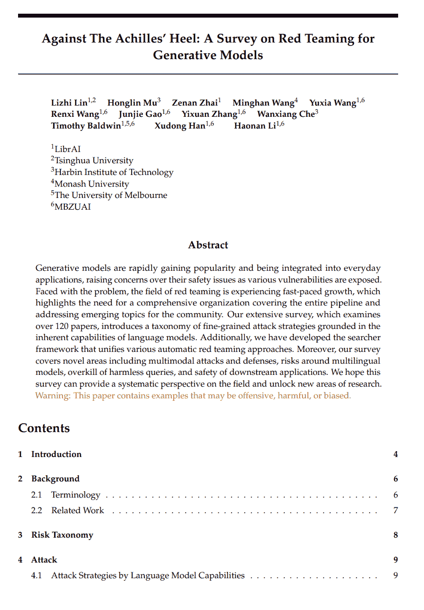

### **语言模型是宇航员操作者**

贡献人：

链接：http://arxiv.org/abs/2404.00413v1

近期涌现了一种趋势，即利用大语言模型(LLM)作为智能体，在用户文本提示的内容基础上采取行动。我们有意将这些概念应用于空间导航和控制领域，使LLMs在自主卫星操作的决策过程中发挥重要作用。作为实现这一目标的第一步，我们已开发了一种纯LLM解决方案，用于Kerbal Space Program Differential Games (KSPDG)挑战赛，这是一项公开的软件设计竞赛，参与者为KSP游戏引擎上运行的非合作空间操作中的卫星创建自主智能体。我们的方法充分利用提示工程、少量提示和微调技术，创建了一个在比赛中排名第二的有效LLM智能体。据我们所知，这项工作开创了将LLM智能体集成到空间研究中的先河。源代码可在 https://github.com/ARCLab-MIT/kspdg 上找到。

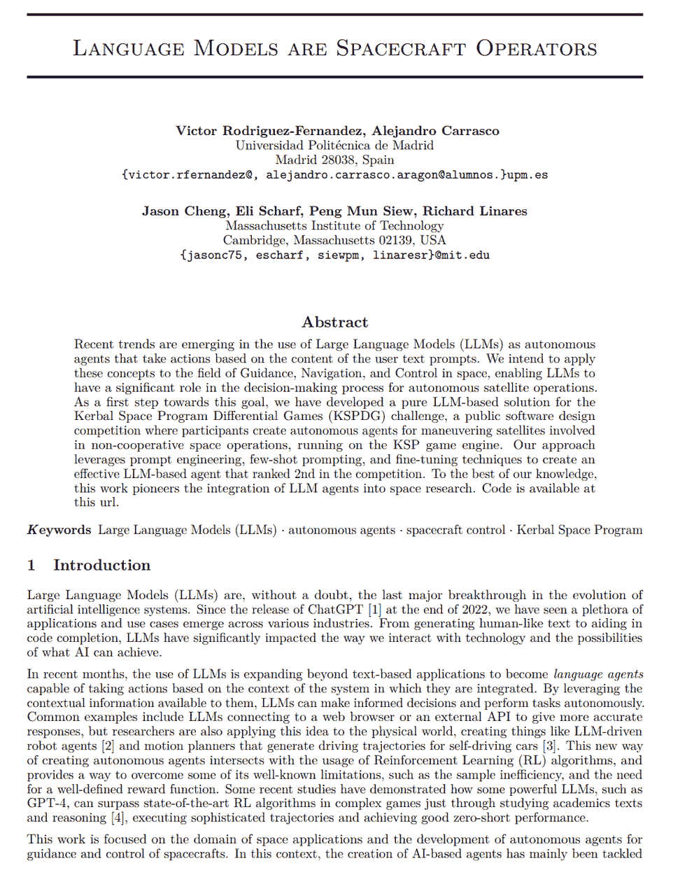

### **通过共同偏好优化对齐大语言模型**

贡献人：

链接：http://arxiv.org/abs/2404.00530v1

通常用于对齐大语言模型（LLMs）的常见技术依赖于通过比较在固定上下文条件下的多代人类偏好来获取。然而，这仅在把多代放置在相同上下文时利用了两两比较。然而，这种有条件的排名经常无法捕捉到人类偏好的复杂和多维方面。在这项工作中，我们重新审视了传统的偏好获取范式，并提出了一种基于共同获取指令-响应对偏好的新轴。我们发现，通过使用基于DOVE的联合指令-响应偏好数据训练的LLM，其在摘要和开放式对话数据集上胜过使用DPO训练的LLM，分别提高了5.2%和3.3%的胜率。我们的发现表明，联合指令和响应对的偏好可以显著增强LLMs的对齐能力，深入挖掘更广泛的人类偏好引发。数据和代码可在 https://github.com/Hritikbansal/dove 获取。

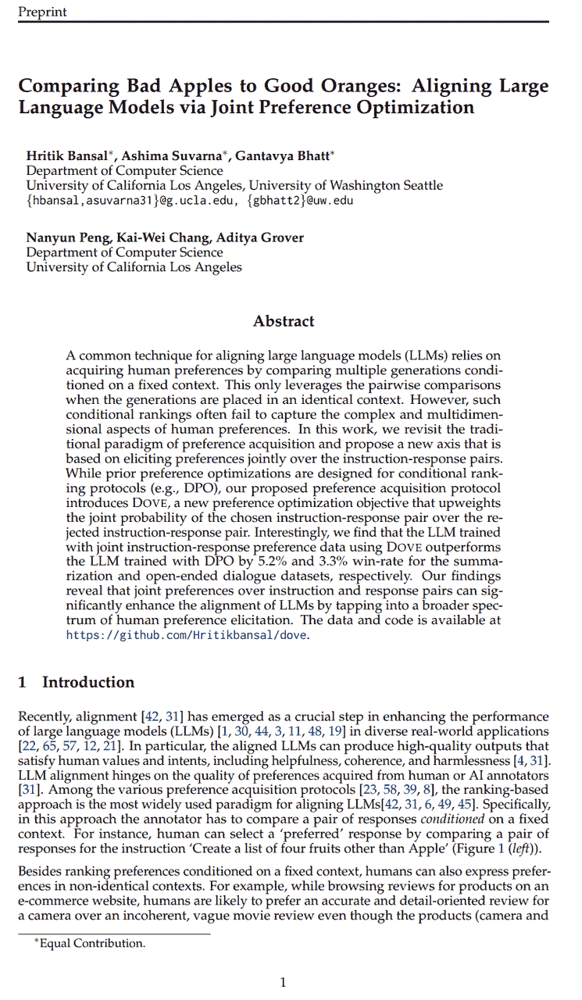

### Stable Code 技术报告

贡献人：

链接：http://arxiv.org/abs/2404.01226v1

我们介绍了Stable Code，是我们新一代代码语言模型系列的第一个模型，可面向代码补全、推理、数学和其他软件工程任务。此外，我们还介绍了一种名为 Stable Code Instruct 的指令变体，允许在自然对话界面中与模型交流，执行问答和基于指令的任务。在这份技术报告中，我们详细介绍了导致这两个模型的数据和训练过程。它们的权重可通过Hugging Face下载并使用，链接为https://huggingface.co/stabilityai/stable-code-3b 和https://huggingface.co/stabilityai/stable-code-instruct-3b。该报告包含对模型的全面评估，包括多语言编程基准测试和重点放在多轮对话的MT基准测试上。在发布时，Stable Code 是基于3B参数的最先进的开放模型，甚至在流行的Multi-PL基准测试中表现出色地与尺寸为70亿和150亿参数的更大模型相媲美。稳定代码Instruct也在MT-Bench编码任务和Multi-PL补全方面表现出色，与其他经过指令调整的模型相比。由于其吸引人的小尺寸，我们还提供在多台边缘设备上的吞吐量测量。此外，我们开源了几个量化检查点，并提供了它们与原始模型性能指标的比较。

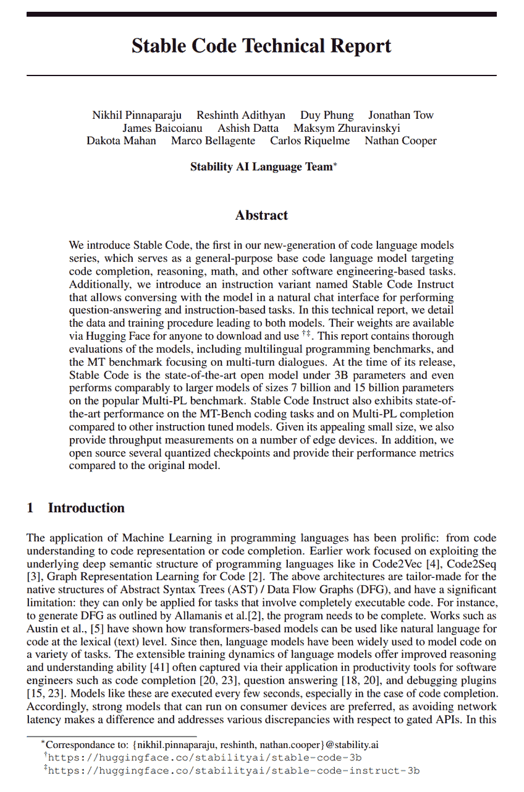

### 重新审视循环和非循环神经网络之间的关系：稀疏性研究

贡献人：

链接：http://arxiv.org/abs/2404.00880v1

神经网络可以分为递归和非递归两大类。虽然这两种类型的神经网络都备受欢迎和广泛研究，但它们通常被视为机器学习算法的不同家族。在这篇立场论文中，我们认为这两种类型的神经网络之间存在比通常认为的更紧密的关系。我们展示了许多常见的神经网络模型，如循环神经网络（RNN）、多层感知器（MLP）甚至深度多层Transformer，都可以表示为迭代映射。

RNN与其他类型的神经网络之间的密切关系并不令人惊讶。尤其是，RNN被认为是图灵完备的，因此能够表示任何可计算函数（如其他类型的神经网络）。然而，在本文中，我们认为这种关系更深入且更实际。例如，RNN通常被认为比其他类型的神经网络更难训练，受到诸如梯度消失或梯度爆炸等问题的困扰。然而，正如我们在本文中展示的那样，MLP、RNN和许多其他神经网络处于一个连续体上，这种视角带来了几个启示，阐明了神经网络的理论和实践方面的许多方面。

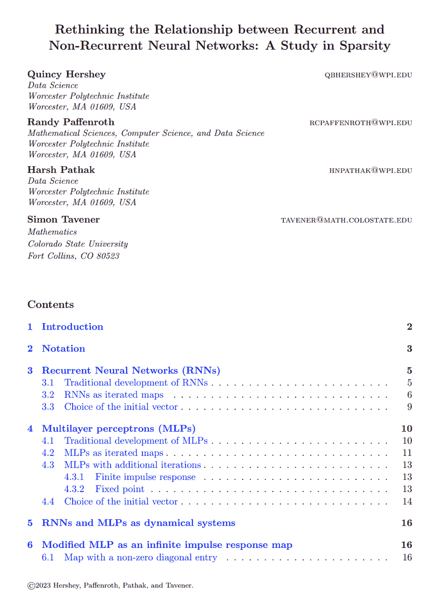

# 产品

### Circlesearch

贡献人：

https://www.circlesearch.ai/home

Circle to Search 是一个浏览器扩展，它可以让用户通过在屏幕上划圈来进行快速搜索。它提供即时的人工智能搜索结果，可以识别食谱、动物和语言等内容。

### CodeRabbit.ai

贡献人：

https://coderabbit.ai/

CodeRabbit.ai 帮助用户获得 AI 驱动的自动化体验，它可以完成代码审查，提供实时协作，根据用户反馈修改调整，使得错误得以快速消除，让开发人员将精力专注于其他事情，高效办公。

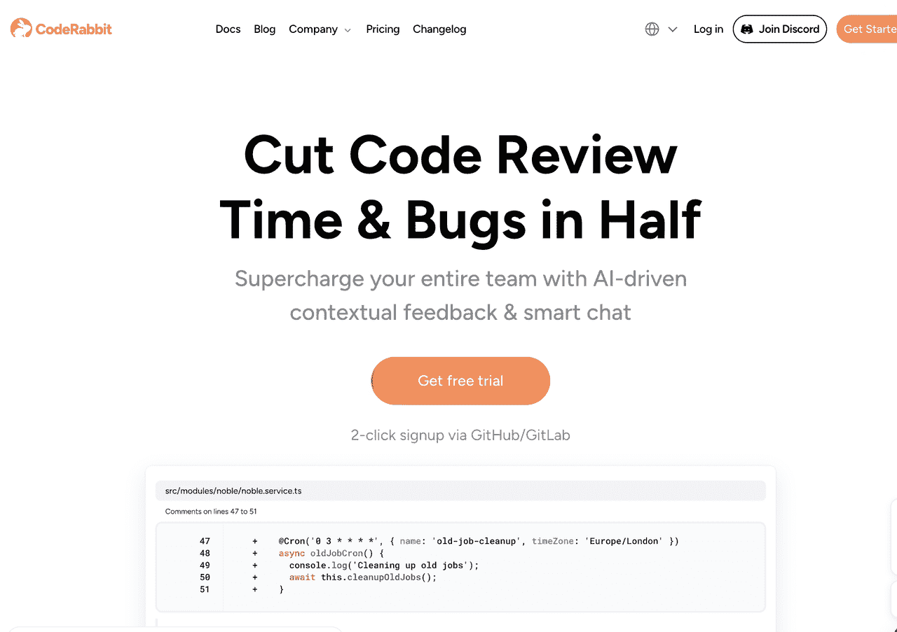

# HuggingFace&Github

### **Mengzi3**

贡献人：

https://github.com/Langboat/Mengzi3

澜舟科技发布的 Mengzi3-13B 模型基于 Llama 架构，语料精选自网页、百科、社交、媒体、新闻，以及高质量的开源数据集。通过在万亿tokens上进行多语言语料的继续训练，实现模型的中文能力突出并且兼顾多语言能力，且数学和编程能力表现突出。

### mPLUG-DocOwl

贡献人：

https://github.com/X-PLUG/mPLUG-DocOwl

阿里巴巴发布了用于文档理解的模块化多模态大型语言模型。

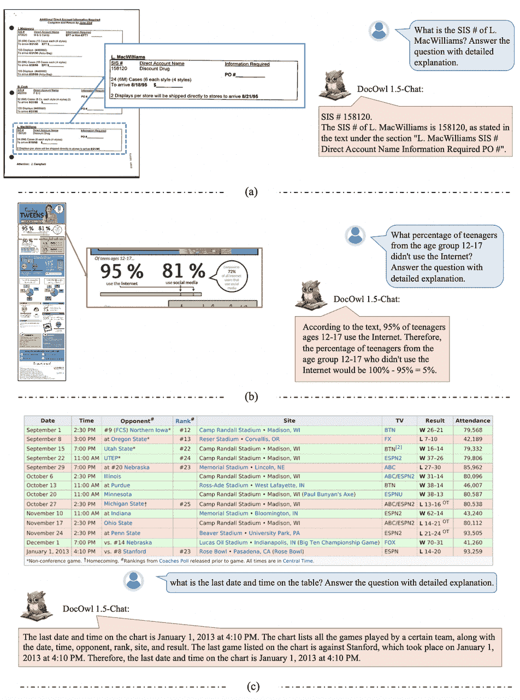

# 投融资

### 盈悦创享获得千万级天使轮融资，专注AI视觉解决方案。

贡献人：

http://www.investorscn.com/2024/04/01/114249/

盈悦创享，一家国内人工智能研发机构，近日宣布完成数千万元人民币的天使轮融资。这一轮融资的资金将被用于推进公司在AI视觉领域的产品研发和技术投入，旨在加大研发力度并优化其AI模型能力。盈悦创享依托其强大的模型能力和两项独立研发技术，专注于开发高自由度、易用性强且能够进行多模态融合的视觉处理技术，旗下首款应用“Katacata Ai”在内部测试中受到广泛好评。此次融资标志着盈悦创享在AI视觉解决方案领域迈出了重要一步，也展示了市场对其技术和未来发展潜力的认可。

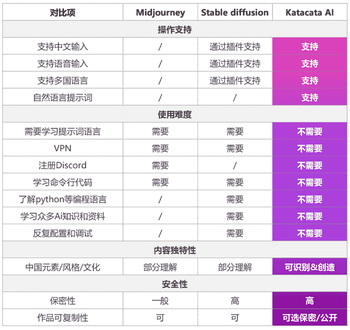

### 阿姆斯特丹旅行应用Stippl筹集57.5万欧元以发展AI旅程规划

贡献人：

https://www.eu-startups.com/2024/04/amsterdam-based-travel-app-stippl-raises-e575k-to-develop-the-ai-planning-journey/

Stippl，一款集多功能于一身的旅行应用，宣布成功筹集超过57.5万欧元。这轮融资得到了澳大利亚Marbruck Investments和荷兰Volve Capital的支持。公司将利用这笔资金发展其AI旅行规划功能，并计划到2024年底用户数增长到一百万。Stippl利用生成式AI的力量，结合创新的旅行规划工具和日益增长的旅行社区，致力于创造最个性化和定制化的体验。此外，公司还雄心勃勃地计划通过新的订阅服务和个性化照片书，扩大和延伸其既有的商业模式。

官网:https://stippl.io/

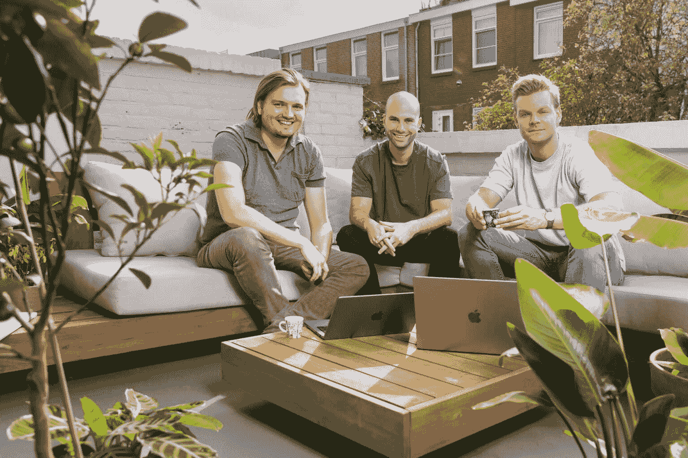

# 学习

### **Amazon SageMaker 上的 Baic**huan2 模型微调及部署（二）部署部分

贡献人：

https://aws.amazon.com/cn/blogs/china/baichuan2-model-fine-tuning-and-deployment-on-amazon-sagemaker-part-two/

本文介绍了在Amazon SageMaker上部署Baichuan2模型的三种方法：使用HuggingFace原生方式、vLLM框架、以及基于TensorRT_LLM后端的Triton Inference Server。文章详细解释了如何加载和合并LoRA模型，对BFloat16和INT8格式的模型进行量化处理以优化GPU资源使用。特别提到，vLLM和TensorRT-LLM通过技术如KV cache和Paged Attention提高了推理速度和吞吐率，对比HuggingFace原生部署显示显著性能提升。此外，文中还探讨了不同部署方法在不同并发条件下的推理性能，展示了vLLM和TensorRT-LLM在高并发场景下的优势。

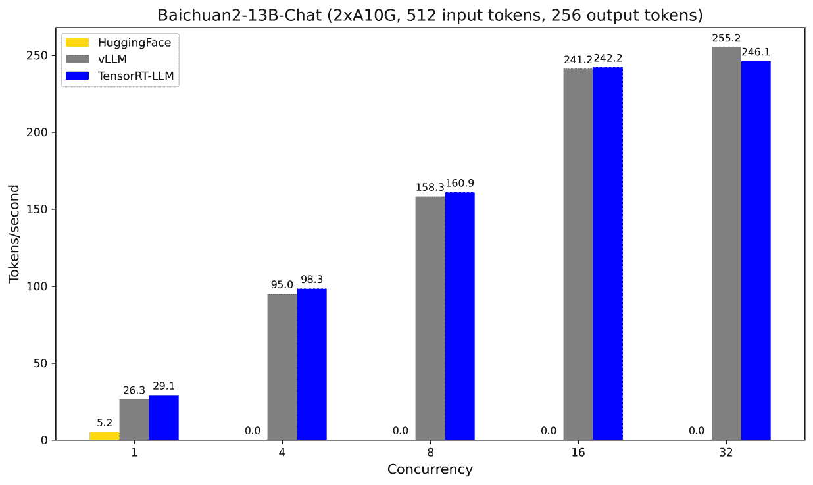

### 利用 🤗 Optimum Intel 和 fastRAG 在 CPU 上优化文本嵌入

贡献人：

https://mp.weixin.qq.com/s/-4dSu4ntPvcJax2OVx-d1A

文章介绍了使用🤗 Optimum Intel和fastRAG在CPU上优化文本嵌入的方法。Hugging Face模型库提供不同尺寸的嵌入模型，适用于基于编码器的轻量级模型，这使得CPU成为运行这些模型的理想选择。文中详细讲述了嵌入模型在信息检索中的应用，强调了稀疏检索和语义检索的区别。嵌入模型在RAG应用中扮演关键角色，涉及到文档索引/更新、查询编码和重排等环节。文章进一步探讨了使用Optimum Intel和IPEX优化嵌入模型的技术细节，包括模型量化和利用Intel硬件加速特性提高模型性能。此外，还展示了量化模型在MTEB任务上的准确度和性能评估，以及如何在fastRAG中集成优化后的模型。

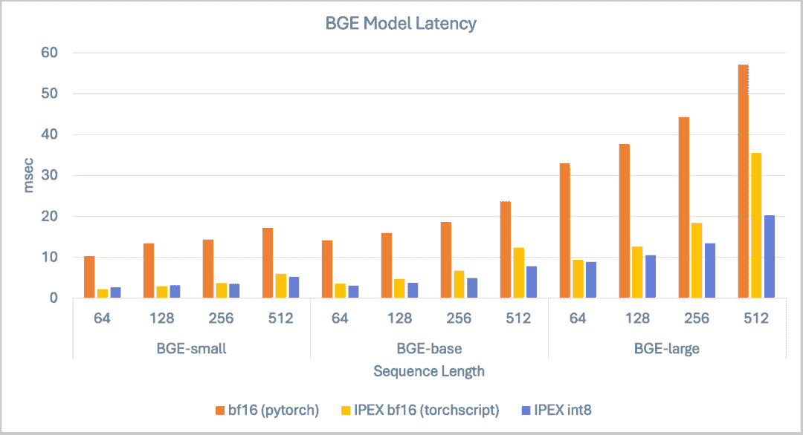

### 大模型在金融领域落地思路与实践 -恒生电子

贡献人：

https://mp.weixin.qq.com/s/Zfzd-MCXADSJl_wGtwUU9g

文章探讨了恒生电子大模型在金融领域的应用实践，重点在于如何利用大模型技术改进金融服务和运营。文章指出大模型技术带来的主要进步包括语言能力提升、意图识别、上下文写作、对知识和逻辑的理解以及代码生成能力。特别提及大模型的两条技术路线——GPT与Bert，并讨论了大模型在解决NLP的远距离上下文关联问题方面的优势。恒生电子通过引入LightGPT模型来提升金融领域服务的专业性和安全性，其中包括严格的语料和模型安全措施，以及金融法律法规遵循和金融领域知识真实性的显著提升。此外，文章也讨论了大模型生态的构建，重点在于如何将大模型技术与金融领域的特定需求相结合，以及如何通过光子中间件实现模型、应用和资源的有效连接。

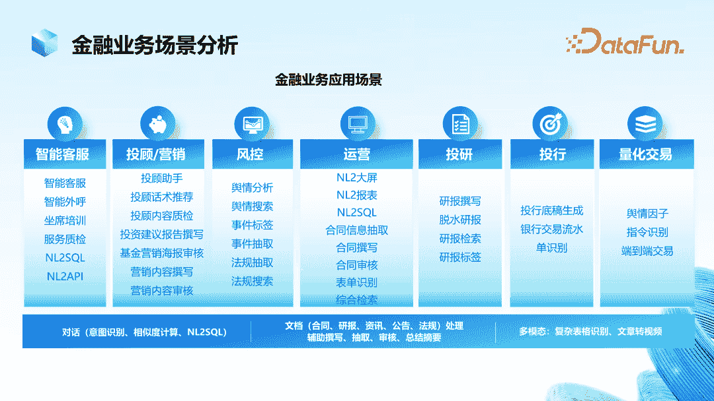

### Diffusion学习笔记（十六）——扩散桥，更高级的条件控制

贡献人：

https://zhuanlan.zhihu.com/p/672779929?utm_psn=1758508126985379840

文章深入探讨了扩散模型的高级技术——扩散桥（Diffusion Bridge），用于解决需要点到点对应的复杂任务，如图像翻译和图像复原。扩散桥通过在给定起点和终点之间建立扩散过程，如布朗桥和Lévy桥等，建立起两点之间的直接关系。文章详细讨论了布朗桥模型的数学推导，包括正向和逆向过程，以及如何通过特定的条件控制（如Doob's h-transform）将任意SDE变成过定点的扩散桥。这些技术的引入为扩散模型提供了更灵活的条件控制能力，使其能够应对更为复杂的应用场景。

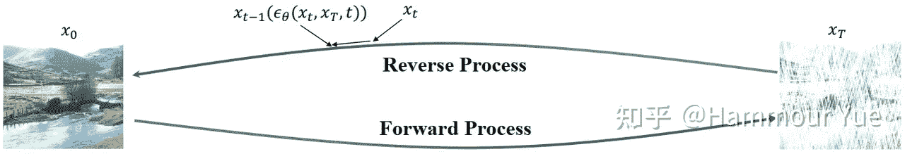

### 结合源码探究多模态模型的结构

贡献人：

https://zhuanlan.zhihu.com/p/690416879?utm_psn=1758552615447900160

本文深入探讨了多模态模型InternLM-XComposer的结构，重点介绍了其基本组成：视觉模块、语言模块、对齐模块。以InternLM-XComposer2为例，展示了图像预处理、ViT模块（利用CLIP模型的图像编码器）、文本处理等关键技术细节。特别指出，该模型通过结合视觉和语言信息，进行细致的图文对齐，实现高效的多模态交互。模型支持自由指令输入图文写作，突显其在图文多模态领域的领先地位。文章还详细说明了代码实现和模型调试过程，包括图像预处理、tokenization、模型输入的合并处理等步骤，为读者提供了深入理解多模态模型架构的宝贵资源。

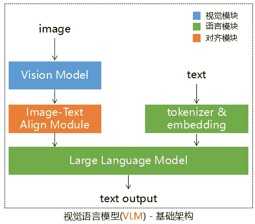

# 声明

本文档仅供学习交流使用，版权归原作者所有，若涉侵权，请联系Jack Jin 15101136166

##

（欢迎在下方反馈您宝贵的意见！整理不易，觉得有用给AI日报小组点个赞👍吧！）

ChatGPT；Angela；Zijia Liu；Alex；Zeqi Tan；Tiezhen（HuggingFace）；Naixu；Lizhi；Peter；Suoman；Jack

封面生成——右脑科技

如果你有大模型相关的创业想法，欢迎来找我们聊聊～微信：15101136166

> 快邀请你的小伙伴们一起来读大模型日报吧！

> **【日报****知识库****】**这里是近期日报内容的汇总,欢迎大家查阅

> [大模型日报知识库(分享版)](https://miracleplus.feishu.cn/wiki/KapVwXfkriOBiskB0B2cUHxjnTh)

>

> 欢迎大家多多帮我们分享,转发~~

> 如果大家有任何的建议或者吐槽,欢迎随时找我聊天~

