# 奇绩大模型日报（4月 1日）

> 来源：[https://miracleplus.feishu.cn/docx/LvAjdVjHto2e8yxQFvqc1XJNnLw](https://miracleplus.feishu.cn/docx/LvAjdVjHto2e8yxQFvqc1XJNnLw)

## **文章推荐**

### 「理论与实践」AIPM 张涛：关于Diffusion你应该了解的一切

https://mp.weixin.qq.com/s/G8u0OUIW4eCuja-0qgzAEQ

Stable Diffusion的亮相之初，在Github 排行榜，在不到两个月的时间内飙升至 33K star。

奇绩邀请了张涛老师来做分享，张涛老师为光年之外产品负责人，在这篇分享中，张涛老师以产品的角度带领技术小白了解Diffusion的底层原理，也进一步通过基于Diffusion的一些技术进展，SD在过去的一年半的时间里面，在整个行业里面构成了一个什么样子的生态？在这样子的生态里面，我们在产品上面的机会有哪些，以及作为产品经理，我们该如何去做。

# 推特

### 从xz包泄漏的后门事件看AI安全：使用pip和npm的AI公司都可能每次更新后被窃听数百次

贡献人：

https://x.com/nisten/status/1774424170664689720?s=20

nisten：我见过的最令人印象深刻(也最令人担忧)的AI安全演示之一。如果你的公司使用pip或npm,你不仅被窃听,而且在每次更新后被窃听了数百次。Snyk/npmregistry并没有发现其中的大部分。没错,就是你,你的数据。

---

转发Feross：xz包的后门只是冰山一角。npm、PyPI和Go注册中心不断有低级的恶意软件和间谍软件被上传。我想分享一些我们迄今为止检测到的20,000多个恶意软件包中的几个例子:

[ssstwitter.com_1711885723827.mp4](https://internal-api-drive-stream.feishu.cn/space/api/box/stream/download/all/WbKgbYR7OoeDepxyQEccUpvVnbf)

### Mojo开源：在Apache 2许可下发布Mojo标准库中的核心模块

贡献人：

https://www.modular.com/blog/the-next-big-step-in-mojo-open-source

Mojo🔥开源的下一个重大步骤

对Modular来说,开源深深植根于我们的DNA。我们坚信,要让Mojo发挥其全部潜力,它必须是开源的。我们一直在逐步开放Mojo和MAX平台的更多部分,今天我们很高兴宣布在Apache 2许可下发布Mojo标准库中的核心模块!

**我们一直认为**,公开构建Mojo将带来更好的结果,因为它允许其设计受到更广泛社区反馈的影响。我们很早就发布了Mojo,并自2023年5月以来一直在稳步改进。构建一门语言及其基础设施是一项艰巨的工作,需要时间,我们很高兴能够从分享我们的工作转变为与全球Mojo开发者合作。

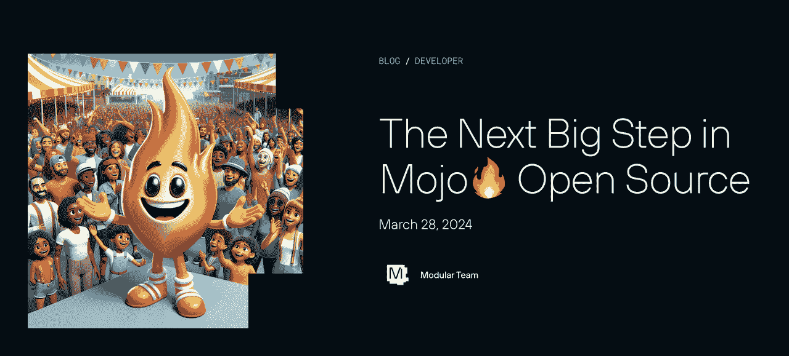

### Raschka：大语言模型预训练和评估奖励模型的技巧

贡献人：

https://x.com/rasbt/status/1774420802328203570?s=20

Sebastian Raschka：我刚写了一篇新文章"大语言模型预训练和评估奖励模型的技巧"。在这里,我回顾了一篇讨论继续预训练大语言模型策略的论文。然后,我讨论了在人类反馈强化学习(一种流行的大语言模型对齐方法)中使用的奖励建模。

1.  大语言模型的持续预训练是一个重要主题,因为它允许我们更新现有的大语言模型,例如,确保这些模型与最新信息和趋势保持同步。此外,它还允许我们在不需要从头开始重新训练的情况下使其适应新的目标领域。

1.  奖励建模很重要,因为它允许我们更紧密地将大语言模型与人类偏好对齐,并在一定程度上有助于安全。但除了人类偏好优化之外,它还提供了一种通过提供指令-输出示例来学习和适应复杂任务的机制,在这些示例中,显式编程正确行为具有挑战性或不切实际。

1.  作为奖励,我还包括了对RLHF中用于训练奖励模型的Bradley-Terry模型的解释,并与直接偏好优化进行了比较!

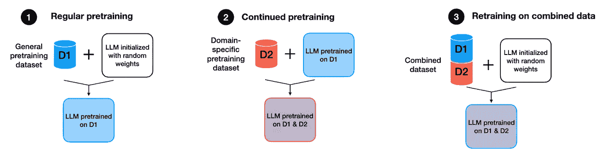

### Huyen：如果再次创业我会解决的问题

贡献人：

https://x.com/chipro/status/1774583930500632917?s=20

如果我再次创业,我会解决的问题(尽管我可能不会很快这样做,因为创业很难)。如果你正在解决其中任何一个问题,我很乐意聊聊。

1.  数据合成:AI在生成和标注数据方面已经变得非常擅长。现在的挑战是确保生成的数据是安全和合法的,例如不侵犯任何知识产权。

1.  评估:随着大语言模型的出现,评估变得更加困难,一方面是因为许多人将模型视为黑盒(我们部署别人为我们开发的模型),另一方面是因为输出可以是开放式的。同时,评估的投入远远不及模型或应用程序开发的投入。我对竞技场式评估、嵌入式评估、人工参与的评估以及小型专门的计分器(而不是使用GPT-4等大型模型作为评判)感兴趣。

1.  能源:人工智能扩展的瓶颈不再是计算,而是电力。我对所有与能源相关的问题都感兴趣,包括新能源和能源交易。

1.  任何能让你收集别人没有的独特数据的应用程序。我听到有人担心构建看起来像流行API"包装器"的应用程序。如果你能早点进入市场并收集足够的数据来不断改进你的产品,数据就是你的护城河。

1.  GPU原生一切:许多数据科学工具,包括scikit-learn、pandas和Spark,都不是为在GPU上原生运行而构建的。已经有一些努力使这些工具更有效地利用GPU,但我认为GPU的软件层(而不仅仅是NVIDIA GPU)仍有很大的空间。

1.  精选互联网:机器人已经破坏了约会应用程序、搜索(机器人在搜索引擎优化方面非常擅长)和社交媒体。我希望能够为我的互联网设置边界,例如将搜索结果限制在我信任的人编写的内容,或经验证为人类的来源。

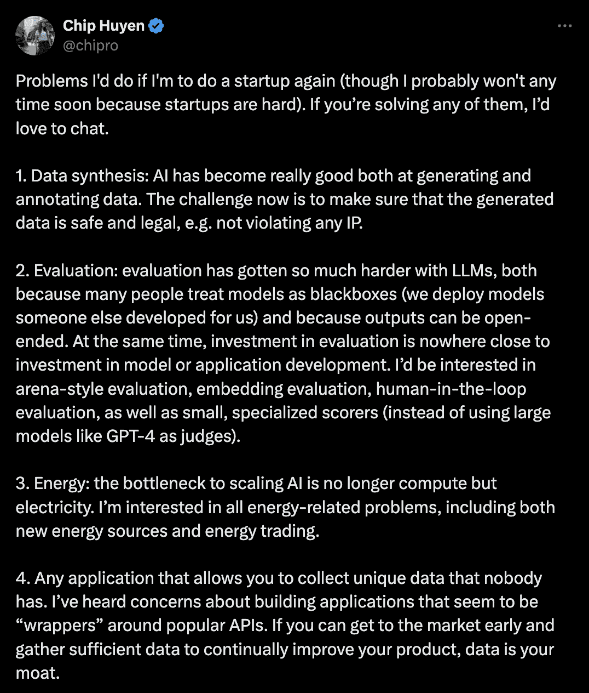

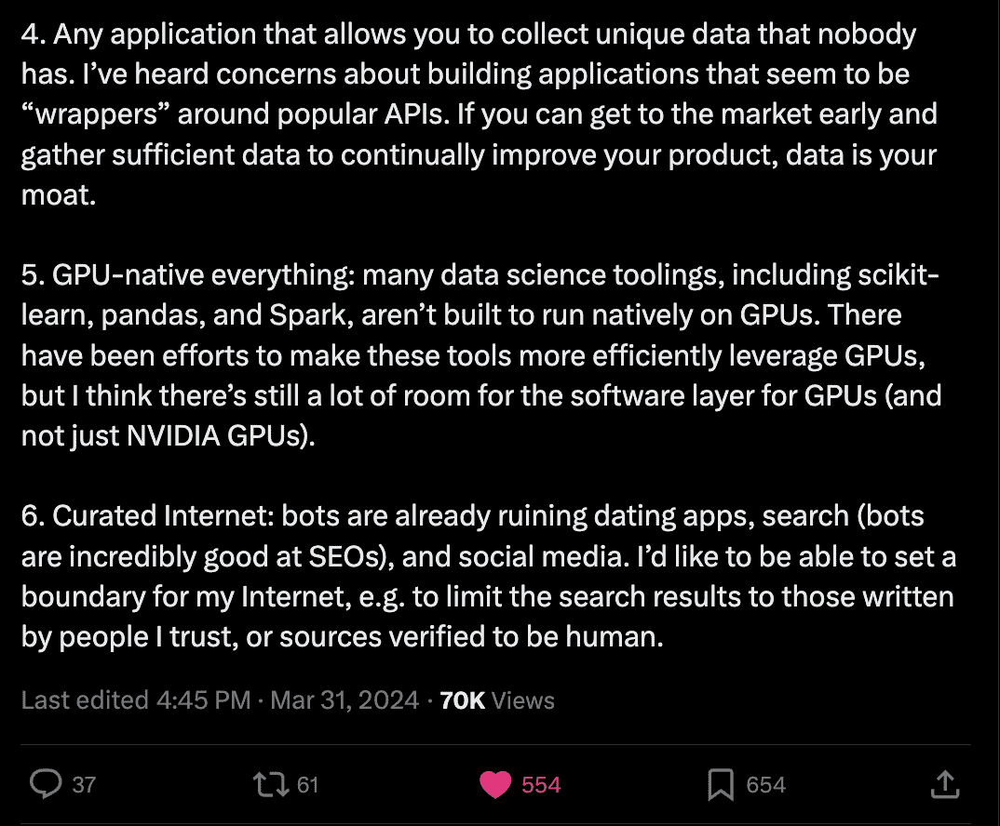

### LLaMA现在在CPU上运行得更快了：让llamafile在许多提示/图像评估场景和硬件的CPU上比llama.cpp快1.3倍到5倍

贡献人：

https://x.com/JustineTunney/status/1774621341473489024?s=20

LLaMA现在在CPU上运行得更快了

我刚刚为llamafile编写了84个新的矩阵乘法内核,使其能够更快地读取提示/图像。与llama.cpp相比,在CPU上使用F16和Q8\_0权重时,llamafile的提示评估时间应该可以提高30%到500%。对于ARMv8.2+(如RPI 5)、Intel(如Alderlake)和AVX512(如Zen 4)计算机,改进最为显著。我的内核比MKL快2倍,适用于适合L2缓存的矩阵,这使它们仍在进行中,因为加速效果最佳适用于少于1,000个令牌的提示。

llamafile是我于2023年11月与Mozilla共同启动的本地LLM项目。我们正在使用Cosmopolitan Libc将llama.cpp打包为单文件跨平台二进制文件,可在AMD64和ARM64的六个操作系统上运行,同时进行温和修改。我相信,通过改进核心技术,我们可以为用户提供最佳的llama.cpp体验,同时帮助两个项目触及更广泛的受众。Mozilla一直在给我资源来做这件事。

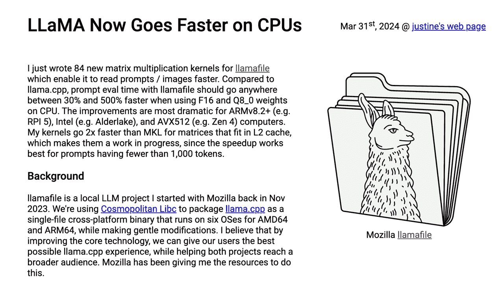

### Hobson博客系列：使用Langchain、OpenBB和Claude 3 Opus进行金融分析

贡献人：

https://x.com/TraderAegis/status/1774292291999416388?s=20

Seth Hobson：今天,我开始了一个新的博客系列,讲述如何使用Langchain、OpenBB和Claude 3 Opus进行金融分析。应该会很有趣!

用Langchain、OpenBB和Claude 3 Opus构建智能股票分析工具

"市场不会击败他们。他们自己打败自己,因为尽管他们有头脑,但无法坐得住。" – Jesse Livermore

在这一系列文章中,我们将探讨如何使用Langchain、OpenBB和Anthropic最新、最强大的大语言模型Claude 3 Opus构建一个AI驱动的股票分析工具。通过利用这些尖端技术,我们可以创建一个强大的应用程序,为交易者和投资者提供有价值的见解和建议,以做出明智的投资决策。

根据Anthropic自己的新闻稿,Opus的一个强有力的潜在用例涉及战略性的"对图表和图形、财务和市场趋势的高级分析,\[以及\]预测"。让我们让那个大脑为我们工作,好吗?

### 为什么神经网络不是图灵机器/Turing Complete

贡献人：

https://x.com/MLStreetTalk/status/1774473007248871660?s=20

神经网络不是图灵机/图灵完备(在任何实际意义上)。这可能是(显然!)几乎每个人都误解神经网络的最普遍的事情。这意味着神经网络中可表达程序的空间只是图灵机的一小部分。Keith Duggar博士和Keith Duggar 一起进行了简要介绍。

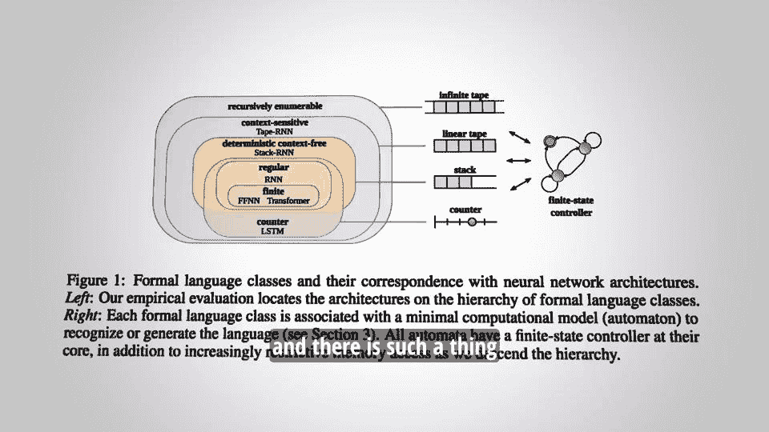

[ssstwitter.com_1711957909981.mp4](https://internal-api-drive-stream.feishu.cn/space/api/box/stream/download/all/MSttbONuhoawwFx48gzcXVVenTd)

### 新的 Dolphin-2.8-mistral-7b-v0.2 发布,在 MistralAI 新 v0.2 基础模型上训练,具有 32k 的上下文

贡献人：

https://x.com/erhartford/status/1774539935355396582?s=20

新的 Dolphin-2.8-mistral-7b-v0.2 发布了,它是在 @MistralAI 的新 v0.2 基础模型上训练的,具有 32k 的上下文。感谢CrusoeCloud、Winson Sou 和 Abacus.AI 的赞助。

# 资讯

### 生成式人工智能量化天气预报中的不确定性

贡献人：

https://blog.research.google/2024/03/generative-ai-to-quantify-uncertainty.html?m=1

准确的天气预报可以对人们的生活产生直接影响，从帮助做出日常决定(如为一天的活动准备什么)，到通知采取紧急行动(例如，在面临危险天气条件时保护人们)。随着气候的变化，准确和及时的天气预报的重要性只会增加。认识到这一点，谷歌方面一直在投资天气和气候研究，以帮助确保未来的预报技术能够满足对可靠天气信息的需求。最近的一些创新包括MetNet-3，谷歌24小时内的高分辨率天气预报，以及GraphCast，一个可以预测未来10天天气的天气模型。

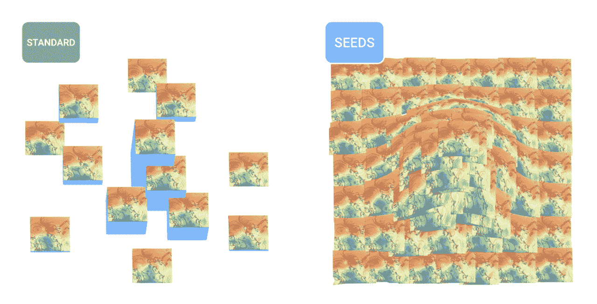

### 告别微软，姜大昕带领这支精英团队攀登Scaling Law，万亿参数模型已有预览版

贡献人：

https://mp.weixin.qq.com/s/GAXBgd_ZUXLqkq_q7h5ong

万**亿参数模型对于算力、数据的海量需求也注定了，这不会是一场「百模大战」，而是少数一些玩家才能参与的角逐。就像前微软全球副总裁、如今的阶跃星辰创始人姜大昕**所说，「GPT-3.5 会是一个分水岭，**在超****过 GPT-3.5 之后，可能**只有极少数的公司会继续攀登 Scaling Law。在算力、系统、数据和算法等各个方面，万亿参数模型的难度都上升了几十倍。如果这里面有任何一个短板，Scaling Law 都很难攀登上去。」作为一位大模型领域的创业者，这番话其实也道出了姜大昕创业以来的一些体会。目前，他带领的阶跃星辰已经做出了超过 GPT-3.5 的千亿参数模型 Step-1 和比肩 GPT-4V 的多模态大模型 Step-1V，甚至正在打造的万亿参数 MoE 语言大模型 Step-2 也有了预览版。在姜大昕看来，他们的路径是非常清晰的，就是沿着「单模→多模→具身智能→世界模型」的路线一步步往下走。打造万亿参数（甚至更大的）模型是其中必要的一环，在此基础上，他们还将推进多模态理解与生成的融合与统一。

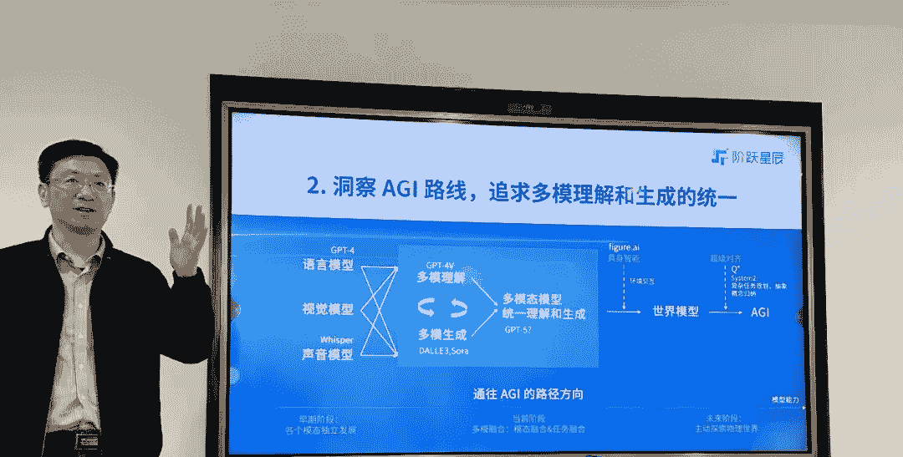

### 0门槛免费商用！孟子3-13B大模型正式开源，万亿token数据训练

贡献人：

https://mp.weixin.qq.com/s/L4wqVnbS8a9FT0Sd8JvDPw

澜舟科技官宣：孟子3-13B大模型正式开源。这一主打高性价比的轻量化大模型，面向学术研究完全开放，并支持免费商用。在MMLU、GSM8K、HUMAN-EVAL等各项基准测评估中，孟子3-13B都表现出了不错的性能。尤其在参数量20B以内的轻量化大模型领域，在中英文语言能力方面尤为突出，数学和编程能力也位于前列。

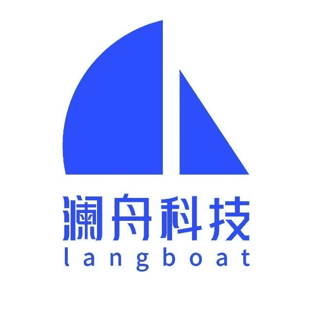

### AI行业买英伟达GPU，花的钱比赚的多17倍

贡献人：

https://mp.weixin.qq.com/s/cflvdU80HbOw7JKaY0Q8JQ

搞 AI 大模型，实在太烧钱了。如今的生成式 AI 有很大一部分是资本游戏，科技巨头利用自身强大的算力和数据占据领先位置，并正在使用先进 GPU 的并行算力将其推广落地。这么做的代价是什么？最近《华尔街日报》一篇有关明星创业公司的报道里给出了答案：投入是产出的 17 倍。

### 可编辑的DALL·E 3要来了？一句话就能PS图片

贡献人：

https://mp.weixin.qq.com/s/4vn-KA0Y_2_sv_JMzgWg1A

可编辑的 DALL・E 3 难道要来了？在 OpenAI 刚刚更新的一篇文章中，透漏了一些关于 DALL・E 3 编辑器界面的消息。该功能使得用户通过选择图像中的一个区域并在聊天中进行文本描述来编辑图像。去年，OpenAI 将 DALL・E 3 集成进 ChatGPT，这种王炸级别的组合令很多人直呼 OpenAI 开始颠覆 AI 绘画领域。但遗憾的是，用户不能对生成的图片进行编辑。现在，这一功能可能真的要来了，已经有网友放出了预览版本。

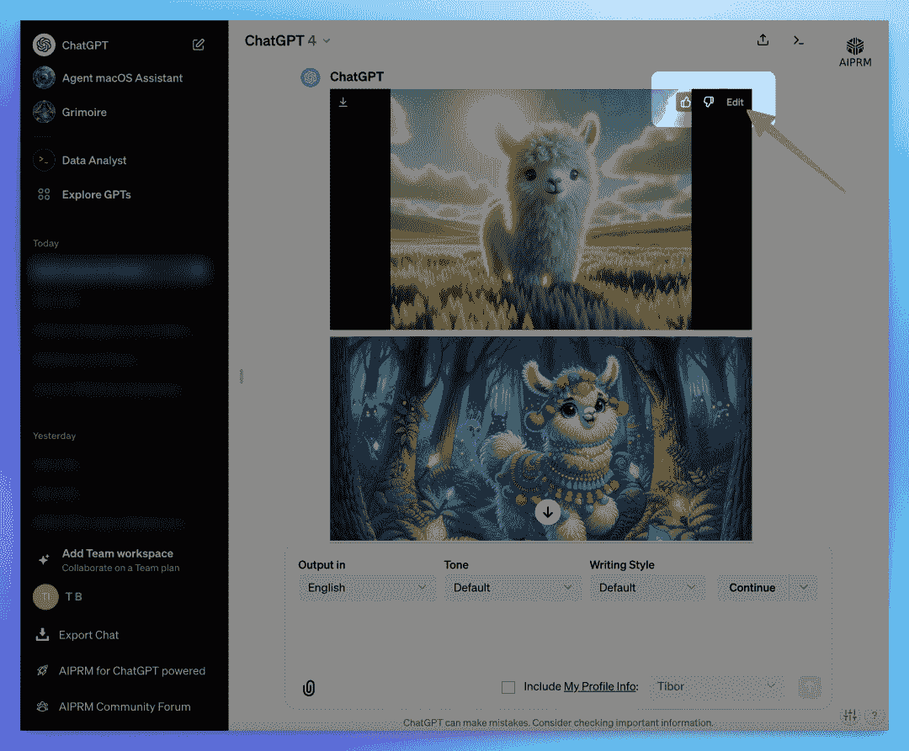

### 比LoRA还快50%的微调方法来了！一张3090性能超越全参调优，UIUC联合LMFlow团队提出LISA

贡献人：

https://mp.weixin.qq.com/s/7s8NNGYlq4JWeln0TkOKmQ

2022 年底，随着 ChatGPT 的爆火，人类正式进入了大模型时代。然而，训练大模型需要的时空消耗依然居高不下，给大模型的普及和发展带来了巨大困难。面对这一挑战，原先在计算机视觉领域流行的 LoRA 技术成功转型大模型，带来了接近 2 倍的时间加速和理论最高 8 倍的空间压缩，将微调技术带进千家万户。但 LoRA 技术仍存在一定的挑战。一是 LoRA 技术在很多任务上还没有超过正常的全参数微调，二是 LoRA 的理论性质分析比较困难，给其进一步的研究带来了阻碍。UIUC 联合 LMFlow 团队成员对 LoRA 的实验性质进行了分析，意外发现 LoRA 非常侧重 LLM 的底层和顶层的权重。利用这一特性，LMFlow 团队提出一个极其简洁的算法：Layerwise Importance Sampled AdamW（LISA）。

### ICLR 2024 | 鸡生蛋蛋生鸡？再论生成数据能否帮助模型训练

贡献人：

https://mp.weixin.qq.com/s/MSSzIl3KnvRzgWVN0ZyW6A

随着生成模型（如** ChatGPT、扩散模型）飞**速发展，一方面，生成数据质量越来越高，到了以假乱真的程度；另一方面，随着模型越来越大，也使得人类世界的真实数据即将枯竭。面对这一处境，一个近期的研究热度是，能否利用生成模型生成的假数据来辅助学习？学界对此也产生了许多争论：到底是可以左脚踩右脚（bootsrap）地实现 weak-to-strong 的不断提升，还是像鸡生蛋、蛋生鸡一样，只不过是徒劳无功？在近期 ICLR 2024 工作中，北大王奕森团队针对这一「数据扩充」（Data Inflation）问题展开了深入研究。他们针对对比学习（如 SimCLR、DINO、CLIP）这一常见的自监督学习场景，从理论和实验两方面分析了生成数据对于表示学习能力的影响。为了控制变量，他们保证生成模型和表示学习都只能使用同一个（无监督）真实数据集进行训练，避免了扩充数据本身带来的收益。

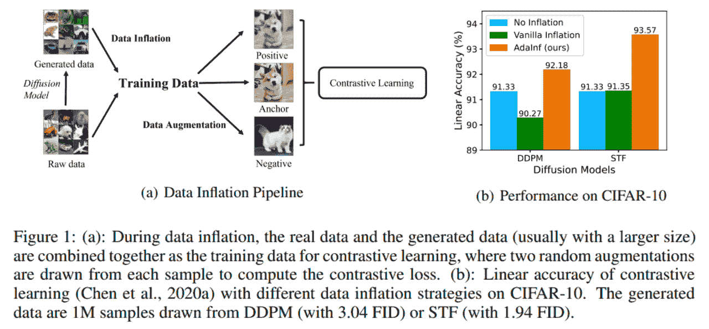

### 大模型实时打《街霸》捉对PK，GPT-4居然不敌3.5，新型Benchmark火了

贡献人：

https://mp.weixin.qq.com/s/vTwX_uAoC18TkoR-uVsyzg

让大模型直接操纵格斗游戏**《街霸》**里的**角色，捉对PK，谁更能打**？GitHub上一种你没有见过的船**新Benchmark火**了。与llmsys大模型竞技场中，两个大模型分别输出答案，再由人类评分不同——街霸Bench引入了两个AI之间的交互，且由游戏引擎中确定的规则评判胜负。这种新玩法吸引了不少网友来围观。由于项目是在Mistral举办的黑客马拉松活动上开发，所以开发者只使用OpenAI和Mistral系列模型进行了测试。排名结果也很出人意料。经过342场对战后，根据棋类、电竞常用的ELO算法得出的排行榜如下：最新版gpt-3.5-turbo成绩断崖式领先，Mistral小杯排第二。更小的模型超过了更大的如GPT-4和Mistral中杯大杯。

### 从300亿分子中筛出6款，结构新且易合成，斯坦福抗生素设计AI模型登Nature子刊

贡献人：

https://mp.weixin.qq.com/s/aRZTdmdEwFQoiDbiW6SurA

全球每年有近 500 万人死于抗生素耐药性，因此迫切需要新的方法来对抗耐药菌株。AI 方法可以发现新的抗生素，但现有方法有明显的局限性。性质预测模型很难扩展到大型化学空间。直接设计分子的生成模型可以快速探索广阔的化学空间，但生成的分子难以合成。在此，斯坦福大学和麦克马斯特大学（McMaster University）的研究人员发明了一种新的生成式 AI 模型 SyntheMol，可以设计数十亿种新的抗生素分子，这些分子价格低廉且易于在实验室中合成。SyntheMol 可以从近 300 亿个分子的化学空间中设计易于合成的新化合物。该模型可以设计新的抗生素来阻止鲍曼不动杆菌的传播。发现 6 个结构新颖的分子表现出对鲍曼不动杆菌的抗菌活性。论文作者、斯坦福大学生物医学数据科学副教授 James Zou 说，「SyntheMol 不仅设计了有希望的候选药物的新颖分子，而且还生成了如何制造每种新分子的配方。」全球健康药物研发中心（GHDDI）首席科学官张儒民博士表示：「生成式 AI 模型 SyntheMol 在短短三个月之内，设计出六款活性不错（当然有待进一步改进）的结构新颖且易于合成的抗生素候选分子。我们因此有理由乐观地预期，在不远的将来，AI 必将大幅提升制药成功率，缩短制药周期，降低研发成本，更快造福人类。」

### 美国升级对中国芯片打压，蔓延到AI PC

贡献人：

https://world.huanqiu.com/article/4HCwikEcwF7

据路透社报道，美国拜登政府上周五以国家安全为由，修订了旨在阻止中国获取美国人工智能（AI）芯片和芯片制造设备的规定。新修订的规则阐明，面向中国的AI芯片出口管制也将适用于包含这些芯片的笔记本电脑。

# 论文

### 混合Transformer-Mamba的 Jamba 语言模型

贡献人：

链接：http://arxiv.org/abs/2403.19887v1

我们介绍了Jamba，这是一个基于新颖的混合Transformer-Mamba专家混合（MoE）架构的新型基础大型语言模型。具体来说，Jamba交错使用Transformer和Mamba层块，享受两个模型系列的优势。MoE被添加在部分层中，以增加模型容量，同时保持活跃参数使用可管理。这种灵活的架构允许资源和目标特定的配置。在我们实现的特定配置中，我们得到一个功能强大的模型，适应单个80GB GPU。大规模构建的Jamba相比于基本Transformer具有高吞吐量和小内存占用，并且在标准语言模型基准和长上下文评估中表现出色。值得注意的是，该模型在高达256K个token上文长度上呈现出强大的结果。我们研究了各种架构决策，比如如何组合Transformer和Mamba层，以及如何混合专家，并展示了其中一些在大规模建模中是至关重要的。我们还描述了这些架构的几个有趣特性，Jamba的训练和评估揭示出来，并计划发布各种消融实验的检查点，以鼓励进一步探索这种新颖的架构。我们以宽松许可协议公开发布我们实现的Jamba权重。

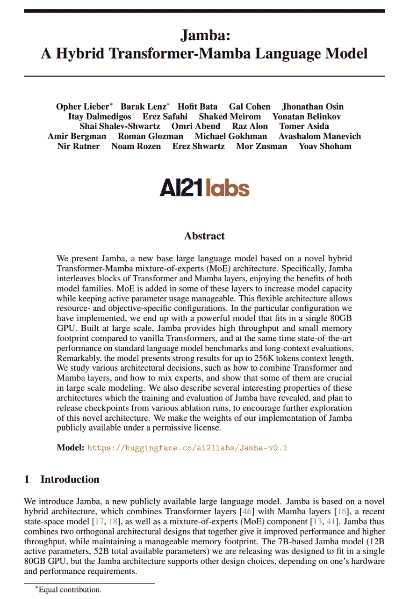

### Gecko：从大语言模型中蒸馏的多功能文本嵌入

贡献人：

链接：http://arxiv.org/abs/2403.20327v1

我们介绍了Gecko，这是一个紧凑且多功能的文本嵌入模型。Gecko通过利用一个关键思路实现了强大的检索性能：从大语言模型（LLMs）中提炼知识到一个检索器中。我们的两步提炼过程从使用LLMs生成多样化的合成配对数据开始。接下来，我们通过为每个查询检索一组候选段落，并使用相同的LLMs重新标记正面和负面难题段落，进一步提炼数据质量。Gecko的紧凑性证明了我们方法的有效性。在大规模文本嵌入基准测试（MTEB）中，具有256个嵌入维度的Gecko超越了所有现有768个嵌入尺寸的条目。具有768个嵌入维度的Gecko实现了66.31的平均分数，与7倍更大的模型和5倍更高维度的嵌入进行竞争。

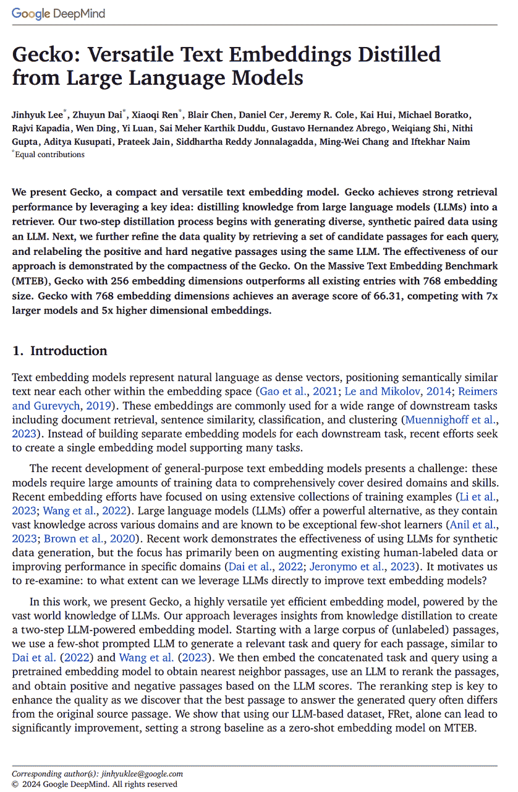

### **AttentionStore: 大**型语言模型服务中多轮对话的高效注意力重用

贡献人：

链接：http://arxiv.org/abs/2403.19708v1

在与人类进行多轮对话交互是大型语言模型（LLMs）的基本特征。然而，现有的用于执行多轮对话的LLM服务引擎由于需要反复计算历史 token 的关键-值（KV）缓存，导致服务成本高昂而效率低下。为了解决这一问题，本文提出了 AttentionStore，这是一种新的注意机制，能够实现在多轮对话中重复使用 KV 缓存（即注意力重用），大幅减少了重复计算开销。AttentionStore采用分层KV缓存系统，利用成本有效的存储媒介保存所有请求的KV缓存。为了减少慢媒介中的KV缓存访问开销，AttentionStore采用分层预加载和异步保存方案，以重叠KV缓存访问与GPU计算。为确保访问的KV缓存位于最快层次，AttentionStore采用调度器感知的提取和淘汰方案，根据推理作业调度器的提示有意识地将KV缓存放在不同层次。为避免上下文窗口溢出造成的保存KV缓存失效，AttentionStore通过解耦位置编码并有效地截断KV缓存，使保存的KV缓存保持有效。大量实验结果表明，AttentionStore可以将首个 token 的时间（TTFT）降低高达 88%，提高多轮对话的提示预填充吞吐量达到8.2倍，将端到端推断成本降低高达56%。对于长序列推断，AttentionStore将 TTFT 降低高达95%，将提示预填充吞吐量提高22倍。

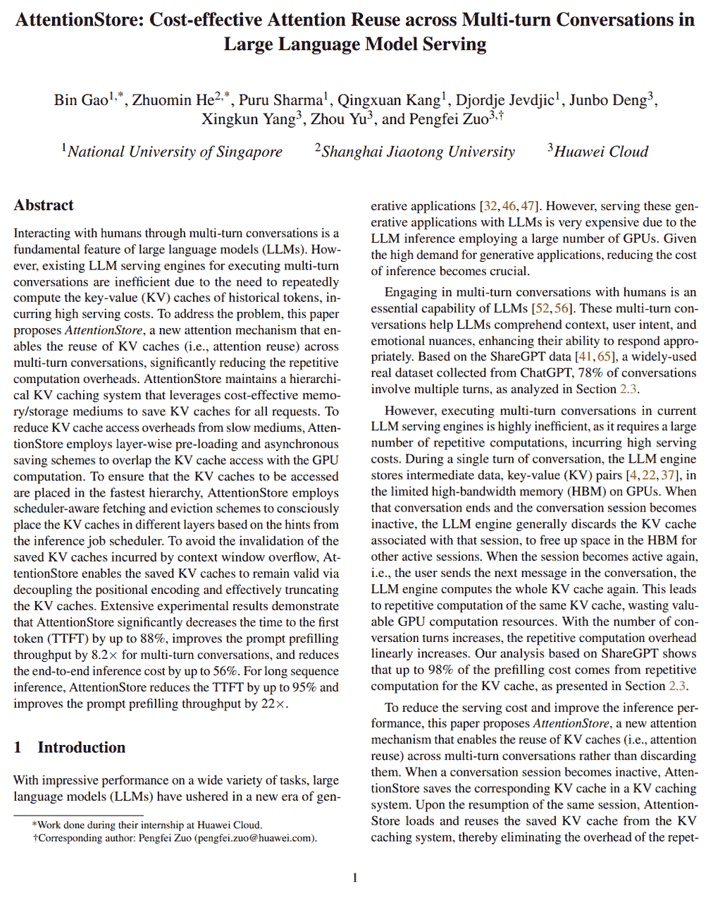

### PURPLE: 让大语言模型成为更好的SQL写手

贡献人：

链接：http://arxiv.org/abs/2403.20014v1

大型语言模型（LLM）技术在自然语言到SQL（NL2SQL）翻译中发挥着越来越重要的作用。通过广泛语料库训练的LLM具有强大的自然语言理解和基本SQL生成能力，无需针对NL2SQL任务进行额外调整。现有基于LLM的NL2SQL方法试图通过增强LLM来提高翻译质量，重点放在用户意图理解上。然而，LLM有时由于缺乏组织复杂逻辑运算符组合的知识而无法生成适当的SQL。一种有希望的方法是向LLM输入包含来自各种数据库的已知NL2SQL翻译的示范。LLM可以从输入示范中学习如何为给定任务组织运算符组合。本文提出了PURPLE（Pre-trained models Utilized to Retrieve Prompts for Logical Enhancement），可通过检索包含NL2SQL任务所需逻辑运算符组合的示范提高准确性，从而引导LLM生成更好的SQL翻译。PURPLE在流行的NL2SQL基准Spider的验证集上实现了80.5%的精确集匹配准确性和87.8%的执行匹配准确性，达到了新的最佳性能水平。PURPLE在各种基准、预算限制和不同LLM上保持高准确性，展现出鲁棒性和成本效益。

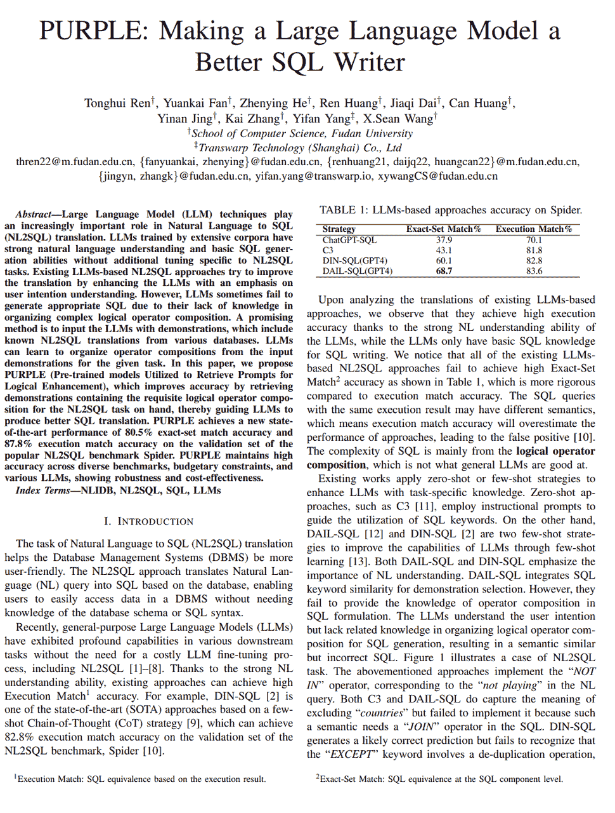

### **MambaMixer: 高效的选择性**状态空间模型，具备双token和通道选择

贡献人：

链接：http://arxiv.org/abs/2403.19888v1

最近深度学习的进展主要依赖于Transformer，因为它们对数据的依赖性和规模学习能力。然而，这些架构中的注意力模块展现出输入规模的二次时间和空间复杂度，限制了它们在长序列建模方面的可伸缩性。尽管近年来设计了高效和有效的多维数据架构骨干，如图像和多元时间序列，但现有模型要么与数据无关，要么未能实现跨维度和内部维度的通信。本文介绍了MambaMixer，一种新的架构，具有数据相关权重，使用了跨token和通道的双选择机制，称为Selective Token and Channel Mixer。MambaMixer通过加权平均机制连接选择性混合器，允许层直接访问早期特征。我们基于MambaMixer模块设计了Vision MambaMixer（ViM2）和Time Series MambaMixer（TSM2）架构，并在各种视觉和时间序列预测任务中探索它们的性能。我们的结果强调了跨token和通道的选择性混合的重要性。在ImageNet分类、目标检测和语义分割任务中，ViM2表现出色，并且胜过基于SSM的视觉模型。在时间序列预测方面，TSM2表现出色，相比最先进的方法，展示了显著改善的计算成本。这些结果表明，虽然Transformer、跨通道注意力和MLP对时间序列预测表现良好是足够的，但不是必要的。

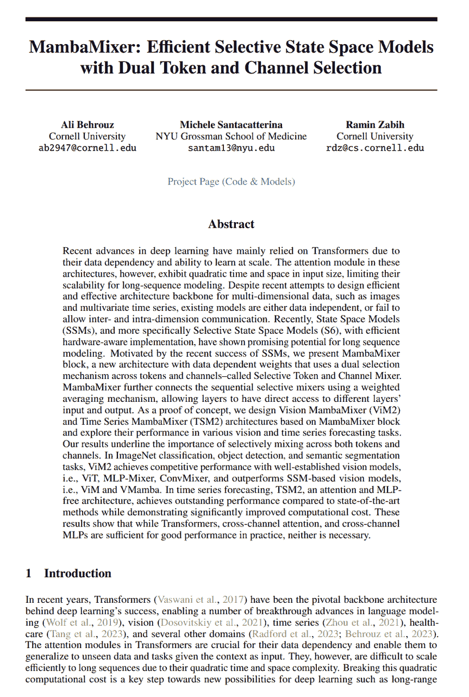

### ReALM: 基于语言建模的参考解析

贡献人：

链接：http://arxiv.org/abs/2403.20329v1

参考解析是一个重要的问题，对于理解和成功处理各种上下文至关重要。这个上下文包括先前的对话和与非对话实体有关的上下文，比如用户屏幕上的实体或在后台运行的实体。虽然LLM已被证明在各种任务中非常强大，但它们在参考解析中的使用，特别是对于非对话实体，仍未充分利用。本文演示了LLMs如何被用于创建一个极其有效的系统来解决各种类型的引用，通过展示如何将参考解析转换为一个语言建模问题，尽管涉及到像屏幕上的那些传统上不易简化为纯文本形式的实体形式。我们展示了相对于现有具有类似功能的系统，我们的最小模型在不同类型的引用上获得了超过5%的绝对增益。我们还与GPT-3.5和GPT-4进行了基准测试，我们的最小模型实现了与GPT-4相当的性能，而我们的较大模型明显优于它。

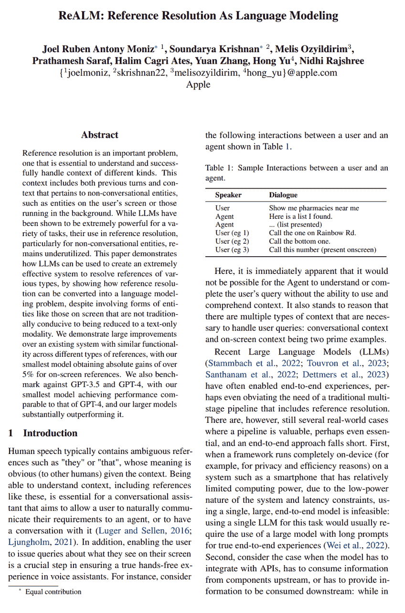

### FiarRAG：通过公平检索增强实现公平人类生成

贡献人：

链接：http://arxiv.org/abs/2403.19964v1

现有的文本到图像生成模型反映甚至放大了其训练数据中根深蒂固的社会偏见。这对人类图像生成尤为令人担忧，其中模型对某些人口群体存在偏见。现有尝试纠正此问题的方法受制于预训练模型固有的限制，并未能在人口多样性方面取得实质性改进。在这项工作中，我们引入了Fair Retrieval Augmented Generation（FairRAG），这是一个新颖的框架，它通过从外部图像数据库中检索的参考图像对预训练生成模型进行条件化，以提高人类生成中的公平性。FairRAG通过一个轻量级线性模块将参考图像投影到文字空间中来实现条件化。为了增强公平性，FairRAG采用简单而有效的去偏置策略，在生成过程中提供来自不同人口群体的图像。大量实验证明，FairRAG在人口多样性、图像与文本对齐和图像保真度方面优于现有方法，在推断过程中附加的计算开销极小。

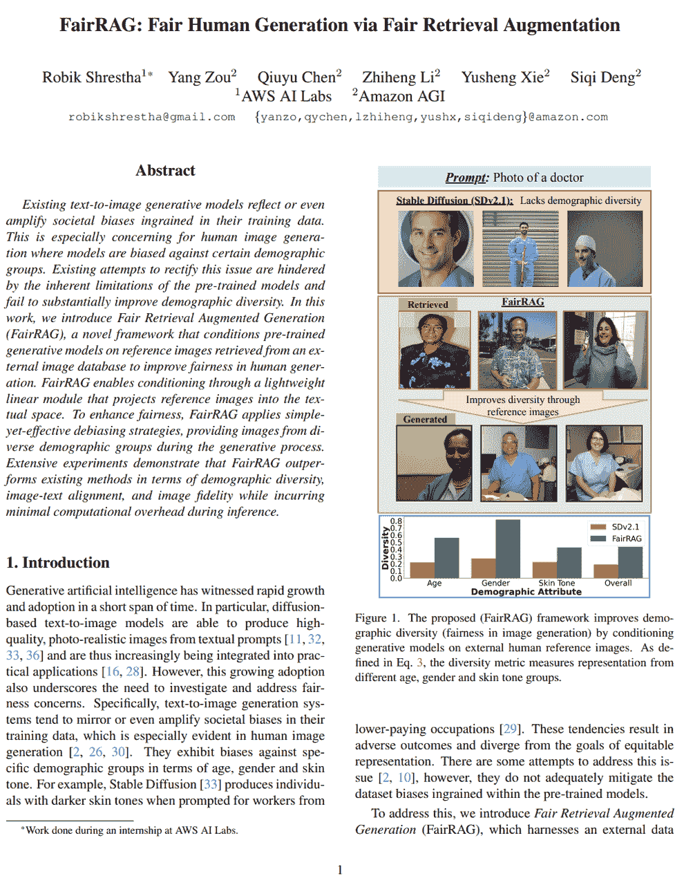

### 提高 Vision Transformer网络效率：设计技巧和见解

贡献人：

链接：http://arxiv.org/abs/2403.19882v1

受人类视觉系统在复杂场景中识别显著区域的固有能力的启发，注意机制已经无缝地整合到各种计算机视觉（CV）任务中。基于这一范式，Vision Transformer（ViT）网络利用注意机制提高效率。本文对ViTs中重新设计的注意机制进行了详尽的探索，旨在增强它们的性能。从理论基础和注意机制的基本概念入手，系统地审视了CV领域的最新文献，提出了多视角分类，基于它们的应用、目标和所应用的注意类型。分析中包括对不同策略的新颖性、优势、劣势进行深入评估。最终，我们开发了强调关键属性和贡献的分类法。欢迎访问我们的GitHub链接，收集了审阅过的研究及其开源实现，并定期更新最新相关论文。

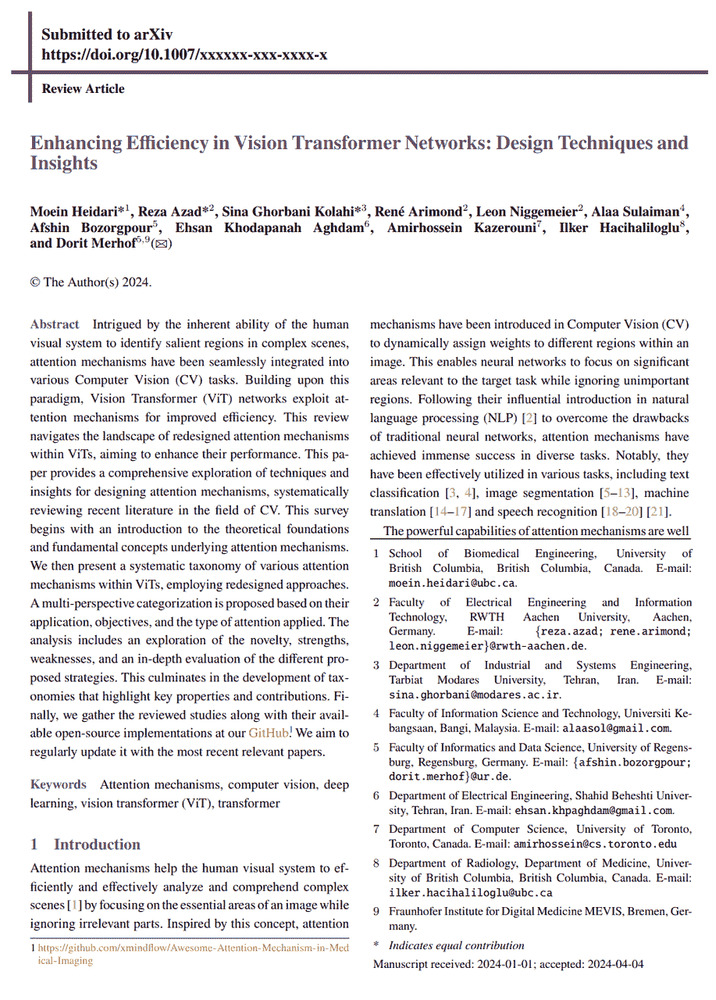

# 产品

### Salieri’s Multiverse

贡献人：

https://salieri.ai/multiverse

Salieri’s Multiverse 是一个故事沙盒平台，旨在将用户的想象力转化为引人入胜的叙事和生动的图像。它利用多智能体LLM将简单的描述无缝地转化为丰富、多方面的故事并伴随生成相应的视觉效果。这个平台适合寻求灵感的作家、制作内容的营销人员，以及希望将他们的愿景变为现实的梦想家。

### **Dodoboo**

贡献人：

https://dodoboo.fun/

Dodoboo 是一个由 AI 驱动的绘画产品，让孩子们可以释放他们的创意天赋，并且享受创造的乐趣。它提供了一个安全、激动人心的AI冒险领域，让孩子们可以在手动绘画时发挥想象力，轻松地创作出令人惊叹的艺术作品。

# HuggingFace&Github

### Mesh2NeRF

贡献人：

https://terencecyj.github.io/projects/Mesh2NeRF/

这项研究提出了一种名为Mesh2NeRF的方法，用于从纹理网格中推导出地面实况辐射场，可用于3D生成任务。与其他方法不同的是，Mesh2NeRF直接从3D网格中获取地面实况辐射场的解析解，并提供了有效性验证的结果。

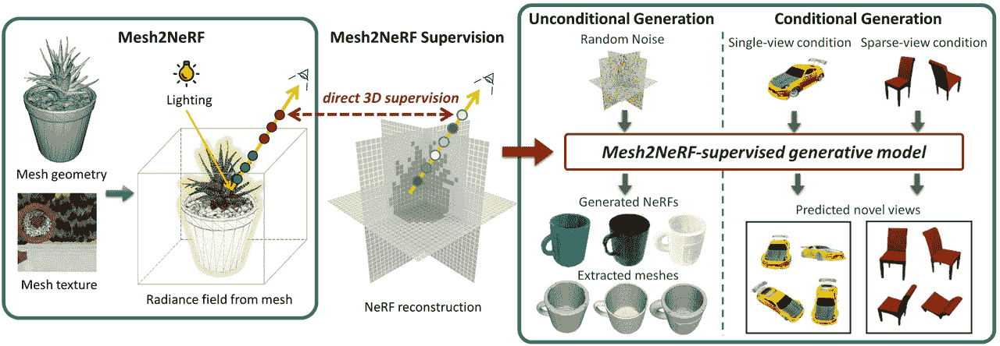

### Beyonder-4x7B-v3

贡献人：

https://huggingface.co/mlabonne/Beyonder-4x7B-v3

Beyonder-4x7B-v3 是对流行的 Beyonder-4x7B-v2 的改进。它是使用 LazyMergekit 制作的专家混合体 （MoE），它是 EQ-Bench 排行榜上最好的 4x7B 型号，优于旧版本的 ChatGPT 和 Llama-2-70b-chat。

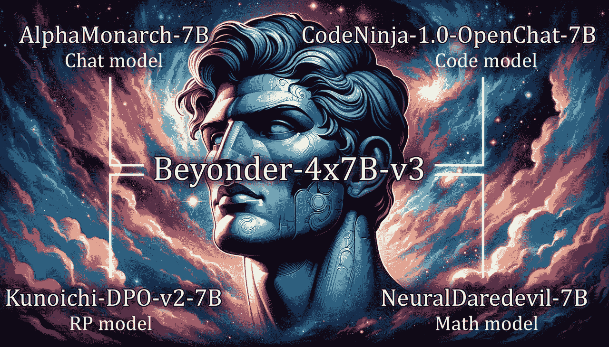

### FlagScale

贡献人：

https://github.com/FlagOpen/FlagScale

FlagScale是一个基于Megatron-LM项目的大型语言模型（LLM）工具包，支持来自北京智源人工智能研究院（BAAI）的LLM。项目的主要目标是在不牺牲数值稳定性和模型有效性的情况下，有效利用计算资源来支持LLMs。

# DevTools

### **lunary**

贡献人：

https://github.com/lunary-ai/lunary

Lunary 是一个旨在帮助 AI 开发人员将其应用程序投入生产的工具，提供成本分析、监控、快速模板、数据集调整、聊天和反馈跟踪以及评估等功能。它的设计旨在与任何模型兼容，易于集成（仅需2分钟），并且简单易于自行托管。

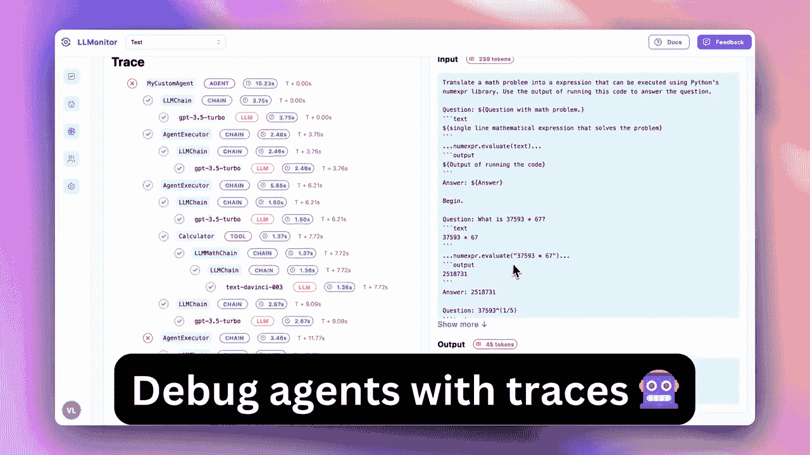

# 投融资

### AI领域安全初创企业SydeLabs在种子融资轮中筹集250万美元

贡献人：

https://economictimes.indiatimes.com/tech/funding/ai-led-security-startup-sydelabs-raises-2-5-million-in-seed-funding-round/articleshow/108841972.cms?from=mdr

SydeLabs是一家专注于利用生成式AI帮助组织发现并修复模型和应用中漏洞的初创公司，由Ruchir Patwa和Ankita Kumari于2023年创立。该公司在由RTP Global领投的种子融资轮中成功筹集了250万美元，Picus Capital等早期投资公司以及包括Cred创始人Kunal Shah和Mobile Premier League创始人Sai Srinivas Kiran在内的知名天使投资人也参与了投资。SydeLabs表示，这笔资金将被用于研发和完善现有产品组合。

公司官网：https://www.sydelabs.ai/

### Parallel Studios完成3500万美元融资

贡献人：

https://gam3s.gg/news/parallel-studios-reveals-35-million-funding-round/

Parallel Studios，开发了受欢迎的Ethereum NFT卡牌对战游戏Parallel的初创公司，宣布成功完成一轮融资。这次融资使公司能够为其Ethereum NFT游戏Parallel以及AI驱动的项目Colony提供资金支持。此轮融资突显了市场对于Parallel Studios旗下项目的强烈兴趣及对其未来发展潜力的认可。

链接：https://parallel.life/

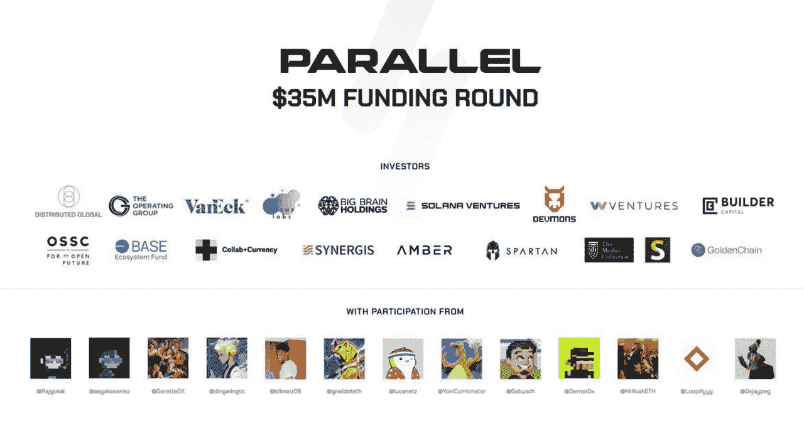

### 人工智能安全平台Rug.ai获得110万美元种子轮融资

贡献人：

https://www.coinlive.com/zh/news-flash/478975

据Foresight News报道，人工智能安全平台rug.ai在种子轮前融资中成功筹集了110万美元。本轮融资由No Limit Holdings领投，同时得到了Mask Network、Builder Capital、Formless Capital、Prismatic Capital、Hack VC合伙人Roshun Patel、Grass联合创始人drej、Pentoshi、Avi Felman、MacnBTC和Andrej Radonjic的支持。rug.ai利用人工智能技术，致力于提供端到端的链上安全解决方案，旨在帮助用户识别和防范潜在的安全威胁。

链接：https://rug.ai/signin

# 学习

### 如何通过指令级并行隐藏GPU Share Memory Bank Conflict

贡献人：

https://zhuanlan.zhihu.com/p/689748284

文章讨论了在CUDA编程中如何优化share memory访问以减少bank conflict，从而提高GPU性能。Share memory由多个bank组成，每个bank每周期只能处理一个地址行的数据。当一个warp内的不同线程访问同一个bank的不同entry时，会产生bank conflict，导致数据返回需要串行处理，降低效率。作者通过一个实例展示了如何触发4-way bank conflict，并提出了通过在share memory中引入padding来避免bank conflict的解决方案。此外，还讨论了指令级并行(latency hiding)如何帮助隐藏由bank conflict带来的额外时延，即通过连续的无bank conflict指令执行来掩盖由bank conflict引起的延迟，从而在系统级别上实现性能提升。

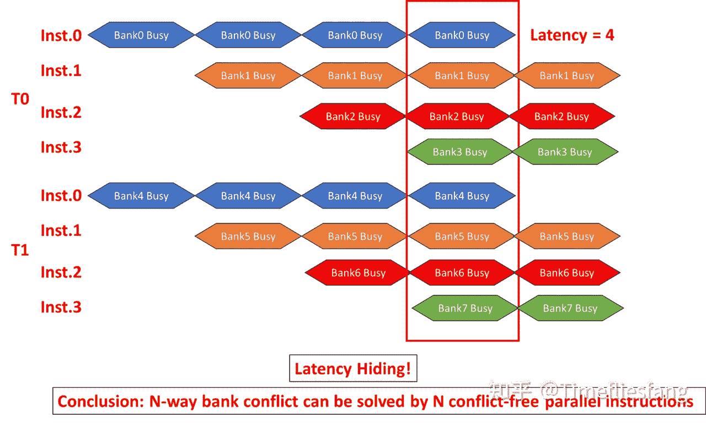

### 搞懂 CUDA Shared Memory 上的 bank conflicts 和向量化指令（LDS.128 / float4）的访存特点

贡献人：

https://zhuanlan.zhihu.com/p/690052715

文章详细讨论了在CUDA编程中，优化算子（如GEMM）时如何高效利用shared memory。特别强调了通过广播机制和避免bank conflicts来提升性能。文章深入分析了使用LDS.64或LDS.128指令（或直接使用float2、float4）进行数据访问时的内存访问特性，包括memory transaction的数量和bank conflict的条件。通过大量博客、问答和Nsight Compute测试，总结出在访问shared memory时，如何根据warp内线程的组织（如4x8或8x4布局）和访问模式（如连续访问uint2或uint4）来优化性能。这包括理解为什么在特定情况下可以通过减少memory transaction数量和避免bank conflicts来显著提升性能。

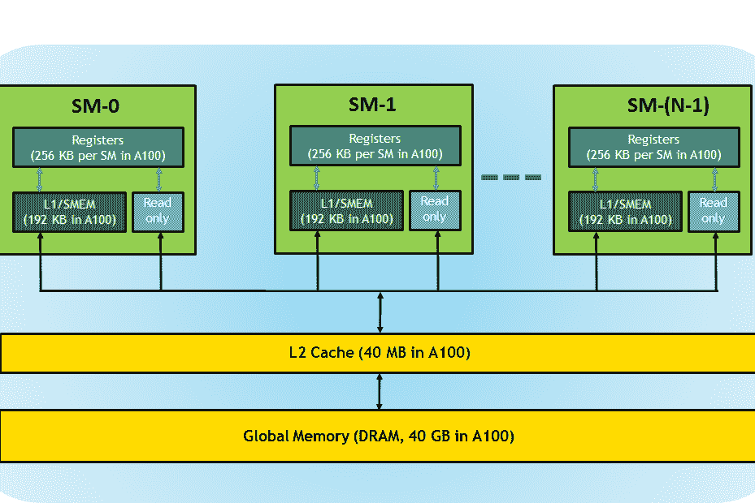

### CUTLASS 3.x 异构编程随感

贡献人：

https://zhuanlan.zhihu.com/p/689829403?utm_psn=1757913209187926016

文章探讨了NVIDIA GPU（NvGPU）异构化对CUDA单指令多线程（SIMT）编程的影响，特别是在新发布的Blackwell架构GPU背景下。文中详细讲述了如何通过CUTLASS 3.x实现高效的CUDA算子，尤其是矩阵乘法（GEMM）、卷积和Flash Attention（FMHA）2.0等在深度学习模型中占主导地位的计算。CUTLASS是一个基于CUDA C++的模板库，用于实现高性能的GEMM及相关计算。文章通过分析CUTLASS在不同NVIDIA GPU架构（如Volta、Ampere和Hopper）上的应用，突出了GPU访存层级和结构对优化GEMM算子的重要性。特别地，Hopper架构引入了新的异构指令，如Tensor Memory Accelerator（TMA）和4代TensorCores，显著提高了性能并改变了SIMT编程模式。此外，文章还介绍了CUTLASS 3.x中的优化技巧，如使用CuTe进行Tiling、利用TMA和WGMMA指令，以及软件流水和Warp-Specialization来适应GPU异构化的发展。

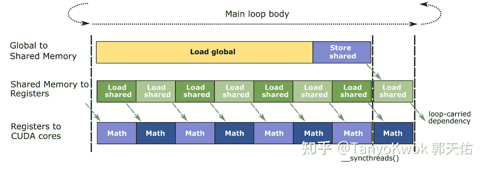

### Mamba模型解析

贡献人：

https://thegradient.pub/mamba-explained/

Mamba通过引入状态空间模型（SSMs）来解决Transformer模型在处理长序列时遇到的“二次瓶颈”问题。它通过消除注意力机制中的二次计算复杂度，实现了对长序列的有效处理，最高可处理长达100万个标记的序列。Mamba不仅运行速度快达5倍，而且在多种模态任务中表现出色，包括语言、音频和基因组学。此外，Mamba的性能在大规模序列上的提升归功于其快速推理能力和序列长度的线性缩放能力。Mamba采用选择性状态压缩机制，能够动态地将输入过滤到序列状态中，这种机制允许Mamba在避免Transformer的内存和计算限制的同时，保持最先进的性能水平。

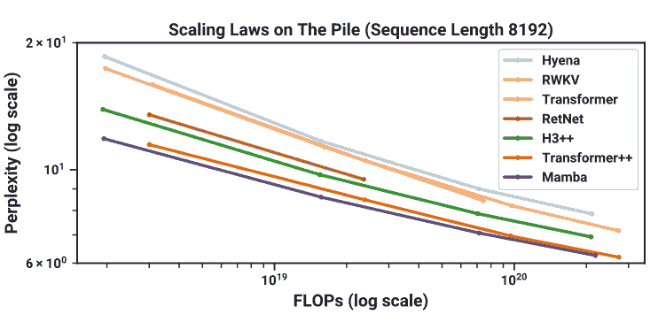

### 知名压缩软件 xz 被发现有后门，影响有多大？如何应对？

贡献人：

https://www.zhihu.com/question/650826484

这个知乎问题探讨了xz-utils 5.6.0和5.6.1版本被维护者Jia Tan注入后门的事件。后门引入方式极其隐秘，仅因Andres Freund发现sshd进程CPU占用异常才被发现。后门通过修改构建脚本，利用grep命令隐蔽地引用恶意文件名，以及利用sed和tr命令处理特定文件内容来执行恶意代码。此后门只在Linux系统上执行感染操作，其复杂性和隐蔽性凸显出现代软件供应链安全的脆弱性。

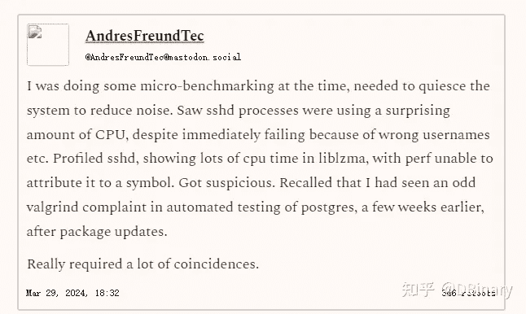

# 声明

本文档仅供学习交流使用，版权归原作者所有，若涉侵权，请联系Jack Jin 15101136166

##

（欢迎在下方反馈您宝贵的意见！整理不易，觉得有用给AI日报小组点个赞👍吧！）

ChatGPT；Angela；Zijia Liu；Alex；Zeqi Tan；Tiezhen（HuggingFace）；Naixu；Lizhi；Peter；Suoman；Jack

封面生成——右脑科技

如果你有大模型相关的创业想法，欢迎来找我们聊聊～微信：15101136166

> 快邀请你的小伙伴们一起来读大模型日报吧！

> **【日报****知识库****】**这里是近期日报内容的汇总,欢迎大家查阅

> [大模型日报知识库(分享版)](https://miracleplus.feishu.cn/docx/QrwoderkeoUtLTxI6B7cX0KPnSf)

>

> 欢迎大家多多帮我们分享,转发~~

> 如果大家有任何的建议或者吐槽,欢迎随时找我聊天~

