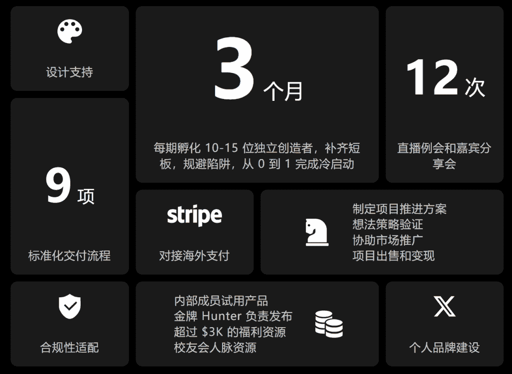
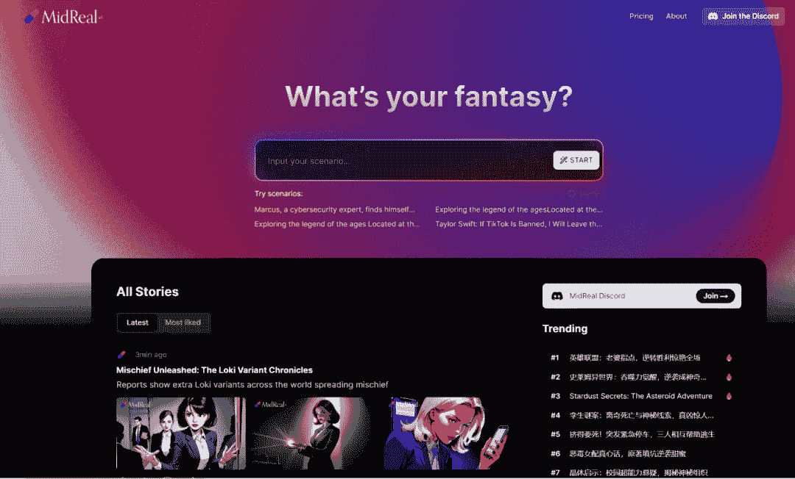
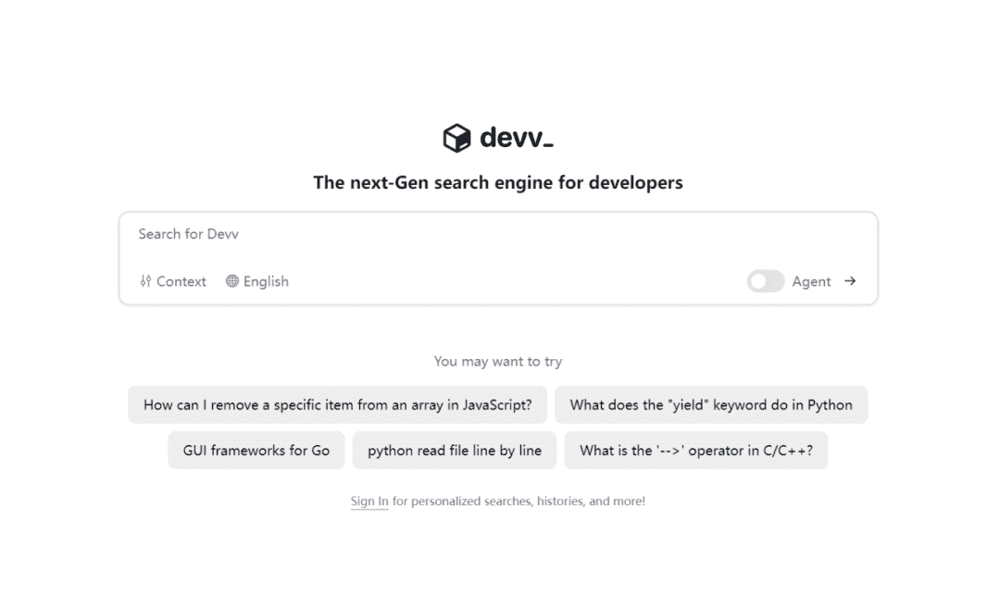
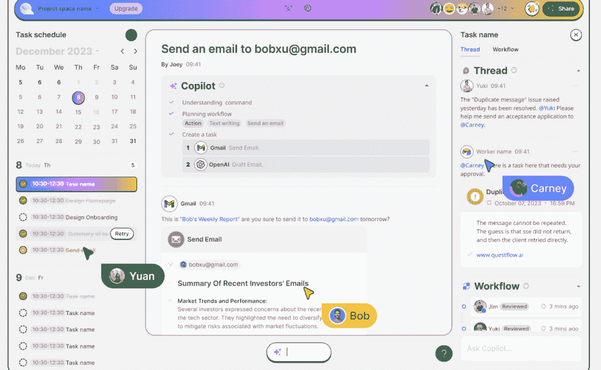
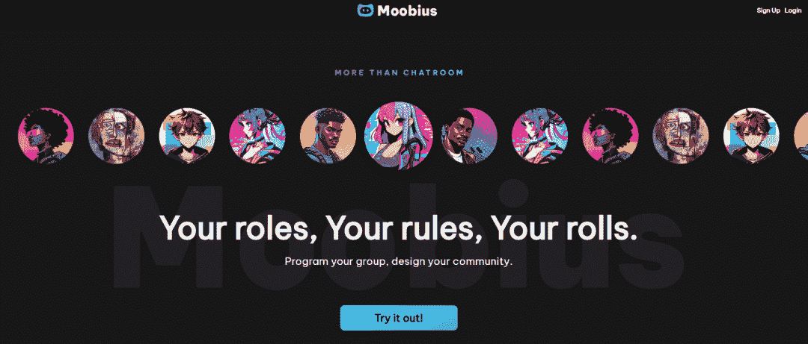
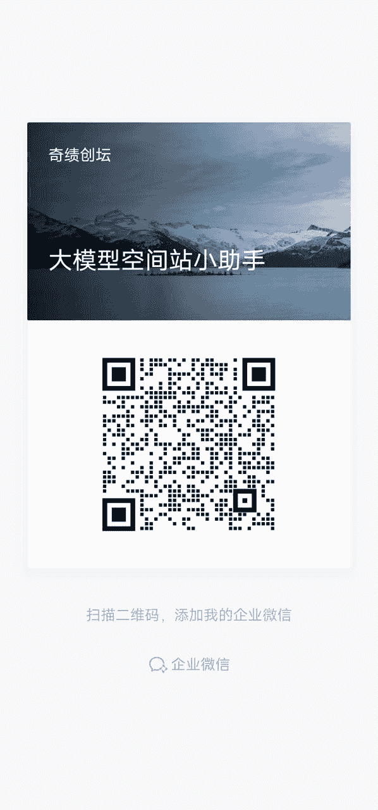

# 关于出海

> 来源：[https://miracleplus.feishu.cn/docx/As55dMDJ6o4jgvxOz6nc2bobnVe](https://miracleplus.feishu.cn/docx/As55dMDJ6o4jgvxOz6nc2bobnVe)

> 不出海，就出局？出海如今已经成为新风口……

> 活动回放：[大模型空间站](https://miracleplus.feishu.cn/wiki/LLQewHYx1ilmlpkxHUqc42L8nzf?from=from_copylink)

> 出海日志提纲：01 出海规划 - 02 市场拓展 - 03 增长策略

> [关于出海的QA](https://miracleplus.feishu.cn/wiki/T5r6wTO1ri76hFkJF9FcLY3Lnce?from=from_copylink)户常见Q&A 以及 一些有意思的出海内容推荐：

> 关[Kostja的增长手册](https://gx27ntqnm5z.feishu.cn/docx/LeU8d1E5VoAWdkx1LNHcfksnnIe?from=from_copylink)出海增长的渠道推荐（by kostja的内部分享）：

> 实时互动问题和文档：[互动问题和文档](https://miracleplus.feishu.cn/wiki/PeF0whE7siht6ekVOIOcilSqnUc?from=from_copylink)

## 分享嘉宾

### 百顺 - 出海去社区孵化器

一名独立开发者。我自己做了一些产品去出海，其中目前花费精力更多的是一个叫early bird page builder，帮助早期的初创者能够快速的验证自己的商业想法，而不用在一开始就投入大量的时间精力以及资源到产品开发上。

出海去孵化器的联合创始人。出海去孵化器是帮助独立创造者解决除了开发以外不会设计、文案、营销之类的困难，能够以陪跑的形式帮助他完成产品的早期能启动，获取海外的第一批种子用户完成海外的第一笔客户的订单。我们的出海去的宗旨是一个人可以跑很快，但是一群人可以走很远。

产品链接：https://chuhaiqu.club

### 锴杰 - Midreal.ai

Midreal是一个AI故事互动的平台。你只要输入你内心中想要的一个想法，比如说我今天想和taylor swift的约会。接下来你就能体验一场图文互动的小冒险。

我们从去年10月上线到今年年初一直在discord里面积累了大约2万名的内测用户。一个月前，我们迁移到了web平台，现在大约加起来总共十万的用户，我们一直在面向海外的用户群。我们这次更多的面向的是C端的18到35的充满幻想的，喜欢读小说的、看故事、玩AI的这批人。

产品链接：https://midreal.ai

### 佳圆 - Devv.ai

一个面向于开发者的搜索引擎，去年11月份左右在twitter发布，主要是面向的海外用户，到现在我们差不多已经有50多万的用户了。

产品链接：https://devv.ai

### 博约 Bob - Questflow

一个AI自动化的产品，就主要通过自然语言描述去完成跨平台的工作流和跨域的调度。

我们主要服务北美的小公司，帮助市场运营人员解决他们自己本身就在日常工作中的一些办公软件之间的有些重复性的工作。我们现在大概有五六千左右的用户，大概百分之二三是付费。

产品链接：https://www.questflow.ai

### 春宇 - Moobius.app

我们的产品是23年9月份正式上线，第一批用户在中国。上线三个月后，我们就到美国去找机会。上线之初是通过线上的方式获得了一批美国的华人用户，然后在今年3月份左右的时候，正式在stanford这边launch，我们有一个非常给力的go to market的合伙人。现在我们在stanford有一些用户，并且在试图做的更大，我们的核心场景就是用AI重新定义群聊！

产品链接：https://www.moobius.net/

---

## 出海规划

### 为什么选择出海？

春宇：我们主要还是做聊天的

1. 国内的合规压力会非常大，用户量一大以后可能会有一些在市场上没有公开的合规压力；
1. 早期启动时，🐧和🛰️的API其实没有那么友好。
1. 国内的聊天相关的流量集中在🛰️上。但在美国，大家会分散在非常多的聊天平台上，比如说message、whatsup、 discord等等，其实它的流量没有那么集中，作为一个新产品，它的社交关系也大多是基于这个通讯录的，我们可以在特定的领域找到自己的机会。这一个领域里，国外市场更分散，更适合一家创业公司去做切入是么。

文雯：春宇你是创立了这个项目，然后选择了做美国市场，才开始去到美国那边的么。

春宇：是的，刚申请奇绩的时候，很明确要做海外，但具体做海外哪想的还没很清楚，就去东南亚去日韩看了一下，发现得到用户也没有想象的那么容易，用户的价值相对还更低。出海怎么样都很难，那就选一个赔率更高的地方吧。这些地方都很陌生，从头开始学习的话，那选一个可能回报会更高的地方。

陈锴杰：

1. 技术起源地：AI这一波事情我们还是要靠近它的源头的。如果在硅谷待一下能感觉到非常明显，或者甚至去AGI house转一圈的话，能够接触到的人和技术先进度都是完全不一样的。
1. 海外用户的特点：我们是做C端产品的。故事生成的平台很看看重用户的创造力。虽然国内用户创造力也非常强，但是相对于海外会稍显不同，比如说在TT和抖音上，抖音有明显的PGC的集中化，但是在Tiktok上面的创造者分布就会广很多，所以我们看重这一类创造能力，它对于我们做AI生成内容是很关键的。
1. 付费习惯：海外用户的付费习惯明显是比国内用户更好。我不知道大家看不看爽文，在国内，番茄和七猫这两个体量最大的爽文平台都是免费广告模式！是流量分发的逻辑。但是在海外基本都是订阅模式。

+ 订阅模式对创业公司来说是友好的，流量模式基本就是做死掉。这个行为的差异对我们来说也比较关键。
+ 我们的付费用户是在海外的话，五美金十美金。对他刷一下是非常容易的，到国内可能是50人民币70人民币。这样付费用户的期待是很高的，他的抱怨是很多的。海外其实无所谓。差异非常大。

1. 内容风险。刚刚春雨也提到的原因。如果是做C端的话,国内的基本上是你做不好就要进去的事情，我还是比较选择海外。

jiayuan：

1. 合规，在国内你去，比如说我们会自己去训练模型，那在国内你需要去做模型备案算法备案，那整体上这个是一个比较耗费时间的这样的事情。而作为一个早期的这样的创业团队，我们其实是不想把太多时间耗费在这部分的事情上，包括说我们在做这个搜索引擎，那你其实还会涉及到搜索引擎层面、内容的合规，对那这个其实是一个很大的这样工作量。
1. 付费习惯：国内的这个开发者工具基本上没有发展的特别好的。所以说我们基于这些，在国内去做商业化不是一个特别好的选择。虽然说我们现在有一部分国内用户付费率还可以，但是从长期上来看，我们觉得海外市场可能是一个更好的选择，因为从开发者这个角度上来说，国内和海外的这个用户本需求层面其实是一致的。

+ 另外还有一些不可抗力的这个因素，因为我们的这个产品在国内其实就是不可以访问的。

许博约BOB：

1. 因为我之前一直在海外，所以在海外工作的时候发现有这样的痛点，所以就开始做了，这本身也是海外的B端的客户
1. 跨平台的工作流自动化本身需要一个很开放的生态。我们需要对接各种大家常用的办公软件，以及各种开放的API以及各种各样的agent公司，在国内这个生态是不太好的，基本上国内办公就是企业🛰️、钉钉还有飞书，可能基本都吃掉了。但在海外的话，我们统计过平均一个公司可能要用超过80个这个S，那这个诉求会比较强，所以这也是我们为什么选择开放就是走海外的原因。
1. 付费意愿，因为前面也提到，海外的付费意愿肯定是比国内强很多的，并且因为我们走的是一个PLG的模式，就用户进来，自己就可以走一个自己的on boarding，然后就可以付费。所以如果一上来就要让用户付二十四、二十五美金起。在国内我觉得基本上是没法推广的，但在海外的话，大家习惯了先试用付费，然后他满意，就继续使用这么一个模式吧，所以我们觉得这个也比较符合我们的产品调性。

百顺：

1. 合规：个人独立开发者想要去上架自己的产品，必须要去做备案。如果是做SAAS这种产品可能要先去做网站的备案和ICP的备案，这层层的规定规章制度对我们个人个体的形式来说，设置了很大的障碍。我们不想在这个事情上投入过多。所以想咱们干脆就到海外做一做小规模的测试，如果这个事情可以，那我们最后再杀回来也ok。
1. 利润：这是开始做了之后，我们发现从定价这个角度上来说，在国内只能卖到比如说50块钱一个月的，在海外可以卖50美金。

### 怎么解决身份问题？

> 十年签：
> `B1`签证：`B1`签证是商务旅行签证，适用于前往美国进行商务活动、参加会议、接受培训等临时性商务目的人士。
> `B2`签证：`B2`签证是旅游签证，适用于前往美国进行旅游、探亲、疗养或其他非商务目的的临时性访问者。2 这两种签证通常都是临时性的，持有者需要在规定的时间内完成他们的活动并返回自己的国家。
>
> 其他：
> `L-1A`签证(Lone a签证)：`L-1A`签证是为了跨国公司的经理和高级管理人员而设立的签证类型，允许他们在美国的子公司、附属公司或关联公司工作。
> `0`签证(`0` visa)：针对在艺术、科学、教育、商业或运动方面具有特殊才能或成就的人士而设计’的签证类型。
> `EB-1A`签证(`EB` visa)：通常应该指的是`EB-1A`签证，也称为"杰出人才“绿卡，为其领域表现杰出的人才而设计。
> `EB`排期(`EB` priority date)：指`EB`绿卡申请的优先日期，这是根据申请人提交的`I-140`移民申请表确定的。

春宇：一些比较常见的情况。

1. 早期去探索这边市场的时候，可以用这个`B1`、`B2`的美国十年签，然后再具体的话，就比如说你要去解决在美国长期发展的情况下，像因为我们其实是已经拿到了美国这边基金的投资，所以其实无论是去办`0`或者是其他东西也会相对比较容易，
1. 还有就是如果你的公司在国内跑了已经满一年的话，并且在国内有一定体量，比如说有五到十个人的规模的时候，其实可以申请去`L-1A`签证去过来，然后当然还有可能就是。你有在美国的对象的话，你可以直接跟他结个婚，然后你就有美国身份了，就反正无非是一些常规的路径。
1. 对于创业者来说，可能比较常见的，一个是`0`，一个是`L-1A`，对，这两个是一个可以去申请的，然后部分创业者像这个履历非常光辉的，其实可以去直接中`EB-1A`，但也解决不了短期来美的问题，它都是现在`EB`也有这个排期了。

#### 总结

> 1.合规压力：在国内要上架自己的产品、发布自己的大模型，必须要去做备案。对于一些如做大模型的、AI搜索产品、个人开发者等来说工作量较大，非常的耗费初创公司的时间，且内容存在风险。
> 2.国内流量集中在巨头身上：聊天相关集中在🛰️、🐧身上，办公软件流量集中于钉钉、飞书、企业🛰️身上，对于做相关AI产品的初创公司非常不利。国外市场更分散，生态更开放，更适合一家创业公司去做切入，我们可以在特定的领域找到自己的机会。
> 3.用户付费意愿：国外用户相较于国内用户付费习惯更强，能接受费用更高，习惯了先试用满意后付费继续使用的模式。
> 4.技术发展水平：去靠近AI的源头，能够接触到的人和技术先进度都是完全不一样的。
> 5.用户创造力：国外用户相较于国内创作者更多，可以从Tiktok和抖音的创作者分布看出。

## 市场拓展

### ToB or ToC？

许博约BOB：

1. 我们的定位是ToC，如果我直接从ToB的逻辑走，那我可能要有销售团队，然后直接去跟他们的负责人直接去沟通，付费周期和产品的迭代的周期会很长，对创业公司是一个很高风险的事情。所以我们就选择说先从个人的使用出发，但是如果说他自己用爽了，他愿意去推广给其他的公司的小伙伴，其他的打工人，那我们就变成一个ToB的公司。
1. 我们虽然很多是用户个人在付费，但是实际上他最后这个付费的这个钱是会给公司报销掉的，所以理论上也可以理解成是公司在买单，但是这个消费的行为是个人。这就降低了付费门槛。

春宇：

1. 我们是ToB/ToC一起做。因为美国这边整个是ToB SaaS以及大量的SMB会去用这些东西，不像国内的国内就没有SMB这个市场，但是在美国就有时候能解决一些小问题，比如说。美国的医生特别贵，你能让医生的访谈用AI整理好，或者说哪怕比如说帮餐厅解决一个定位置的的事情，或者就像YC里面很多这种ToB的这个项目，光这样的东西可能就可以做到一个很高的这样收入，在美国做ToB还是会比想象中的这样容易不少，我们现在跟学校进行一些这个沟通。
1. 底到底是让学生层面订阅，还是用教授的经费买，还是学校层面统一采购，其实我们还在比较艰难的摸索中，但我们之前比较大的一些收入还是来自于这个ToB，就比如说是学校直接跟我们签合同付钱，也包括一些比较大的科技公司，直接买了我们的服务。我们一直想往ToC做，但是为了公司生存以及去确认自己找到的PMF是真的，就是有ToB客户愿意付钱的时候，还是接了。

陈锴杰：

1. 对我们来说ToB可能更像是要在VC那边取得一些认可。比如说我们合作的是腾讯光子爱奇艺这些，他们是会整个市场比价的这些公司。他们的认可能对vc来说是重要的，但恰恰恰相反。我觉得TOB的合作是没有办法验证PMF的。它可以验证你的企业关系有多好，你和这群人混的有多熟，请了他们吃多少次饭，但是反映不出来说——用户是不是真的？买单，那这对我们来说本身企业就是做纯TOB的来说是多少顿饭多好的关系，这本身就是你的价值。
1. 我有几个观察可以跟大家分享一下：
1. 最近这个YC的demo day的结果大家肯定也都看了，200多个公司？是有180多个是做ToB的。TOB肯定是主流在今天的AI浪潮里面。TOB的叙事一般是这样的：我今天Sony音乐公司制作人找到了我在谷歌做ML的好朋友。我们觉得今天音乐制作可以优化很多，我们出来做。或者我是全球第一猎头公司的VP,我找到了我在meta的ML的好朋友。我们一起出来觉得猎头这件事情有很多优化。一方面有商业资源，一方面有AI。这个肯定是主流叙事。

+ 那为什么今天我们在座的可能很多是在ToB和ToC之间挣扎的。我觉得本质是因为我们跟美国本土这批人在竞争，在Tob这个领域上是没有任何比较优势的。他们的access to market、Access to capital和access to talent. 都是远胜于我们。基本就是被摁着打。这是第二个观察就是没有比较优势。还是有这样的公司比如说黑阵，我觉得就蛮厉害的。他能够在TOB这个事情上做起来。
+ 为什么TOC的是有的。我觉得TOC是我们会唯一有一些有竞争优势的地方，当然到每个公司身上，我觉得每个公司都有自己的竞争优势，但是TOC是我们作为中国创业者来说，整体有系统性优势的。因为美国从snapchat上市之后。很少出现新的大规模的C端应用。包括在资本市场上被成功收购或者退出的应用。中国反之，在最近这几年仍然有新的大型应用出来。
+ 美国的前十里面。陈木等这些中国人已经挤进去很多了，所以在美国的C端应用市场上面。大家做应用的能力是逐渐下滑的。比如说c.ai。他招了产品经理，其实只是来画画UI。整个character AI的？产品迭代并没有在往前走。这对c.ai来说，今天是非常致命的问题。我觉得chat GPT或者openAI也是相似的。他们今天的战略已经开始往TOB去转。
+ 连c.ai、OpenAI都要做TOB，我觉得还是非常有代表性。所以我们在做C端这个事情上可能是稍微有优势，而且做C端就没有access to market的问题，因为你都是在公开市场上做增长。access to capital我们就可以拿国内美元或者就还好。access to talent你就不需要去拿那些有TOB客户经验的talent。那你只要有开发经验或者AI能力就可以在这样的情况就好很多，最后观察就是我们在做C端上面其实是有一些比较优势，这可能可以解释今天的看到的一些现象。

## 增长策略

### 不同的增长策略？

许博约BOB：

1. 优化SEO

+ 在各类APP首页展示
+ 在22年12月把产品上架很多AIdirectories或者AI的导航网站之类的产品进一步促使被很多网站收录

1. Twitter

+ AI现在的一手信息基本都是通过twitter发的，无论是pika的launch还是sam被干掉的这些都是twitter先开始发酵。如果要找early adopter的话，那大概率就是在twitter上。所以我们花了很多时间去运营个人以及公司的推特账号：

+ 个人号的作用更多等于personal touch，就是让大家觉得这确实是有人在build这个产品，是可靠的。公司要持续的做一些use case，尽量做几个爆款就是同时让你的视频有这个personal touch。
+ twitter也是很好的networking手段。比方说我们最近跟open VC，一个在北美最大的VC database创始人通过twitter去认识了，然后我们就达成了合作，现在产品也介入了，我们做了好多这样子的use case，所以我们认为这个一方面是一个go to market的手段，让大家去了解你的产品，也是一个去reach out to investor或者说潜在的partner的。

# 社区 - Community

我们做了像 producthunt 还有这样的 launch。基本上也是在里面能够有非常集中的 early adopter 能给你反馈。我们当时做的策略很简单，就是 twitter 加来回导流的这么一个方式，让社区给我们支持。总体上还可以，然后最后就是一些跟你产品相关的社区，就无论你做什么产品都会有一个非常历史的社区，我们有一个叫 AI automation 这么一个社区，他们的 discord channel 一些平台有不少的人，然后我们去跟他们混去，去看他们的诉求是什么。

主要是这几个方向，我们现在因为付费转化率有一些提升，我们也在考虑投放的事情。所以最近也在跟几个 AI 的大的 news 在合作，然后去做一些投放，如果能回本，我们会持续的做这个投放这些。

# 最重要的是什么

不同阶段的公司不太一样

## 第一阶段

只是一个简单的 branding build，早期的公司 SEO 还是挺重要的，至少能够让大家搜出来能够看到你，这个是一个 basic 的东西；

## 第二阶段

可能就是 talk user，就是 where are your users 你的 user 在哪里，那对我们来说，我们的 user 是在 twitter 和 product hunt 以及一些 group chat 里面。那我们就去找到他们然后跟他们去对话就行了，然后 build MVP 然后找 PMF；

## 第三阶段

就是如果这些 PMF 的付费转化率或者一些公司满足了你的需求，那可以就开始放量，做一些更加 public 的东西，比如说 tiktok、youtube 等等这些平台，就可以跟 KOL 或者 influence 去合作。

jiayuan：

把它区分为两个阶段非常重要，因为不管是从实施角度还是从战略角度上来说，它的方式都有很大的不一样。

# 冷启动阶段

就是要想尽办法去获取到目标用户，你有了这个产品，或者说你有了这个 MVP 之后，你怎么去获取到第一批的用户去从这部分用户里面去收集到一些 feedback，因为有时候你可能做出来的东西可能并没有解决真实的用户需求，或者说并不是用户真实想用的这个东西。我们 Devv 在冷启动阶段做了很多事情，去一对一的和开发者去沟通去了解他们的这个需求痛点到底在哪里，你一定要迭代速度非常快，在这些部分的这个开发者里面去做一个一定 PMF 的验证。

在冷启动阶段，你可以你的目标用户，然后去给他发私信来去一对一的去手动的去获取这样的一个用户。

# 增长阶段

假设你在冷启动阶段获得了一些潜在的 PMF 的验证，那你后续可以去做一些增长的手段，增长阶段它追求的是 scale up，就是它是一个规模化的一个效应，那不管是 SEO 还是说付费投放，找 twitter 上的 influence 还是说其他的一些 marketing 的手段，大家在大规模的去做增长之前，你需要去计算它的 ROI，因为它本质上是一个漏斗，用户进来之后有多少能够留存下来很重要。

我觉得最核心的是未来的整个的增长模型，它是有哪一个主要部分组成，现在增长的方式有很多，但是我觉得大部分的这样的一个产品，其实在早期只需要分配到一个增长方式就可以了，就把这个增长方式做到极致，就做到业内顶顶尖的水平，然后在路径去达到瓶颈之后、已经平稳之后，再去扩展其他渠道去找到第二增长曲线，跟着这个产品去搭建不一样的这样的增长框架！

# 陈锴杰

我觉得我这边尝试过 twitter 然后 tiktok discord 这样的平台，我想和大家一起来分享三个我们的关键的区分：

## 花钱 vs 不花钱

### 不花钱，其实就是 PLG

Product like growth，其实前两年大家讨论很多，特别是 figma 这个产品讨论的是最多的就怎么做 PLG 的增长。我很容易让用户导出分享，然后这样子新用户就很快能进来，也用上我的产品，还比如说拼多多的砍一刀。然后分享之后的激励、新用户的激励，这些其实都是通过产品功能来让你的东西增长。

在 C 端产品，它可能更有一些花活可以做。比如生图社区里面就常有这样一个功能，把你的脸放到动漫角色身上，或者把你和动漫角色放在一起。或者让你和 taylor swift 拥抱接吻，这样你的这张图片其实就附带了一个非常强的，你要把它发到朋友圈去炫耀的动机。

不花钱的增长其实是更加的厉害的，如果你能做成一个传销组织这样增长，你又没进去，那你的产品可能就会非常的厉害。

### 花钱，付费推广

它会占用你的时间去关注怎么去投 KOL、怎么去做 twitter 的投放、怎么去做广告，还是关注在你迭代出更有爆款能力的产品功能，这是要取舍的时间，那对我来说。我们有两个人在负责。各一个方向，这个是我们的选择。

### AI 制作 vs 传统手工制作

比如说你要在 Tiktok 上面投放你的产品的视频。你完全可以手工来生产一些很好的内容。你也可以 Ai 生视频。手做的视频你可能要一两个人认真做两三天，AI 投放你可能是一天会产出 100 到 200 个，然后人简单修之后。投到平台上、投什么样的人、怎么把它投出去，其实有一点门道，你每天投 200 个的感觉和你每天投一两个就和你一周投一两个的感觉是肯定不一样的。

投 200 个是什么感觉，它的转化率肯定会很低。你可能只会看到有一部分过了 tiktok 的最低。第二个流量池的门槛也就超过 1000 或者 1500 这样的 view。那这时候产生一些的转化，但你的数量很大。我们试验的过程中发现。PPT 形式的内容是在 tiktok 限流会比较严重的。你的 AI 生成是以图片为主，然后口播加上字幕。这样的内容是容易被限流的。但如果你的口播是一个人，比如说 黑卷 或者 剪映 也有自带的 虚拟人 在前面讲话，然后后面是你的产品，这样的内容限流的频率就会很少。最好把 AI 生成 tag 打出来，你的限流可能也会变少。

如果你的产品有内容能直接由 AI 生成去投放，这样是一个高效的事情。

### 投流和 KOL

最终都会统一到产品的用户新增的性价比上。

在尝试 KOL 的时候就会发现 KOL 的性价比、差异、浮动会非常大的。有可能你找到很合适的时候，你可以做的非常便宜，如果这个 KOL 不好，五块钱或者十块钱一个新增就非常糟糕。你可以快速验证，比如关于 devv 的 developer 的这批人，你是有没有吸引力的，然后你再换一个游戏区的 KOL，你可以快速去感受这个 KOL 的人对你来说怎么样？但我建议是后面慢慢就可以做成推广投流的方式就相当于买广告，然后买广告你就比较好精确的去测算转化的比例，看能不能做到 1.5，那如果是 APP 的话，可能做到三块到五块，如果是高付费转化的游戏类的 APP 可能做到十块，也都算是一个好数据。

投流我还有一些想测但是我还没有测出来的，我们可以一起交流的就是消费意愿可能相对于 TT 这种娱乐性平台来说更高的地方的推广。

# 百顺

我讲的更多的是适用于独立开发者行之有效的三点：

## 去做尽可能多的产品

就我不会把所有的精力放在一个产品上，因为我在早期的时候没有找到 PMF 之前。我可能要尝试去做不同的产品，看看哪一个产品，它的 RY 更高。在国外的 indie hackers 这个圈子里面有一个非常不错的挑战叫“12个月构建12个产品”，我们其实是在不断去试哪一个产品更有爆发的潜力。我觉得在非常早期的时候这是非常不错的方案。

## SEO

发布也是 SEO 的一个方面，但是你想从上面直接拿到客户成交几乎是不可能，因为他很难刚好跟你的用户 Match，我们更多的是把它当做一个 SEO 的策略来做，因为你可以从他那里后续从不同的 newsletter。那里拿到很多高质量的反链，这个是恰恰更重要的，还有就是我们可能会去结合前面我说的 12 月构建 12 个产品，我们构建产品可能是根据主产品去构建支线产品或免费的工具产品来引流。所以从这个层面上来说，做 SEO，构建导流产品，找到最容易突破的流量产品，然后再从流量产品上导流导到主产品上去。

## 在推特上构建自己的个人 IP

分享自己的经验，分享自己在这个赛道上构建产品的一些经历故事，去获取客户对你的信任，从而成交，我是从 0 到现在 1w5k 粉丝大约花了半年多的时间，我能感觉到，只要你真正愿意在这方面去花时间都是效果不错的。

# 春宇

我们本来想做一个产品人人都能上来用，后面发现能力和精力其实都不太够，在这个的情况下，我们用了一个很取巧的做法，选了美国某个知名大学，然后说只为这个学校的同学构建的。反而会让他们觉得只有我们学校人才能进来，但其实是因为我们的很多综合能力还不太够。

但是恰恰这个学校就会更愿意来尝试，并且去批取相关学校的，无论学生还是学生之外的一些人都会更容易。这样的话也让这个用户的场景更垂直更聚焦，这些人有相同的生活背景，甚至还可以用类似地推的办法去把这些事情给完成，因为就直接住在了这，所以还是取得了一些成绩。

很重要的就是我们在这有一个做 go to market 的合伙人，然后他把这个学校的很多事情都给搞定了，因为我们能力有限，所以我们就在很小很垂直的这个圈子里先把它给搞定，然后这个机会也去帮助我们去把产品打磨的更好，去把他们的需求看得更明白，很多用户其实我们就可以直接约到学校的咖啡厅、会议室一对一的聊，看看他们怎么用我们的产品，会在哪个地方卡住，我们哪些地方做的不够好的。

在自己团队能力还不足以放出一个可以让很多人用的产品，或者说在 go to market、流量资源上不够大的情况下，我们的方式就是选一小群用户说：我们就是专门为你服务，让他们倍感荣幸。

跟他说：我们加班就为了帮你把这个功能做出来，然后这个用户可能就会变成长留用户，可能对我们早期还在打磨产品的过程中，是比较有用的，然后我也是非常赞同 jiayuan 说的，就如果我们这一步能走好之后，可能再去走增长会更合适，因为一个学校的模式还是可以复制到其他学校身上，一开始在精力有限的情况下，我们就 focus 到了一个学校，然后就热身的在这里把这个事情给做好。

我们之前也尝试过一些东西，一开始是国内的这种 🛰️ 群的 bot 的方式获客还比较猛，后面就陷入了跟腾讯的这个攻防对这个上了，然后还有就是和当时国内跟一些大科技公司合作，把我们的功能直接交到他们平台上，数据还不错，但是这毕竟也不是自己的东西。

我们还有一些有趣的尝试，比如说我们做了一些 AI 和教育场景整合的能力，那我们当时判断一个答案怎么对用户有帮助的时候，我们其实是去了找到他们学校的这个论坛，去做很多测试，把我们 AI 回答的根据他们学校资料生成的这个答案，去直接去回答他们可能几天没有人回复的问题，然后看用户会不会给我们点赞？给我们点赞就说明我们解决了这个用户的问题，然后在下面去放上我们产品的推广链接。

# 推特账号怎么快捷地去做增长？

## jiayuan

虽然说我 推特 上有还算可以的 follower。我不太建议大家为了专门去发布产品去构建自己的推特账号，因为这是一个非常长期的过程，最开始我没想过把推特打造成专门用来发布产品的东西，在推特分享一些自己的学习笔记、对 AI 行业的看法，花了一年多的时间，关注量才涨起来。

为了发布产品，其实有更好的方式，比如刚刚 春宇 提到的，在学校里约他喝喝咖啡、去看他到底怎么使用你的产品。或者就约一个线上的 meeting，早期不可避免的会去做这样的事，非常多成功的公司，比如说像 air BNB 早期的时候就是挨家挨户的去宣传，睡在他们用户的家里，这些事情都是不可扩展的，你没有办法去把它规模化，但是验证你产品 PMF 的一个非常有效的这样的手段。

## Luo

首先就是咱们现在国内已经有产品了，然后或者说已经有一个小的 MVP 这个时候我们通常会建议先做上线，然后通过去做发布，或者去通过做这个广告投放，比如说我投 100 美金去拿到，比如说 50 到 100 个客户线索，因为我们前期是需要拿到这个客户的联系方式，然后去跟他去做 one one 的这种交流与打磨我们的产品，或者去找到真正的需求在哪。这种方式。

因为这个需求上来说，特别是做广告投放需求是非常精准的。

你的用户可能怎么样，会去有什么样的习惯，如果说是一般普通人的话，那就去做搜索引擎的投放，那比如说像 领英 你可以去做跟职业相关的一些内容的投放。

这个只是一个测试，就是肯定不是我们接下来主要去做营收的这个投放方案，就是相当于做一个诱饵，先把这些用户给落到我的能力配置上来，这个是第一步。至于成交是下一步的事情。

---

**审稿：**彭书航

**整理：**彭书航、李茜、怡男

**有任何问题欢迎私聊我们的小助手**，扫描右边二维码加入我们的社群！

