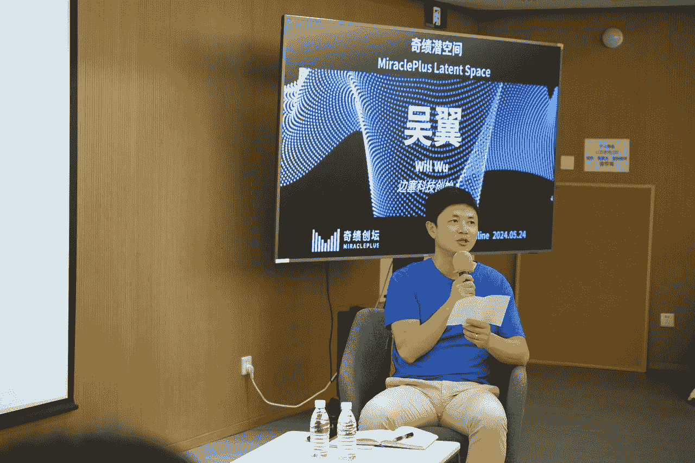
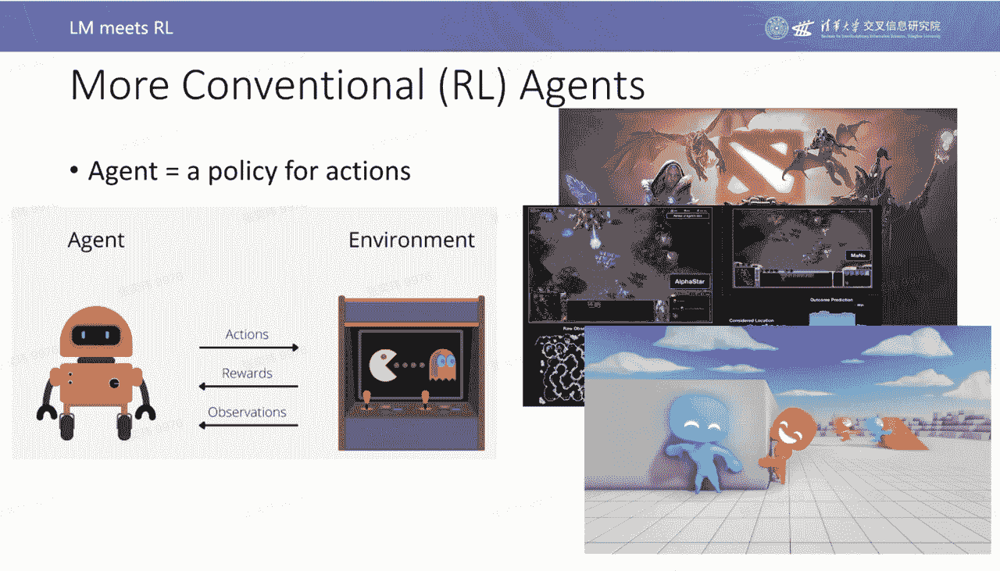
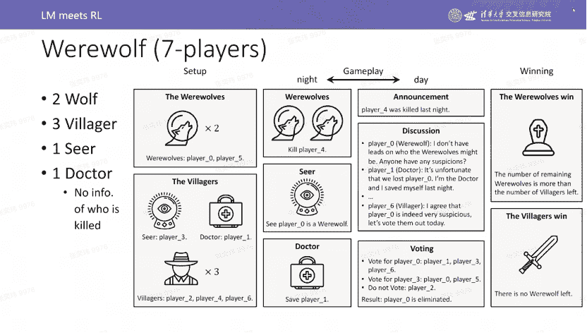
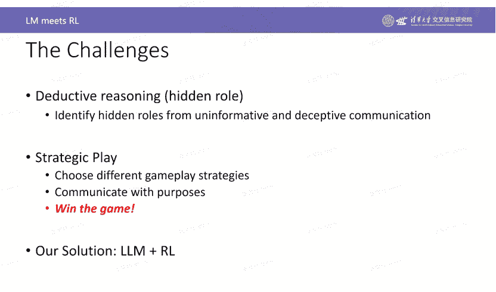
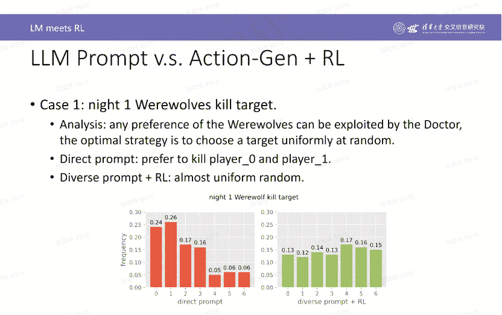
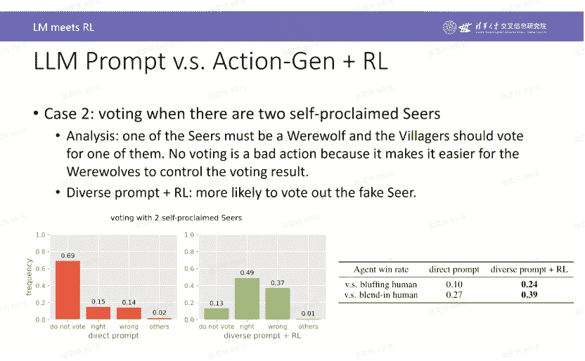
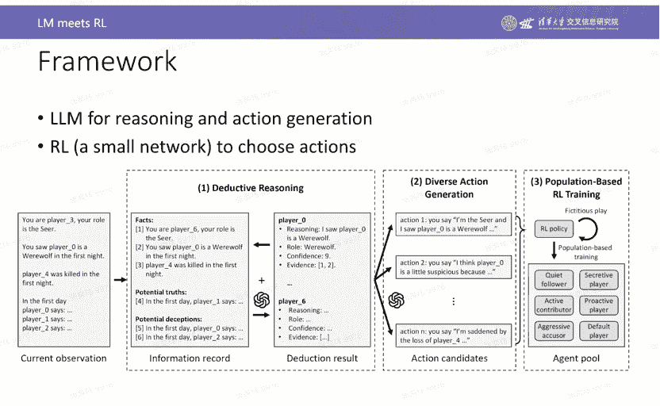
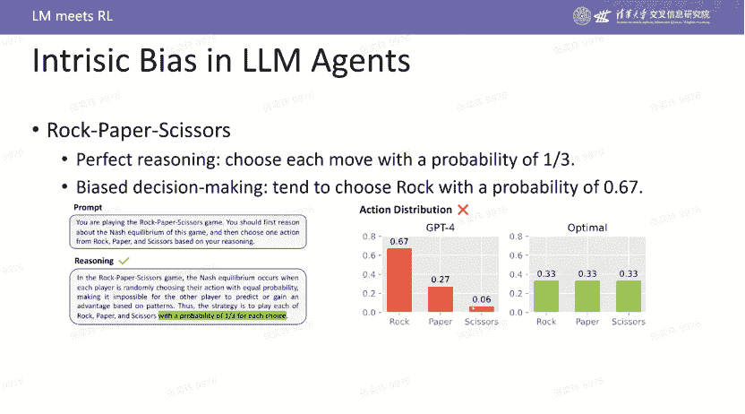

# 奇绩潜空间 | 吴翼访谈笔记

> 来源：[https://miracleplus.feishu.cn/docx/ORPJdTRoYoeCl8xII5dcSLzEnne](https://miracleplus.feishu.cn/docx/ORPJdTRoYoeCl8xII5dcSLzEnne)

活动时间：2024年5月24日 晚上19:00-20:30

---

---

## 从科研到创业的双栖人生

> **嘉宾介绍**

吴翼，现在在清华大学交叉信息研究院做助理教授，也在上海期智研究院做研究。最近组了一个 startup 叫边塞科技，担任创始人&CEO。

吴翼在中学期间参加信息学奥赛，高一暑假保送清华，后来担任国家信息奥赛集训队队长。

在清华上学时代表学校征战ACM比赛；在伯克利做研究时师从Stuart Russell和Peter Abbiel，并作为早期的华人员工加入OpenAI。

> **之前在研究什么？**

> 吴翼做过的Language agents for gameplay:

1. 迷你版星际争霸: 人类可以用`Attack`，`retreat`等口令来让AI帮助自己操作。
1. Overcook：用AI来帮助人类打游戏，和人类合作。
1. LLM+RL打狼人杀。

> 是什么机缘让您选择了强化学习和多智能体的方向？

> 选择强化学习和多智能体方向是机缘巧合。当时我在Berkeley，因为我老板当时对我要求特别高，所以我就说有没有什么东西是可以做一做的，刚好是Berkeley是这个强化学习的大本营，我很自然地去做了强化学习。

> 2016 年我开会碰到了 Jacob Foster。当时他刚开始在牛津读PhD，搞了一些多智能体强化学习，我刚好在做 valuation network。这个事情同博弈放在一起确实挺有意思的，我就开始想做智能体的这个方向，一是同自己做强化学习有关系，二也是同自己的兴趣有关系。

---

## 最新工作：狼人杀AI

> **什么是狼人杀游戏？**

> 游戏简介：七人版狼人杀：3个村民+2个狼人+1个预言家+1个医生

> “**为什么选择了狼人杀游戏？**”

> 我们做了很多尝试。

> 最早，我们做了一个简化版的星际争霸。

> 为什么要做星际争霸的AI呢？

> 第一个出发点是，我自己操作不太熟练，我又喜欢发表高屋建瓴的观点，希望找一个方式去验证想法，但又不亲自上手，所以我就希望有个 AI 来帮我完成具体操作。

> 第二，我觉得人和 AI 的交流方式肯定不是非常细节的指令，如“这个英雄出门 10 米左转，然后走到第二个树林的岔口，进商店买一个什么东西”，而是“我们去打 rush，我们去推下路”类似的很抽象，宏观的语言。抽象宏观的语言更符合人类自然的交流模式。

> 然而，星际争霸的例子偏向于指令类型，人类说话，AI 跟随指令，两者之间是合作关系。除了合作，我们希望找到一些竞争场景。由于狼人杀是一个角色扮演类型的竞争游戏，所以我们就选择了它。

> “**狼人杀游戏有什么难的？**”

1. 通过人的发言来判断玩家是否撒谎，需要复杂的自然语言推理。

> 这不仅仅是听他们说了什么，更重要的是如何说。玩家的措辞，语音的抑扬顿挫，甚至是面部表情与肢体语言，都可能暴露他们的真实意图。而这种判断过程并不简单，它涉及到对言辞含义的深层次解读、对不一致性的敏感察觉以及对人类行为的心理学理解。成功的玩家往往能够洞察言辞背后的真相，甚至运用先进的自然语言推理能力去揭露那些巧妙伪装的谎言。

1. 策略，选择刀人/跳预言家/冒充好人，需要`Strategic play`的技能。

> 是否在某一个夜晚刀掉某个角色，或者在白天时宣称自己是预言家，抑或是在整个游戏过程中扮演一个无辜的好人，这些决定都需要玩家对游戏局势的敏锐洞察和精准计算。成为一个策略高手要求玩家具备分析当前局面、预见未来变化的能力，同时还要能够设计和执行复杂策略，通过心理战和策略布局来迷惑对手，最终为自己阵营获得胜利。

1. 这是一个竞争游戏，目标是获胜。

> 这种竞争不仅仅是力量上的对决，更是智力和心理上的角力。玩家需要不断地观察、推理、诡辩、联盟或背叛，每一轮发言和投票都可能对游戏结果产生决定性的影响。智者见智，勇者见勇，在这个混杂着欺骗与推理、勇气与智慧的游戏里，只有最会观察、最能推理、最善欺骗和最懂合作的玩家，才能带领他们的团队走向最后的胜利。

> “**最后效果怎么样？**”

> 案例一: 狼人杀游戏中的第一个夜晚(`First Night`)

> 作为狼人，

> 理想最优选项是：随便选择一个玩家击杀

> **改进前：**`0`号玩家和`1`号玩家被击杀的概率远高于其他玩家。

> **改进后：**基本`0`-`6`号玩家有相同的被杀概率。

>

> **为什么会发生这件事呢？**大模型在回答类似问题时，不是通过推理获得这个数字，而是通过基于数据分布概率的直觉来回答。`0`和`1`在训练数据中的词频比较高，所以大模型倾向于回答`0`和`1`。

> 案例二: 在场上有两个人跳预言家的情况下投票

> 理想最优选项是：一定要投。

>

> 为什么一定要投呢？若场上有2个人同时跳预言家，必然有一个人是狼人，另一个是真实的预言家。此情形下有两种情况：

1. 投票盲猜：1/2概率投到预言家或者狼，好人有1/2概率获胜。
1. 不投票：除去两个预言家，5人投票。若不投票，则剩下4人投票，2个狼一定会投给同一个人，此时只要有一个好人和狼阵营投了同一个人，则必然会出局一个好人。接下来则五人局两狼必然失败。

> 因此投票盲猜是比较好的选择。

>

> 但是`gpt-4`倾向于不投票，因为它不随意血口喷人，alignment和safety环节非常优秀。

> 经过RL的LM agent，有90%的概率会投票，且有超过1/2的概率可以投正确。

> **两个例子的结论：**在复杂的场景下，大模型有很大的偏差，这种偏差来自于训练方式和数据收集。

---

## 用上AlphaGO的技术路线：强化学习

> 做狼人杀游戏，在技术上要做哪几件事？

> 大模型+强化学习的框架下

> 大模型产生的推理和行动方案（reasoning & action generation），作为备用选项库（Candidate set），输入到强化学习的神经网络，由强化学习来训练并决策具体采取哪一项行动。

> **第一部分：**狼人杀游戏重在角色演绎和推理，Agent需要将关键事实信息进行分类，推理玩家发言的可信度，并决定以怎样的身份在游戏中发言。

> **第二部分：**不需要LM选出正确的动作选项，只需要用`iterative prompting`的方式让LM去产生更多的行动方案，然后让强化学习神经网络来决策。因为，如果让大模型只生成一个最优的`action`，一般会非常保守，比如“我同意所有玩家说的话”。因为`gpt-4`有很强的alignment & safety，不支持质疑和争论。

> **第三部分：**用`Policy`神经网络：`action`—`embedding`—输入`transfer`网络—`SoftMax` action 来激发LM产生更多选项的能力。

> **为什么最后一步使用了强化学习？只用大模型不行么？**

> 因为大模型虽然很强很通用，但是依然有很多偏差。我们以石头剪刀布为例：

>

> 理想的情况：出石头，剪刀，布的概率相等，别人就猜不到下一步会出什么。

> 如果只用LLM，会发生什么呢？我们用`GPT-4`测试发现：相比于剪刀和布，`GPT-4`更倾向于选择出`Rock`(67%)，可能是因为“`Rock`”一词在英文中的词频更高。

> 该例子证明：LLM有很大的偏差。

>

> 这种偏差有几个可能的原因：

1. 词频偏差：模型生成文本的倾向性可能受到训练数据中单词出现频率的影响。“`Rock`”一词可能在训练数据中出现得更频繁，导致模型倾向于选择“`Rock`”。这种现象在文本生成中是不希望的，因为“石头剪刀布”游戏中的每个选择都应该具有等概率。
1. 训练数据内容偏差：如果训练数据中某种模式或内容超过其他内容被强调，模型在做出随机化决策时可能会偏向这些模式。语言模型的训练依赖于文本数据，而这些数据中的偏差会被模型学习并反映在其生成的内容上。
1. 决策原理差异：LLM主要通过预测下一个最可能的词来生成文本，这与真正的随机或策略性决策有很大的不同。在一个决策密集的游戏中，仅仅预测概率最大的行为并不等同于做出最佳策略选择。

>

> 为了克服这类偏差并提升决策的质量，在需要随机或策略性决策的任务中，可以将强化学习（RL）与LLM结合起来。强化学习是一种机器学习范式，它通过奖励系统来训练模型，使之学习如何在给定环境下做出最优决策。

> **关于动作和奖励是怎么考虑的？**

> **关于动作：**

> 我们其实希望通过设计合适的指令（`prompt`）让大型模型能够生成尽可能多样化的行为。在像狼人杀这样的游戏中，虽然高层策略并不特别复杂，基本上可以涵盖到最优策略，但如果游戏的复杂性空间非常大，单靠这种方法可能就行不通了。考虑到狼人杀动作空间之广，任何自然语言表达都有可能是一个潜在行为，最理想的解决方案是能够将奖赏信号或反馈信号重新反馈到大型模型的训练中去，而不是单纯让模型自己进行选择。

> 我们当时也做了一些妥协。

> 举例来说，我们曾经尝试必须使用`GPT-4`才能进行游戏，如果换成`GPT-3.5`的版本效果就大大降低了，而`GPT-4`同时还有`token`限制。不过，我认为现在开源的模型非常多，可以直接在这些大型模型上进行调整。我们对这个方向也有所考虑，但目前还未能完全实现。

> **关于奖励：**

> 在这里就是简单的胜利：赢得游戏就是1分，没有赢就是0分。

> **你们从这个工作中得到什么启示？**

1. 大型语言模型（LLM）为强化学习（RL）增加了巨大潜力：常识、推理、沟通。大型语言模型，如`GPT-4`，其在提供理解和生成自然语言方面的能力，可以显著提高强化学习代理在进行决策、推理以及与人类及其他代理进行交流时的性能。
1. 大型语言模型需要强化学习以实现领域特定和超人类水平的游戏玩家：战略游戏、文本游戏、实时互动。因为大型语言模型在缺乏特定培训和相关经验的情况下可能无法达到最优表现，而通过结合强化学习策略性地训练，能够在特定类型的游戏中展示出超越人类玩家的性能。
1. 分层设计可以作为一个通用框架，充分发挥大型语言模型和强化学习的能力。在大型语言模型和强化学习结合的背景下，分层设计可以让系统更有效地学习和决策，每层专注于不同的处理层面，如一层处理语言理解，而另一层专注于策略决定。
1. 游戏仍然是检验AI-人类合作的最佳试验田。AI在游戏中的应用，不仅可以作为研究它们的能力的基础，还可以为人机交互提供视野。人机合作的游戏场景能够揭示人工智能在实际互动中的表现。

---

## 大模型时代的强化学习

> **强化学习和大语言模型如何结合？**

> 强化学习专注于特定场景下的后训练过程，旨在优化性能，是熵减过程；而大模型主要集中于预训练阶段，属于熵增过程。我看好的未来趋势是，大模型在AI应用中进行对齐，以强化学习来增强特定能力，优化决策效率。

> RLHF等强化学习方法做后训练是否必要？

> 我们使用了`GPT-4`，但不确定它是否经过了`RLHF`训练，即使进行了`RLHF`，本质上也是为了实现更好的微调，这是对齐的最基础要求。只有模型能准确跟随微调指令，才能进行后续操作。因此，做好指令跟随的微调非常重要。此外，我认为某些模型特性并非由价值观引导形成，而是模型训练的自然结果。

> 大模型agent和强化学习agent有什么区别？

> **强化学习Agent：**

> No talking（无法理解自然语言），High action frequency（200-300次环境交互/min），Long horizon，Objective：Strong enough for a win（击败人类顶尖玩家）

> **大模型 Agent：**

> Language interface (can talk)，Limited but complex interaction（交互次数少，但复杂），Short horizon

> 强化学习在大语言模型中，还有什么落地场景？

> `ChatGPT` 就是一个基于后训练，特别是强化学习的应用。我觉得所有的应用都需要后训练，`prompting` 是一种最简单的对齐方式。很多时候大模型本身的微调已经做得很好了，几乎不太需要强化学习，狼人杀就是一个需要强化学习的案例。

> 另外，当时做 `Copilot` 的时候也用了基于人类反馈的强化学习，如果它代码写得不对，就可以用强化学习的方式让它重新输出，写对了之后给它反馈，这也是一个落地场景。

> **强化学习还有哪些问题和挑战？**

> **强化学习的观念正在改变**。过去，人们认为需要一个有明确的奖励或可模拟的场景，但`ChatGPT`的出现表明，可以学习一个奖励模型。然而，尝试寻找一个完美的奖励模型是不可能的，不可能仅通过离线数据集来创建一个超级准确的奖励函数，所以在线反馈至关重要。

> 此外，对齐是一个复杂的系统工程，不能仅通过收集优质数据来实现。它需要结合多种方法，如 `prompting` 和 `population-based training`。目前存在的问题是如何将这些方法融合，并在相应场景中实现大模型的最大潜力。

---

## 从大模型到具身智能

> 您怎么看近期大火的机器人Figure？机器人有什么前沿进展？

> `Figure`展现了机器人本体和大模型推理的结合，我觉得它做得很好。而且端到端训练在机器人领域取得了一些突破，但作为研究方向尚无明确共识。短期内，完全依赖端到端可能不现实，未来两三年内，分层设计、结合多个模块可能是主流，包括高级推理大模型、小模型和最优控制等。

> **怎么看机器人的进展速度？**

> 大模型随着智能终端走进大家生活是极其乐观的，毫无疑问三五年之内一定会出现生活方式的巨大改变，但如果要达到好莱坞电影《Her》所描述的场景还要很久。

> 引入物理世界交互会给研究带来什么改变？

> 我主要感兴趣的事情是人和机器的交互，所以虚拟世界只是一个特别好的用例。

> 在虚拟环境中，我们可以方便地模拟各种情境，快速实验并调整AI的行为。例如，在虚拟世界中创建一个跳舞的AI相对容易，没有太多物理限制。

> 然而，在物理世界中引入交互则带来了诸多挑战。物理世界的交互必须考虑到现实环境的复杂性、不确定性以及各种物理限制。

> 因此，基于之前在虚拟环境中的研究，我们在引入物理交互时需要更加关注实际环境的限制和挑战，以确保AI系统的可靠性和实用性。

> 是否会做一些和客观物理世界有互动的多智能体研究？

> 在现实世界中，我们也做了诸如多机协同等事情。比如，在前两年的一届 `ECCV` 上，我们做了多智能体的合作探索。后来我们在 `ICRA` 机器人的会上也做了多机、真机的协同。今年 `ICRA` 上面有两个工作都是关于机器狗，让它去做一些像人一样的交互。

> 我也同意AI 和人的交互无处不在，也希望最后能有一些现实生活中同人的交互的场景，我的团队是做很多这样的事情。

> 如何能够更好地获得物理世界的数据？

> AI 作为一个数据产生工具，已经可以帮助大家提升数据质量，并高效地产生更多优质数据。至于物理世界的数据收集，目前尚无共识，存在多种可能的路径，如观看视频、硬标注或使用模拟等方法。

---

## 问答环节

强化学习后训练后，模型似乎在通用测试集下得分下降，您怎么看？

+ 我的整体层面的回答是，如果你不非常小心地做 alignment，那么你做强化学习一般就会在这种通用榜单上有下降。

+ 如果在强化学习训练后，模型在通用榜单上的性能出现下降是可能的。要在保持模型所有能力不下降的同时，还在某个特定方面进行增强，是非常具有挑战性的。这需要在训练过程中非常小心，以平衡各方面的性能。许多大模型公司都面临这样的工程问题，即如何在刷好榜单和做好产品之间找到平衡。

`GPT`对话有很明显的AI风格，有没有一些调整策略？

+ 强化学习是一种有可能改进模型表现的方法，通过与用户的交互和数据累积来自我改进。相比之下，单纯的`prompting`方式没有学习过程，因此无法通过与用户的数据交互来改进表现。当然，`SFT`或`fine tuning`等方法也具有类似的能力。关键在于所采用的方法是否具有可扩展性，以及是否能够通过收集更多数据来持续改进。如果是这样，那么它就是一个好的方法。否则，如果所有的改进都依赖于专家设计问题的方式，那么这种方法的实用性就会受到限制。

大语言模型需要配多大的强化学习模型？

+ 强化学习模型与大语言模型的参数配比取决于具体任务。对于一个`10B`的大语言模型，配备的强化学习模型可能只有百万参数级别，因为该任务主要是选择而非生成或理解，不需要大规模的模型。但如果任务涉及图像或多模态理解，强化学习模型的规模可能会相应增大。

最近 `LeCun` 说如果你是一个学生，你想做 `AGI`，你现在应该不要去研究 `LLM`，而是去研究 `LLM` 以外的东西，您怎么看这个观点？

+ 我觉得 `LeCun` 这个观点没错，如果你想拿图灵奖，那么你现在做 `LLM` 就不太可能拿到，应该去做更费脑筋的事情。但对于学生来说，你可能还要做好平衡，可以在保留理想的同时先把工作做好。比如，先发表一些文章，做些研究让大家知道你，然后再去做一些基础研究。

如何获得创业资金？

## 创业资金与心态建议

+ 首先我们是真格和顺为给的启动资金，确实挺感谢我们那些早期投资人。如果是在企业工作，我会建议你先利用业余时间制作一些demo，并参加创业营，以此为基础去募集启动资金，会比直接提出要创业更有效。在还没有明确创业方向或制作出demo之前，建议先不要辞职。

+ 心态上肯定要调整。面对资金短缺的问题时，不妨换个角度思考：在现有资源有限的情况下，我该如何推进我的创业计划？实际上，现在有很多平台都提供免费的credits，而且市场上也在进行价格战，获取百万token的成本非常低甚至免费。即使资金有限，一两个人也完全有能力开发出一个小产品。

## 预训练和后训练哪个更重要？

+ 如果 LLM 走到产品这步，我觉得这种对齐会变得越来越重要。但是对齐有各种各样的方法，整体来看，post-training 会变得越来越重，只靠基座能力的提升并不能带来最好的用户体验，很多能力会通过很好的反馈和对齐来产生。

## 可以通过 RL 等方式可以改善 LLM 生成结果吗？

+ 我们的经验是可以的，因为之前的一个项目是写 WPS 的脚本代码，用 RL 的效果就很好。我们今年 SCM 还有一篇文章，是用 Llama 3 去做 RLHF，最后它可以用 30B 的模型超过 40B 模型的效果，在正确率上高了 5 个点。

## 您看好蒙特卡洛树同 LLM 一起走的那个 `Q-star` 的路径吗？

+ 首先我不知道 `Q-star` 到底是什么，但在强化学习领域，有效地应用搜索方法通常会比不搜索效果好，蒙特卡洛树搜索就是一个例子。然而，如何在实际问题中成功应用搜索方法，如在狼人杀中构建一个有效的世界模型进行搜索，是非常具有挑战性的。

## IRL 和普通的 behavior cloning 的本质区别是什么，为什么 IRL 没有用在语言模型上？

+ IRL和behavior cloning的本质区别在于，IRL更复杂且会对策略的分布做一些假设，这些假设在扩展时可能引发问题。相反，behavior cloning更为直接。IRL在语言模型上应用较少，主要是因为其复杂性和在扩展时的问题。

+ 目前唯一在扩展时还表现不错的IRL方法是RLHF的reward model，但它其实并不能完全看作是一个IRL方法。
