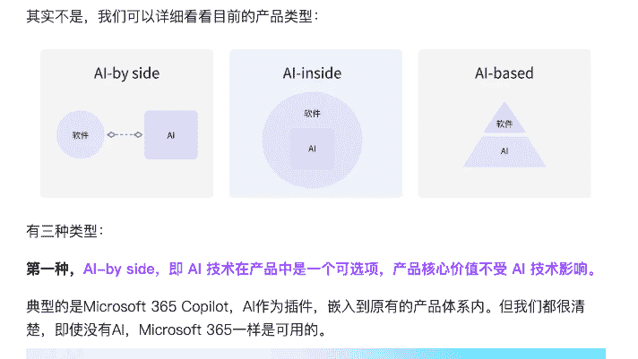

# 1  ChatGPT 风暴来袭

> 来源：[https://my.feishu.cn/docx/XN6td7svcoayO7xU64Ic1xv4nyJ](https://my.feishu.cn/docx/XN6td7svcoayO7xU64Ic1xv4nyJ)

# AI 不会取代人，但使用 AI 的人将取代不使用 AI 的人

ChatGPT 就像你友好的人工智能聊天伙伴和写作助手！这是一个由 OpenAI 创建的超级智能语言模型。基本上，它可以和你对话，给你各种各样的答案和建议，使其成为一个超级强大的人工智能写作助手。

它已经接受了一大堆互联网文本的训练，所以它对人类语言有很好的掌握。你可以问它问题，得到解释，集思广益，或者只是就几乎任何事情进行一次愉快的聊天！

请记住，像任何人工智能一样，它并不完美。有时它可能会出错，给你一个古怪的反应。除了训练之外，它没有实时信息或个人经历。所以，如果你需要事实核查或做出重要决定，仔细检查信息总是好的。

---

# 0.1  ChatGPT-AI Copilot 领头羊

ChatGPT，作为由 OpenAI 开发的人工智能生成内容（AIGC）模型，引领这一轮的 AIGC 革命，并成为目前全球用户量最大、用户口碑最好的日常 AI 工具。

开通 Plus 后会有很多能力，比如 GPT-4 、更强大的内容创作能力、文生图、实时搜索网页、调用各种插件等。可用于信息搜索、文件总结和提问。

其中实时搜索还有 New Bing、Bard、Perplexity（一般搭配使用，几乎可替代搜索引擎了）、天工搜索等。

# 0.2  ChatGPT 主要使用场景

ChatGPT，具有多种强大的应用场景，可以帮助人们在不同领域提高效率和创造力。

以下类似 ChatGPT 这一类的 LLM 大语言模型的一些主要能力以及使用场景：

LLM的能力大致分类为六种，生成、总结、提取、分类、检索、改写6种。

> 这个听名字大家应该也都能理解到，对吧？生成就是比如你让LLM帮你写篇文章，帮你写个什么周报，甚至写一部小说，他也可以写。你让LM写代码其实也是生成。

> 总结就是比如说帮你总结文章，总结邮件？整理会议纪要这些都是总结。

> 提取的话可以是像比如说你跟LLM说，请帮我找出这篇文章里面提到的所有的书，这就是一种提取。

> 分类可以是比如说你让LLM帮你判断说这篇文章的这个内容是积极的还是消极的。它在股市里面，比如说它是利好的还是不利好的，或者说这篇文章里面有没有政治敏感信息，这种就是LLM可以帮你判断，给你分一个类别出来。

> 检索可以是比如说帮我找出这个公司的收入规模这种问题。这种检索和一般意义上的摄取最大的区别在于说，LLM是通过语义，而不是通过关键词匹配去检索的那它其实检索的这个范围和准确度其实就会高很多，因为它可能这个文章里面完全没有这个收入规模这样的词，但是你通过LLM提问，你就可以找到这个信息。

> 最后是改写，比如说对一篇文章进行润色，或者说改正错别字，哪怕是改正标点符号，包括翻译，它也是一种改写。

> 但实际上这几大类能力在我看来其实都是从生成这个核心能力上衍生出来的，只不过它使用场景不同。

> 然后另外这六大类里面，我觉得还有一个能力其实没有被提到作为其他模型间的胶水或者说是协调者，就是整个多模态的这个场景下面，LLM作为它的一个协调者去协调不同的模型工作。因为LLM可以通过生成代码生成提示词来驱动别的模型，从而协同完成LLM能力之外的事情，这个也是很重要的一个能力。比如说现在我们不是可以通过GPT？用自然语言去生成图片。其实LLM在里面扮演的就是这样一个协调者的角色。

> 内容描述来源：构建AI产品必听：关于LLM那些必须知道的事

扩展阅读：

Q：ChatGPT 能够为我做些什么？

A：ChatGPT 是一个强大的人工智能助手，能够在多个方面为您提供帮助和支持。以下是一些 ChatGPT 能为您做的事情：

1. **回答问题和提供信息**：

- 解释复杂的概念、历史事件、科学原理等。

- 提供最新的新闻和趋势分析（需要实时查询）。

2. **文本创作和编辑**：

- 撰写文章、博客、电子邮件或任何类型的文本。

- 帮助修改和校对文本，提升语法、风格和可读性。

3. **语言翻译**：

- 将文本从一种语言翻译成另一种语言。

- 提供语言学习的建议和指导。

4. **编程和技术支持**：

- 提供编程问题的解决方案和代码示例。

- 解释技术概念，帮助解决软件或硬件相关问题。

5. **教育和学习支持**：

- 提供学习资源和建议，帮助理解课程内容。

- 解答作业问题，提供学习技巧和方法。

6. **建议和指导**：

- 给予职业发展、时间管理、生活方式等方面的建议。

- 提供决策支持，帮助分析不同选择的利弊。

7. **娱乐和创意**：

- 生成故事、诗歌、笑话或其他创意写作。

- 提供电影、书籍、音乐等娱乐推荐。

8. **计划和组织**：

- 帮助制定计划，如旅行、活动策划、日程安排等。

- 提供清单和建议，确保您准备充分。

9. **个人助理**：

- 帮助管理日常任务，设定提醒和提醒事项。

- 提供购物建议、餐厅推荐等日常生活支持。

10. **互动对话**：

- 进行有趣且有意义的对话，提供陪伴和娱乐。

无论您需要信息、建议、创意或只是一个倾听的对象，ChatGPT 都能提供帮助。请告诉我，您具体需要什么样的帮助，我会尽力为您服务。

# 0.3  ChatGPT 时代的 AIGC 基本功

### 决定用 AI 辅助创作之前，先要搞清楚 3 个问题：

第一，AI 到底适合生成什么？

AI 不是无所不能的，生成满意内容的前提，是知道它擅长在什么场景下使用，它的适用性和优势如何。具体来说，你需要了解 AI 在哪些类型的内容创作上表现最好，比如是设计、艺术创作、数据分析报告，还是其他领域；

第二，具体的 AI 生成工具如何使用？

如何初始化它（理解它的底层逻辑、生成内容的流程、工具模块、甚至比如可选择配置的设计风格参数等），让它更好地被人上手。毕竟一下子面对一个输入框，就像一个绘画小白面对一张白纸一样不知所措；

第三，如何最大化发挥 AI 工具的势能？

了解给 AI 下指令的核心方法，以更有效的提问技巧生成更好的回答。很多自媒体会夸大 AI 的用法，似乎一句话就能生成一堆东西，这种很明显是误导。打好基础才是最重要的，Prompt 提示词工程的修炼是关键。

### 用好 Prompt 提示词，AI 创作分分钟开挂，效率 and 创造力双飙升

延展阅读｜读在前面：

[**对于普通人而言，并不需要去学所有 AI 底层知识，**](https://web.okjike.com/originalPost/657a8802abd4694727145f65)稍微了解其原理，重点学习如何应用就很好了

[去](https://mp.weixin.qq.com/s?__biz=MzkzMDY1NDgyOQ==&mid=2247783622&idx=1&sn=1e4728253997ac32baf194e04fe13d7d&source=41#wechat_redirect)学习和了解 AI，不必焦虑它会取代我们，把 AI 作为工具提升我们的生产力，你我都可以成为善用 AI 的人

#### 出于科学上网以及中文处理方面的考虑，本文中出现的 ChatGPT ，也代指这一类 ChatBot 对话式 AI 工具，这些应用产品的基础功能设置都差不多，主要区别在于模型能力与生成效果、以及一些特色功能

---

作者简介：

我是文森策，一个10年+品牌策划人，AI提示词&提效玩家。

现阶段热衷于AI辅助内容营销探索，欢迎交流分享AI辅助创作思考/技法/实用工作流，一起用AI打开更多创作可能。

⭐ **提交反馈与交流合作请直接戳我**👇

