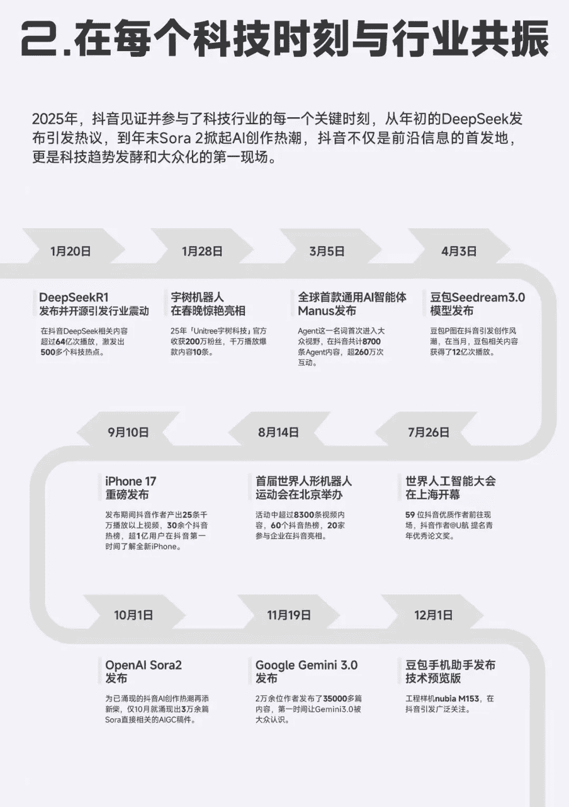

# 2025 年 AI 领域重大事件一览

> 来源：[https://my.feishu.cn/docx/TPbxdS5oCoG0mKxF7qJcoORZnHd](https://my.feishu.cn/docx/TPbxdS5oCoG0mKxF7qJcoORZnHd)

## 美国启动“星际之门”AI项目，强化全球AI竞赛

+   时间 ：2025年1月 21 日（特朗普上任后）

+   项目名称 ：星际之门（Stargate）

+   项目亮点 ：

+   美国政府主导、多家科技巨头（包括OpenAI、软银和甲骨文等）联合推动的国家级AI项目，聚焦生成式AI技术研发与战略布局。该项目的目标是通过建设数据中心和AI超级计算机，提升美国在全球AI领域的竞争力。

+   此项目的初始投资额为1000亿美元，计划在未来四年内增加至5000亿美元，旨在建立和发展美国的AI基础设施。

+   影响 ：加剧全球AI技术竞争，可能推动军事、经济等领域AI应用的加速落地。

+   经济与就业影响：特朗普在宣布该项目时表示，星际之门计划将“几乎立即创造10万个美国就业岗位”，并预计将为全球经济带来显著的效益。

+   技术创新：该项目不仅关注基础设施的建设，还计划利用AI技术进行药物设计，特别是在癌症治疗领域的应用，旨在推动医疗技术的革新。

+   星际之门项目被视为美国在AI领域战略布局的重要一步，预计将对全球科技竞争格局产生深远影响。随着项目的推进，OpenAI等公司正在评估美国各州作为数据中心的潜在选址，以支持这一大规模的AI基础设施建设。

## DeepSeek-R1发布并引爆全球

+   **时间**：2025年1月20日

+   **亮点**：

+   中国公司深度求索发布的1.3B参数开源模型，以2000张H800 GPU实现ChatGPT-o1相近性能，训练成本仅557万美元。

+   在数学、代码、自然语言推理等任务上性能比肩OpenAI o1正式版，1月24日在国外大模型排名Arena上基准测试升至全类别大模型第三，在风格控制类模型分类中与OpenAI o1并列第一。

+   推理模型以较低成本匹敌或超越领先模型，如OpenAI的o1。根据报道，其开发成本远低于传统模型。

+   **影响**：

+   DeepSeek-R1在苹果App Store表现出色，成为首个同期在中国和美区苹果App Store占据第一位的中国应用，用户量短时间内迅速攀升。

+   引发全球科技股震荡，英伟达单日市值蒸发6000亿美元，被全球云平台（如百度、华为云、阿里云、亚马逊、微软等）广泛接入，成为“主流标配”。

+   挑战传统AI开发成本高的问题，可能降低行业准入门槛，引发全球市场震动。

## **Kimi K1.5多模态突破**

+   **时间**：2025年1月20日

+   **亮点**：月之暗面发布的128K上下文窗口模型，在AIME奥数测试中准确率超越GPT-4o

+   **影响**：推动长文本处理技术革新，但后续因股权纠纷陷入发展瓶颈

## 通义千问Qwen2.5-Max发布

+   **时间**：2025年1月29日

+   **亮点**：阿里20万亿token训练的超大规模MoE模型，在MATH-500数学测试达90.6%准确率

+   **影响**：引发国内大模型价格战，模型服务成本下降97%

## Gemini 2.0系列模型全面开放访问

+   **时间**：2025年2月5日

+   **产品名称**：Gemini 2.0 Pro Experimental / Flash / Flash-Lite

+   **产品亮点**：

+   Pro Experimental：200万token上下文窗口（可处理2小时视频或140万字文本）、代码生成准确率提升40%、集成Google搜索API实时比价（电商场景准确率98.7%）。

+   **Flash**：120ms极低延迟，支持1080p视频流实时分析，图像处理成本低至$0.15/张。

+   **Flash-Lite**：文本生成成本仅$0.0075/百万token，10万条商品描述生成成本压缩至7.5美元，较传统文案成本降低99.9%。

+   **影响**：

+   电商领域实现自动化内容生产革命，科研场景可处理2000+篇文献综述。

+   开发者通过4行代码即可调用API，推动AI技术快速商业化落地。

## Gemini 2.0 Flash Thinking推理模型全面开放

+   **时间**：2025年2月5日

+   **产品名称**：Gemini 2.0 Flash Thinking（实验版）

+   **产品亮点**：

+   可视化思维链路展示，支持跨模态推理（如结合文本与图像分析战术录像生成游戏改进建议）。

+   深度推理能力提升，在数学竞赛级问题（如MATH基准测试）中准确率达91.3%。

+   **影响**：增强AI决策透明度，应用于企业战略规划、教育培训及科研实验设计，推动可解释性AI发展。

## **Grok 3颠覆性升级发布**

+   **时间**：2025年2月18日

+   **亮点**：xAI在10万H100 GPU上训练的"最聪明AI"，支持火箭发射窗口计算等复杂物理建模

+   **争议**：被OpenAI指控测试数据造假，64次采样取最优值的评测方式引行业质疑

## Claude 3.7 Sonnet混合推理模型发布

+   **时间**：2025年2月25日

+   **亮点**：Anthropic推出支持快速响应/深度思考双模式模型，编程通过率达70.3%

+   **突破**：首个实现自主决定思考时长的AI，医疗诊断采纳率超越同类产品

## 微软开源其全新的多模态AI代理模型——Magma

+   **时间**：2025年2月25日

+   **亮点**：多模态Agent基础模型，响应时间100ms，支持机器人物理操作与心理意图预测

+   **生态**：开源策略冲击OpenAI闭源生态，三天内GitHub Star量突破2万

## **通义万相2.1开源**

+   **时间**：2025年2月25日

+   **亮点**：阿里开源的视频生成模型，在VBench评测86.22%超越Sora，支持480P实时生成

+   **创新**：引入"深度自省"机制解决AI幻觉问题

## **腾讯混元Turbo S加速**

+   **时间**：2025年2月27日

+   **突破**：首字响应延迟降低44%，Hybrid-Mamba架构降低70%部署成本

+   **战略**：合并四大AI产品线，企业🛰️率先接入深度研究功能

## GPT-4.5（Orion）预览版上线

+   **时间**：2025年2月28日

+   **亮点**：OpenAI最后一个非思维链模型，计算效率较GPT-4提升10倍，情感理解能力显著增强

+   **影响**：免费用户可无限制使用GPT-5标准版，推动AI普惠化