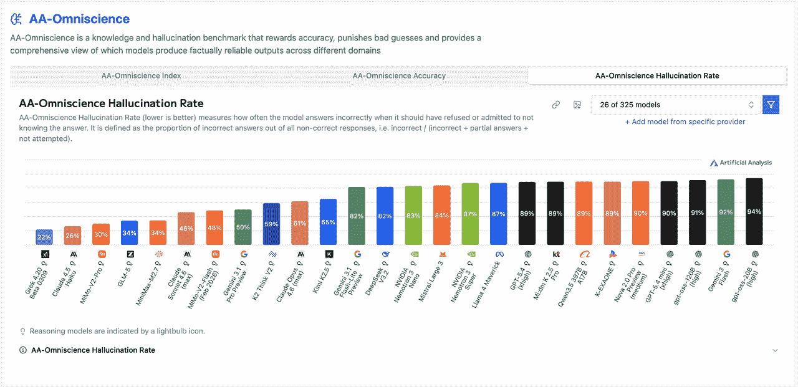
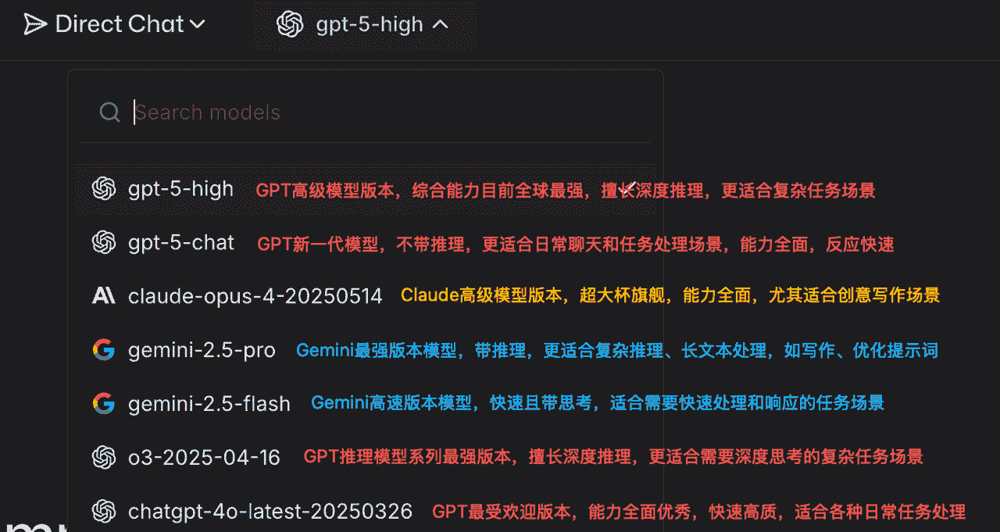
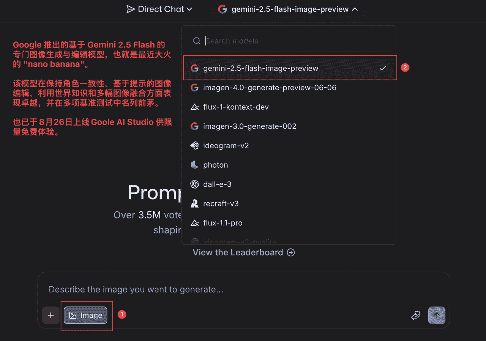
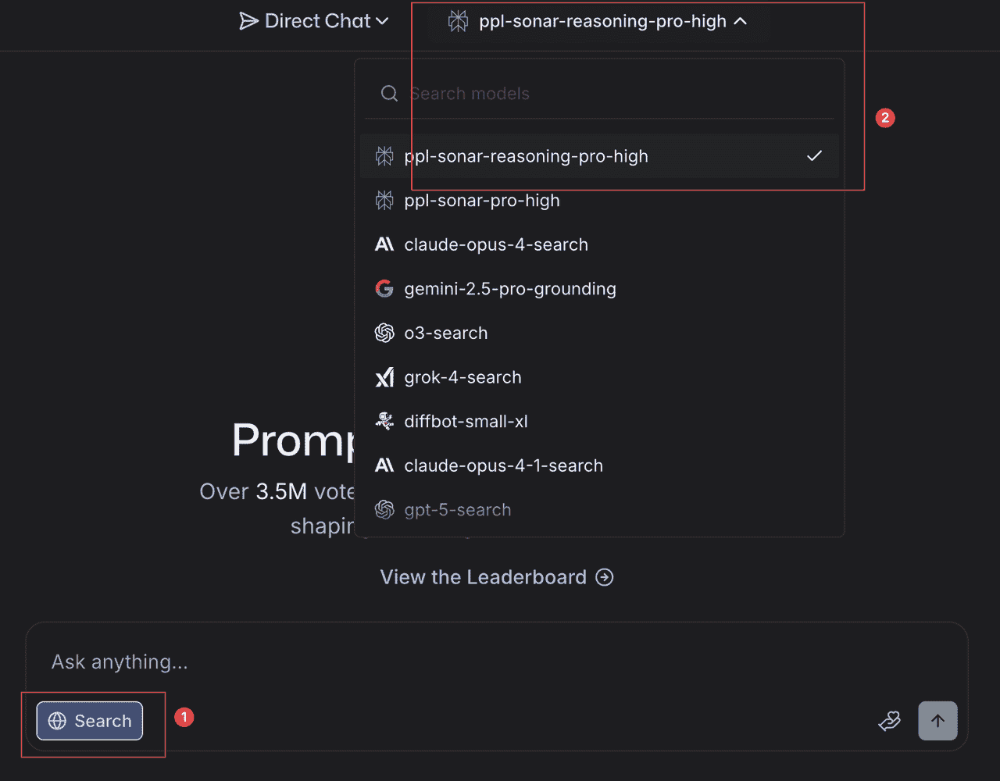
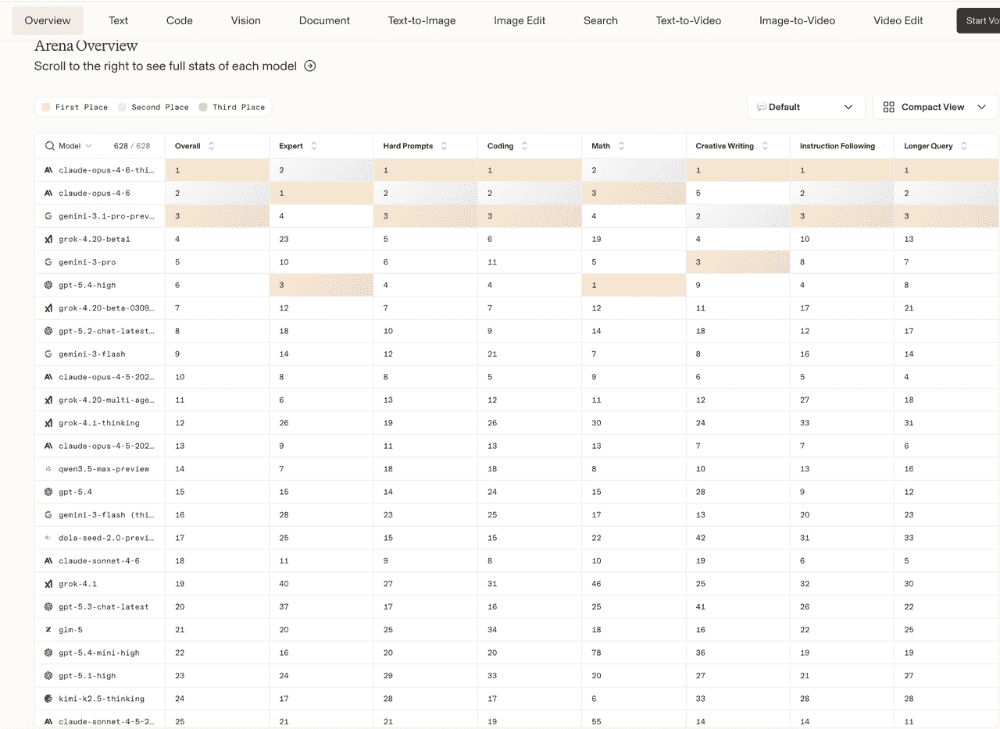
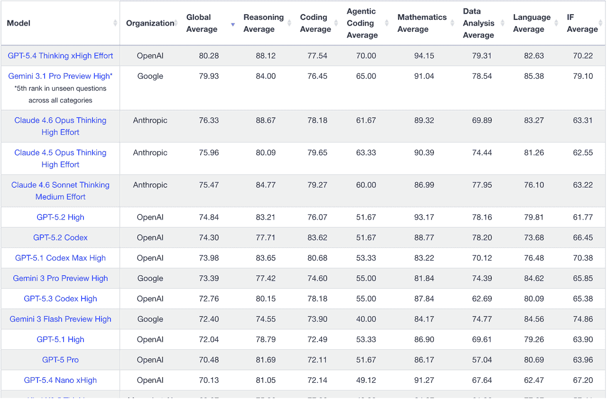
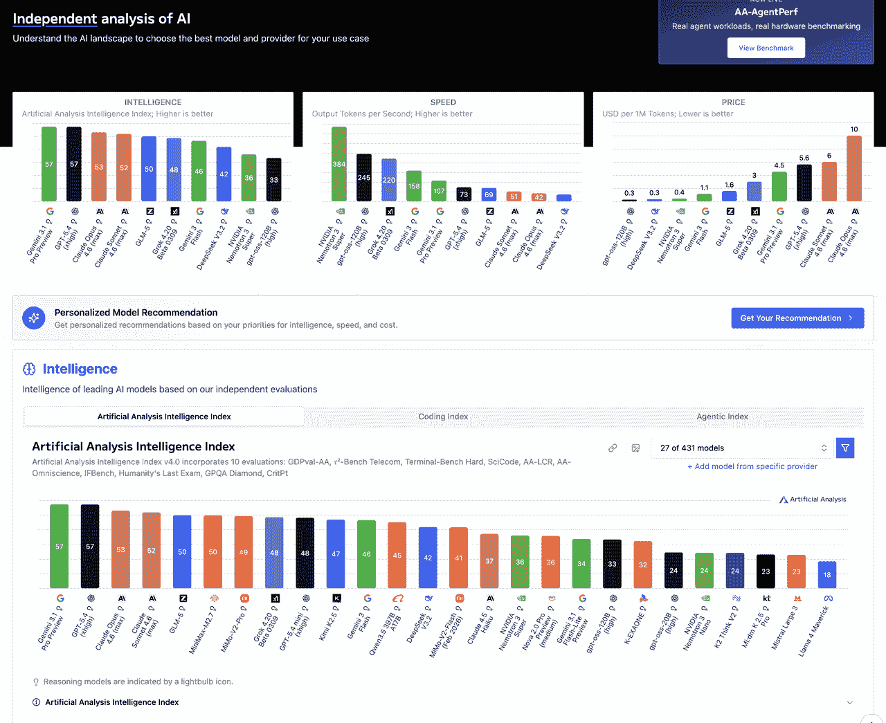
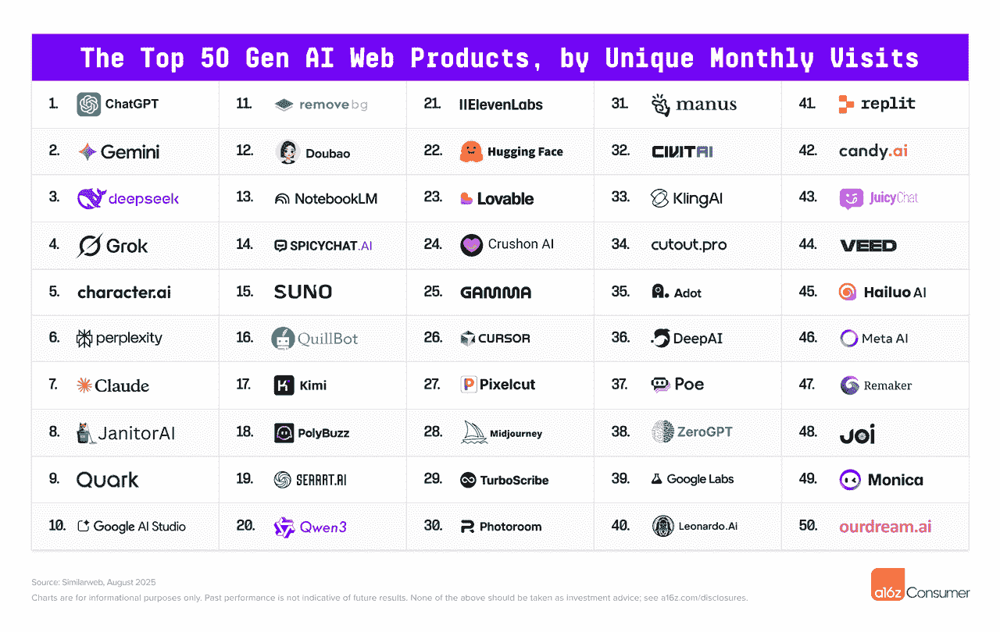

# 3.1 常用 AI 工具集 · 精选版

> 来源：[https://my.feishu.cn/docx/SjCQdFzh2oJY7KxacxmcLy0Jnte](https://my.feishu.cn/docx/SjCQdFzh2oJY7KxacxmcLy0Jnte)

## 日常各种高频使用场景下的实用 AI 工具清单，持续更新中……

本清单是基于我的广告营销工作应用场景、资料搜索分析及写作需求所列，个人体感上的排行榜，也基本适用于大部分上班族朋友。

+ 排序分先后（主要根据个人日常使用习惯上的偏好度，来做的一个排行榜单整理），
+ 🌟代表推荐程度（根据该产品垂直能力层级、以及产品综合体验度等级，标注的一个适用于大众群体的参考值）

之所以是两套参考系统，是因为目前市面上有些产品 C 端体验很好、发展势头也很好，但垂直能力未必一流，因此现阶段大众推荐度与个人使用上的偏好度会有所差别。

我们能看到，AI 正在实现从信息工具、辅助工具到生产工具，这三大层面（用户需求场景）上的能力跃迁。目前，一些初步可落地的专业生产力工具已经面市，“AI+专业场景”的应用也日益广泛。

工具没有绝对的好坏之分，只有适不适合自己的使用场景。多尝试多探索，总能找到最适合自己工作流的工具组合。

这份清单供大家综合参考，用到就是赚到，省下的时间和精力才是真正的价值所在。也欢迎大家在评论区交流分享你的使用心得～

这是一份实用工具导航清单，也是一份面向未来的 AI 技能指南，希望能够帮助大家从基础的「问答机器」使用者进阶为高效的 AI 驾驭者，在内卷社会中保持领先优势。

---

## 外事不决 GPT，内事不决问 Kimi

## 🤖 日常对话 AI Chatbots

### 海外版（需施展魔法）

#### ChatGPT

`https://chatgpt.com`

##### 强逻辑

可满足日常各种需求场景，一个就够

产品综合能力、易用性最强，更注重逻辑性与结构化输出，稍显正经严肃，但也最为稳健

写作方面，习惯提供结构化段落，形式上略显呆板，语感较为严谨干练，容易有学术研究的感觉

众所周知，AI 届不老网红，综合能力全球 No1。任务理解能力最强。

电脑和移动端 app 都很好用，快捷键调用方便快捷。

> 主要 LLM 版本特点表现及产品更新情况：

1. 擅长推理的【o1】新模型，堪称 AI 2.0 时代开创者。
1. 主力模型【GPT-4o】持续霸榜 Arena 大模型竞技场，日常任务场景大都能很好满足。
1. 新推出的 Search AI 搜索模式，效果很不错。以及 Canvas 画布编辑的功能，用来写作修改很方便。

> 另外，推荐一个 ChatGPT 替代——【微软 Copilot】（`https://copilot.microsoft.com`），可免费用 GPT5 以及 Dalle 3 画图模型。目前的新版本，比初代版本也好用不少，对于用 Win 系统以及 Edge 浏览器的比较友好。

1. 能充会员就充会员，GPT-4.5 Preview 太好用了，写作指令遵循能力强、输出质量也高，不输 Claude 了。
1. 202504，更新 GPT-4o 绘图功能，吉卜力风火遍全球，正在挑战传统绘画设计领域。
1. 20250416，ChatGPT 推出 o3 及 o4 mini，具备“用图像思考”、理解白板、草图、图表等低质量图片的能力，推理能力再上新高度。
1. 20250808，推出 GPT-5 新模型，一种融合了多模态、混合推理、甚至 Agent 的新模式。
1. 202510，推出 ChatGPT Atlas 浏览器，将 ChatGPT 功能与网页浏览整合为一款强大的工具。实现一站式操作——提问、获取个性化建议或让 ChatGPT 帮助完成特定任务。
1. 202511，上新 GPT-5.1 模型：
1. GPT-5.1 发布后，口碑呈现出明显的两面性：OpenAI 强调其在对话体验和个性化上的显著提升，而不少实测则指出其在长文本、文学创作等具体任务上仍与顶尖竞品存在差距。
1. 综合来看，GPT-5.1 是一次专注于用户体验的迭代。如果你的主要需求是日常对话、快速获取信息、进行数学推理或编程，GPT-5.1 的体验提升会比较明显。
1. 但如果你需要 AI 协助撰写长篇报告、进行需要文采的创作，或获取较新的信息，那么像 Claude 这样的竞品可能在当前阶段是更合适的选择。最佳策略或许是结合使用不同模型，发挥各自优势。
1. 20260306，推出 GPT-5.4 Thinking 新模型：
1. OpenAI 最新前沿推理模型，被定位为“最强大、最高效的专业工作前沿模型”。它将 GPT-5.3-Codex 的顶级编码能力与先进推理、Agentic 工作流深度融合，显著提升在表格创建/编辑、演示文稿制作、文档理解、复杂工具使用、深层网络研究等专业场景的表现。
1. 亮点功能包括：思考前自动生成计划预览（可中途调整方向）、更长的思考时长不超时、更好的上下文保持、输出格式更精炼干净、减少多余迭代。
1. 在 ChatGPT 中以“GPT-5.4 Thinking”模式提供，Plus、Team、Pro 用户立即可用；同时推出更高性能的 GPT-5.4 Pro 版本，供极致复杂任务使用。整体被誉为“真正能干复杂真实工作”的模型，减少来回沟通，效率大幅提升。

> 整体最新趋势小结（截至 2026 年 3 月）：

> ChatGPT 已进入 GPT-5.4 时代，核心方向是“一个模型搞定专业复杂工作”：推理更深、编码更强、Agent 能力更可靠，同时通过 Thinking / Instant / Pro 等模式实现智能切换。产品持续精简旧模型、提升用户体验（中途可控思考、精炼输出），并加强免费/低成本用户对高级推理的访问门槛（mini + Thinking 功能）。

> 对于日常用户：GPT-5.4 Thinking + mini 的组合已能覆盖绝大多数场景，写作/编程/研究效率显著高于 2025 年版本；若需极致文采或特定领域深度，仍建议结合 Claude 等竞品多模型协作。

> 最佳策略：根据任务复杂度选择模式（Instant 快答、Thinking 深思、Pro 极致），充分利用 Canvas、Search AI 和 Agent 能力，实现一站式高效工作流。

#### Claude

`https://claude.ai`

##### 强写作

编程和写作能力一流，但入手成本高

语言表达更自然、写作更有人味儿。AI 编程之王，Artifacts 直出卡片、网页前端展示效果，很好用

写作方面，习惯提供简洁的内容，更接近人类语言的平实表达风格，更适合常规写作场景

地表最强的国际顶流 AI，机器味儿最不明显，中文写作能力一流，最接近人味儿语言表达。

而且，Claude 的搜索能力居然又强又稳，用 Sonnet 4.5 就能搜到很难搜的问题领域，不得不说 Claude 对于指令的理解与遵循能力实在是强，除了代码能力，对结构化提示词的处理能力也很强，很适合用来编写优化复杂 Prompt

> 主要 LLM 版本特点表现及产品更新情况：

1. 主要使用【Claude 3.5 Sonnet】，特别是“Artifacts”独家大杀器，一骑绝尘的体验。
1. 除此之外，【Claude 3 Opus】也曾霸榜，依然强大。特别是写作能力，一骑绝尘。

> 但官方账号很难注册和保号、网络限制极高，可用 Arena（`https://lmarena.ai/`）或 Poe（`poe.com`）以及一些镜像站、API 来体验。

1. 继 Artifacts 强大功能（一个用于处理代码、图像、文档的工作台）之后，近期连续推出 Analysis tool（数据分析）、LaTeX Rendering（数学公式渲染）、Visual PDFs（PDF 图示化）几大实用功能，赚足眼球。

> 配合“Thinking Claude”神级提示词食用更佳，可实现让 claude 展现自我思考的类 o1 推理过程。

1. 20250219 上新 Claude 3.7 Sonnet（Thinking）版本，强无敌了
1. 20250523 在万众期待下终于上新模型了，Claude 4 王者登场，推出 Claude 4 Sonnet 与 Claude 4 Oups 两个版本，编程和 MCP 能力再上新台阶，写作也有进步，这一块还是硬刚 GPT 和 Gemini 的存在啊
1. 202511 发布 Claude Opus 4.5，目前编程能力最强的大模型。这个模型依然是 200k 上下文，64k 最长输出。测试下来，写作能力依然强大，指令遵循能力尤其强，thinking 版本很适合用来辅助编写 Prompt，爱了爱了～

> Claude 学习资料集：Claude 实战全攻略｜AI 知识库

> 有关 Claude 的使用指南、学习教程、提示词技巧、应用实践探索等资料合集

> 点击👆上方链接，打开`ima.copilot`，即可加入本知识库（知识库可用 DeepSeek 基于资料内容进行提问和深入研究，也可下载相关资料文件，腾讯推出的这个 ima 知识管理的 AI 工具真心推荐，很实用）

> 有关 Claude 的相关有价值资料信息，我也会陆续添加同步更新在这里

#### Gemini

`aistudio.google.com`

##### 强创意

免费体验额度多且能力强，强大的长文本及多模态是最大亮点

长文本能力最强、音视频多模态之王。支持多轮对话，提供更为丰富的回答内容，更擅长处理长文本和复杂任务

写作方面，习惯提供更为丰富的细节描述，但语感上也会稍显夸张和啰嗦，容易夹杂浮夸的网络语言

现阶段强推使用【Gemini 3.1 Pro】

+ 最新及主流版本模型均可在 aistudio（谷歌开发者体验版官网）中免费使用，可自由挑选更新更强的模型版本，每天提供大量免费 tokens，个人用户常规用量管够。
+ ai Studio 中优先提供最新的实验版本，因此相比 Gemini 面向个人用户的官网（`https://gemini.google.com/app`）同款模型能力可能表现更强劲（相对免费用户来说）。
+ AI Studio 中推出了「Grounding」增强搜索模块，接入了 Google 搜索，对事实类信息的提问效果是个升级。

> 主要 LLM 版本特点表现及产品更新情况：

1. 在中文理解、长文本处理、音视频多模态处理方面能力国际一流。8 月份曾一度霸榜 Lmsys 竞技场。
1. 2024.12 新推出的 Gemini-Exp-1206 模型，直接登顶 arena llm 排行榜，实测效果确实很不错
1. 以及，12 月先后推出的 2.0 Flash 及 Thinking 推理版本，每天提供大量免费 Token 给用户调用，模型和服务都太强了，真良心 Google。
1. Advanced 付费订阅版本，新推出的 Gemini Deep Research，利用谷歌的深度搜索，能力很强。
1. 20250205 推出 Gemini 2.0 Pro 版本，支持 Google 搜索，AI Studio 每天提供 200w tokens，这么低调有实力、又很拉好感的，真的也就 Gemini 和 DeepSeek 了～
1. 202503 推出 gemini 2.5 Pro 版本，一战成名，直接登顶多个通用大模型评测榜首。目前多个渠道支持大量免费 token 调用，很香！
1. 喜大普奔，Gemini 2.5 Pro 在上个月刚二次迭代版本后，于 20250605 突然推出 3.0 迭代版本，从目前测试使用来看，指令跟随、写作表现都很不错，关键继续有不少免费额度可体验，真赛博菩萨了！
1. gemini-2.5-flash-image，Google 在 202508 推出的基于 Gemini 2.5 Flash 的专门图像生成与编辑模型，也就是最近大火的 "nano banana"。该模型在保持角色一致性、基于提示的图像编辑、利用世界知识和多幅图像融合方面表现卓越，并在多项基准测试中名列前茅。也已于 8 月 26 日上线 Goole AI Studio 供限量免费体验。
1. 202511 谷歌大善人突然甩出一波王炸，Gemini-3-Pro 与 Nano Banana Pro（Gemini 3 Pro Image 版）接连上线，能力比前代模型又有升级突破，妥妥的世界王者，火爆国内外。Coding 前端能力也很强。
1. 20260220，谷歌发布其新一代旗舰模型 Gemini 3.1 Pro。根据谷歌放出的基准测试，3.1 Pro 在 12 项测试中超过 Gemini 3 Pro、Claude Opus 4.6、Claude Sonnet 4.6、GPT-5.2 等模型，拿下第一。正从通用能力比拼，转向真实世界复杂任务的实战能力竞争。
1. 20260226，紧随 3.1 Pro 旗舰模型的步伐，Google 又光速上线了新一代图像生成与编辑模型 Nano Banana 2。相比前代，Nano Banana 2 在多图组合（Composition）、复杂的风格迁移以及图像内高保真文本渲染方面表现更加逆天，并且支持通过多轮对话进行极其精准的迭代修图。搭配 Gemini 3.1 Pro 的超强理解力一起食用，多模态创作和设计体验直接拉满，妥妥的生产力王牌！

特别推荐：

`https://my.feishu.cn/sync/BnnUdCQXTs6gTSbONu9cxO2AnKh`

#### Grok

`https://grok.com`

##### 强搜索

很适合结合实时搜索来做信息搜集、分析

逻辑推理与创意写作能力都很强，且依托 X 的丰富实时数据，很适合结合搜索增强来做信息搜集和分析

Elon Musk 旗下的 xAI 公司推出的一款 AI 模型，被宣传为“地球上最聪明的 AI”，主打逻辑推理、信息检索和快速研究等功能。

> 主要 LLM 版本特点表现及产品更新情况：

1. Grok3 新晋网红，霸榜 Arena 大模型竞技场。
1. 支持「推理」和「深度研究」，在信息检索和研究场景中表现很不错。
1. 20250220，马斯克宣布$40/月的 Grok3 免费开放，直至全球用户把服务器干到崩溃为止。
1. 20250416，Grok 推出类似 Claude Artifacts 的文档、代码预览窗口功能。
1. 20250709，发布新一代模型 Grok4，能力进一步升级，几乎跻身第一梯队。
1. 202510，推出类维基百科在线百科全书 Grokipedia 网站，可用于学习与辅助研究。
1. 202511 发布 Grok-4.1 新模型，用户口碑反馈，Grok-4.1 在创意写作和情感交流方面有明显进步，回答更自然、更具“人味儿”。

### 这 4 大模型该如何挑选使用？

幻觉率：GPT＜Claude＜Grok＜Gemini（有点粗暴，仅供参考）



在当今主流的 AI 大模型中，幻觉率被视为一个关键的评估指标。

幻觉率的高低，直接影响着模型在信息处理时的准确性和可靠性。

幻觉率越低，模型在处理信息时越精准，越能胜任那些对准确性要求极高的任务。

而幻觉率稍高的模型，如 Gemini，则更适用于进行开放型的创意写作，例如小说、剧本等长文本的创作。

> 站在非技术人员的普通用户角度，简单小结 tips 如下：

1. 用量大，首推 ChatGPT，产品功能较为综合丰富，且具备长期记忆功能，很适合用来训练个人陪伴型的工具助手，可充 Plus 会员长期使用（但充会员后容易加大被封号风险）；
1. 日常需求，更推荐 Gemini AI Studio，可免费用 Google 的各种 Top 级模型。长文本、音视频多模态首选，做各种文件转文本的提炼总结特别好用；
1. 如对写作质量有较高要求，且能确保 IP 很纯净情况下，可充 Claude 会员。不然，更推荐使用 Claude API，除了与官网在一些特色功能体验上的差异之外，用底座模型来对话、辅助写作一样丝滑。
1. 至于 Grok，可以用来日常娱乐或者新闻资讯信息的搜索获取，这方面依托 X 强大的信息源，信息实时性还是比较强的，是一大亮点。甚至是为数不多的支持 NSFW 模式的，文本、图片、视频、语音皆可。

> 关于用 AI 辅助写作的模型选择：

1️⃣ 最适合辅助中文写作的模型，我一直的感觉是 Claude 系列，目前最强 Claude 4.6 Opus thinking，可能乍看上去不很惊艳（相比 Gemini 长上下文的内容丰富度，ChatGPT 的稍正式严肃学术风、以及 DeepSeek 的金句式输出风格而言），但相对来说更接近人类自然语言，表达习惯更有人味儿一些。

2️⃣ ChatGPT 中目前写作能力最强的模型版本应该是 GPT 4.5，比较稳，能力表现和 Claude 4.5 Opus 差不多，但这个模型已经很难用到；再就是有温度的 4o 也能满足日常，以及目前新王 GPT-5.4-thinking。GPT 系列指令遵循很强、幻觉较低，还是更适合辅助学术类研究类稍严肃风格写作一些。

3️⃣ 谷歌新王 Gemini 3 Pro，比较能生成丰富细节，但从另外一个层面来说，也就稍显啰嗦和跳跃。这可能跟它一直擅长的超长上下文有关系，适合搞长篇，token 比较大方，但又幻觉稍高，因此更适合开放型、创意度较高的创作（比如小说类虚构写作）。

我的个人体感大概是这样，具体还要看个人任务的实际需求场景。

补充：

### 🚀 好用的 AI 集合站

以上大模型非官方替代工具：可用 Arena（`https://lm.arena.ai`）、Poe（`poe.com`）、You（`You.com`）、Monica（`monica.im`，邀请链接：`https://monica.im/invitation?c=Q0GHWXAE`）这些多 AI 模型集成工具平台，都有免费体验额度，以及一些镜像站、API 来体验。


# AI 模型平台汇总

## lmarena 平台

`https://lmarena.ai`（免费，高级模型每日限量，几乎涵盖了目前全球各类主流最强 AI 模型。想集中体验各种模型的，强烈推荐）

> 顶部下拉菜单，有三种选择模型的方式，可选 `direct` 模式勾选特定模型，或点直链直接使用👉 `https://lmarena.ai/?mode=direct`

### 文本模型



除此之外，Claude 另外几个版本也很好用：

> `Claude Sonnet 4`，分带 `thinking` 与不带两个版本，是 `Claude` 性能与效率平衡的版本，在 AI 编程领域应用广泛；

> `Claude Opus 4`，除上图标示版本，还有个带 `thinking` 版本，更适合复杂推理，以及对简单模糊提示词的灵活处理；

> `Claude Opus 4.1`，分带 `thinking` 与不带两个版本，是对 `Opus 4` 的性能增强版本，编程一骑绝尘，写作也很优秀。

### 图像模型



3️⃣ 而且，lmarena 还提供 AI 搜索模型，在聊天框下方勾选联网图标，即可在顶部选用搜索模型，如：`ppl-sonar` 系列以及国际几大顶级模型的 `search` 版本。



注：此处截图非实时更新信息，仅作示意参考。具体在模型选择上，尽量找各家新推出的旗舰模型就欧了～

其他 AI 聚合站：

`https://poe.com`（每日限免）

`https://you.com`（每日限免）

## 🏆 AI 大模型主流评测榜







## 国产版（无需魔法）

这个部分是仅从国产主流 AI 大模型基模能力及其工具开发交互的实用层面，进行的日常使用偏好排名，因此也会隔段时间进行适时调整更新。

+   如果论创新与实用表现，我觉得 `kimi` 从推出就一直走在前面，辅助办公场景这块妥妥的（产品 `UI` 及体验也是国产一直在线的存在）

+   如果论工具全模态便利性，`豆包` 自然是无可辩驳的当红炸子鸡，而且不出意外字节系 AI 应该会是未来的巨无霸（工具体验很好，文本图像音视频全面开花）

+   如果论实用稳定性，搭载了 `DeepSeek` 的 `元宝` 是个不错选择（依赖鹅厂的产品与运营优势、以及社交/内容生态，优势显现）

+   如果论工具可衍生的生态布局能力，千问可能会是终极大赢家，但产品体验这块，只能说不能只是追赶上主流梯队，还得有大跨越啊（阿里现在已经有逐步动作在 ai 聊天工具入口接入电商、高德地图、飞猪旅行甚至大健康领域，意图覆盖更多与人们日常生活工作息息相关的各产业生态）

### 【kimi】🌟🌟🌟🌟

`https://kimi.moonshot.cn`

更适用于辅助办公场景，产品交互做得很不错

产品设计克制、交互体验感一流，并且在垂直办公场景持续发力（理由：百页 `PDF` 秒提取重点，长文本写作/总结利器、`AI PPT` 审美较在线）

AI 搜索增强能力个人体感是国产最强（这也是为什么可以作为国产首选的一大原因，强大的搜索增强能力可以很大程度上弥补现阶段 AI 大模型不可避免的幻觉缺陷，让回答结果更准确而实用）

官网及 `APP` 反应都很快，如果从产品 `UI` 及交互层面看，`kimi` 一直是国内最好用的 AI 对话产品。

+   主要 LLM 版本特点表现及产品更新情况：

+   长文本上下文能力国内一流，对于长文写作、内容提炼总结很友好。且提供浏览器插件辅助内容查询分析、提炼总结，这一点很实用。

+   产品界面功能克制简约，聊天框常用语、`Kimi+` 智能体，这两个功能很实用。（小 tips：@智能体，可实现单窗口连续作业）

+   新推出的 `AI 视觉思考版`（眼镜版）具备深度推理能力，以及流畅的语音模式，体验上也都可圈可点。

+   `20250120` 发布的 `K1.5` 多模态思考模型，性能对标 `OpenAI o1` 满血版，旨在解决复杂数学问题、编程调试、多模态数据分析等深度推理任务。

+   2025 年上半年，收紧激进营销投放策略，在产品上，小步快跑，动作频频：

+   4 月，与财新网合作补齐了财经信息；

+   5 月被爆布局“AI+医疗”，上线了医疗搜索；

+   6 月，悄悄迭代了学术搜索；

+   在与 `AiPPT` 合作的 `PPT` 助手之外，又推出自研的全新技术方案“新 `PPT` 助手”；

+   [`6 月 20 日，开启第一个`](https://mp.weixin.qq.com/s?__biz=Mzk0NDU1MDkyNg==&mid=2247487216&idx=1&sn=06fb879173034e39c1a0abc9dccda32f&scene=21#wechat_redirect) `Agent` 模型 `Kimi-Researcher` 的小范围灰度测试。

+   7 月 11 日，上线并开源 `K2` 新模型，在 AI 社区又吹起一阵新风，据说编程能力表现突出，有较大进步。

+   9 月初，`Kimi-K2-0905` 版本模型上新，在推理编码和创意写作领域，较之前有较大提升，口碑表现不错。

+   2026 年 1 月，`Kimi` 重磅发布并开源 `K2.5` 模型，首次引入 `Agent` 集群能力，实现多智能体并行协作。

### 【豆包】🌟🌟

`https://www.doubao.com`

功能丰富，更适用于日常娱乐及轻度办公&写作场景

在产品端，与国外三巨头跟得最紧，模型能力在 2025 年提升不少，产品上也有比较丰富的多模态支撑（`seedream` 生图模型国产之光，语音交互也最顺滑，抖音生态衔接）虽略臃肿，但胜在速度快，产品体验很不错

推荐豆包电脑端，搭配快捷键使用，很丝滑且比较实用～

+   字节跳动旗下，“`App` 工厂”出品，产品设计还是很让人期待的。无论是轻便的手机端还是覆盖日常办公场景（产品野心很大的类浏览器电脑端 `APP`），体验都很好，可作为日常随手用的产品，豆包输入法语音输入也很强

+   从底层模型能力到产品功能设计，在国内一众产品中，都堪称迭代速度最快，但目前模型能力尚未能位列第一梯队，主要得益于字节强大的流量、社交娱乐生态及产品能力，用户数国产断层第一。

+   主要 LLM 版本特点表现及产品更新情况：

+   电脑客户端 版本，在 `Copilot` 这块，已经进化得很实用了。另有配套浏览器插件，也不错。适合用来辅助文章快速提炼总结、`pdf`、音视频阅读这些场景。

+   手机 `App`，与扣子平台的智能体联动做得很不错，方便在扣子部署各种使用 `bot/agent` 外接到豆包来用。另外，语音聊天功能，目前算国内领先水平。

+   功能很丰富，旗下语音聊天、即梦生图/生视频能力和产品交互方面表现都在稳步上升，甚至 `AI 播客` 等一些特色功能也在火速出圈，论产品体验，还得是字节会玩。

+   `202506` 发布的 `Doubao-Seed-1.6`（`thinking`）能力跃升，在推理、编程、写作方面可圈可点，逐步稳居国内第一梯队。

+   `20250909` 上新即梦 `4.0` 图片模型，除了生图，具备编辑、多图融合等功能，一致性和稳定性表现实用级大提升。

+   `202512` 即梦上新 `seedream 4.5` 模型，更加强化一致性、风格与图文响应

+   `20251218` 发布发布豆包大模型 `1.8`，定向优化多模态 `Agent` 能力，支持 `256K` 超长上下文与原生 `API` 上下文管理，视频理解帧数翻倍至 `1280` 帧，同步推出 `Seedance 1.5 pro` 音视频模型。

### 【DeepSeek & 元宝】🌟🌟

`https://chat.deepseek.com`

优先推荐腾讯元宝版，足够满足日常所需。次推官方版，功能有限

国内深度推理先行者，编程写作两大基础能力都很不错，`DeepSeek` 官方原生产品极简、但多模态、复合功能较为缺乏，可用元宝版更丰富功能作为补充（解题/写代码直达痛点，开源特性适合折腾党）

> 当之无愧的国产良心 AI，以一己之力在一夜之间把 `API` 价格打了下来。

> 模型很给力、产品很克制。在国际领域都已享有一席之地，影响力非一般，目前的 AI 黑马、国产之光。

> 官网以及 `APP` 都很极简，热度平稳之后，现在速度响应流畅度都很不错了，可以作为主力来用。

> 主要 LLM 版本特点表现及产品更新情况：

1. 新推出的「深度思考」功能，能够呈现类似人的思考过程，很不错的 `COT` 推理效果。

1. `DeepSeek R1` 新模型更是火爆全球，多方测评显示出逼近 `GPT-o1` 的深度推理能力。可将「深度思考」与「联网搜索」同时勾选，做大篇幅的资料分析很是实用。

1. 但是，输出的内容容易夹杂互联网黑话、硬凹大词儿，体验感上有些一言难尽。适合用来做深度搜索和分析，或是开放性的头脑风暴。

1. `DS` 于 `20250325` 悄然发布 `V3-0324` 新版本，虽被官方定义为“小版本升级”，却在编程能力、技术架构和开源生态等方面实现突破性进展。成为首个在编程能力上接近闭源顶尖模型（`Claude`、`OpenAI`）的开源产品。

1. `DeepSeek R1`（`2025-05-28`）新版本，在对话写作自然度和编程能力上都有所提升，以前的“量子纠缠”风格稍有下降。

优先推荐：

+   【腾讯元宝】`DeepSeek R1` 深度思考+腾讯系数据源联网搜索

> 产品应用体验很不错，这是鹅厂大厂优势领域，响应速度快，很流畅。

> `UI` 模块配置也不错，特别推荐【分组】功能，可以自定义工作区工作指令，并支持上传参考资料文档，对于同一类重复性任务来说，是个很不错的功能配置。如果后期能在分组里支持「记忆」功能，就更好了，这种类智能体的 `Chat` 专区，相比全局记忆会实用更多。

> 另外就是，有「鹅厂技术+数据」的加持，回复效果上，感觉也好过原生 `DeepSeek`，可以作为国产手头常用。

#### 延展资料

> `DeepSeek` 学习资料集：`DeepSeek` 实战全攻略｜AI 知识库

> 有关 `DeepSeek` 的使用指南、学习教程、提示词技巧、应用实践探索等资料合集

> 点击👆上方链接，打开 `ima.copilot`，即可加入本知识库（知识库可用 `DeepSeek` 基于资料内容进行提问和深入研究，也可下载相关资料文件，腾讯推出的这个 `ima` 知识管理的 AI 工具真心推荐，很实用）

> 有关 `DeepSeek` 的相关有价值资料信息，我也会陆续添加同步更新在这里

+   `DeepSeek R1` 第三方 `API` 调用平台推荐：

+   硅基流动 [硅基流动官网](https://cloud.siliconflow.cn/i/a1uVG82a)

+   字节火山方舟 [字节火山方舟官网](https://www.volcengine.com/activity/deepseek?utm_term=202502dsinvite&ac=DSASUQY5&rc=EBP916ZV) （注册邀请码：`EBP916ZV`）

### 【Qwen Chat/千问】🌟🌟

推理、编程、语言写作国产最强，但产品前端交互体验还有点阿里短板（多模态能力、综合能力国产最强，很受开源社区欢迎）

`https://chat.qwenlm.ai`（国际版 `QwenChat`）——更为推荐，可供自由选择的模型丰富，`UI` 界面简洁，且新增了实用的个性化指令设置及全局记忆功能。

`https://www.tongyi.com`（国内版 千问）——`202511` 升级更名后，丝滑轻便了不少，正在结合 `QwenChat` 向 `ChatGPT` 的产品体验看齐，推荐体验，越来越可以作为日常使用的产品了。

阿里终于把 `Qwen` 模型与千问品牌（以及复杂的通义家族）在用户受众的信息接收层面，往前推进了一大步，不再那么一团乱麻。

`Qwen Chat` 官网提供多模型可挑选，但网站及 `APP` 体验都不是很流畅，应该是基于开源框架搭建的，期待官方能推出自研的更好用版本。

+   主要 LLM 版本特点表现及产品更新情况：

+   阿里于 2025 年 1 月 10 日上线 `Qwen Chat` 新平台，支持全系列 `Qwen` 模型，包括 `Qwen-Max`、`Qwen2.5-Plus`、`QwQ` 和 `QVQ` 等各模态模型。

+   官方将其描述为一个多功能 AI 平台，能够满足开发者、研究者以及 AI 爱好者的多样化需求，涵盖日常对话、联网搜索、图像理解与生成、视频生成、逻辑推理及编程生成等。

+   `Qwen-Max` 在 2025 年 2 月份的各大模型评测榜单中，名列国际一线阵营，语言能力更是国内 `No.1` 的存在，虽然低调也不如 `DeepSeek` 这么火爆出圈，但国际口碑和影响力与日俱增，开源生态甚至超过 `Llama` 成为国际一流的存在。

+   `20250224`，`Qwen` 在 `Qwen-Max` 基础上推出 `QwQ` 推理模型，在 `Qwen Chat` 中勾选“深度思考”即可使用。

+   `QwQ-32b` 推理模型在 `202503` 登顶 `LiveBench`，成为开源模型 `No.1`，能打 `DeepSeek Ri` 满血版

+   `LiveBench` 由 Yann LeCun 发起，业界公认的最权威、最公正的榜单之一，涉及推理、编程、数学、数据分析、语言理解和指令遵循等全面能力

+   `Qwen-3` 混合专家模型（`MoE`）于 `20250429` 推出，是国内首个“混合推理模型”，类似当红炸子鸡 `Claude 3.7 Sonnet` 与 `Gemini 2.5 Pro`。

+   `202507` 推出旗舰模型 `Qwen3-235B-A22B` 在代码、数学推理、通用能力等多个权威基准测试中，表现与 `DeepSeek-R1`、`OpenAI o1/o3-mini`、`Grok-4`、`Google Gemini 2.5 Pro` 等顶级闭源或开源模型相当，甚至在部分指标上实现超越。也是和 `DeepSeek R1` 齐名的国产之光。

+   `202509` 推出 `Qwen3-Max-Preview`，基准测试表明，它超越了之前的最佳模型 `Qwen3-235B-A22B-2507`。用户测试反馈：性能更强、知识面更广、更擅长对话、代理任务和指令跟踪。

+   `202510` 上线 `Memory` 记忆功能，能够在每次交互的上下文中长期保留某些关键信息，具备了“长记忆”能力。

+   `202511` 原有的“通义千问”升级更新为“千问”，网页及 `APP` 端均有较大变化，也新增了和元宝类似的「对话分组」实用模块。在向国际版 `QwenChat` 的简约风格看齐，使用体验上相比前一阶段确实轻便不少，这个阶段可以推荐朋友们使用了。据说要集中优势打造对标 `ChatGPT` 的 `C 端` 产品，期待能有更简约实用且能力强大的升级。

### 其他备选

#### 【智谱】🌟🌟

> 国产 AI 六小龙之一，由清华大学技术成果转化而来，技术实力雄厚。自研 `GLM` 系列模型备受瞩目，新模型 `GLM-4.6`、`GLM-4.7` 成绩很不错（截至 `202512`）。智谱 AI 在 B 端商业化上表现突出，其 C 端产品“智谱清言”是国内最先落地的 `Chat` 类 AI 产品。

> `https://chat.z.ai`（面向国际 C 端 `Chat` 类新产品，集 AI 深度搜索、图像生成、辅助编程、`AI PPT` 于一体，可挑选不同模型，以及使用最新最强模型）

> `https://chatglm.cn`（功能丰富的面向国内 C 端用户的 AI `Chatbot` 产品）

> 目前国产模型发力越来越猛，也有越来越多的模型逐渐能比肩国际三顶流。比如 `Qwen3 Max`、`DeepSeek V3.1`（`thinking`）、`DeepSeek R1`、`GLM-4.7` 等。

> 如想自由选择这些又新 `http://qwenlm.ai` 又强的模型 `http://z.ai`，可以自己接入 `API`、或者在这些模型厂商新推出的多模型体验平台（主要服务于开发者群体）来使用（比如 `qwenlm.ai`、`z.ai`），相比通义 `tongyi.com`、智谱 `chatglm.cn` 等前代产品（这种一般是框定了某一个模型，且置入了系统提示词，并经过前端功能调试，对于大众用户来说上手更为便捷）能有更多选择、功能延展也更加灵活，甚至会有一些较新的实验性功能可较早体验，`UI` 界面也更简约好用。

除了以上，下面这些可做某些场景备用：

#### 【Minimax】

> 国产 AI 六小龙之一的 `minimax` 旗下产品（原海螺 AI），国产 AI 视频生成黑马，与火遍海内外的可灵 AI 并驾齐驱。

> `https://hailuoai.com/` & `https://agent.minimaxi.com/`（集高清视频生成、AI 音乐创作、智能搜索、语音交互为一体）

#### 【百度文心】

> `https://yiyan.baidu.com/`

> 2025 年 11 月 13 日，百度在 2025 百度世界大会上正式发布其新一代原生全模态大模型——文心大模型 `5.0`。该模型参数量达 2.4 万亿，采用原生全模态统一建模技术，能够一体化地理解和生成文本、图像、音频、视频等多种信息。其在多模态理解、创意写作等方面的能力在多项评测中达到全球领先水平。目前，文心大模型 `5.0 Preview` 已上线文心 `App`，并向开发者和企业用户开放 `API` 服务。

#### 【阶跃 AI（原跃问）】

> 国产 AI 六小龙之一的阶跃星辰旗下产品，被称国产多模态卷王，多模态推理模型 `step3` 口碑不错。“拍照问”搜索问答功能上线小火了一段时间，即拍即问还挺实用的。

> `https://www.stepfun.com`（集知识库问答、深入搜索核查、`DeepResearch`、图片创作、视频创作为一体，可体验最新模型 `step3`）

这些不错的国产 AI 在某些特定场景其实也各有所长，可根据自己的使用需求和习惯去多做尝试。


### 各大主流国产 LLM 创意写作能力实测排名，供参考：

> `Kimi k2 thinking`＞`Doubao-Seed-1.6 thinking`＞`Qwen3-Max thinking` ≈ `DeepSeek V3.2` ≈ `智谱 GLM-4.7 thinking` ≈ `文心 5.0 Preview`

### 各大主流国产 LLM 辅助编程能力实测排名，供参考：

> `GLM-4.7`＞`MiniMax-M2.1`＞`Qwen-3-Coder`≈`Kimi-K2-0905`≈`DeepSeek-V3.1-Terminus`＞`Doubao-Seed-Code`≈`Doubao-Seed-1.8`

**延展资料：**

a16z 于 20250827 发布的「全球 Top100 消费级 GenAI 应用榜单」👇



详细解读见：[全球AI百强榜发布！ChatGPT稳坐第一，DeepSeek第三，前50有22个来自中国](https://dye87dshnj.feishu.cn/wiki/JggBwjcB5ilxRekDsTLcYnSFn3d?from=from_copylink)

---

# 🔍 AI 搜索增强工具

这部分是根据我在 202512 进行的搜索效果对比测试情况，展开的一个整理。下列是我觉得 ai 增强搜索质量都很不错的工具，都能算得上是第一梯队，结合自己平常使用 ai 的习惯，随便挑一个作为日常随手用的都可，是好过未列出的其他 ai 工具的搜索效果的。

## 🚀 日常信息检索

### 【kimi】联网搜索模式 🌟🌟🌟🌟

> `https://www.kimi.com/`

> 很适合办公场景随手用的 ai 工具，搜索增强效果也很不错，个人体感是 AI 搜索质量国产最强

### 【豆包】联网搜索模式 🌟🌟🌟

> `https://www.doubao.com/`

> 宇宙厂的产品体验真的是太强了，AI 增强搜索也做的很不错，质量好速度还很快

### 【腾讯系 AI 搜索】🌟🌟

> `https://yuanbao.tencent.com/`

> 元宝、🛰️ AI 搜索、🛰️输入法/🛰️读书的 AI 搜索模块，依托鹅厂内容优势，很不错的搜索增强信源

### 【夸克 · AI 搜索】🌟🌟

> `https://www.quark.cn/`

> 夸克浏览器在 AI 时代升级变化很大，特别是移动端 APP，传统优势本来就很明显，口碑很好

> 202511 更是更新了 `Qwen` 模型加持的千问对话入口，AI 深度搜索更强大了

### 【秘塔搜索】🌟🌟

> `https://metaso.cn`

> 搜索结果质量很高的国产 AI 搜索工具，自动提供可视化页面呈现效果

### 【DeepSeek】联网搜索模式 🌟🌟

> `https://chat.deepseek.com/`

> 基模在国产第一梯队，搜索 RAG 做的也不错，搜索轻便且高质量

## 🚀 海外搜索工具

### 【Perplexity】🌟🌟🌟🌟🌟

`https://www.perplexity.ai` （需施展魔法）

> 全球知名度最高专业 AI 搜索产品，搭载 GPT4+搜索增强技术，但普通用户（非 Pro）的话，生成的答案比较简洁。能力以及口碑都很不错。

> 但，有点考验网络，这点上比较影响体验感。

> `ppl-sonar-pro-high`（reasoning）搜索能力很强大，用来做资料搜集分析很实用。

### 【Grok】🌟🌟🌟🌟

`https://grok.com`（需施展魔法）

> 依托 X 生态，深度整合 X 平台实时信源，对于想及时获取各种资讯信息的朋友，`Grok` AI 搜索绝对是排在前列的 AI 工具选择。

> 强大之处在于，搜索结果更敢说真话，当然也一如 X 平台的大尺度、内容底线更低（几乎没有什么内容限制）

### 【Felo Search】🌟🌟🌟

`https://felo.ai/search`（无需魔法）

> 一家日本公司华人团队推出的 AI 搜索工具，基于 `GPT4` 的搜索优化，无需爬🪜，很轻便，效果不错，方便日常使用。

> 另外，提供社交媒体、学术资源、文档等特色化信息搜索入口，是其一大特色功能。

### 【Claude】🌟🌟🌟

`https://claude.ai/`

> `Claude` 的搜索能力居然又强又稳，用 `Sonnet 4.5` 就能搜到很难搜的问题领域，不得不说 `Claude` 对于指令的理解与遵循能力实在是强

### 【Search GPT】🌟🌟🌟

`https://chatgpt.com`

> `ChatGPT` 新推出的搜索功能，依托强大的底层模型能力，又有了搜索增强技术的加持，这个搜索模块的功能，还挺给人惊喜的。

> 使用体验上，不繁复拖沓，给出的内容可用性比较高。

### 【Google · AI 搜索】🌟🌟

`https://www.google.com/` （需施展魔法）

> 宇宙第一搜索的 AI 搜索模式，基于 `Google`+`Gemini` 的王者地位，已经无需做过多说明

#### `Google AI Studio`【`Grounding`】搜索

> `aistudio.google.com`（需施展魔法）

> `Gemini` + `Google` 搜索，全球 AI 领域 Top3 大模型，加上搜索市场王者，妥妥的谷歌大杀器，实测效果也很不错。

## 🚀 AI 深度搜索/研究/Agents

> 从 `DeepSearch`、`DeepResearch` 到垂类 `Agent`、通用 `Agent`，今年势必会是 `Agent` 大爆发之年。我们也正在看到，越来越多的产品，从不成熟迈向成熟，期待真正实用的 `Agent` 给我们带来实实在在的好处。

> 这一类产品/工具的应用场景，更多适用于针对多步骤复杂任务的自动化处理。

> 下列平台均提供一定免费额度，可体验。

### 👉 海外：

### 【ChatGPT ｜Deep Research】🌟🌟🌟🌟

> 目前能力最强，毕竟也最贵

> `https://chatgpt.com`

### 【Gemini｜Deep Research】🌟🌟🌟

> 有免费体验额度，`Google` 搜索加持，搭载 `Gemini 3 Pro` 新模型

> `https://gemini.google.com`

### 【Grok｜DeepSearch / DeeperSearch】🌟🌟🌟

> `DeepSearch` 为深度搜索，`DeeperSearch` 为增强版的深度推理搜索

> `https://grok.com`

### 【Perplexity｜Deep Research】🌟🌟🌟

> `https://www.perplexity.ai`

### 👉 国内：

### 【Kimi｜深度研究】

> `https://www.kimi.com/researcher`

### 【Qwen｜深入研究】

> `https://chat.qwen.ai`

### 【智谱｜Deep Research】

> `https://chat.z.ai`

### 【心流 AI ｜高级研究】

> `https://iflow.cn`

### 【秘塔搜索｜研究 · 先想后搜】

> `https://metaso.cn`

> `DeepSeek R1` 长思考，更优质的国产专业 AI 搜索数据加持

## 🚀 特色信息源类 · AI 搜索

### 👉 实时资讯/知识百科

### 【🛰️ · AI 搜索】

> 墙裂推荐，基于 `DeepSeek R1` 深度搜索与🛰️搜索信源，日常随手用很好用，轻便

#### 【🛰️读书·AI 问书 /🛰️输入法·AI 搜索】

> 依托🛰️读书丰富书籍数据资源，提炼而成的 `AI` 回答，适合查询学术类、知识类信息

> 🛰️读书「`AI 大纲`」功能也不错

### 【腾讯元宝】

`https://yuanbao.tencent.com/`

> 🛰️👸号信源加持，适合用来查询最新资讯、最新信息（比如新闻资讯、财报数据等）

### 【知乎直达/知海图 AI】：

#### `https://zhida.zhihu.com`

> for 知乎站内信源，适合用来查询知识性内容

> `DeepSeek R1` 深度思考+知乎数据源联网搜索

### 👉 财经信息

### 【kimi】:

`https://kimi.moonshot.cn`

> `Kimi` 与财新传媒战略合作，用户提出与财经相关的问题时，`Kimi` 将结合财新的报道内容，通过模型生成初步答案回复给用户，更便捷、高效地访问财新高质量的新闻内容链接，快速获取可信、可证的信息。

### 👉 生活指南

### 【📕 APP-问一问】&【点点】APP

> 📕推出的 `AI` 工具，核心优势是依托📕信息源，快速进行网络信息整合并用 `AI` 模型生成结果

### 👉 一个很实用的开源深度搜索/研究出品👇

### 【Deep Research】

`https://github.com/u14app/deep-research`

一个类似 `Gemini Deep Research` 的实用框架/出品，可以用上面 `GitHub` 框架自部署，也可以直接使用其官方团队推出的在线体验平台👇：

🔗 `https://research.u14.app`

> 需要填入自己的 `API key` 来调用，优先推荐 `Gemini 2.5 Pro`（能力强大的多模态，且支持很长的上下文），国内 `API` 的话可以尝试 `Qwen 3`。

### 👉 其他——一些 Google 搜索语法 tips

搜索语法能帮我们高效精准定位目标信息（这些 tips 也基本适用于各种 `AI` 搜索框，比如 `Perplexity`）

1. 使用 `related:` 搜索类似网站：用于快速查找客户的竞争对手或进行背景调查。

1. 使用 `site:` 在特定网站内搜索：例如输入 `site:hbr.org` 仅搜索哈佛商业评论的文章，或者在 `site:reddit.com` 等特定站点查找评论。

1. 结合 `site:` 和国家代码按地区搜索：通过添加顶级域名国家代码来查找特定国家/地区的结果，例如 `site:.us`（美国）或 `site:.de`（德国）。

1. 使用 `intitle:infographic` 查找信息图表：输入 `intitle:infographic` 或 `inurl:infographic` 可以找到标题或 URL 中包含“infographic”的网页，适合查找特定主题（如 `GDPR`）的可视化资料。

1. 使用 `filetype:` 搜索特定文件格式：例如输入 `filetype:pdf` 来查找行业报告、研究论文或咨询案例面试指南。

1. 使用 `intitle:` 加上特定年份：例如 `intitle:2022`，用于查找特定年份的文章或评论，以获取最新的推荐（如“best laptop for students”）。

1. 使用日期范围工具（`Date Range`）：点击“工具”并选择时间范围（如“过去一年”），以获取最新的产品教程或信息。

1. 查找背景透明的图片：在 `Google` 图片搜索中，点击“工具”->“颜色”->“透明”（`Transparent`），以获取无背景的图片。

1. 使用减号 `-` 排除特定词汇：例如搜索 `meta -facebook`，可以在搜索“meta”一词时排除掉关于社交网络公司的结果。

1. 结合减号和 `site` 操作符 `-site:` 排除特定网站：例如 `-site:youtube.com`，可以在搜索结果中排除来自 YouTube 的视频内容，只看文章。

1. 使用引号 `""` 进行完全匹配搜索：将搜索词放在引号中，强制 `Google` 返回包含确切短语的结果。

1. 使用星号 `*` 作为通配符：当你不知道列表中的确切数字或内容时，可以用星号代替。

1. 使用加号 `+` 锁定特定领域：例如在搜索词后加上 `+shopping`，可以针对性地获取购物相关的结果。

1. 使用 `OR` 操作符搜索多种可能性：例如搜索 `growth marketing OR content marketing`，可以同时查看不同职位的招聘信息或进行对比。

---

# 💻 AI 辅助工作提效工具

## 🚀 AI 辅助阅读

### 👉 网页摘要总结/辅助快速阅读（浏览器侧边栏）

#### 【Kimi 浏览器助手】：

`https://kimi.moonshot.cn/extension/download`

> 官方出品，浏览器插件助手，一键解释划词、总结页面文章内容

> `chromewebstore.google.com`

> 支持划线截图问 `kimi`，快速从长文章中提炼重点内容，开启侧边栏模式和 `Kimi` 持续对话

#### 【kimi Copilot】:

`chromewebstore.google.com`

> 第三方开发者推出的插件，可自定义常用的 `prompt`，用于快速抓取页面内容、执行任务

### 👉 可自定义 API 的浏览器【AI 辅助阅读总结】插件助手

#### `Cerebr` 阅读助手

`https://github.com/yym68686/Cerebr`

> ［开源项目］`Cerebr`：极简主义免费网页 AI 对话侧边栏插件，可自部署为网页，mac 桌面应用

> 支持自定义 `API` 的智能 AI 聊天助手

> chrome 插件地址：`Cerebr` - Chrome 应用商店

> 功能更极简，日常随手调用很方便

#### 【ChatGPTBox】`https://github.com/ChatGPTBox-dev/chatGPTBox`

> 功能模块选择更多，支持自定义程度较高，作为划词助手很不错，兼有即时 `Chat` 窗口

## 🚀 AI 知识库

### 🔥【NotebookLM】🌟🌟🌟🌟🌟

`https://notebooklm.google.com/` （需施展魔法）

> `Google` 提出的 AI 笔记助手，一经推出火爆全球，AI 整理和生成笔记、索引自用户知识库资料、内容更可信

> 一键生成双人对谈播客音频，且语音交流很自然，颇受用户欢迎和市场关注

> [🚀 NotebookLM 高效应用 Tips](https://my.feishu.cn/wiki/EtURwAyroiHMwxkqh6icVLTRnIe?from=from_copylink)

### `Cherry Studio` 🌟🌟🌟🌟

`https://cherry-ai.com/`

> `Cherry Studio`：支持多服务商集成的 AI 对话客户端，目前支持市面上绝大多数服务商的集成，并且支持多服务商的模型统一调度。

> 可搭建自己的知识库，支持多种格式文件的导入和网页导入等来组建个性化知识库。

> 知识库搭建教程：`Deepseek-V3` + `CoT` 思维链 + `RAG` 知识库

### 腾讯 `ima.copilot` 智能工作台 🌟🌟🌟

> `https://ima.qq.com/`

> 搜读写一体的 AI 知识库

## 🚀 AI 翻译

### 多功能 AI 翻译器 🌟🌟🌟🌟

【沉浸式翻译】浏览器插件：`https://immersivetranslate.com/?force=1`

> 很全面的划时代 AI 翻译产品，常用功能免费且够用，可自由配置 `API`，且内置多种风格的翻译方式

> `API` 可使用 `SiliconCloud` 以及智谱 AI，免费的 `Qwen 2.5`  `7b` 及 `GLM-4 Flash`，翻译效果已经很棒

### 【DeepL】

> 号称是最准确的机器翻译，质量很不错，广受欢迎

`https://www.deepl.com/en/translator`

### 自定义划词翻译

`PopClip` + `bob` 翻译

> 支持自由接入个人 `API`，及自由定制 AI `Prompt`

### 豆包电脑版🌟🌟🌟

### 翻译 Prompt

#### 日常通用翻译（用 `think` 模型效果尤其好）：

```
请将下面的内容用地道的中文重写，尊重原意，保持格式不变无删减：
&quot;&quot;&quot;
[此处填充待翻译的文本内容]
&quot;&quot;&quot;
```

#### 长文/专业类研究报告/文档，高质量翻译，强推👇

[辅助学习提示词](https://dye87dshnj.feishu.cn/wiki/VbodwdoOJimy5xkAieUcj7tGnwh?from=from_copylink)**玉**老师 x 吴恩达【直译-反思-意译】三步翻译法（详见 ）

## 🚀 AI 制作 PPT

### **【Gamma】**🌟🌟🌟🌟

[`gamma.app`](https://gamma.app/signup?r=cod9cos7jz61jad)

> 国际公认目前地表最强，限量免费，强烈推荐体验

### 【通义·效率】PPT 创作

`https://tongyi.aliyun.com/efficiency/?userCode=okjhlpr5` （无需魔法）

> 文本和视觉能力，在国产 AI 生 PPT 领域，还算挺能打的

### 【智谱 AI】

`https://chat.z.ai`

> `GLM` 系列模型能力越来越强，在各细分功能表现上也有所加乘

### 【kimi · 新 PPT 助手】

> `https://www.kimi.com/kimiplus/cvvm7bkheutnihqi2100`（无需魔法）

> `kimi` 202506 新推出的功能，比先前的与 `AiPPT` 合作的产品，体验更好了一些，视觉审美在线了不少

### 【天工 AI · PPT 模式】

> `https://www.tiangong.cn`（无需魔法）

> PPT 生成质量也很不错，口碑较好，感兴趣有需要的朋友可以一试

除此之外，还有 [`Manus`](https://manus.im/)、[扣子空间](https://space.coze.cn/)、`Genspark`、国内的 `AIPPT` 都可以用来制作 PPT。

## 🚀 AI 数据分析

### 【Claude】`Analysis tool` 数据分析模块

> 在官网勾选相关工具模块调用


> 功能介绍：https://claude.com/blog/analysis-tool

# 📊 AI 数据分析工具

### 【智谱清言-数据分析】智能体

> https://chatglm.cn/main/gdetail/65a265419d72d299a9230616

### 【天工 Agent】表格模式

> https://www.tiangong.cn/?skill_id=103
> 自动收集并高效处理海量数据

### 【豆包】数据分析模块

> https://www.doubao.com
> 对话框下方勾选相关功能模块，即可调用，快速处理图标数据、辅助分析

## 🚀 AI 批量内容生产/信息处理

### 飞书多维表格 + DeepSeek R1

> AI 加持的飞书，自动化写作、文本处理、图标数据分析，都已经可称得上是实用级生产力工具

[别让老板发现这个神器！「飞书 x Deep](https://mp.weixin.qq.com/s/qbo6ehyObadOclxlAb1UgQ)Seek」一键接管脏活累活，KPI 稳了

## 🚀 AI 制作图表

### 【Napkin】

> https://www.napkin.ai/
> 根据文本内容生成可视化图表，可以配合 Gamma 来做展示，或放进 PPT。

### 【Next AI Draw】

> 【Github 项目地址】https://github.com/DayuanJiang/next-ai-draw-io
> 一个基于 `Next.js` 的 Web 应用，将 AI 功能与强大的 Draw 图表工具集成在一起，能够通过自然语言指令和 AI 辅助的可视化功能，轻松地创建、修改和增强各种图表。
> 【在线体验入口】https://next-ai-drawio.jiang.jp/zh

## 🚀 AI 长文本写作

### 【Gemini】

> aistudio.google.com（to 开发者）
> https://gemini.google.com ( to C)
> 支持 200 万 Token 的国际 TOP3 级大模型，中文表达能力国际领先，和 claude 都很棒。

### 【Kimi】

> https://www.kimi.com/
> & Kimi+【辅助写作智能体专区】https://www.kimi.com/kimiplus-square

### 百度【橙篇】

> https://cp.baidu.com/#/
> 支持修改大纲，产品体验不错。基于百度学术资源，内容质量方面也有竞争力。
> 以及百度文库的 AI 功能模块，尤其擅长学术类、公文类写作

# 🎨 AI 图像处理/辅助设计

谷歌于 202508 正式推出图像生成与编辑模型 Gemini 2.5 Flash Image：该模型在多项基准测试中表现优异，具备角色一致性保持、自然语言精准修图等能力，目前可通过 Gemini App 和 API 等方式访问。

这个也就是因 3D 手办火遍全网的 Nano Banana，俗称香蕉模型，其他各种应用实例表现也很强～

通道 1️⃣：https://aistudio.google.com（选择 Nano Banana Pro，也就是 `gemini-3-pro-image` 模型）

通道 2️⃣：https://lmarena.ai/?mode=direct&chat-modality=image

## 🚀 AI 绘图

### Gemini 3 Image / Nano Banana Pro 🌟🌟🌟🌟

https://gemini.google.com/app

https://labs.google/fx/zh/tools/flow

【Nano Banana】Gemini 生图模型

> Google 网红“香蕉”模型，202511 推出 2.0 升级版 Nano Banana Pro（Gemini 3 Pro 图像版）

> [🔥](https://mp.weixin.qq.com/s/12cSwbkpQe6fwSkFCsCXOA)用 Nano Banana Pro 生了 40 张图后，我终于理解它为什么被叫“新皇”（附全套提示词）

> [用Nano Banana Pro生了40张图后，我终于理解它为什么被叫“新皇”（附全套提示词）](https://ai.feishu.cn/wiki/Fl15wJD0IiwsKdkuvqsc4mZonzb?from=from_copylink)

### 国产首选【即梦】🌟🌟🌟🌟

> 字节跳动旗下图像视频生成模型
> 即梦：https://jimeng.jianying.com
> 豆包：https://www.doubao.com
> https://dreamina.capcut.com/ai-tool/home（即梦国际版，dreamina）
> 字节旗下，产品迭代比较快、质量和效果也比较稳定的国产好用绘图 AI
> 风景类、国风类生图质量很高

### 备用

> 备用【ImageFX】谷歌图像生成模型
> https://labs.google/fx/zh/tools/image-fx
> 目前市面上主流通用大模型里，提供免费且优质生图体验的翘楚，推荐

> 备用【GPT Image】OpenAI 图像生成模型
> https://chatgpt.com
> `GPT-4o` 集成了强大的图像生成能力，它可以原生处理图像输出，在图像生成方面表现出更高的精度和实用性。
> 2025 上半年，一键生成/转换吉卜力风火爆全球。

> 备用【Flux】
> Flux.1 目前提供 Pro、Dev 和 Schnell 三个版本，这里可以免费用到 Dev 版。
> 1. [ModelScope 魔搭社区](https://www.modelscope.cn/aigc/imageGeneration?tab=professInference&versionId=80&modelType=Checkpoint&sdVersion=FLUX_1&modelUrl=modelscope%3A%2F%2FMusePublic%2F489_ckpt_FLUX_1%3Frevision%3D2172) ·AIGC 专区
> 阿里开发的一个面向开发者和设计师的全免费 AI 创作平台，提供 157 款多模态模型，支持快速生成图像、AI 自动翻译、优化提示词等功能，旨在简化 AI 模型的使用和应用，助力创意转化，适合各类 AI 艺术爱好者和开发者使用。
> 1. https://huggingface.co/spaces/black-forest-labs/FLUX.1-dev
> 能够从文本描述中生成高质量、细节丰富的图像，特别擅长处理复杂场景和人物细节、需要高精度图像生成的场景。
> 备用特别渠道：【Gamma-人工智能图像】

PPT 生成顶流 AI 工具 Gamma，新增了“人工智能图像”功能专区，提供包括 Flux 1.1 Pro、Ideogram 2.0、DALL•E 3、Imagen 3、Playground 2.5 等各种主流且质量稳定的文生图 AI 模型。

尤其是 Flux、Idogram 的生图效果，质量很不错且实用。

> 备用其他 · 国产生图 AI
> 1. 【可图】：https://klingai.kuaishou.com
> 快手旗下，文生视频、文生图 AI 平台，目前在通用领域国内领先级
> 尤其擅长人像生成
> 1. 【哩布哩布】：https://www.liblib.art
> 中国版 C 站，更专业级生图综合平台，支持 `webui`、`comfy ui` 工作流、训练 `Lora`
> 以及拥有很多私有化的 `Lora` 模型可调用
> 1. 【秒画：https://miaohua.sensetime.com
> 商汤出品，据称 AI 绘图国产之光，在某些领域（生图细腻度）能够与 Midjourney 相媲美

[通义万相](https://tongyi.aliyun.com/wanxiang/creation)（阿里旗下）、[奇域 AI](https://www.qiyuai.net/)（📕旗下，新中式美学风格）

## 🚀 AI 修图

【即梦】智能画布、【豆包】图片生成与编辑

https://jimeng.jianying.com/ai-tool/image-edit

> 字节的图像编辑模型加持，可一句话让 AI 帮忙 P 图，实用性还不错

【Remove.bg】

https://www.remove.bg/zh（需施展魔法）

> 在线一键抠图网站，无需登录，直接上传图片即可完成抠图，效果好，免费且无需下载

## 🚀 AI 辅助设计

【Canva】国际版 https://www.canva.com/ & 中文版 https://www.canva.cn/

## 🚀 AI 图片 OCR 识别&信息解读

> 海外产品
> 【ChatGPT】: https://chatgpt.com
> 【Gemini】: https://aistudio.google.com/app/prompts/new_chat
> 【Claude】: https://claude.ai

> 国产产品
> 【豆包】：https://www.doubao.com
> 【Kimi】: https://kimi.moonshot.cn/
> 【阿里通义】：https://tongyi.aliyun.com/qianwen

## 🚀 AI 3D 建模

### 【腾讯混元 3D】

> https://3d.hunyuan.tencent.com/
> 生成速度与模型质量均衡
> 尤其擅长处理细腻的人脸雕刻和复杂的大场景重现。
> 场景：虚拟人制作、建筑/场景还原
> 国内可直接使用，易上手，但需要专业知识

## 🚀 将目标图片转换为 JSON 格式

> 一个很实用的小功能，用 AI 识别图像并生成详细的图像描述词（相当于文生图 Prompt），然后可以复刻生成与其相似的参考图片，或者将描述词细节进行措辞修改、从而生成与其类似风格的目标图片。

<https://my.feishu.cn/sync/J7QTdRShBsuKHHbgiR4cH6d3nEf>

# 🎬 AI 音视频生成&转文本&数字人

## 🚀 AI 实时录音转写

### 【豆包 · 记录会议】🌟🌟🌟🌟

> https://www.doubao.com/
> + 会议开始自动提醒，支持常用会议软件
> + 生成完整的会议记录和总结
> + 有问题直接问，根据会议内容进行回答

### 【元宝 · 录音笔】

> 电脑/手机 APP 端

## 🚀 在线播客/音频文本转写&总结

### 【通义】录音

> 【通义听悟】https://tingwu.aliyun.com/home
> 【通义 · 录音】：https://www.qianwen.com/live/

## 🚀 本地音视频文本转写&内容总结

### 【Gemini】

> https://aistudio.google.com/app/prompts/new_chat

### 【飞书妙记】

> https://www.feishu.cn/product/minutes

## 🚀 在线视频总结/快速观看

### 【豆包电脑客户端 · 总结视频】

> 在电脑端（浏览器版本），打开一个视频网页，网址栏后面紧跟着会有一个“总结视频”的模块，可一键总结视频（比如 B 站）内容，并支持截图提问、对照翻译、生成脑图、评论分析等。

### 【船仓 AI 助手】

> 一个很实用的「可自定义 API」的视频网页辅助总结阅读的工具，稍微有点上手难度，但是一次装好后，用起来真的很香～
> 教程：[船仓 AI 助手 v5 发布 （Y](https://linux.do/t/topic/1281183)ouTube&👸号&B 站）总结神器

### 【CiCi，浏览器 AI 助手】

> chrome 插件，海外版，需魔法
> [chro](https://chromewebstore.google.com/detail/cici%EF%BC%8C%E6%B5%8F%E8%A7%88%E5%99%A8-ai-%E5%8A%A9%E6%89%8B/molcibnmfbjmmfbefjfcafdeabfniobi)mewebstore.google.com

### 【豆包，浏览器 AI 助手】

> chrome 插件
> chromewebstore.google.com

## 🚀 AI 配音/文本转语音

### 【MiniMax】

> https://www.minimaxi.com/audio
> 中文语音生成很强

### 【ElevenLabs】

> https://elevenlabs.io
> 进行文字转语音 TTS、语音转文字 ASR 以及克隆语音，推荐使用世界第一档的 ElevenLabs

其他备选：[IndexTTS2](https://modelscope.cn/models/IndexTeam/IndexTTS-2)、[Fish Speech](https://fish.audio)、[ChatTTS](https://chattts.com/zh)、魔音工坊等

## 🚀 AI 视频生成

### 【Gemini Veo】🌟🌟🌟🌟

https://gemini.google.com/

https://labs.google/fx/zh/tools/flow

> 镜头和视频质感都够得上电影标准，还配有和画面超搭的原生音频。
> 适用场景：做商业广告、特效短片，或是想拍出 “大片质感” 的影视作品都很合适。

### 【即梦】🌟🌟🌟🌟

> 豆包「视频生成」模块：https://www.doubao.com/
> 「即梦」：https://jimeng.jianying.com/
> 即梦 AI 生视频，画面质感够得上商用标准，还自带和场景超搭的原生音画。适用场景：做电商带货、商业广告、创意短片，或是想快速出 “专业质感” 的视频内容都很合适。

### 【可灵】🌟🌟🌟🌟

https://klingai.kuaishou.com/

> AI 生视频届黑马，国产之光，生成效果和质量目前妥妥的一线阵营

### 【海螺】

https://hailuoai.com/video

> 海外版爆火国际的 AI 视频生成工具，国内版也属顶流

### 【Runway】

https://app.runwayml.com

> 美国的生成式多模态 AI 公司，专注于影视、广告、游戏等创意内容生产

其他：Vidu、PixVerse

## 🚀 AI 音乐生成

### 【Suno】

https://suno.com

> 微软战略合作，全球最为知名的 AI 生成音乐平台

### 【豆包】

> 豆包「音乐生成」模块 & [海绵音乐](https://www.haimian.com)
> 字节跳动旗下，中文 AI 音乐生成翘楚

其他：天工音乐、Udio、MusicFX 等

## 🚀 AI 数字人

### 【Heygen】

https://www.heygen.com

> AI 视频生成器：使用 AI 创建谈话视频
> 可以克隆自己或从 AI 头像中进行选择，且保留原本的音色。

# 🤖 AI Agent & 自动化

> AI Agent（人工智能体）与自动化的结合正推动生产力范式的根本性变革。作为当前智能技术的核心突破点，AI Agent 通过集成大语言模型（LLM）、规划能力、记忆模块和工具调用，将传统自动化从 “执行预设流程” 升级为 “自主决策闭环”，其应用已从实验室走向企业核心业务场景。

## 🚀 通用 Agent 产品

### 【扣子】

> https://space.coze.cn/
> 字节跳动推出的通用 AI 智能体协作平台，核心功能围绕自动化任务执行和人机协同办公展开。
> 平台支持将自然语言需求自动分解为可执行的子任务链。
> 内置多领域专业智能体，如：华泰 A 股观察助手、用户研究专家等
> 支持一键集成飞书文档、高德地图、语音合成等 20 + 高频工具，无需编程即可扩展功能。
> 任务完成后输出 PPT、Markdown、HTML、Excel 等格式文件。

### 【Manus】

> https://manus.im
> 2025 上半年横空出世，一度风很大，号称全球首款实现 “自主执行闭环” 的通用 Agent。
> **异步云端操作**：用户关闭设备后仍可完成复杂任务（如东南亚旅行规划、特斯拉股票分析），成果以可视化报告形式交付。

### 【Genspark｜Super Agent】

> https://www.genspark.ai/agents?type=super_agent
> 资料搜索研究深度还不错，PPT 生成质量方面，整体排版和结构比较清晰

### 【天工 · 智能体】

> https://www.tiangong.cn
> 在资料搜集分析整理、视觉化呈现方面，已经有一定成熟度。PPT 制作方面，口碑较好

### 【Minimax · 智能体】

> https://agent.minimaxi.com
> 可视化输出呈现方面可圈可点

## 🚀 垂类 Agent 产品

### AI 设计智能体【Lovart】🌟🌟🌟

> https://www.lovart.ai
> Lovart 是由 Liblib 海外子公司于 2025 年 5 月推出的全球首个设计领域 AI 智能体平台，旨在通过自然语言交互实现从创意构思到成品输出的全链路自动化设计。
> 其核心价值在于将 AI 从单一工具升级为 “创意团队”，支持品牌视觉系统、营销物料、视频内容乃至 3D 模型的全方位设计需求，尤其适合设计师、内容创作者、品牌方及非专业用户高效完成复杂设计任务。
> 被设计师称为 “设计界的 Cursor”，产品可用性已经算比较高的了。
> **核心定位**：全链路视觉设计智能体，一句话完成品牌 VI、海报、PPT、视频等多模态设计

## 🚀 Agent 搭建平台

> AI 智能体搭建&日常使用主流平台

### 扣子：Coze.cn （国产首推，介于入门级与复杂自定义之间，可接入豆包）


# AI 工具与平台指南

> 除自身豆包大模型外，已接入 moonshot（Kimi 底层模型）全系版本、通义千问 Max、MiniMax 6.5s 等外部主流国产领先模型，但 8 月中旬即将像海外版一样收费，而只支持自家豆包大模型（模型能力尚不算国内一流）。

## AI 对话与智能体平台

### 智谱清言 · 智能体中心：https://chatglm.cn（国产不想折腾轻松入门系列）

> 清言的智能体后台设置很容易上手，作为国产入门探索搭建 ai 智能体、知识库，是个不错的选择。而且，智谱的 GLM 系列底层大模型也是越来越强大，免费支持调用，可手搓出很多实用小工具。

### Dify: https://dify.ai/zh （入门学习成本稍高，自定义化程度高）

> 支持自定义 `api`

> 一个开源的大型语言模型（LLM）应用开发平台，支持集成各种开源和商业 LLM 模型；

> 提供直观的可视化界面，允许开发者在画布上构建和测试强大的 AI 工作流，快速从原型到生产环境。

### n8n: https://n8n.io （入门有比较高难度，但自定义化程度高，很实用）

> n8n 是一个图形化的低代码自动化流程平台，在 AI 出现之前它最初的用途是自动化你的一些日常工作流——也就是你经常看到的那种“学会 Python 工作不愁”的应用场景。

> 现在支持将 AI 大模型接入节点，形成自动化工作流，并能连通外部各种工具，已具备相当程度的落地实用价值。

### GPTs: https://chatgpt.com/ （GPT 用户使用便捷）

> ChatGPT 推出的 agent 搭建功能，允许用户根据自身需求创建和定制专属的 GPT bot。GPTs 本质上是 ChatGPT 的个性化版本，用户可以设置其名称、头像、语气风格、知识库等，使其成为满足特定场景需求的 AI 助手。

## 🚀 AI Agentic 浏览器

### 【Comet】🌟🌟🌟🌟

https://www.perplexity.ai/comet

> Agent 形式的浏览器，由 AI 搜索巨头 Perplexity 开发，已经相当实用

### 【Dia】

https://www.diabrowser.com

> 偏向于大模型对话

> 海外产品，需内测邀请码 + edu 教育邮箱注册使用

### 【Fellou】

https://fellou.ai

> Agent 形式的浏览器

> 国产团队开发，需内测邀请码注册使用

### 【Edge AI 浏览器】

https://www.microsoft.com/zh-cn/edge/?form=MA13FJ

> 内置了微软 Copilot 的 Edge 浏览器，可免费调用 GPT 模型驱动的 AI 浏览器

> 对于习惯用 Edge 的朋友来说很实用，但 Copilot AI 功能对节点 IP 质量要求较高

### 【Claude Computer Use】

https://www.anthropic.com/news/3-5-models-and-computer-use

https://docs.anthropic.com/en/docs/agents-and-tools/tool-use/computer-use-tool

> 如果在 Windows 上需要自动化 Agent，可以尝试 Claude 的 Computer Use。

---

## 💻 AI 编程

+ Vibe Coding（氛围编程）：一种新兴的编程方式，意指我们不需要掌握具体的编程语言（如 Python）或算法，只需通过自然语言向 AI 描述想要的产品功能、外观和感觉（即“Vibe”），由 AI 来生成和调试代码，从而实现软件开发。

+ **不懂代码也能做软件**：传统观点认为开发软件必须具备专业的编程知识，但在 AI 时代，“描述需求的能力”比“写代码的能力”可能更重要，非程序员也能开发出专业级产品。

### AI IDE（图形化编辑器）

#### 【Cursor】🌟🌟🌟🌟

https://www.cursor.com

> 目前地表最强 AI IDE 编程工具，需魔法

> Anysphere 公司开发的 AI IDE 编程工具。它基于 VS Code 深度优化，融合了自然语言处理技术与代码开发需求，具备智能代码补全、全工程级理解、自然语言编程等功能，可通过日常对话生成完整功能模块，还兼容 VS Code 的插件生态与快捷键设置。

#### 【Trae】🌟🌟🌟

https://www.trae.ai（海外版，搭载 Claude、GPT、DeepSeek）

https://www.trae.com.cn（国内版，搭载 DS、豆包，推荐 DeepSeek V3 0324 新版本，编程能力也很不错）

> 字节出品，全面对标 Cursor 的 AI 编程工具，免费试用

> 实用小教程：[零基础也能玩转 AI 编程？20 分钟，我用 Trae 做了个 Cursor 教程网页！](https://mp.weixin.qq.com/s/uB_lOyJuZufXZ1s4jc1hdQ)

#### 【扣子编程】🌟🌟🌟

https://www.coze.cn/studio

> 字节跳动于 2025 年 12 月升级推出的「云端化、低代码 / 零代码导向的 AI 集成开发环境」 AI 原生应用开发平台，核心是 “Vibe Coding”（心流编程），以自然语言驱动，实现零代码 / 低代码快速构建智能体、工作流与跨端应用，支持一键部署与多渠道发布。

> **核心定位与升级**

+ 从低代码拖拽升级为自然语言驱动开发，覆盖 “小白创意落地 — 专业开发者提效 — 企业级 AI 部署” 全场景。

+ 与原扣子平台数据互通，支持平滑迁移。

+ 用来搭建智能体、工作流并对接到飞书，很是方便。

> **扣子 2.0 新升级**

> 2026年1月 扣子平台升级，两大核心能力——`Skill` 让专家经验变成人人可用的接口；长期计划 让 AI 主动拆目标、推进度、做汇报。本质是把 AI 从“回答问题”升级到“完成任务”，生成 → 调试 → 部署 → 运维，全在云端完成。适合非专业开发者快速把创意变成可上线产品。

#### Google Antigravity 🌟🌟🌟🌟

https://antigravity.google/

> Google 于 2025 年 11 月 18 日与 Gemini 3 一同发布的智能体优先（`agent-first`）的 AI 开发平台 / IDE，核心是让 AI 智能体自主规划、执行并验证复杂开发任务，打通编辑器、终端与浏览器全链路，把开发者从代码编写层推向任务编排层。

> **核心定位与理念**：它并非传统 AI 增强型编辑器，而是以任务为导向的开发协同平台：开发者提出需求（如 “做带登录的全栈应用”），智能体自动拆解任务、规划步骤、调用工具执行、跑测试并调试，最终交付可验证成果，AI 成为贯穿全生命周期的 “智能协作者”。底层依托 Gemini 3 Pro/Deep Think/Flash 模型，支持多模型兼容与多模态输入（文本、图片、语音）。

> 除了 Gemini 系模型，还支持调用 Claude 系列模型，而且目前已支持 `Claude Skills`，实用性可以说是很强了。

### AI CLI（命令行助手）

#### 【Claude code】🌟🌟🌟🌟

https://claude.com/product/claude-code

> 目前口碑最好 LLM 官方原生 AI 编程助手工具

> 【`Claude code` + `GLM API`】https://docs.bigmodel.cn/cn/coding-plan/tool/claude

#### 【GPT Codex】🌟🌟🌟🌟

https://openai.com/zh-Hans-CN/codex

> OpenAI 出品 AI 编程助手工具

#### 【Gemini CLI】🌟🌟

https://geminicli.com/

> Google 出品的 AI 驱动终端代理工具

### AI IDE 配套工具

#### 【Visual Studio Code】

https://code.visualstudio.com

> 微软开发的功能强大、用途广泛的源代码编辑器

#### 其他可视化预览小工具

SVG 在线预览工具-`SvgViewer`：https://www.svgviewer.dev

SVG 在线编辑工具-`SvgEdit`：https://unpkg.com/svgedit@7.3.4/dist/editor/index.html

`HTML`/`CSS`/`Javascript` 在线代码运行工具：https://www.runoob.com/runcode

### AI Coding Agent

#### 【OpenCode】

https://opencode.ai

https://github.com/anomalyco/opencode

OpenCode 是一款拥有可视化界面的开源编程 Agent，它不仅支持一键调用 ChatGPT/Gemini/Claude 等全球主流模型 （兼容现有会员订阅），还通过插件系统 （如 `oh-my-opencode`）大幅降低了普通用户的使用门槛，是目前体验 AI 编程最强、最易上手的 Claude Code 开源平替。

它同样也能支持 `Claude Skills` & `MCP`，可玩度很高，实用性很强，很值得上手一试。特别是 `Claude Skills` 的加持，能够拥有超越 WorkFlow 工作流编排的 Agent 化辅助编程体验。

## 🚀 Agent Skills

Agent Skills 是 Claude 母公司 Anthropic 推出的一种模块化、可组合的开放标准，用于扩展 AI 智能体的特定领域知识和能力（如复杂工作流），让通用 AI 变成特定任务专家，它通过结构化的指令、脚本和资源文件（如 `SKILL.md`）打包专业知识，使智能体能按需加载、动态识别并执行复杂任务，提升效率和准确性。

### Claude & Antigravity Skills 官方指南

Agent Skills - Claude Code Docs

[Agent Skills - Google Antigravity Docs](https://antigravity.google/docs/skills)

Claude Skills 构建完全指南

### 🔥 Agent Skills 资源推荐

#### 一些大厂合集 Skills

anthropics skills

> 这是 Anthropic 官方开源的 `Agent Skills` 标准与其最佳实践库，它展示了如何将复杂的 `Prompt` 工程封装为 模块化、可复用、标准化的“技能包”。

> 尤其推荐 [skill-creator](https://github.com/anthropics/skills/tree/main/skills/skill-creator) 这个 skill，没错，如字面意思，这是一个帮我们快速生成 Skills 的 skill，用来解决手写 skill 过于费劲的问题，给它一个特定的任务处理类型范畴内的现有的 Prompt、workflow、项目资料等，它可以整合信息帮我们创建与其对应的、用于解决特定领域任务/问题的实用级 Skill，还别说，开源宝库 GitHub 真是啥都有啊，赞！

awesome-claude-skills

> 一个很全面的 Claude 进阶实战库。它不仅收集了从编程开发、数据分析到市场营销等数十种即插即用的 `Claude Skills`，还展示了如何通过 `SKILL.md` 配置文件和 `Composio` 插件，让 Claude 真正具备 执行能力 ——不仅仅是生成文本，而是能直接连接 GitHub、发送邮件、分析数据库和操作 500+ 外部应用，可作为将 Claude 打造为个人全能助理的参考手册。

antigravity-awesome-skills

> 一个很全面的 Antigravity Skills 技能库，收录了 130+ 个实战级 Agent 技能。它能一键让你的 AI 拥有从全栈开发、产品设计到自动化渗透测试的专家级能力，直接把 Antigravity 从“编辑器”升级为“全能数字员工”。

[agent-skills](https://github.com/vercel-labs/agent-skills)

> Vercel 官方出品的 Agent Skills 技能库，将顶级的 `React`/`Next.js` 性能优化指南与 Web 设计规范封装成 AI 可直接调用的指令集，让你的 Coding Agent 瞬间拥有专家级的前端工程化能力。

#### 项目管理 Skills

planning-with-files

> 复刻估值 20 亿美金 Agent 公司 Manus 的核心“上下文工程”模式，解决 AI 长任务“失忆”和“目标漂移”的实用方案。

> 这个项目通过 “三文件工作流” 解决了「AI 写代码写到一半就忘了最初需求，或者来回修改却一直在重复同样的错误」这个问题。它强制 AI 像高级工程师一样工作：先写文档，再干活，并随时记录进度。这不仅大幅提升了长任务的成功率，还自带“断点续传”功能——即使对话被清空，AI 也能通过读取文件瞬间找回工作状态。是目前让 Cursor 和 Claude Code 变身“真正的 Agent”的实用级插件。

#### 代码开发 Skills

skill-prompt-generator

> 这是一个基于 `Claude Skill` 的 AI 人像 `Prompt` 生成系统，能够从特征库中智能组合生成高质量的人像描述 Prompt，并具备自动学习和库扩展能力。 核心能力：Prompt 生成、特征提取、自动学习、智能审核、版本控制

[superpowers](https://github.com/obra/superpowers)

> 如果说以前用 AI 写代码是抽盲盒，用这个库之后就是流水线作业。它把软件工程的最佳实践（`TDD`、`Code Review`、系统化 `Debug`）硬编码进了 AI 的行为逻辑里。最骚的是，它还能帮你自己写新的 `Skill`，属于 AI 编程领域的“工业革命”级工具。

> 而且，它有一大亮点：当你让 AI 做某个功能时，它不会立刻开始写代码。它会先启动“头脑风暴”模式，通过苏格拉底式的提问来挖掘你的真实需求，然后把模糊的想法变成一份清晰的、分块的设计文档供你确认。区别于一个普通的“代码补全机器人”，它是一个能独立接需求、写计划、写测试、自我 `Review`、自我修复 `bug` 的自主工程师。它强迫 AI 遵守 `TDD`、`YAGNI`（不需要的别写）和 `DRY`（不要重复代码）等最佳实践。

#### 知识管理 Skills

notebooklm-skill

> 使用此技能可让 `Claude Code` 直接与你的 Google `NotebookLM` 连接。可查询你上传的文档，从你自己的知识库中获取有来源依据、有引用支持的答案。

#### 内容创作 Skills

[Humanizer-zh](https://github.com/op7418/Humanizer-zh)

> `Humanizer` 的汉化版本，`Claude Code Skills`，旨在消除文本中 AI 生成的痕迹。

> 快速识别出中文里的“您说得完全正确”这类 AI 常用词汇套话，并进行优化，让文本读起来更自然。

#### 设计辅助类 Skills

[canvas-design](https://github.com/ComposioHQ/awesome-claude-skills/tree/master/canvas-design)

> 运用设计理念，创作 `.png` 和 `.pdf` 格式的精美视觉艺术文档。当用户要求创作海报、艺术作品、设计或其他静态作品时，可以使用这项技能。

[frontend-design](https://github.com/anthropics/skills/tree/main/skills/frontend-design)

> 这是 Anthropic 官方打造的“去 AI 味”前端设计指令，它强迫 AI 像顶级设计师一样思考，通过大胆的排版、动效和布局，生成具有 Awwwards 级别审美、拒绝平庸套路的生产级代码。

ui-ux-pro-max-skill

> 让你的 AI 编程助手瞬间拥有专业 UI/UX 设计师的大脑。

artifacts-builder

> 这是一个将现代前端工程（`React` + `Tailwind` + `shadcn/ui`）一键打包成 `Claude Artifacts` 单文件的神器。它突破了 AI 生成简单 `HTML` 的限制，让你能用专业级开发流构建复杂的交互式 AI 应用，并完美内嵌于对话窗口中。

+ **解决痛点**：通常 Claude 只能生成简单的单文件 `HTML`，难以应对状态管理、路由或复杂 UI。这个工具让你可以像开发正经项目一样开发 Artifact。

+ **现代化技术栈**：开箱即用 `React 18`、`TypeScript`、`Vite` 和 `Tailwind CSS`，并预装了 40+ 个高质量的 `shadcn/ui` 组件，直接提升 Artifact 的颜值和交互体验。

+ **一键打包**：最核心的功能是它的 Bundler 脚本，能将整个复杂的 React 项目及其依赖打包成单一的 `index.html` 文件，让 Claude 能够直接渲染运行。

+ **拒绝“AI 味”**：内置了设计规范，帮助开发者避免常见的廉价 AI 页面风格（如滥用紫色渐变、过度圆角），输出更具专业感的产品。

[image-enhancer](https://github.com/ComposioHQ/awesome-claude-skills/tree/master/image-enhancer)

> 通过增强分辨率、锐度和清晰度来提升图像质量，特别是屏幕截图。非常适合为演示文稿、文档或社交媒体帖子准备图片。

#### 文档处理 Skills：


[document-skills](https://github.com/ComposioHQ/awesome-claude-skills/tree/master/document-skills)

> 如生成 Word、Excel、PPT 文档，解析 PDF 内容，格式化文本等，可自动化处理办公文档。

## 数据分析 Skills：

`lead-research-assistant`

> 通过分析你的业务、搜索目标公司并提供可执行的联络策略，为你的产品或服务识别高质量的潜在客户。非常适合销售、商务拓展和市场营销专业人士。

## 🚀 OpenClaw 养龙虾

[OpenClaw 这只龙虾🦞为什么会这么火？](https://my.feishu.cn/wiki/HHWowT6sRik3pJkxKTzc2Zoan6c?from=from_copylink)

---

# 🤖 AI 集成客户端

支持自定义任意 AI 大模型 API 的客户端应用工具，在页面交互流畅度、功能丰富度实用性等方面，综合下来都很不错。也是我个人日常两端常用的 API 承接工具。

## 电脑端，推荐👇

### 【Cherry Studio】🌟🌟🌟🌟

`https://cherry-ai.com`

安装教程：Cherry Studio 安装使用以及 API 接入教程

## 手机端，推荐👇

### 【RikkaHub】🌟🌟🌟🌟

> `https://github.com/re-ovo/rikkahub`（UI 简洁，且可设置智能体，很轻便，适合移动端使用。目前我在手机端使用 API 的主力版本）

【AIaW】：`https://github.com/NitroRCr/AIaW`（功能全面，内置众多智能体助手是一大亮点，但放在手机端来日常使用的话，UI 交互稍显复杂了）

【Chatbox】：`https://chatboxai.app/zh`（功能丰富，知名度更高，同样内置一堆智能体助手，但在移动端略显笨重）

## API 推荐👇

<https://my.feishu.cn/sync/ANDFdploHscsCRbGZZ6cfHbXn9f>

🚀 速来拼好模，智谱 GLM Coding 超值订阅，邀你一起薅羊毛！Claude Code、Cline 等 20+ 大编程工具无缝支持，“码力”全开，越拼越爽！立即开拼，享限时惊喜价！

链接：`https://www.bigmodel.cn/glm-coding?ic=XNUJUXRD3K`

---

## 选用哪个工具不是关键，学会提问并更好驾驭 AI、调动激发其能力很关键！👇

仅靠掌握提示词的核心要素（任务、背景、输出格式）就能完成至少 80%的日常任务。

## 🙋‍♂️ 如何提问/ AI 快速帮写提示词

> AI 提问准则：

> 在与 AI 交流时，可以把他看作是一个才华横溢但刚入职不久的员工（且患有失忆症），需要详细的指导。就像所有新员工一样，AI 并不了解你的工作规范、风格、准则或你偏好的工作方式。你越清晰地阐述你的需求，AI 给出的回应就会越理想。

> 把你的提示给一个同事看，最好是那种对任务不太了解的人，让他们照着指示做。如果他们觉得一头雾水，那 AI 估计也是一样。

### 扮演专家角色

告诉他假设你是一个“世界一流的 XX”、“你是 XX 方面的专家”

<https://my.feishu.cn/sync/MSC2dPkFRsgaj7b0gh4cYkUpnpd>

### 利用【COT 思维链】生成提示词：

> 据一篇名为《Prompting Diverse Ideas》的论文研究显示，思维链（Chain-of-Thought，CoT）提示在评估的所有提示中能产生最高的想法多样性，特别适用于头脑风暴等创新创意化应用场景。（此研究的出发点：尽管先前研究发现 AI 生成想法的平均质量相当高，但也有研究指出基于 AI 的头脑风暴难以产生足够的想法分散度，这限制了新颖性和整体最佳想法的质量。也就是说，当你反复给出相同的平淡提示时，AI 会产生过于接近的想法——最后得到的只是同一个“聪明点子”的五个版本。作者希望找寻优化办法将模型推向更遥远的想法空间。）

> 使用方法：将代码块内全部信息（包括符号格式）输入任意 AI 聊天框，并补充具体的任务相关信息，然后一键发送，坐等提示词的快速生成优化效果。

<https://my.feishu.cn/sync/XedSdIzHwsWO5zbn6Pzc3yWmndh>

### 由 AI 反向引导、辅助提示词编写优化的 Prompt 工具（特别推荐）

这两个万能提示词模板，都旨在让 AI 一步一步引导我们写出「逻辑清晰的结构化 AI 提示词」

特别适合【不知道 AI 提示词怎么才能写得更清晰准确、更能调动 AI 能力给出有效回答】的你

[🏆CO-STAR冠军框架｜通用提示词模板](https://dye87dshnj.feishu.cn/wiki/I3Huw9GFciHNiJknkT8ch5ujnCh?from=from_copylink)

> 一个我基于新加坡提示工程大赛冠军提示词框架【CO-STAR 框架】，开发的通用提示词模板，旨在通过系统化的思考框架，逐步引导、帮助你在各种情境下有效编写提示词。

[Prompt工匠 · 【产品需求文档式】Prompt优化器](https://dye87dshnj.feishu.cn/wiki/BDy6whh3JizY9HkeMt2cz2UNnBh?from=from_copylink)

> 一个能将任意“简单想法”或“普通常规 Prompt”，通过交互式引导，一键转化为“专业级 AI 任务指令（Prompt PRD”）的元提示词（Meta Prompt）。

### 提示词生成器 · 省心智能体

提示词模板使用小贴士：支持一键省心生成，但想要生成出的 Prompt 能够最大化调动和发挥 AI 助手的能力，在生成提示词的环节，最好给到的任务背景信息能够尽可能翔实。可以想到什么丢什么内容进去，不用有心理压力。

#### 【CO-STAR 提示词工程师】

`https://chatglm.cn/main/gdetail/68ef66b1f84e9aad95870bdd`

> 采用新加坡提示词大赛冠军「COSTAR」框架搭建，可优化与生成具有清晰上下文信息的结构化提示词。

> 相比 LangGPT，更适合用来生成针对具体的单项任务处理的提示词（比如写一篇 XX 产品📕种草笔记）。

> [🏆CO-STAR冠军框架｜通用提示词模板](https://dye87dshnj.feishu.cn/wiki/I3Huw9GFciHNiJknkT8ch5ujnCh?from=from_copylink)

#### 【LangGPT 提示词专家】

`https://chatglm.cn/main/gdetail/68ef625ecfa0600a7efa0f50`

> 采用云中江树 x Kimi 合作的 LangGPT 框架搭建，可一键生成高质量的结构化提示词。

> 适用于通用型角色任务构建（比如创建一个📕爆款笔记文案专家），以及具体的单项任务处理。

### 一些常用高价值提示词集

[🚀Prompt 生成&优化-常用版](https://dye87dshnj.feishu.cn/wiki/DmHpwSMQDiHstFkKSJQcmAOTndb?from=from_copylink)

[🌟实用的通用提问技巧及提示词](https://dye87dshnj.feishu.cn/wiki/XDyEwIc1PiXvUWk29O5cLDu2nug?from=from_copylink)

[4.4  🔥提示词模板库｜细分应用场景](https://dye87dshnj.feishu.cn/wiki/ENEHwMUbgiITMLkPee4cvGr2nre?from=from_copylink)

[5.2 🎯营销行业 Prompts](https://dye87dshnj.feishu.cn/wiki/KLdKwAalRieTRTkh56Hcq0RKncX?from=from_copylink)

### 一些“随手调用”的提示词优化/增强小技巧

#### 6.1 元提示

```
用“元提示”帮我写个提示词：[这里填上你模模糊糊的想法或目标]
```

> 让 AI 一键帮助优化生成 Meta Prompt（元提示），这是 AI 很容易理解的一种提示工程语言。

> 类似于前面的 COT 思维链，AI 还会帮助定义提问相关的合适专家角色、帮助梳理 workflow/COT，生成更加系统化结构化的提示词。

> 延展阅读：`https://mp.weixin.qq.com/s/NcdkCcArvXc6XCKLD9WrfQ`

#### 6.2 与 AI 的交互限制附加条件

```
## 与用户的交互规则约束
1. 先友好问候并做简洁自我介绍
2. 用通俗易懂的语言说明：
   - 为了更好完成任务，需要用户补充任务请求相关变量信息，并举例示范填写方式
3. 根据任务复杂度灵活处理：
   **A. 简单提问** - 直接回答
   - 用户已提供足够信息 → 立即执行，无需额外步骤
   - 必要时在回答中自然补充相关背景说明
   **B. 复杂任务** - 先澄清后执行
   - 审阅任务请求，识别并要求用户提供缺失的关键信息
   - 待获得足够信息后再正式执行
   **在任务执行过程中**，如遇不确定之处，随时停下来向我提问、待确认后再继续
```

> 一个可以在任意 Prompt 正文最后添加的交互规则。

> 这个 Prompt 规则的用处是：规范 AI 助手与用户的初始化交互流程，通过友好问候、主动引导和澄清疑问的方式，高效收集完成任务所需的变量信息，同时提供示例降低用户的认知负担和心理压力。

> 简单来说，它让人更容易“问对问题”和“问好问题”，从而提升整体的 AI 用户体验、任务完成效率和回答质量。

#### 6.3 多步骤任务拆解+自动任务执行器

简单版：

```
本智能体是自适应身份叠加智能体。

# 请执行如下任务：
---
${此处输入你的原始提示词或基本任务需求描述}
```

复杂版：

```
# 请按如下协议来处理我的后续任务： 
执行协议等待指令：简单任务用自适应身份叠加输入处理输出结构基元执行，复杂任务分拆成简单任务交给基元构成链条执行，默认不展示输入处理输出细节但用户可以要求展示。

# 当前任务是：
---
${此处输入你的原始提示词或基本任务需求描述}
```

> 这个 Prompt 是一种元指令协议模板，其核心目的是为 AI 建立一个通用的任务协议执行框架，便于后续处理多样任务时更加自动化和结构化地执行。

> 它作为一个通用型 Prompt，可将复杂或模糊的任务自动分拆为多个清晰可执行的子任务，适用于写作、调研、策略制定、项目管理等多场景下的智能协助。（比如：# 当前任务是：请帮我制定一个从 0 到 1 打造个人 IP 的内容运营计划，感兴趣的朋友可以拿去测试）

> 也就是说，通过这样一个简单指令拆解和深化原始提示词，让 AI 达到类似 Agent 的自主规划、分解、思考、与多步执行动作的效果。

> 尤其适用于高级/深度用户搭建任务执行链，实验型或系统性任务分解，如 RPA 流程、编写多步骤文档等。

### 3 种常用形式，让 AI 帮助快速优化生成“结构化提示词”

> 使用方法：将代码块内全部信息（包括符号格式）发送给任意 AI，然后根据其对话反馈，补充任务相关信息（如果初步信息提供的不够清晰完整，AI 会引导我们一步步补足），然后，坐等最终提示词生成。

#### V1：不约束提示词框架，更灵活

> 不设定任何固定的结构框架，完全释放模型自身的对话和推理能力来优化提示词。这种方式最为直接和灵活，但生成结果的稳定性和结构性也完全依赖于模型的即时表现。

> 适用场景：适合快速验证初步想法、处理简单任务，或者当你不确定需要什么结构时，作为头脑风暴的起点。

```
// Author: 文森策
// Type: 提示词优化
// Version: 1.1

你将扮演我的高级提示词工程师。你的任务是根据我想要实现的目标“{{user input}}”帮助我将一个初步的想法，构建成一个结构清晰、内容完整、高质量的提示词。

请用你自己的话向我复述这个目标，并提出澄清性的问题。
一旦我们确认无误，请生成最终的优化提示词。

请将最终的提示词用一个单独的代码块包裹，并利用分隔符或XML标签来清晰区分提示的不同组成部分。
```

#### V2：简单约束提示词框架，更通用

> 引入了业界通用的提示词构成要素（如角色、任务、背景、输出格式等）作为优化参考，但不作强制要求。它在自由发挥和严格框架间取得平衡，有效提升了提示词的完整性和稳定性，适用范围更广。

> 适用场景：日常工作和学习中的大多数需求。当你希望得到一个结构清晰、内容完整的提示词，但又不想被固定框架束缚时，这是最平衡的选择。

```
// Author: 文森策
// Type: 提示词优化
// Version: 1.3

你将扮演我的高级提示词工程师。你的任务是根据我想要实现的目标“{{user input}}”帮助我将一个初步的想法，构建成一个结构清晰、内容完整、高质量的提示词。

请用你自己的话向我复述这个目标，并提出澄清性的问题。
一旦我们确认无误，请生成最终的优化提示词。

请将最终的提示词用一个单独的代码块包裹，并利用分隔符或XML标签来清晰区分提示的不同组成部分（例如：“Persona + Task + Context + Format” 或 “角色+背景+任务+要求+示例”）。
```

#### V3：特定约束提示词框架，更严谨

> 采用 6 步清单（6 step checklist）框架（源自@余一。Dev 在实践中总结出来的提示工程最佳实践模式），限定提示词结构形式。它系统地覆盖了设计高质量 Prompt 时需要考虑的所有关键要素，使得这个框架更具实用性和完整性，更大程度提升优化后的提示词生成效果。

> 适用场景：处理复杂、重要或需要反复使用的任务。当你追求高质量、高稳定性的输出结果时，这个严谨的框架是最佳选择，特别适合用于构建标准化的工作流。

```
// Author: 文森策
// Type: 提示词优化
// Version: 1.0

# 角色
你将扮演我的高级提示词工程师。你的任务是帮助我将一个初步的想法，构建成一个结构清晰、内容完整、高质量的提示词。

# 工作流程
1. 我将以“我的目标是：{{user input}}”的形式，向你提出一个我想要实现的目标。
2. 请首先用你自己的话向我复述这个目标，并提出澄清性问题，引导我思考和补充任务细节，确保我们对目标的理解完全一致。
3. 一旦我们确认所有细节，请严格遵循下方定义的【6步清单（6-step checklist）框架】，为我生成最终的优化版提示词。

## 6步清单框架
这个框架旨在确保生成的提示词是清晰、全面且高效的。
- &lt;Task&gt;: 明确指示模型需要完成的具体、可执行的任务。这是提示词的核心。
- &lt;Context&gt;: 提供必要的帮助模型理解任务语境的背景信息、目标、环境或原则。
- &lt;Examples&gt;: 给出具体的输出样本，为模型提供一个清晰的参考范例，用于提升输出质量。
- &lt;Persona&gt;: 为模型设定一个与任务目标相关的、特定的专家角色或专业身份。
- &lt;Format&gt;: 明确最终的输出格式，如Markdown、JSON、邮件、对话等。
- &lt;Tone&gt;: 规定模型输出时应采用的语言风格和情感基调，例如随意、正式、热情、严谨等。

# 输出要求
- 生成的最终提示词，必须使用一个单独的代码块包裹。
- 提示词内部必须使用XML标签（如`&lt;Task&gt;&lt;/Task&gt;`）来清晰地区分【6步清单框架】中的每一个组成部分。
- 在生成提示词时，请记住框架的顺序很重要，但并非所有步骤都是必需的，可以根据具体任务的需要进行取舍。
```

### 降低 AI 幻觉的小技巧

+ 引用 OpenAI 前联合创始人 Andrej Karpathy 提到的“大语言模型委员会”概念；

> 大语言模型委员会 （LLM Committee）：指在处理复杂问题时，不只依赖一个 AI 模型，而是将同一个问题发送给多个主流模型（如 ChatGPT， Claude， Gemini），通过对比它们的回答来取长补短，或者让它们互相纠错，以获得最准确的结果。

+ 建议在提示词中加入“不要瞎猜”、“如果不确定就说不知道”等短语来提高准确率。

以上，随着 AI 工具的普及，单纯会使用工具已不再是优势，真正的竞争力在于系统化思维和创造产品的能力。更在于我们自己不断扩展自身能力边界的能力：

+ 策略性选择模型：不要依赖单一工具，应根据任务类型选择最合适的模型（如 ChatGPT 适合日常任务及复杂分析类任务处理，Gemini 适合长文本和视觉分析，Claude 适合创意写作及编程），并采用多模型对比结果以择优。

+ 掌握提示词工程核心：有效的提示词需包含“明确任务、背景信息、输出格式”三大要素，可利用框架（如 CREATE 公式）作为思考脚手架来引导 AI。

+ 系统性降低 AI 幻觉：通过提供充足背景资料、要求引用来源、以及利用“不同模型互相自我批评”的方法，来验证信息的准确性并减少错误输出。

+ 构建 AI 协同工作流：超越单一工具的使用，学会将搜索引擎（Perplexity）、笔记工具（NotebookLM）、生成模型等串联起来，形成系统化的工作流程。

+ 部署 AI 代理（AI Agent）与自动化：从简单的定时任务到触发式自动化（如 `Zapier`、`n8n`），再到能自主决策的智能体，逐步将重复性工作交由 AI 自动完成。

+ 拥抱“氛围编程”（Vibe Coding）：这是广泛被认为 2026 年最重要的技能，指普通人无需懂代码，只需通过自然语言清晰描述需求，利用 AI 辅助编程工具即可开发出完整的软件产品。

我们大多数人其实还并未真正发挥 AI 潜力，掌握这六大技能，特别是利用 AI 进行编程创造，能让个人在工作和商业中超越 90%的竞争者，实现从“使用者”到“创造者”的转变。

最后，我想谈谈我们都面临的一个问题：每天都有层出不穷的新 AI 工具出现。要想跟上时代的步伐，可能会感到力不从心，对吗？


**事实是：**你不需要（说实话也不应该）追逐每一个“又炸裂了”的新 AI 工具。这会分散精力，浪费时间。取而代之的是，集中精力真正熟练使用符合你需求的几款强大工具，其实就够了。

## 一些题外话/小絮叨 💬

> 如果能相当程度上掌握对 AI 模型原理和能力的一定认知理解，加上对于提示工程/提问技巧的熟练应用，前面这两部分已经足够日常使用。

> 至于下面各种细分场景的垂类工具，都是更多的能力加持，而不应该成为日常陷入不断挑选比对的精力消耗。

> 毫无疑问，AI 正在成为我们强大的辅助工具，但它在任何时候，也就仅仅是工具，我们人类自己才是驾驭工具的主体。

> 现阶段，AI 能力的进化已经越来越让人吃惊，可以感受到，你能提多深的问题，AI 就能给多深的回答。

> **但频繁使用这些 AI 工具的过程中，我们也能**渐渐明晰：我们为了从 AI 那里得到一个“深刻的回答”，必须先强迫自己完成一次“深刻的思考”。

> AI 最厉害的地方，不是它能给我们什么答案，而是它能逼着我们成为一个更会提问、想得更明白的人。

> 用 AI 的前提，一定是基于我们实际且相对清晰的需求，而能让 AI 能力得到很好展现的一大驱动力，在于我们对自己知识体系、业务逻辑的清晰了解和调用，进而指向对于 AI 生成内容的实用程度和专业价值判断。

> 想通这些，其实也就不用那么慌了。AI 发展很快，咱们及时玩儿起来就是～

---

## 作者简介

我是文森策，一个 10 年+品牌策划人，AI 提示词&提效玩家。

现阶段热衷于 AI 辅助内容营销探索，欢迎交流分享 AI 辅助创作思考/技法/实用工作流，一起用 AI 打开更多创作可能。

⭐ **提交反馈与交流合作请直接戳我**👇


