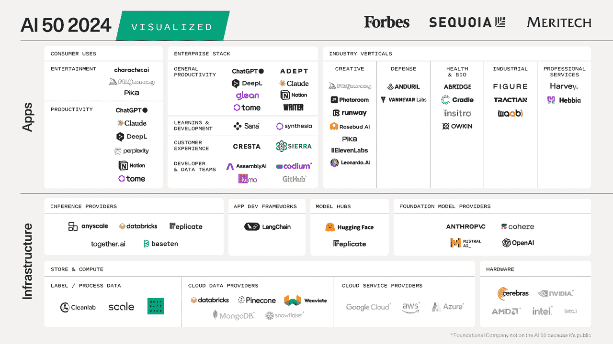
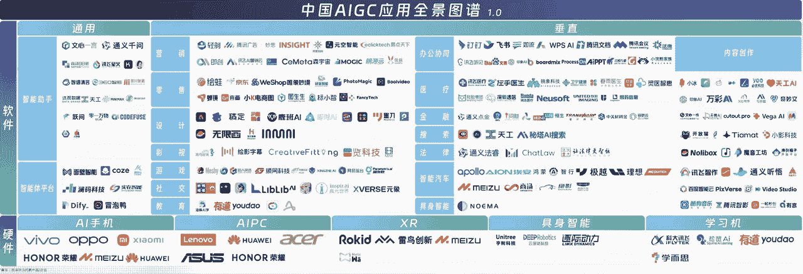

# 3.2  AI Copilot｜ChatBots工具

> 来源：[https://my.feishu.cn/docx/QhdadNgiHoNKvPxyPZ4cHrIvnYg](https://my.feishu.cn/docx/QhdadNgiHoNKvPxyPZ4cHrIvnYg)

# AI Copilot｜AI ChatBots 好工具

#### 目前，国际主流 AI 模型下的 ChatBot 能力大致排序：

## GPT4 Turbo/GPT-4o/Gemini 1.5 Pro/Claude 3 Opus＞GPT-4/Gemini Ultra＞Gemini Pro/Llama 3/Mistral Large/微软 Copilot＞Claude2/Llama2/GPT-3.5

#### 国产主流 ChatBot 能力大致排序：

## Kimi Chat＞智谱清言/通义千问＞百小应/海螺AI＞零一万物/跃问/DeepSeek/豆包/讯飞星火/天工/360/文心一言

#### 关于各大 AI 模型的能力评测思路：

各种 AI 应用的产品说到底应该是用户视角的、面向可用性的，那么，综合评测就没有太大意义。

例如，大模型 A 的创作能力很差，总结能力极好，而大模型 B 的创作和总结能力都均衡，于是就让大模型 B 比大模型 A 评价更好、推荐用户都去使用吗？当然不合理。

未来的 AI 产品一定是面向场景的，那自然擅长某些任务的大模型，就该按照垂直领域来评价和推荐。而且不同的场景的评价标准应该是不一样的，举个例子，知识类问题的「容错率」就跟创作型问题的「容错率」不同，如果是询问一个很精确的新闻里的数字，AI 胡说八道，而用户信以为真，就非常麻烦；如果是创作内容时有一些不严谨的地方，则可以在后续再修正。这是不同的场景。

所以针对 AI 的可用性评测，可以结合不同的使用场景：简单分为四大场景。这四个场景是很多人日常工作生活中所需的，完全按主观的需求出发来定义的：

1.  **博学家。**代表的是一个熟悉各种历史、社会、科学等知识的百晓生一样的角色。我有问题可以问他，不用去翻书，不用去打听。定义这种场景的评价标准就是：提供信息量，并且准确，严禁出错。

1.  **通讯员。**代表的是能够帮助我们搜集互联网上的信息的角色，跟博学家最大的区别是，能够获悉最新的新闻、资讯。同样的，也是要提供准确的信息，不能出错。

1.  **书记员。**代表的是可以帮助我们总结内容、整理摘要的角色。重点不仅在准确率，还在于召回率——能不能真正呈现更完整的内容总结，总结的是不是覆盖完全，是不是容易理解，帮助我们筛选判断。

1.  **创作者。**代表的是能直接上手帮我们写初稿的角色。这个容易理解，重点是写的是否有创意、对我们的工作创作是否有启发、是否可以将生成的内容拿来直接使用。这方面就不用严格考量准确与否。

评测思路内容来源：一年过去了，国产大模型怎样了？——用户视角的 12 家 AI 产品评测

#### 扩展阅读

**大模型质量众测排行榜**

🏆 LMSYS Chatbot Arena Leaderboard

https://huggingface.co/spaces/lmsys/chatbot-arena-leaderboard

> **LMSYS LLM 竞技场之**所以能成为目前几乎最具权威的LLM评测榜单，浅以为主要体现在以下几个方面：

+   由加州大学伯克利分校等知名高校主导，一定意义上决定了项目的学术严谨性和公正性。

+   支持盲测评估，避免了LLM在训练数据中可能存在的数据污染或对抗性提示攻击等安全隐患。

+   采用多种评价指标，如Elo评分、MT-Bench分数和MMLU测试，能够较为全面评估LLM在多轮对话、问答、推理等各方面的能力。

+   基于全球用户的海量使用体验反馈，持续优化评测体系，更大程度上显示出评测结果的可靠性和实用性。

+   作为公益性非盈利项目，避免了商业化运营中的利益冲突，能够最大化保持评测的独立性和客观性。

**上海人工智能实验室研发推出了 OpenCo**mpass 司南开源评测体系·评测榜单：

> https://rank.opencompass.org.cn/home

ModelScope 魔搭社区 LLM 模型专题：

> https://modelscope.cn/topic/dfefe5be778b49fba8c44646023b57ba/pub/summary

