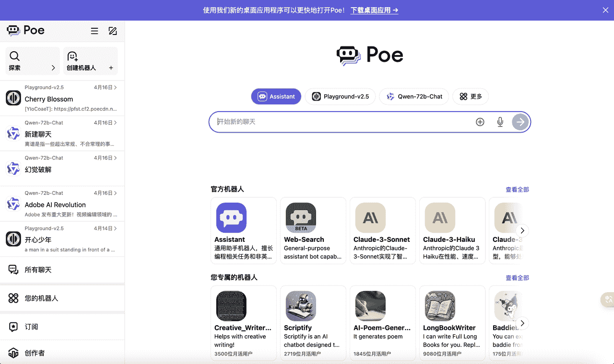
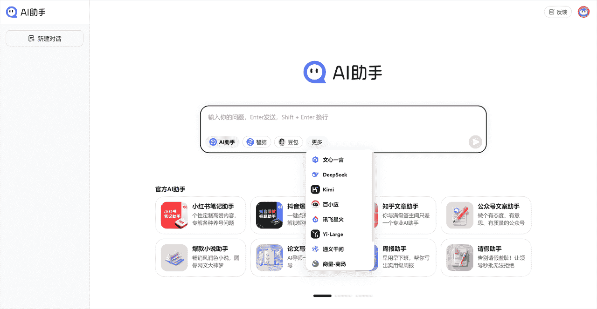
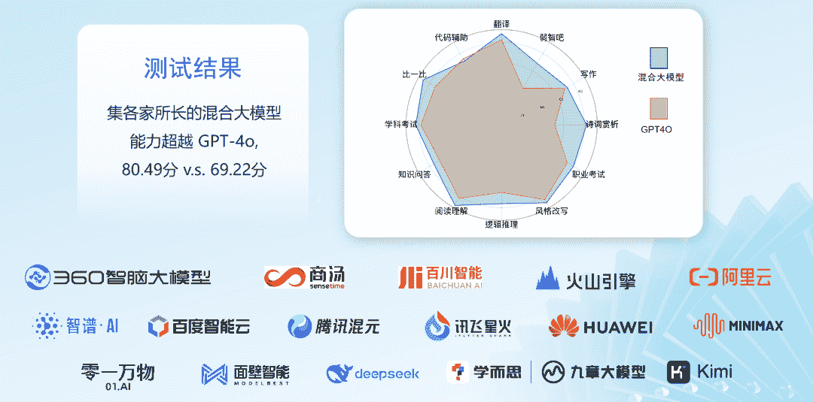
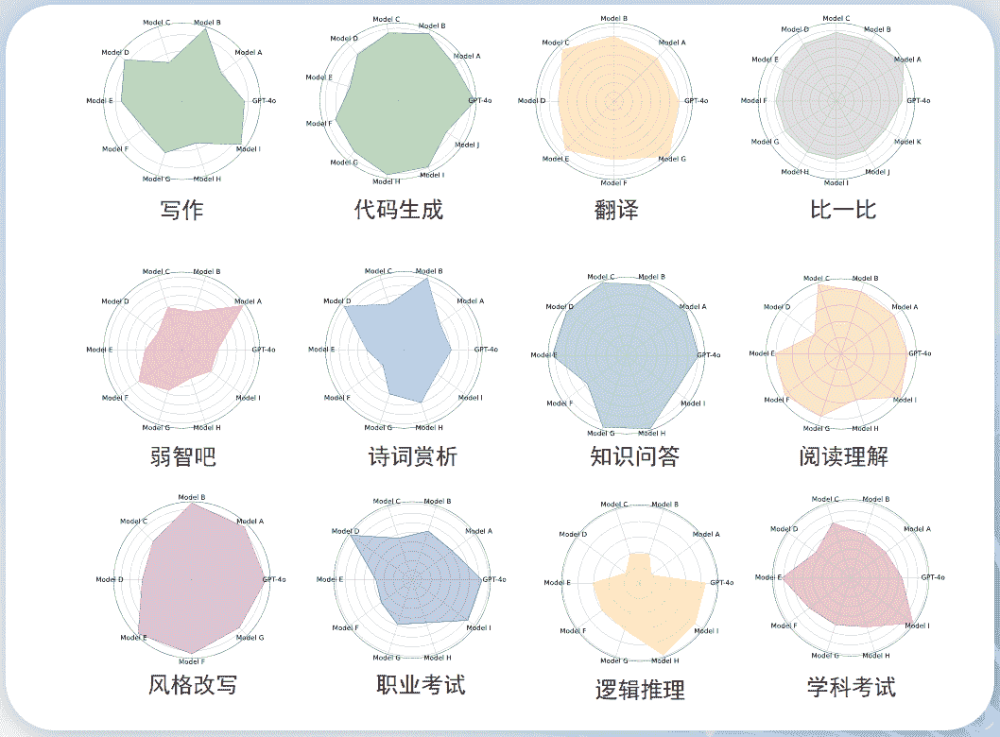
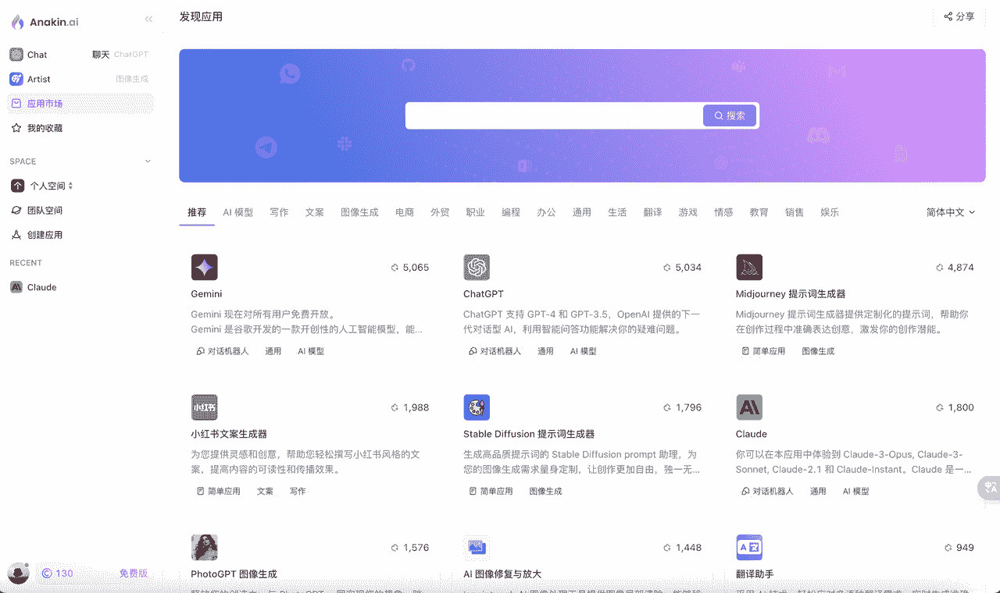
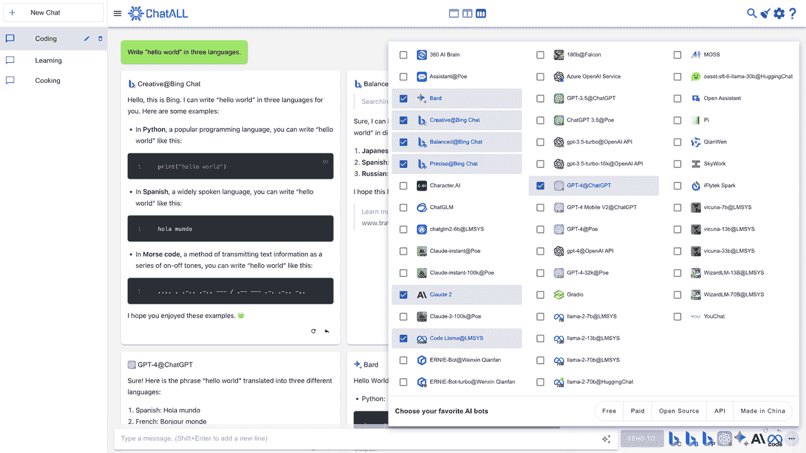

# AI 集合平台

> 来源：[https://my.feishu.cn/docx/HiUVdYCwZori1hxkghYcvjFknge](https://my.feishu.cn/docx/HiUVdYCwZori1hxkghYcvjFknge)

# Poe

poe.com （需施展魔法）

推荐指数：🌟🌟🌟🌟

目前颇受欢迎的国际主流大模型最佳聚合平台

由 Quora（海外问答平台，类似国内知乎）开发，有 APP 版本，支持跨端使用。主要亮点在于集成了 Claude3、Chat GPT、GPT-4、Gemini Pro、StableDiffusion、Playground v2.5 等模型，同时支持用户自建 Chatbot。不同语言模型回复效果有差异，适合需要调用多种大语言模型的用户。

此外支持分享用户和模型的对话内容。大部分免费可用，但 GPT-4、Claude+产品需要付费订阅使用。

# 360 Bot

https://bot.360.com/

推荐指数：🌟🌟🌟🌟

20240802 由 360 公司牵头的 CoE 混合模型发布的一款 AI 集合 Chatbot 产品，一个集合了十五家大模型公司技术力量的 AI 架构，形成的一个国产大模型 AI 集合工具平台。

用一句话说，就是根据用户不同问题，来调用不同的模型进行回答。

毕竟至今，没有一个非常全面的大模型，能说自己在所有任务上都是最顶尖的。而我们在日常使用中，又会有各种不同的细分应用场景。

基于此，通过调用不同模型，各取所长，来执行各自擅长领域特定任务，就显得必要且实用。

# hugging Chat

https://huggingface.co/chat （需🪜）

推荐指数：🌟🌟🌟🌟

Hugging Face 推出的基于各种免费开源大模型的聊天工具——Huggingchat，试了一下还挺好用的。

支持非常多常见的开源模型，速度很快，体验也不错。

已经支持最新推出的 Llama 3.1 405B 最强开源模型。

尤其推荐 Command R+，中文的能力真的很强，感觉比国内的几个都要强了。

另外，新推出了 iOS app 版本，据说反应速度比较快。

# DuckDuckGo AI Chat

[duckduckgo.com](https://duckduckgo.com/?q=DuckDuckGo&ia=chat)

推荐指数：🌟🌟🌟🌟

免费访问 GPT-3.5 和 Claude 的 DuckDuck Go AI 聊天指南 https://poiblog.com/archives/6muvrMUz

# Groq

https://groq.com/

推荐指数：🌟🌟🌟🌟

号称当前反应最快速的 AI ChatBot 聊天工具助手，可免费体验 Llama3.1 最新模型。

# Felo Chat

https://chat.felo.ai/

推荐指数：🌟🌟🌟🌟

Felo Search 是由 日本 Sparticle Inc. 公司推出的产品。该公司利用 ChatGPT 和 AI Agent 技术，旨在优化用户发现和理解全球知识的体验。

+   每天可以免费使用GPT-4o Mini和Llama 3.1模型。

### 其他免费功能

+   Felo Translator：提供免费的实时双向翻译功能，支持超过15种语言。

+   Felo Search：一个多语言AI搜索引擎，支持简化深度研究的过程，免费使用。

# 其他

## Yes Chat

https://www.yeschat.ai/zh-CN/yeschat

推荐指数：🌟🌟🌟

将多种 AI 功能集成到一个综合平台中，为用户提供了一站式的 AI 工具体验。

## Anakin.ai

https://app.anakin.ai/  推荐指数：🌟🌟🌟

Anakin 是一个 AI 聚合平台，用户可以直接访问，无需魔法。内置了多种 AI 应用，包括 Claude3、ChatGPT、Midjourney 等，可以满足各种场景需求，如内容生成、图片生成、对话交流、文档搜索、工作流程自动化等。

可自己搭建 agent。

## ChatAll

https://github.com/sunner/ChatALL/blob/main/README_ZH-CN.md

推荐指数：🌟🌟🌟

Github 上一个开源工具，支持多个当前主流 AI 的 LLMs ChatBot 聚合平台，可以同时与所有 AI 机器人聊天

基于大型语言模型（LLMs）的 AI 机器人非常神奇。然而，它们的行为可能是随机的，不同的机器人在不同的任务上表现也有差异。如果你想获得最佳体验，不要一个一个尝试。ChatALL（中文名：齐叨）可以把一条指令同时发给多个 AI，帮助您发现最好的回答。

目前只有客户端版本，ChatALL 的典型用户是：

🤠大模型重度玩家，希望从大模型找到最好的答案，或者最好的创作

🤓大模型研究者，直观比较各种大模型在不同领域的优劣

😎大模型应用开发者，快速调试 prompt，寻找表现最佳的基础模型

