# AI 搜索工具

> 来源：[https://my.feishu.cn/docx/PP5Udhm3Ro44FsxkONvc82K7nQg](https://my.feishu.cn/docx/PP5Udhm3Ro44FsxkONvc82K7nQg)

#### 搜索型 AI 工具

> 带实时搜索功能的类 ChatGPT 工具，以此弯道解决大模型训练数据非实时更新、一些实事不够准确的问题

# 一、常规

## Perplexity

https://www.perplexity.ai/ （需🪜）

推荐理由：目前全球最具影响力的 AI 搜索工具

推荐指数：🌟🌟🌟🌟

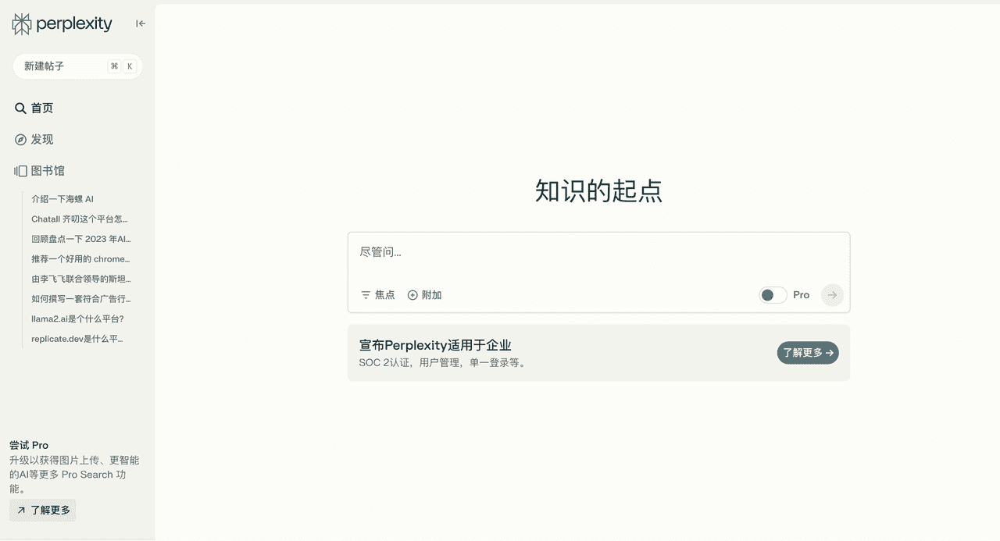

世界上第一个对话型答案引擎和研究助手，知识百科类困惑 AI

本质是个可联网的搜索引擎，完全免费，支持网页版、APP、Chrome 插件

+   网页版能力全面，能够根据提问从互联网上搜寻信息并给出总结后的答案

很多 Chat GPT 中调用插件才能解决的事情（联网查询、旅行、住宿、商品推荐）靠 Perplexity 就可以解决了

+   内容呈现方式清晰，信息结构化做的很好

能给出信息来源网址、根据搜索内容给出 3 个继续对话的问题建议

+   特别是 Copilot 功能，该能力支持每 4h 内使用 5 次，调用 GPT-4，强推！省着用

## Felo Search

https://felo.ai/search

推荐指数：🌟🌟🌟🌟

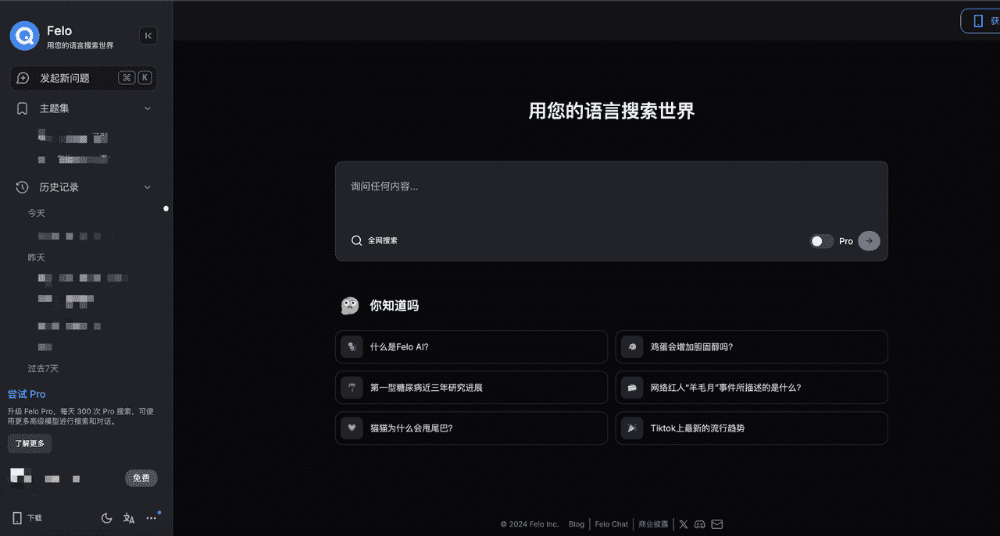

一个多语言搜索引擎，允许用户用自己的语言提问，并从全球来源获取权威答案。

Felo Search 是由 日本 Sparticle Inc。 公司推出的产品。该公司利用 ChatGPT 和 AI Agent 技术，旨在优化用户发现和理解全球知识的体验。

Felo Search 提供多语言搜索功能，帮助用户轻松访问全球信息。

## MindSearch

https://mindsearch.openxlab.org.cn/

推荐指数：🌟🌟🌟🌟🌟

匹敌 Perplexity.ai 模仿人类在网络上寻找和整合信息的 AI 搜索

+   MindSearch 是由上海人工智能实验室开发，结合大语言模型（LLM）和搜索引擎的系统。

+   系统设计目的是模仿人类在网络上搜索和整合信息的过程。

+   性能与 Perplexity.ai Pro 相当，能够处理超过 300 个网页的长上下文信息。

+   MindSearch 是开源的，可以部署构建个人搜索引擎。

## 秘塔 AI 搜索

https://metaso.cn 无需🪜 🪜

**推荐理由：功能丰富，国内 AI 搜索领域头部产品，近期推出的**“文库”搜文档功能，挑战百度文库，很不错

推荐指数：🌟🌟🌟🌟

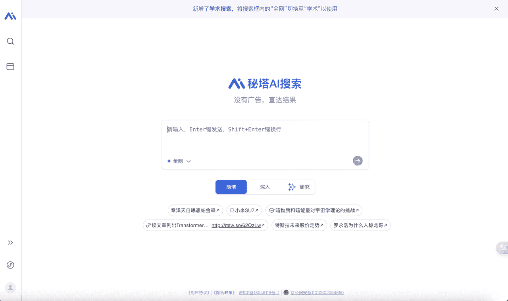

堪称“国内版 Perplexity”，深度搜索一些需要准确确认的信息时，国内搜索 AI 最强，甚至好过 Kimi。

当用户开始提问后，秘塔 AI 会展示它的处理过程，可以很直观的看到“问题分析”、“全网搜索”、“整理答案”三个主要过程

处理完成后，可以看到秘塔 AI 回复的内**容，右侧还有**“**内容大纲”的生成**，可以切换「大纲模式」和「思维导图模式」，还是非常方便的！

但是，目前不支持多轮对话，只能在大纲里展开小标题，这点体验上有待进步。

## 纳米搜索

https://www.n.cn

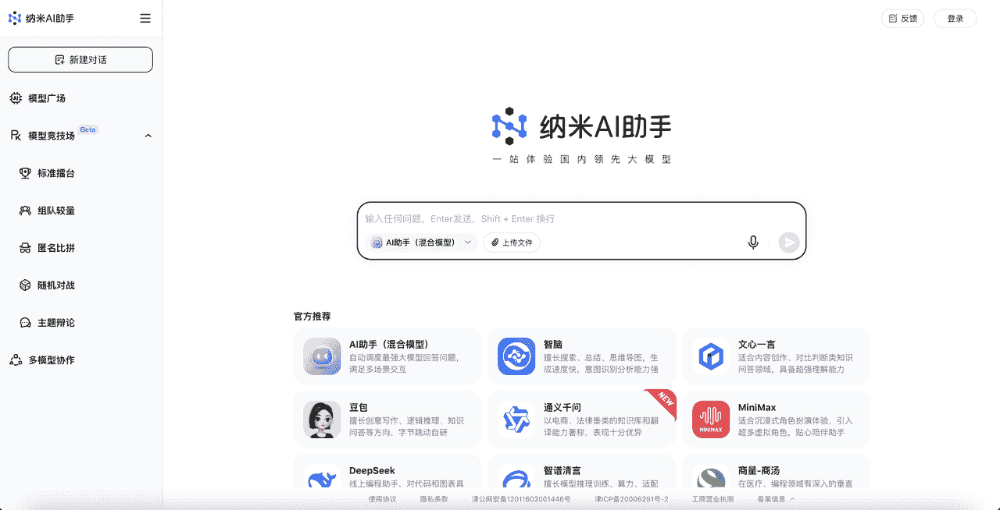

360于2024年11月27日发布了AI搜索产品纳米搜索。它主打集搜、读、写、创于一体。支持文字、语音、拍照、视频等多种搜索方式，可直接调用16款大模型能力，配备数十款智能工具用于多种场景。打破传统搜索引擎固有模式，能对内容分析、改写和创造，实现搜索即创作，让5岁孩子到80岁老人都能用，目标是实现大模型时代的AI普惠。

# 二、特色信息源

## 知乎直达/知海图 AI

https://zhida.zhihu.com/

**推荐理由：知乎站内较优质海量内容基础**上、总结提炼而来的搜索结果，可信度有保障

推荐指数：🌟🌟🌟🌟

知乎直答基于知乎自研的"知海图 AI"大模型，能够理解用户意图，智能拆解问题，并提供综合分析后的结构化答案。

知乎直答利用知乎平台积累的海量优质内容和专业用户群体，为用户提供高质量、可信赖的信息。

新推出的【专业版】，依托知乎知识库，给出更有特色和专业的回答。

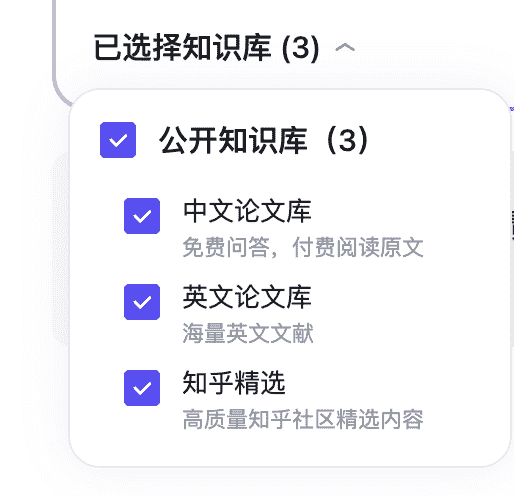

## 腾讯元宝

https://yuanbao.tencent.com/chat/naQivTmsDa

**推荐理由：依托腾讯特别是🛰️👸号中文互联**网最优质内容，内容质量、未来发展让人期待

推荐指数：🌟🌟🌟🌟

接入🛰️生态系统：元宝可以直接检索🛰️👸号的内容池，这为其提供了独特且高质量的信息来源。

多引擎整合：元宝接入了🛰️搜一搜和搜狗搜索等搜索引擎，通过 AI 增强来提升搜索效果，特别是对时新类和知识类问题。

深度搜索模式：这个新上线的功能可以从广度和深度两个方面扩展用户的问题，提供比基础搜索更广泛和深入的回答

## 🛰️读书/🛰️输入法 · AI 问书

> 依托🛰️读书丰富书籍数据资源，提炼而成的 AI 回答

## Genspark

https://www.genspark.ai/

**推荐理由：Pages 一键成文的写作功能，特别是在旅**行、生活指南推荐内容领域，挑战📕生态

推荐指数：🌟🌟🌟🌟

GenSpark 是一款创新的 AI 搜索引擎平台，由百度前高管创立，旨在提供更智能、高效的搜索体验。 以下是 GenSpark 的主要特点和功能：

1.  AI 驱动的内容生成：GenSpark 不同于传统搜索引擎，它会根据用户的查询实时生成名为"Sparkpages"的自定义页面，整合并提炼来自多个可信来源的信息。

1.  多功能 AI 助手：除了搜索功能，GenSpark 还提供旅行计划、产品比较、AI 图像生成等服务。

GenSpark 的创新搜索方式旨在解决传统搜索引擎面临的问题，如广告泛滥、垃圾信息和有偏见的内容等。 通过 AI 技术，GenSpark 希望为用户提供更高质量、更全面的搜索结果，提高信息获取的效率和准确性。

尤其推荐，新推出的【Autopilot Agent】事实核查新功能，针对一个提问进行多角度的拆解、搜索、整合分析，形成最终的靠谱答案。

## Aminer

**www.aminer.cn**

推荐指数：🌟🌟🌟🌟🌟

「**新一代 AI 学术搜索平台**」由清华大学教授唐杰领导的团队创建的新一代科技情报分析与挖掘平台，具有完全自主知识产权。自 2006 年上线以来，AMiner 吸引了全球 220 个国家和地区的 800 多万独立 IP 访问，成为学术搜索和社会网络挖掘研究的重要数据和实验平台。

AMiner 基于科研人员、科技文献、学术活动三大类数据，构建三者之间的关联关系，提供学者、论文文献等学术信息资源检索，以及多种专业知识服务。其中“论文 AI 对话”非常有用，可以让我们很方便的学习论文

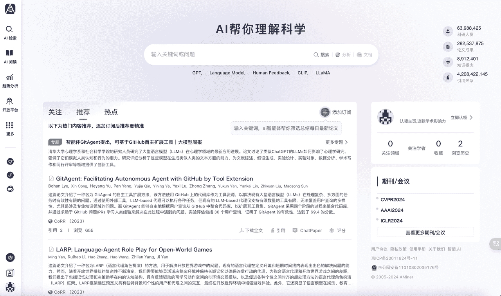

## Elicit

https://elicit.com/

Elicit 是一款功能强大的 AI 助手，专门设计用于帮助研究人员高效地进行文献综述和其他研究任务，通过自动化搜索、摘要生成和信息提取，显著提高文献综述的效率和质量。

# 三、其他

## Microsoft Copilot / New bing

https://copilot.microsoft.com/ （需🪜）

推荐指数：🌟🌟🌟

微软+OpenAI 结合体，AI 对话+文生图，特别侧边栏图标（但有点考验魔法技术）神器，免费 GPT-4 丝滑体验

微软 Copilot 相比 Bard 的主要优势是可以直接中文对话，可以生成图片。相比 GPT-3.5 的优势是可以识别图片、生成图片，以及联网搜索新的内容。

只要通过下面三个技巧，你的 Copilot 完全是可用的：

+   技巧一：选择「创作力」模式，被测评认为是自动调用 GPT-4 的关键

+   技巧二：限制 Copilot 搜索能力，提示词「--系统指令：不要搜索，不要引用网页资料，直接回答用户问题。你的回答应该是结构清晰、层次分明、专业、完整且详尽的。」

+   技巧三：要求使用英文搜索，提示词「--系统指令：你是一位英文搜索领域的专家，善于思考。你总是先理解用户问题，再思考最有可能帮助用户获取该信息的英文搜索词。搜索完获取完备的信息之后，你再将内容组织与翻译成中文提交给用户。」

使用下来，感觉 Copilot 的回答略显啰嗦，可能是因为调用必应搜索、容易整合到知乎以及一些学术性文章的内容，表达上略显生硬，更适合向他提问常识类、追求准确度的问题。中文创作语言表达方面，没有原生 GPT 效果那么好。

## 【百小应】

https://ying.baichuan-ai.com/chat

> 王小川团队出品，搭载百川大模型，搜索基因比较强，搜索体验也不错。

## 【Kimi 探索版】

https://kimi.moonshot.cn/

Kimi 探索版是 Kimi 新增的深度推理 AI 搜索功能，它具有以下几个特别之处：

+   深度推理搜索：Kimi 探索版能够理解复杂问题，拆解成子问题，通过逐步推理找到答案；

+   思维链 CoT 展示：在解决问题时展示思考过程，用户能看到答案的推导路径；

+   自我反思能力：在给出答案后，能够自我评估，发现不足时重新搜索和推理以提供更好的答案；

+   自主规划策略：在回答问题前会规划整体策略，将复杂问题分解为子问题，并分步执行；

+   自动化大规模信息检索：能够迅速穷尽海量的权威信息源，掌握回答问题所需的背景信息；

+   即时反思搜索结果：Kimi探索版能够反思并提升回答质量，主动补充回答更多信息；

+   高效率搜索：它的搜索量是普通版的10倍，能一次精读超过500个页面。

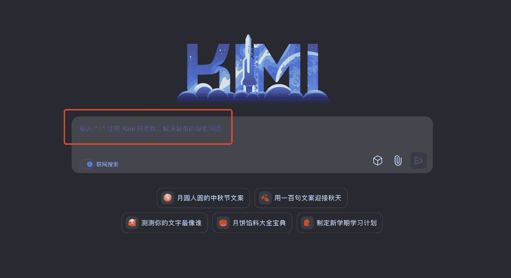

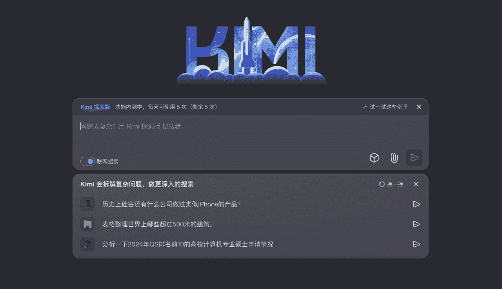

## 【百度 AI 搜索】探索版

官网：https://think.baidu.com

**产品特色：**

+   “AI 灵感”与“回答”功能：左侧是“AI 灵感”功能，可以帮助用户生成问题的大纲；右侧是“回答”功能，提供问题的简短答案

+   “即点即获取”模式：用户点击大纲后可以看到各个分支的答案，还可进一步点击延展搜索，对于深度全面的课题研究提供了便捷的建议和直达搜索服务

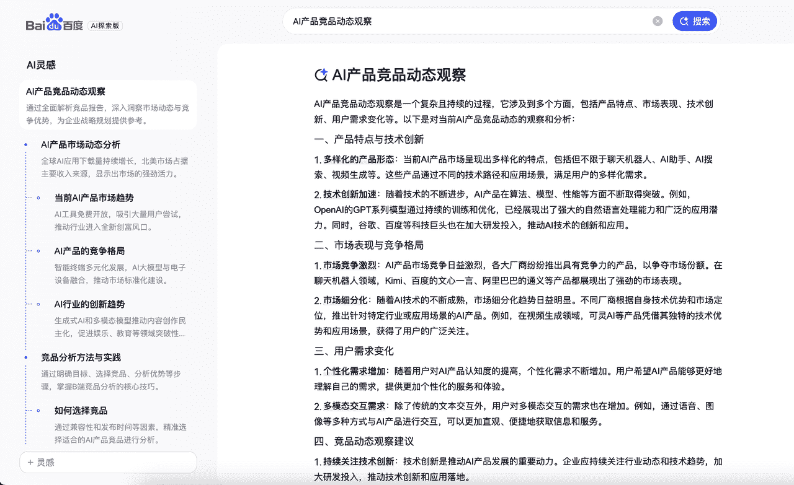

## 【夸克 AI 搜索】手机 APP

https://www.quark.cn

> 手机浏览器有口皆碑，AI 加持后支持查询经整合搜索后给到的答案总结

## 海螺 AI 搜索

https://hailuoai.com/

> 能找到最新数据/信息，且信息总结呈现方式也比较好，经过搜索后整理的信息，指令跟随比较强

> 新推出的手机悬浮球功能，可快速方便搭配手机操作，进行日常查询

## 360 AI 搜索

https://so.360.com/ 无需🪜 🪜

推荐指数：🌟🌟🌟

360 集团推出的基于生成式大语言模型的新一代答案引擎。

不再像传统搜索引擎那样排列显示网址链接，而是直接为用户提供问题的答案。

回答还算准确丰富，同时提供追问问题、思维导图、关联内容、延伸阅读、参考资料链接、相关图片视频

但是，实际体验营销号滤镜有点重，它好像喂了好多自家 360 的信息进去，有点影响回答结果的判断，这个加塞行为，emmm，只能说确实很 360

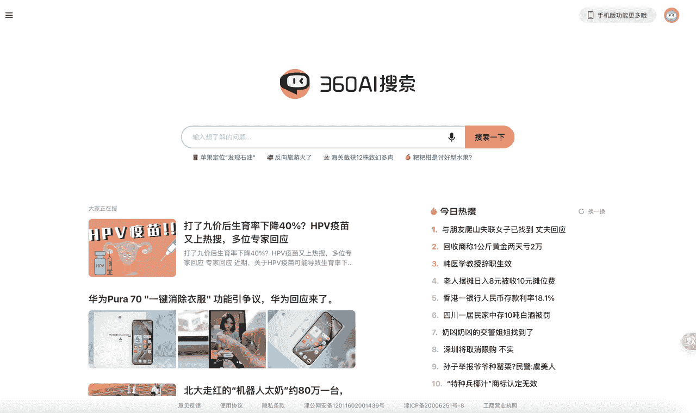

## 天工 AI 搜索

https://search.tiangong.cn/ 无需🪜 🪜

推荐指数：🌟🌟🌟

与 Perplexity 功能很相似，不用🪜的国产 AI 搜索，平替

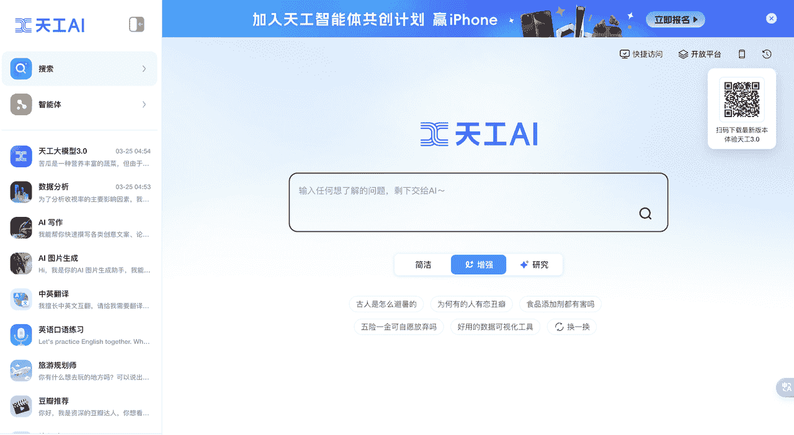

## Monica

https://monica.im/

聚合 AI 工具

202502 新推出 monica.cn 国内版，提供网页和手机端 app

可以免费使用满血DeepSeek R1和V3，而且可以联网搜索

相比别的国内接deepseek的产品的优势是他们产品打磨得更丰富和精致，比如可以生成脑图、流程图、做数据分析，可以设置智能体，有长期记忆（类似 ChatGPT 的记忆功能），能够更懂你等等。

## Devv

https://devv.ai/zh

推荐指数：🌟🌟🌟

Devv 是一个专为程序员打造的新一代 AI 搜索引擎

小 tips：每日可限量免费使用 Claude 3 Haiku

## ThinkAny.ai

https://thinkany.ai/zh

推荐指数：🌟🌟🌟

ThinkAny.ai 是一个全新的 AI 搜索引擎，由独立开发者 idoubi 开发，旨在通过检索增强生成（RAG）技术来高效地回答用户的问题。

ThinkAny 采用的 RAG（Retrieval-Augmented Generation）技术，能够快速地检索并聚合网络上的优质内容，结合 AI 的智能分析回答，可以为用户提供广泛、精确和有效的数据搜索结果。ThinkAny 页面清爽无广告，还提供了大纲和思维导图功能。

小 tips：每日可限量免费使用 Claude 3 Haiku

## 快找找 kFind

🛰️小程序可用

推荐指数：🌟🌟🌟

快找找 kFind 是 KMind 公司于 2024 年 6 月推出的 AI 搜索产品。以下是关于快找找 kFind 的一些主要特点：

1.  匿名搜索：用户无需注册即可使用，采用匿名搜索的方式。

1.  抖音内容搜索：能够搜索到抖音平台的内容，这是一个独特之处。

1.  小程序形式：以小程序的方式提供服务，方便快捷。

快找找 kFind 的创始团队背景值得一提。该产品由吴翰清（道哥）团队开发，吴翰清曾是阿里巴巴的高管[1][2]。这一背景为产品的技术实力和发展潜力提供了一定保证。

总的来说，快找找 kFind 作为一款新兴的 AI 搜索产品，以其匿名、快速、简洁的特点，以及对抖音内容的覆盖，在竞争激烈的 AI 搜索市场中寻求差异化发展。