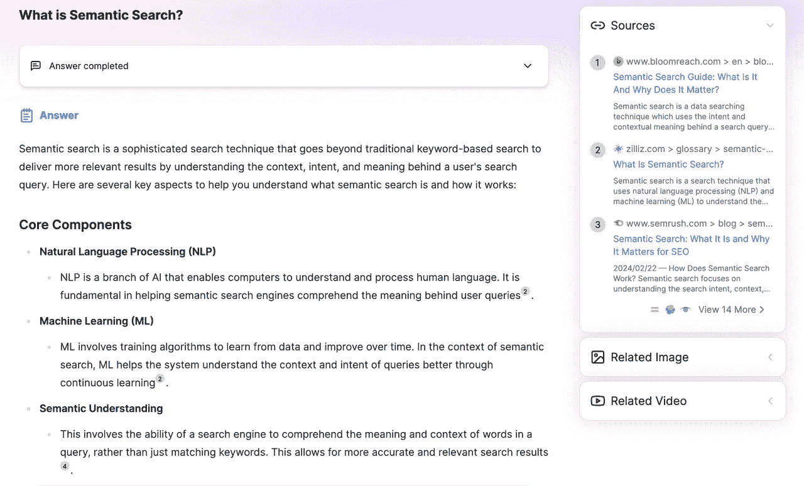
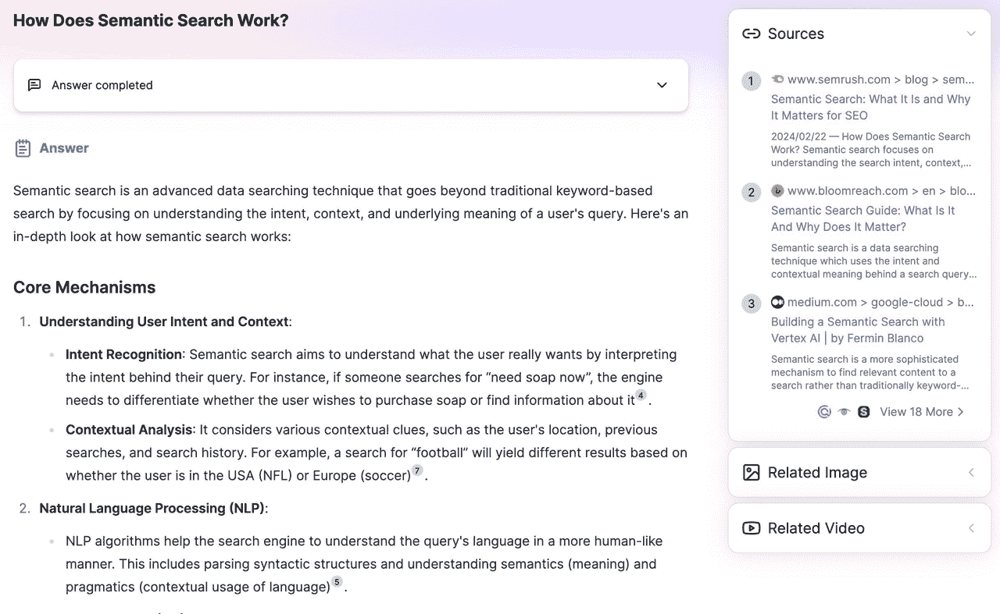
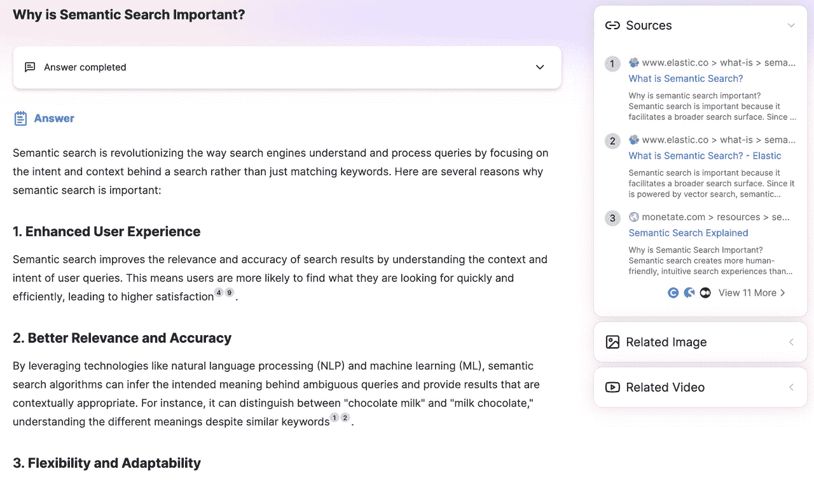

# 语义搜索，超越基于关键字查询的新时代

> 来源：[https://my.feishu.cn/docx/DBAqdAexKollnzxghcPcqO0nn6f](https://my.feishu.cn/docx/DBAqdAexKollnzxghcPcqO0nn6f)

语义搜索是搜索引擎技术领域的一次重大飞跃。通过理解用户查询背后的意图和上下文，语义搜索有望提供更准确、更相关和更个性化的搜索结果。展望未来，语义搜索无疑将在我们如何在网上查找信息和与信息互动方面发挥至关重要的作用。

在不断发展的搜索引擎技术领域，有一个词最近引起了不小的波澜：语义搜索。随着我们超越基于关键字的查询时代，语义搜索有望彻底改变我们在网上查找信息的方式。但究竟什么是语义搜索，为什么它被认为是下一件大事？让我们深入了解一下。

语义搜索指的是搜索引擎理解用户查询背后的意图和上下文含义的能力，而不仅仅是匹配关键词。这种方法旨在通过考虑搜索者的意图、搜索的上下文以及词语之间的关系来提高搜索的准确性。

例如，如果您搜索 "纽约最值得去的地方"，传统的基于关键字的搜索引擎可能会查找包含精确短语 "纽约最值得去的地方 "的页面。相比之下，语义搜索引擎会明白您在寻找旅游推荐，因此可能会提供包括顶级旅游景点、隐藏的瑰宝以及与纽约市相关的旅游指南在内的结果。

# [语义搜索是如何工作的？](https://felo.ai/search/WS7sTohXFZDymL5gu66TWS)

语义搜索依赖于几种先进的技术和方法，其中包括

1.自然语言处理（NLP）：NLP 使搜索引擎能够以一种既有意义又符合上下文的方式理解和处理人类语言。这项技术可帮助搜索引擎解释用户查询的细微差别。

2.机器学习：通过分析大量数据，机器学习算法可以识别不同信息之间的模式和关系。这使搜索引擎能够对用户正在寻找的信息做出更明智的预测。

3.实体识别：这包括对查询中提到的关键实体（如人、地点和事物）进行识别和分类。通过识别这些实体，搜索引擎可以更好地理解上下文并提供更相关的结果。

4.知识图谱：知识图谱是存储实体及其关系信息的数据库。它们帮助搜索引擎连接不同信息之间的点，从而提供更准确、更全面的搜索结果。

# [语义搜索为何重要？](https://felo.ai/search/cYo9XLhsVRtSqXW7dmuz5g)

转向语义搜索有几个关键因素：

1.改善用户体验：通过了解用户查询背后的意图，语义搜索可以提供更相关、更有用的结果。这将带来更好的用户体验，因为搜索者更有可能快速、轻松地找到他们正在寻找的内容。

2.语音搜索：随着 Siri、Alexa 和 Google Assistant 等语音助手的兴起，用户越来越多地使用自然语言进行搜索。语义搜索对于准确解释和响应这些语音查询至关重要。

3.复杂查询：随着用户的搜索行为越来越复杂，他们提出的问题也越来越复杂和细微。与传统的基于关键字的搜索相比，语义搜索能更有效地处理这些复杂的查询。

4.内容发现：通过了解不同内容之间的关系，语义搜索可以帮助用户发现他们可能无法发现的新的相关信息。

内容来源：

利用 Felo 发掘语义搜索的力量