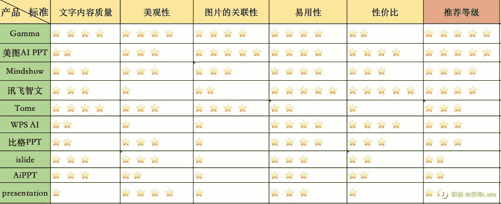

# 办公提效摸鱼

> 来源：[https://my.feishu.cn/docx/WoVXdmowNoT1KWxVfMecNGyDnhg](https://my.feishu.cn/docx/WoVXdmowNoT1KWxVfMecNGyDnhg)

# 几个超好用的Top级大模型的Agents/Bots/智能体专区：

> GPTs：https://chatgpt.com/gpts

> 通义 · 效率：https://tongyi.aliyun.com/efficiency/home

> kimi+：https://kimi.moonshot.cn/kimiplus-square

# 1.1  AI + 会议纪要

+   工具推荐：

### **通义听悟 **

https://tingwu.aliyun.com/home 推荐指数：🌟🌟🌟🌟🌟

可自动录音、语音识别、生成文字版会议纪要、智能改写、生成待办事项。

实时语音转文字、并可生成内容总结（可用作会议场合、形成会议纪要）。

音频、视频转文字，总结的内容非常棒，可播客链接一键转文字，然后复制文字到 Kimi  进行提问。

亮点：功能比较综合，使用起来更方便。

### **飞书妙记**

推荐指数：🌟🌟🌟🌟🌟

可录音、转文字，需人工进行精简。

亮点：音频转文字识别效果最好、准确率更高。

### **讯飞听见、飞书妙记**

讯飞听见，对语音记录转成的文字，加以润色，不只是摘要总结。

+   使用方法：

+   会议开始前打开工具进行录音，会议过程中可实时转录并标注重点内容，会后自动生成文字版纪要，再进行人工精炼和优化。

+   注意事项：

+   虽然 AI 可以自动生成纪要，但仍需人工核查和精炼，保证内容准确性和完整性。

---

# 1.2  PPT 制作

## 国内版

### kimi x AiPPT

https://kimi.moonshot.cn/kimiplus/conpg18t7lagbbsfqksg

推荐指数：⭐️⭐️⭐️⭐️

一家专门做 AI 生成 PPT 的公司，再加上 kimi 的内容生成能力，就挺强的组合

### **讯飞智文**

https://zhiwen.xfyun.cn/home

推荐指数：⭐️⭐️⭐️⭐️

推荐理由：**性价比王者👑，**目前在测试阶段，所以完全免费；图文都是由 AI 生成的，还可以 AI 优化文案；不需要挑选模板，比较方便；但是布局排版和样式也不够新颖，AI 生成的图片有一些生硬，希望测试阶段结束后会有更好的表现吧。

### **万知**

https://www.wanzhi.com/home

推荐指数：⭐️⭐️⭐️⭐️

推荐理由：李开复01万物大模型旗下ChatBot产品，基于较强国产AI的模型基础能力，生成内容方面有所优势。

### **腾讯文档 AI 助手**

推荐指数：⭐️⭐️⭐️

https://docs.qq.com/desktop/

支持生成多种类型文档（思维导图、PPT 等）、文档内 AI 创作、表格内 AI 数据处理

**PPT 可在线修**改完善**内容、一键替换模板，**内容质量生成一般，但是设计审美居然还挺不错，腾讯做产品还是有两下子的

目前免费公测阶段，基本一申请马上过

公测申请通道｜腾讯文档 AI，打开效率想象力！

### **美图 AI PPT**

https://www.x-design.com/ppt/?from=ai-bot.cn

推荐指数：⭐️⭐️⭐️

推荐理由：操作简单，一键生成；AI 生图效果真实，与主题相关度高；性价比高，每天可免费生成四次，付费也不贵；整体效果表现较好。

### **MindShow**

https://www.mindshow.fun/#/home

推荐指数：⭐️⭐️

推荐理由：内容与主题相关度高，配图美观的同时也与主题相符。

### **WPS AI**

https://ai.wps.cn/

推荐指数：⭐️⭐️

推荐理由：使用比较方便，操作简单，可调整度比较高，可以申请一个月免费使用，还支持其他 AI 功能，性价比高；但是对于 PPT 的生成效果确实还有不足，样式不够新颖，美观度不够，内容质量也有待提高。

## 国际版

### **Gamma**

https://gamma.app/signup?r=cod9cos7jz61jad  （需🪜）

推荐指数：⭐️⭐️⭐️⭐️⭐️

**推荐理**由：算是目前 **A**I PPT 的天花板，唯一缺点就是贵，而且海外产品付费不方便。AI 生成前会有指引输入内容，让 AI 生成的内容更具定制化，所以文字内容质量以及配图的相关性比较高，整体是比较简洁的风格。

tips：在生成中文内容时加一句“用中文生成”效果会更好

可以支持导出 PPT 了，提供一定积分的免费体验额度

另外可以一键**生成网站**的效果也很不错，网站感兴趣可以点击查看 https://tea-brand-3jy932n.gamma.site/

### **Tome**

https://tome.app/ （需🪜）

推荐指数：⭐️⭐️⭐️

推荐理由：较为推荐，文字内容、排版布局以及图片质量都还尚可，AI 能力比较强，采用的是 Open AI 的大模型；但是文档输入只支持 Google 文档，而且价格较贵，国外网站，充值比较麻烦，使用门槛比较高。

附：AI PPT 工具对比一览表

---

# 1.3  工作流分解

### **godmode**

https://godmode.space/

一个做复杂任务的AI：godmode，可以根据你的需求自动拆分子任务，并引导你完成。每次任务执行都有结果、思考、推理和建议行动。

这种逻辑可以借鉴，完成一项小任务，思考下一步，推理或者反思理由是什么，据此得出下一步的行动计划。子任务之间环环相扣，有问题反馈给他就直接修改。

可以举一反三，将所有子任务的执行过程收集起来，封装成一份操作示例，发给AI学习，做成构化提示词，甚至做一个智能体，感觉还是不错的。

### Magic ToDo

https://goblin.tools/

由 GoblinTools 开发的一款智能任务管理工具，旨在提高用户的工作效率和任务组织能力。主要功能：

+   **智能任务分解**：Magic ToDo 可以将复杂的任务自动分解成若干个可操作的小步骤，帮助用户更轻松地完成任务。

**使用场景**

Magic ToDo 适用于需要高效管理复杂任务的个人和团队，例如项目管理、学习计划、日常工作安排等。它特别适合那些希望通过智能工具来简化工作流程并提高生产力的用户群体。