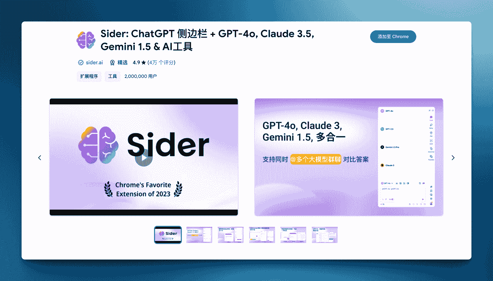
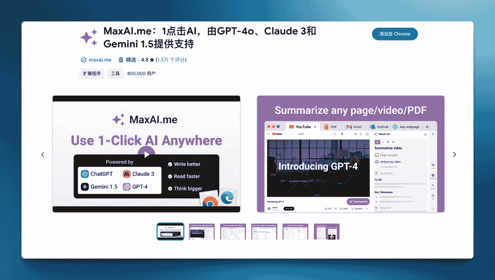
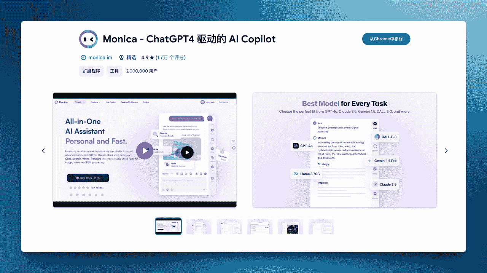

# 集成式 AI 助手插件

> 来源：[https://my.feishu.cn/docx/NWtFdy0qmodeatxwtLrctKOJnye](https://my.feishu.cn/docx/NWtFdy0qmodeatxwtLrctKOJnye)

# 1.1  Sider

chromewebstore.google.com

ChatGPT 侧边栏：使用 ChatGPT、GPT-4o、Claude3 和 Gemini 1.5 Pro 进行高级 AI 搜索、阅读和写作，提升工作效率。

# 1.2  UseChatGPT

很好用的 AI 工具，曾登 Product Hunt 榜一——UseChatGPT

> 他们改名字了

https://www.maxai.me/usechatgpt （需施展魔法）

1.  鼠标选择+AI，网页端选中任意文字快捷键快速呼出 AI 侧栏菜单，快速进行对话

1.  我们可以安装自己的需求自定义自己的 prompts，比如总结、扩写、修改语法等

1.  免费集成多个 AI 聊天机器人，如 ChatGPT、Bard、Bing、Claude，最炸裂的是可以不需要 API，一方面你只要有自己的 ChatGPT 账号，就可以免费永久使用（如果是 plus 就可以享受 GPT4 的体验，不过我担心被封号），另一方面如果你没有 ChatGPT 账号并且不会魔法上网，你可以使用 Free AI，享用无需翻墙半年无限制免费使用的时长

1.  快捷键可以自定义，可以设定 Stable mode，不需要担心网络不稳定

如何使用，直接谷歌插件下载即可

---

# 1.3  Monica

https://monica.im/ （需施展魔法）

一款由 ChatGPT API 驱动的 Chrome 浏览器插件，简单上手的个人 AI 助手

All-in-One 的 AI 效率工具集，从 Chat/Read/Search/Write 等多个场景切入，提供了设计美观、交互强大、功能丰富的趁手工具箱。

只需按下 Cmd+M 或 Ctrl+M 快捷键，即可开始与 Monica 进行聊天。或者让 Monica 帮助你在任何网页上撰写和插入文本。可从超过 80 个模板中选择，快速生成市场营销文案。选择网页上的文本，让 Monica 解释、翻译或改写。 Monica 可以帮助你更高效地沟通和写作，让聊天和文案撰写变得更加轻松自如。

