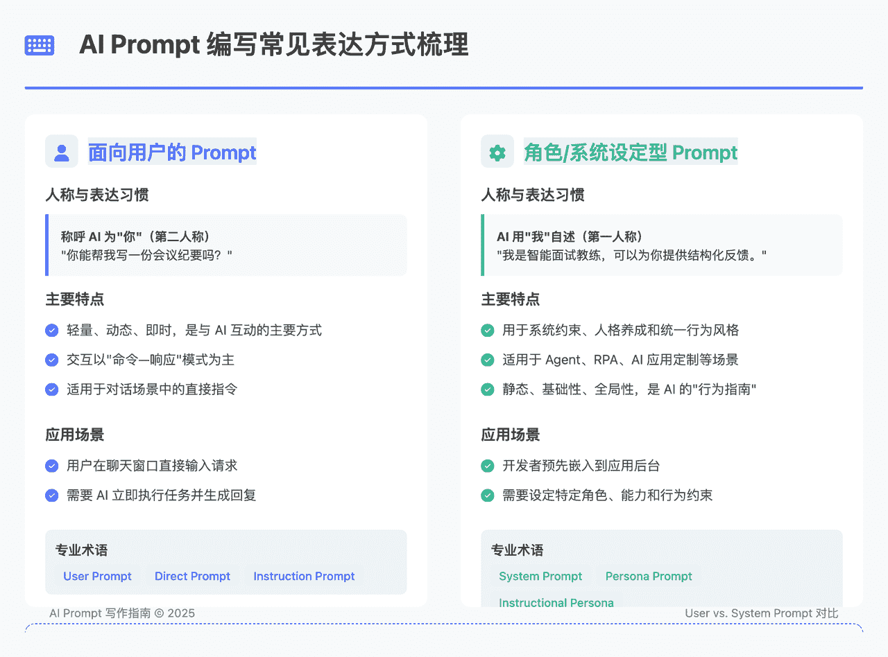

# AI Prompt 编写常见表达方式梳理

> 来源：[https://my.feishu.cn/docx/AcSYd6ToroGjLCxBFJZcfBtCngd](https://my.feishu.cn/docx/AcSYd6ToroGjLCxBFJZcfBtCngd)

## 一、背景介绍

随着 ChatGPT、DeepSeek 等大语言模型（LLM）应用普及，Prompt（提示词/命令）的写作规范和分类逐渐受到关注。许多初学者在编写 Prompt 时常遇到一个困惑：

“有时要用‘你’来指示 AI，有时又要用‘我’来自述 AI 的身份和能力，不同人称表达到底适用于哪些场景？它们在专业上怎么称呼和区分？”

本篇将结合实际应用和行业专业术语，系统梳理 AI Prompt 写作中两种常见表达方式及其适用情境，助你更高效、专业地设计 Prompt，并能清晰为他人讲解。

---

## 二、两种主流 Prompt 表达方式介绍

### 1. 面向用户的 Prompt（User Prompt）

**场景**

+   用户直接在 AI 聊天窗口输入请求，AI 立刻按照指令执行并生成回复。用户与 AI 进行直接、实时的对话和任务指令。

**表达习惯**

+   用户用“你”称呼 AI（即第二人称）。

+   例句：“你能帮我写一份会议纪要吗？”

**专业术语**

+   User Prompt（用户指令）

+   Direct Prompt（直接提示）

+   Instruction Prompt（指导型提示）

**特点**

1.  轻量、动态、即时，是用户与 AI 互动的主要方式。

1.  用户和 AI 的交互以“命令—响应”为主。

1.  对话交互式指令，强调其在对话场景中的应用。

---

### 2. 角色/系统设定型 Prompt（System/Persona Prompt）

**场景**

+   开发者或团队在 Agent、机器人或定制应用/插件里，把 Prompt 预先作为“规则、人格设定、行为约束”等嵌入应用后台，AI 按约定角色与用户交互。用户通常不直接看到或修改它。

**表达习惯**

+   AI 用“我”自述身份和能力（即第一人称），作为后续所有对外行为的统一风格。

+   例句：“我是智能面试教练，可以为你提供结构化反馈。”

**专业术语**

+   System Prompt（系统提示）

+   Persona Prompt（角色设定/人格设定）

+   Instructional Persona（身份规范说明）

**特点**

1.  用于系统约束、人格养成和统一行为风格。

1.  适用于 Agent、RPA、AI 应用定制等场景。

1.  静态（相对用户交互而言）、基础性、全局性，是 AI Agent 的“底层操作系统”或“行为指南”。

---

## 三、行业主流分类与表述总结

**Note**

+   某些复杂系统开发中，偶尔会用第三人称（如“AI 助手应该如何如何……”），但在普通用户写作和 Agent 开发时，第一/第二人称占绝对主流。

---

## 四、AI Prompt 编写的专业实践建议

1.  **为最终用户写模板/做培训**：
强调“你”字开头，让用户直接像吩咐 AI 一样对话，简单直接，上手快。

1.  为 Agent、定制应用、企业自动化设定规则/角色时：
用“我”开头，给 AI 立好身份、约束行动边界，保证行为一致性和专业度。

1.  **讲解时这样区分****：
“user prompt 是交互指令，sy**stem prompt 是角色和身份约束。”

---

## 五、易混淆问题与补充说明

+   所有 prompt 的终极目标都是“调动 AI 干活”，但专业区分在于“角色/行为定义 VS 任务请求”，而不是单纯“谁来用”。

+   行业官方文档（如 OpenAI Chat API）明确区分 system、user、assistant 等不同角色输入。

+   文本要求一致风格、身份或能力，更建议用 system prompt 和人格设定（persona prompt）。

---

## 六、常用 prompt 写法案例

**用户交互类**（user prompt）

+   “你能帮我写一个产品发布会的活动流程吗？”

+   “请你帮我润色下面这封客服邮件。”

**角色设定类**（system/persona prompt）

+   “我是你的法律咨询专家，能够用通俗语言解释合同条款，并为你指出关键风险。”

+   “作为儿童编程启蒙老师，我会用生动的故事和游戏化教学，让孩子们轻松理解复杂知识。”

---

## 七、总结与指导建议：

AI Prompt 写作的场景和专业表达区分，有赖于人称与任务类型的明确区分——

+   **核心区别：** 对话式 Prompt 是用户“告诉 AI 做什么”（How the user talks to the AI），系统 Prompt 是“定义 AI 是什么”（How the AI is configured to be）。

+   **人称选择：**

**面向用户的任务请求，用“你”写，**称为 User Prompt（用户指令）

+   当你在**聊天窗口**与 AI 互动，指导它完成**具体任务**时，使用**第二人称 （"你"）** 是最自然和直接的方式。

**设**定 Agent 角色或系统行为，用“我”写，称为 System/Persona Prompt（系统/人格提示）

+   当你需要配置一个 **Agent 或 AI**** 应用，让它拥有特定**的身份和行为模式时，在后台的 System Prompt 中使用第一人称 （"我"） 来进行自我描述，效果通常最好，能让 AI 更好地“代入”角色。

+   **指导他人：** 在指导别人编写 Prompt 时，可以明确区分这两种场景：

+   “如果你是在**和 AI 对话**，想让它帮你做事，就像和人说话一样，用‘你’来告诉它要求。” （对应对话式 Prompt）

+   “如果你是在开发一个 AI 应用或 Agent，需要预先设定好它的‘人设’和基本规则，那就需要写一个 System Prompt，站在 AI 的角度用‘我’来描述它自己。” （对应系统 Prompt）

掌握这两种主流表达规范，既能指导新人写好 prompt，也可以为企业或项目开发定制高效、专业的 AI 角色。