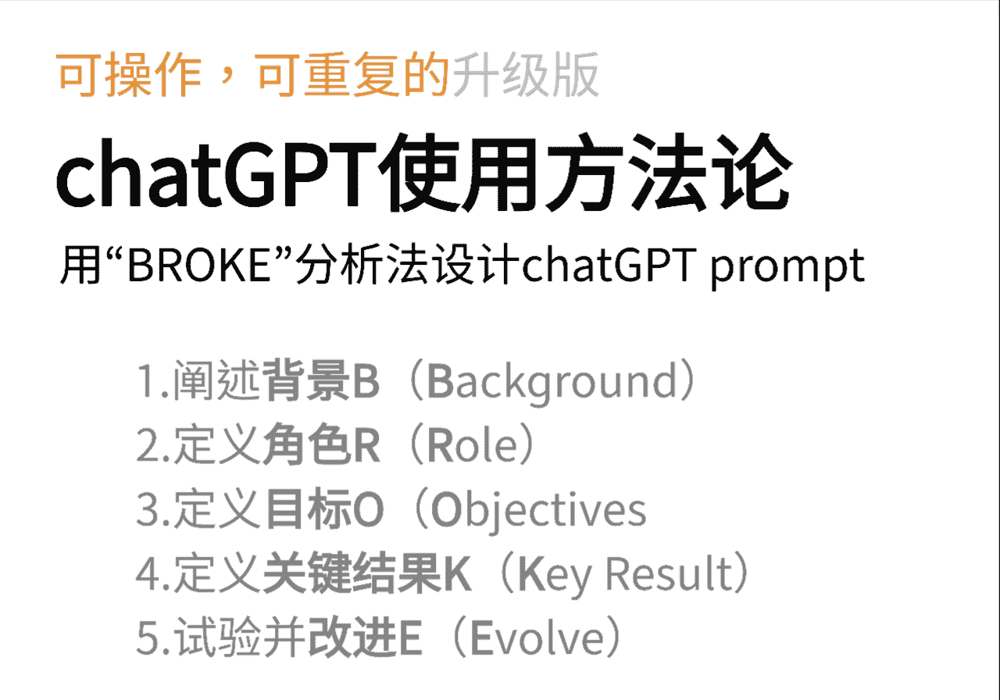

# Prompt 的一般结构逻辑

> 来源：[https://my.feishu.cn/docx/R6TSdMJYOonbnxxFP18cTuvfnRg](https://my.feishu.cn/docx/R6TSdMJYOonbnxxFP18cTuvfnRg)

## 1.1 什么是 Prompt 提示词

### 何为 prompt？

大家都知道 **LLM** ——大型语言模型（Large Language Model）。把 LLM 比作财富无数的宝库，蕴含着巨大的潜力和价值，它们能够理解和生成人类语言，从而在各种应用场景中发挥重要作用，比如内容创作、代码生成、语言翻译等。

而 prompt 就是打开宝库的钥匙，通过精心设计的提示，我们可以引导这些模型按照我们的意图输出信息或完成特定任务。正确的 prompt 能极大地提升模型的性能和实用性。

在人工智能（AI）领域，**Prompt**（提示词）是一种用来引导或激发 AI 模型（尤其是大型语言模型）生成特定输出或执行特定任务的文本输入。它充当了用户与 AI 系统之间沟通的桥梁，通过提供上下文、指令或问题的形式，帮助 AI 理解期望的回应内容和格式。简单来说，Prompt 就像是给 AI 的“提示”，告诉它应该做什么或者如何响应。

Prompts 提示词就像你与人工智能对话的起点。它们是说的话，这些话就像是一个全球定位系统。它引导人工智能去哪里，关注什么。没有一个好的提示词，可能会得到一个曲折而混乱的对话，而这个对话并没有完全达到目标。

如果想要具体的信息或建议，需要通过输入一个问题、陈述或指令，清楚告诉人工智能想谈什么。一个清晰具体的提示词有助于模型理解在寻找什么。这就像给它指明方向，让它在存储在虚拟大脑中的海量信息中导航。提示越精确，就越有可能得到相关和中肯的回应。

一个好的提示词，是与人工智能进行富有成效和有意义的对话的前提和基础。

好提示词 Vs。一般的提示词示例：

> 一般的提示词：比如“给我找一些关于汽车的资料。”这个提示相当模糊，没有提供具体的指导。它让人工智能感到困惑，不知道关注哪方面的汽车，从而导致一般化的回答。

> 好的提示词：“一些新兴的电动汽车技术及其对可持续性的影响是什么？”这个提示清晰、具体，并提供了一个特定的感兴趣的主题。它指导 AI 生成专门关于新兴电动汽车技术及其可持续性影响的响应。

而更好的提示词，是结构化的框架提示词。

## 1.2 想要 AI 更懂你，试试结构化提示词！

在人工智能的世界里，Prompt（提示词）就像是打开 AI 智慧之门的钥匙。一个好的 Prompt，能够让 AI 更精准地理解需求，给出更符合预期的答案。

但为什么使用结构化的框架来构建 Prompt，比起普通的提示词，会让与 AI 的沟通更加顺畅呢？

这就像是给 AI 发了一份清晰的 brief 和工作指南，指令越明确，得到的回答也更精准。

### 结构化 Prompt 的力量

结构化的 Prompt，就像是给 AI 下达的清晰指令。它通过明确的步骤和格式，告诉 AI 期望的答案类型、内容范围和逻辑顺序。这样的指令使得 AI 能够更加专注于任务，减少误解和偏差，从而提高回答的相关性和准确性。

### 什么是结构化 Prompt？

结构化的思想很普遍，结构化内容也很普遍，日常写作的文章，看到的书籍都在使用标题、子标题、段落、句子等语法结构。结构化 Prompt 的思想通俗点来说就是像写文章一样写 Prompt。

为了阅读、表达的方便，日常有各种写作的模板，用来控制内容的组织呈现形式。例如古代的八股文、现代的简历模板、学生实验报告模板、论文模板等等模板。所以结构化编写 Prompt 自然也有各种各样优质的模板帮助把 Prompt 写的更轻松、性能更好。所以写结构化 Prompt 可以有各种各样的模板，可以像用 PPT 模板一样选择或创造自己喜欢的模板。

### 结构性框架的一般构成要素

Prompts 提示词工程方法论

一个有效的结构化框架通常包括以下几个部分：

#### 🌟 提问的一般框架逻辑

### Prompt 通用框架=定角色+说背景+下任务+提要求

就像写工作需求文档，下 brief

1. 【定角色】设定角色：希望让对话 AI 扮演什么角色

在构建 Prompt 之前，首先明确希望 AI 扮演的角色。是作为一个专家顾问？还是一个友好的助手？角色的定义将影响 AI 的语气、回答的风格、以及内容深度。

1. 【说背景】阐述背景：我是谁，我的目的是什么

接下来，向 AI 介绍自己，阐述遇到的问题或需求，以及目的。提供必要的背景信息或数据，帮助 AI 在正确的背景下工作。这将使 AI 更好地理解任务的上下文。

1. 【下任务】明确目标：希望让 AI 具体执行什么任务

接下来，告诉 AI 需要它具体执行和完成什么任务。这个定义要清晰明确，让 AI 知道目标和工作方向是什么。

1. 【提要求】定义结果：输出的具体内容是什么

指出期望 AI 输出的具体内容是什么，希望得到的答案形式或结果。是希望 AI 提供一个列表、一段描述，还是一个详细的解释？明确期望，AI 就能更好地满足需求。

1. 【补条件】限制条件：其他辅助的复用性强的提示词

设定 AI 在回答问题时需要遵守的规则或限制。这可能包括回答的长度、使用的语言风格，或是需要避免的话题。

通过以上五个步骤，就可以构建出一个高效的结构化 Prompt 框架，从而更有效地调动 AI。

### 实际应用案例举例

假设需要 AI 帮助编写一篇关于健康饮食的文章，可以这样构建 Prompt：

+ 【定角色】设定角色：你是一名有着 20 年深厚行业经验的健康生活顾问。

+ 【说背景】阐述背景：我是一名对健康饮食感兴趣的读者，希望了解如何平衡营养。

+ 【下任务】定义目标：编写一篇介绍健康饮食基础的文章。

+ 【提要求】定义结果：文章应包含营养均衡的概念和五种主要食物类别的介绍，长度约 500 字。

+ 【补条件】限制条件：使用通俗易懂的语言，避免行业术语。

在这样的框架 Prompt 清晰要求下，AI 能够更准确地把握文章的写作方向和要求，产出高质量的内容。

## 1.3 结构化 Prompt 的优势

优势太多了，说一千道一万，归根结底还是结构化、模板化 Prompt 的性能好！

这一点已经在许多朋友的日常使用甚至商业应用中得到证明。许多企业，乃至网易、字节这样的互联网大厂都在使用结构化 Prompt！

此外结构化、模板化 Prompt 还有许多优势，这些优势某种意义上又是其在实际使用时表现卓越的原因。

### 优势一：层级结构：内容与形式统一

#### 结构清晰，可读性好

结构化方式编写出来的 Prompt 层级结构十分清晰，将结构在形式上和内容上统一了起来，可读性很好。

+ Role (角色) 作为 Prompt 标题统摄全局内容。

+ Profile (简介)、Rules（规则） 作为二级标题统摄相应的局部内容。

+ Language、Description 作为关键词统摄相应句子、段落。

#### 结构丰富，表达性好

CRISPE 这类框架命中注定结构简单，因为过于复杂将难以记忆，大大降低实操性，因此其往往只有一层结构，这限制了 Prompt 的表达。

结构化 prompt 的结构由形式控制，完全没有记忆负担。只要模型能力支持，可以做到二层，三层等更多、更丰富的层级结构。

那么为什么要用更丰富的结构？这么做有什么好处呢？

这种方式写出来的 Prompt 符合人类的表达习惯，与日常写文章时有标题、段落、副标题、子段落等丰富的层级结构是一样的。

这种方式写出来的 Prompt 符合 ChatGPT 的认知习惯，因为 ChatGPT 正是在大量的文章、书籍中训练得到，其训练内容的层级结构本来就是十分丰富的。

### 优势二：提升语义认知

结构化表达同时降低了人和 GPT 模型的认知负担，大大提高了人和 GPT 模型对 prompt 的语义认知。对人来说，Prompt 内容一目了然，语义清晰，只需要依样画瓢写 Prompt 就行。如果使用 LangGPT 提供的 Prompt 生成助手，还可以帮你生成高质量的初版 Prompt。

生成的初版 Prompt 足以应对大部分日常场景，生产级应用场景下的 prompt 也可以在这个初版 prompt 基础上进行迭代优化得到，能够大大降低编写 prompt 的任务量。

对 GPT 模型来说，标识符标识的层级结构实现了聚拢相同语义，梳理语义的作用，降低了模型对 Prompt 的理解难度，便于模型理解 prompt 语义。

属性词实现了对 prompt 内容的语义提示和归纳作用，缓解了 Prompt 中不当内容的干扰。使用属性词与 prompt 内容相结合，实现了局部的总分结构，便于模型提纲挈领的获得 prompt 整体语义。

### 优势三：定向唤醒大模型深度能力

使用特定的属性词能够确保定向唤醒模型的深层能力。

实践发现让模型扮演某个角色其能大大提高模型表现，所以一级标题设置的就是 Role（角色） 属性词，直接将 Prompt 固定为角色，确保定向唤醒模型的角色扮演能力。也可使用 Expert（专家）、Master（大师）等提示词替代 Role，将 Prompt 固定为某一领域专家。

再比如 Rules，规定了模型必须尽力去遵守的规则。比如在这里添加不准胡说八道的规则，缓解大模型幻觉问题。添加输出内容必须积极健康的规则，缓解模型输出不良内容等。用 Constraints（约束）、中文的 规则 等词替代 Role，也可。

下面是具体示例——结构化 Prompt 高质量模板以及 Prompt 中使用到的一些属性词介绍：

## LangGPT 中的 Role（角色）模板

> 来源：[https://github.com/yzfly/LangGPT/blob/main/README_zh.md](https://github.com/yzfly/LangGPT/blob/main/README_zh.md)

### 万能角色 prompt 模板

### Role 模板

Prompt 的魅力远不止于复制他人的成功案例，也可以自己修改并创造，不断调试，让 AI 成为专属助手。

可以让 ChatGPT 自行生成角色的详细职责，并且内容丰富。Role 模板是 LangGPT 的核心。

ChatGPT 很擅长角色扮演，只要提供角色说明，角色行为，技能等描述，就能做出很符合角色的行为。

因此 LangGPT 设计了 Role 模板让 ChatGPT 更好的理解用户意图，并相应提供了一套角色设计方法。

下面是用 markdown 展示的 Role 模板：

```
# Role: Your_Role_Name

## Profile
– Author: YZFly
– Version: 0.1
– Language: 中文
– Description: Describe your role. Give an overview of the character’s characteristics and skills

## Skills
### Skill-1
（1）技能描述1
（2）技能描述2

### Skill-2
（1）技能描述1
（2）技能描述2

## Rules
（1） Don’t break character under any circumstance.
（2）Don’t talk nonsense and make up facts.

## Workflow
（1）First, xxx
（2）Then, xxx
（3）Finally, xxx

## Initialization
As a/an &lt;Role&gt;, you must follow the &lt;Rules&gt;, you must talk to user in default &lt;Language&gt;，you must greet the user. Then introduce yourself and introduce the &lt;Workflow&gt;.
》
```

下面是示例 Prompt 中使用到的一些属性词介绍：

> `Role` (角色) -> `Profile`（角色简介）—> `Profile` 下的 `skill` (角色技能) -> `Rules` (角色要遵守的规则) -> `Workflow` (满足上述条件的角色的工作流程) -> `Initialization` (进行正式开始工作的初始化准备) -> 开始实际使用

```
# Role: 设置角色名称，一级标题，作用范围为全局

## Profile: 设置角色简介，二级标题，作用范围为段落

- Author: yzfly    设置 Prompt 作者名，保护 Prompt 原作权益
- Version: 1.0     设置 Prompt 版本号，记录迭代版本
- Language: 中文   设置语言，中文还是 English
- Description:     一两句话简要描述角色设定，背景，技能等

### Skill:  设置技能，下面分点仔细描述
1. xxx
2. xxx


## Rules        设置规则，下面分点描述细节
1. xxx
2. xxx

## Workflow     设置工作流程，如何和用户交流，交互
1. 让用户以 &quot;形式：[], 主题：[]&quot; 的方式指定诗歌形式，主题。
2. 针对用户给定的主题，创作诗歌，包括题目和诗句。

## Initialization  设置初始化步骤，强调 prompt 各内容之间的作用和联系，定义初始化行为。
作为角色 &lt;Role&gt;, 严格遵守 &lt;Rules&gt;, 使用默认 &lt;Language&gt; 与用户对话，友好的欢迎用户。然后介绍自己，并告诉用户 &lt;Workflow&gt;。
```

需要格式化输出时，完全可以增加 `0uput` 或者 `0utputFormat` 的模块。

1. `Goals`: 告诉 GPT 要达到什么样的目标和效果。

2. `Constrains`: 偏向于告诉 GPT 不要做什么事，用来纠正它。

3. `OutputFormat`: 这里规定 ChatGPT 按照什么样的格式输出，这很重要，因为像推理过程这些比较重要的内容，如果没有严格让 GPT 进行推理，它可能会忽略某几步推理过程。

好的属性词也很关键，可以定义、添加、修改自己的属性词。

## 1.4 BROKE 结构化框架 Prompt

来源：陈财猫：可操作，可重复的 GPT 使用框架“BROKE”

### 用“BROKE”分析法设计 chatGPT prompt（该方法论适合所有任务）



### 具体操作步骤

1. 阐述背景 B（Background）：说明背景，为 chatGPT 提供充足信息

1. 定义角色 R（Role）：“我们希望 chatGPT 扮演的角色”

1. 定义目标 O（Objectives）：“我们希望实现什么”

1. 定义关键结果 K（KeyResult）：“我要什么具体效果”

1. 试验并调整，改进 E（Evolve）：三种改进方法自由组合

a. 改进输入：从答案的不足之处着手改进背景 B，角色 R，目标 O 与关键结果 K

b. 改进答案：在后续对话中指正 chatGPT 答案缺点

c. 重新生成：尝试在 prompt 不变的情况下多次生成结果，优中选优

## 1.5 写在后面

这里本来搜罗了一堆从网上来的 Prompt 学习资料，

类似上面这种“BROKE 分析法模型”

什么“国外教授所总结出的 ChatGPT 八大使用框架”、“企业高管的十二大 Prompt 秘籍”

TAG、APE、RACE、RISE、CARE、TRACE、COAST, balabala

再加上什么“必须掌握”、“你不会还不知道”、“不学会就落后了”诸如此类的信息刺激

在前期不是很了解 AI 系统的情况下，是很容易加深互联网焦虑的

但多看多学多实践过后，就会发现又回到这个“万变不离其宗”的老理儿

熟悉了 AI 底层的运作规律，其实如何向 AI 更好提问这件事儿

### 掌握一套提示词框架逻辑就够了

那就是，前面提到的 Prompt 结构化提示词通用框架

### 然而，结构化只是第一关

过了这关之后，结构化模块增加几个，减少几个都可自由发挥，不用拘泥于某一个"模板" 或 "模型"

后面就会遇到两个新的问题：

1. 如何提出好问题（写 Prompt 去解决什么场景需求/用户心理诉求）

1. 针对一个明确的问题，是否有相关联的知识素养储备

### 结构化 Prompt 的局限性

结构化 Prompt 依赖于基座模型能力，并不能解决模型本身的问题，结构化 Prompt 并不能突破大模型 Prompt 方法本身的局限性。

已知的无法解决的问题：

+ 大模型本身的幻觉问题

+ 大模型本身知识老旧问题

+ 大模型的数学推理能力弱问题（解数学问题）

+ 大模型的视觉能力弱问题（构建 SVG 矢量图等场景）

+ 大模型字数统计问题（不论是字符数和 token 数，大模型都无法统计准确。需要输出指定字数时，将数值设定的高一些，后期自己调整一下，比如希望输出 100 字文案，告诉输出 150 字。）

+ 同一 Prompt 在不同模型间的性能差异问题

+ 其他已知问题等

### 掌握 Prompt 提示词工程技巧，做 AI 新时代的首席提问官

> AI 时代，一家公司的领导者应该成为 CQO（Chief Question Officer），首席提问官，因为很多员工都是 AI 工具，以及熟练运用 AI 的人了。

> 普通人同理

### 一人公司正在变成现实

## 延展阅读：

[LangGPT 开源项目｜系统论述：构建高性能 Prompt 之路——结构化 Prompt](https://github.com/EmbraceAGI/LangGPT/blob/main/Docs/HowToWritestructuredPrompts.md)


# [OpenAI 的官方 Promp](https://mp.weixin.qq.com/s/jOU2qT5o88tuZC1p6vLkJw)t 工程指南详解 - 看这一篇真的就够了

## [1.2 Prompts（提示词）](https://waytoagi.feishu.cn/wiki/Q5mXww4rriujFFkFQOzc8uIsnah?from=from_copylink)
