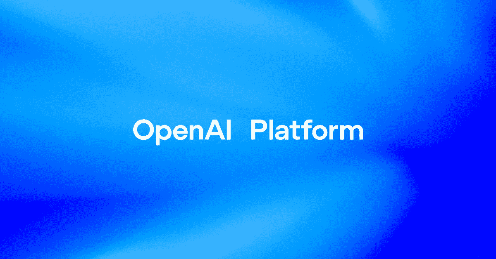
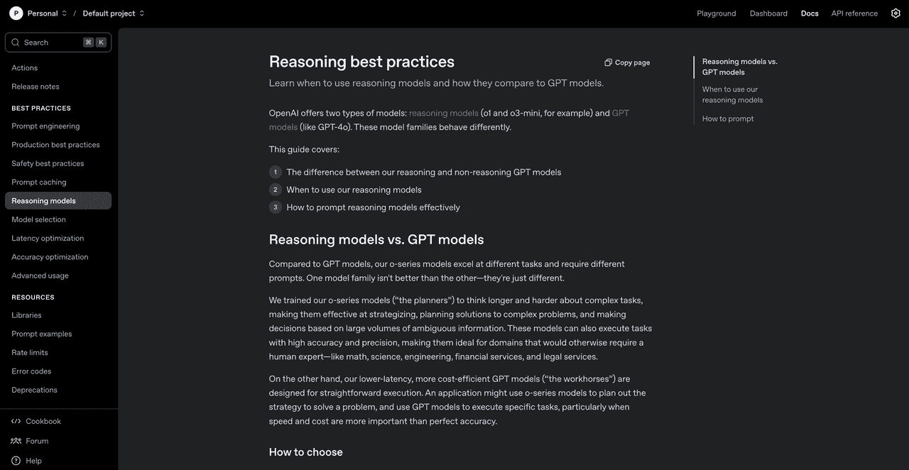

# 🔥推理模型的提示技巧

> 来源：[https://my.feishu.cn/docx/J5F7dkVazoFYLUxWjAHcnZU1n9d](https://my.feishu.cn/docx/J5F7dkVazoFYLUxWjAHcnZU1n9d)

# OpenAI 官方手把手教学：6条黄金法则，让你用好推理模型

原文：https://mp.weixin.qq.com/s/6haK6D9mC9eo8hF7QMFBgw



用「更有效的提示词技巧」榨干 AI 推理潜力，适用于 o1、o3、DeepSeek R1、K1.5 等推理模型

OpenAI 最近发布了一份关于推理类模型最佳实践的新指南博客，介绍了 OpenAI 的推理模型（如 o1 和 o3-mini）与 GPT 模型（如 GPT-4o）的区别、使用场景及有效提示方法。

其中，特别指导如何更好的使用 01、03 这类推理模型，其中包含一些在生产中使用推理的最佳人工智能创始人提供的实际技巧。



### 🌟 核**心原则：**不教 AI 做事，而是给 AI 明确任务目标

× 误区：用魔法咒语式指令（如“一步一步思考”）或之前流行的各种基于标准 workflow 的结构化提示词

√ 正解：像给资深助理派活，要将任务目标清晰界定，而不是多余展开技巧指导（具体怎么做，资深人士早已有经验可循，要达成什么目标才是关键）

# 🔧 6** 条黄金法则 **

### 1️⃣ **指令要简洁明确**

这些推理模型不同于 GPT-4o、Claude 3.5 Sonnet、DeepSeek V3 等常规模型，更加擅长理解简要且清晰的指令。因此，提示词不用写得过长或复杂。别绕弯子，直接说需求即可！

比如“写一首关于春天的诗，每句不超过 7 个字，押 ang 韵”比“请发挥你的创造力，用优美的语言描述春天”更有效。

再比如：

× 常见误区：

“请用专业且富有创意的风格，撰写一篇关于新能源汽车的深度分析报告”

√  正确操作：

```
“生成2024年新能源汽车市场分析报告：  
- 包含中美欧三地政策对比  
- 需引用近3年销量增长率数据  
- 禁止使用专业术语”    
```

### 2️⃣ **避免“逐步思考”的提示**

避免添加“让我们一步一步思考”“请一步步解释你的推理过程”这类提示词，别教 AI 怎么思考。

因为这些推理模型自带推理能力，会在内部自主推理，就像你不需要教厨师“先开火再倒油”，不必显式告诉 AI 任务展开的步骤，有时加戏反而可能拖后腿。

比如——

× 常见误区：

"请先分析市场现状，再逐步推导解决方案"

√  正确操作：

直接说："给出解决北京早高峰堵车的 3 个创新方案"

### 3️⃣ **使用分隔符以确保结构清晰**

📌 需要多段落输入时，用```、XML 标签或章节标题等分隔符，来清楚地标明输入内容的不同部分，从而帮助模型更准确地理解提示。比如：

```
&lt;Context&gt;  
  用户身份：跨境电商创业者  
  业务范围：宠物智能用品  
&lt;/Context&gt;  

&lt;Task&gt;  
  生成TikTok爆款视频脚本（3个版本）  
&lt;/Task&gt;  

&lt;Constraints&gt;  
  - 单视频时长≤60秒  
  - 必须包含产品使用场景演示  
  - 禁用：网络流行语/竖屏文字  
&lt;/Constraints&gt; 
```

### 4️⃣ 优先尝试零样本，必要时再用少样本

推理模型通常不需要很少的示例就能产生很好的结果，因此在编写提示时应尽量先不使用示例（zero-shot），直接告

诉模型你的需求就行了。

如果你对输出结果有更复杂的要求，可以加入少量示例（few-shot）。但要确保示例与提示词指令相符，因为两者之间的差异可能会导致结果不佳。

比如——

1.  **零样本试探**：基础指令获取初步输出
→ “生成智能猫砂盆推广文案”

1.  **单样本校准**：补充典型案例修正方向
→ “参考案例：<某爆款文案结构>”

### 5️⃣ **限制条件要具体**

如果你对结果有特别的要求，希望对模型的回答进行限制，应在提示中明确列出这些限制。例如，可以指定预算、时间等约束条件，以引导模型产生符合要求的回答。

像是“预算 500 元内的旅行方案”“用小学生能懂的词汇”这类明确要求，果断直接写进指令！

需要规避的内容，在很多时候，比需要生成的内容更重要。

可以**记下这个公式**：

要什么 + 不要什么 + 硬指标

比如：

```
生成团建方案：  
- 要：半天能完成/人均成本≤200元  
- 不要：聚餐/剧本杀  
- 硬指标：包含备用雨天方案  
```

### 6️⃣ **目标越细，结果越香**

**阐述清楚你的最终目标**，在提示词中尽量详细说明你想要的成功标准，给出成功响应的具体参数，并鼓励模型不断推理、持续推敲，展开多轮对话互动，直到符合成功标准。

可以告诉模型“必须满足 XX 条件才算达成最终任务目标”，这有助于模型更好地理解任务要求，提高回答的质量和准确性。

比如：

```
# 任务  
策划针对Z世代的奶茶新品上市方案  

## 成功标准（不满足需重新生成）  
✅ 必须包含：  
1. 精准对标3个社交媒体平台（需附平台用户画像数据对比）  
2. 首月预算分配表（总预算≤20万元，注明CPC预估）  
3. 爆款内容公式（如：2个热点借势方向+3种UGC模板）  
4. 效果监测方案（至少3个可量化指标，如：首发3日用户生成内容≥500条）  
```

✨ **小贴士**：初次使用建议从简单指令开始，逐步叠加复杂度，搭配分隔符清晰表达，模型会给你惊喜！

🔗 延**伸学习：**OpenAI 官方指南原文 https://platform.openai.com/docs/guides/reasoning-best-practices

👉 你在用推理模型时还有哪些独门技巧？评论区分享你的神操作！ 💬

（如果觉得有用，也请随手转发给需要的小伙伴，一起解锁 AI 潜力！)