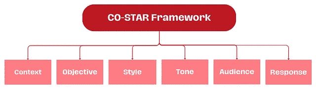

# 【补充阅读资料】新加坡提示词大赛冠军CO-STAR 框架

> 来源：[https://my.feishu.cn/docx/BMhodNaeAolfAkx6FtGczn16n2f](https://my.feishu.cn/docx/BMhodNaeAolfAkx6FtGczn16n2f)

# ChatGPT 十级提示词技巧深度解读

# 视频笔记

视频来源：https://www.youtube.com/watch?v=2djqKsRXt_Q&ab_channel=PatrickStorm

这个视频深入探讨了如何利用不同层次的提示词技巧，充分发挥 ChatGPT 的潜力，获得更精确、更个性化的回复。

# 10 级 ChatGPT 提示词，从初学者到获奖者

**基础级别：入门阶段**

1.  **直接描述需求（1级）:** 适用于简单的任务，例如翻译、总结、编写简单文本。直接告诉 ChatGPT 你想要的结果，它能够理解并完成基本任务。

1.  **基本格式（2级）:** 添加分割线、项目符号等格式元素，帮助 ChatGPT 区分提示词的不同部分，例如输入数据和预期输出格式。这对于需要结构化回复的任务（如表格生成）尤为重要。

1.  **明确的目标（3级）:** 避免模糊的指令，清晰地表达你的目标。例如，不要说“让回复更漂亮”，而要明确说明你希望的风格或格式，如“使用诗歌形式回复”。

**进阶级别：提升回复质量**

1.  **提供示例（4级）:** 当任务需要特定格式或风格时，提供示例输入和输出能够显著提升 ChatGPT 的理解和执行能力。这相当于为它提供了一个“参考答案”，使其能够更好地把握你的需求。

1.  **自我反思（5级）:** 利用 ChatGPT 的评估能力，通过询问“你是否遗漏了什么？”来检查其回复的完整性。这有助于发现潜在的错误或缺失信息，提高回复的准确性。

1.  **利用系统提示（6级）:** 在 ChatGPT 的设置中添加系统提示，提供你的个人信息、职业背景、偏好等，使 ChatGPT 能够根据你的个性和需求生成更定制化的回复。例如，你可以告诉它你是软件工程师，喜欢简洁的回复，并提供代码示例。

**专家级别：精通提示词工程**

1.  **使用角色扮演（7级）:** 要求 ChatGPT 扮演特定角色，例如专家、历史人物、虚拟角色等，以获得更具专业性或创意性的回复。

1.  **思维链（8级）:** 通过提示词引导 ChatGPT 进行逐步思考，分析问题，权衡利弊，并最终得出结论。例如，你可以要求它“逐步分析这个谜语，并解释你的推理过程”。这对于解决逻辑难题和复杂问题非常有效。

1.  **自我提示（9级）:** 利用 ChatGPT 自身的提示词生成能力，让它编写更有效的提示词，进一步提高回复质量。例如，你可以要求它“为我写一个详细的提示词，用来解决这个谜语，并使用最先进的提示词工程技术”。

1.  **CO-STAR框架（10级）:** 这是一个更系统化的提示词结构，包含上下文、目标、风格、语气、受众和回复六个要素。通过仔细考虑并填写每个要素，你可以构建一个清晰、完整、有效的提示词，最大程度地发挥 ChatGPT 的潜力。

**视频观点：**

+   提示词工程是一项重要的技能，可以显著提升 ChatGPT 的使用体验和回复质量。

+   通过逐步学习和实践不同的提示词技巧，你可以从新手到专家，充分发挥 ChatGPT 的潜力。

+   CO-STAR框架是一个强大的工具，帮助你构建更有效的提示词，获得更精准、更个性化的回复。

**个人见解:**

视频中的提示词技巧非常实用，无论是新手还是经验丰富的用户，都可以从中受益。 通过不断学习和实践，我们可以更好地利用 ChatGPT 这一强大的工具，提高我们的工作效率和创造力。

# ChatGPT 十级提示词技巧：补充与思考

除了视频中提到的技巧，还有一些额外的补充和思考：

**1. 提示词的长度:**

+   ChatGPT 对提示词的长度有限制，过长的提示词可能会被截断或导致回复不完整。建议将提示词控制在合理的长度范围内，并确保信息清晰、简洁。

**2. 反馈与迭代:**

+   不断尝试和调整你的提示词，观察 ChatGPT 的回复，并根据结果进行反馈和迭代，找到最有效的提示词结构和内容。

**3. 语言模型的局限性:**

+   ChatGPT 仍然是一个语言模型，它无法完全理解人类的意图和情感。在使用过程中，我们需要保持批判性思维，并对 ChatGPT 的回复进行评估和验证。

**4. 伦理与安全:**

+   在使用 ChatGPT 时，我们需要遵守伦理和安全准则，避免生成有害或歧视性的内容。

**5. 持续学习:**

+   提示词工程是一个不断发展的领域，新的技巧和方法层出不穷。我们需要保持持续学习的态度，关注最新的研究成果和实践经验。

**思考：**

+   ChatGPT 等大型语言模型的出现，正在改变我们与信息交互的方式。提示词工程作为一种新的技能，将变得越来越重要。

+   如何更好地利用这些工具，并确保其安全和伦理使用，是一个值得深入探讨的话题。

**总而言之，** 通过学习和实践不同的提示词技巧，我们可以更有效地利用 ChatGPT 等大型语言模型，并从中获得更大的价值。

希望以上补充和思考能够对你有所帮助。

# 深入解读 CO-STAR 框架：ChatGPT 提示词工程的最佳实践

## 🔵 借助 CO-STAR 框架构建高效的提示

在使用大语言模型时，有效的提示构建至关重要。CO-STAR 框架，由新加坡政府科技局数据科学与 AI 团队创立，是一个实用的提示构建工具。它考虑了所有影响大语言模型响应效果和相关性的关键因素，帮助你获得更优的反馈。

CO-STAR 框架是一个系统化的 ChatGPT 提示词构建方法，它包含六个关键要素，帮助你创建更清晰、更完整、更有效的提示词，以获得更精准、更个性化的回复。

C - 上下文 (Context):

+   提供与你的请求相关的背景信息，帮助 ChatGPT 理解你的需求和目标。这可能包括：

+   **个人信息:** 你的职业、兴趣爱好、专业领域等

+   **任务信息:** 你希望 ChatGPT 完成的任务类型，例如写作、翻译、编程等

+   **相关数据:** 任何与你的请求相关的输入数据，例如文本、代码、图像等

O - 目标 (Objective):

+   明确定义你希望 ChatGPT 达成的目标。这需要清晰、具体的描述，例如：

+   总结一篇文章的要点

+   翻译一段文本

+   编写一段代码

+   创作一首诗歌

+   回答一个问题

**S - 风格 (Style):**

+   指定你想要的写作风格，例如：

+   正式或非正式

+   幽默或严肃

+   专业或通俗

+   创意或客观

**T - 语气 (Tone):**

+   选择合适的语气，例如：

+   乐观或悲观

+   友好或讽刺

+   兴奋或平静

A - 受众 (Audience):

+   说明你的目标受众，例如：

+   儿童或成人

+   专家或普通大众

+   特定职业或兴趣群体

R - 回复 (Response):

+   指定你希望 ChatGPT 以何种格式进行回复，例如：

+   段落

+   列表

+   表格

+   代码

+   诗歌

使用 CO-STAR 框架的优势:

+   **提高效率:** 通过提供 ChatGPT 所需的所有信息，可以减少反复尝试和调整提示词的次数，节省时间和精力。

+   **提升准确性:** 清晰、完整的提示词能够帮助 ChatGPT 更好地理解你的意图，从而生成更准确的回复。

+   **个性化定制:** 通过指定风格、语气和受众，可以获得更符合你需求的个性化回复。

**CO-STAR 框架示例:**

**任务:** 为我的新产品 (一款飞行魔毯) 写一个 Facebook 广告文案

**CO-STAR 提示词:**

+   **C:** 我是一家飞行魔毯公司的创始人。我的目标受众是 30 多岁的科技爱好者。

+   **O:** 编写一个吸引人的 Facebook 广告文案，推广我的新产品。

+   **S:** 使用简洁、现代的风格，并突出产品的创新性和便利性。

+   **T:** 使用积极、乐观、令人兴奋的语气。

+   **A:** 30 多岁的科技爱好者。

+   **R:** 四句话的广告文案，包含 emoji。

**通**过使用 CO-STAR 框架，你可以构建更有效的提示词，充分利用 ChatGPT 的能力，并获得更优质的回复。

# CO-STAR 框架的创作背景：新加坡 GPT-4 提示词工程大赛的智慧结晶

CO-STAR 框架的诞生源于一场激烈的竞赛：新加坡 GPT-4 提示词工程大赛。这场比赛汇聚了众多提示词工程领域的专家和爱好者，他们致力于探索如何更有效地利用大型语言模型，并开发出更先进的提示词技巧。

在比赛过程中，参赛者们不断尝试各种方法，并分享他们的经验和发现。最终，一位名叫 Ce Le Tao 的参赛者脱颖而出，他提出的 CO-STAR 框架凭借其系统性、全面性和有效性，赢得了大赛的冠军。

CO-STAR 框架的设计灵感源于以下几个方面：

+   **大型语言模型的特性:** ChatGPT 等大型语言模型拥有强大的语言理解和生成能力，但它们也需要清晰、完整的指令才能发挥最佳性能。

+   **人类思维过程:** CO-STAR 框架的结构与人类解决问题的思维过程相吻合。我们通常会首先了解问题的背景，然后设定目标，并考虑风格、语气、受众等因素，最终形成解决方案。

+   **提示词工程的最佳实践:** CO-STAR 框架整合了提示词工程领域现有的最佳实践，例如提供示例、使用角色扮演、思维链等，并将其融入一个更系统化的框架中。

**CO-STAR 框架的意义:**

+   **推动提示词工程的发展:** CO-STAR 框架为提示词工程提供了一个标准化的框架，有助于推动该领域的进一步研究和发展。

+   **提升大型语言模型的应用价值:** 通过使用 CO-STAR 框架构建更有效的提示词，我们可以更好地利用 ChatGPT 等大型语言模型，为各个领域带来更大的价值。

+   **降低使用门槛:** CO-STAR 框架提供了一个易于理解和使用的结构，即使是提示词工程新手，也可以轻松上手，并获得更好的使用体验。

**CO-STAR 框架的未来:**

+   随着大型语言模型的不断发展，CO-STAR 框架也需要不断改进和完善，以适应新的模型特性和应用场景。

+   未来，CO-STAR 框架可能会被整合到 ChatGPT 等大型语言模型的界面中，为用户提供更便捷的提示词构建工具。

总而言之，CO-STAR 框架是提示词工程领域的一项重要成果，它为我们提供了更有效地利用大型语言模型的方法，并推动着该领域的不断发展。

延展阅读：

我如何夺冠新加坡首届 GPT-4 提示工程大赛-翻译自宝玉