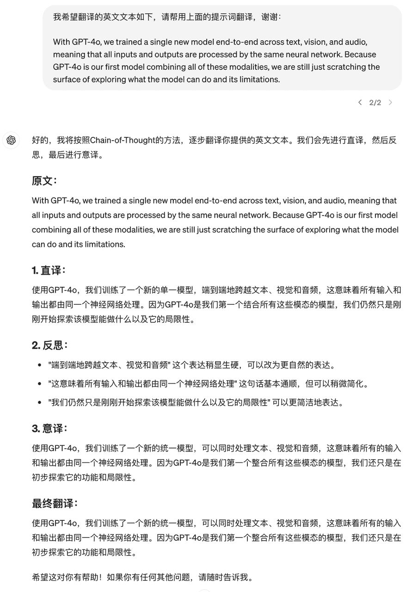
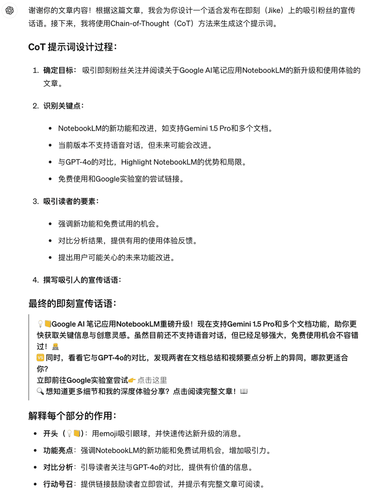
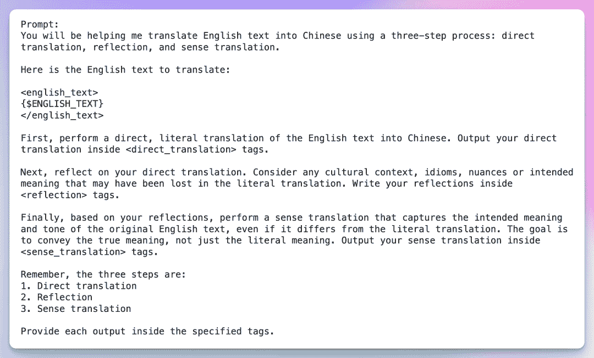
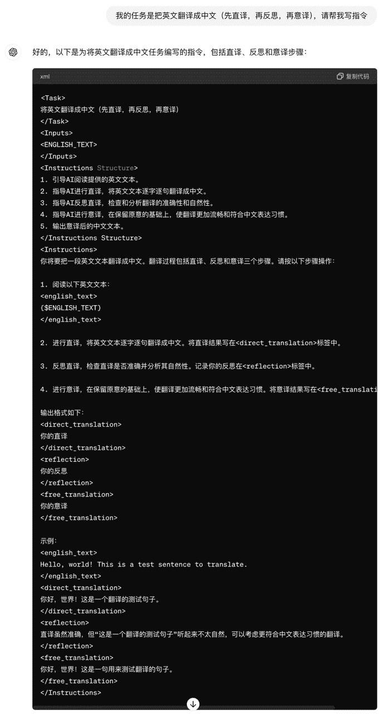

# 用COT思考链生成提示词模板

> 来源：[https://my.feishu.cn/docx/KtVfdA8rzorAVzx4MxScfeU9nRc](https://my.feishu.cn/docx/KtVfdA8rzorAVzx4MxScfeU9nRc)

内容来源：Kate人不错

## 推荐一个自动生成复杂提示词的模版：思考链（CoT）如何通过分步推理提升AI任务准确性 | 示例详解

#### **什么是思考链 (CoT）**

思考链（Chain of Thought，简称 CoT）是一种推理策略，通过将复杂问题分解为多个简单步骤，从而提升大型语言模型（LLM）的推理能力。

这种方法使得模型能够逐步构建解决方案，从而减少错误并提高准确性。

CoT 主要应用于需要多步骤推理的任务，如数学问题、逻辑推理和编程问题等。

值得注意的是，CoT 是 OpenAI() 与 DeepLearning.AI 合作的课程中提到的一种重要策略。


课程链接：https://learn.deeplearning.ai/courses/chatgpt-building-system/lesson/5/chain-of-thought-reasoning

#### **介绍提示词的简单模版**

为了更好地利用思考链方法，我建议使用以下提示词模版：

```
我要让 AI 帮我 {XXXX}，请帮我用 Chain-of-Thought 来写 AI 提示词。
```

这个模版可以帮助你有效地引导 AI 进行多步骤推理，从而提高任务完成的准确性和效率。

#### **传统方法的局限**

在过去，使用 GPT 处理任务时，通常会添加一句“请一步步思考”。然而，这种提示较为笼统，模型有时无法准确理解具体需求，导致结果不尽如人意。

#### 改进方法：通过 CoT 生成提示词

最近，我发现了一种更高效的方法：先通过 CoT 生成提示词，然后根据这些提示词完成任务。

### **实践示例**

#### 示例一：英文翻译成中文（先直译，再反思，再意译）

提示词模版：

```
我要让 AI 帮我从英文翻译成中文（先直译，再反思，再意译），请帮我用 Chain-of-Thought 来写 AI 提示词。
```

GPT-4o 生成的提示词如下：



#### **示例二：画图**

提示词模版：

```
我要让 AI 帮我画图，我会先上传一张图片，让 AI 帮我画出相似的图片，相似度 100%，请帮我用 Chain-of-Thought 来写 AI 提示词。
```

我上传的原始图片是在 ideogram 平台上生成的，通过 GPT-4o 生成的提示词重新输入 ideogram 后，生成的新图片与原图片非常相似。


需要注意，如果直接在 GPT 里生成，可能效果不好，因为 GPT 里用的是 DALLE3 模型。


#### **示例三：写推荐文案**

提示词模版：

```
我要让 AI 分析我上传的文章，写一段适合发布在即刻（https://web.okjike.com/）网站上，以吸引即刻粉丝阅读的文案，请帮我用 Chain-of-Thought 来写 AI 提示词。
```




结果显示，生成的文案效果非常不错。

### **为什么需要特定 CoT**

不同内容需要生成不同的 CoT，因为每个问题的结构和逻辑不同，需要特定的推理步骤来解决。

通过生成特定的 CoT，可以引导模型逐步完成每个步骤，从而提高问题解决的准确性和效率。

### **Anthropic****()**** 智能生成提示词**

Anthropic Prompt Generator 也备受关注。除了直接在 Anthropic API 的 playground 后台生成外，还可以在 Colab() 上生成。相关链接如下：

+   https://docs.anthropic.com/en/docs/helper-metaprompt-experimental

+   https://colab.research.google.com/drive/1SoAajN8CBYTl79VyTwxtxncfCWlHlyy9

Anthropic Metaprompt Text 非常长，内容复杂。

以下是我设置的一个任务示例：

任务：我要让 AI 帮我从英文翻译成中文（先直译，再反思，再意译）

Prompt Generator 生成的提示词：



当将 Metaprompt Text 放入 GPT-4o 中时，生成的提示词效果似乎不如直接让 GPT-4o 生成 AI 提示词来得好。



### **结语**

再次强调，我介绍的提示词简单模版如下：

```
我要让 AI 帮我 {XXXX}，请帮我用 Chain-of-Thought 来写 AI 提示词。
```

希望这个方法能对你有所帮助，欢迎留言讨论。