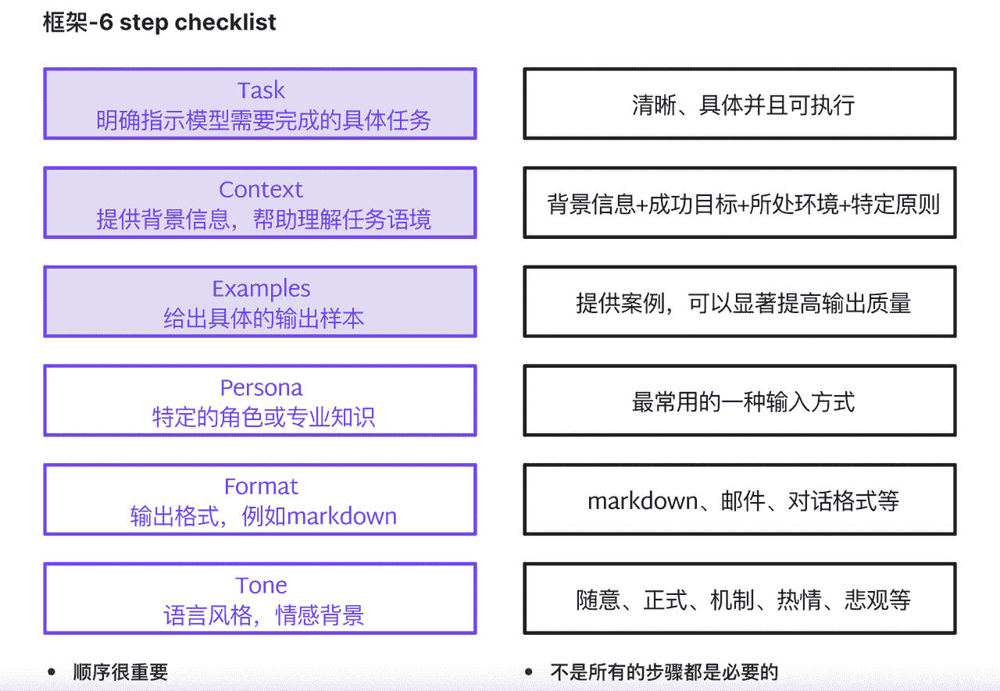

# 🌟6 step checklist提示词框架

> 来源：[https://my.feishu.cn/docx/Fl3UducMpo5e7pxDDuocPUmYnlb](https://my.feishu.cn/docx/Fl3UducMpo5e7pxDDuocPUmYnlb)

内容来源：@余一 https://gamma.app/docs/AIGC-Dev-9y7n4vslcp2bol2?mode=doc

## 如何通过掌握提示技巧，在 ChatGPT 上获得高质量的输出结果？

**提示词的重要性：** 提示词对于引导 AI 模型生成符合预期的结果至关重要。



# **六个关键组成部分**

## **任务 （Task）**

> 清晰表达你希望 AI 模型完成的任务，通常以动词开头，例如生成、提供、分析等。

+   这是提示中最关键的部分，必须清晰地告诉 AI 模型你想要它做什么。

+   使用动词开头，例如：

**生成 （Generate）:** 例如，生成故事、诗歌、代码等。

**总结 （Summarize）:** 例如，总结文章、报告、对话等。

**翻译 （Translate）:** 例如，将文本从一种语言翻译成另一种语言。

**分析 （Analyze）:** 例如，分析数据、文本、图像等。

**解答 （Answer）:** 例如，解答问题、提供解释等。

+   尽可能具体地描述任务，例如：“写一篇关于人工智能的博客文章”，比“写点东西”更有效。

## **背景 （Context）**

> 提供与任务相关的背景信息，帮助 AI 模型理解你的意图。

+   提供与任务相关的背景信息，帮助 AI 模型理解你的意图和生成更相关的输出。

+   背景信息可以包括：

**主题：** 例如，人工智能、历史、科学等。

**目标受众：** 例如，儿童、专家、普通大众等。

**风格：** 例如，正式、休闲、幽默、讽刺等。

**相关事实或数据：** 提供支撑任务的具体信息。

+   避免提供过多无关信息，以免分散 AI 模型的注意力。

## **范例 （Exemplars）**

> 提供一些示例或参考框架，让 AI 模型了解你期望的输出格式和风格。

+   通过提供示例，让 AI 模型了解你期望的输出格式和风格。

+   范例可以是：

+   **文本示例：** 例如，一篇与你希望生成的文本类似的文章。

+   **结构框架：** 例如，STAR 面试回答框架、博客文章的提纲等。

+   **代码示例：** 例如，一段与你希望生成的代码功能类似的代码。

+   范例可以帮助 AI 模型学习模式和规律，从而生成更符合你预期的结果。

## **角色 （Persona）**

> 指定 AI 模型扮演的角色，例如专家、导师、朋友等。

+   指定 AI 模型扮演的角色，例如：

+   **专家：** 在特定领域拥有专业知识和经验。

+   **导师：** 提供指导和建议。

+   **朋友：** 进行轻松愉快的对话。

+   **名人：** 模仿名人的语言风格和观点。

+   角色设定可以使输出更具个性化和趣味性。

## **格式 （Format）**

> 指定输出的格式，例如电子邮件、要点、代码块等。

+   指定输出的格式，例如：

+   **电子邮件：** 包含主题行、称呼、正文、结尾等。

+   **要点：** 一系列简短的陈述。

+   **代码块：** 特定编程语言的代码。

+   **表格：** 包含行和列的有组织数据。

+   **剧本：** 包含对话和舞台指示。

## **语气 （Tone）**

> 指定输出的语气，例如正式、休闲、幽默、讽刺等。

+   指定输出的语气，例如：

+   **正式：** 严肃、专业、客观。

+   **休闲：** 友好、平易近人、轻松。

+   **幽默：** 风趣、机智、有趣。

+   **讽刺：** 用反语表达观点。

+   **鼓舞人心：** 积极、乐观、充满希望。

+   语气设定可以影响输出的情感色彩和风格。

**将所有内容结合起来：**

+   使用上述六个组成部分，你可以构建一个完整的提示，例如：

+   “你是一位资**深营销专家 （Persona），请撰写一篇**关于最新社交媒体趋势的博客文章 （Task）。目标受众是小型企业主 （Context），风格要专业但易于理解 （Tone）。文章应包括以下部分：引言、主要趋势概述、对小型企业的建议以及结论 （Format）。请参考以下示例文章 （Exemplars）: [链接到示例文章]”

+   通过不断练习和尝试，你可以掌握提示技巧，并利用 ChatGPT 和 Bard 的强大功能完成各种任务。

# **顺序很重要**

> **重要性排序：**

## 任务 > 背景/范例 > 角色/格式/语气

# **实用技巧：**

+   **控制背景信息：** 提供足够的信息以约束 AI 模型的可能性，避免输出过于宽泛。

+   **利用范例的力量：** 提供相关示例或结构框架，可以显著提高输出质量。

+   **指定角色：** 想象你希望与之交谈的专家或角色，并让 AI 模型扮演该角色。

+   **明确格式：** 告知 AI 模型你期望的输出格式，例如表格、电子邮件、代码等。

+   **传达语气：** 用简单的词语描述你期望的语气，例如友好、专业、幽默等。

# **示例：**

为清晰展示，以下将按照 “场景 - 目标 - 示例提示” 的结构进行整理，并标注所使用的提示公式组成部分：

## **场景一：健身计划制定**

+   **目标：** 获得一个为期 3 个月的个性化训练计划。

+   **示例提示 1 （简单版本）：** “我是一个 70 公斤的男性，请给我一个为期 3 个月的训练计划。” （任务）

+   示例提示 2 （复杂版本，包含背景、目标和环境信息）: “你是一位经验丰富的物理治疗师，拥有超过 20 年帮助运动员康复的经验。我是一个 70 公斤的男性，希望在未来 3 个月内增加 5 公斤的肌肉。我每周只能去健身房两次，每次 1 小时。请根据我的情况，制定一个详细的训练计划，重点关注那些能让我在 Instagram 上看起来更好的肌肉群。” （角色，背景，任务，环境）

## **场景二：面试准备**

+   **目标：** 构建回答“你最大的弱点是什么？”这个问题的答案。

+   示例提示 （使用 STAR 框架作为范例）: “根据我的简历，请帮我构建一个回答面试问题“你最大的弱点是什么？”的答案，使用 STAR 回答框架：情境、任务、行动和结果。这是我的简历供参考：[粘贴简历]” （背景，任务，范例）

## **场景三：职位描述撰写**

+   **目标：** 起草 B2B 产品营销经理的职位描述。

+   **示例提示 （使用范例）:** “我是一名市场营销团队的招聘经理，负责撰写 B2B 产品营销经理职位空缺的职位描述。我们的团队主要专注于提高 Netflix 广告平台的品牌知名度，目标是获得新的广告合作伙伴。请使用以下现有职位描述的格式起草职位描述：[链接到示例职位描述]” （背景，任务，范例）

## **场景四：用户反馈分析**

+   **目标：** 将用户反馈按团队和优先级进行分类整理。

+   **示例提示 （指定格式）:** “我们收集了简体中文的用户反馈，请根据需要跟进的团队对用户反馈进行分类：市场营销、销售或产品。以表格形式输出，列标题为：反馈、团队和优先级。以下是用户反馈：[粘贴用户反馈]” （任务，格式，背景）

## **场景五：电子邮件写作**

+   **目标：** 撰写一封语气专业且友好的电子邮件。

+   示例提示 1 （询问语气关键词）: “我正在写一封电子邮件，希望对方认真对待我，但不要显得过于自负和尴尬。你能给我列出五个可以在 ChatGPT 提示中包含的语气关键词吗？” （任务，语气）

+   **示例提示 2 （实际应用）:** “请使用清晰简洁的语言，以友好而自信的语气，为我写一封电子邮件给一个我之前没有合作过的团队，内容是关于 [主题]。” （任务，语气，背景）

## **场景六：团队活动通知**

+   **目标：** 以蝙蝠侠的口吻撰写团队活动通知邮件。

+   **示例提示 （指定角色）:** “我正在为 10 名员工举办一次团队聚会，主题是超级英雄和正义联盟。请以蝙蝠侠的身份起草一封通知电子邮件。活动将持续 2 天，并将结合团队建设和业务活动。” （任务，角色，背景）

# **不是所有的步骤都是必要的**

结**合以上示例，来深入理解和应用**，我们可以看到：在执行具体的任务描述时，我们可以按需任意选取这提示公式六个组成部分中的某几个进行自由组合，灵活运用，来构建有效的提示词，引导 AI 模型生成高质量的输出结果，提高工作效率和创造力。

# 🌟 六分法 Prompt 生成器

```
**背景 (Background):**
- 主题: 如何通过掌握提示技巧,在 AI 模型上获得高质量的输出结果
- 目标读者: 希望提高 AI 模型使用效率和输出质量的用户
- 重要性: 提示词对于引导 AI 模型生成符合预期的结果至关重要

**角色 (Role):**
- 你是一位经验丰富的 Prompt 工程师,精通设计高效的提示词。你的目标是创建一套易于理解和应用的提示词生成工具,帮助用户快速掌握提示技巧,并在 AI 模型上获得高质量的输出结果。

**目标 (Objective):**
- 创建一个交互式的提示词生成工具,引导用户输入关键信息,并基于**六个关键组成部分(任务、背景、范例、角色、格式和语气)**生成定制化的提示词
- 为用户提供一套完整的、基于其需求生成的提示词

**关键结果 (Key Results):**
1. 用户能够通过回答问题,清晰表达其提示词需求
2. 用户能够获得一套基于其需求和六个关键组成部分生成的完整提示词
3. 用户能够通过应用生成的提示词,显著提高 AI 模型的输出质量和效率

**工作流程 (Workflow):**
创建一个多步骤的交互式问答流程,按下列问题的顺序，每次提问一个问题并提供参考内容,引导用户分步骤输入以下五步信息,并在最后一步生成一套完整的提示词:
1. 第一步: 提示词的主题或目的是什么?
2. 第二步: 谁是目标读者或受众?
3. 第三步: 任务的具体要求是什么?
4. 第四步: 有哪些相关的背景信息需要提供?
5. 第五步: 您期望的输出格式和语气是什么?
6. 第六步：根据用户的输入,生成一套完整的 Markdown 格式的提示词,包含以下六个关键组成部分,并附加注释说明每部分的作用:
   - **任务**: 清晰表达 AI 模型需要完成的任务 (注: 明确任务有助于 AI 集中精力,提高输出质量)
   - **背景**: 提供与任务相关的背景信息 (注: 背景信息为 AI 提供了必要的上下文,便于更好地理解和完成任务)
   - **范例**: 提供示例或参考框架,展示期望的输出格式和风格 (注: 范例有助于 AI 快速理解并模仿所需的输出形式)
   - **角色**: 指定 AI 模型应扮演的角色 (注: 明确角色有助于 AI 保持一致的语气和风格)
   - **格式**: 明确输出的格式要求 (注: 格式要求保证了输出的可读性和美观性)
   - **语气**: 设定输出的语气基调 (注: 语气影响输出的亲和力和可接受性)
  
**约束条件（Constrains）:**
1. 严格按照 Workflow 的要求,一步一步来展开你的任务执行
2. 经过几轮互动,最后产出一个逻辑清晰、格式优美、表达通顺的Prompt提示词
3. 接下来, Let&#x27;s think step by step, work hard and painstakingly, 请根据上面的背景(Background),假设你是角色(Role),遵循步骤(Steps),完成目标(Objective)。这对我来说非常重要。

**初始化格式 (Initialization):** 
“你好!我是一位经验丰富的 Prompt 工程师,我的目标是帮助你创建一套高质量的提示词,以便你在使用 AI 模型时能够获得理想的输出结果。让我们通过一系列问题来收集必要的信息,设计出最适合你需求的提示词吧!
首先,请告诉我你希望 AI 模型帮助你完成的主题或目的是什么？例如，你可能需要AI模型帮助您撰写一篇文章、生成一份报告或者提供一个创意解决方案等。”
```