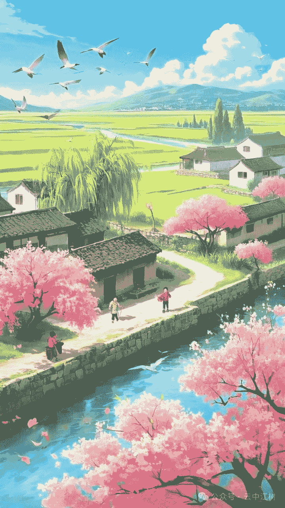
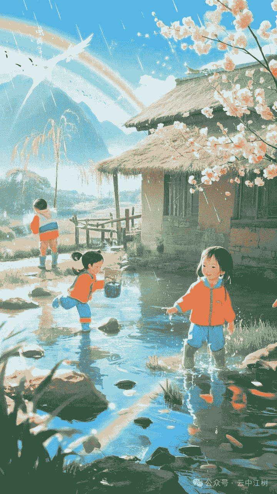
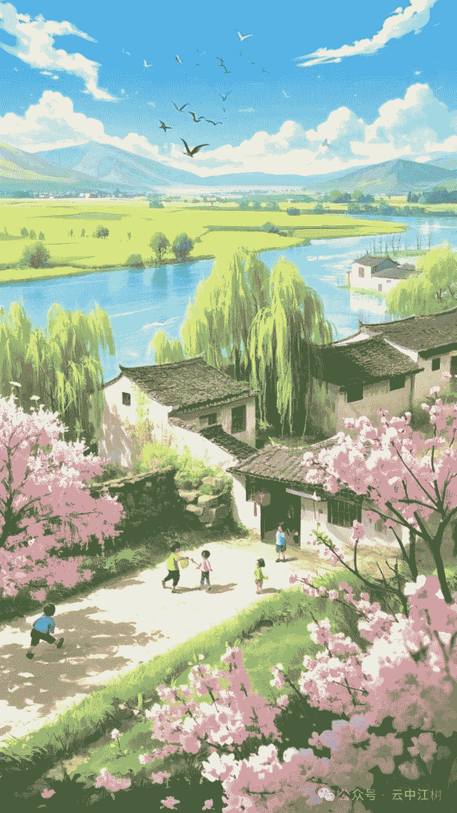
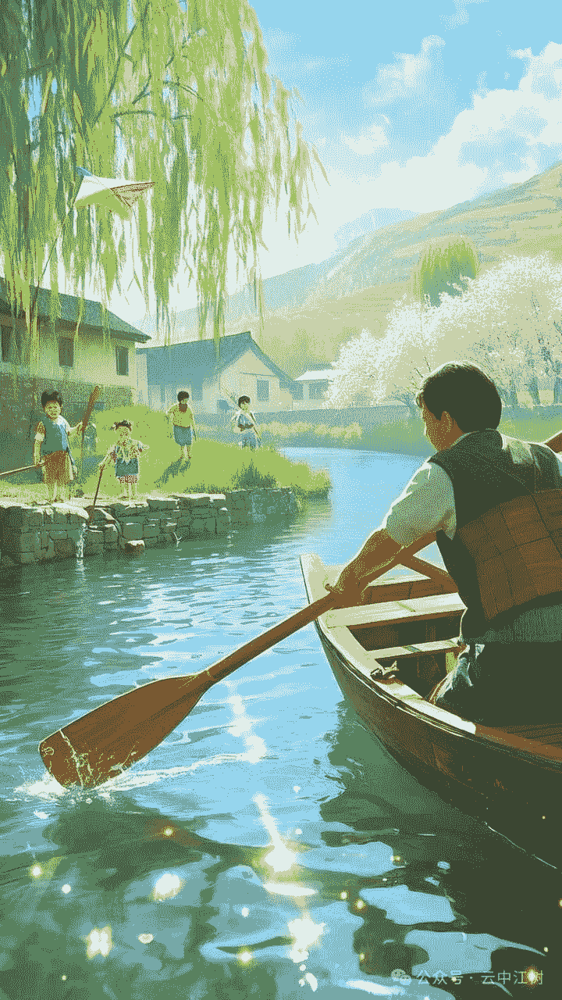
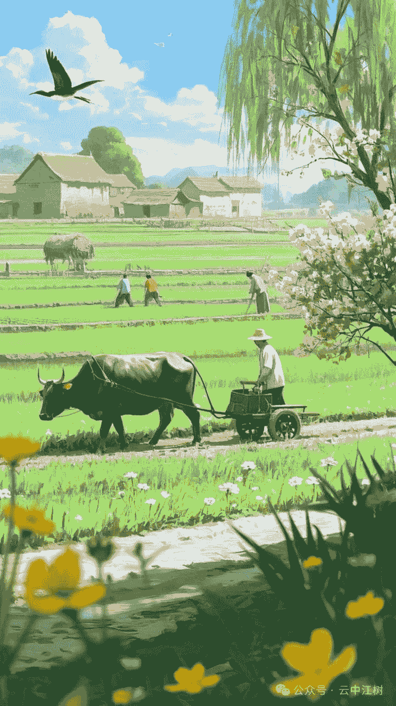
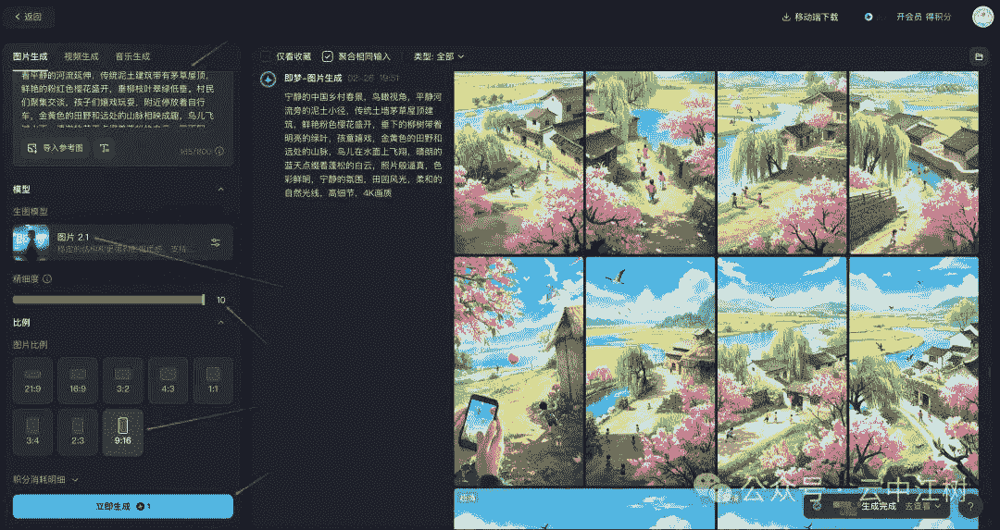

# 30秒免费生成惊艳国风画卷，小白也能轻松上手！

> 来源：[https://my.feishu.cn/docx/DdhGdad8QoDFVnxa3uFcClhBnWg](https://my.feishu.cn/docx/DdhGdad8QoDFVnxa3uFcClhBnWg)

这些美到让人窒息的中国乡村春景，零基础小白也能一键生成！👇

最近📕上很多这种充满诗意的中国传统插画风格

竟然用完全免费的即梦就能轻松实现！

这个宝藏技巧太值得分享了！👉

一起来看看如何0成本创作出这些精美画作...

## 三步搞定，新手也能画出大师级作品！

1.  **打开即梦官网**

> https://jimeng.jianying.com/ai-tool/image/generate

1.  **复制这段神奇提示词** ✨

> 一幅宁静的中国乡村春景，俯瞰视角，一条土路沿着平静的河流延伸，传统泥土建筑带有茅草屋顶，鲜艳的粉红色樱花盛开，垂柳枝叶翠绿低垂。村民们聚集交谈，孩子们嬉戏玩耍，附近停放着自行车，金黄色的田野和远处的山脉相映成趣，鸟儿飞过水面，清澈的蓝天点缀着蓬松的白云。画面写实，色彩鲜艳，氛围宁静，田园风光，柔和的自然光线，细节丰富，4K画质。

1.  **一键设置，轻松出图** 🔥

+   选择「图片2.1」模型

+   精细度拉满

+   比例选择9:16

+   点击生成，美图立现！

# 最后

沉浸在这如诗如画的乡村春景中，

我们找到了一种心灵的栖息地。

这样的美，值得被分享；

这样的技艺，值得被传递。

每一次分享，都是为世界多添一份美好。

来源：@云中江树

---

作者简介：

我是文森策，一个10年+品牌策划人，AI提示词&提效玩家。

现阶段热衷于AI辅助内容营销探索，欢迎交流分享AI辅助创作思考/技法/实用工作流，一起用AI打开更多创作可能。

⭐ **提交反馈与交流合作请直接戳我**👇

