# 用Nano Banana Pro生了40张图后，我终于理解它为什么被叫“新皇”（附全套提示词）

> 来源：[https://my.feishu.cn/docx/X3NTd3WJMoUtKnxCueRcszDXnTg](https://my.feishu.cn/docx/X3NTd3WJMoUtKnxCueRcszDXnTg)

这几天谷歌真是杀疯了！在用Gemini 3 Pro屠榜AI大模型圈后，紧接着又甩出一张王牌，网红香蕉模型的2.0升级版本Nano Banana Pro（Gemini 3 Pro 图像版）。

一时间凭实力轮番炸场，大杀四方，火爆出圈。

我也终于没忍住，闭关尝试了几十个不同维度的生成测试（要了老命了），效果和感受就是两个字：真香！

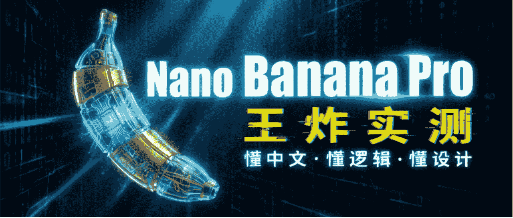

从我和众多网友们的一手测试来看，这款模型确实进步很大。

除了以前擅长的文生图，这个升级版使用Gemini强大的推理以及更贴近现实世界的实时知识信息，比以往能更好地产出可视化信息，比如创建和编辑更复杂的视觉效果、信息图表等等。

Gemini甚至推出图文并茂的直出效果功能，在产品体验上，将vibe coding不只停留在技术圈，丝滑地代入到了大众用户的使用日常。

话不多说，用来测试的Prompt提示词以及生成的图片，所有干货都在下面了，大家可以跟着我先感受一番，如果感兴趣，直接复制文中指令，即可同步卷一卷你的AI。

### 01  脑洞大开的平行宇宙

咱们先来点好玩的，看看它的玩梗水平，试探一下它的想象力和Cosplay能力。如果说以前的AI只能画画图，现在的Nano Banana Pro就能帮你造梦。

首先，大家都很熟悉的哈利波特。如果他不骑扫帚，改练轻功了会怎么样？我试着让它搞了个武侠版哈利波特，这个东方禅意feel，不得不说分分钟立住了。

#### 【提示词】：

请生成一张电影级剧照，主题是“武侠版哈利波特”。主角是哈利波特（保留圆眼镜和额头疤痕特征），但他身穿飘逸的深红色汉服长袍（类似于中国古代侠客），手持一根雕刻着龙纹的木制魔杖，正站在云雾缭绕的中国名山（黄山）之巅施法。光影效果要求像电影《卧虎藏龙》一样具有东方禅意，色调偏青冷，画质为 8K 超高清。

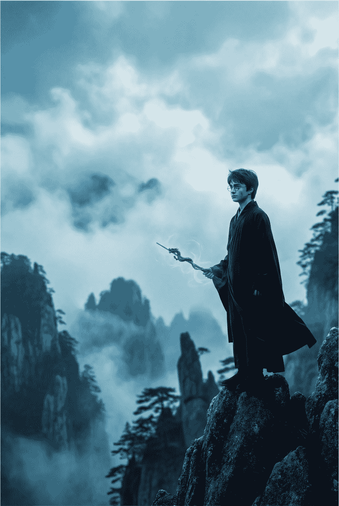

哈利波特站在云雾缭绕的黄山之巅施法，电影级武侠版哈利波特剧照有了！

这么一看，它好像确实能开始理解角色的灵魂了。

既然能跨界，那就再来个「治愈系 x 硬核科幻」的碰撞。我想看看它能不能把宫崎骏的龙猫，毫无违和感地塞进赛博朋克的世界里。

那让我们的心头好龙猫去赛博朋克的世界等个巴士，也会有点看头的吧？

#### 【提示词】：

请生成一张跨界融合的插画。场景是一个雨夜的赛博朋克未来城市巴士站，霓虹灯闪烁，地面湿滑反光。吉卜力动画中的“龙猫”体型巨大，毛茸茸的，正撑着那把标志性的黑色小雨伞站在巴士站等车。它的身边站着一位穿着带有发光二极管和透明雨衣的未来派少女。背景是高耸的、挂满全息广告牌的摩天大楼。画风要求融合吉卜力的水彩手绘感和赛博朋克的科幻光影。

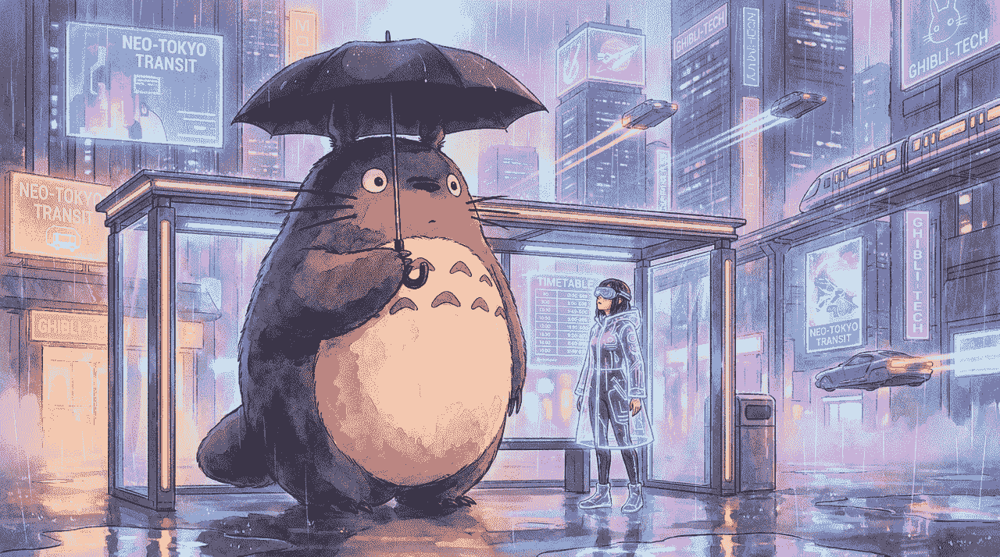

这只大龙猫以及这梦幻未来感，是我很喜欢的了！

测完画风融合，再测测反差萌。那就把《进击的巨人》里那个砍人如麻的利威尔兵长，扔进温馨的咖啡馆做个拉花？看它能不能抓住兵长那个标志性的“死鱼眼”和严肃脸。

#### 【提示词】：

请描绘一张照片级的场景：动漫《进击的巨人》中的角色“利威尔兵长”在一家繁忙的现代精品咖啡馆里担任咖啡师。他穿着带有调查兵团标志的围裙，表情依然冷峻、严肃、一丝不苟。他正极其专注地在制作一杯拿铁拉花，动作专业。背景是温暖的咖啡馆环境，有其他顾客在用笔记本电脑，窗外是现代街道。重点突出他严肃的表情和手中精致的拉花艺术的反差。

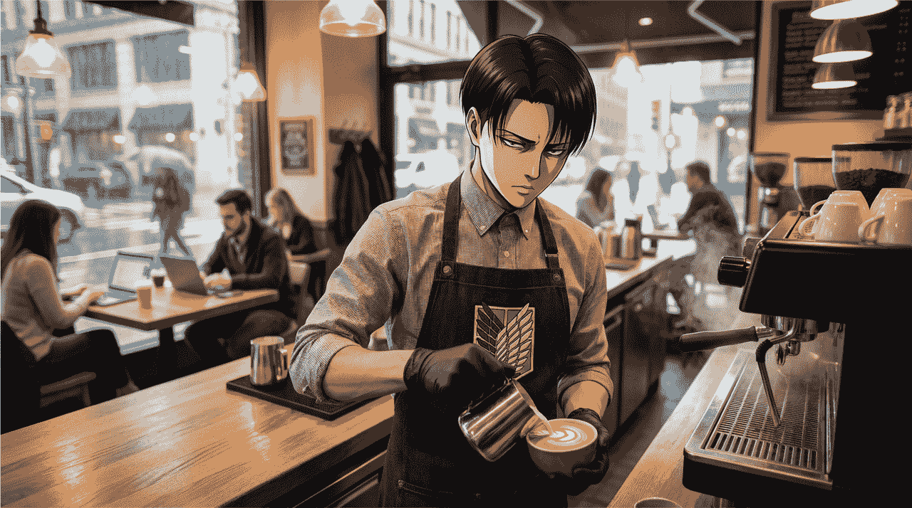

这保持稳定发挥的一贯冷冷眼神，要它突出的严肃表情果然是拿捏住了，哈哈哈

既然能控制角色，那把真人变成盲盒手办这个老网红玩法，更是so easy了，绝对的发朋友圈搭子。那么，今天就真人浅浅出个镜，大家凑合看一下效果～

#### 【提示词】：

参考图片中的人物，变身成为一个精美的 3D 盲盒公仔玩具。

材质是高光泽的 PVC 塑料，甚至能看到注塑口的痕迹。

风格是 Q 版大头身，表情夸张可爱。

它站在一个展示底座上，底座上写着：“打工人”。

包装盒散落在旁边，背景是专业的影棚柔光灯照明。

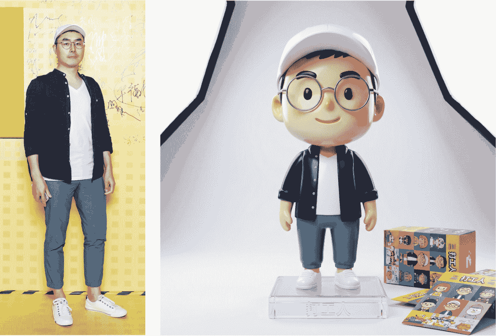

属于自己的电子手办，分分钟就拥有了～要是手头有3D打印机的朋友，还可以借助AI建模，很快打印出一个实体手办出来，感受一把真正DIY的爽感。

同样的提示词，随手再拿一张大家的老婆神仙姐姐来测试一下：

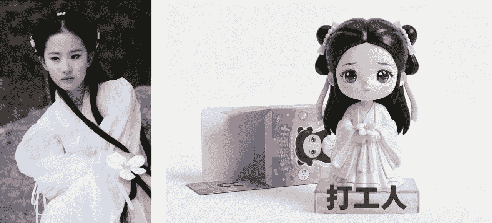

还是又漂亮又可爱的～

接下来这个是这次的升级难度：画一张微信聊天截图。

这回就选个大家耳熟能详全网热捧的大IP吧，它就是：甄嬛传。一个抽象的甄嬛传群聊风，大家且看——

#### 【提示词】：

请生成一张极其逼真的 iOS 微信群聊界面截图。

**【群信息】** 群名：“雍正集团核心管理层 (KPI考核中...)”。背景是略带磨砂质感的微信默认背景。

【聊天流 - 从上到下严格排列】

1.  CEO-四大爷 (头像：戴墨镜的雍正皇帝，手持保温杯)：

行为： 发送了一条长达 59秒 的【语音消息】。

紧接着发文字： “@所有人 今晚全员加班。安陵容的新品‘舒痕胶’销量不行啊，朕很痛心。☕️”

1.  安陵容 (头像：穿着生化防护服、正在冒烟的实验室里调香水的安陵容)：

文字气泡： “老板...那个配方...我在加急改了...😭😭😭”

行为： 发送了一个表情包，画面是一只卑微的麻雀在搬砖，配字“我命苦”。

1.  **华妃-年世兰 (头像：涂着死亡芭比粉**口红，戴着巨大的墨镜，脖子上挂着工牌)：

文字气泡： “就她那寒酸样能卖出货？🙄 本宫今晚直播间卖‘欢宜香’至尊版，一分钟就破万了。@CEO-四大爷 什么时候给本宫升职？”

1.  端妃 (头像：躺在病床上玩手机，挂着吊瓶)：

文字气泡： “你们卷吧，我请病假了。勿扰。💤”

1.  甄嬛 (右侧绿色气泡 - 用户视角)：

头像： 甄嬛在甘露寺修行的素颜自拍，但比了一个“Rock/以牙还牙”的手势。

文字气泡： “@华妃 姐姐别急，听说翊坤宫的账还没平？要不要我找果郡王审计一下？😏”

1.  敬妃 (头像：正在数砖头的像素风动图)：

文字气泡： “@甄嬛 别吵了，我在做一个‘后宫砖头数量统计表.xlsx’，谁帮我看看格式？”

1.  CEO-四大爷 (右侧绿色气泡 - 用户视角)：

行为： 发送了一个【微信转账】，显示金额：¥ 0.50。

备注文字： “加班费，拿去买点瓜子磕。”

**【渲染细节】**

+   界面必须完美还原 iOS 微信字体（San Francisco + PingFang SC）。

+   请确保安陵容的“生化防护服”头像和华妃的“墨镜工牌”头像既保留古装特征，又融合现代职场元素，这是关键笑点。

+   这个界面应该是甄嬛的聊天界面截图，所以只有甄嬛是在聊天框的右侧，其他人均在左侧显示。

+   左侧的所有人聊天信息气泡背景应为白色，右侧的甄嬛聊天信息气泡背景为绿色。

+   CEO-四大爷发红包的这条消息也必须是**在聊天界面的左侧显示**，这部分背景全部都应该为**橘红色**、并且包含有微信红包特征（红包样式icon+最下方“微信红包”四个小字）。

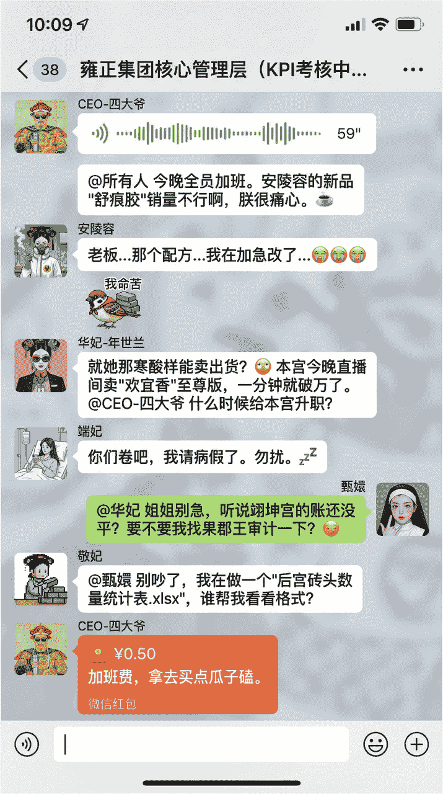

分分钟生成了极其逼真的iOS微信群聊界面截图，朋友们注意看那个绿色的气泡和文字对齐。这UI排版简直了，神模仿复刻微信聊天界面风格啊。

除了微信红包的小icon还有些不尽人意，整体已经很好了是不是，讲真，瑕不掩瑜。

所有人物角色都一个不落地呈现出来了，融入现代职场元素又保留甄嬛传原有人物语言风格的梗图，整活儿也是挺好玩的，哈哈～

这一点比上一代模型好上很多，在依指令依葫芦画瓢之外，对于现实世界的理解又往前进了一步。

### 02  学霸附体的知识图解

AI当然是不只能拿来娱乐的，发展到现在，这届Gemini 3的数据训练，对于知识的丰富理解，简直一骑绝尘了。

Nano Banana Pro的结构认知能力非常强，手绘个生物作业、物理图解啥的，不管是画细胞还是画机械，都能当教科书插图用了。拿来做笔记、搞科普才是降维打击～

比如这个植物细胞解剖图，它能清晰画出叶绿体和液泡，还给标注上中文！

#### 【提示词】：

请绘制一张精美的、教科书级别的“植物细胞结构”解剖示意图。画面主体是一个被切开的植物细胞，清晰展示内部构造。请用引线和清晰的中文准确标注以下部位：细胞壁、细胞核、叶绿体、液泡、线粒体。风格采用清新的3D渲染风格，色彩明亮区分度高，背景洁白，像是一张高质量的科普海报。

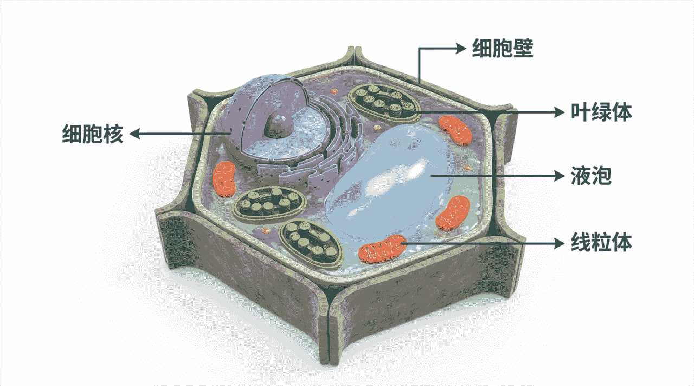

这种严肃又不失活泼的画风，用来做生物学教学和科普宣传感觉也很合适了。

既然懂生物，那物理机械也不在话下。先来个透明生物解剖。把机械结构画在水母肚子里，还得符合透视逻辑。一个复杂的透明解剖图就这么闪现了。

#### 【提示词】：

生成一张极其精细的生物学解剖图，风格类似百科全书插图。 生物是一只‘玻璃机械水母’。

外壳是完全透明的玻璃质感。

内部器官是由精密的金色齿轮和发光的蓝色光纤组成的。

它漂浮在深黑色的背景中。

画面右侧需要有引线和标注，指向齿轮部分，并清晰地写上文字标签：‘Engine Core’。

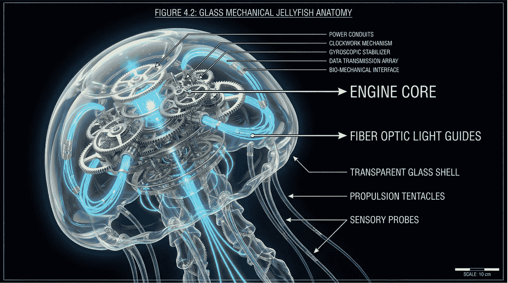

这个整体风格的呈现，简直已经符合百科全书级的科普知识插图标准了吧。

还有抽象的概念，让它把「算法」画成一座AI神经网络城市。

#### 【提示词】：

请画一张“AI 神经网络工作原理”的趣味示意图。把神经网络想象成一个复杂的发光城市交通系统，数据像发光的车辆一样在多层道路（层级）中穿梭，最终汇聚到一个中心处理塔。

这个未来感的3D风格，既保持了技术感又不失趣味性，很适合用于教育场景说明神经网络的工作原理。

更厉害的是，它能自己查资料。你不用教它步骤，让它自己去搜怎么做奶茶，然后画出来。

#### 【提示词】：

请制作一张关于“如何制作完美的台式珍珠奶茶”的竖版信息图表。风格采用现代极简主义插画风。

图表需要包含以下步骤的图解和清晰的中文标注：

煮珍珠（Boiling Tapioca）；

泡红茶（Brewing Black Tea）；

混合牛奶和糖浆（Mixing Milk & Syrup）；

加入冰块（Adding Ice）。

并在底部用醒目的大字写上：“肥宅快乐水指南”。

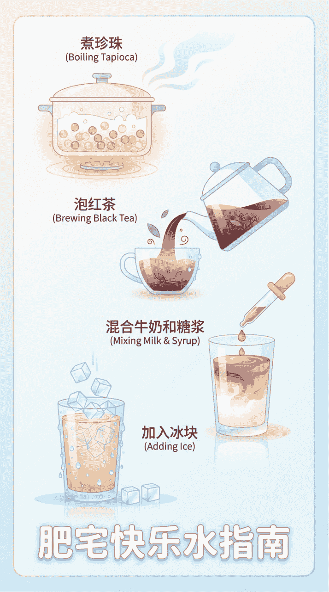

朋友们感受一下这画风，清新的渐变色，稳定的中英文文字渲染，这张图出来那一刻，我是眼前一亮的。

柔和的马卡龙色调和简洁的插画风格，信息层次清晰，已经可以立刻发出去社交媒体分享一下啦。

这对于平常做做个人自媒体的朋友，甚至是电商/新媒体运营的朋友来说，都不只是素材了，可以算得上是秒出的出街级配图了，就这出品这效率，惊不惊喜？

奶茶有了，咖啡自然也不在话下，随手评测了，就也发出来看看，请大家喝杯电子coffee，哈哈

#### 【提示词】：

请制作一张精美的“手冲咖啡制作指南”信息图。画面需要通过插画分步展示：1. 研磨咖啡豆，2. 90度热水闷蒸，3. 缓慢注水，4. 享用咖啡。请在每个步骤旁标注正确的中文说明，风格采用清新的水彩手绘风，背景简洁。

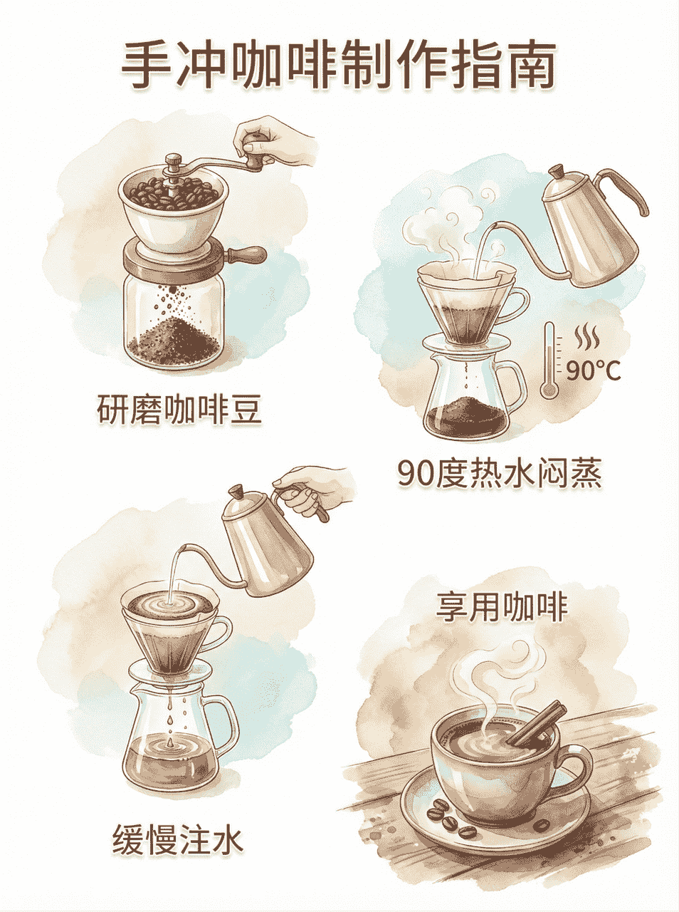

清新水彩手绘风格，这张我也很喜欢。

这两个提示词中，都还是做了简单的步骤提醒的，下面这个就属于是真厉害了，完全依赖Nano Banana Pro的Gemini 3思考推理能力，用一句简单的指令，就能调动它深度发挥。不只是画图，而是真的深入理解和拆解任务，给出实用解决方案。

特意选了个我们很常见的话题，在轻松氛围中感受一下它的专业发挥。

#### 【提示词】：

画个番茄炒蛋流程图

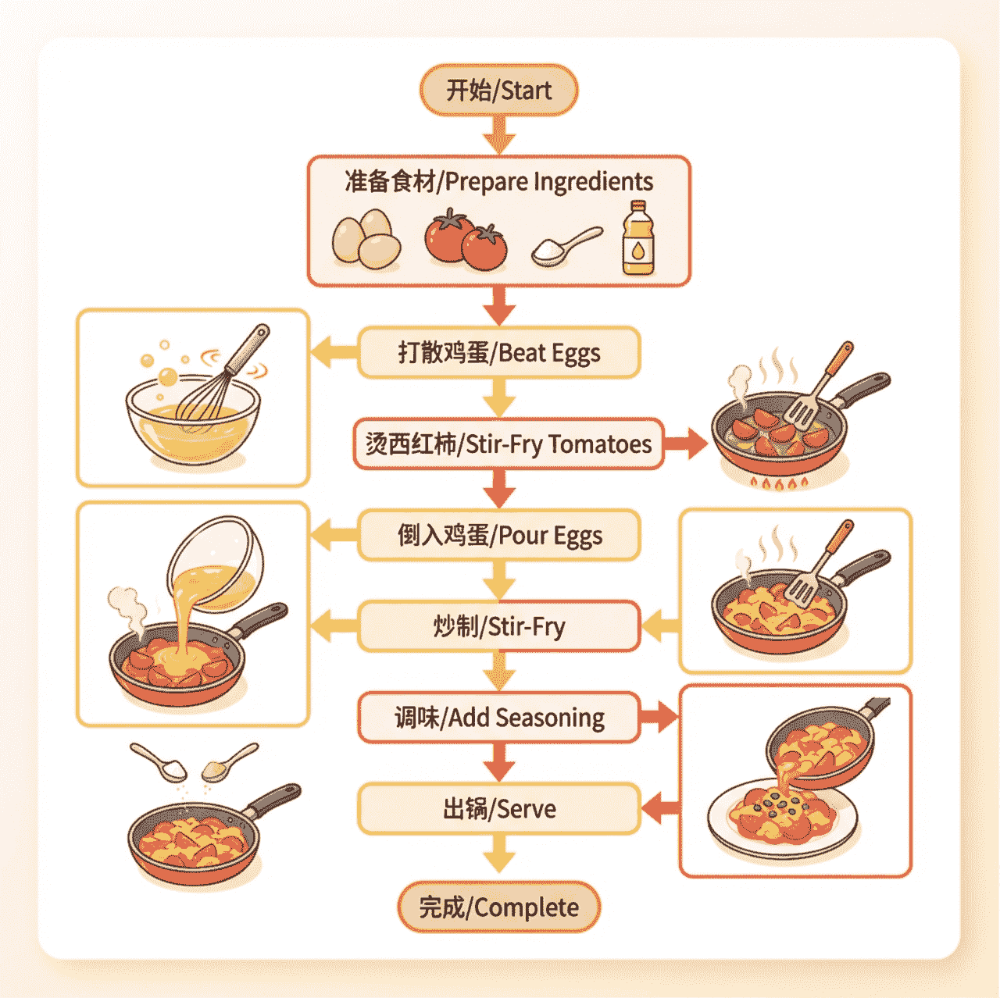

看这个流程图清晰地展示了从准备食材到出锅的完整烹饪过程，这么简单的一句话，它能分分钟出来这种生成效果，咱就说做个帮厨图解已经是很实用了有木有～

### 03  省钱省力的商业设计

既然这回大升级，中文支持是一大亮点。接下来，这部分来测试一下它的文化底蕴，看看它对中文世界的理解是不是真的精进了。就不仅要画得像，还要有味道。

以前的海外AI画中国元素很生硬，但这次我发现它是真的有点开窍了。

比如这里拿中秋和春节的节日营销海报来做个简单测试——

#### 【提示词】：

请设计一张温馨、治愈风格的中秋节插画海报。画面中心是一个巨大的、发着暖黄色光芒的月亮，月亮里面是由多层剪纸艺术构成的广寒宫和桂花树场景，几只可爱的玉兔在捣药。在海报的顶部，用飘逸的金色书法字体写上大标题“中秋佳節”。在月亮下方，用较小的、规整的宋体字写上副标题“千里共嬋娟”。整体色调是深蓝和暖金。

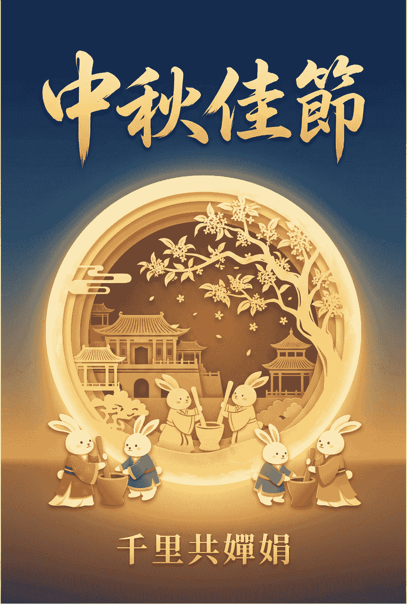

深蓝与暖金的色调融合，温馨又治愈的节日氛围feel了。

#### 【提示词】：

一张充满活力和动感的国潮风格春节海报。画面主角是一头正在腾空跳跃的南派醒狮，狮头设计结合了机械感和传统的鲜艳色彩（红、黄、金）。背景是爆炸出的金色礼花和红色的丝绸。海报中央用极其夸张、带有火焰特效的现代设计字体写上巨大的“醒獅賀歲”。下方配上一行小字“HAPPY CHINESE NEW YEAR 2026”。画面要有强烈的冲击力和庆典氛围。

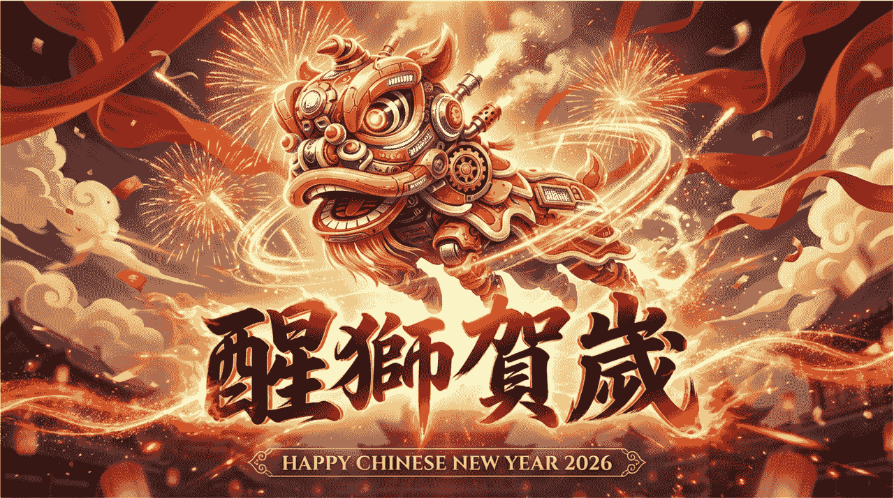

南派醒狮正在腾空跳跃，机械感与传统色彩融合，又动感又有冲击力的国潮风格春节海报，实用级生产力了。

我们再顺便测个文字渲染的效果～

#### 【提示词】：

请生成一张赛博朋克风格的台北夜市街景图。画面中心是一个发光的霓虹灯招牌，招牌上必须清晰准确地写着繁体中文“深夜食堂”四个大字，下方还有一行小字写着“珍珠奶茶无限续杯”。灯光要带有粉色和蓝色的光晕，字体要有设计感。

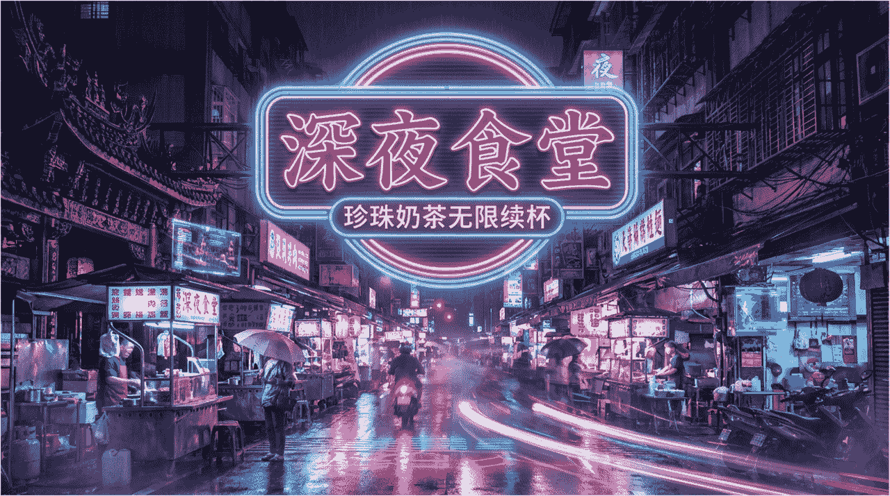

粉色与蓝色光晕效果，营造出了浓厚的赛博朋克氛围，对于赛博朋克的理解和融合很不错了。

这种审美能力用来做节日海报简直是神器，它甚至已能处理复杂的剪纸风格和中文书法字体。这对于做线上运营的朋友来说，是真福音了，就拿简单的日常运营场景来说，这种素材拿来随手再设计处理一下，添加上更丰富的品牌/产品/活动推广信息，分分钟都能po在网上了。

我身边的设计师好朋友已经在用「Nano Banana + Lovart」辅助生产级商业设计了，生成的一些素材图，不管是画风创意，还是审美和稳定性，都很让人惊艳。

当然，要想一键生成很高质量的图片，还很依赖于自己的专业审美与驾驭ai工具的能力，包括提示词技巧。只不过Gemini 3这波让这种驾驭能力的鸿沟又消解了不少，让AI对于任务的理解、生成的稳定性，都前进了一步，对我们大部分普通人来说，就会更傻瓜式好用了。

不敢想象在不久的将来，品牌营销运营、设计相关行业得被这些个AI影响成啥样～

那说回更具落地性现实可操作的，如果是做商业设计，从品牌Logo、VI、海报甚至到快闪店效果图设计，咱们逐个来看。

想给新能源汽车做个Logo 提案？直接给客户看这两种风格demo，一个是未来的玻璃感极客风——

#### 【提示词】：

为新能源超跑品牌“AETHER (以太)”设计一个车头 Logo 的微距实拍照片。

【图形设计】

Logo 图形是一个抽象的“莫比乌斯环（Möbius strip）”结构，象征无限续航与循环。线条极其流畅，没有任何锐角，呈现出液态金属的流动感。

【材质与光效（关键测试点）】

这是一个内嵌式的发光车标。

外层： 高透光的蓝宝石水晶玻璃材质，表面带有雨后的微小水珠，反射着城市的霓虹夜景。

内层： 核心是一条发着“冰蓝色（Ice Blue）”呼吸光的灯带，光线柔和地漫射出来，边缘带有微妙的紫边色散。

底座： Logo 镶嵌在哑光碳纤维（Carbon Fiber）纹理的封闭式格栅上，碳纤维的编织纹理清晰可见。

【排版】

在图形 Logo 的正下方，有压印（Embossed）在金属条上的品牌英文：“AETHER”，字体为充满未来感的宽体无衬线字，带有拉丝金属质感。

【氛围】

8K 电影级画质，浅景深（Bokeh），对焦在 Logo 的玻璃表面，背景是虚化的赛博朋克城市街道。

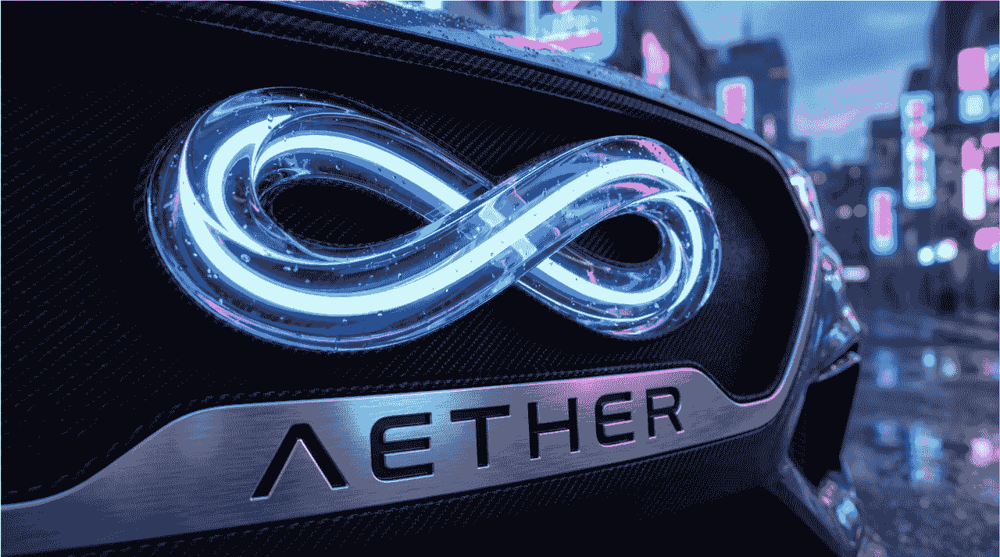

另一个是奢华的金属感运动风——

#### 【提示词】：

设计一个极具侵略性的豪华电动 SUV 品牌 Logo，品牌名为“TITAN”。

【图形概念】

图形灵感来自于“三叉戟”与“闪电”的结合。由三个锐利的银色回旋镖形状组成一个放射状的对称图案，视觉重心极度稳定，充满力量感。

【材质工艺】

抛弃发光设计，回归纯粹的极致工业美学。

材质为“暗夜黑铬（Dark Chrome）”与“香槟金（Champagne Gold）”的拼色组合。

表面处理采用瑞士名表级别的工艺：边缘是镜面抛光（High Polish），中间面是细腻的缎面拉丝。

【场景呈现】

Logo 被安装在汽车引擎盖的前端。

阳光从右上角 45 度射入，在金属倒角处形成耀眼的高光（Specular Highlight），并没有过度曝光。

【文字标识】

Logo 下方紧贴着一行精致的立体金属字：“TITAN MOTORS”。

【画质要求】

超写实渲染（Octane Render），不仅要展现金属的冷硬感，还要表现出车漆的深邃光泽，画面要有高级的颗粒感。

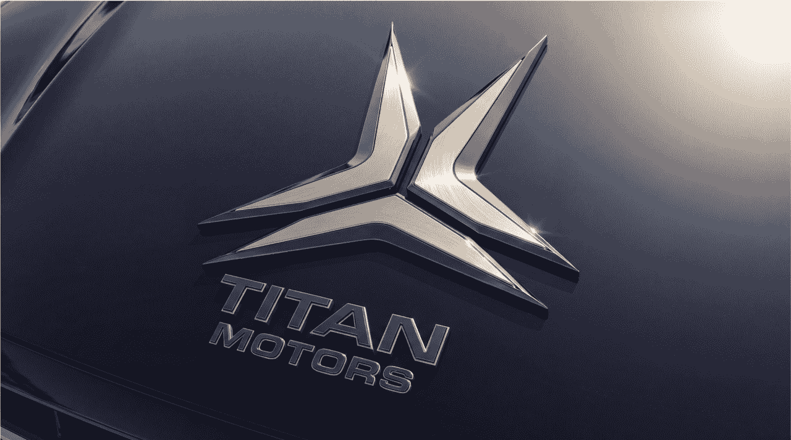

这次测试的logo素材好像有点太近景了，但不想补充了，有点掉在素材堆里出不来了，哈哈～下次再来点很具画面张力的摄影大片感汽车图，之前用上一代模型测试过，就已经很惊艳了，想必以后会表现更拉风了。

做品牌设计的时候，VI也是刚需。现在来看套demo的生成效果。

#### 【提示词】：

生成一张俯视视角的品牌 VI 视觉识别系统展示图（Branding Mockup Flat Lay）。

品牌设定： 一家名为“山丘咖啡（HILLS COFFEE）”的日式极简咖啡馆。

包含物料：

1.  一个牛皮纸色的外带咖啡杯（印有黑色 Logo）；

1.  一张白色的极简名片；

1.  一个帆布手提袋；

1.  一份菜单设计；

1.  散落在旁边的几颗深烘焙咖啡豆。

风格： 莫兰迪色系（米色、灰绿色、原木色），光线柔和自然，仿佛是在精致的木桌上拍摄，具有 Behance 设计首页的高级感。

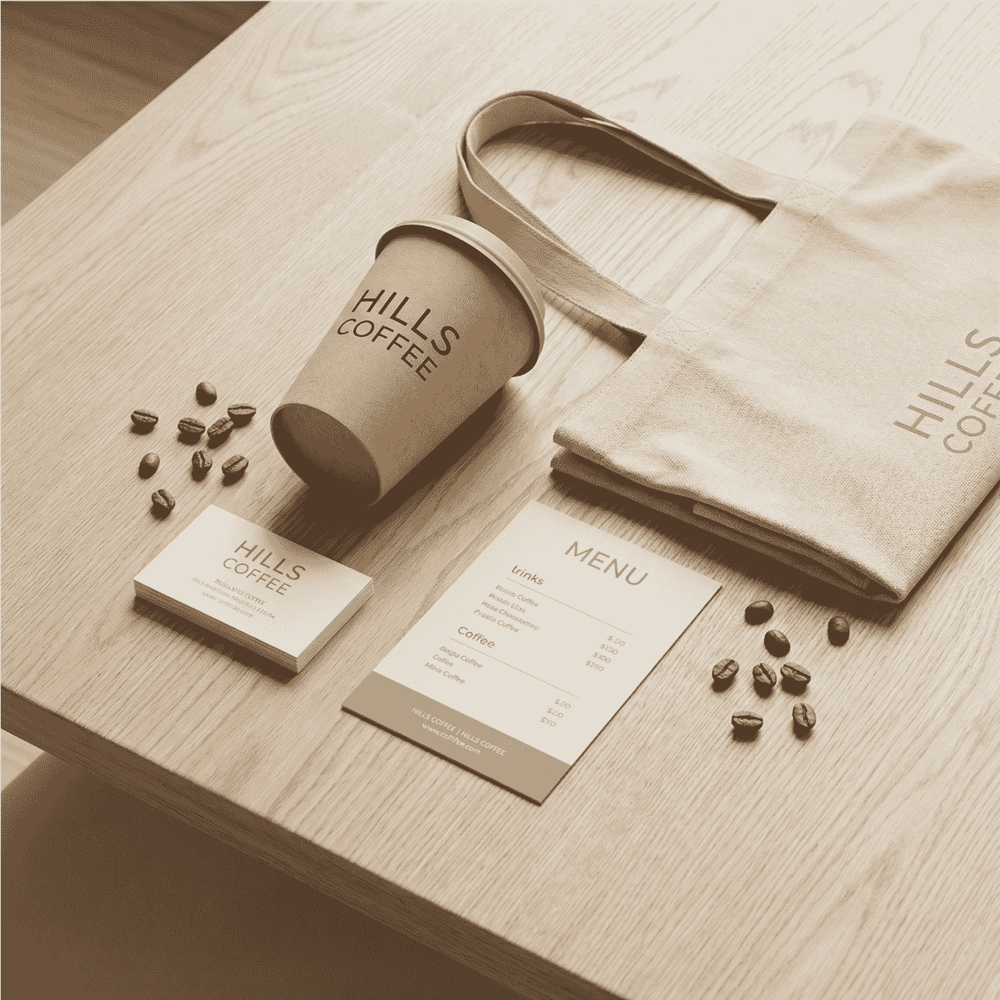

画面采用俯视视角，将牛皮纸咖啡杯、白色名片、帆布手提袋、菜单和咖啡豆等品牌物料精心陈列在原木桌面上，整体呈现莫兰迪色系的高级感，光线柔和自然，还真的有Behance设计平台的专业品质感，妥妥的日式极简美学了。

打完品牌基础，推广环节的物料自然也是必不可少的。试试做产品KV海报？那自然也不在话下。

#### 【提示词】：

为高端男士香水”极光 (AURORA)“生成一张杂志内页级别的商业广告海报。

【画面主体】

一个棱角分明的深海蓝渐变玻璃香水瓶，瓶盖为哑光拉丝钛金属材质。瓶身半透明，能看到液体的流动感。瓶子放置在黑色镜面材质上，倒影清晰。

背景是深邃的极夜星空，一道幽绿色的极光如丝绸般横跨画面，光影细腻，为瓶身提供侧逆光（Rim Light）。

【排版与文字要求（核心测试点）】

请严格按照现代主义排版风格（International Typographic Style），将以下信息排布在画面右侧的留白处，文字必须清晰锐利，无乱码：

1.  主标题（顶部，最大字号，无衬线体，白色）：

AURORA

极 光

1.  Slogan（标题下方，字号适中，优雅宋体）：

循 光 而 行 ， 步 履 不 停

1.  产品核心卖点（中间位置，小字号，整齐左对齐）：

前调 Top Notes: 佛手柑 / 冰川水

中调 Heart Notes: 雪松 / 杜松子

后调 Base Notes: 龙涎香 / 苔藓

1.  底部规格信息（底部，极小字号，字间距宽松）：

EAU DE PARFUM | 100ml / 3.4 fl.oz.

【渲染要求】

8K分辨率，超精细细节。文字仿佛是经过专业平面设计软件（如InDesign）排版后叠加在画面上的，字距（Kerning）考究，不要与背景混淆。

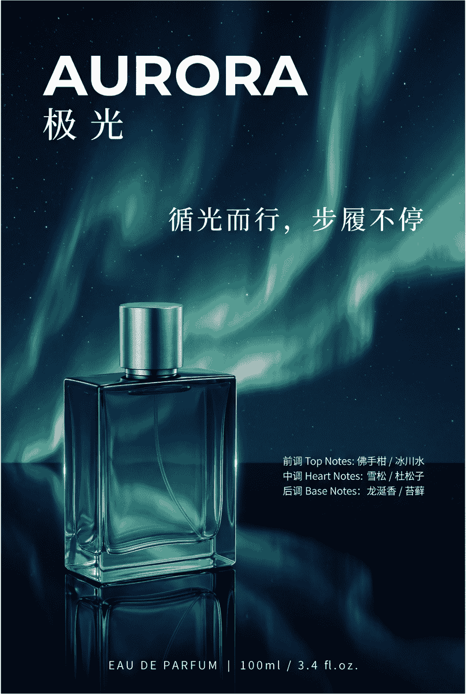

看看这个极光香水的质感，乍一看还是很能拿得出手的吧。现在连文字排版都不用自己动手了。

接下来，再试一张复古广告。测试它能不能把产品和文字排版完美结合。

这回我们就让“NANO BANANA”网红香蕉出回镜——

#### 【提示词】：

设计一张 80年代风格的复古杂志全页广告。 画面主体是一根外观像未来科技产品的黄色香蕉，由于它不仅是水果也是手机，上面有天线和按键。

图片正上方用巨大的、粗体的复古衬线字体写上标题：‘NANO BANANA’。 底部用清晰的白色字体写上广告语：‘Taste the Future’。 整体色调为暖黄色和复古噪点风格，要有高级感。

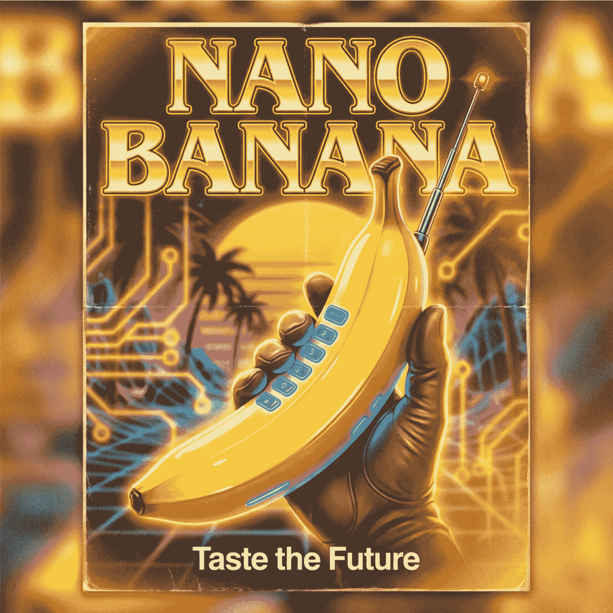

一张80年代风格的复古杂志全页广告，与未来科技感的结合，又复古怀旧又疯癫抽象有木有。

至于空间设计，那更是有求必应。

快闪店秒出图，活动策划er的福音。不用等3D渲染，先出概念图去拿预算，这丝滑。

#### 【提示词】：

设计一个位于高端商场中庭的“赛博朋克风”化妆品快闪店（Pop-up Store）的效果图。

视角： 人视视角的广角镜头。

材质与色彩： 大量使用镭射幻彩玻璃（Dichroic Glass）、拉丝银色金属和粉色霓虹灯管。

结构： 中心是一个圆形的试妆台，顶部悬挂着发光的品牌 Logo 装置。

氛围： 充满未来感和科技感，地面是反光材质。

人物： 画面中要有几位穿着时尚的年轻女性在试用产品，作为比例尺参考。

渲染风格： Unreal Engine 5 建筑渲染，超写实光线追踪。

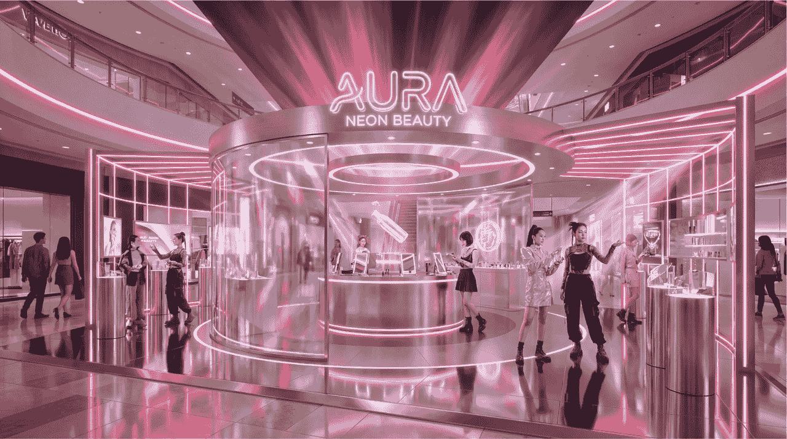

这氛围这feel，什么科技感啦未来感啦，分分钟拿捏，非常适合用于对品牌出街调性更有要求的轻奢甚至科技类品牌的商业展示场景。

Nano Banana Pro这一波，咱就别说是设计师朋友们本人用来搞钱了，就连普通个体，借助这些越来越好用的AI，想省钱都是更加容易的了。

比如你最近正打算装修？那先别急着找室内设计装修公司，自己用AI跑个图试试，小蓝图先畅想一下。

咱们这就来试一下一直挺火的法式奶油风。

#### 【提示词】：

请生成一张专业级的室内设计渲染图。风格为目前流行的“法式奶油风 (Cream Style)”。客厅采用温润的米白色和奶咖色为主调。画面包含：云朵造型的白色布艺沙发、圆润的弧形门洞设计、人字拼的浅色木地板。阳光透过白色的纱帘柔和地洒在地面上，光影效果极佳。茶几上放着一杯咖啡和一本杂志。整体氛围慵懒、高级、舒适。

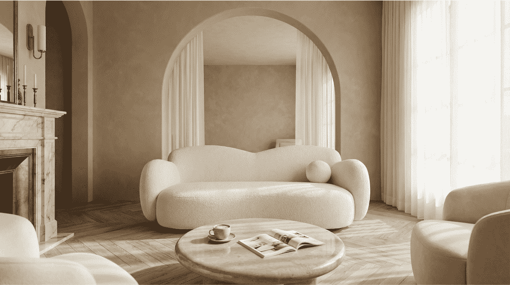

一张专业级法式奶油风室内设计渲染图就这样生成了，整体氛围慵懒、高级、舒适，光影效果也很不错。它对这个白色纱帘的光影，还有布艺沙发的质感，还原度简直惊人。

如果你喜欢硬核一点的，也可以试试赛博朋克中式书房。虽然这多少有点超现实了，但要测试就来点拥抱未来的嘛，感受一下总是可以的，至于采不采纳再说喽～

#### 【提示词】：

这是一个未来的中式书房设计。房间中心是一张悬浮的实木书桌，上面放着全息投影的古籍卷轴。书架是传统的博古架结构，但格子里摆放的不是古董，而是发光的量子计算机组件和赛博格植物。窗外是霓虹闪烁的未来城市夜景，红蓝色的环境光映照在室内的红木家具上，形成冷暖对比。

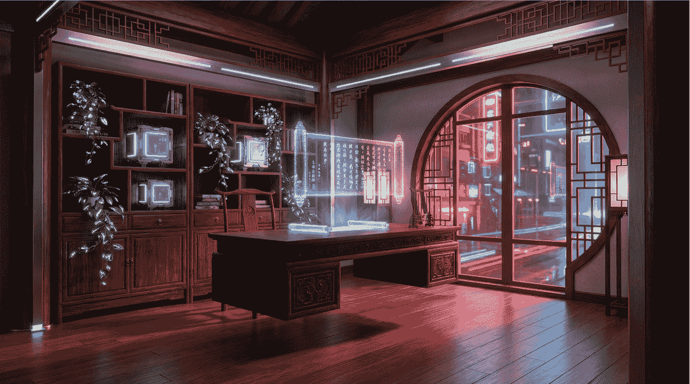

这个未来中式书房的设计图，古典与未来科技的交汇，在此就形成了。

### 04  大师级别的视觉大片

除此之外，商业摄影与时尚杂志风这块，Nano Banana Pro的审美也比前一代模型更加强大，生成的图片细腻丰富度都更好了一点。

4K、8K摄影大片这种清晰度也能轻松生成，不过篇幅所限，上传不了很高清的画面，这点朋友们可以自测感受一下，感觉不只设计师朋友们，摄影师朋友们也在慌了。

先来一张我们的传统瑰宝水墨风测试一下——

#### 【提示词】：

生成一张极简主义的艺术概念图，主题是“凝固的水墨”。

**【核心创意】**

画面中心是一位舞者正在旋转，但她并没有穿着真实的衣服。她的裙摆是由“泼洒的浓黑墨汁”和“升腾的烟雾”构成的。

这些墨汁和烟雾在空中凝固成了丝绸礼服的形状，既有液体的飞溅感，又有丝绸的褶皱纹理。

**【色彩与构图】**

纯白色的无限背景（Infinite White Background），利用大量的留白（Negative Space）来强调东方的空灵感。

画面只有黑、白两色，以及少许的朱砂红（可以是舞者唇上的红，或是一枚漂浮的红色印章）。

**【渲染质感】**

8K分辨率，超微距细节。要清晰地展现出墨汁边缘那种半透明的晕染效果（Subsurface Scattering），以及烟雾飘渺的动态模糊。这就仿佛是一滴墨水滴入水中瞬间的高速摄影。

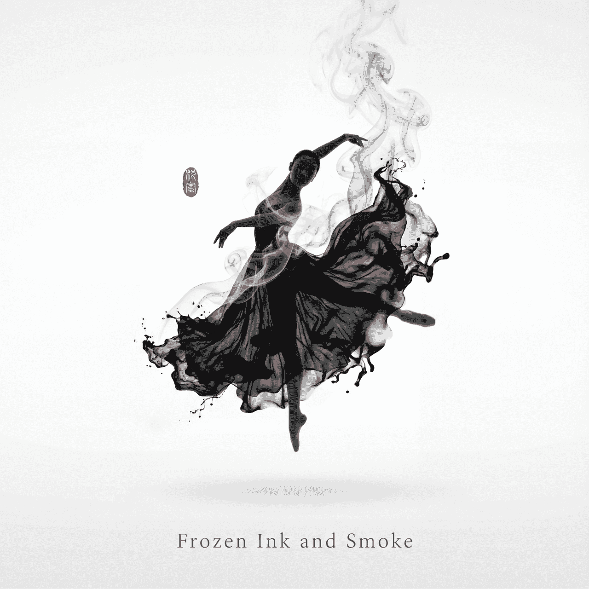

这张极简主义艺术概念图「凝固的水墨」，将传统水墨的流动感与现代雕塑的凝固瞬间完美融合，呈现出了梦幻而富有哲学意味的视觉效果。很高级了有木有～

测完国风，接下来我们再来一张新国风——

#### 【提示词】：

生成一张极其华丽且梦幻的新国风概念摄影图。

**【核心概念】**

将敦煌壁画中的“飞天飘带”进行现代科技化的重构。模特身处一个纯净的零重力空间中。

**【服饰与材质】**

她身上的衣裙不是普通的布料，而是一种**“全息流光丝绸” (Holographic Silk)**。这种面料在光线下呈现出敦煌经典的配色渐变：石青、朱砂、赭石与金色的完美融合。

衣摆极其长，在空中蜿蜒流动，如同彩色的银河或云雾，包裹着模特的身体，既有丝绸的柔软褶皱，又有金属般的光泽。

**【人物状态】**

模特姿态舒展，仿佛在空中悬浮（Levitation photography）。面部表情松弛神圣，妆容带有金箔点缀。

**【画质要求】**

8K 分辨率，色彩过度要非常柔和（Smooth Gradient），不要出现噪点，强调丝绸表面的丝滑质感。

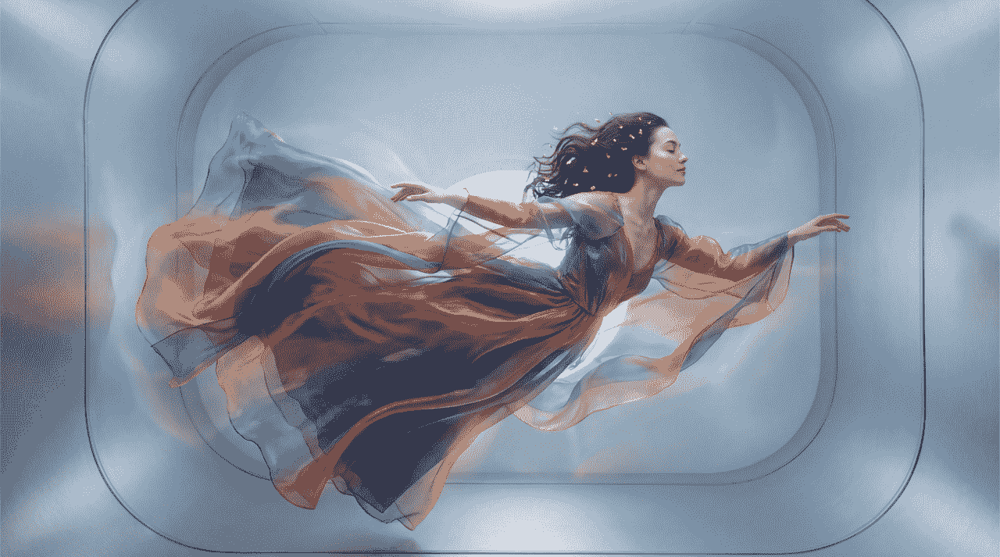

这张华丽又梦幻的新国风概念摄影图，把零重力悬浮姿态、全息流光丝绸、经典配色渐变、梦幻质感、神圣氛围都融合拿捏住了，4K分辨率的丝滑质感，色彩过度柔和自然，相比前面水墨风的高级感，更添了一份优雅。

接下来，扩展一组新国风时尚人像海报，带来一组vogue杂志风。

大家一起感受一下可商业落地的空间如何，毕竟玩票归玩票，终极目标我们都还是想借助这些工具，能真正实现一些生产力上的提效和收效的。

#### 【提示词】

生成一张《Vogue》杂志封面的竖版设计图。

**【杂志刊头】**

顶部必须有巨大的、经典的衬线体标题：VOGUE。

标题颜色为深翠绿色（Emerald Green）。

关键测试点： 请让一两片前景的竹叶微微遮挡住字母 "V" 和 "G" 的边缘，形成细腻的前后空间感（Depth of Field）。

**【画面主体】**

一位东方超模的半身特写。她妆容极简，眼神犀利直视镜头。

她穿着一件纯白色的高定剪裁西装，领口立起。

**【光影艺术】**

阳光透过画面外的竹林，将清晰锐利、姿态优雅的竹叶影子投射在模特白色的西装和脸颊一侧。

影子必须符合物理光学，边缘锐利，黑白对比强烈，构成一幅如水墨画般的构图。

**【排版细节】**

画面左下角有两行优雅的无衬线小字标题：

Line 1: THE SHADOW OF EAST

Line 2: 东方竹韵 · 2026

**【画质】**

哈苏相机（Hasselblad）拍摄质感，演播室灯光，8K 分辨率。

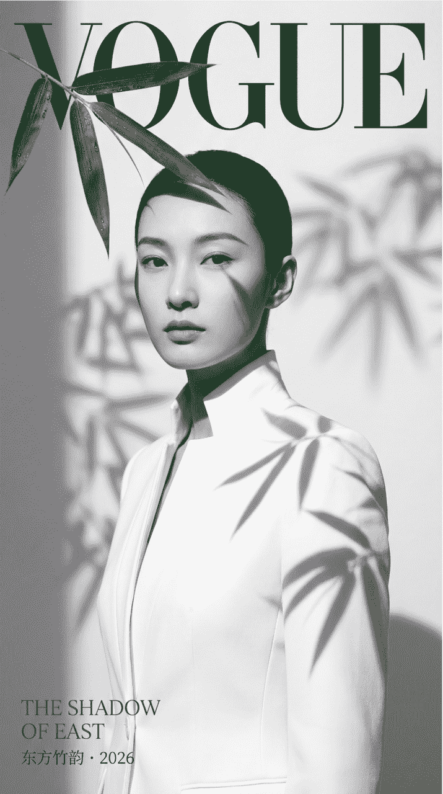

#### 【提示词】：

请生成一张具有电影质感的新国风时尚人像海报，风格致敬王家卫的色彩美学。

**【画面主体】**

一位气质清冷的东方超模，身穿极简的墨绿色丝绒长裙，妆容干净，只有唇部是一抹复古的朱砂红。她侧身站在一面白墙前。

**【核心测试点：光影逻辑】**

画面右侧有几竿翠竹（不需要完全入画），阳光透过竹叶，在模特白皙的脸庞和身后的白墙上，投射出斑驳、清晰且富有诗意的**竹影**。影子要与模特的五官起伏完美贴合，形成人面桃花相映红的现代版意境。

**【材质与细节】**

模特佩戴着一只通透的、种水极好的**翡翠耳坠**。光线穿过翡翠，在颈部投下一小点绿色的光斑（Caustics，焦散效果）。

**【氛围】**

宁静、高级、光影层次丰富，画面具有大量的留白。

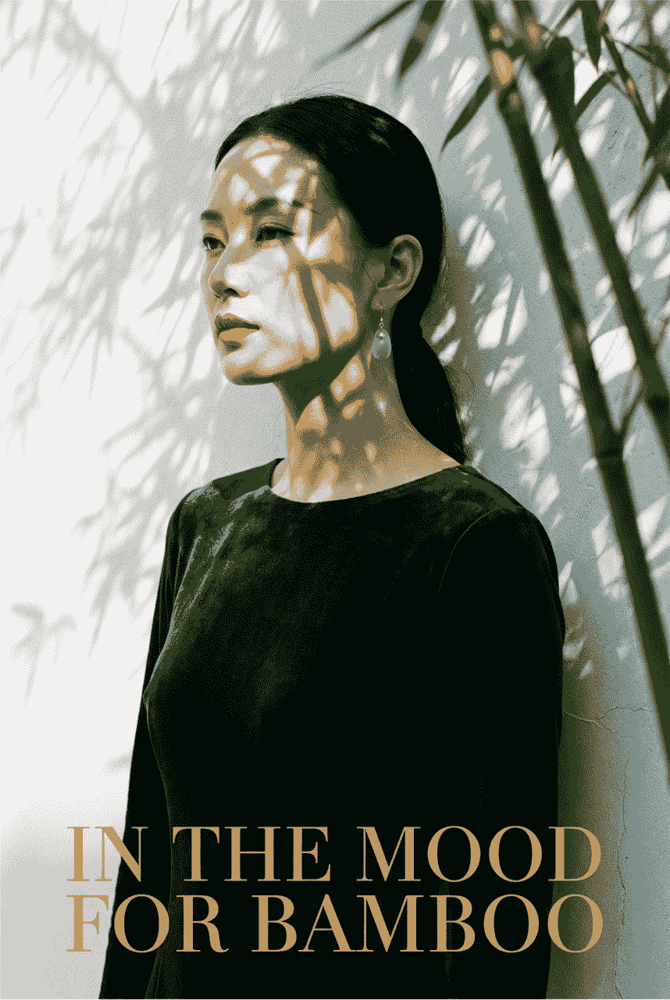

#### 【提示词】：

设计一张具有强烈视觉冲击力的《Vogue》服饰美容版封面。

**【核心造型】**

模特身着一件极具未来感的“竹编铠甲”（Bamboo Weaving Armor）。

这不是传统的竹筐，而是解构主义的高级时装。竹蔑被打磨得如同黄金般光滑，编织出夸张的立体廓形，包裹着模特的肩部和头部，像一个巨大的时尚光环。

**【色彩与光泽】**

整体色调为“黑金”风格。背景是深邃的炭黑色。

侧逆光（Rim Light）打在竹编材质上，反射出温润的木质光泽和强烈的立体感。

**【杂志排版】**

顶部的 VOGUE 标题采用烫金质感（Gold Foil Texture）。

标题位于竹编头饰的后方，被头饰的边缘部分遮挡，体现出模特“破框而出”的气势。

**【文字内容】**

底部居中排版中文标题：

主标题：非 遗 新 生

副标题：BAMBOO RENAISSANCE

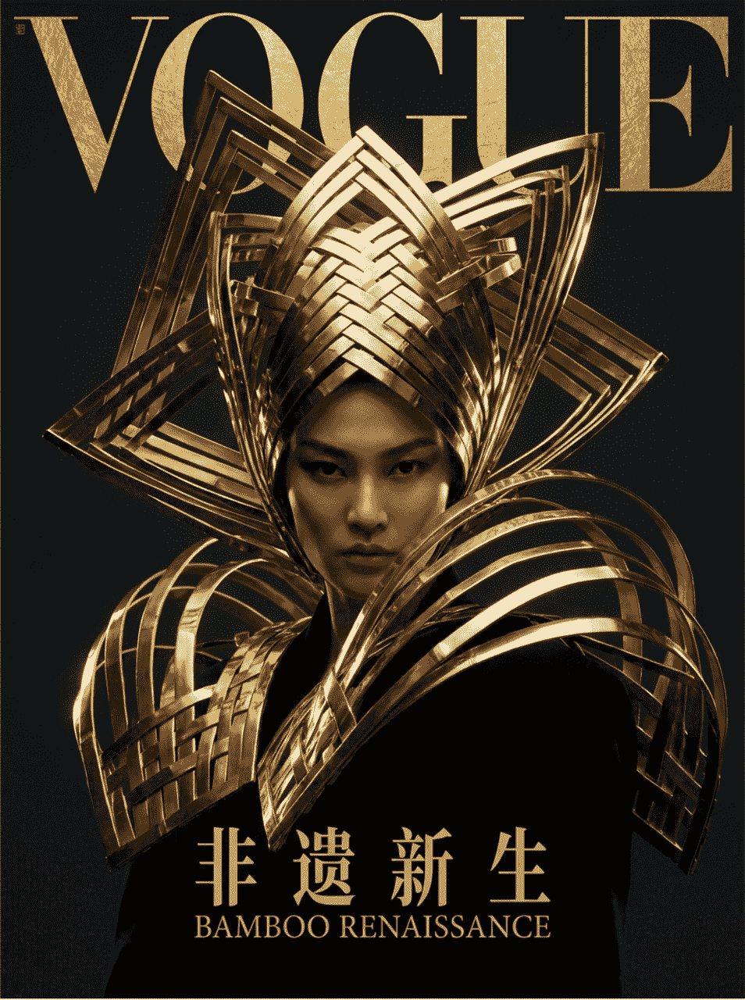

这几张图，立体感和视觉张力都有，不管是Vogue标志性的顶栏大logo，还是指令中要求的文字，中英文生成的效果都很稳定。甚至连字体都可以框定，惊住了有木有。

说到这里，想到一年前的这个阶段，我为了实现类似这种杂志风海报配图效果，当时还费劲巴拉地搓了一个巨长挺复杂的「文生图Prompt」，来各种描述限定风格，特意让给出留白空间，以便后续手动添加文字信息上来。

就在一年后的现在，已经完全用不着那么麻烦去分几个阶段的工作流，去打磨提示词、再生图、再设计，就已经可以一键直出这种效果，科技进步真的是一种神奇的力量啊！

话说回来，除了前面的人物摄影风，人文摄影当然也是可以的——

#### 【提示词】：

90年代台北旧唱片店的木架上，周围堆满了黑胶唱片和旧磁带，温暖的钨丝灯光，背景有霓虹灯招牌的倒影，空气中有尘埃飞舞。

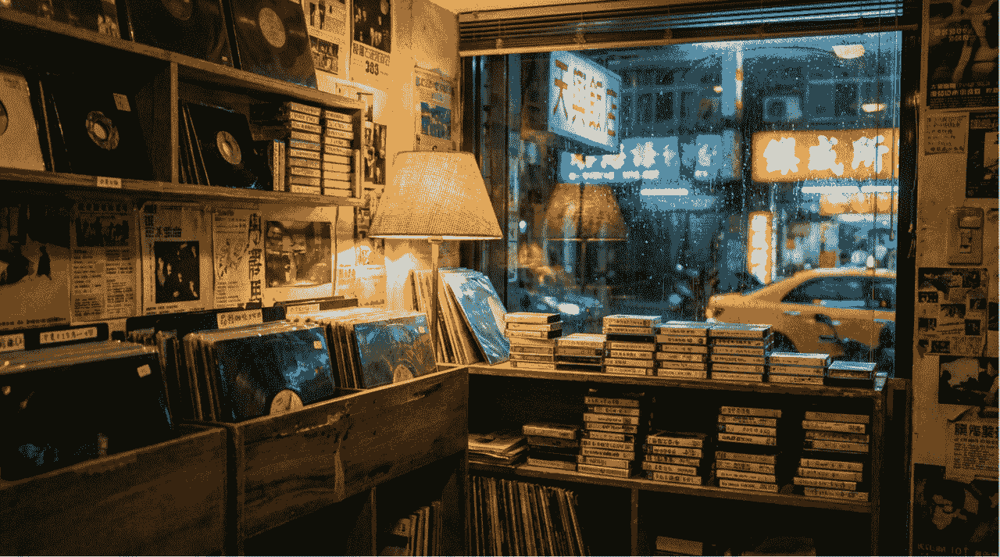

浓郁的复古氛围扑面而来，罗大佑的《恋曲1990》都在耳边响起了，就这么悄悄溜走的轻飘飘的旧时光啊～

伤感一秒钟，回来了。让我们转移到自然风景，开阔一下，就拿我喜欢的FUJI风来随手测试两个：

#### 【提示词】：

主体是远景中雄伟壮观的富士山，山顶覆盖着厚厚的积雪，在清澈的蓝天下显得格外圣洁。前景是宁静宽阔的湖面（类似于河口湖），湖水清澈见底，如镜面般完美倒映着富士山的倒影（逆富士）。画面左下角有少许随风摇曳的金黄色芦苇或延伸入湖的古老木质栈桥作为前景引导线，增加画面的层次感。拍摄距离为远景，采用广角镜头拍摄，以展现宏大的风景场面；拍摄高度为低角度，贴近水面拍摄，强调湖水的质感和倒影的对称美；拍摄方向正对富士山。场景设定在清晨的黄金时刻，阳光刚刚照亮山顶（日照金山），色温温暖，而湖面和阴影处仍保留着清晨的冷调。图片风格为典型的富士胶片摄影风格（Fujifilm Style），模拟 Fujichrome Velvia 50 胶片效果，色彩鲜艳且浓郁，对比度较高，天空呈现出富士特有的深邃青蓝色，植被呈现油润的深绿色。画面清晰锐利，具有极高的动态范围，光影过渡自然，带有轻微的胶片颗粒质感，是一张令人屏息的自然风光摄影大片，8k分辨率，超写实。

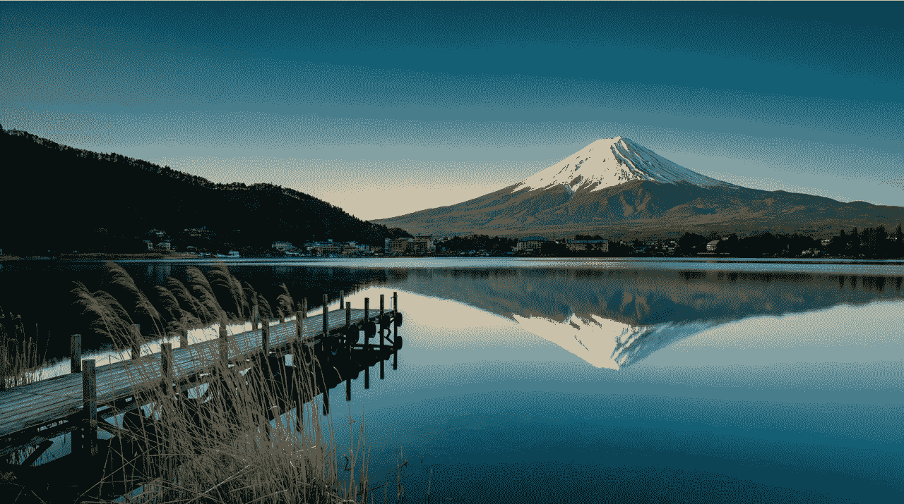

这张重点在于捕捉富士胶片特有的高饱和度色彩、深邃的绿色与蓝色表现，以及细腻的胶片颗粒感。

#### 【提示词】：

主体展现的是日本富士吉田市本町通的标志性街景，在画面正中央的背景处，雄伟壮观的富士山拔地而起，占据了画面的上半部分，山顶覆盖着皑皑白雪。街道两侧是充满昭和复古气息的商店，挂着日文招牌和红色的灯笼，排列着典型的日式电线杆和错综复杂的电线。采用远景拍摄，利用长焦镜头的压缩感，使背景的富士山看起来极其巨大，与前景的街道形成强烈的视觉对比。拍摄角度为平视，视角正对街道延伸方向。场景设定在黄昏的蓝调时刻（Blue Hour），天空呈现出深邃的靛蓝色，街道上的路灯和招牌散发出温暖的橙黄色光芒，形成冷暖色调的互补对比。画面具有浓郁的富士摄影风格（Fujifilm Style），模拟了Classic Negative（经典负片）胶片模拟效果，高对比度，色彩略显复古与厚重，阴影部分深沉但保留细节，高光柔和，带有细腻的胶片颗粒感。这是一张高质量的摄影大片，构图严谨，具有电影般的叙事感，8k分辨率，画质极佳。

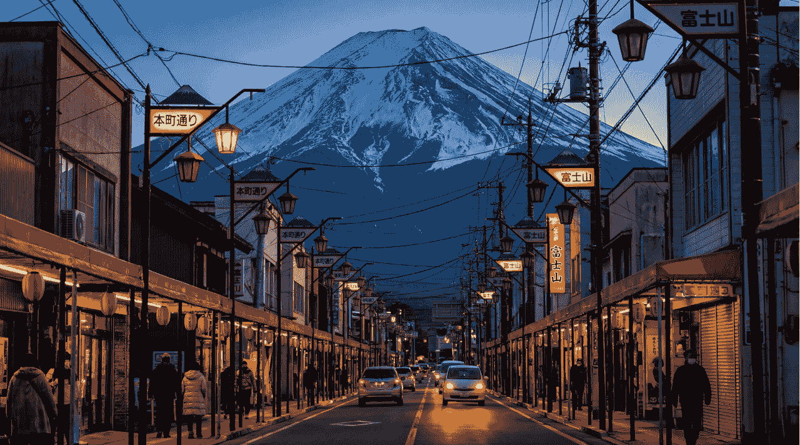

这是一个极具代表性的日本风光机位，巨大的富士山背景与充满生活气息的昭和风街道形成强烈视觉冲击，非常适合表现“富士摄影风格”的胶片感和“摄影大片”的压迫感构图。

### 05  物理逻辑的整活挑战

最后，我们回归本质，看看它到底有多聪明～

这部分是老粉都知道的保留节目了。

说到AI生图，角色永远是个绕不开的强需求视觉主体，而要说到角色，最难的还是“角色一致性”。能不能让同一个角色在不同场景里不崩坏？我用这个猫侦探测试了一把。

我们先来出一张图——

#### 【提示词】：

生成一张全身照：一只拟人化的英国短毛猫侦探，穿着旧风衣，戴着复古圆墨镜，脖子上挂着一个发光的全息警徽。背景是灰暗的赛博朋克街道，霓虹灯闪烁。请记住这个角色的外观特征。

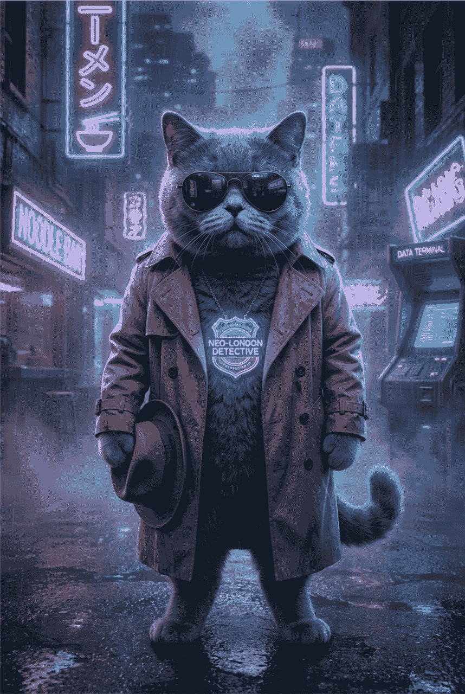

这时候Gemini会回复说，它会记住这个角色的外观特征，包括他的毛色、服装、墨镜和警徽等细节。

紧接着，我们来发出第二条Prompt指令——

#### 【提示词】：

保持上面那个猫侦探的角色外观完全一致（包括风衣、墨镜和警徽）。生成一张新图片：它正坐在一间混乱的高科技拉面店里吃发光的蓝色面条，手里拿着一双金属筷子，表情严肃。

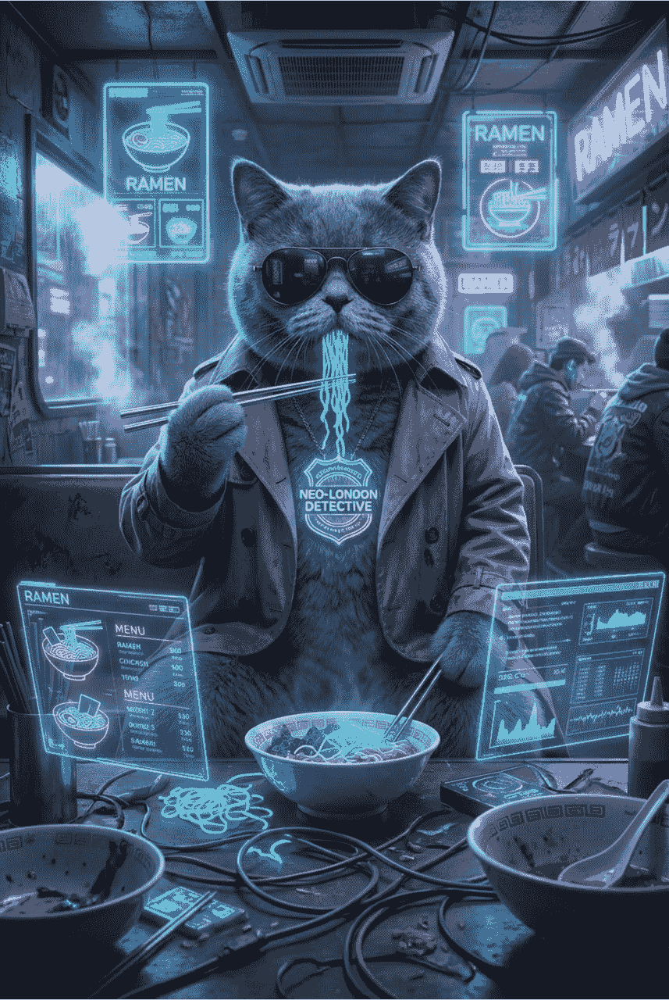

可以看到，猫侦探在连续对话中，保持了完全一致的外观特征。

这里我是一张张分开测试的，其实Nano Banana Pro这回依赖Gemini 3的强大思考推理能力，已经能支持在一条指令里的多图角色一致性生成了。比如一个九宫格人物主体的故事线脚本，感兴趣的朋友可以自行测试一下。

我来用画连环画的方式简单测试一下，一个角色一致性的四格漫画就这么秒出。

#### 【提示词】：

请生成一张四格漫画，主角是一位穿著黄色雨衣、戴着红色圆眼镜的小男孩。 第一格：小男孩站在雨中抬头看天，表情惊讶； 第二格：一只巨大的发光鲸鱼从云层中游过； 第三格：小男孩兴奋地指着鲸鱼，雨衣的细节保持一致； 第四格：小男孩拿出一个相机拍照。 要求：四格画面中，小男孩的长相、眼镜和雨衣必须保持完全一致。

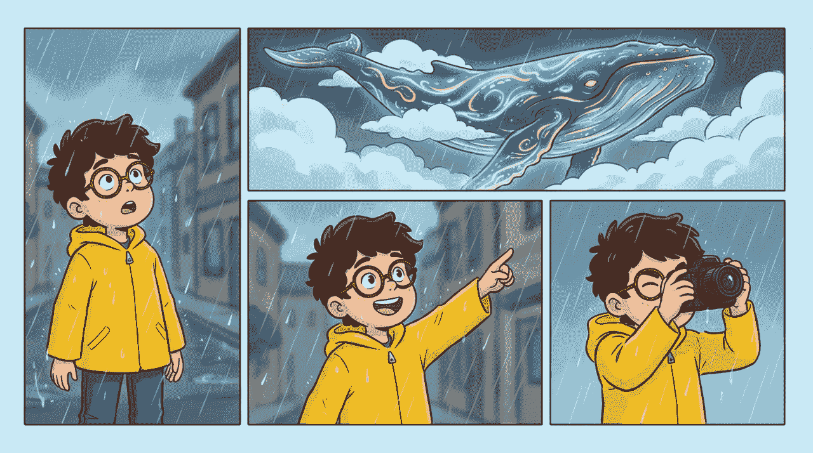

四个分格中的小男孩的外观、眼镜和雨衣都保持了一致。

我们再来看物理逻辑。试一个鲁布·戈德堡机械的物理悖论，看看复杂的物理折射，看玻璃球的折射和动态模糊表现如何。

#### 【提示词】：

一个由透明玻璃和黄铜齿轮组成的复杂的鲁布·戈德堡机械装置（Rube Goldberg machine），放置在复古的书房桌面上。

画面捕捉到一颗钢珠刚刚滚落，撞倒了一排多米诺骨牌的瞬间。

重点要求：请准确描绘钢珠在玻璃管道中的折射变形，以及多米诺骨牌倒下时的动态模糊，光影必须符合物理逻辑，营造出电影般的定格瞬间。

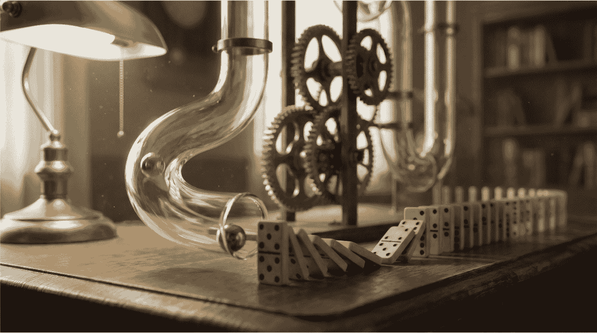

画面精准捕捉了钢珠在透明玻璃管道中的折射变形效果，光影符合物理逻辑，多米诺骨牌倒下的动态模糊也清晰呈现。整个场景充满电影般的定格瞬间感，透明玻璃与黄铜齿轮的质感细节都得到了完美呈现。

接着来看一个反常识的水下燃烧。看它怎么处理“火在水里”这种矛盾的视觉效果。

#### 【提示词】：

生成一张超现实主义的艺术照片。

场景是”水下的燃烧“。

一个潜水员在深海中拿着一根正在剧烈燃烧的火把，火焰呈现出奇异的气泡状结构，火光照亮了周围游动的发光水母。

这种违背物理常识的画面需要处理得极度逼真，仿佛是真实存在的某种魔法物理现象，色彩以深蓝和亮橙色对比为主。

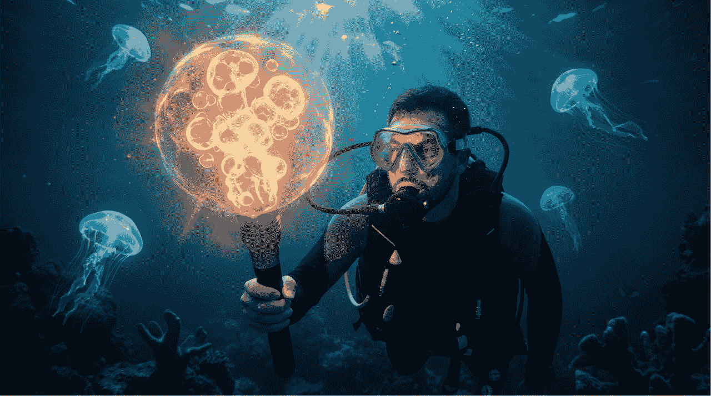

画面展现了一位潜水员在深海中手持剧烈燃烧的火把，火焰呈现出违背物理定律的气泡状结构，用明亮的橙色与深蓝的海水形成强烈对比，照亮了周围游动的发光水母。整个科幻大片级场景极度逼真，仿佛真实存在某种魔法物理现象。

还有材质嵌入。让中国字“长”在柠檬上。

除了银幕级摄影大片感，微小的材质嵌入也很考验功力。比如，把中国字“种”在柠檬皮上，这种超写实的微距摄影照片。

#### 【提示词】：

生成一张超写实的微距摄影照片。

主体是一个刚刚切开的新鲜柠檬，果肉晶莹剔透，汁水四溅。

在柠檬的果皮纹理上，像天然生长一样，浮现出清晰的红色中文字样：“酸爽过瘾”。

光线要从侧面打过来，让文字呈现出微妙的凹凸质感，背景是模糊的清凉夏日海滩。

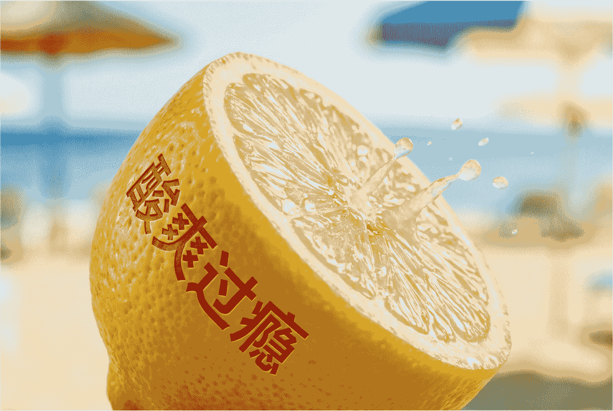

#### 【提示词】：

把柠檬上的字改成“超甜”

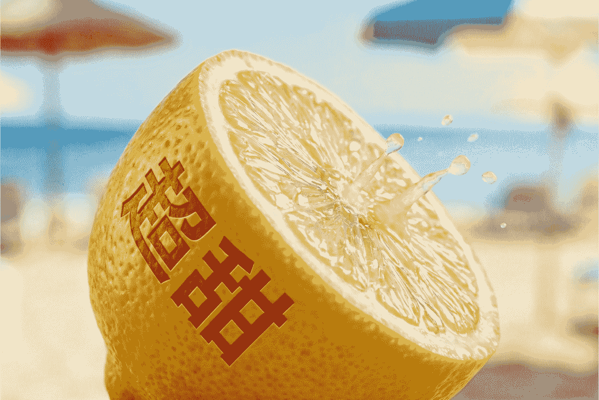

除此之外，Nano Banana Pro对于物理世界的理解，也是更上一层楼。

#### 【提示词】：

特写镜头：一个放在海滩沙滩上的透明玻璃灯泡。 灯泡内部不是灯丝，而是一个完整的微缩世界：有一座微型的灯塔、汹涌的海浪和一只小小的帆船。 阳光穿过玻璃灯泡，在沙滩上投下聚焦的彩虹光斑。真实感，8K 画质。

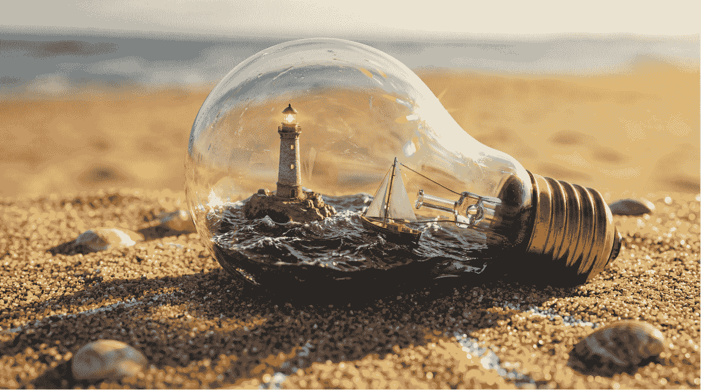

这个海滩上透明玻璃灯泡中微缩世界的场景特写镜头，的确也很真实感效果了，光影折射的效果也很赞。

为了加大难度，我还增加了一个Knolling平铺拆解风格测试。这要求AI必须对物体的结构有极深的认知，并且排版不能乱。

#### 【提示词】：

生成一张极其精细的“机械心脏”拆解图，采用 Knolling 摄影风格（高空俯视，零件整齐排列）。 画面包含：一个核心的金属心脏主体，周围整齐摆放着微型螺丝、血管状的红蓝电缆、金色的齿轮片和玻璃外壳。 背景为干净的磨砂白，灯光为专业的影棚柔光，阴影锐利。

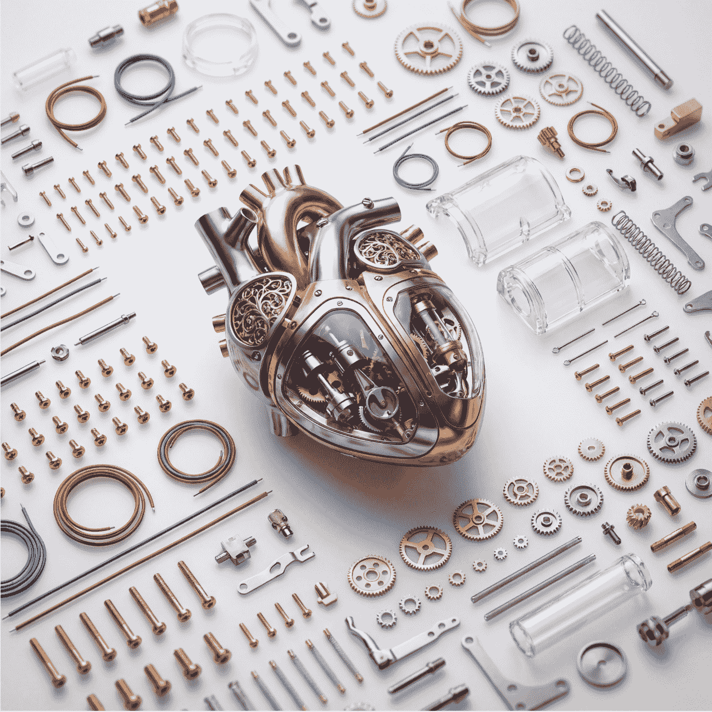

这张极其精细的机械心脏拆解图，一眼看上去真就很厉害了，看起来很好地呈现出了Knolling摄影风格。

还有很神的一点，这回Nano Banana Pro（Gemini 3 Pro Image）除了思考推理的加持，就连谷歌的骨灰级神技「网络搜索」也融合了进来。

大白话就是说，在对我们的具体任务进行处理时，可以按需调动搜索增强来结合实时搜索的数据信息，给出不只是文本问答的结果，更是直接的图文生成效果。

就拿实时联网查天气这个应用很广泛的场景，来感受一下它的联网画图——

#### 【提示词】：

请利用 Google 搜索查询现在此时此刻“上海东方明珠塔”当地的天气和时间状态。然后根据搜索到的天气（晴天、雨天或阴天）和时间（白天或夜晚），生成一张极其逼真的东方明珠塔风景照。如果现在是晚上，请展示夜景灯光；如果是雨天，请展示地面的积水倒影。

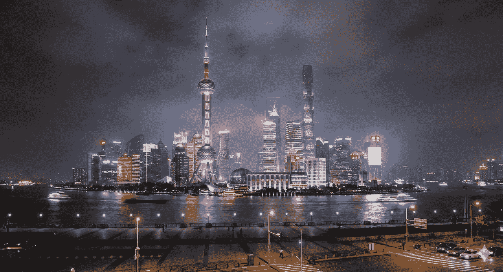

测试的当时是在夜晚，它就对应出了一张夜晚的图片。而且这两天上海的空气不是太好，也能隐约看到多云天气似云又似雾霾的天空。

如果要是在白天测试，它也会根据实时搜索判断后，给出白天的风景照。

这就很有意思了，突然感觉好像和我们现实世界的连接又近了一大步，开始越来越亲密地参与到我们的日常生活中了。

**写在最后：**

这近40个Prompt测下来，我是真服气。我最大的感受是：AI已经从“玩具”变成了“瑞士军刀”。

以前我们用AI是在抽卡，现在用Nano Banana Pro，感觉开始有点像是在跟一个懂行的乙方设计师沟通了。

当然说到这里，广告同行们其实大家也不必焦虑，AIGC这块确实肉眼可见地一天天强大起来，但直观体验就也能感觉到，距离真正威胁到商业设计，还明显是有一段路的。

特别是要想产出行业优秀级水准的出品，还得是专业更在行、能够熟练驾驭AI的设计老手。

当前这个阶段，用AI文生图、视觉编辑模型辅助生产和处理一些素材，确实是已经能提升相当程度的生产效率了，虽说不必焦虑，但拥抱前沿工具，肯定是能让我们自己能够更加稳稳地在行业有一席之地的。

最后的最后，一个小彩蛋，这篇文章的封面图（也就是开篇首图），如你所想，没错，也是让Nano Banana Pro帮忙生成的。真是能榨的地方就要尽情地榨，哈哈哈～

指令也送给大家参考——

#### **【提示词】：**

生成一张微信公众号头图，宽高比为 2.35:1 (900x383 pixels)。

【背景】 深邃的科技黑背景，带有流动的蓝色代码矩阵光效，具有很强的景深感。

【主体】 画面左侧是一个悬浮的、半透明的“机械香蕉”（Cybernetic Banana）。它由发光的玻璃和金色的电路板组成，内部核心像芯片一样发着蓝光，极具未来感。

【文字排版（核心）】

在画面右侧的留白区域，使用极其醒目、粗壮的无衬线字体（类似 Impact 字体），排版以下文字：

第一行（巨大，白色发光）：Nano Banana Pro

第二行（中等大小，亮黄色，带有故障艺术效果）：王 炸 实 测

第三行（小字）：懂 中 文 · 懂 逻 辑 · 懂 设 计

【渲染】 Unreal Engine 5 渲染，C4D 风格，8K 分辨率，锐利清晰。

哦对了，我这次测试的大部分案例是在Lovart上面用Nano Banana Pro生成的，几乎都是一次直出。另外小部分是通过Gemini官网测试。测试量比较大，有些直出效果不很尽人意的地方，也没太花心思继续去多轮对话调整。大家先简单感受一下，有兴趣地可以去慢慢尝试和多轮调试，相信效果会更好，更贴近落地使用级。

朋友们，这么多示例，高低得赶紧码住了，趁热随手一试吧！要是跑出了什么神图，记得分享在评论区大家一起欣赏！

—— THE END ——

---

我是文森策——

10yr+品牌营销人｜AI提示词&提效玩家

《轻松玩转AIGC》飞书AI知识库作者

商业与人文观察者，持续关注AI中……

欢迎同频朋友交流探讨、友好合作🤝

附：《轻松玩转AIGC》飞书AI知识库（免费公开） ➡️ https://dye87dshnj.feishu.cn/wiki/space/7355723427619110916?ccm_open_type=lark_wiki_spaceLink&open_tab_from=wiki_home （含9大主题100+篇文档，包括超实用AI工具盘点及丰富提示词清单，助力快步赶上AI时代快车）

既然看到这里了，如果觉得我的内容还不错，不妨顺手点个赞、在看、转发三连吧～想要第一时间收到推送，也可以给我个星标⭐欢迎点击下方公众号关注我👇