# 《Nano Banana Pro 全面指南：10 条专业素材制作技巧》｜Google官方教程

> 来源：[https://my.feishu.cn/docx/RdabdrNcqoAuT6xBrLGc7jTcnIh](https://my.feishu.cn/docx/RdabdrNcqoAuT6xBrLGc7jTcnIh)

## The Complete Guide to Nano Banana Pro: 10 Tips for Professional Asset Production

`Nano-Banana Pro` is a significant leap forward from previous generation models, moving from "fun" image generation to "functional" professional asset production. It excels in text rendering, character consistency, visual synthesis, world knowledge (`Search`), and high-resolution (`4K`) output.

Following the [developer guide](https://dev.to/googleai/introducing-nano-banana-pro-complete-developer-tutorial-5fc8) on how to get started with [AI Studio](https://ai.studio/) and the `API`, this guide covers the core capabilities and how to prompt them effectively.

> By Guillaume Vernade, Gemini Developer Advocate, Google DeepMind

## Here's what you'll find in this article:

1. The Golden Rules of Prompting
2. Text Rendering, Infographics & Visual Synthesis
3. Character Consistency & Viral Thumbnails
4. Grounding with Google Search
5. Advanced Editing, Restoration & Colorization
6. Dimensional Translation (`2D` ↔ `3D`)
7. High-Resolution & Textures
8. Thinking & Reasoning
9. One-Shot Storyboarding & Concept Art
10. Structural Control & Layout Guidance
11. What's Next?

## 🛑 Section 0: The Golden Rules of Prompting

`Nano-Banana Pro` is a "`Thinking`" model. It doesn't just match keywords; it understands intent, physics, and composition. To get the best results, stop using "`tag soups`" (e.g., dog, park, `4k`, realistic) and start acting like a Creative Director.

### Edit, Don't Re-roll

The model is exceptionally good at understanding conversational edits. If an image is 80% correct, do not generate a new one from scratch. Instead, simply ask for the specific change you need.

> Example: "That's great, but change the lighting to sunset and make the text neon blue."

### Use Natural Language & Full Sentences

Talk to the model as if you were briefing a human artist. Use proper grammar and descriptive adjectives.

> ❌ `Bad:` "Cool car, neon, city, night, `8k`."

> ✅ `Good:` "A cinematic wide shot of a futuristic sports car speeding through a rainy Tokyo street at night. The neon signs reflect off the wet pavement and the car's metallic chassis."

### Be Specific and Descriptive

Vague prompts yield generic results. Define the subject, the setting, the lighting, and the mood.

> `Subject:` Instead of "a woman," say "a sophisticated elderly woman wearing a vintage chanel-style suit."

> `Materiality:` Describe textures. "Matte finish," "brushed steel," "soft velvet," "crumpled paper."

### Provide Context (The "Why" or "For whom")

Because the model "thinks," giving it context helps it make logical artistic decisions.

> Example: "Create an image of `a sandwich for a Brazilian high-end gourmet cookbook`." (The model will infer professional plating, shallow depth of field, and perfect lighting).

## Text Rendering, Infographics & Visual Synthesis

`Nano-Banana Pro` has `SOTA` capabilities for rendering legible, stylized text and synthesizing complex information into visual formats.

Best Practices:

+ `Compression:` Ask the model to "compress" dense text or `PDFs` into visual aids.

+ `Style:` Specify if you want a "polished editorial," a "technical diagram," or a "hand-drawn whiteboard" look.

+ `Quotes:` Clearly specify the text you want in quotes.

Example Prompts:

> `Earnings Report Infographic` (`Data Ingestion`):

> [Input `PDF` of Google's latest [earnings report](https://s206.q4cdn.com/479360582/files/doc_news/2025/Oct/29/attachments/2025q3-alphabet-earnings-release.pdf)]

> "Generate a clean, modern infographic summarizing the key financial highlights from this earnings report. Include charts for `'Revenue Growth'` and `'Net Income'`, and highlight the CEO's key quote in a stylized pull-quote box."

Try it in `AI Studio`

(Note: Requires uploading a `PDF`)

> Retro Infographic:

> "Make a retro, 1950s-style infographic about the history of the American diner. Include distinct sections for `'The Food'`, `'The Jukebox'`, and `'The Decor'`. Ensure all text is legible and stylized to match the period."

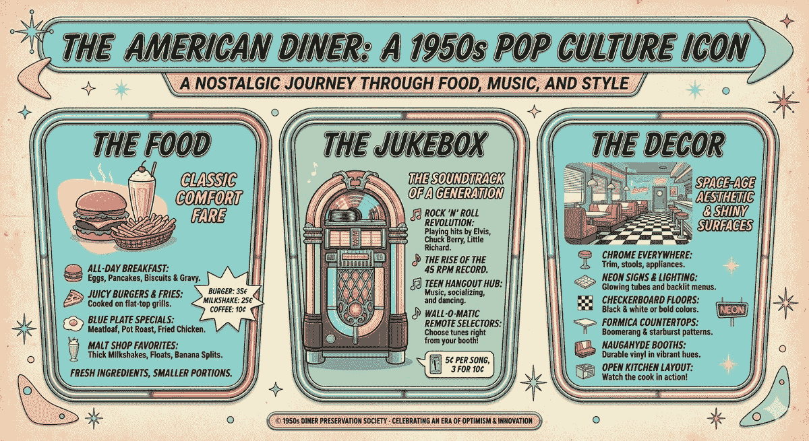

Try it in `AI Studio`

> Technical Diagram:

> "Create an orthographic blueprint that describes this building in plan, elevation, and section. Label the `'North Elevation'` and `'Main Entrance'` clearly in technical architectural font. Format `16:9`."

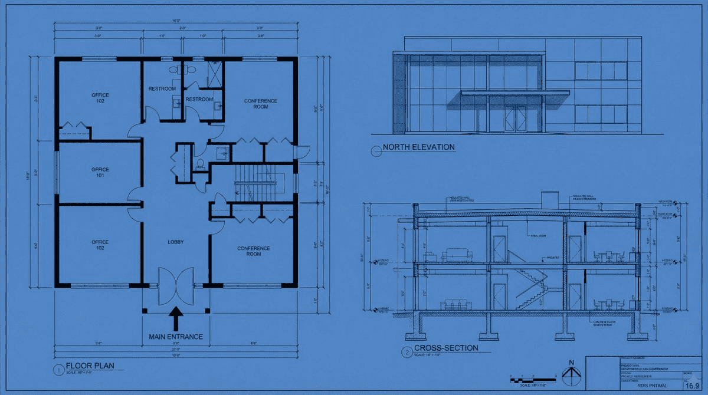

Try it in `AI Studio`

> Whiteboard Summary (Educational):

> "Summarize the concept of `'Transformer Neural Network Architecture'` as a hand-drawn whiteboard diagram suitable for a university lecture. Use different colored markers for the `Encoder` and `Decoder` blocks, and include legible labels for `'Self-Attention'` and `'Feed Forward'`."

Try it in `AI Studio`

## Character Consistency & Viral Thumbnails

`Nano-Banana Pro` supports up to 14 reference images (6 with high fidelity). This allows for "`Identity Locking`"—placing a specific person or character into new scenarios without facial distortion.

Best Practices:

+ `Identity Locking:` Explicitly state: "Keep the person's facial features exactly the same as `Image 1`."

+ `Expression/Action:` Describe the change in emotion or pose while maintaining the identity.

+ `Viral Composition:` Combine subjects with bold graphics and text in a single pass.

Example Prompts:

> `The "Viral Thumbnail" (Identity + Text + Graphics)`:

> "Design a viral video thumbnail using the person from `Image 1`. Face Consistency: Keep the person's facial features exactly the same as `Image 1`, but change their expression to look excited and surprised. Action: Pose the person on the left side, pointing their finger towards the right side of the frame. Subject: On the right side, place a high-quality image of a delicious avocado toast. Graphics: Add a bold yellow arrow connecting the person's finger to the toast. Text: Overlay massive, pop-style text in the middle: '3分钟搞定!' (Done in 3 mins!). Use a thick white outline and drop shadow. Background: A blurred, bright kitchen background. High saturation and contrast."

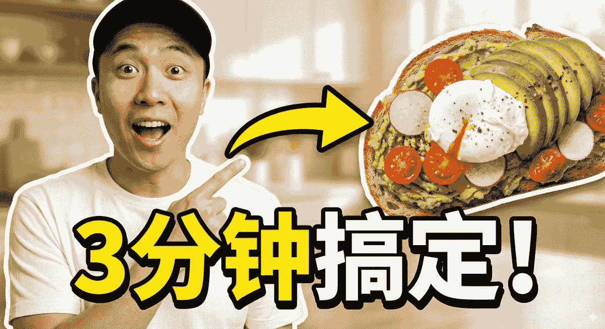

Try it in `AI Studio`

(Note: Requires uploading a reference image)

> `The "Fluffy Friends" Scenario (Group Consistency)`:

> [Input 3 images of different plush creatures]

> "Create a funny 10-part story with these 3 fluffy friends going on a tropical vacation. The story is thrilling throughout with emotional highs and lows and ends in a happy moment. Keep the attire and identity consistent for all 3 characters, but their expressions and angles should vary throughout all 10 images. Make sure to only have one of each character in each image."

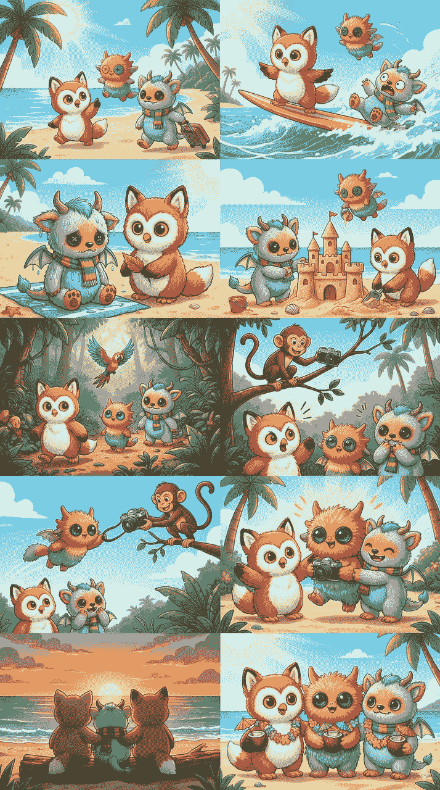

Try it in `AI Studio`

(Note: Requires uploading reference images)

> `Brand Asset Generation:`

> [Input 1 image of a product]

> "Create 9 stunning fashion shots as if they’re from an award-winning fashion editorial. Use this reference as the brand style but add nuance and variety to the range so they convey a professional design touch. Please generate nine images, one at a time."

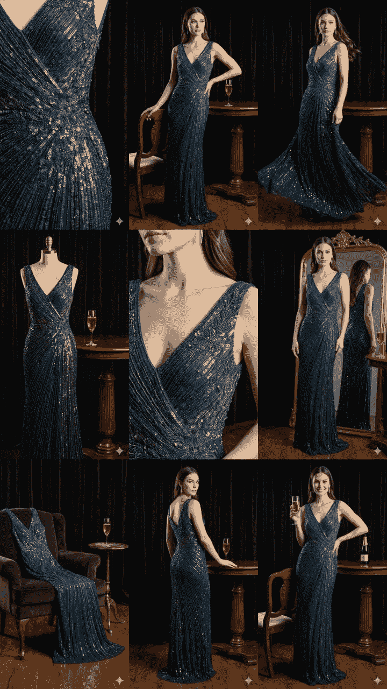

Try it in `AI Studio`

(Note: Requires uploading a reference image)

## Grounding with Google Search

`Nano-Banana Pro` uses `Google Search` to generate imagery based on real-time data, current events, or factual verification, reducing hallucinations on timely topics.

Best Practices:

+ Ask for visualizations of dynamic data (weather, stocks, news).

+ The model will "`Think`" (reason) about the search results before generating the image.

Example Prompts:

> Event Visualization:

> "Generate an infographic of the best times to visit the U.S. National Parks in 2025 based on current travel trends."

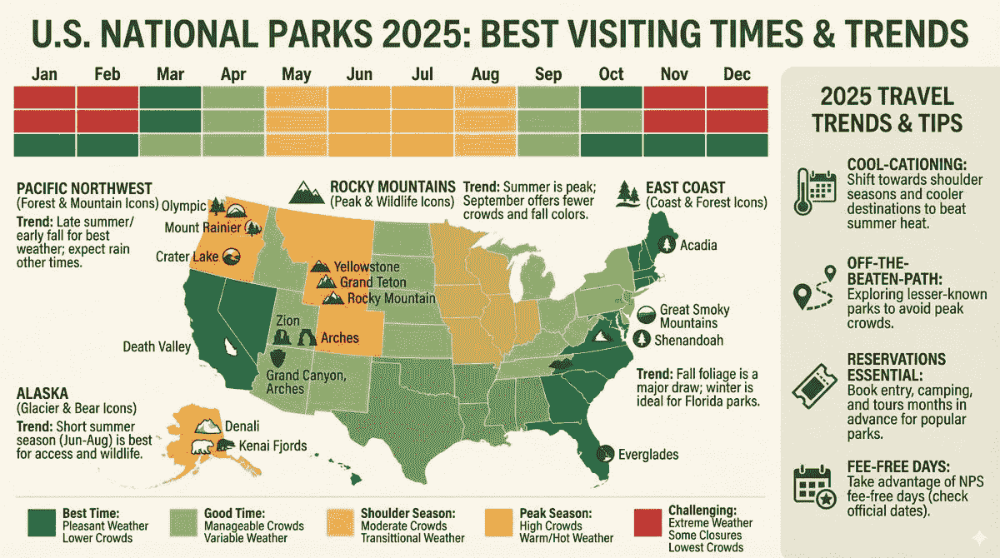

Try it in AI Studio

# Advanced Editing, Restoration & Colorization

The model excels at complex edits via conversational prompting. This includes "In-painting" (removing/adding objects), "Restoration" (fixing old photos), "Colorization" (Manga/B&W photos), and "Style Swapping."

## Best Practices:

+   Semantic Instructions: You do not need to manually mask; simply tell the model what to change naturally.

+   Physics Understanding: You can ask for complex changes like "fill this glass with liquid" to test physics generation.

## Example Prompts:

> Object Removal & In-painting:

> "Remove the tourists from the background of this photo and fill the space with logical textures (cobblestones and storefronts) that match the surrounding environment."

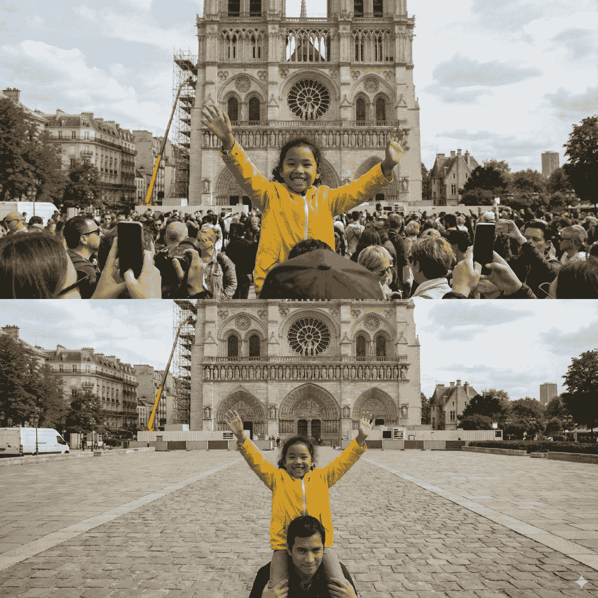

Try it in AI Studio

(Note: Requires uploading a photo)

> Manga/Comic Colorization:

> [Input black and white manga panel]

> "Colorize this manga panel. Use a vibrant anime style palette. Ensure the lighting effects on the energy beams are glowing neon blue and the character's outfit is consistent with their official colors."

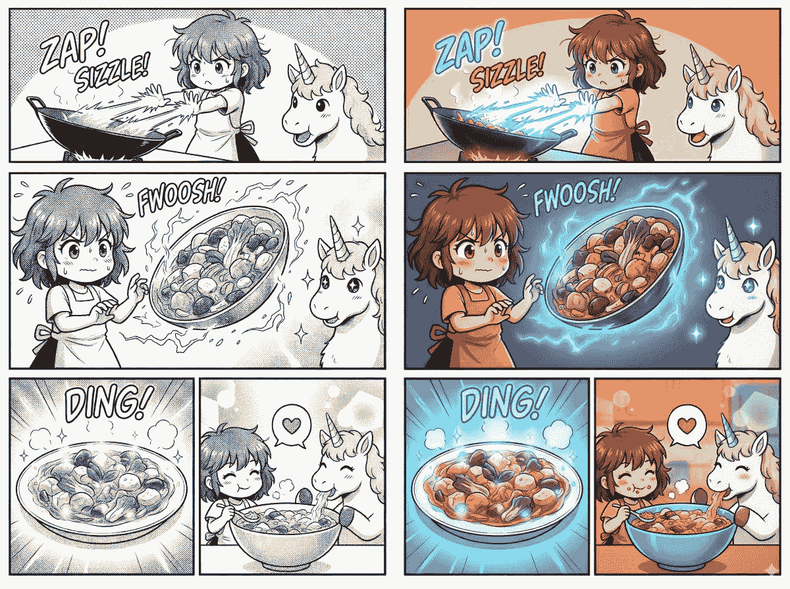

Try it in AI Studio

(Note: Requires uploading an image)

> **L**ocalization (Text Translation + Cultural Adaptation):

> [Input image of a London bus stop ad]

> "Take this concept and localize it to a Tokyo setting, including translating the tagline into Japanese. Change the background to a bustling Shibuya street at night."

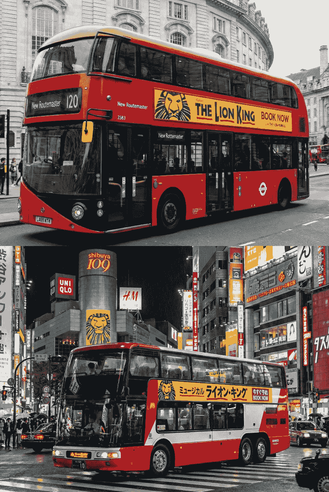

Try it in AI Studio

(Note: Requires uploading an image)

> Lighting/Seasonal Control:

> [Input image of a house in summer]

> "Turn this scene into winter time. Keep the house architecture exactly the same, but add snow to the roof and yard, and change the lighting to a cold, overcast afternoon."

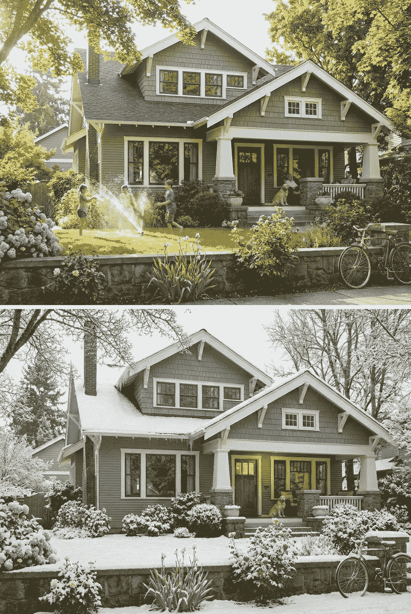

Try it in AI Studio

(Note: Requires uploading an image)

# Dimensional Translation (2D ↔ 3D)

A powerful new capability is translating 2D schematics into 3D visualizations, or vice versa. This is ideal for interior designers, architects, and meme creators.

## Example Prompts:

> **2D Floor Plan to 3D Interior Design Board:**

> "Based on the uploaded 2D floor plan, generate a professional interior design presentation board in a single image. Layout: A collage with one large main image at the top (wide-angle perspective of the living area), and three smaller images below (Master Bedroom, Home Office, and a 3D top-down floor plan). Style: Apply a Modern Minimalist style with warm oak wood flooring and off-white walls across ALL images. Quality: Photorealistic rendering, soft natural lighting."

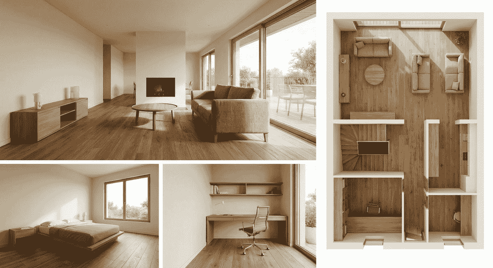

Try it in AI Studio

(Note: Requires uploading a floor plan)

> 2D to 3D Meme Conversion:

> "Turn the 'This is Fine' dog meme into a photorealistic 3D render. Keep the composition identical but make the dog look like a plush toy and the fire look like realistic flames."

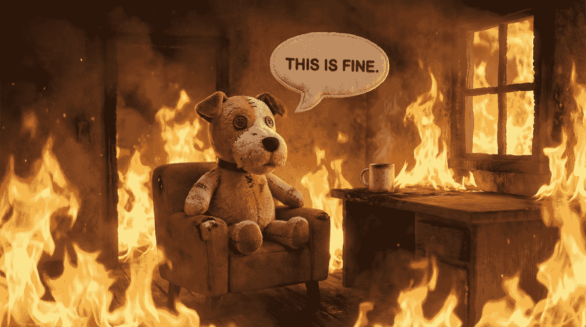

Try it in AI Studio

# High-Resolution & Textures

Nano-Banana Pro supports native 1K to 4K image generation. This is particularly useful for detailed textures or large-format prints.

## Best Practices:

+   Explicitly request high resolutions (2K or 4K) if your API/Interface allows.

+   Describe high-fidelity details (imperfections, surface textures).

## Example Prompts:

> 4K Texture Generation:

> "Harness native high-fidelity output to craft a breathtaking, atmospheric environment of a mossy forest floor. Command complex lighting effects and delicate textures, ensuring every strand of moss and beam of light is rendered in pixel-perfect resolution suitable for a 4K wallpaper."

Try it in AI Studio

> Complex Logic (Thinking Mode):

> "Create a hyper-realistic infographic of a gourmet cheeseburger, deconstructed to show the texture of the toasted brioche bun, the seared crust of the patty, and the glistening melt of the cheese. Label each layer with its flavor profile."

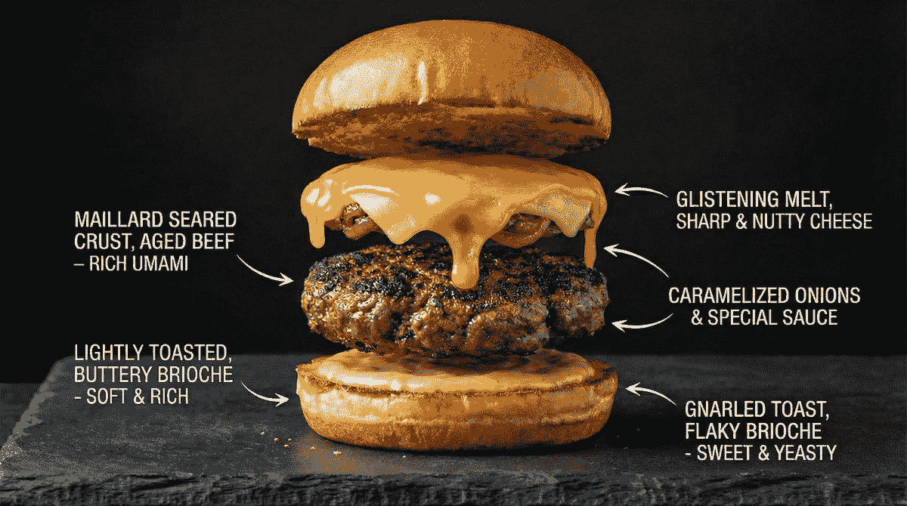

Try it in AI Studio

# Thinking & Reasoning

Nano-Banana Pro defaults to a "Thinking" process where it generates interim thought images (not charged) to refine composition before rendering the final output. This allows for data analysis and solving visual problems.

## Example Prompts:

> Solve Equations:

> "Solve log_{x^2+1}(x^4-1)=2 in C on a white board. Show the steps clearly."

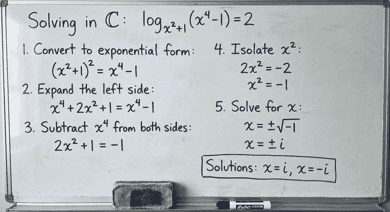

Try it in AI Studio

> Visual Reasoning:

> "Analyze this image of a room and generate a 'before' image that shows what the room might have looked like during construction, showing the framing and unfinished drywall."

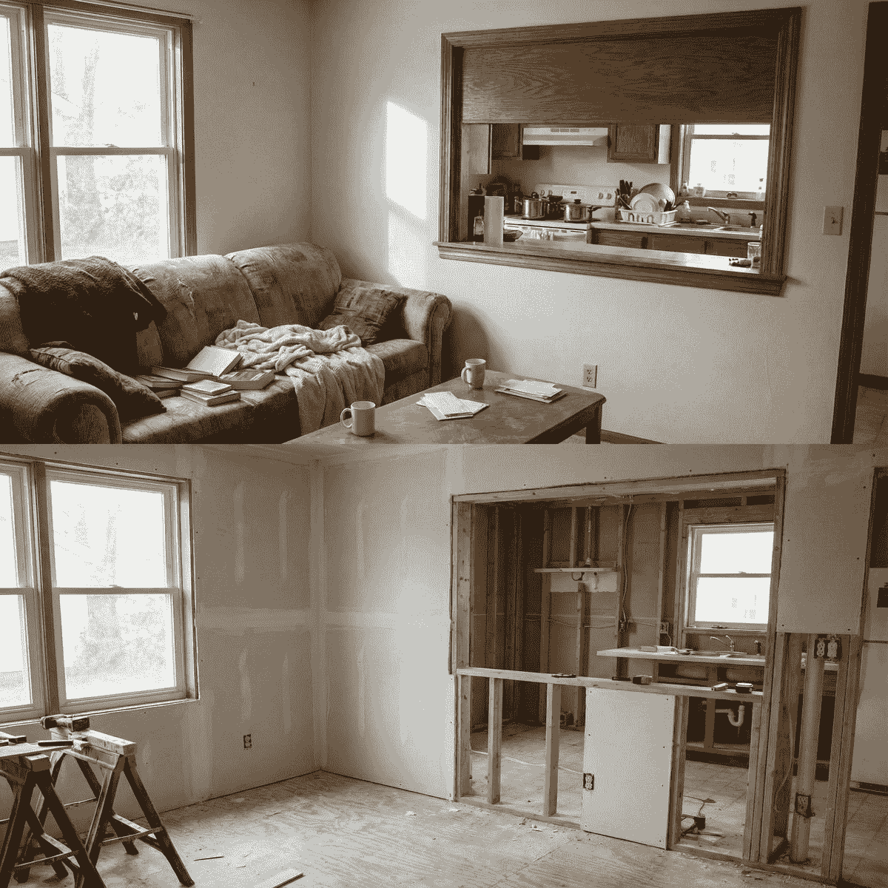

Try it in AI Studio

(Note: Requires uploading an image)

# One-Shot Storyboarding & Concept Art

You can generate sequential art or storyboards without a grid, ensuring a cohesive narrative flow in a single session. This is also popular for "Movie Concept Art" (e.g., fake leaks of upcoming films).

## Example Prompt:

> "Create an addictively intriguing 9-part story with 9 images featuring a woman and man in an award-winning luxury luggage commercial. The story should have emotional highs and lows, ending on an elegant shot of the woman with the logo. The identity of the woman and man and their attire must stay consistent throughout but they can and should be seen from different angles and distances. Please generate images one at a time. Make sure every image is in a 16:9 landscape format."

Try it in AI Studio

# Structural Control & Layout Guidance

Input images aren't limited to character references or subjects to edit. You can use them to strictly control the composition and layout of the final output. This is a game-changer for designers who need to turn a napkin sketch, a wireframe, or a specific grid layout into a polished asset.

## Best Practices:

+   Drafts & Sketches: Upload a hand-drawn sketch to define exactly where the text and object should sit.

+   **Wireframes:** Use screenshots of existing layouts or wireframes to generate high-fidelity UI mockups.

+   **Grids:** Use grid images to force the model to generate assets for tile-based games or LED displays.

## Example Prompts:

> Sketch to Final Ad:

> "Create a ad for a [product] following this sketch."

Try it in AI Studio

(Note: Requires uploading a sketch)

> UI Mockup from Wireframe:

> "Create a mock-up for a [product] following these guidelines."

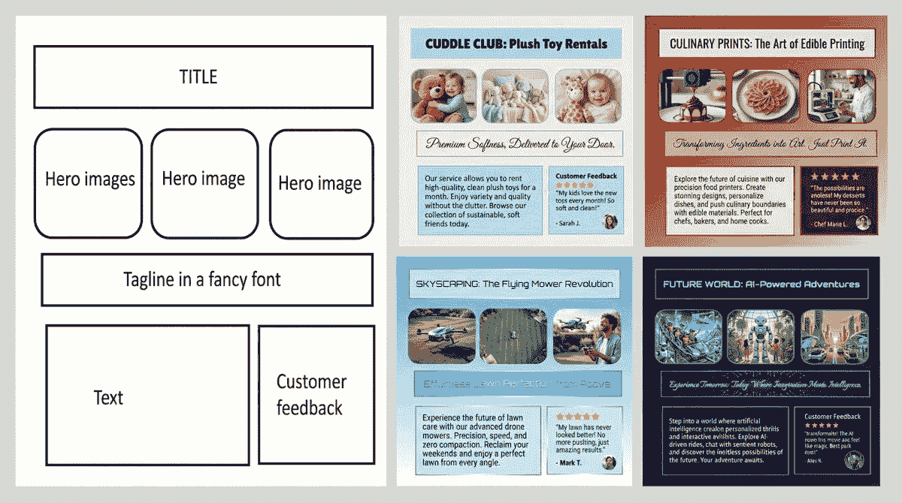

Try it in AI Studio

(Note: Requires uploading a wireframe)

> Pixel Art & LED Displays:

> "Generate a pixel art sprite of a unicorn that fits perfectly into this 64x64 grid image. Use high contrast colors."

> (Tip: Developers can then programmatically extract the center color of each cell to drive a connected 64x64 LED matrix display).

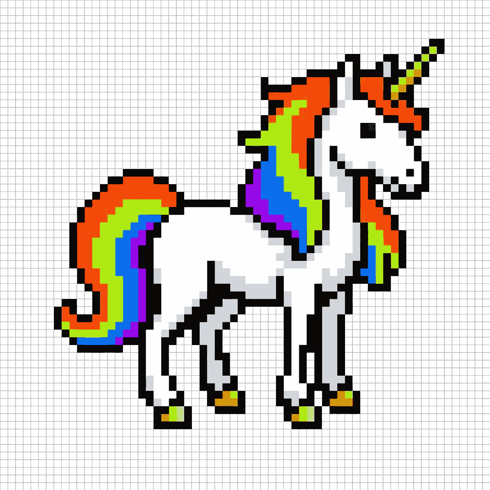

Try it in AI Studio

(Note: Requires uploading a grid image)

> **Sprites:**

> "Sprite sheet of a woman doing a backflip on a drone, 3x3 grid, sequence, frame by frame animation, square aspect ratio. Follow the structure of the attached reference image exactly."

> (Tip: You can then extract each cell and make a gif)

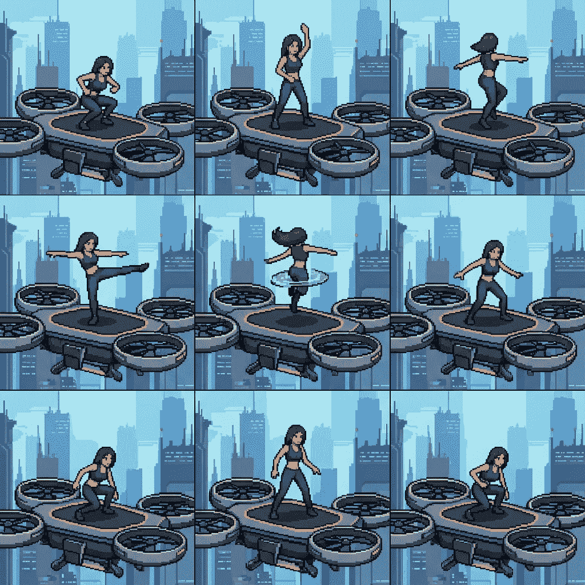

https://x.com/i/status/1994480371061469306

[Try it in Colab](https://colab.sandbox.google.com/github/google-gemini/cookbook/blob/main/quickstarts/Get_Started_Nano_Banana.ipynb#scrollTo=xuQeyK-teUf1)

# What's Next?

Now that you have mastered the basics of prompting, here is how you can start building:

+   Experiment in the UI: Google AI Studio is the fastest way to test prompts and parameters.

+   Check really cool Nano-banana powered app in the [App Gallery](https://aistudio.google.com/apps?source=showcase&showcaseTag=nano-banana).

## `Vibe-code` you dream app
Transform you best prompt into an app that you can easily share with your friends in [AI Studio Build](https://aistudio.google.com/apps).

## Build Applications
Ready to code? Check out the [developer guide](https://dev.to/googleai/introducing-nano-banana-pro-complete-developer-tutorial-5fc8) or the Gemini API Cookbook for guides and code snippets.

## Technical Deep Dive
Read the full Gemini API Documentation for details on rate limits, pricing, and integration.

来源：`https://x.com/GoogleAIStudio/status/1994480371061469306?s=20`
