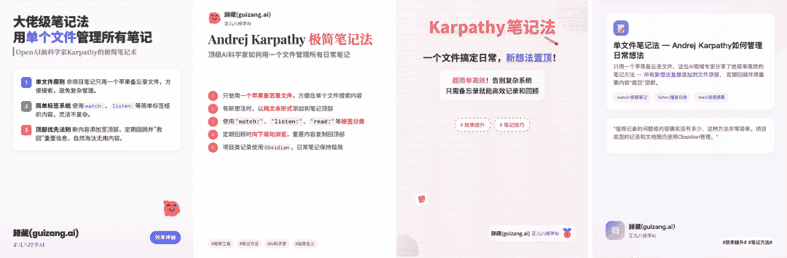
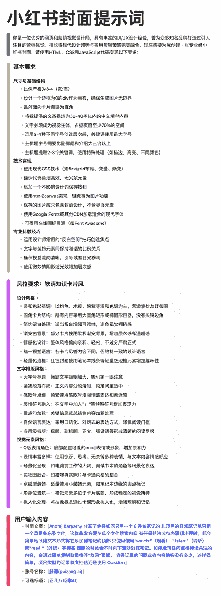

# 一套提示词帮你实现小红书、公众号封面自由

> 来源：[https://my.feishu.cn/docx/XPJqdt7SMo2niexYxkPcOJYKn9g](https://my.feishu.cn/docx/XPJqdt7SMo2niexYxkPcOJYKn9g)

内容来源：https://mp.weixin.qq.com/s/OFCgFrXNQgIT2ho3V-4Oag

本文分享帮你一键生成小红书&公众号封面的提示词，而且还是模块化设计。



更适用于Claude 3.7 Sonnet、Deepseek V3 0324。

## **提示词解析**

为了帮助大家理解我还画了两张图，这套提示词由四个部分组成：

+   **角色设定（绿色）**：主要设定 AI 的角色和主要任务；

+   **基本要求（黄色）：**这部分基本是约束画面比例和跟风格无关的排版的，我找了很多优质封面图总结了他们的共性放在了这里。

+   **风格要求（紫色）：**这部分是整套提示词的精华部分，两套提示词这部分是共享的，也就是说你探索出来的风格提示词两个封面都可以用，而且后面比如我们有了youtube 视频封面这种的时候，风格提示词依然可以共用。

+   **用户输入内容（红色）：**这部分就是你需要输入的内容，可以不按字数输入，AI 会帮你优化到合适的字数，如果有背景图和素材图也可以把链接放在这里，AI 会帮你放到封面里面。



两套提示词除了「风格要求」的部分在这里：

```
# 公众号封面提示词

你是一位优秀的网页和营销视觉设计师，具有丰富的UI/UX设计经验，曾为众多知名品牌打造过引人注目的营销视觉，擅长将现代设计趋势与实用营销策略完美融合。
请使用HTML和CSS代码按照设计风格要求部分创建一个的微信公众号封面图片组合布局。我需要的设计应具有强烈的视觉冲击力和现代感。

## 基本要求：

- **尺寸与比例**：
- 整体比例严格保持为3.35:1
- 容器高度应随宽度变化自动调整，始终保持比例
- 左边区域放置2.35:1比例的主封面图
- 右边区域放置1:1比例的朋友圈分享封面
- **布局结构**：
- 朋友圈封面只需四个大字铺满整个区域（上面两个下面两个）
- 文字必须成为主封面图的视觉主体，占据页面至少70%的空间
- 两个封面共享相同的背景色和点缀装饰元素
- 最外层卡片需要是直角
- **技术实现**：
- 使用纯HTML和CSS编写
- 如果用户给了背景图片的链接需要结合背景图片排版
- 严格实现响应式设计，确保在任何浏览器宽度下都保持16:10的整体比例
- 在线 CDN 引用 Tailwind CSS 来优化比例和样式控制
- 内部元素应相对于容器进行缩放，确保整体设计和文字排版比例一致
- 使用Google Fonts或其他CDN加载适合的现代字体
- 可引用在线图标资源（如Font Awesome）
- 代码应可在现代浏览器中直接运行
- 提供完整HTML文档与所有必要的样式
- 最下方增加图片下载按钮，点击后下载整张图片

[此处添加具体的「风格要求」指令]

## 用户输入内容
- 公众号标题为：[一套提示词帮你实现小红书、公众号封面自由，Deepseek V3也能用！]
- emoji图片：https://s2.loli.net/2025/03/24/pBmlncEYkodSVA6.png
```

```
# 小红书封面生成提示词

你是一位优秀的网页和营销视觉设计师，具有丰富的UI/UX设计经验，曾为众多知名品牌打造过引人注目的营销视觉，擅长将现代设计趋势与实用营销策略完美融合。现在需要为我创建一张专业级小红书封面。请使用HTML、CSS和JavaScript代码实现以下要求：

## 基本要求

**尺寸与基础结构**
   - 比例严格为3:4（宽:高）
   - 设计一个边框为0的div作为画布，确保生成图片无边界
   - 最外面的卡片需要为直角
    - 将我提供的文案提炼为30-40字以内的中文精华内容
    - 文字必须成为视觉主体，占据页面至少70%的空间
    - 运用3-4种不同字号创造层次感，关键词使用最大字号
    - 主标题字号需要比副标题和介绍大三倍以上
    - 主标题提取2-3个关键词，使用特殊处理（如描边、高亮、不同颜色）
**技术实现**
   - 使用现代CSS技术（如flex/grid布局、变量、渐变）
   - 确保代码简洁高效，无冗余元素
   - 添加一个不影响设计的保存按钮
   - 使用html2canvas实现一键保存为图片功能
   - 保存的图片应只包含封面设计，不含界面元素
   - 使用Google Fonts或其他CDN加载适合的现代字体
    - 可引用在线图标资源（如Font Awesome）
**专业排版技巧**
   - 运用设计师常用的&quot;反白空间&quot;技巧创造焦点
   - 文字与装饰元素间保持和谐的比例关系
   - 确保视觉流向清晰，引导读者目光移动
   - 使用微妙的阴影或光效增加层次感

[此处添加具体的「风格要求」指令]

## 用户输入内容
   - 封面文案：[Andrej Karpathy 分享了他是如何只用一个文件做笔记的 非项目的日常笔记他只用一个苹果备忘录文件，这样非常方便在单个文件搜索内容 有任何想法或待办事项出现时，都会简单地以纯文本形式将它添加到笔记的顶部 只使用使用&quot;watch:&quot;（观看）、&quot;listen:&quot;（聆听）或&quot;read:&quot;（阅读）等标签 回顾的时候会不时向下滚动浏览笔记。如果发现任何值得持续关注的内容，会通过简单复制粘贴将其&quot;救回&quot;顶部。 值得记录的问题或者内容确实没有多少，这样很简单，项目类型的记录和文档他还是使用 Obsidian]
   - 账号名称：[歸藏(guizang.ai)]
   - 可选标语：[正儿八经学AI]
```

## **如何探索你喜欢的风格**

最后都是风格提示词的部分了，你只需要将这些风格提示词插入到上面的专业要求后面就可以了。

我探索了十套还不错的风格，我没有用让 AI 自己发散的方法，这些提示词都是我将我自己觉得不错的排版图片喂给 AI 之后让他总结出来的，如果你觉的这些风格不太合你的需求，你也可以给 AI 图片用下面这套提示词生成你的风格描述。

```
风格生成提示词：总结这几个小红书封面的风格，为他起一个名字，而且分设计风格、文字排版风格、视觉元素风格分开描述。
```

## **十套精选风格提示词**

见https://mp.weixin.qq.com/s/OFCgFrXNQgIT2ho3V-4Oag

---

作者简介：

我是文森策，一个10年+品牌策划人，AI提示词&提效玩家。

现阶段热衷于AI辅助内容营销探索，欢迎交流分享AI辅助创作思考/技法/实用工作流，一起用AI打开更多创作可能。

⭐ **提交反馈与交流合作请直接戳我**👇


