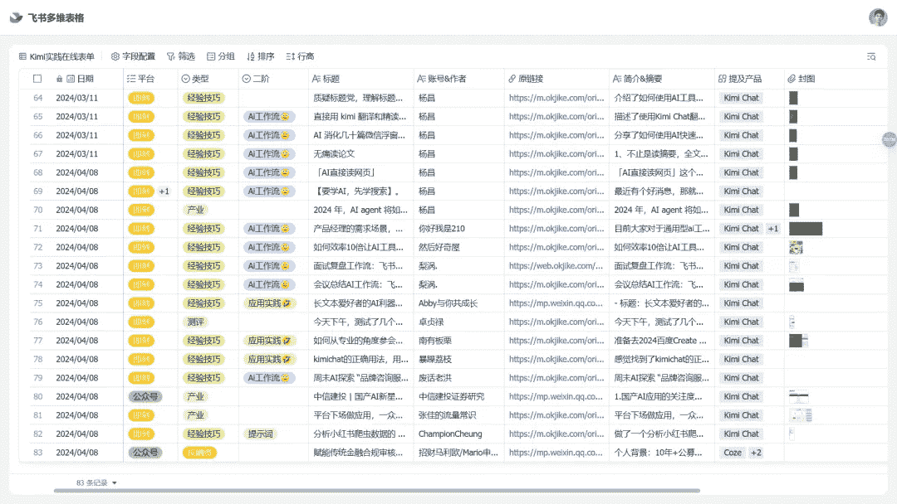
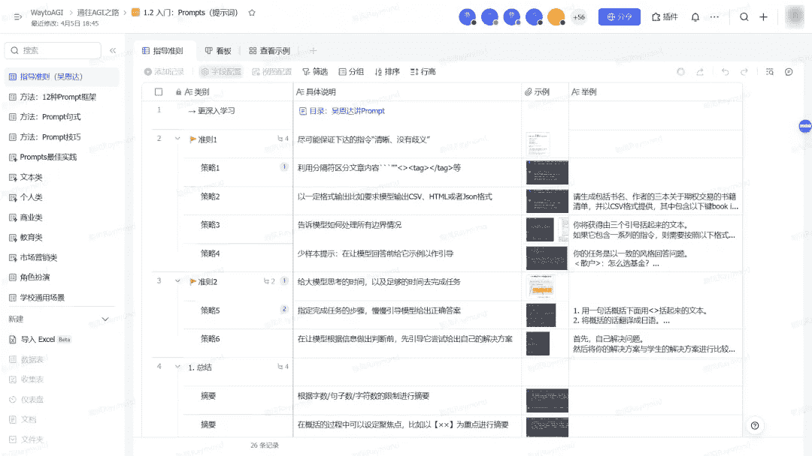
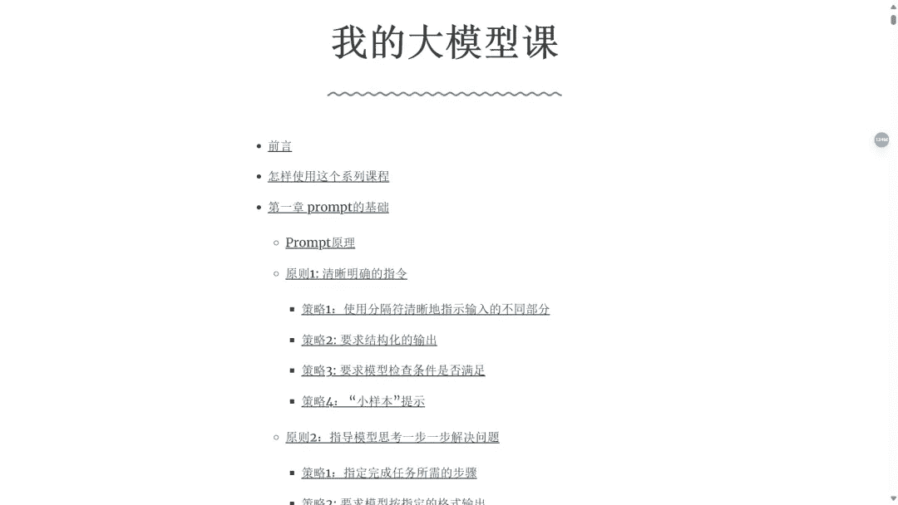

# 一些常用优质 prompt 精选站

> 来源：[https://my.feishu.cn/docx/D5BLdAH3PoP3AlxrCV7citTSnLd](https://my.feishu.cn/docx/D5BLdAH3PoP3AlxrCV7citTSnLd)

一个开源的系统提示词合集库：

https://github.com/asgeirtj/system_prompts_leaks

> 库里面有多个平台不同模型的系统提示词，朋友们做提示词研究的话应该可以参考。

# 其他

## 1、Kimi实践在线表单

https://kh18s6uvdi.feishu.cn/share/base/view/shrcnm6JDJzeITUAee3sbsipUee

**这个文档，由Kimi团队的@奥古斯书整理，里面涵盖了许多使用**Kimi的用法，以及好用的经验技巧、提示词、AI工作流，以及相关技术文章和访谈等。

帮助你快速了解自己可以用AI做什么事。

## 2、通往AGI之路-提示词入门

[1.2 入门：Prompts（提示词）](https://waytoagi.feishu.cn/wiki/Q5mXww4rriujFFkFQOzc8uIsnah?table=tbldSgFt2xNUDNAz&view=vewo2g2ktO)

## 3、AI提示词课程：「我的大模型课」

https://ishell.online/blog/llm_course/

这是一个在Github上开源的AI提示词课程，虽然课程整体是基于ChatGPT的，不过里面许多知识点套用在国内的AI上依旧适用。

看这个课程不需要技术功底，完全零基础都能看懂。

学习透大模型的第一性原理，对你写出优秀的AI prompt非常有帮助。

之后我关于AI提示词相关的文章也会参考该课程中的内容，不断精进迭代。

## 4、提示词图书馆

[按使用场景导览](https://vxc3hj17dym.feishu.cn/wiki/NqZRw9lGKiqiaTkxevXcEF73nQe?table=tblJmjjUu2j9PPvC&view=vew2fUKa8m)

这个文档中收录了不少比较好的结构化提示词，大伙可以通过阅读别人的提示词，进一步精进自己的提示词。

**或者你也可以利用Kimi，拆解一下这些提示词**，然后让你的Kimi成为你的提示词教练。

## 5、绘画Prompt

**Catjourney**

https://catjourney.life/

是一个专门收录高质量 AI 绘画提示词的网站,由 @歸藏 和 @LysonOber 联合开发。 它的主要功能是提供各种风格的提示词,供用户一键复制并应用于 Midjourney、Dall·E 等 AI 绘画工具,快速生成所需风格的图像。 网站设计精致,提示词类型丰富,都是作者人工挑选和生成,确保质量。 除了提示词外,该网站还有 Catjourney Weekly 版块,会不定期更新 AI 绘画的基础使用技巧。 总的来说,Catjourney 是一个为 AI 创作者提供便捷途径的灵感和素材网站。