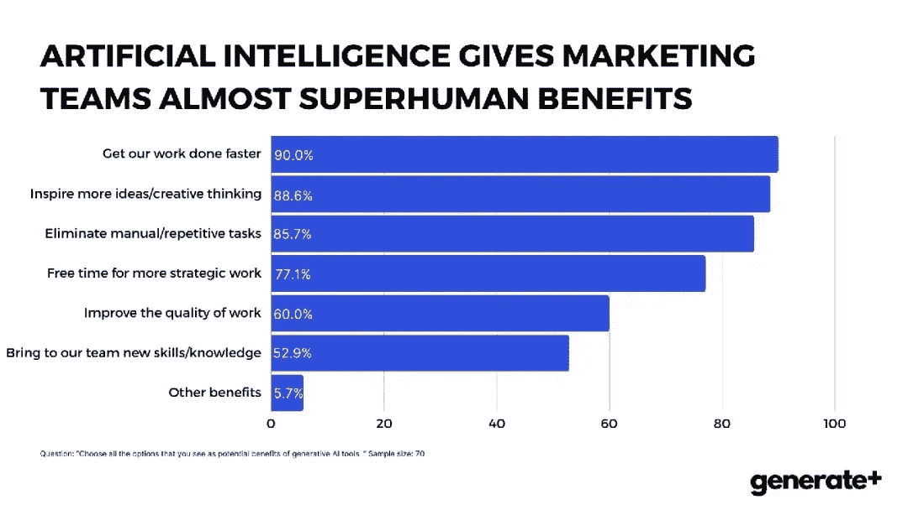

# 5  AI +营销

> 来源：[https://my.feishu.cn/docx/RqmZdfvnUoB58hxfUjbcstNon6f](https://my.feishu.cn/docx/RqmZdfvnUoB58hxfUjbcstNon6f)

本部分主要探讨 AIGC 在营销领域的应用，看 AIGC 如何在营销中大显身手。

🔗 文档链接直达：

[5  AI +营销](https://dye87dshnj.feishu.cn/wiki/SmX2w6P6GifGKkkm0VgcPZctnRf?from=from_copylink)

[5.1 营销行业 AI 实践探索](https://dye87dshnj.feishu.cn/wiki/EcFcwchELi9nlpkYvxLc5RujnNb?from=from_copylink)

[5.2 🎯营销行业 Prompts](https://dye87dshnj.feishu.cn/wiki/KLdKwAalRieTRTkh56Hcq0RKncX?from=from_copylink)

[5.3 营销行业 Agents](https://dye87dshnj.feishu.cn/wiki/BlL8wshQIiKDYakpgQkc6IiWnhe?from=from_copylink)

[5.4  大神们AI+营销实战案例](https://dye87dshnj.feishu.cn/wiki/ZNgkwqRPSiniDKkvlC5cYIqonub?from=from_copylink)

---

## 本章节主要是围绕 AIGC 在营销领域的应用探索

### 目前 AI 之于营销人的主要用处：

提高工作效率、激发创造力、自动化代处理高频简单琐碎的工作，让自己有精力投入更具战略性的高价值工作。

---

### AI 工具在营销中的应用

在营销领域，AI 工具不仅仅是新奇的技术，更是能够优化工作流程和实现流程自动化的革命性工具。下面是 AI 在营销中最流行的应用和常见用例。

应用场景：

🔆 个性化内容创作：AI 能够分析客户数据，生成包括电子邮件、社交媒体帖子和网站文案在内的个性化内容，以更好地吸引目标客户。这有助于提高客户参与度和转化率。

🔆 动态广告生成：借助生成式人工智能，营销人员可以创建根据用户兴趣和行为定制的动态广告。通过在适当的时机向目标受众传递更相关的内容，从而提高广告活动的效果。

🔆 聊天机器人开发：AI 可用于开发能够使用自然语言与客户交流的聊天机器人，并根据客户的偏好和历史互动提供个性化推荐。

🔆 预测分析：AI 能够分析客户数据并预测未来行为，使营销人员能够在恰当的时机向合适的受众传递准确的信息。

🔆 创意资产生成：AI 可用于生成针对特定营销活动或品牌形象定制的创意资产，如图像、视频和动画。这能帮助营销人员创作更具吸引力和记忆点的内容，在竞争中脱颖而出。