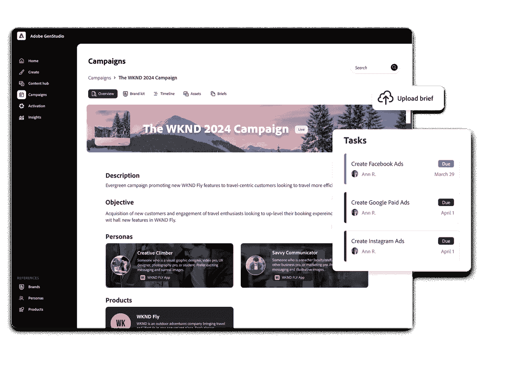

# AI 营销实践-其他

> 来源：[https://my.feishu.cn/docx/V16TddetHoJMGFxa5CVc6tRjn6f](https://my.feishu.cn/docx/V16TddetHoJMGFxa5CVc6tRjn6f)

# Adobe GenStudio

https://business.adobe.com/products/genstudio.html

Adobe GenStudio 是一款基于生成式人工智能的全方位营销工具，主要功能包括快速规划、创建、管理和发布品牌内容，特色在于其与Adobe Experience Cloud的无缝集成和强大的数据洞察能力，推荐理由是它能显著提升内容创作效率和品牌一致性。

