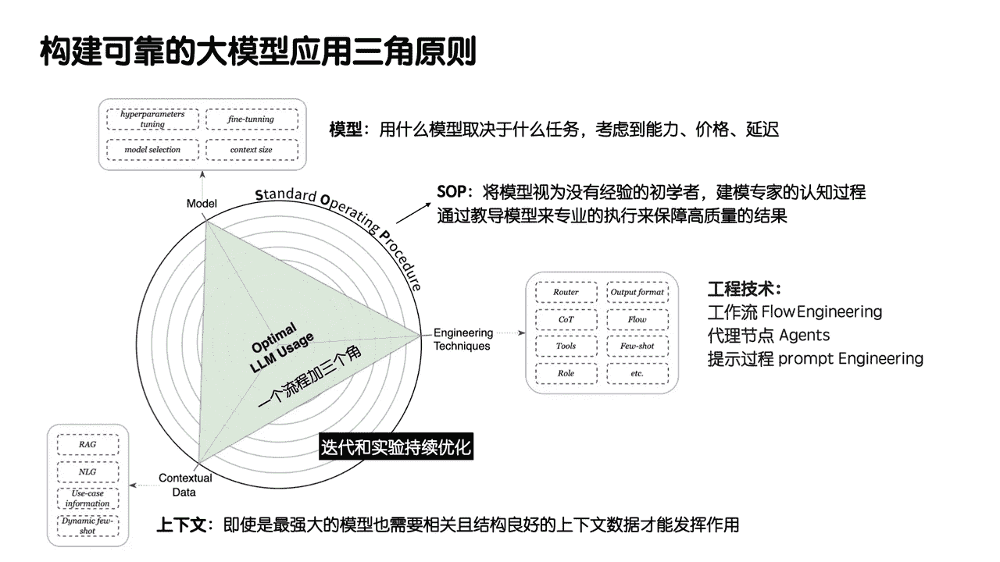

# 6  LLM大模型平台

> 来源：[https://my.feishu.cn/docx/JWVTd7CyEoXTJlxSdB3cexPxnqh](https://my.feishu.cn/docx/JWVTd7CyEoXTJlxSdB3cexPxnqh)

本部分涵盖了对大型语言模型（LLM）平台的基础知识介绍，如：ChatGPT、Gemini、Kimi Chat等主流平台的产品功能、用户指南、技术背景、应用实践等方面内容。

🔗 文档链接直达：

[6  LLM大模型平台](https://dye87dshnj.feishu.cn/wiki/GKHVwsGTuiXs7WkmE9Rc8gvrnfc?from=from_copylink)

[6.1  ChatGPT 平台相关](https://dye87dshnj.feishu.cn/wiki/CXlyw6vrZiR1mmk8LmDckTr2nHb?from=from_copylink)

[6.2  Gemini 平台相关](https://dye87dshnj.feishu.cn/wiki/Bq9QwAh2hiIotUk2b4fcWrUxnOe?from=from_copylink)

[6.3 Claude 平台相关](https://dye87dshnj.feishu.cn/wiki/DquYws4gxitltZkPvkDcxja8nZd?from=from_copylink)

[6.4  Kimi Chat 平台相关](https://dye87dshnj.feishu.cn/wiki/U02dwXBhwiV0WTkpOwncvOSWn0A?from=from_copylink)

[6.5 阿里通义/支小宝相关](https://dye87dshnj.feishu.cn/wiki/BRbUwZoOHi9g9qkzoGVc9TlVnBg?from=from_copylink)

[6.6 DeepSeek 平台相关](https://dye87dshnj.feishu.cn/wiki/P9jWw8elIi2GP5klje8cZ0PUnHg?from=from_copylink)

---

**子文档列表：**

LLM大模型平台入门：

涵盖了对大型语言模型（LLM）平台的基础知识介绍，如：ChatGPT、Gemini、Kimi Chat等主流平台的产品功能、用户指南、技术背景、应用实践等方面内容。

+   **平台功能**：介绍当前主流大语言模型平台的主要功能，如文本生成、问答、语言翻译等。

+   **用户指南**：提供如何注册、登录、开始对话以及如何使用平台提供的高级功能的用户指南。

+   **技术背景**：解释大型语言模型的工作原理，包括它们是如何训练的，以及它们在处理自然语言时的优势和局限性。

+   **应用场景**：讨论大型语言模型在不同领域的应用，如教育、客户服务、内容创作等。

+   **最佳实践**：提供有效使用大型语言模型的建议和技巧，帮助用户最大化平台的潜力。

+   **案例研究**：展示一些成功的案例，说明如何通过使用Kimi Chat或ChatGPT平台解决了实际问题或提升了业务效率。

