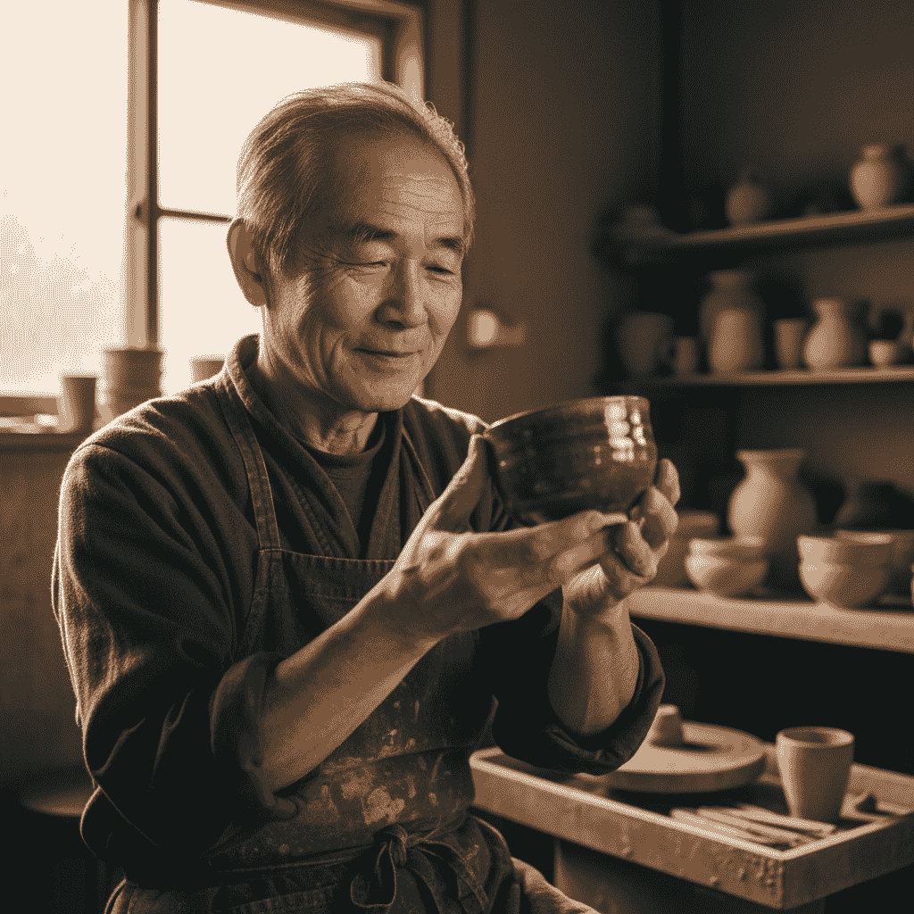
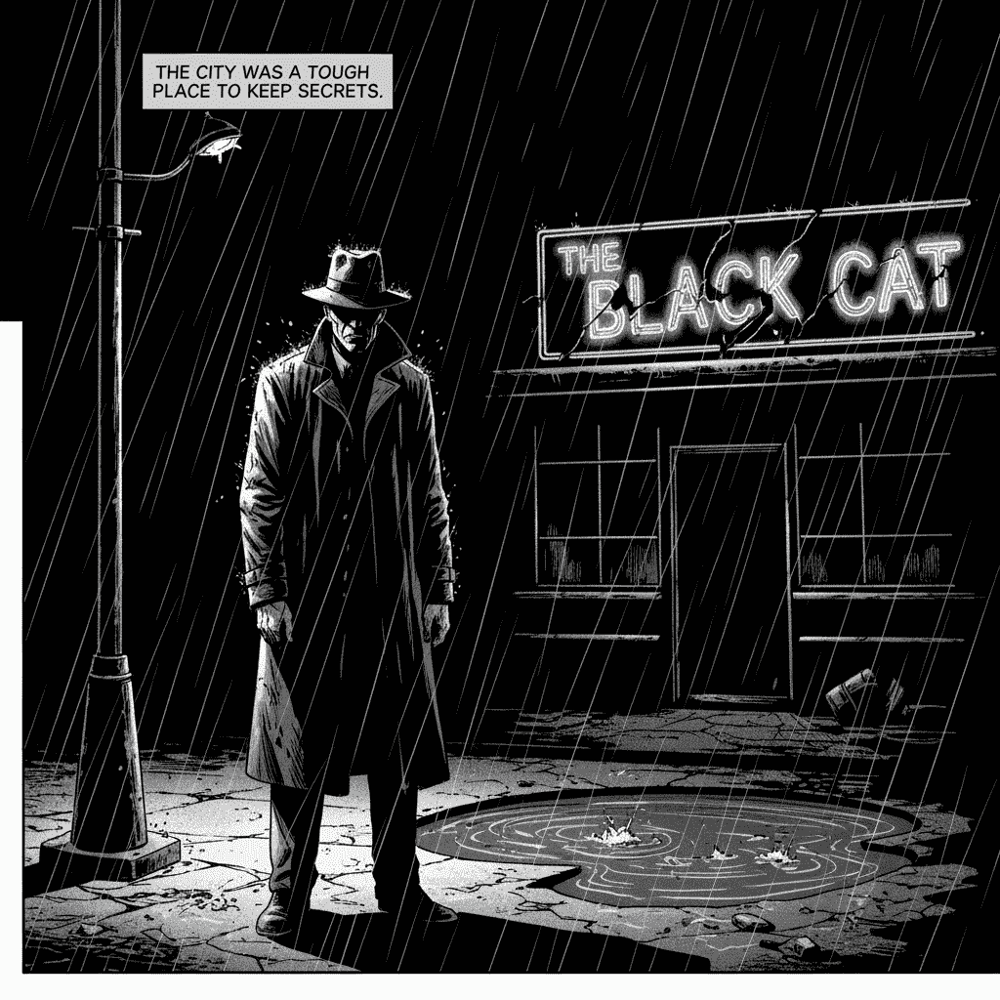
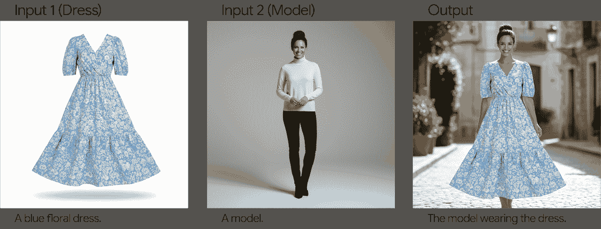

# Google发布 Nano Banana 提示词编写指南

> 来源：[https://my.feishu.cn/docx/VxkfdJAdzoaSRXxQ9cTcDroVnQD](https://my.feishu.cn/docx/VxkfdJAdzoaSRXxQ9cTcDroVnQD)

### Nano Banana 爆火背后｜Google发布 Nano Banana 提示词编写指南

https://developers.googleblog.com/en/how-to-prompt-gemini-2-5-flash-image-generation-for-the-best-results/

中英对照版本：

# How to prompt Gemini 2.5 Flash Image Generation for the best results 如何提示 Gemini 2.5 Flash 图像生成以获得最佳效果

2025年8月28日

Gemini 2.5 Flash Image is our latest, fastest, and most efficient natively multimodal model. What makes Gemini 2.5 Flash unique is its native multimodal architecture. It was trained from the ground up to process text and images in a single, unified step. This allows for powerful capabilities beyond simple image generation, such as conversational editing, multi-image composition, and logical reasoning about image content.

Gemini 2.5 Flash Image 是我们最新、最快、最高效的本地多模态模型。Gemini 2.5 Flash 的独特之处在于其本地多模态架构。它从头开始训练，以统一的步骤处理文本和图像。这就使其具备了超越简单图像生成的强大功能，如对话式编辑、多图像合成和图像内容逻辑推理。

Here are the key things you can do:

以下是您可以做的主要事情：

+   **Text-to-image:**** Gener**ate high-quality images from simple or complex text descriptions.
文本到图像： 根据简单或复杂的文本描述生成高质量图像。

+   **Image + text-to**-image (editing): Provide an image and use text prompts to add, remove, or modify elements, change the style, or adjust colors.
图像 + 文本到图像（编辑）： 提供图像，并使用文本提示添加、删除或修改元素，更改样式或调整颜色。

+   **M**ulti-image to image (composition & style transfer): Use multiple input images to compose a new scene or transfer the style from one image to another.
多张图像到图像（合成&；风格转移）： 使用多张输入图像合成一个新场景，或将风格从一张图像转移到另一张图像。

+   **Itera**tive refinement: Have a conversation to progressively refine your image over multiple turns, making small adjustments.
迭代完善： 进行对话，在多次轮回中逐步完善图像，并做出微小调整。

+   **Text rendering:**** Gene**rate images that contain clear and well-placed text, ideal for logos, diagrams, and posters.
文本呈现： 生成包含清晰且位置恰当的文本的图像，是徽标、图表和海报的理想选择。

This guide will teach you how to write prompts and provide instructions that get better results from Gemini 2.5 Flash. It all starts with one fundamental principle:

本指南将教您如何编写提示和提供说明，以便从 Gemini 2.5 Flash 中获得更好的效果。一切从一个基本原则开始：

> **(Describe the scene, don't **just list keywords.)( The model's core strength is its deep language understanding. A narrative, descriptive paragraph will almost always produce a better, more coherent image than a simple list of disconnected words.)

> (描述场景，而不仅仅是列出关键字。)( 该模型的核心优势在于其对语言的深刻理解。一个叙述性、描述性的段落几乎总是能比一个简单的不连贯单词列表产生更好、更连贯的图像。)

You can try these with[ cod](https://ai.google.dev/gemini-api/docs/image-generation)e from the official documentation or start creating right away in Google AI Studio.

您可以使用 官方文档中的代码尝试这些功能，也可以立即在 Google AI Studio 中开始创建。

Creating images from text

从文本创建图像

The most common way to generate an image is by describing what you want to see.

生成图像的最常见方法是描述您想看到的内容。

1.  Photorealistic scenes  1.逼真场景

For realistic images, think like a photographer. Mentioning camera angles, lens types, lighting, and fine details will guide the model toward a photorealistic result.

对于逼真的图像，请像摄影师一样思考。提及相机角度、镜头类型、照明和精细细节将引导模型实现逼真的效果。

**Template:  模板：**

A photorealistic [shot type] of [subject], [action or expression], set in [environment]. The scene is illuminated by [lighting description], creating a [mood] atmosphere. Captured with a [camera/lens details], emphasizing [key textures and details]. The image should be in a [aspect ratio] format.

在[环境]中拍摄[主体]、[动作或表情]的逼真[镜头类型]。场景由[灯光描述]照亮，营造出[情绪]氛围。使用[相机/镜头细节]拍摄，突出[关键纹理和细节]。图像应采用[宽高比]格式。

Example prompt:  提示示例：

A photorealistic close-up portrait of an elderly Japanese ceramicist with deep, sun-etched wrinkles and a warm, knowing smile. He is carefully inspecting a freshly glazed tea bowl. The setting is his rustic, sun-drenched workshop. The scene is illuminated by soft, golden hour light streaming through a window, highlighting the fine texture of the clay. Captured with an 85mm portrait lens, resulting in a soft, blurred background (bokeh). The overall mood is serene and masterful. Vertical portrait orientation.

这是一幅逼真的特写肖像画，画中有一位日本老年陶艺家，他的脸上有深深的皱纹和温暖、会心的微笑。他正在仔细检查一个刚上好釉的茶碗。背景是他那充满乡村气息、阳光普照的工作室。柔和的金色光线透过窗户照射进来，突出了粘土的细腻质感。使用 85 毫米人像镜头拍摄，背景柔和模糊（虚化）。整体氛围宁静而精湛。垂直人像方向。

Example output:  输出示例：

A photorealistic close-up portrait of an elderly Japanese ceramicist...

一位日本老年陶艺家的逼真特写肖像...

1.  Stylized illustrations & stickers
2.风格化插图和贴纸

To create stickers, icons, or assets for your projects, be explicit about the style and remember to request a white background if you need one.

要为您的项目创建贴纸、图标或资产，请明确说明风格，如果需要，记得要求使用白色背景。

**Template:  模板：**

A [style] sticker of a [subject], featuring [key characteristics] and a [color palette]. The design should have [line style] and [shading style]. The background must be white.

主题]的[风格]贴纸，具有[主要特征]和[色调]。设计应具有[线条风格]和[阴影风格]。背景必须为白色。

Example prompt:  提示示例：

A kawaii-style sticker of a happy red panda wearing a tiny bamboo hat. It's munching on a green bamboo leaf. The design features bold, clean outlines, simple cel-shading, and a vibrant color palette. The background must be white.

一款卡哇伊风格的贴纸，图案是一只戴着小竹帽的快乐的小熊猫。它正在啃绿色的竹叶。设计的特点是轮廓粗犷、简洁，采用简单的 CEL 阴影和鲜艳的色调。背景必须为白色。

Example output:  输出示例：

A kawaii-style sticker of a happy red panda...

卡哇伊风格的快乐小熊猫贴纸

1.  Accurate text in images
3.图像中的精确文本

Gemini 2.5 Flash Image can render text within images. Be clear about the exact text you want, describe the font style, and set the overall design.

Gemini 2.5 Flash Image 可在图像中呈现文本。请明确您想要的确切文字，描述字体样式，并设定整体设计。

**Template:  模板：**

Create a [image type] for [brand/concept] with the text "[text to render]" in a [font style]. The design should be [style description], with a [color scheme].

为[品牌/概念]创建一个[图像类型]，文字为[字体样式]的"[要呈现的文字]"。设计应为[风格描述]，并采用[配色方案]。

Example prompt:  提示示例：

Create a modern, minimalist logo for a coffee shop called 'The Daily Grind'. The text should be in a clean, bold, sans-serif font. The design should feature a simple, stylized icon of a coffee bean seamlessly integrated with the text. The color scheme is black and white.

为一家名为 "The Daily Grind "的咖啡店设计一个现代、简约的徽标。文字应使用简洁、粗体、无衬线字体。设计应将一个简洁、风格化的咖啡豆图标与文字完美地结合在一起。配色方案为黑色和白色。

Example output:  输出示例：

Create a modern, minimalist logo for a coffee shop called 'The Daily Grind'...

为一家名为 "The Daily Grind "的咖啡店设计一个现代、简约的徽标...

1.  Product mockups & commercial photography
4.产品模型和商业摄影

Create clean, professional product shots for e-commerce, advertising, or branding.

为电子商务、广告或品牌创建简洁、专业的产品图片。

**Template:  模板：**

A high-resolution, studio-lit product photograph of a [product description] on a [background surface/description]. The lighting is a [lighting setup, e.g., three-point softbox setup] to [lighting purpose]. The camera angle is a [angle type] to showcase [specific feature]. Ultra-realistic, with sharp focus on [key detail]. [Aspect ratio].

在摄影棚内拍摄一张高分辨率的产品照片，[背景表面/描述]上有[产品描述]。照明为[照明设置，如三点柔光箱设置]，以达到[照明目的]。拍摄角度为[角度类型]，以展示[特定功能]。超真实，清晰聚焦于[关键细节]。[高宽比]。

Example prompt:  提示示例：

A high-resolution, studio-lit product photograph of a minimalist ceramic coffee mug in matte black, presented on a polished concrete surface. The lighting is a three-point softbox setup designed to create soft, diffused highlights and eliminate harsh shadows. The camera angle is a slightly elevated 45-degree shot to showcase its clean lines. Ultra-realistic, with sharp focus on the steam rising from the coffee. Square image.

在摄影棚灯光下拍摄一张高分辨率的产品照片，照片中是一个哑光黑色的简约陶瓷咖啡杯，放置在抛光的混凝土表面上。灯光采用三点式柔光箱设置，旨在营造柔和的漫射高光，消除刺眼的阴影。拍摄角度为略微抬高的 45 度角，以展示其简洁的线条。超逼真，清晰聚焦咖啡升腾的蒸汽。方形图像。

Example output:  输出示例：

A high-resolution, studio-lit product photograph of a minimalist ceramic coffee mug...

一张高分辨率的产品照片，照片中是一个简约风格的陶瓷咖啡杯。

1.  Minimalist & negative space design
5.极简主义和负空间设计

Create backgrounds for websites, presentations, or marketing materials where you plan to overlay text.

为网站、演示文稿或营销材料创建背景，并在其中叠加文字。

**Template:  模板：**

A minimalist composition featuring a single [subject] positioned in the [bottom-right/top-left/etc.] of the frame. The background is a vast, empty [color] canvas, creating significant negative space. Soft, subtle lighting. [Aspect ratio].

这是一幅极简的构图，画面的[右下/左上/等]位置只有一个[主体]。背景是一张巨大、空旷的[彩色]画布，营造出明显的负空间。光线柔和、微妙。[纵横比]。

Example prompt:  提示示例：

A minimalist composition featuring a single, delicate red maple leaf positioned in the bottom-right of the frame. The background is a vast, empty off-white canvas, creating significant negative space for text. Soft, diffused lighting from the top left. Square image.

简约的构图，画面右下方是一片精致的红色枫叶。背景是一张巨大、空旷的米白色画布，为文字创造了大量的负空间。左上方有柔和的散射光线。方形图像。

Example output:  输出示例：

A minimalist composition featuring a single, delicate red maple leaf...

简约的构图以一片精致的红色枫叶为特色。

1.  Sequential art (comic panel / storyboard)
6.连环画（连环画板/故事板）

Create compelling visual narratives, panel by panel, ideal for developing storyboards, comic strips, or any form of sequential art by focusing on clear scene descriptions.

通过清晰的场景描述，逐幅创作引人入胜的视觉叙事，是制作故事板、连环画或任何形式的连环画的理想选择。

**Template:  模板：**

A single comic book panel in a [art style] style. In the foreground, [character description and action]. In the background, [setting details]. The panel has a [dialogue/caption box] with the text "[Text]". The lighting creates a [mood] mood. [Aspect ratio].

艺术风格]风格的单幅漫画。前景是[人物描写和动作]。背景是[场景细节]。画面上有一个[对话/字幕框]，文字为"[文字]"。灯光营造出[氛围]。[宽高比]。

Example prompt:  提示示例：

A single comic book panel in a gritty, noir art style with high-contrast black and white inks. In the foreground, a detective in a trench coat stands under a flickering streetlamp, rain soaking his shoulders. In the background, the neon sign of a desolate bar reflects in a puddle. A caption box at the top reads "The city was a tough place to keep secrets." The lighting is harsh, creating a dramatic, somber mood. Landscape.

单幅漫画的画面采用黑白高对比度墨水，具有阴暗、黑色的艺术风格。前景中，一名身穿风衣的侦探站在闪烁的路灯下，雨水浸湿了他的肩膀。背景中，一家荒凉酒吧的霓虹灯倒映在水坑中。顶部的说明框写道："城市是一个难以保守秘密的地方"。灯光刺眼，营造出一种戏剧性的阴郁氛围。景观

Example output:  输出示例：

A single comic book panel in a gritty, noir art style...

以黑色幽默艺术风格创作的单幅漫画...

## Editing images with text  用文本编辑图像

This is where Gemini 2.5 Flash Image multimodality truly shines. You can provide one or more images alongside your text prompts for editing, composition, and style transfer.

这正是 Gemini 2.5 Flash Image 多模式的真正优势所在。您可以在文字提示的同时提供一张或多张图片，以便进行编辑、构图和风格转换。

1.  Image editing: Adding & removing elements

1.图像编辑：添加和删除元素

Provide an image and simply describe the change you want. The model will analyze the original image's style, lighting, and perspective to make the edit look natural and maintain character consistency across a series of images.

提供一张图片，并简单描述您想要的变化。模特会分析原始图片的风格、光线和视角，使编辑看起来自然，并在一系列图片中保持人物性格的一致性。

**Template:  模板：**

Using the provided image of [subject], please [add/remove/modify] [element] to/from the scene. Ensure the change is [description of how the change should integrate].

使用提供的[主题]图像，请在场景中[添加/删除/修改][元素]。确保改动[说明改动应如何整合]。

Example prompt:  提示示例：

Using the provided image of my cat, please add a small, knitted wizard hat on its head. Make it look like it's sitting comfortably and matches the soft lighting of the photo.

使用所提供的我的猫的图片，请在它的头上添加一顶针织的小巫师帽。让它看起来坐得很舒服，并与照片的柔和光线相匹配。

Example input & output:  输入和输出示例：

1.  Inpainting: editing a specific area
2.内绘：编辑特定区域

You can conversationally tell Gemini 2.5 Flash Image to edit only one part of an image while leaving the rest completely untouched.

您可以用对话的方式告诉 Gemini 2.5 Flash Image 只编辑图像的一部分，而其他部分则完全不动。

**Template:  模板：**

Using the provided image, change only the [specific element] to [new element/description]. Keep everything else in the image exactly the same, preserving the original style, lighting, and composition.

使用所提供的图像，仅将[特定元素]更改为[新元素/描述]。图像中的其他部分保持不变，保留原始风格、照明和构图。

Example prompt:  提示示例：

Using the provided image of a living room, change only the blue sofa to be a vintage, brown leather chesterfield sofa. Keep the rest of the room, including the pillows on the sofa and the lighting, unchanged.

使用所提供的客厅图片，仅将蓝色沙发改为复古的棕色皮质 chesterfield 沙发。保持房间的其他部分不变，包括沙发上的枕头和灯光。

Example input & output:  输入和输出示例：

1.  Style transfer  3.风格转换

Provide a photo and ask the model to recreate its content in the specific style or art movement.

提供一张照片，要求模特按照特定的风格或艺术流派再现照片内容。

**Template:  模板：**

Transform the provided photograph of [subject] into the artistic style of [artist/art style]. Preserve the original composition but render it with [description of stylistic elements].

将提供的[主题]照片转换成[艺术家/艺术风格]的艺术风格。保留原始构图，但加入[风格元素描述]。

Example prompt:  提示示例：

Transform the provided photograph of a modern city street at night into the artistic style of Vincent van Gogh's 'Starry Night'. Preserve the original composition of buildings and cars, but render all elements with swirling, impasto brushstrokes and a dramatic palette of deep blues and bright yellows.

将所提供的现代城市街道夜景照片转换为文森特-梵高《星夜》的艺术风格。保留建筑物和汽车的原始构图，但使用旋转、浮雕笔触以及深蓝和亮黄的戏剧性色调渲染所有元素。

Example input & output:  输入和输出示例：

1.  Advanced composition: Combining multiple images
4.高级构图：组合多张图像

Provide multiple images as context to create a brand new, composite scene. This is perfect for product mockups or creative collages.

提供多张图片作为背景，创建一个全新的合成场景。这非常适合产品模型或创意拼贴。

**Template:  模板：**

Create a new image by combining the elements from the provided images. Take the [element from image 1] and place it with/on the [element from image 2]. The final image should be a [description of the final scene].

通过组合所提供图片中的元素来创建新图片。将[图片 1 中的元素]与[图片 2 中的元素]放在一起。最终图片应为[最终场景描述]。

Example prompt:  提示示例：

Create a professional e-commerce fashion photo. Take the blue floral dress from the first image and let the woman from the second image wear it. Generate a realistic, full-body shot of the woman wearing the dress, with the lighting and shadows adjusted to match an outdoor environment.

制作一张专业的电子商务时尚照片。从第一张图片中提取蓝色花朵连衣裙，让第二张图片中的女性穿上它。生成一张逼真的全身照片，拍摄穿着裙子的女性，并调整灯光和阴影，使其与室外环境相匹配。

Example input & output:  输入和输出示例：

## Best practices  最佳实践

As you build, here are a more tips for working with image generation:

在创建过程中，以下是有关图像生成的更多提示：

+   **Be hyp**er-specific: The more detail you provide, the more control you have. Instead of "fantasy armor," describe it: "ornate elven plate armor, etched with silver leaf patterns, with a high collar and pauldrons shaped like falcon wings."
要非常具体： 提供的细节越多，你的控制能力就越强。与其描述 "奇幻盔甲"，不如描述它："华丽的精灵板甲，刻有银叶花纹，领子很高，护手的形状像猎鹰的翅膀"。

+   **Fix charac**ter consistency drifts: If you notice a character's features begin to drift after many iterative edits, you can restart a new conversation with a detailed description to retain consistency.
修正角色一致性偏差： 如果您发现某个角色的特征在多次反复编辑后开始偏差，您可以重新开始新的对话，并进行详细描述，以保持一致性。

+   Provide context and **intent: **Explain the purpose of the image. For example, "Create a logo for a high-end, minimalist skincare brand" will yield better results than just "Create a logo."
提供背景和意图： 解释图像的目的 。例如，"为一个高端、简约的护肤品牌创建一个徽标 "将比仅仅 "创建一个徽标 "产生更好的效果。

+   **Itera**te and refine: Don't expect a perfect image on the first try. Use the conversational nature of the model to make small changes. Follow up with prompts like, "That's great, but can you make the lighting a bit warmer?" or "Keep everything the same, but change the character's expression to be more serious."
反复推敲： 不要期望第一次尝试就能获得完美的图片。利用模型的对话性质进行细微修改。跟进提示，如 "这很好，但你能把灯光调得暖一点吗？"或 "保持一切不变，但把人物的表情改得严肃一些"。

+   **Use "semanti**c negative prompts": Instead of saying "no cars," describe the desired scene positively: "an empty, deserted street with no signs of traffic."
使用 "语义否定提示"： 与其说 "没有汽车"，不如正面描述所需的场景："一条空旷冷清的街道，没有任何交通迹象"。

+   **Aspect ratios:** When edit**ing,** Gemini 2.5 Flash Image generally preserves the input image's aspect ratio. If it doesn't, be explicit in your prompt: "Update the input image... Do not change the input aspect ratio." If you upload multiple images with different aspect ratios, the model will adopt the aspect ratio of the last image provided. If you need a specific ratio for a new image and prompting doesn't produce it, the best practice is to provide a reference image with the correct dimensions as part of your prompt.
长宽比： 编辑时，Gemini 2.5 Flash Image 通常会保留输入图像的长宽比。如果没有，请在提示中明确说明： "Update the input image... Do not change the input aspect ratio." 如果您上传了多幅不同纵横比的图像，模型将采用最后提供的图像的纵横比。如果您需要新图像的特定比例，而提示又无法生成，最好的做法是在提示中提供一张具有正确尺寸的参考图像。

+   Control the camera: Use photographic and cinematic language to control the composition. **Terms** like wide-angle shot, macro shot, low-angle perspective, 85mm portrait lens, and Dutch angle give you precise control over the final image.
控制镜头： 使用摄影和电影语言来控制构图。诸如广角拍摄 、 微距拍摄 、 低角度透视 、85 毫米人像镜头和荷兰式角度等术语可让您精确控制最终图像。

Limitations   局限性

As we continue to develop and improve our models, we believe in being transparent about areas for improvement.

随着我们不断开发和改进我们的模型，我们相信我们对需要改进的地方是透明的。

While Gemini 2.5 Flash Image is a powerful and versatile tool, achieving perfection on the first attempt with highly nuanced requests can require some iteration. You may find that generating complex typography or maintaining absolute consistency of character features across multiple images sometimes needs refinement through follow-up prompts.

虽然 Gemini 2.5 Flash Image 是一款功能强大、用途广泛的工具，但要在第一次尝试时就达到完美的高度细微差别的要求，可能需要一些反复练习。您可能会发现，生成复杂的排版或在多个图像中保持字符特征的绝对一致性有时需要通过后续提示来完善。

We are actively working to improve these areas and appreciate your creativity as we build the next generation of image tools together.

我们正在积极改进这些方面，并感谢您的创造力，让我们一起打造下一代图像工具。

What's next? Start creating!

下一步是什么？开始创造！

You now have the foundational skills to help you create and edit incredible images with Gemini 2.5 Flash. The best way to improve is to practice. Here are some resources to help you on your journey:

您现在已经掌握了使用 Gemini 2.5 Flash 创建和编辑精彩图像的基本技能。提高的最好方法就是练习。以下是一些资源，希望能对您的学习有所帮助：

+   Explore Gemini in Google AI Studio: The easiest way to start experimenting with the techniques in this guide is with our web-based tool.
在 Google AI Studio 中探索双子座 ：开始尝试本指南中的技术的最简单方法是使用我们的网络工具。

+   [**Read th**](https://ai.google.dev/gemini-api/docs/image-generation)e official documentation: For developers who want to integrate Gemini 2.5 Flash's image generation capabilities into their own applications.
阅读官方文档 ：适用于希望将 Gemini 2.5 Flash 的图像生成功能集成到自己的应用程序中的开发人员。

+   [**Review pricing**](https://ai.google.dev/gemini-api/docs/pricing#gemini-2.5-flash-image-preview)[**: Und**](https://ai.google.dev/gemini-api/docs/pricing#gemini-2.5-flash-image-preview)erstand the costs associated with using Gemini 2.5 Flash Image generation with the Gemini API for your projects.
查看定价 ：了解在您的项目中使用 Gemini 2.5 Flash 图像生成与 Gemini API 的相关成本。

+   [**Try the Im**](https://ai.studio/apps/bundled/pixshop)age Editing Applet: Test AI-Powered photo editing, apply creative filters, or make professional adjustments using simple text prompts.
试用图像编辑小程序 ：测试人工智能驱动的照片编辑，应用创意滤镜，或使用简单的文本提示进行专业调整。