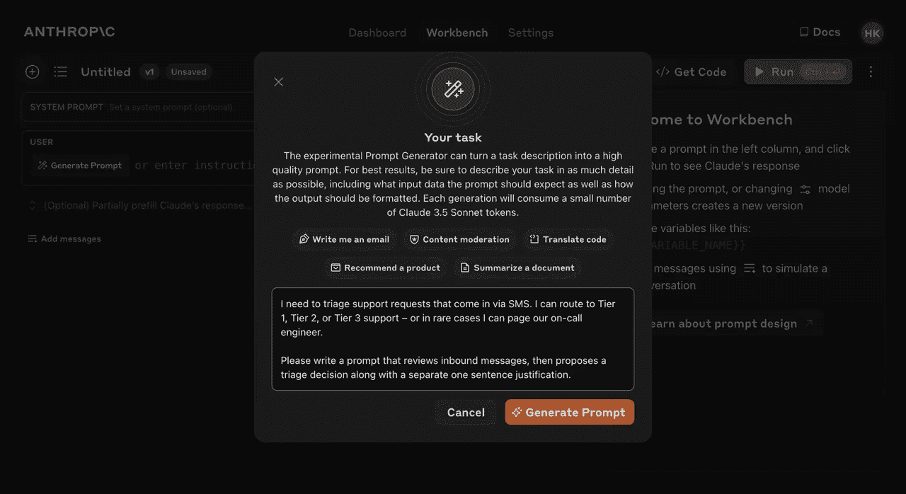
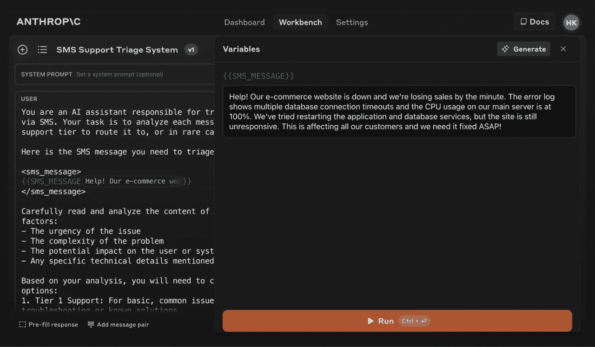
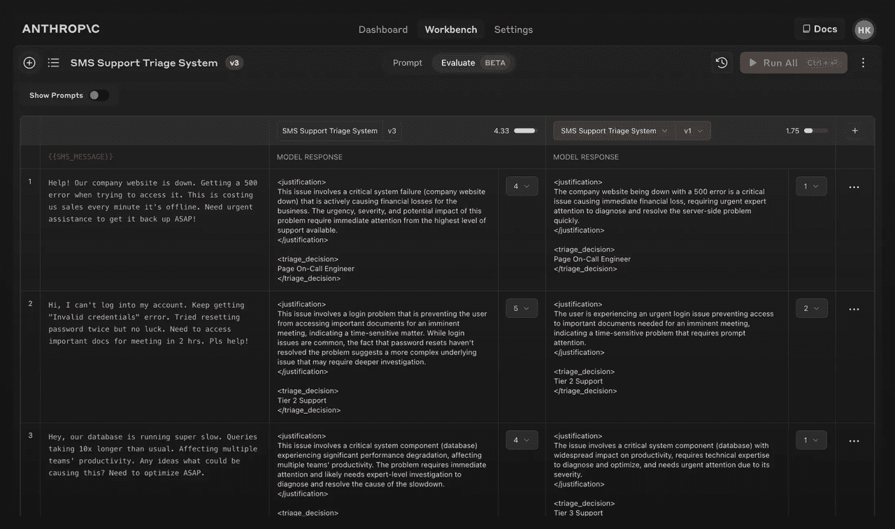

# 在开发者控制台中评估提示<译文>

> 来源：[https://my.feishu.cn/docx/WJhVd20W3oVBHdxeJSWc0pY6nLb](https://my.feishu.cn/docx/WJhVd20W3oVBHdxeJSWc0pY6nLb)

原文来源：[Claude 官网-Evaluate prompts in t](https://www.anthropic.com/news/evaluate-prompts)he developer console

在构建人工智能驱动的应用程序时，提示质量会对结果产生重大影响。但是制作高质量的提示具有挑战性，需要深入了解应用程序的需求和大型语言模型的专业知识。为了加快开发和改善结果，我们简化了这个过程，使用户更容易生成高质量的提示。

您现在可以在人工控制台中生成、测试和评估提示。我们添加了新功能，包括生成自动测试用例和比较输出的能力，使您能够利用Claude为您的需求生成最佳响应。

### 生成提示

编写出色的提示可以像向Claude描述任务一样简单。控制台提供了一个内置的提示生成器，由Claude 3.5 Sonnet提供支持，允许您描述您的任务（例如“分拣入站客户支持请求”）并让Claude为您生成高质量的提示。

您可以使用Claude的新测试用例生成功能为提示生成输入变量（例如，入站客户支持消息）并运行提示以查看Claude的响应。或者，您可以手动输入测试用例。

### 生成测试套件

针对一系列实际输入测试提示可以帮助您在将提示部署到生产环境之前建立对其质量的信心。使用新的评估功能，您可以直接在我们的控制台中执行此操作，而不是跨电子表格或代码手动管理测试。

从CSV手动添加或导入新的测试用例，或者让Claude使用“生成测试用例”功能为您自动生成测试用例。根据需要修改您的测试用例，然后一键运行所有测试用例。查看和调整Claude对每个变量的生成要求的理解，以获得对Claude生成的测试用例的更细粒度控制。

### 评估模型响应并迭代提示

改进提示现在需要更少的步骤，因为您可以创建新版本的提示并重新运行测试套件以快速迭代和改进您的结果。我们还添加了并排比较两个或多个提示的输出的能力。

您甚至可以让主题专家按5分制对响应质量进行评分，以查看您所做的更改是否提高了响应质量。这两个功能都支持一种更快、更容易获得的方法来提高模型性能。

https://youtu.be/KIGBsQqZcNA

### 开始行动

测试用例生成和输出比较功能可供人类控制台上的所有用户使用。要了解有关如何使用Claude生成和评估提示的更多信息，请查看我们的文档。