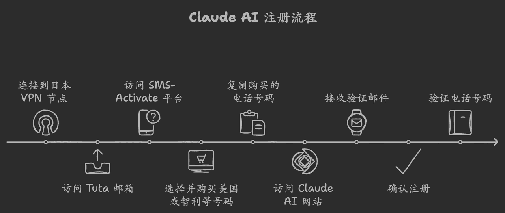

# Claude 注册教程

> 来源：[https://my.feishu.cn/docx/VOimd5LeVobniQxGwaKcUhOAnB5](https://my.feishu.cn/docx/VOimd5LeVobniQxGwaKcUhOAnB5)

## 注册 Claude 3.5 Sonnet 超详细教程：

> 内容参考来源：

> 🔗1：https://youtu.be/ScjYcAPniko?si=o5mj5MO4Faei49mJ

> 🔗2：https://www.youtube.com/watch?v=iE7eNFGL5Es&list=PLNmHqdRDK9PFZEqlldYHwGNKOpADcRwWq&index=13&t=1s&ab_channel=%E9%BB%84%E6%80%9D%E5%B9%B3

> 🔗2：https://github.com/wozulong/fuclaude

**注册 Claude 3.5 其实非常简**单，只需准备三个东西，按照步骤操作即可:

**一、准备工作：**

1.  **稳定的梯子：** 尽量选择干净稳定的节点，因为大陆地区使用 Claude 需要翻墙。

1.  **Tuta 邮箱：**

+   视频作者尝试过 Gmail 和 Outlook 邮箱，但发现很容易被 Claude 封号，建议使用相对冷门的 Tuta 邮箱（https://tu.ta.com/）。

+   进入 Tuta 官网后，点击左下角 CREATE FREE EMAIL ACCOUNT 按钮，根据提示创建免费的 Tuta 邮箱。

1.  SMS-Activate 接码平台：

+   这是一个俄罗斯的接码平台（https://sms-activate.io/），用于接收 Claude 注册所需的验证码。

+   进入 SMS-Activate 官网，先将语言切换为中文，点击右上角 "注册" 按钮，使用刚才注册好的 Tuta 邮箱注册账号。

+   注册成功后，需要充值至少 2 美元才能使用接码服务，充值方式可以选择支付宝。

**二、详细注册步骤：**

1.  **开启**梯子，连接到一个稳定的日本节点。

1.  打开 Tuta 邮箱，确认可以正常接收邮件。

1.  **打开 SMS-Activate 接码平台，**在左侧菜单找到并点击 “Claude”。

1.  选择一个美国号码，点击购物车图标进行购买。 美国号码相对来说比较稳定，成功率更高。智利等一些小众国家也可。

1.  **复制购买的智利号码。**

1.  **打开 Claude AI 官网（h**ttps://claude.ai），在 Continue with Email** 的位置输入你的 Tuta 邮箱，并粘贴刚才复制的智利手机号。**

1.  **点击  **Continue with Email 按钮，Claude 会向你的 Tuta 邮箱发送一封验证邮件。

1.  回到 Tuta 邮箱，找到 Claude 发来的邮件。 如果在收件箱找不到，可以到垃圾邮件里查看。

1.  点击邮件中的 “确认” 按钮，确认注册。

1.  **此时网页会跳转到验证手机号的页面，Cla**ude 会向你购买的智利号码发送验证码。

1.  回到 SMS-Activate 平台，查看并复制收到的验证码。

1.  **将验证码粘贴到 Clau****de 的验证页面，点击验证按钮****。**

1.  **验**证成功后，会要求你填写个人信息，如姓名等，填写完成后即可开始使用 Claude 3.5 Sonnet。

**三、其他解决方案：**

+   **POE 平台：** POE（https://poe.com）平台也提供 Claude 3.5 模型，使用相对稳定，基本不会被封号，但使用次数有限制。

+   **Arena** **Lmsys 大模型竞技场**：https://arena.lmsys.org/ 可免费使用Claude-3.5 Sonnet，中文写作能力超强，但官方账号很难注册、网络限制极高，可用 Arena 替代。