# 联网搜索与深度处理的 Prompt 技巧

> 来源：[https://my.feishu.cn/docx/E7WwdQhEgoQgVXxFwwfcUDO5nwh](https://my.feishu.cn/docx/E7WwdQhEgoQgVXxFwwfcUDO5nwh)

Kimi的搜索能力很强！支持使用精确关键词、特定文件类型搜索、site语法限定来源网站、时间范围限定、布尔逻辑检索、通配符搜索、标题关键词搜索等等，这些技巧大多都是搜索引擎的检索技巧，Kimi是支持或者能理解执行的。这里技巧也比较多，演示几个高级点的技巧。

### **① 查找特定文件类型**

应用技巧就是加上文件格式如pdf、ppt等，也可以可以通过语法如 filetype：pdf（doc、ppt等） 。

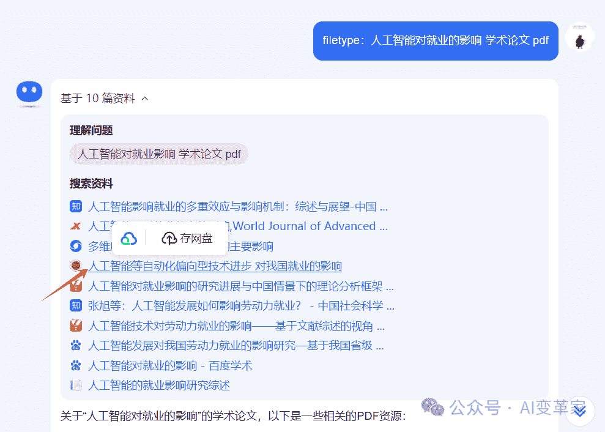

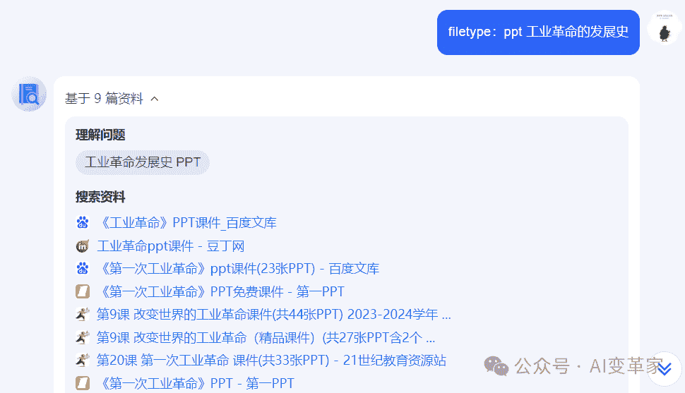

### **②** 使用site语法

###

site语法是一种高级搜索指令，用于限定搜索结果的来源。之前也分享过。

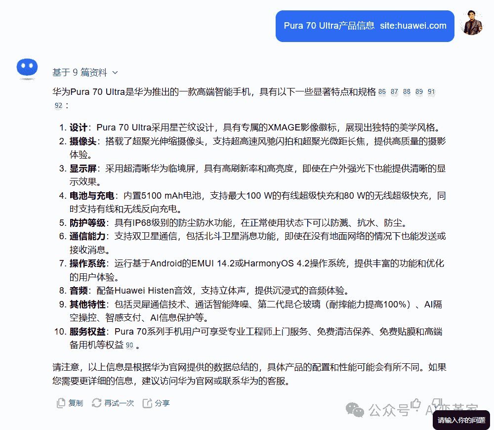

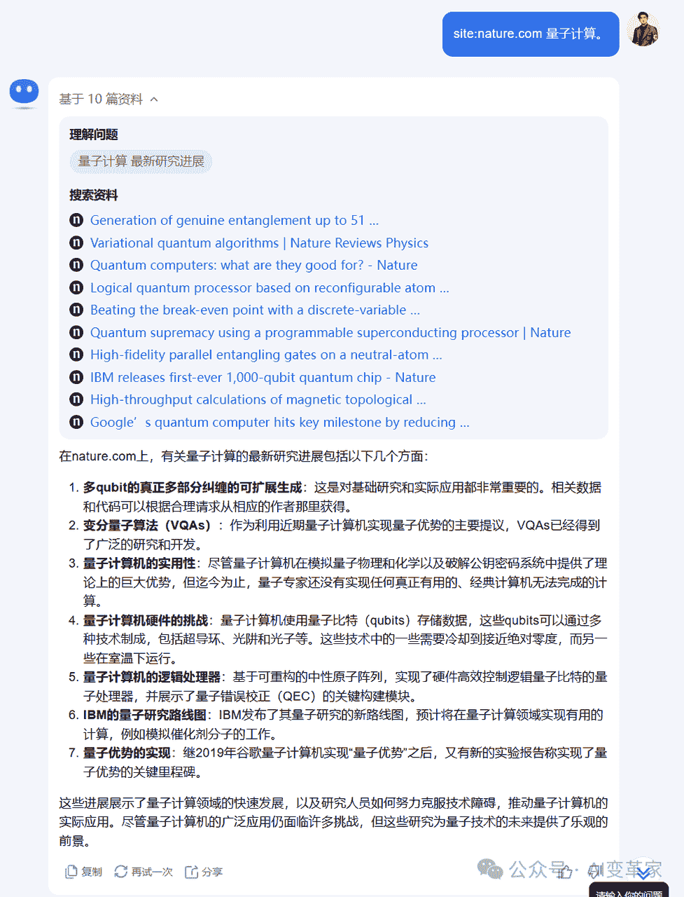

### **③ **限定时间范围

可以使用daterange：进行时间限定，获取特定时间段内的信息。简言之，就指定时间范围来过滤搜索结果，确保获取到的信息与当前需求紧密相关。与前面文档格式搜索一样，“daterange:”可要可不要。

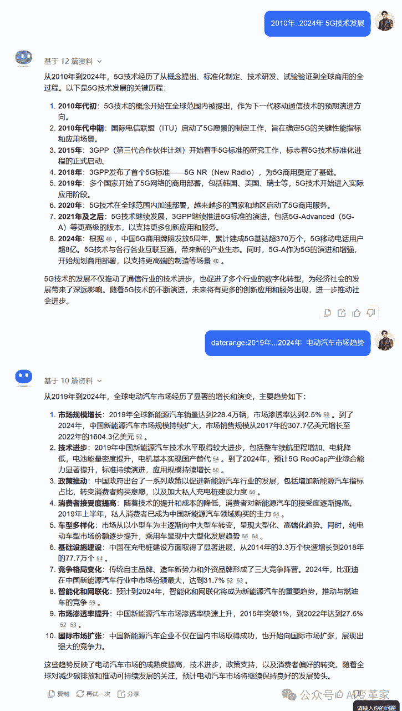

### **④ 布尔逻辑检索的高级应用**

布尔逻辑搜索是一种高级检索技巧，包括三个基本操作：AND（与）、OR（或）和NOT（非），也可以用在Kimi上，构建复杂的搜索查询，以精确找相关信息。

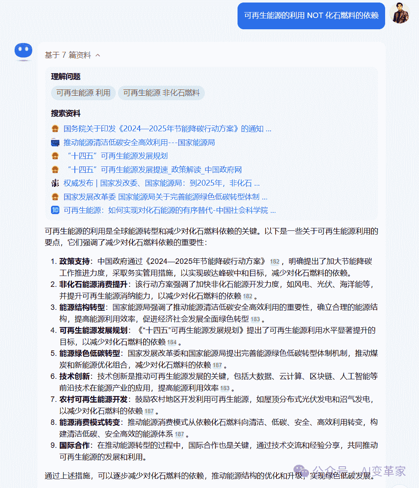

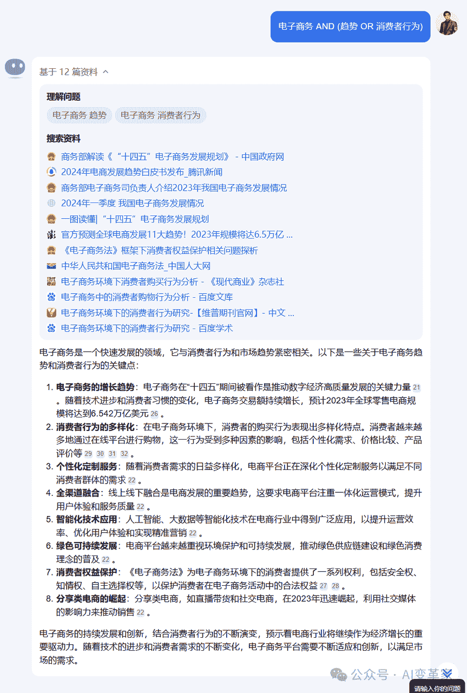

如果想限制搜索结果只来自特定新闻媒体或网站，可以使用site指令。

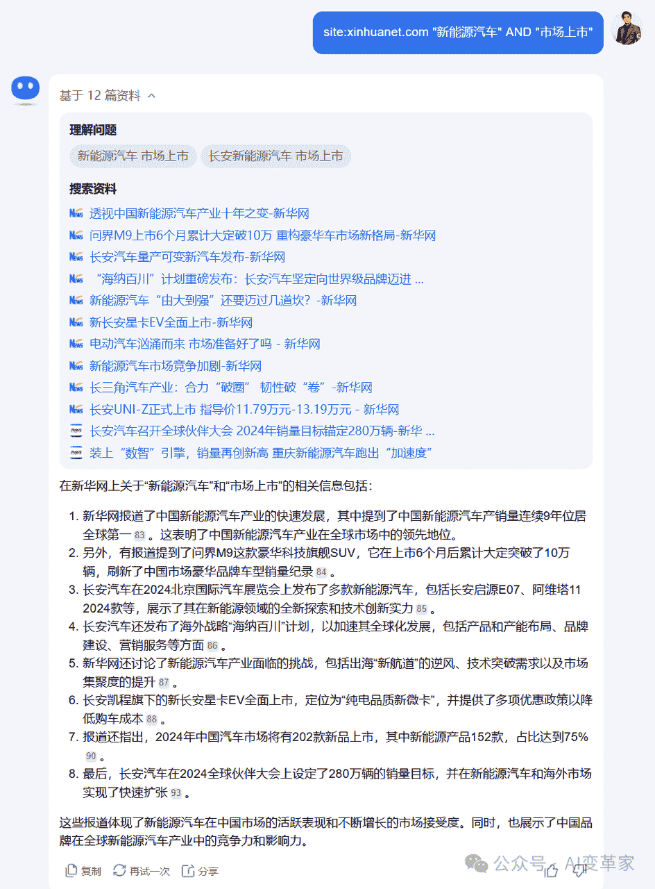

### **⑤ 使用通配符**

通配符一种用特殊字符（如星号 * 和问号 ?），能在你只掌握部分信息，或希望拓展搜索范围时提供帮助。比如当你要了解某款智能手机的特性，但只记得部分型号名称时，使用问号代替，让Kimi帮你找一找，或许你就想起来了。

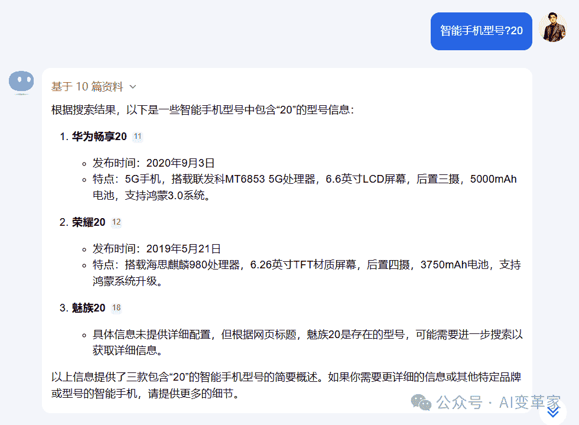

可以让Kimi给你搜索相关理论、研究方法和案例分析，帮你深入探讨问题。结合布尔逻辑和关键词，限定在学术期刊和网站中搜索。

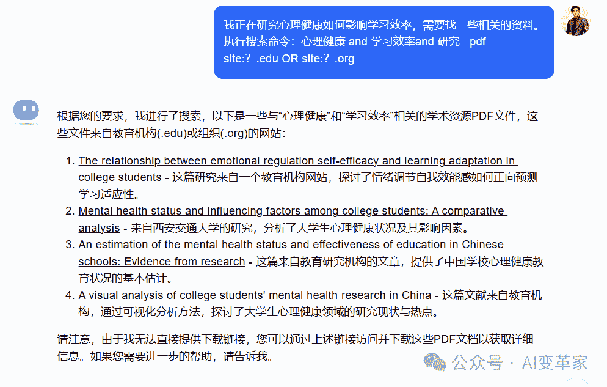

接下来展示几个应用案例。下面是对资料整理的自动化。

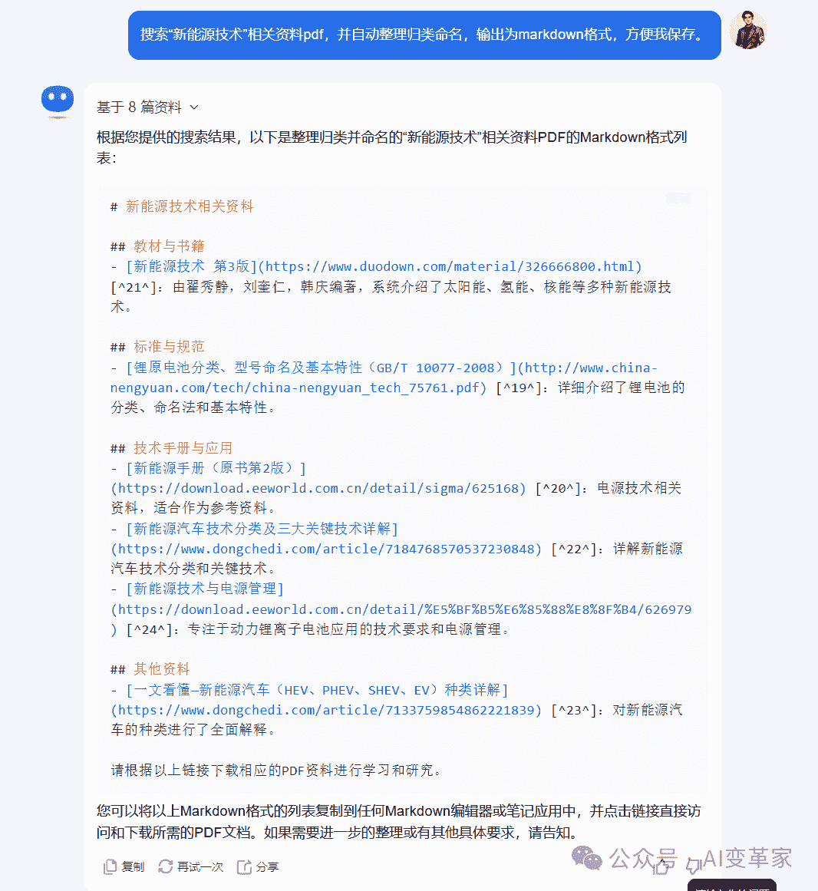

放到飞书大概就是这样的，列表形式还是比较清晰的。

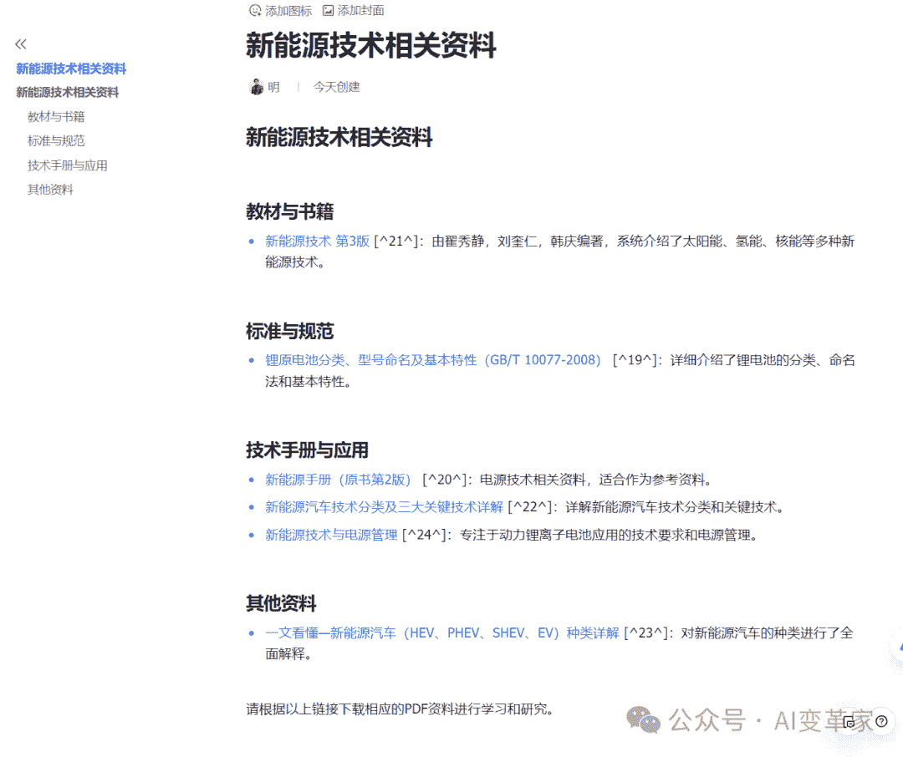

继续，演示一个应用示例，搜集并整合旅游攻略，做旅游计划。在搜索这里，还可以加入一些搜索技巧，比如用site语法，限定时间等等。

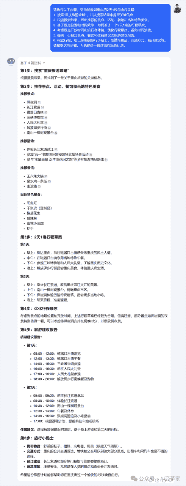

这个部分内容也很丰富，各种组合式，限定式检索及应用非常多，我用了两节来写，用1.3万字把这部分玩得明明白白的。

内容来源：https://mp.weixin.qq.com/s/bOqTlFHeKbKWNxXFwLLshw