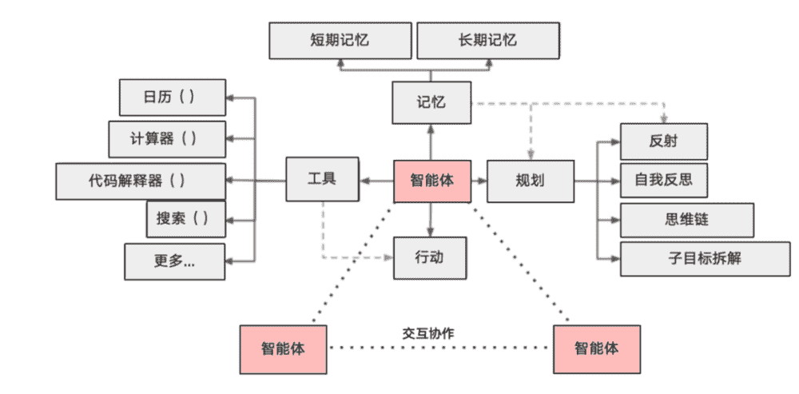

# 什么是 AI Agent？

> 来源：[https://my.feishu.cn/docx/AnD3d5T0goqaEJxyI7ccUSPInSf](https://my.feishu.cn/docx/AnD3d5T0goqaEJxyI7ccUSPInSf)

# AI Agent > GPTs > AI ChatBot

比尔·盖茨都为之倾倒的 AI Agent，究竟是什么？

“Android、iOS 和 Windows 都是平台，AI Agent 将成为下一个平台”，比尔·盖茨在他的博客文章中这样说到。

在比尔·盖茨看来，随着 AI 技术的日益普及，未来五年内我们将不再使用不同的应用程序来完成不同的任务，相反只需用日常用语告诉你的手机或电脑想要做什么，它们就能够处理你的请求。在不远的将来，任何上网的人都将能够拥有一个由人工智能驱动的个人助理，也就是所谓的“AI Agent”。

# AI Agent 的概念与重要性：

+   AI Agent 是一种应用了大模型（LLM）能力的 Agent，也被称为智能体。它由 LLM、 Planning（规划）、 Memory（记忆）和 Tools（工具）等几部分组成。其中，LLM 是核心大脑，Memory、Planning Skills 以及 Tool Use 等则是 Agents 系统实现的三个关键组件。

+   与大型语言模型（LLM）在像 ChatGPT 这样的工具中“通常”的使用方式不同，Agent 拥有复杂的工作流程，模型本质上可以自我对话，而无需人类驱动每一部分的交互。

+   AI Agent 具有自主决策和行动能力，可以理解并适应复杂环境，根据目标，自主思考、制定计划并执行相应任务。相较于 Copilot 的工具型辅助能力，Agent 更注重对环境的实时感知和判断，更像人类一样形成独立的决策和行动方案。

+   目前已发布的 AI Agent 以通用 AI Agent 居多，在使用成本、速度、技术成熟度上仍存在一定的局限，未来突破的关键在于计算机视觉等底层技术的突破。

+   IDC 调研显示，Agent 被普遍认为是 AI 应用发展的趋势性方向，50%的企业已经在某项工作中进行了 AI Agent 的试点，另有 34%的企业正在制定 AI Agent 的应用计划，主要应用于智能终端、智能座舱、汽车自动驾驶、工业机器人和人形机器人等领域。

# AI Agent 的潜力与优势：

+   受到科技界巨头如比尔·盖茨和扎克伯格的关注。比尔·盖茨认为 AI Agent 将成为下一个平台，未来五年内人们将通过日常用语与 AI Agent 交流，完成各种任务。Meta 创始人扎克伯格也曾表示，看到了“以有用、且有意义的方式，向数十亿人介绍 AI Agents 的机会”。

+   AI Agent 是一种人工智能技术，它具有巨大的潜力和优势，可以帮助人们解决各种问题和任务。以下是 AI Agent 的一些主要优势和潜在应用：

+   **自动化**：AI Agent 可以自动执行各种任务，从而节省时间和提高效率。它可以处理重复性的任务，如数据输入、客户服务和订单处理等，从而释放人力资源，使人们能够专注于更有价值的工作。

+   **智能决策**：AI Agent 可以使用数据和算法来做出更明智的决策。它可以分析市场趋势、客户行为和竞争对手，从而帮助企业制定更有效的战略和决策。

+   **个性化服务**：AI Agent 可以根据客户的偏好和行为来提供个性化的服务。它可以通过分析客户数据来了解客户的需求和喜好，从而提供更符合客户需求的产品和服务。

+   **提高客户满意度**：AI Agent 可以提供 24/7 的客户服务，从而提高客户满意度。它可以快速响应客户的问题和请求，并提供准确的信息和解决方案。

+   **创新**：AI Agent 可以帮助企业探索新的业务模式和创新解决方案。它可以分析市场趋势和技术发展，从而帮助企业发现新的机会和创新点。

总的来说，AI Agent 是一种非常有前途的技术，它可以帮助企业提高效率、降低成本、提高客户满意度和实现创新。

# AI Agent 的基本框架

+   AI Agent 的基本框架包括 LLM（大模型）、Planning（规划）、Memory（记忆）和 Tools（工具）四个部分。

+   LLM 是 AI Agent 的智慧和知识库，它提供了庞大的信息存储和处理能力，以理解和响应各种问题。Planning 则像园丁制定种植计划一样，决定 AI Agent 先执行哪些任务、后执行哪些任务。Memory 让 AI Agent 能记住以往的经验和已经完成的任务，确保不会重复错误。Tools 则是 AI Agent 可以运用的各种软件和程序，帮助它执行复杂的任务。

+   在大模型出现之前，Planning 和 Memory 已经有比较成熟的技术。大模型的出现则补足了 AI Agent 发展的最后一环。

# 一些常见的 AI Agent 构建平台

+   那么，AI Agent 又是如何搭建的呢？目前，一众以 AI Agent 为目标的厂商基本上都是以 LLM 为核心，在此基础上增加规划（Planning）、记忆（Memory）、工具（Tools）这三大关键组件。

+   AI Agent 是一种能够自主执行任务并与环境进行交互的智能体。以下是一些常见的 AI Agent 构建平台：

+   **Coze**：是一个新一代的一站式 AI Bot 开发平台，适用于构建基于 AI 模型的各类问答 Bot。它集成了丰富的插件工具，可以极大地拓展 Bot 的能力边界。

+   Microsoft 的 Copilot Studio：这个平台的主要功能包括外挂数据、定义流程、调用 API 和操作，以及将 Copilot 部署到各种渠道。

+   **文心智能体**：是百度推出的基于文心大模型的智能体（Agent）平台，支持开发者根据自身需求打造大模型时代的产品能力。

+   **钉钉 AI 超级助理**：依托于钉钉强大的场景和数据优势，提供更深入的环境感知和记忆功能。这使得它在处理高频工作场景如销售、客服、行程安排等方面表现更加出色。

+   以及阿里通义、智谱清言、豆包等等

# 为什么大语言模型（LLM）刚流行不久，就需要AI Agent呢？

大语言模型（LLM）是一种强大的人工智能技术，能够理解和生成人类语言。尽管它们在处理大量数据、提供信息和回答问题方面非常有效，但是还有一些限制和挑战导致了AI Agent的需求：

+   复杂性管理：LLM能够产生非常复杂的输出，可能需要更多的专业知识和技巧来引导和管理，以确保输出对用户最有帮助。

+   使用方便性：AI Agent可以帮助用户更便捷地与LLM交互，特别是针对那些不熟悉如何有效提问的用户。

+   个性化：用户可能需要根据他们特定的场景和偏好来个性化交互。AI Agent可以协助实现这种个性化服务。

+   理解上下文：LLM可能在理解复杂或多层次的会话上下文方面存在局限。AI Agent可以帮助衔接对话和上下文，为用户提供更加连贯和有意义的体验。

+   可访问性：AI Agent可以使LLM的强大功能更加易于访问，服务于不同技术能力的用户。

+   信息筛选和解释：用户可能不需要或不理解LLM提供的所有信息。AI Agent可以帮助筛选和解释信息，使其更加相关和易于理解。

+   隐私和安全：LLM处理敏感数据时需要严格的隐私和安全措施。AI Agent可能对于确保数据安全和遵守法律法规起到辅助作用。

+   提升决策制定：AI Agent可以在用户用LLM做决策时，提供指引和问答，引导他们考虑更多的角度并提出深入的问题。

简而言之，AI Agent可以作为LLM的补充，提供更个性化、更方便、更安全的服务，优化用户的体验。

# OpenAI 对于 AI Agent 的定义

**OpenAI 将 AI Agent 定义为，以大语言模型为大**脑驱动，具有自主理解感知、规划、记忆和使用工具的能力，能自动化执行完成复杂任务的系统。AI Agent 基本框架如下图：

基于 LLM 驱动的 Agent 基本框架

它具有记忆、规划、行动和使用工具四个主要模块：

**（1）记忆**（Memory）。记忆模块负责存储信息，包括过去的交互、学习到的知识，甚至是临时的任务信息。对于一个智能体来说，有效的记忆机制能够保障它在面对新的或复杂的情况时，调用以往的经验和知识。例如，一个具备记忆功能的聊天机器人可以记住用户的偏好或先前的对话内容，从而提供更个性化和连贯的交流体验。

它分为短期记忆和长期记忆：a。短期记忆，所有的上下文学习都是**利**用短期记忆来学习；b.长期记忆，这为智能体提供了长时间保留和回忆（无限）信息的能力，通常是通过利用外部向量数据库和快速检索，比如某个行业领域沉淀的大量数据和知识。有了长期记忆，很多数据可以被积累下来，使得智能体的可用性更加强大，更具行业深度、个性化、能力专业化等优势。

**（2）规划**（Planning）。规划模块具有事前规划和事后反思两个阶段。在事前规划阶段，这里涉及对未来行动的预测和决策制定，如执行复杂**任务时，智能体将大目标分解为更小的、可管理的子目标，从而能够高**效地规划一系列步骤或行动，以达到预期结果。在事后反思阶段，智能体具有检查和改进制定计划中不足之处的能力，反思错误不足并吸取经验教训进行完善，形成和加入长期记忆，帮助智能体之后规避错误、更新其对世界的认知。

**（3）工具使用**（Tool use）。工具使用模块指的是智能体能够利用外部资源或工具来执行任务。如学习调用外部 API 来获取模型权重中缺失的额外信息，包括当前信息、代码执行能力、对专有信息源的访问等，以此来补足 LLM 自身弱项。例如 LLM 的训练数据不是实时更新的，这时可以使用工具访问互联网来获取最新信息，或者使用特定软件来分析大量数据。

现在市场上已经存在大量数字化、智能化的工具，智能体使用工具比人类更为顺手和高效，通过调用不同的 API 或工具，完成复杂任务和输出高质量结果，这种使用工具的方式也代表了智能体的一个重要特点和优势。

**（4）行动**（Action）。行动模块是智能体实际执行决定或响应的部分。面对不同的任务，智能体系统有一个完整的行动策略集，在决策时可以选择需要执行的行动，比如广为熟知的记忆检索、推理、学习、编程等。

总的来说，这四个模块相互配合使智能体能够在更广泛的情境中采取行动和作出决策，以更智能、更高效的方式执行复杂任务。