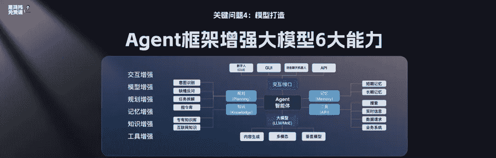
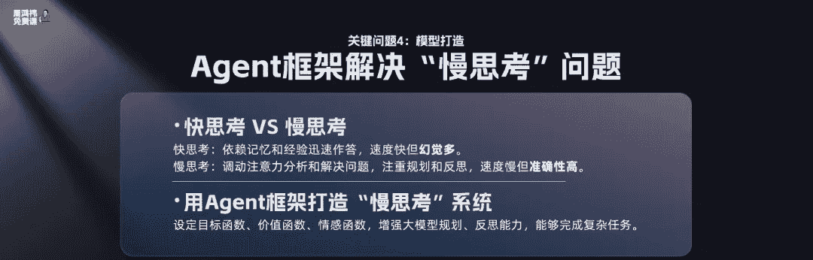
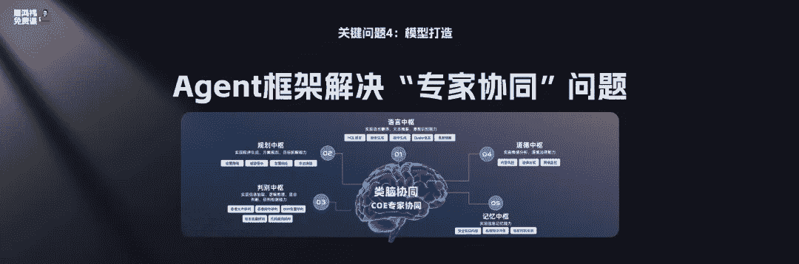
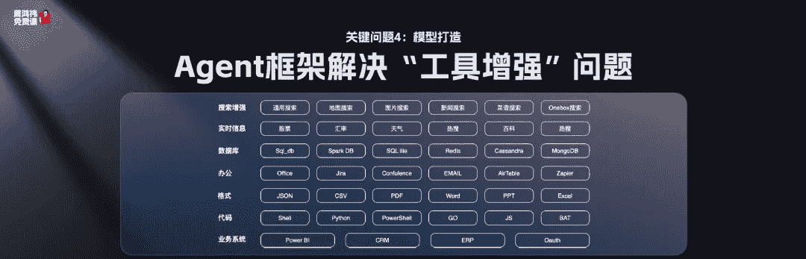

# 为什么要重点关注 AI Agent？

> 来源：[https://my.feishu.cn/docx/VDnMdYqnYoPh5jxx62eclANGnZe](https://my.feishu.cn/docx/VDnMdYqnYoPh5jxx62eclANGnZe)

“智能体不仅将改变每个人与计算机的交互方式。它们还将颠覆软件行业，带来从键入命令到点击图标以来最大的计算革命。”—— 比尔盖茨

# “GPT 3.5+Agent ＞ GPT4”——吴恩达

# 1、吴恩达揭秘 4 种革命性 AI Agent 工作流设计模式

最近，吴恩达教授在红杉资本的人工智能峰会（AI Ascent）上发表了一次演讲。作为深度学习的重要推动者和谷歌大脑项目的创始人，在本次演讲中，他谈到了 AI agent 多步迭代的模式，并向大家分享了自己对于 AI agent 工作流设计模式的四种分类，为技术从业者和业界提供了富有启发性的思路和规划方向。

## 代理工作流：AI 的多步迭代探索

吴恩达教授表示，AI 代理工作流（AI Agent Workflow）与传统使用 LLM 的方式不同，它更加迭代，也能更大化发挥 AI 的潜力。

当前，我们通常采用的与大型语言模型的互动方式是直接的：提供一个问题或提示，模型便迅速给出答复。这个过程可以类比为要求作者一气呵成地完成一篇文章，且不允许修改或回退。虽然有效，但 AI 的潜力远不止于此。

而代理工作流则采取了一种更为细致和迭代的方法。想象一下，首先让 AI 帮助我们勾勒出文章的大纲，如果需要深入研究，AI 也会先行搜集相关信息。接着，AI 会根据这些资料撰写初稿。我们阅读后，可以指导 AI 针对特定部分进行修改和完善，然后再次审查和调整。通过这样的反复修正和优化，最终的成果往往能够达到更高的质量标准。

## 构建未来：AI 代理的四大设计模式

在演讲中，吴恩达教授分享了他对 AI 代理设计模式的分类，这些模式将深刻影响 AI 的发展方向。这 4 种主要的 Agent 设计模式，分别是：

1.  **反思（Reflection）：让 Agent **审视和修正自己生成的输出，提升生成质量。

想象一下，如果你的 AI 助手能够自我审视并改进它的工作，这将是多么令人兴奋的事情！反思模式正是基于这样的理念。AI Agent 会生成一个输出，然后再次审视这个输出，提出改进意见。这就像是 AI 拥有自我批评和学习的能力，能够不断提升自身的性能。

1.  **工具使用（Tool Use）：通过 LLM 生成代码、调**用 API 、网络搜索等工具，提高效率。

在这个模式下，AI Agent 不仅仅是一个执行者，它还能使用各种工具来完成任务。比如，它可以生成代码、调用 API，甚至进行网络搜索。这种模式极大地扩展了 AI 的应用范围，使其能够更加高效地处理复杂的问题。

1.  **规划（Planning）：让 Agent 自主规划、**分解复杂任务、指定执行计划并按计划执行。

规划模式让 AI Agent 能够分解复杂任务，并制定执行计划。就像人类在写作或项目管理中制定大纲和计划一样，AI Agent 也可以通过这种方式来提高工作效率和质量。这种方法特别适合处理需要多步骤、长期规划的任务。

1.  **多**智能体协作（Multi-agent Collaboration）：多个 Agent 扮演不同角色，共同协作完成复杂任务。

这是一个非常前沿的概念，它涉及到多个 AI Agent 扮演不同角色，协同工作以完成任务。这些智能体可以互相交流、分配任务，就像一个团队一样。这种协作模式模拟了现实世界中的工作场景，为 AI 的应用打开了新的可能性。

## 未来展望：GPT-4+agent＞GPT-5

吴恩达教授的这次演讲不仅为我们展示了 AI Agent 工作流的潜力，也为我们描绘了一个更加智能、高效的未来。他还提到，快速生成 token 的重要性，即使使用质量略低但速度更快的模型，通过多次迭代，也可能获得比高质量慢速模型更好的结果。

研究表明，在没有先前样本作为参考的情况下，GPT-3.5 模型的准确率大约为 48%，而 GPT-4 模型则将这一数字提升至 67%。然而，有趣的是，当我们将代理工作流程应用于 GPT-3.5 时，其性能意外地超越了 GPT-4。同样地，当 GPT-4 结合代理工作流程使用时，其表现也同样令人印象深刻。

这一发现强调了在开发应用程序时，采用代理工作流程的重要性，它能够有效地提升 AI 模型的输出质量。甚至可以达到“GPT-4+agent＞GPT-5”的实际应用效果。

相关内容延展阅读：

[吴恩达红杉美国 AI 峰会谈 Agent W](https://new.qq.com/rain/a/20240329A041XC00)orkflow 以及 4 种主流设计模式

吴恩达最新演讲：AI Agent 工作流的未来

[Agent > GPT5? 吴恩达最新演讲：](https://mp.weixin.qq.com/s/6sh39yEO4YGZI-BGPjJnCg)四种 Agent 设计范式（通俗易懂版）

用扣子/Coze 揭秘吴恩达的 4 种 AI Agent 设计模式 &  使用 coze 的 muilt-agent 驯服 GPT-4

# 2、周鸿祎 2024 AI 产业趋势之“关键问题：模型打造。”

> 来源：周鸿祎：2024 年 AI 产业发展的 16 个趋势（https://mp.weixin.qq.com/s/P13UzTQrcWCqU42oO-bMgA）。

企业大模型不是从 0 开始训练，是从千亿模型蒸馏出来的百亿模型。

吴恩达（）最近一个观点我非常赞同，“GPT 3.5+Agent 优于 GPT4”。你可以认为，现在做一个大模型，如果没有 Agent 架构，大模型将会一事无成，特别在企业内部。因为大模型的能力还有很多欠缺。Agent 架构恰恰能够在企业弥补大模型的很多不足。

中文我们把 Agent 框架翻译成“智能体”。它能增强大模型的六大能力——交互增强、模型增强、规划增强、记忆增强、知识增强和工具增强。

## Agent 框架解决“慢思考”问题

特工少女：这个观点最早是华为天才少年李博杰，在知乎 AI 先行者活动中的 “Agent 的下一站，是有趣又有用” 一分享主题中提到的。

我简单来解释一下。它要模拟人脑，人脑的系统里面有两套系统，一套叫快思考，一套叫慢思考。快思考就是生物本能，慢思考就需要衡量。今天大模型快思考的能力已经超过人类了。大模型回答问题不一定对，但是大模型自己没法反悔，所以 Agent 架构里引入了一个框架。就是说我们可以用 Agent 框架来让大模型进行反思，对自己的答案进行检测，进行二次回答，所以大模型不是只调用一次就能出最好的结果。

打个比方，你来问我一个难题，要求说我马上回答，不许修改、不许出错，一气呵成，我也做不到。其实真要讨论一个问题，肯定是经过很多次，慢慢就能找到答案。这才是人脑真正的工作过程。所以 Agent 框架可以让 GPT3.5 多次工作。

我上次举了一个例子，你找一个翻译专家，他也不会只翻译一遍，他会先粗粗翻译一遍，然后再进行润色修改，再来对照原文。那现在你给大模型说把这篇中文翻译成英文，凭什么就要求大模型一次就到位呢？如果你要求大模型做三次，我告诉你翻译的结果会比第一次好很多。所以在企业内部 Agent 架构非常重要。

RAG 知识增强，RAG 可为大模型提供知识增强和知识对齐，提升事实准确性，降低幻觉。

大模型会出错，要防止它出错，就要做知识对齐。这个知识对齐既包括内部知识，也包括外部知识。所以最近 360 推出来的 360 AI 搜索，我用起来就很放心。他所有的答案都先在网上搜一遍，把网上搜到的东西做了理解，再来给我做答案。而不是无中生有瞎编。

## Agent 框架解决“专家协同”问题

企业未来会有多个专业大模型，我们提出来一个 COE 的概念，多个专家模型扮演不同的角色，就类似人的大脑，有不同的语言中枢、规划中枢、判别中枢、记忆中枢一样来进行协作。

## Agent 框架解决“人机界面”问题，不要迷信 Prompt

在企业里边，如果你全是 Prompt，这个企业用大模型一定会失败的。因为你的员工能力水平参差不齐。你想我们人跟人之间沟通还特别费力，你要求你的员工都是 Prompt 专家，所以 Prompt 这种界面，我们称为 LUI。有人说会彻底否定掉 GUI 这个观点是不对的。大模型通过 Agent 框架会把你企业原来的 API 和常见的鼠标键盘界面连在一起，这种操作对员工可能是最简便的。

我们也在探索一个 CUI，就一个聊天室的数字人的界面，但从现在来看，它作为一个补充是可以的，因为你什么事都要跟通过语言方式来表达，在企业内部并不是最高效率的。

## Agent 框架解决“工具增强”问题

大模型的能力实际上是很弱的，很多事都干不了。比如你让它订餐、订票、查航班，它必须有很多工具向它开放，大模型才有了手跟脚，那除了外部的工具之后，在企业内部我们有很多系统，你能不开放吗？假设啥都不让我碰，什么数据库我都没有账号，那我只能给你夸夸其谈，但是如果我都能操纵这些东西，那我作为一个专业员工，我就能发挥作用。所以如果没有 Agent 框架，光有个大模型，在企业内部实际上啥活也干不了。

