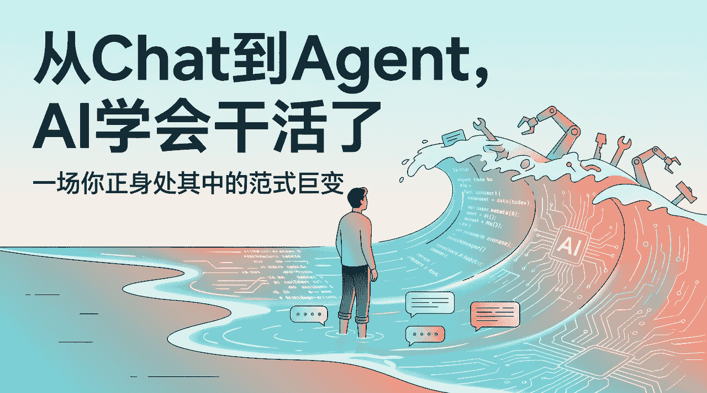
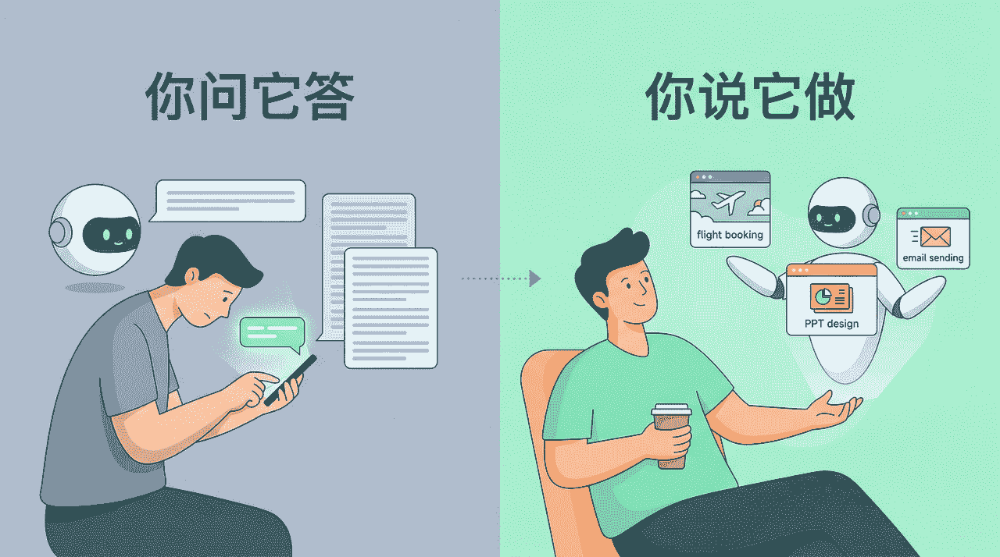
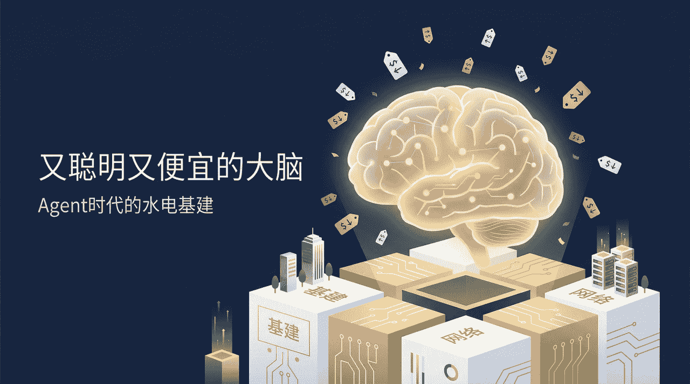
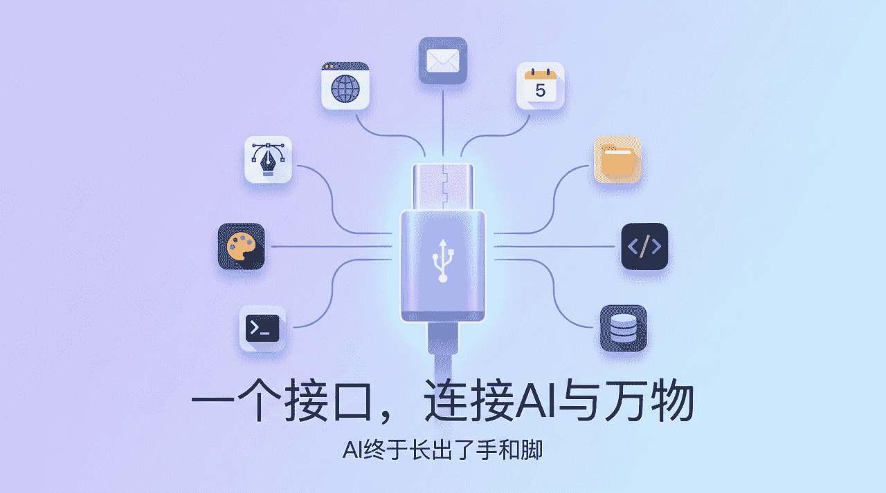
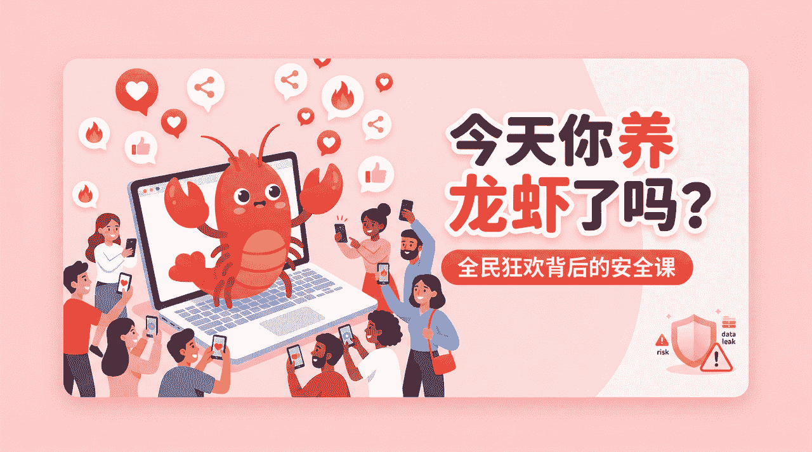
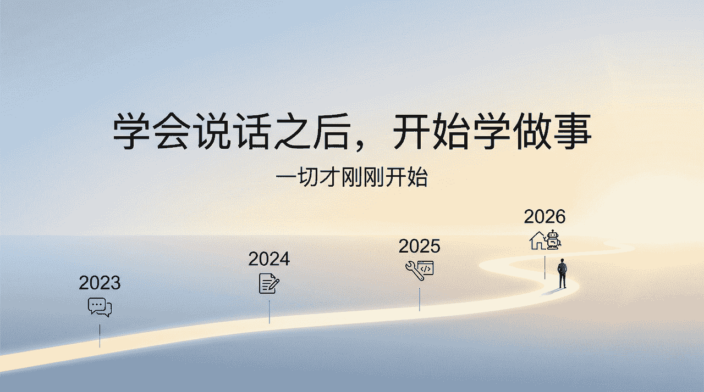

# 2025-2026，从Chat到Agent，AI学会干活了

> 来源：[https://my.feishu.cn/docx/VjSTdtE4lo9OBxx1fo0c9SaZntf](https://my.feishu.cn/docx/VjSTdtE4lo9OBxx1fo0c9SaZntf)

##  副标题：一场你可能正身处其中、却还没完全看清的范式巨变

如果你在2023年第一次用ChatGPT时感到震撼，那你大概能理解我现在想说的话——那种震撼，正在被一种更深层的变革所取代。

只不过这一次，变化不像ChatGPT横空出世那样一夜爆红，它更像是潮水：退去时你没注意，涨上来时，你已经站在水里了。

**这个变化，圈内最常见的概**括就是四个字：从Chat到Agent。

## 先说说“Chat时代”长什么样

回想一下你过去两年怎么用AI——

打开对话框，输入一个问题，等AI回复。觉得**不满意，**再追问一句。来来回回，本质上就是你问它答。

**这就是Chat模式。**它的底层逻辑很简单：人类主导，AI响应。

你让它写一篇文章，它写。你让它翻译一段话，它翻。你让它改一下措辞，它改。

**AI再聪明，在这个模式下，**它本质上是一个被动的、一次性的文字生成器。它没有记忆连贯性（至少早期没有），不会自己规划步骤，更不会主动去打开一个网页、调用一个工具、或者帮你执行一连串操作。

**你是大脑，它是手指。**

2023年到2024年，几乎所有AI产品的竞争都围绕这个模式展开：谁回答得更准，谁支持的上下文更长，谁聊天聊得更自然。模型之间的排名也主要看“对话能力”，谁更会聊天，谁就是王者。

## 那“Agent”到底是什么？

**Agent这个词直译**是“代理人”，但在AI语境下，我更喜欢把它理解为“能自己干活的AI”。

区别在哪？举个生活化的例子——

**Chat模式**像是你跟一个极其博学的朋友发🛰️。你问他：“我下周去东京玩，有什么推荐？”他噼里啪啦给你发一大段攻略。但你还得自己去订机票、订酒店、查签证、做行程表。

**Agent模式**像是你有了一个私人助理。你说：“帮我安排下周的东京之行，预算一万五，我喜欢逛书店和吃拉面。”然后这个助理自己去查航班、比价格、订酒店、排行程、甚至帮你把确认邮件整理好发给你。

看到区别了吗？

**Chat是生成信息，Agent是完成任务。Cha**t输出的是文字，Agent输出的是结果。

从技术角度说，一个Agent需要具备几个关键能力：

+   **规划**：把一个复杂目标拆解成多个步骤

+   **工具调用**：知道什么时候该搜索、什么时候该写代码、什么时候该操作软件

+   **多轮执行**：不是一问一答就结束，而是自己循环迭代，一步一步把事做完

+   **自我纠错**：中间出了错，能自己发现并调整

**也就是说，Chat时代的AI是“**顾问”，Agent时代的AI是“员工”。

## 这两年到底发生了什么？四个标志性节点

说实话，Agent这个概念并不新。2023年AutoGPT火过一阵，号称“让GPT自己给自己发指令、自动完成任务”。但那时候的尝试基本都是玩具，模型的基础能力撑不起来，调用工具经常出错，规划能力约等于零，跑起来像个不断撞墙的无头苍蝇。

真正的转折，发生在2025年前后。而且身在中国互联网，这场转变你一定不会陌生，因为几个标志性事件已经从科技圈刷到了你的朋友圈、短视频甚至饭桌上。

### 第一幕：DeepSeek——给Agent装上一颗“便宜的聪明大脑”

Agent要干活，背后需要大模型在不停地思考、规划、试错。一个复杂任务跑下来，模型可能要内心活动成百上千次。这就意味着，如果底层模型太贵，Agent就永远只是有钱人的玩具。

2025年初，DeepSeek横空出世，彻底改变了这个局面。

它用极低的训练成本，做出了对标国际顶尖水平的开源模型，然后把API调用价格打到了地板价。以前跑一个复杂的自动化任务可能要花几十块的Token费，现在只需要几分钱。

**DeepSeek的意义不仅仅是“中国也有好模型了”，而是**它让“人人用得起Agent”变成了现实。

它就像Agent时代的水电基建。Agent再花哨，底层没有一颗既聪明又便宜的大脑，一切都是空中楼阁。DeepSeek把这个地基打好了，后面的故事才成为可能。

### 第二幕：MCP——给AI装上“手和脚”的通用接口

光有聪明大脑还不够。

在Chat时代，AI就像一个被关在小黑屋里的天才。它虽然学富五车，但碰不到你电脑里的文件，连不上公司的数据库，打不开你的浏览器。你只能把信息复制粘贴给它，它再把结果复制粘贴回来。

要让AI真正干活，它必须能直接操作外部世界的工具和软件。但问题来了：工具千千万万，每个工具的接入方式都不一样。如果每个AI要单独对接每个软件，那开发成本简直是天文数字。

2025年，一个叫MCP（Model Context Protocol，模型上下文协议） 的东西全面普及了。

你可以把MCP想象成AI世界的USB Type-C接口。

还记得十年前，每个手机品牌都有自己的充电线吗？安卓用Micro USB，苹果用Lightning，三星老款还有个奇形怪状的。充电线一抽屉，出门忘带就抓瞎。后来Type-C一统天下，一根线走遍天下。

MCP做的就是同一件事：不管你用的是ChatGPT、Claude还是国内的各类模型，都能通过这个标准协议，无缝且安全地读取本地文件、调用设计软件、接入飞书或企业🛰️。

有了MCP，AI终于长出了手和脚，可以真正在你的软件生态里动手干活了。 而且，开发者搭建Agent的门槛也大大降低，不用每次都从零造轮子。

### 第三幕：Manus——让全世界看到“AI真的能替你干活”

如果说DeepSeek提供了大脑，MCP提供了手脚，那么Manus就是第一个站起来走路、还走得挺好看的那个Agent。

2**025年3月**，由中国团队推出的Manus一夜刷屏。它的名字来自拉丁语“手”（Hands On AI），定位就是通用AI代理。

你给它一个宏观指令，比如：“帮我调研今年最火的三个AI营销案例，做成一份图文并茂的PPT，然后发邮件给团队。”

然后它自己打开一个云端虚拟电脑，自己上网搜索、自己整理数据、自己排版设计、自己发送邮件，全程你可以在旁边喝咖啡。

GAIA基准测试中，Manus的分数一度超越OpenAI的产品。内测邀请码被炒到上万元。🧣、知乎、朋友圈全在刷“中国的Agent时刻来了”。A股150多只AI概念股涨停。

Manus最大的价值，是让普通人第一次看见了Agent是什么。

在此之前，大家对Agent的理解还停留在概念和PPT上。Manus用一个肉眼可见的过程（浏览器在自动翻页、文件在自动生成、邮件在自动发送），把“AI从动嘴到动手”这件事，直观地摆在了所有人面前。

### 第四幕：“养龙虾”——Agent走入千家万户的全民狂欢

**如果说Manu**s是“科技圈的震撼”，那2026年初的“养龙虾”事件，就是Agent真正走进普通人生活的标志。

2026年春节前后，一款名叫**OpenClaw**的**开源AI智**能体软件突然爆火。因为它的Logo是一只红色的龙虾，网友们把在自己电脑上安装和配置这个AI助理的过程，亲切地戏称为“养龙虾”。

它的卖点非常诱人：你在自己电脑上养一只龙虾，它就能像一个24小时在线的数字分身，帮你查邮件、抓信息、回消息、整理文件、生成报告，甚至模仿你的语气帮你处理日常事务。零工资，不请假，不摸鱼，永远精力充沛。

这直接戳中了打工人的痛点。

一夜之间，“今天你养龙虾了吗？”成了社交货币。朋友圈在晒，短视频在教，腾讯、百度等大厂甚至在写字楼下摆摊，工程师现场帮普通市民“一键部署”这只赛博龙虾。两会代表委员讨论了，政府工作报告里也首次提及“智能体推广”。

**但随后的反转同样精彩——**

因为OpenClaw需要较高的系统权限才能帮你操控电脑，大量用户在不了解安全风险的情况下裸奔部署。隐私泄露、系统被黑客控制等安全事件接连爆出。官方紧急发布风险提示，网上甚至出现了卸龙虾教程和付费安全卸载服务。

从排队养虾到抢着卸虾，前后不到一个月。

这场闹剧给很多人上了一课：Agent时代，AI不再只是帮你写写文字那么简单。你把电脑和工作流的控制权交出去，安全和权限管理就成了第一道门槛。这不仅仅是技术问题，更是信任问题。

## 为什么Agent时代更难，也更有价值？

你可能会想：如果Agent这么好，为什么不早点做？

因为做Agent比做Chat难太多了。

C**hat模式下，模型犯一个错**，用户看到了，自己纠正就行。但在Agent模式下，模型需要连续做十几步、甚至几十步决策，每一步的小错误都会被放大。就像多米诺骨牌，第三块歪了一点，到第十块就完全倒错了方向。

这对模型的要求是全方位的：

+   **代码能力**要足够强，因为大量Agent任务最终都要靠写代码来执行

+   **指令遵循**要足够精确，不能“差不多就行”

+   **工具调用**要足够可靠，不能调着调着就幻觉出一个不存在的功能

+   **长程规划**要足够稳定，不能做到一半就忘了自己在干什么

所以，Chat时代的模型排行榜，看的是“谁更会**聊天”。而Ag**ent时代的排行榜，看的是“谁更会干活”。

这两件事高度相关，但绝不相同。很多聊天很溜的模型，一到实际干活就拉胯。反过来，一些对话体验一般般的模型，编程和工具调用能力却异常出色。

这就是为什么2025-2026年的AI竞争格局被重新洗牌了。 之前被认为“只会聊天”的公司开始掉队，而那些在编程能力和工具调用上默默积累的团队，突然站到了舞台中央。比如海外的Claude以及我们的Kimi，这段时间已经是AI Coding界以及Agent落地领域的当红炸子鸡。

## 对我们普通人意味着什么？

如果你不是程序员，不是AI从业者，只是一个普通的互联网用户，这个变化跟你有什么关系？

**关系大了。**

在Chat时代，AI能帮你**回答问题**。在Agent时代，AI能帮你**解决问题**。

这两者的区别，就像百度和淘宝的区别：一个告诉你“哪里有卖的”，一个直接帮你下单送到家。

过去**一**年里，最先被改变的是程序员群体。他们最推崇的AI工具，从需要人在旁边盯着的辅助编程产品（比如Cursor），逐步转向了AI自己读代码、改代码、运行测试、修bug的自主式工具（比如Claude Code）。表面看是界面从漂亮的图形编辑器退化成了黑白命令行，实际上是交互范式在进化：从人类握方向盘、AI当副驾驶，变成了人类说目的地、AI自己开车。

程序员只是第一批。接下来，这个变化会扩展到所有知识工作领域：

+   你跟AI说“帮我做一份本周的项目进度汇报PPT”，它不再只是列提纲，而是真的去读你的项目文档、拉数据、生成图表、排好版，直接给你一个成品。

+   你说“帮我对比这五款手机的性价比”，它不再只是列参数表，而是自己去各个平台抓实时价格、读用户评价、生成购买建议。

+   你说“帮我把这篇英文论文的核心观点整理成中文备忘录，发到飞书上”，它真的一条龙做完。

AI正在从“信息助手”变成“任务执行者”。

**当然，兴奋之余也要清醒。养龙虾事件已经提前给所有人打了**一针预防针，当AI从帮你写字变成帮你干活，你交出去的不只是一个对话框，而是你的文件、你的账号、你的工作流。 安全意识和权限管理，必须跟上。

## 这不是终点，一切才刚刚开始

从Chat到Agent的转变，本质上反映了一个更深层的趋势：AI正在从“模拟人类说话”走向“模拟人类做事”。

聊天只是人类能力的冰山一角。我们之所以能改造世界，不是因为我们会说话，而是因为我们会思考、规划、使用工具、执行任务、从错误中学习、然后继续执行。

Agent时代的AI，正在开始学习这整个链条。

回头看这两年的时间线，脉络异常清晰——

**DeepSeek击穿了成本底线，让Agent有了一颗人人用得起的聪明大脑；MCP统一了工具接口，让AI终于长出了手和脚；Manus用一个可视化的过程，让**全世界看到AI真的能替人干活；“养龙虾”则用一场全民狂欢，宣告Agent正式走出科技圈、走进普通人的生活。连同它的巨大潜力和尚未解决的安全隐患，一起摆上了台面。

当然，现在的Agent还远称不上完美。它们会犯错、会走弯路、有时候会执拗地在一个死胡同里打转。但就像2023年的ChatGPT经常说胡话一样，技术的迭代速度，远比我们的想象力快。

2023年，我们惊叹于AI居然能像人一样聊天。

2024年，我们习惯了AI帮我们写文章、做翻译。

2025年，我们开始看到AI自己写代码、调用工具、完成项目。

2026年，我们正在亲历AI走进千家万户，开始真正“动手做事”。

**如果说Chat时代是AI的“学说话”阶段，那**Agent时代就是AI的“学做事”阶段。

而从当下的进展来看，这场变革不过才走完了开头几步。未来的竞争焦点，已经不再是“谁的模型跑分更高”，而是“谁的Agent最能把活儿干得漂亮、干得安全、干得让人放心”。

这才是接下来真正精彩的部分。

从“跟AI聊天”到“让AI干活”，你感受到这个变化了吗？欢迎留言聊聊你的体验和期待 👇

—— THE END ——

---

我是 Vincent 文森特——

👨‍💻 10yr+品牌营销人｜AI 深度玩家

✍️ 自编《轻松玩转 AIGC》飞书知识库

🔭 以营销视角，探寻 AI 商业新机会

🚀 欢迎交流探讨，合作请注明来意🤝

附 AI 参考资料：

《轻松玩转 AIGC》飞书 AI 知识库之《🚀 常用 AI 工具集·精选版》➡️ https://ai.feishu.cn/wiki/NQLow0opDijbzMkp3mnc887cnte?from=from_copylink

既然看到这里了，如果觉得我的内容还不错，不妨顺手点个赞、在看、转发三连吧～想要第一时间收到推送，也可以给我个星标⭐欢迎点击下方👸号（文森策）关注我👇