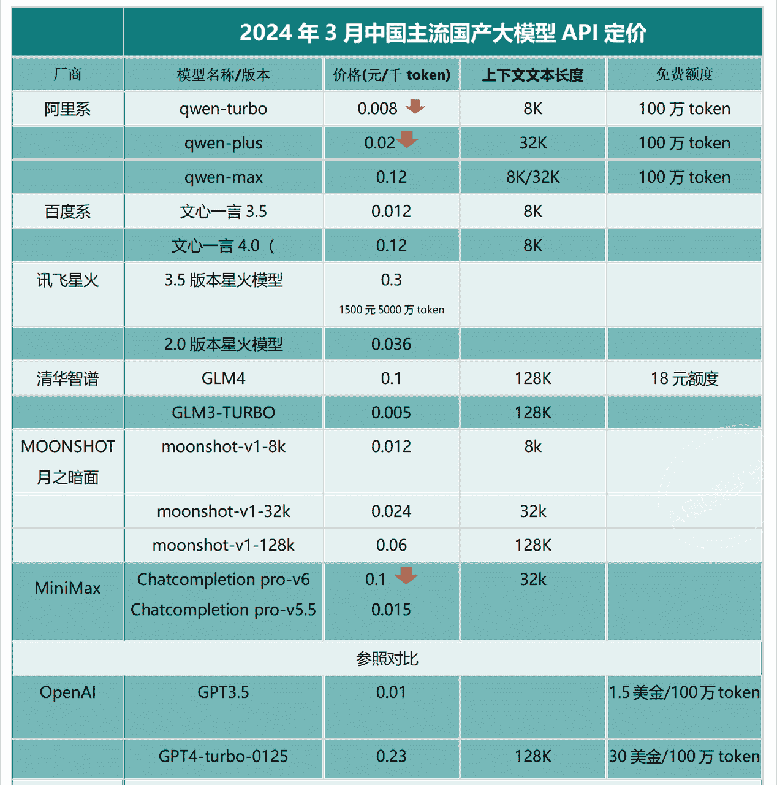

# 7.1  AI Agent 如何搭建？

> 来源：[https://my.feishu.cn/docx/QvsUdGbLBoZ40lx6m7pcKowkngd](https://my.feishu.cn/docx/QvsUdGbLBoZ40lx6m7pcKowkngd)

# AI Agent 搭建平台

### 1)  Coze

> Coze 是由字节跳动推出的一个 AI 聊天机器人和应用程序编辑开发平台，可以理解为字节跳动版的 GPTs。

> 无论你是否有编程经验，这个平台都可以让您快速地创建各种类型的聊天机器人，并将它们部署在其他社交平台和消息应用上。Coze 还提供了多种插件、知识、工作流、长期记忆和定时任务等功能，来增强聊天机器人的能力和交互性。

+   **海外版：Coze** https://www.coze.com/explore （需施展魔法）推荐指数：🌟🌟🌟（五星降至三星）

可以免费部署使用 GPT4，调用 Google 搜索，支持自己免费创建 GPTs。像是在 gpt4 的套壳基础上，加持了各种复合功能，甚至在产品使用体验方面，目前口碑好过 GPTs，不愧是移动互联网时代的“app 工厂”

**海外版 Coze 官方文档（中文版）-用法指南 **https://www.coze.com/docs/zh_cn/welcome.html

（补充：海外版自202406月起，推出付费会员制，大离谱，so sad, 不香了不香了）

+   **国内版：Coze 扣子 **https://www.coze.cn/ 推荐指数：🌟🌟🌟🌟🌟

[2024 年2 月 1 日新上](https://new.qq.com/rain/a/20240201A03WX800)线，功能与海外版 Coze 同理（字节版 GPTs“扣子”上线了），这个平台可以看到很多别人创建的 Bot 智能体范例、参考别人的提示词、来创建自己的 ChatBot。

之前一直用字节云雀大模型，4 月 20 日上线了 moonshot 大模型（Kimi），这下可用性就强了很多了，甚至可以替代掉一众国产了。

比如：

你可以让 Bot 每天早上给你推荐个性化的新闻，或者每周五帮你规划周末的出行计划

你可以做一个帮你搜集电影评论的工作流，或者一个帮你撰写行业研究报告的工作流

**国内版 Coze 扣子官方文档（中文版**）-用法指南 https://www.coze.cn/docs/guides/welcome

+   **功能科普**：

+   [白](https://mp.weixin.qq.com/s/jMU5JLLCFUQa_brBkeUaTA)嫖 GPT4，Dalle3 和 GPT4V - 字节开发的 Coze 初体验！附教程及提示词 Prompt

+   [GPT4 自动化神器：一键生成文案、视频、](https://www.bilibili.com/video/BV19C411h7Dx?vd_source=10ac1f64c31c16db36a207dbc7eac844)编程，小白也能轻松掌握 AgentAI！

+   **部署教程**：[普](https://www.bilibili.com/video/BV1UC4y1r7zL/?spm_id_from=333.1007.top_right_bar_window_history.content.click&vd_source=5bd86464fb14bc4ab272a83ce82f14af)通人秒变 AI 高手：使用免费开放的 Coze 平台（GPT4-V、DALL E3）创建个人专属 AI 助理

+   **更多功能**：[Coze 应用导航｜使用教程](https://jn6074dvza.feishu.cn/docx/NgT5da3AGojec3xqzOCcmPTOnle)

+   **补充资料：**

> 字节的Coze、扣子和GPTs，有什么区别？https://mp.weixin.qq.com/s/qgEi6mZeaxRsl7skvets2w

> Coze 中文交流社区：[欢迎来到Coze中文交流社区](https://agentuniverse.feishu.cn/wiki/HmcXwIHk8iYyqNkwAGjcMU5PnFb)

> [详解：Coze 扣子](https://waytoagi.feishu.cn/wiki/FjBYwQHVdicl26kXh7Ccdj6xngU?from=from_copylink)

### 2)  国内AI智能体平台

> agent 搭建部署平台，与 Coze/扣子同理，但操作相对更简单

+   **智谱清言**

+   **文心智能体**

+   **通义千问**

+   **昆仑天工**

+   **豆包**

+   **腾讯元器**

### 3)  Coze同类型LLMs Agent 搭建平台——

POE：机器人专区，支持个人通过提示词创建。

[Dify](https://dify.ai/zh)：开源的 LLM 应用开发平台。提供从 Agent 构建到 AI workflow 编排、RAG 检索、模型管理等能力，轻松构建和运营生成式 AI 原生应用。比 LangChain 和 Flowise 更易用。

[FastGPT](https://fastgpt.run/)：一个基于 LLM 大语言模型的知识库问答系统，提供开箱即用的数据处理、模型调用等能力。同时可以通过 Flow 可视化进行工作流编排，从而实现复杂的问答场景！

附：2024 年 3 月中国主流国产大模型 API 定价

# 补充阅读

[谈Agent构建平台的设计【2023H2】](https://agentuniverse.feishu.cn/wiki/WlDRwlqBdi6ldfk6uS7cRb7inwo?from=from_copylink)