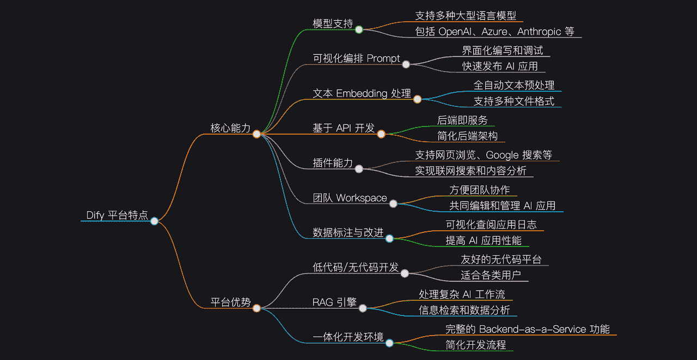
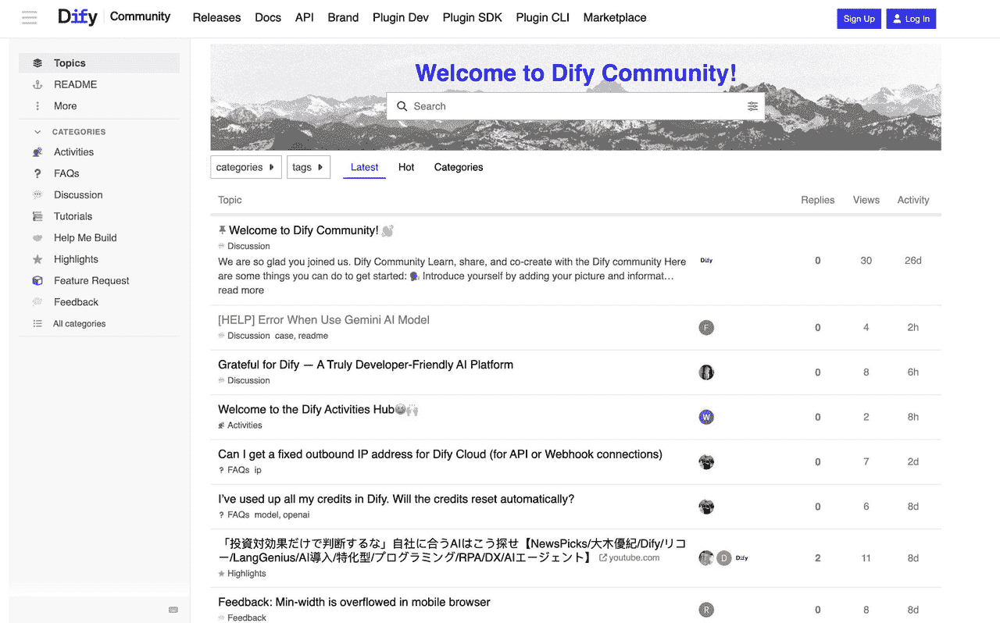
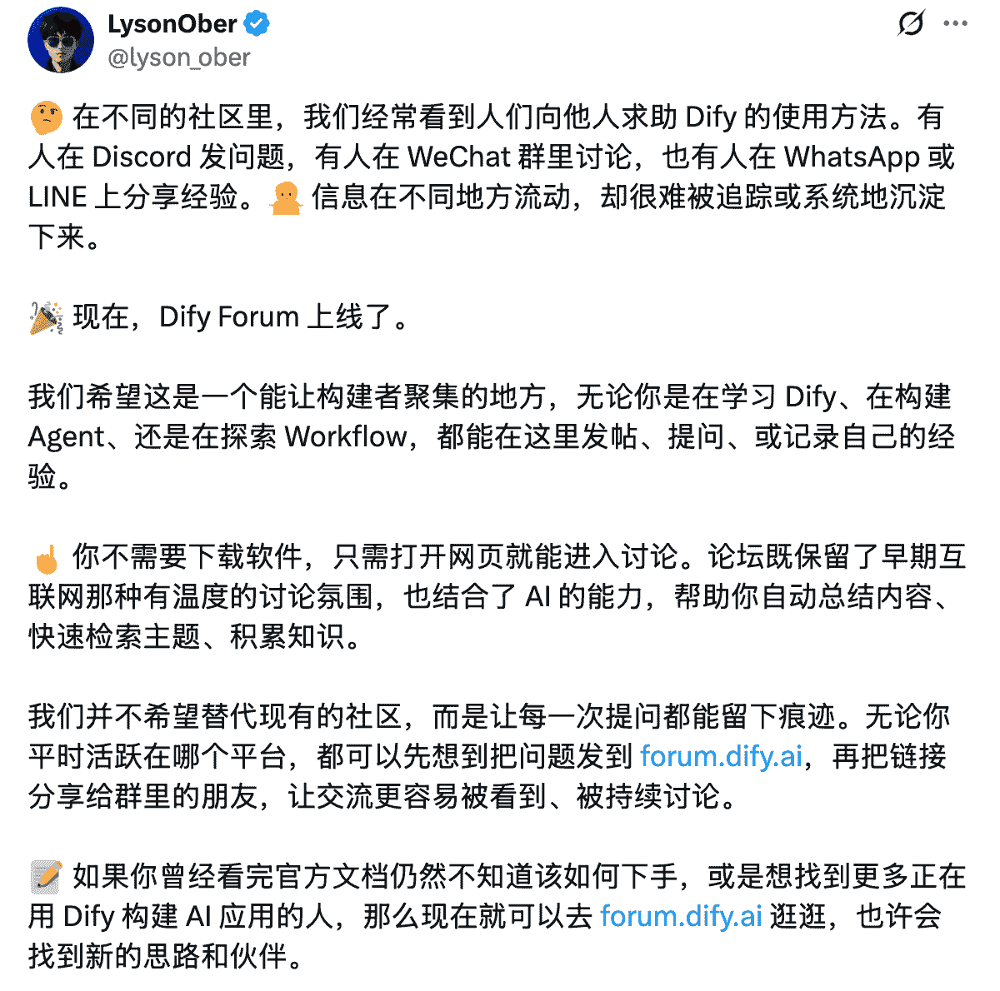

# Dify Agent

> 来源：[https://my.feishu.cn/docx/WgYvdee5GoCPlXxsPq3cLuJVnTe](https://my.feishu.cn/docx/WgYvdee5GoCPlXxsPq3cLuJVnTe)

#  Dify 简介

官网：https://cloud.dify.ai/apps

Dify 是一个专注于生成式 AI 应用开发的平台，旨在让用户能够轻松创建和部署 AI 应用。以下是 Dify 平台的一些特别之处：

## **核心能力**

1.  **模型支持**：

+   Dify 支持多种大型语言模型（LLMs），包括 OpenAI 的 GPT 系列、Azure OpenAI Service、Anthropic 的 Claude 系列、Replicate、Hugging Face Hub、ChatGLM、Llama2、MiniMax、讯飞星火大模型、文心一言和通义千问等。

1.  **可视化编排 Prompt**：

+   用户可以通过界面化编写和调试 prompt，只需几分钟即可发布一个 AI 应用。这种方式大大简化了开发过程。

1.  **文本 Embedding 处理**：

+   Dify 提供全自动的文本预处理功能，支持 PDF、txt 等文件格式，并能从 Notion、网页、API 同步数据，使用用户的数据作为上下文，无需理解复杂的技术处理。

1.  **基于 API 开发**：

+   Dify 提供后端即服务（Backend-as-a-Service, BaaS），用户可以直接访问网页应用或通过 API 集成到自己的应用中，无需关注复杂的后端架构和部署过程。

1.  **插件能力**：

+   Dify 支持多种插件，如网页浏览、Google 搜索、Wikipedia 查询等，可以在对话中实现联网搜索、分析网页内容和展示 AI 的推理过程。

1.  **团队 Workspace**：

+   团队成员可以加入 Workspace 共同编辑、管理和使用团队内的 AI 应用，方便团队协作。

1.  **数据标注与改进**：

+   Dify 提供可视化查阅 AI 应用日志并对数据进行改进标注的功能，帮助用户不断提高 AI 应用的性能（此功能即将推出）。

# **平台优势对比**

+   **低代码/****无代码开发**：

+   Dify 设计了友好的无代码平台，用户只需拖拽操作即可创建和部署 AI 应用，适合从 AI 开发高手到代码小白的各类用户。

+   **RAG ****引擎**：

+   Dify 集成了 Retrieval-Augmented Generation（RAG）引擎，能够处理复杂的 AI 工作流，进行信息检索、数据分析和内容生成的链条式操作。

+   **一体化开****发环境**：

+   Dify 提供完整的 Backend-as-a-Service（BaaS）功能，从设计到部署一条龙服务，简化了开发流程。

Dify 平台通过这些核心能力和优势，帮助用户快速从创意走到实现，简化了 AI 应用的开发和部署过程，使其成为一个高效且易用的生成式 AI 应用开发平台。

Dify 是一个专注于生成式 AI 应用开发的平台，与其他 AI 开发平台相比，它有一些独特的特点和优势。以下是 Dify 与其他几种常见 AI 开发平台的对比：

## **Dify vs. Coze**

| 特点 | Dify | Coze |
| --- | --- | --- |
| **功能** | 提供全面的平台功能，包括多用户支持、多种模型选择和工具，特别是问题分类器和迭代功能 | 提供丰富的插件工具，支持快速搭建基于大模型的 Bot，集成了知识库功能 |
| **插件能力** | 插件能力强，但插件商店活跃度相对较低 | 插件商店活跃度高，功能丰富 |
| **易用性** | 界面友好，适合专业用户，支持复杂任务的工作流编排 | 操作简单，适合一般用户，支持快速发布到社交平台和通讯软件 |
| **发布** | 需要一定的开发能力才能将工作流接入其他平台 | 支持傻瓜式操作，易于将 Bot 发布到各个渠道 |

Dify 更适合专业用户，提供了强大的功能和灵活性，而 Coze 则更适合一般用户，操作简便且插件丰富。

## Dify vs. FastGPT

| 特点 | Dify | FastGPT |
| --- | --- | --- |
| **专注领域** | 生成式 AI 应用开发，支持多种模型和复杂工作流 | 知识库问答系统，专注于知识库训练和数据处理 |
| **工作流编排** | 提供可视化的 Prompt 编排和复杂的工作流处理 | 提供丰富的工作流编排和 API 集成功能 |
| **用户群体** | 适合从 AI 开发高手到代码小白的各类用户 | 主要面向企业用户和开源社区用户 |
| **成熟度** | 社区力量强大，支持私有化部署和定制化开发 | 成熟度高，拥有数百家企业付费客户和数十万社区用户 |

Dify 提供了更广泛的功能和灵活性，适合多种应用场景，而 FastGPT 则专注于知识库问答，适合需要处理大量数据和知识库的企业用户。

## **Dify vs. 其他平台**

| 特点 | Dify | 其他平台（如腾讯元器、百度云千帆AppBuilder） |
| --- | --- | --- |
| **开源性** | 完全开源，支持私有化部署和定制化开发 | 多为闭源平台，由大厂主导，产品质量可控 |
| **社区力量** | 强调社区力量和二次开发的可能性 | 提供社区和基础设施，推动平台能力完善 |
| **开发门槛** | 低代码/无代码开发，适合各类用户 | 可能需要一定的开发能力，适合专业开发者 |

Dify 的开源性和社区力量使其在灵活性和定制化方面具有优势，而其他闭源平台则在产品质量和用户上手简单方面更具优势。

综上所述，Dify 在功能全面性、插件能力、易用性和发布灵活性方面都有其独特的优势，适合不同需求和技能水平的用户。与其他平台相比，Dify 提供了更高的灵活性和社区支持，特别适合需要定制化开发和私有化部署的用户。

# 一些 DSL 工作流文件

### Awesome-Dify-Workflow

一个不错的[dify工作流合集~](https://github.com/svcvit/Awesome-Dify-Workflow)分享一些好用的Dify工作流程

🧐这个项目汇集了一些基于Dify DSL的工作流程，主要供个人使用和学习，适用于Dify 0.8.0 及以上版本导入。所有工作流程基本可以免费使用，主要依赖Deepseek模型，支持多种应用场景，如翻译、SEO、内容生成和聊天机器人开发。

➡️链接：github.com

✨重点 ● 🛠️ 多功能工作流程：项目包含了翻译、工具生成、内容创作、聊天机器人和代码生成等多种工作流程，用户可以根据需求导入并调整。

● 🎯 Dify DSL支持：这些工作流程基于Dify的DSL构建，能够方便地嵌入到ChatBot等应用中，并进行条件判断、变量聚合等复杂操作。

● 💡 学习与自用：项目适合学习和个人使用，用户可以利用这些工作流程提升生产力或作为参考进行自定义开发。

# Dify Forum 论坛

https://forum.dify.ai

Dify 论坛是一个面向 AI 应用构建者的官方社区论坛，提供教程、案例分享、技术讨论和问题解答，帮助用户学习和使用 Dify 平台快速构建 AI 应用。

