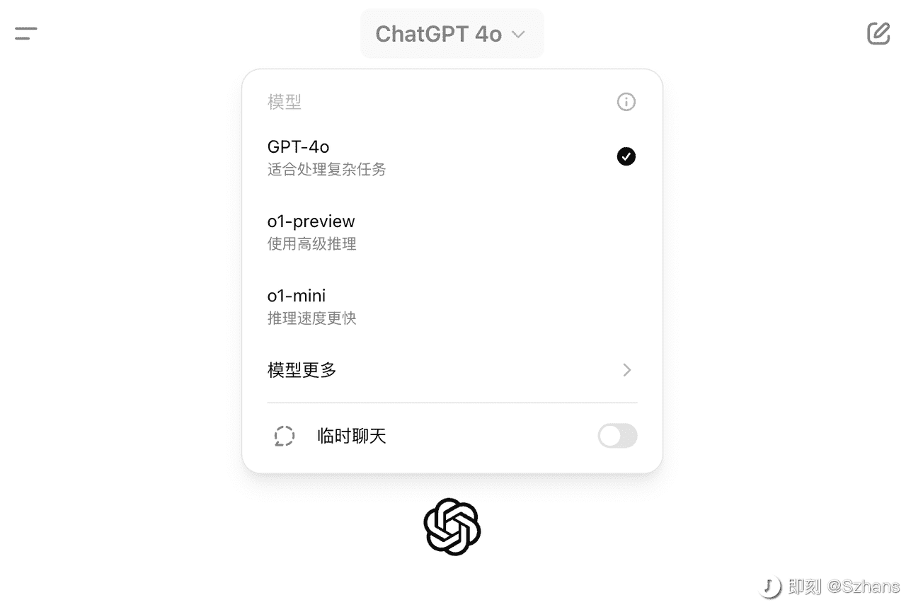
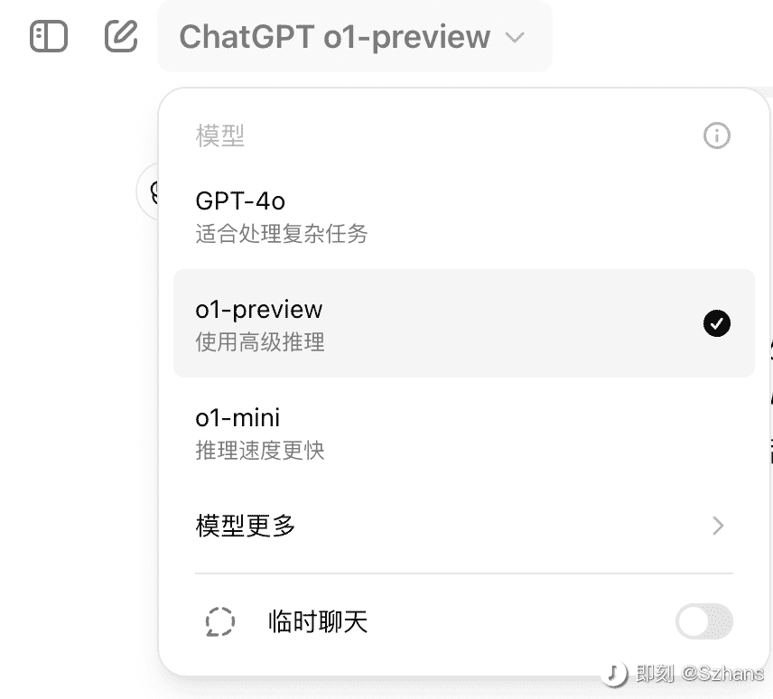
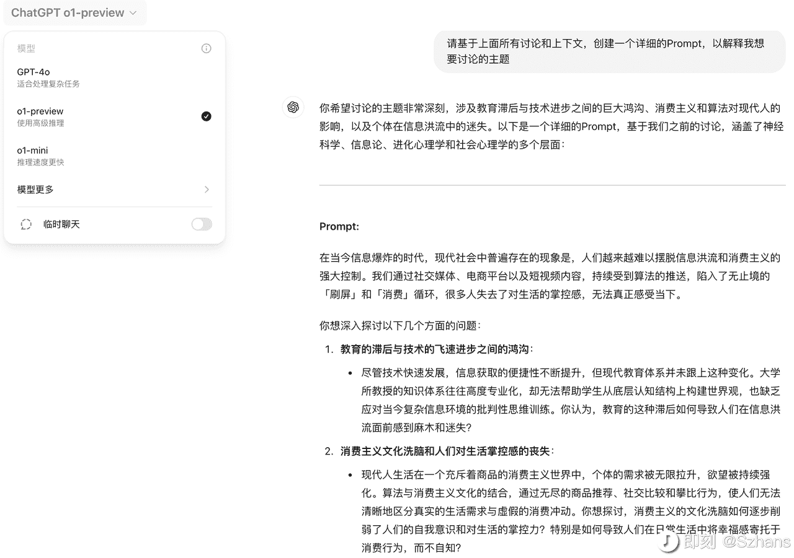

# 一个强大、实用的Open AI新模型 o1 用法

> 来源：[https://my.feishu.cn/docx/Ep4ydxD4poRrnOxUxDxcWFK1nvd](https://my.feishu.cn/docx/Ep4ydxD4poRrnOxUxDxcWFK1nvd)

# 【Prompt for me-o1 版】提问方法论

> 适用于 GPT-4o 与 o1-preview 的组合式使用

## 操作思路：

1.  首先，选择 GPT-4o 的模式，持续深度对话或复制文本、代码进来（不要上传）

1.  然后，请ChatGPT结合所有上下文，创建一个丰富详尽的Prompt ，注意表明你的意图——解释或实现什么

1.  在当前的对话窗口切换到 o1-preview （注意不要新建）

1.  粘帖GPT 为你创建的Prompt，等待o1 慢慢思考……（秒数是一个奇妙的指标）

1.  你将得到o1 思维链和高级推理的有趣输出

## 演示效果：

上面例子的思路与实操对话展示：

和GPT-4o 先深度讨论消费主义和算[法，最后让o1 进行一](https://chatgpt.com/share/66e7904f-0de8-8006-9fd5-908b1e950dc9)次性输出，供参考：chatgpt.com

内容参考来源：https://web.okjike.com/originalPost/66e79687dd7383e4721e1cf9