# 全球AI百强榜发布！ChatGPT稳坐第一，DeepSeek第三，前50有22个来自中国

> 来源：[https://my.feishu.cn/docx/IiojdvIpto9rM2xFzxkcEyQtnTw](https://my.feishu.cn/docx/IiojdvIpto9rM2xFzxkcEyQtnTw)

文章来源：新智元

##### 【新智元导读】a16z最新发布「全球Top100消费级GenAI应用榜单」，AI竞争格局逐渐稳定，中国力量全面崛起，DeepSeek、豆包、夸克等多款产品跻身前十。ChatGPT依旧领跑，谷歌Gemini紧随其后，Grok高速逆袭。整体来看，全球AI正进入多极化竞争的新阶段。

就在刚刚，**a16z**最新一期的「Top 100消费级GenAI应用榜单」出炉！

本期榜单传递出一个**最核心信息**：**AI产品竞争的生态格局正****日趋稳定！**

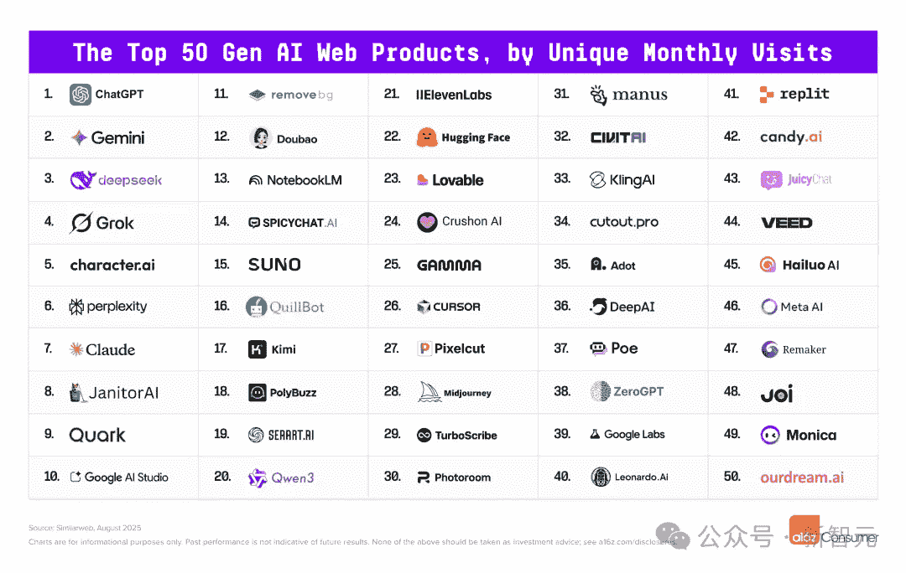

网页排行前50

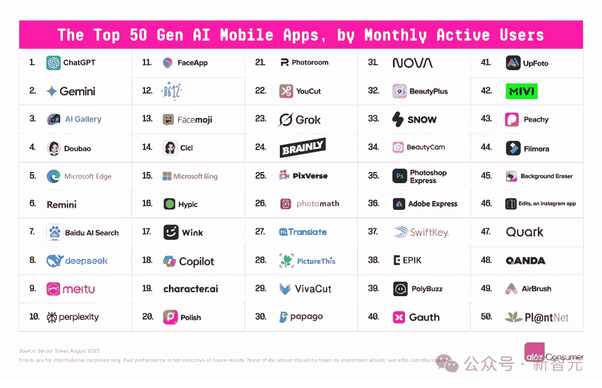

移动应用排行前50

不论是你常用的DeepSeek、豆包、夸克，还是一直领先的ChatGPT和Gemini，或者是新进榜单Lovable等，这场AI产品的「百团大战」依然在继续！

**中国开始影响世界**

**首先来看网页排行榜，本次榜单**中，5家中国公司跻身全球前20。

分别是**DeepSeek**全球排名第三、夸克**Quark**全球排名第九、豆包**Doubao**排名全球第十二、月之暗面**Kimi**排名全球第十七、通义千问**Qwen3**全球排名第二十。

此外，可灵**KlingAI**上榜全球排名第三十三，**海螺**AI排名45。

在移动应用榜单中，排名有较大变化。

**豆包**拿下全球第四、**百度AI搜索**全球第七、**DeepSeek**全球第八、**美图**全球第九，以及**夸克**上榜第四十七。

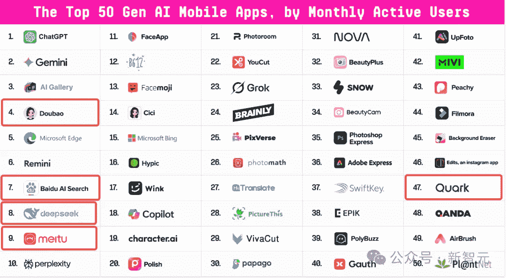

以上都是我们熟悉的产品，设有中文网站，a16z统计这些产品超过75%的流量来自国内。

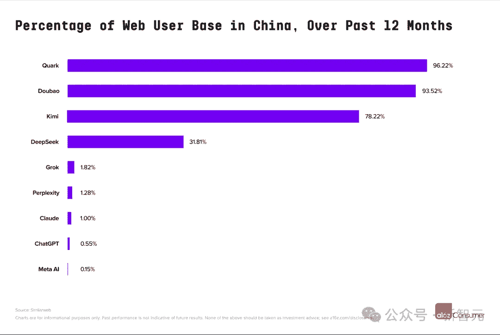

其中，值得一提的是，**国内的视频模型**比海外的产品更具优势——因为中国有更多研究人员专注于视频领域。

照片和视频类别的集中度尤其高，仅美图一家就贡献了五个席位：Photo&VideoEditor、BeautyPlus、BeautyCam、Wink和Airbrush。

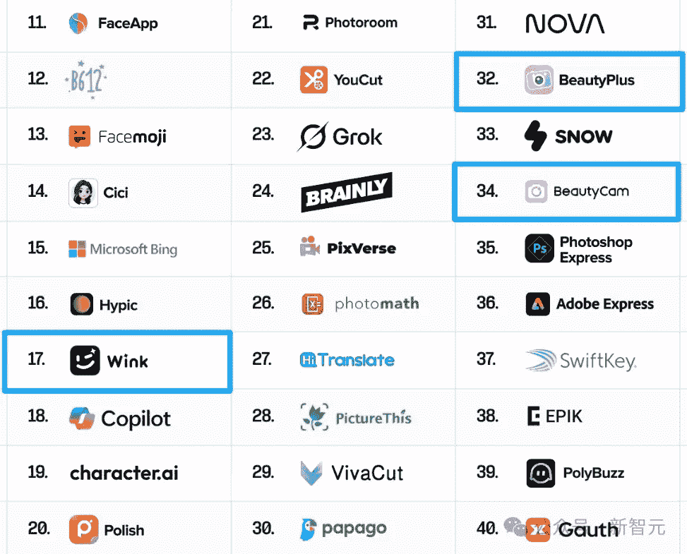

字节跳动也是一个重要参与者，旗下产品包括豆包和Cici（通用大语言模型助手）、Gauth（教育科技）和Hypic（照片/视频编辑）。

**谷歌携四款产品强势入榜**

这是首次对谷歌几款应用单独的流量进行排名并收录。

该公司的通用大语言模型助手Gemini位居第二，仅次于ChatGPT，其网站访问量约为ChatGPT的12%。

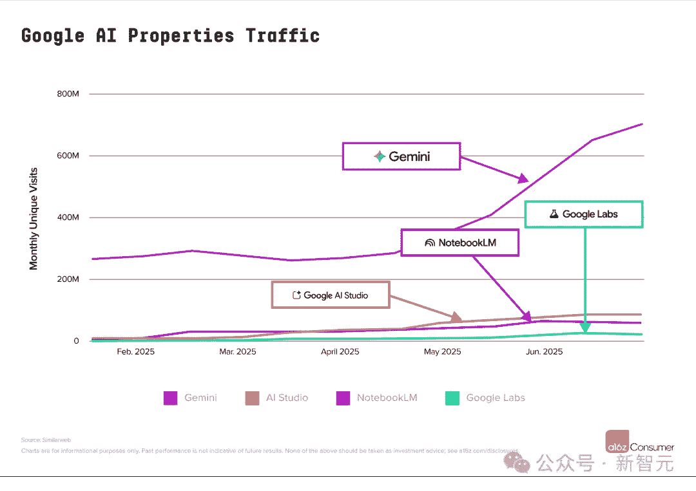

**谷歌还有哪些产品上榜？**

面向开发者的**AI Studio**首次亮相即跻身前十。

该网站提供了一个沙盒环境，开发者可在此基础上使用Gemini模型进行构建，包括多模态模型。

紧随其后的是排名第13的NotebookLM。

该产品在作为Google Labs的一部分推出后，现已作为独立网站运营。

NotebookLM在近一年前首次爆红，此后稳步增长，仅在夏季有轻微下滑（可能源于学术用户的暂时性流失）。

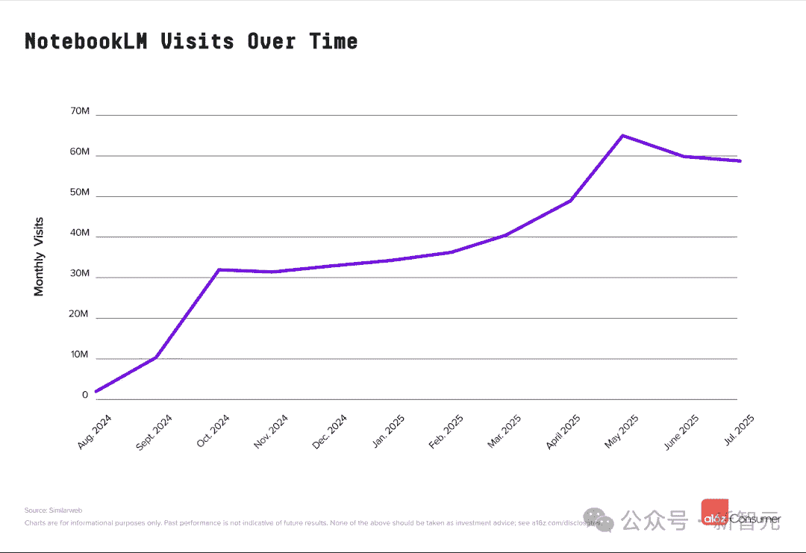

作为谷歌面向消费者的AI实验平台，Google Labs排名第39。

Labs平台承载了Flow（用户可在此试用视频模型Veo3）以及其他多款应用。

在2025年5月Veo3发布后，Google Labs的流量飙升超过13%，创下过去一年的最大单月增幅。

在移动端，Gemini同样排名第二，紧随ChatGPT，但差距要小得多，其月度活跃用户（MAU）已接近ChatGPT的一半。

Gemini在安卓设备上表现尤为强劲，其近90%的MAU来自安卓平台，相比之下，ChatGPT的安卓用户占比为60%。

ChatGPT稳坐第一Grok紧追

在通用大语言模型助手的激烈竞争中，ChatGPT仍保持领先，但谷歌、Grok和Meta正在缩小差距。

Grok在网站榜上排名第4，移动榜上排名第23。

**该公司在移**动端的跃升尤为惊人，从2024年底无应用的「冷启动」状态，发展到如今超过2000万的月活用户。

2025年7月，Grok的移动端用量迎来巨大增长，随着7月9日新模型Grok4（具备更强的推理能力、实时搜索和工具集成）的发布，用量攀升了近40%。

紧接着，7月14日又推出了AI伴侣头像功能。

发布初期，动漫头像Ani（包含NSFW选项）尤为火爆。

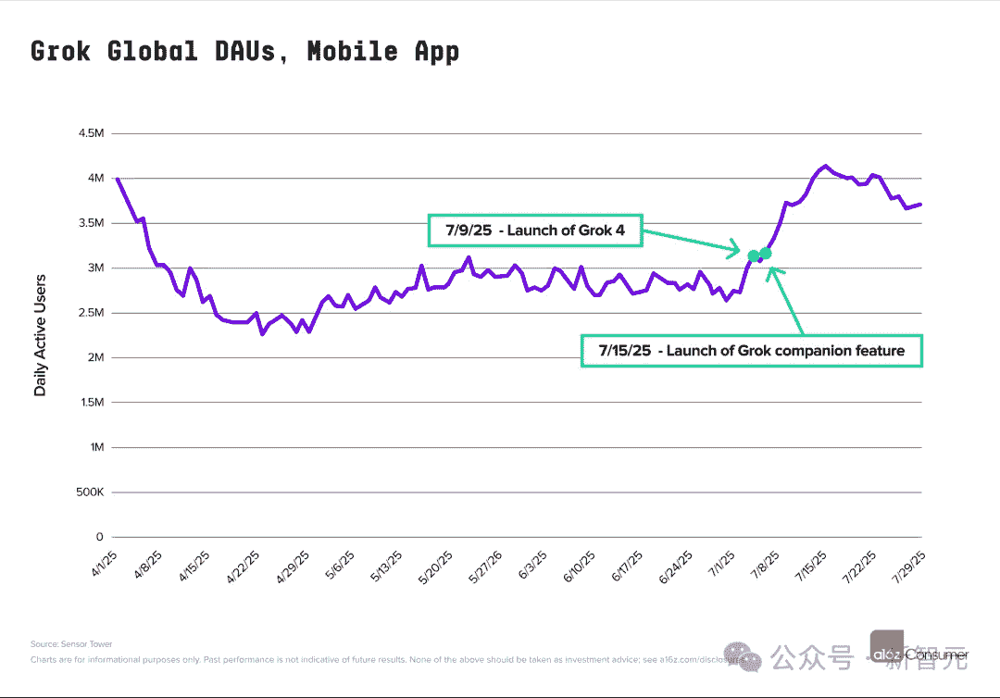

相比之下，Meta的努力至今增长较为平缓。其通用助手MetaAI在网站榜上排名第46，未能进入移动榜单。

MetaAI于2025年5月底推出，但增长速度远不及Grok，尤其是在2025年6月发生了一次「公开动态」事件（用户发现自己的部分帖子被公开发布）之后。

在通用大语言模型助手的其他战线，Claude在移动端均已明显增长放缓。

Perplexity则与Grok一道，持续展现强劲的增长势头。

在网站端，Perplexity和Claude持续增长。

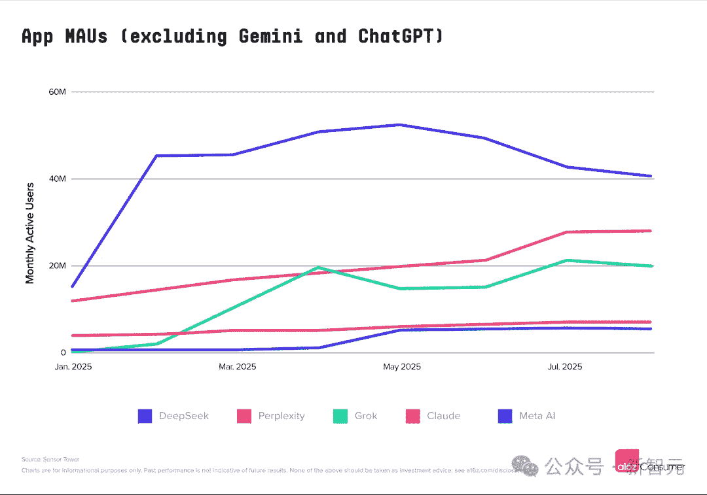

在网站榜单中，有11个新晋应用的上榜是由流量增长驱动的。

相比之下，在a16z 2025年3月的榜单中，新晋者达17个。

移动应用榜单的新面孔则明显更多（14个），这得益于各大应用商店对「山寨ChatGPT」应用的打击（也就是所谓套壳），为更多原创移动应用腾出了发展空间。

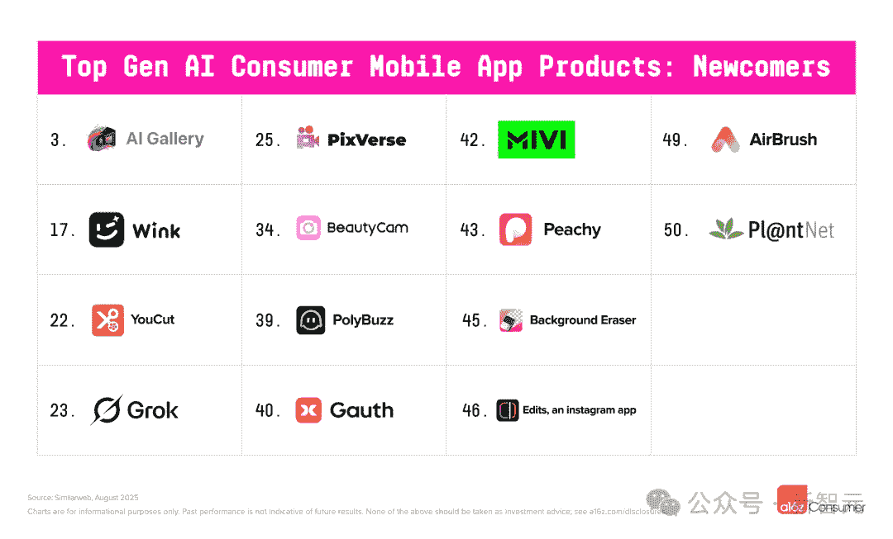

这是a16z第二次发布「准上榜名单」（BrinkList）：即刚刚与榜单失之交臂的10家公司（5家网站，5家移动应用）。

在上期网站榜的「准上榜名单」中，Lovable成功闯入百强，并一举跃升至第22位，令人瞩目！

这一飞跃也凸显了AI驱动的应用生成这一赛道的普遍崛起。

在上期移动应用榜的「准上榜名单」中，PolyBuzz和Pixverse这两家公司成功进入核心榜单。

**氛围编程强势崛起**

在a16z 2025年3月的榜单中，「氛围编程」(vibe coding)的概念才刚刚萌芽——当时网站榜上只有Bolt一家。

如今，Bolt已进入「准上榜名单」，而Lovable和Replit则双双首次登上主榜单。

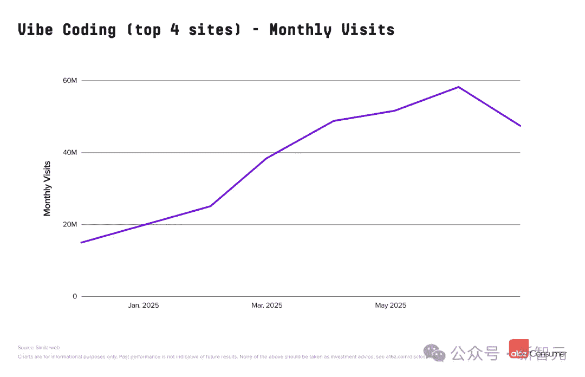

虽然「氛围编程」的使用看似短暂，但早期数据显示其用户粘性很强——或者说，至少有足够多的用户留存下来并逐渐扩大使用范围。

来自信用卡数据提供商ConsumerEdge的数据显示，某顶级「氛围编程」平台的美国用户群体，在注册数月后，其收入留存率超过了100%。

这意味着，即便算上流失的用户，这些用户群体的月度总支出仍在持续增长。

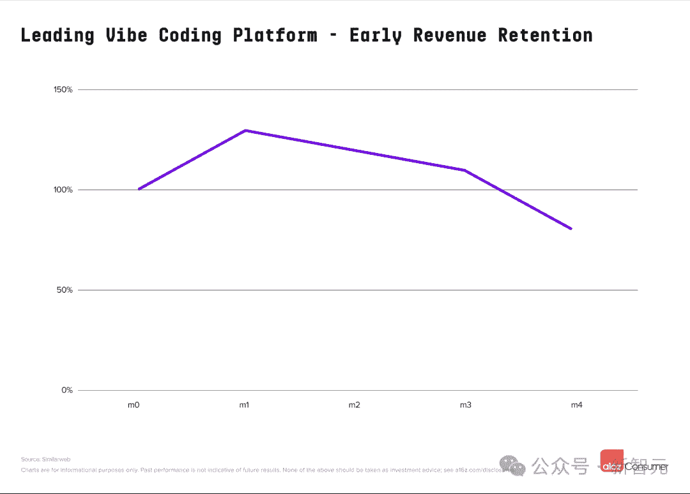

这些平台也在为其他AI产品引流。通过Replit和Lovable构建并发布的网站（未使用自定义域名），其流量分别归于replit.app和lovable.app之下。

这两个域名本身都有着可观的流量（lovable.app的流量足以排进榜单前50），但仍低于其面向开发者的主站。

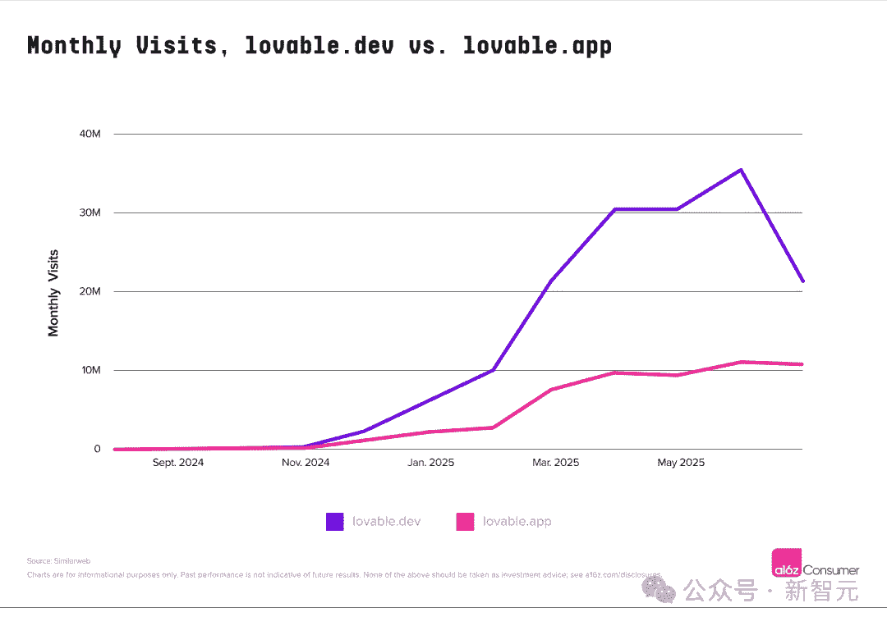

作为「氛围编程技术栈」的一部分，相关产品的流量也随之激增，因为开发者们需要用它们来部署项目。

这些产品不符合上榜资格（因其自身并非AI原生公司）——最典型的例子就是数据库提供商Supabase。

Supabase的流量增长与核心「氛围编程」平台的崛起几乎亦步亦趋，在过去九个月里的增速远超往年。

**14家「全明星」从未缺席**

在a16z发布的五期网站Top50榜单中，有14家公司从未缺席——a16z称之为「全明星」！！

这些公司构成了消费者AI行为的真实缩影：

+   通用助手（ChatGPT、Perplexity、Poe）

+   AI伴侣（CharacterAI）

+   图像生成（Midjourney、Leonardo）

+   图像与视频编辑（Veed、Cutout）

+   语音生成（ElevenLabs）

+   生产力工具（Photoroom、Gamma、Quillbot）

+   以及模型托管（Civitai、HuggingFace）

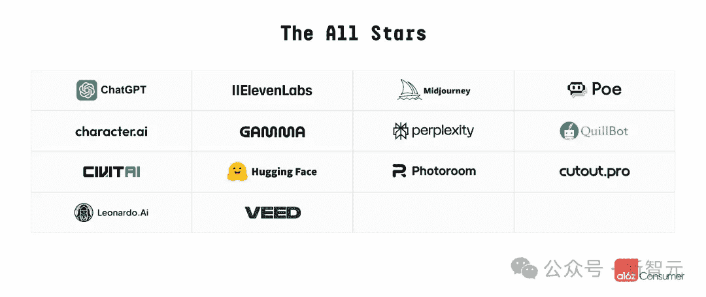

在a16z近两年前发布的第一份榜单中，a16z曾好奇：所有顶级的消费级AI公司最终都会训练自己的基础模型吗？

现在，a16z有了答案——在这14家「全明星」中：

+   五家拥有自研模型

+   七家使用来自其他公司的API或开源模型

+   还有两家是模型聚合平台。

有趣的是，尽管榜单的全球化程度日益提高，但这十四位「常青树」仅来自五个国家：美国、英国（ElevenLabs、Veed）、澳大利亚（Leonardo）、中国（CutoutPro）和法国（Photoroom、HuggingFace）。

此外，除了两家公司外，其余均已获得风险投资——Midjourney以其自力更生而闻名，而CutoutPro也尚未进行过融资。

若不计入首期榜单，还有另外五家公司也能入选「常青树」之列——这反映了它们近期的强劲势头。

这些公司同样代表了多样的AI消费级应用，包括：

+   Claude和DeepAI（通用助手）

+   JanitorAI（AI伴侣）

+   Pixelcut（图像编辑）

+   Suno（音乐生成）

**a16z统计方法说明**

榜单分别对排名前50的AI原生网站产品（依据Similarweb的月度独立访问量）和排名前50的AI原生移动应用（依据SensorTower的月度活跃用户）进行排名。

对于那些增加了重要生成式AI功能但并非AI原生的产品，如Canva和Notion，则不包含在内。

参考资料：

https://a16z.com/100-gen-ai-apps-5/

https://x.com/omooretweets/status/1960726780681376028